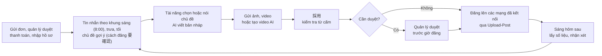
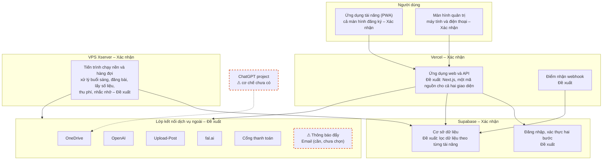
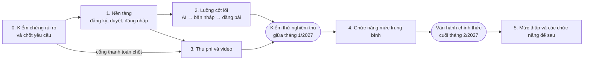

# Báo cáo phân tích dự án AI育成OS

## Đối chiếu nguồn mới — 20/11/2026

Phần dưới cập nhật hiệu lực theo nguồn mới; các mã [AG]/SD18 trong phân tích trước vẫn là trích dẫn lịch sử. Không suy nguồn FCP hoặc mục cần xác nhận thành khách đã duyệt.

- **6-2** — Bắt buộc đăng ký phương thức thanh toán và mở từ biểu tượng màn hình chính; thêm biểu tượng bằng hướng dẫn thủ công theo máy. SNS và cho phép thông báo có thể làm sau. Thanh toán đăng ký xong tự kích hoạt, tạo folder và báo Manager; sau khởi tạo mở Mypage T-08, không phải Home T-09. Office bỏ bước thanh toán. Còn mở: Cần kiểm thiết bị/PWA quay lại sau kết nối, không coi hình minh họa là kiểm chứng tương thích. Căn cứ: `T19:5,6,8,9,11,26,33;BF19:4`.
- **4-4** — Manager sửa bài bị từ cấm, AI kiểm lại; sạch thì đặt lịch, còn từ cấm thì giữ ở màn xử lý. Không cần trả bản Manager sửa cho Talent xác nhận lại theo GJ19§12. Còn mở: Quyền Talent tự sửa chính bài đã bị chặn chưa được mô tả rõ như quyền sửa bản nháp thường; chỉ giữ phần này ở No.57. Căn cứ: `M19:16,23;BF19:17;GJ19:12`.
- **5-1** — T-14 bản 19/11 chỉ mô tả video ngắn từ ảnh; tạo khi Talent yêu cầu và xem giá trước. Còn mở: CONFLICT: QA No.36/CR-04 trước có cả video ngắn và slideshow; nguồn 19/11 chỉ nêu short. Không tự xóa slideshow hoặc suy đã duyệt đổi phạm vi. Căn cứ: `T19:20;BF19:12`.
- **7-4** — Bỏ nút đánh dấu xử lý; mở dòng thông báo sang màn liên quan thì đánh dấu đã xử lý và bỏ khỏi số chưa xử lý. Lọc mặc định chưa mở, bỏ lọc xem cả đã mở. Yêu cầu duyệt nằm danh sách M-04 riêng. Thông báo và email gửi Manager phụ trách, không mọi người. Còn mở: Phân công category/cá nhân và fallback vẫn No.6; email loại nào và câu chữ còn cần rà mẫu. Không tự chốt đã xử lý chung hay riêng từng Manager. Căn cứ: `M19:6,8;BF19:14;GJ19:6,7`.
- **1-1** — Phí tháng cộng phí video; giá AI video từ lượt đầu; tạo lại tính thêm, lỗi dịch vụ không tính. Không lưu thẻ; đổi thanh toán/lịch sử qua nhà cung cấp. Còn mở: Chưa chốt trả trước/sau, ngày bắt đầu tính phí, cổng chính thức; Square ở H105 là nhận định cần provider kiểm, không tự chọn GMO hay Square/thu ngay/ngày 1/thử lại 3 ngày. Căn cứ: `T19:9,20,21,25,26;M19:15;BF19:15;KS:20261120:23,24,25,26`.

Chi tiết từng finding/Q&A và hiệu lực gate: [báo cáo đối chiếu hiện hành](../docs/requirement-review/corrections-2026-11-19/NEW_DELIVERY_IMPACT.md). Không dùng các giả định mâu thuẫn bên dưới làm kết luận hiện hành.

> **Quyết định20/11 — DEC-0001:** người dùng chốt áp dụng H65, không giới hạn số lần nhờ AI viết lại. Thay giới hạn hai lần trong đúng chủ đề; các điều kiện sửa/duyệt và chính sách chi phí khác giữ nguyên. Xem [bản ghi quyết định](../docs/requirement-review/corrections-2026-11-19/REPORT.md).

2026-11-13 · hoahn-hocnao

AI育成OS có phạm vi rõ (54 chức năng), nhưng chưa đủ điều kiện để thiết kế chi tiết. Bản yêu cầu v2 đổi hẳn cách bắt đầu dùng (tài năng tự đăng ký, quản lý duyệt) và bỏ loại tài năng miễn phí. Sáu việc cần chốt trước đợt kiểm thử nghiệm thu (giữa tháng 1/2027) là:

1. Cổng thanh toán có thu được số tiền thay đổi hằng tháng không (確認49).
2. Cơ chế ChatGPT project → OneDrive cho từng tài năng.
3. Các khả năng thực tế của Upload-Post, và đăng ký tài năng với Upload-Post vào lúc nào.
4. Tiêu chí nghiệm thu.
5. Đồng ý về dữ liệu cá nhân và đồng ý của phụ huynh khi người ngoài công ty tự đăng ký.
6. Ảnh hưởng tới báo giá và lịch của các chức năng khách vừa quyết làm ngày 17/11: nhóm tài năng, màn chỉ dẫn cho AI, duyệt theo nhóm, tài năng sửa chữ, hai cách đăng 自動投稿 / 要確認 ([KS], tệp 21).

**Các quyết định đã chốt** (chi tiết: tệp 19 cho Q&A 15/11, tệp 21 cho bảng xác nhận 17/11):

- Q&A 15/11: tự đăng ký và quản lý duyệt (No.11, CR-01, làm ở đợt đầu, không thu thêm); 3 chủ đề mỗi lần đề xuất (No.9); lưu ảnh, video ở OneDrive (No.8, CR-10); trả lại kèm lý do (No.35); hai loại video, video trình chiếu ghép ở máy chủ (No.36, CR-04); AI tìm tin tức 1 lần mỗi ngày (No.38, CR-05); quản lý gửi tư liệu và tạo video thay (CR-09, nay chỉ cho tài khoản công ty theo [KS] 確認27); một loại quản lý (No.5); không trần phí AI (No.17); không tự đăng lại (No.15).
- Bảng xác nhận 17/11: CR-17 (nhóm tài năng: M-10 thiết kế khách = M-13 [AG]), CR-18 (màn chỉ thị cho AI: M-11 thiết kế khách = M-14, M-15 [AG]), CR-19 (duyệt theo nhóm hoặc quản lý phụ trách) và CR-21 (tài năng sửa chữ trực tiếp) **làm**; CR-20 (nhiều tài khoản trên một mạng) **không làm**; CR-22 (thử thách) đã chốt hướng, chờ khái niệm アデッソ viết; CR-23 (video tự làm thành bản nháp mỗi ngày) vẫn chờ khách (Q&A No.50); CR-24 (hội thoại riêng tư) **không làm** vì quản lý xem toàn bộ hội thoại (Q&A No.7 đóng 17/11); CR-25 **không cần** vì 画面定義書 do FutureCore làm (Q&A No.68 đóng 17/11). Ảnh hưởng tới báo giá và lịch của các CR nay làm: chưa rõ ([KS], tệp 21). Việc mới: hai cách đăng 自動投稿 / 要確認, nhịp đề xuất chỉnh qua chỉ thị cho AI, khung giờ sáng/trưa/tối, màn nhập thông tin tài năng (chờ Q&A No.74), xóa dữ liệu tài năng rời đi sau 6 tháng, chu kỳ thu phí từ ngày đăng ký.
- Quyết định nội bộ: xác thực hai bước của quản lý chỉ làm ứng dụng xác thực (TOTP); SMS chờ bàn với khách (S01-11); không làm OTP qua email; khóa 5 lần sai làm ở BE.
- Rủi ro kỹ thuật: xem tệp 20 (RT01–RT12), thay phần rủi ro kỹ thuật của báo cáo này.

Báo cáo này tổng hợp các tab phân tích, đã viết lại theo bản yêu cầu v2. Mỗi mục ghi tab chi tiết để tra cứu. Danh sách đầy đủ các thay đổi so với v1 nằm ở tab "Cập nhật theo v2".

**Cách đọc nhãn:**

- **[Xác nhận]:** có trong tài liệu gốc. Nguồn ghi theo mục của [YK2] (概要要件定義書 – bản định nghĩa yêu cầu khái quát, bản v2), hoặc theo trang của [SM], [SD], [TK-T], [TK-M], [AG] (xem mục "Tài liệu nguồn" ở cuối tab). 前提 là phần tiền đề ở cuối mỗi UC.
- **[Xác nhận ⚠]:** có trong tài liệu, kèm 確認 (mục cần xác nhận) là đề xuất của FutureCore. Khách đã trả lời trong bảng xác nhận 17/11; chỗ đã chốt ghi `[KS] 確認N`, chỗ khách đồng ý giả định giữ ⚠ (tệp 21). Số 確認 theo đánh số của v2 (1–56).
- **[Đề xuất]:** đề xuất kỹ thuật của mình để các chức năng đã xác nhận chạy được. Không phải yêu cầu mới.
- **[Giả định]:** mình suy ra khi tài liệu im lặng. Cần khách xác nhận trước khi dùng.

## 1. Tổng quan dự án và mục tiêu kinh doanh

AI育成OS giúp tài năng của アデッソ đăng bài đều đặn lên Instagram, TikTok và YouTube, nhờ một huấn luyện viên AI (AIコーチ) riêng cho từng người. Huấn luyện viên nhắn tin mỗi ngày, gợi ý chủ đề và viết bản nháp. [Xác nhận] [YK2] 2-1.

| Hạng mục | Nội dung | Nhãn và nguồn |
| --- | --- | --- |
| Vấn đề | Khoảng 5 quản lý phụ trách khoảng 80 tài năng. Nhiều tài năng không tự đăng bài, không tự làm video | [Xác nhận] 2-2 |
| Mục tiêu 1 | 10.000 người theo dõi trên mỗi mạng (chỉnh được theo từng tài năng, có hạn đạt), để có thêm việc. Thêm チャレンジ (thử thách nhỏ có thời hạn) | [Xác nhận ⚠] 2-1, UC-02 前提, 確認3, 5 |
| Mục tiêu 2 | Cả người vốn không hay đăng cũng duy trì đăng mỗi ngày | [Xác nhận] 2-1. Chưa có chỉ số đo |
| Mục tiêu 3 | Quản lý chỉ duyệt đơn, thiết lập ban đầu và xử lý thông báo, việc hằng ngày do AI làm | [Xác nhận] 2-1, 2-3, 2-4 |
| Doanh thu | Mọi tài năng đều trả phí thuê bao tháng cộng phí theo số lần tạo video. Không còn loại miễn phí. Tài khoản công ty không thu phí | [Xác nhận] 5-4, 6-3 |
| Quy mô | Bắt đầu tối thiểu khoảng 30 người, mỗi tháng thêm 10, sớm lên khoảng 100. Mục tiêu 200–300, tương lai 1.000. Khoảng 5 quản lý. Người ngoài công ty cũng đăng ký được | [Xác nhận] 2-2, 9-2, 12-6. Người ngoài công ty: [Xác nhận ⚠] 確認1 |
| Lịch | Kiểm thử nghiệm thu từ khoảng giữa tháng 1/2027. Nghiệm thu khoảng tuần 2–3 tháng 2/2027. Vận hành chính thức cuối tháng 2/2027. Họp thứ Ba và thứ Sáu từ tuần 17/11/2026 đến hết năm | [Xác nhận] 14-1, 14-2 |
| Phân vai | アデッソ duyệt đơn đăng ký, ký hợp đồng các dịch vụ ngoài, soạn điều khoản sử dụng, chuẩn bị kinh nghiệm đăng bài. Tài năng thuộc công ty đã ủy thác việc xử lý dữ liệu cá nhân và quyền hình ảnh khi ký hợp đồng. FutureCore thiết kế, phát triển, kiểm thử, phát hành | [Xác nhận] 2-3, 8, 14-4, 確認1 |

Chi tiết: tab "Tab 1" (bối cảnh kinh doanh), tab "Phạm vi", tab "Cập nhật theo v2".

## 2. Module và chức năng chính

Có 54 chức năng chia vào 12 module: 42 mức 高 (cao), 11 mức 中 (trung bình), 1 mức 低 (thấp). Khi vận hành chính thức chỉ cam kết các chức năng mức cao và trung bình. [Xác nhận] [YK2] 6, 12-3. Mã và số chức năng không đổi so với v1, nhưng nội dung 12 chức năng đã đổi.

Bảng dưới liệt kê đủ 54 chức năng theo thứ tự trong [YK2] mục 6-1 đến 6-12. Mã chức năng giữ nguyên theo số hạng mục lớn của SOW (bản mô tả phạm vi công việc), nên không liên tục trong một module. Mức ưu tiên: 高 (cao), 中 (trung bình), 低 (thấp). Chi tiết đầu vào, điều kiện và kết quả của từng chức năng nằm ở tab Yêu cầu chức năng.

| Module | Tất cả chức năng (mã – tên – mức ưu tiên) | Số chức năng |
| --- | --- | --- |
| 1. Đăng ký và đăng nhập ([YK2] 6-1) | **1-4** Đăng ký, duyệt đơn và đăng nhập (高): tự đăng ký trên ứng dụng, quản lý duyệt hoặc từ chối, email mật khẩu tạm, tự đặt mật khẩu, khóa 15 phút khi sai 5 lần, tự đặt lại khi quên **1-5** Nhận diện tài năng (高) **6-2** Hướng dẫn lần đầu và kết nối mạng xã hội (高) | 3 |
| 2. Phân quyền ([YK2] 6-2) | **1-6** Đăng nhập và quyền của quản lý (高): đăng nhập hai bước, một loại quyền, thêm và vô hiệu hóa quản lý **7-3** Đổi trạng thái tài năng (高): trước khi dùng, đang dùng, đã kết thúc **7-6** Nhật ký xem thông tin (中) | 3 |
| 3. Thu phí ([YK2] 6-3) | **1-1** Thu phí thuê bao tháng (高): qua cước nhà mạng hoặc thẻ **1-2** Loại tài khoản (高): tài năng trả phí hoặc tài khoản công ty không tính phí **1-3** Đổi loại (中): không còn việc để làm vì v2 bỏ loại miễn phí **5-4** Đếm số lần tạo video và thu gộp với phí tháng (高) | 4 |
| 4. Thông tin tài năng ([YK2] 6-4) | **2-2** Tạo thư mục riêng cho tài năng (高): tạo trên OneDrive khi đăng ký thanh toán xong **2-3** Nhập thông tin từ ChatGPT (高): quản lý nhập hồ sơ qua ChatGPT project của từng tài năng **2-4** Đăng ký mục tiêu (高): số người theo dõi, hạn đạt **2-1** Đọc thông tin tài năng (高): huấn luyện viên AI đọc mỗi sáng **7-1** Xem thông tin tài năng (高): trên màn hình quản trị | 5 |
| 5. Huấn luyện viên AI – lõi ([YK2] 6-5) | **3-1** Hiểu tài năng và thuật toán (高) **3-4** Trò chuyện với huấn luyện viên AI (高): tối đa 1.000 ký tự mỗi tin **3-3** Giới hạn chủ đề trò chuyện (高): chuyện sức khỏe, rời công ty thì báo quản lý **3-9** Nhắc tài năng lâu không đăng bài (中): mặc định 3 ngày nhắn tài năng, 7 ngày báo quản lý **3-2** Tự cải thiện (高) **3-6** Nhận xét bài hôm trước và gợi ý cải thiện (高) **3-8** Tổng kết tuần (中) **3-7** Thông báo khi đạt mục tiêu (中) **3-5** Quản lý chi phí AI (中) | 9 |
| 6. Bản nháp ([YK2] 6-6) | **4-1** Tự tạo bản nháp (高): 3 chủ đề mỗi lần đề xuất, chú thích, hashtag, hướng dẫn chụp, kịch bản video **4-2** Yêu cầu sửa và viết lại (高): nhờ AI không giới hạn số lần, tài năng tự sửa chữ được ([KS] 確認28, 29) **4-3** 採用 – chấp nhận bản nháp (高): bắt buộc có ảnh hoặc video, chọn có gửi duyệt không; chỉ áp cho 要確認, còn 自動投稿 tự đăng trong khoảng tài năng đặt ([KS] 確認25) **4-4** Phát hiện từ cấm (高) **6-6** Xem trước bài đăng (中) | 5 |
| 7. Tư liệu ([YK2] 6-7) | **6-3** Gửi ảnh và video (高): tài năng gửi, quản lý cũng gửi thay được **6-4** Lưu tư liệu (高): lưu vào thư mục OneDrive, video tự làm dùng mỗi ngày 1 cái **6-5** Nhắc gửi tư liệu (中): trước giờ đăng 2 tiếng, 1 lần mỗi ngày | 3 |
| 8. Video ([YK2] 6-8) | **5-1** Tạo video (高): từ ảnh, qua Kling **5-2** Định dạng video (高): video ngắn dọc **5-3** Xem và xử lý video đã tạo (高): dùng, tạo lại hoặc bỏ **5-5** Ghi rõ video do AI tạo (高) | 4 |
| 9. Duyệt bài ([YK2] 6-9) | **7-7** Duyệt bài đăng (高): bật theo từng tài năng; tài năng tự chọn gửi duyệt; yêu cầu gửi quản lý của nhóm hoặc quản lý phụ trách ([KS] 確認34); duyệt hoặc trả lại có lý do; quá giờ chưa duyệt thì không đăng (確認35, 36) | 1 |
| 10. Đăng bài hẹn giờ ([YK2] 6-10) | **8-2** Kết nối dịch vụ đăng bài (高): đăng ký tài năng với Upload-Post **8-3** Đăng lên 3 mạng xã hội (高): cùng ảnh hoặc video và chú thích **8-4** Chống bị khóa tài khoản (高) **8-5** Thông báo khi đăng lỗi (高) **8-6** Thông báo khi mất kết nối (中) **7-5** Dừng đăng tự động, toàn bộ hoặc từng tài năng (高): dừng thì hủy cả bài đã hẹn **7-2** Xem và hủy bài đăng (高): trên màn hình quản trị **9-1** Đăng bài bằng tài khoản công ty (中) | 8 |
| 11. Số liệu ([YK2] 6-11) | **8-7** Lấy số liệu (高): từ Upload-Post **8-8** Ghi số liệu vào file (高): vào thư mục OneDrive của tài năng **3-10** Hiển thị số người theo dõi (高) **6-7** Số liệu và mức đạt cho tài năng (高) **8-1** Phân tích giờ đăng (中): chọn giờ đăng cho từng tài năng **8-9** Lấy khung giờ tương tác (低) | 6 |
| 12. Thông báo và nền tảng ([YK2] 6-12) | **6-1** Tin nhắn trong ứng dụng và thông báo đẩy (高) **7-4** Danh sách thông báo cho quản lý (高) **6-8** Nền tảng PWA – ứng dụng web cài lên màn hình chính (高) | 3 |

**Ngoài phạm vi [Xác nhận]:**

- LINE (đã bỏ ngày 20/10, 別紙B – phụ lục B, số 17).
- Ứng dụng trên kho ứng dụng, lượt video miễn phí, mức trần phí video, loại tài năng miễn phí (5-4, 6-14).
- Bảo trì sau phát hành (hợp đồng riêng, mục 11).
- Các chức năng để sau ở mục 13: X, TikTok Live, suất cho công ty trong tập đoàn, người hâm mộ dùng…

**Chưa rõ có trong phạm vi không:** màn hình chỉ dẫn cho AI (phạm vi toàn bộ / nhóm / tài năng, chạy thử, lịch sử phiên bản) và nhóm tài năng. Cả hai có trong thiết kế của khách, được nêu trong 確認6, 7, 8, 47 nhưng chưa có mã chức năng.

Chi tiết: tab "Phạm vi", tab "Yêu cầu chức năng".

## 3. Vai trò người dùng và phân quyền

| Vai trò | Quyền chính | Nhãn và nguồn |
| --- | --- | --- |
| Người đăng ký (chưa duyệt) | Chỉ gửi đơn đăng ký trên ứng dụng. Chưa đăng nhập được | [Xác nhận] UC-01, 6-1 (1-4) |
| Tài năng | Chỉ thao tác trên dữ liệu của mình: trò chuyện, 採用, gửi tư liệu, tạo video, kết nối mạng xã hội. Không vào được màn hình quản trị. Phải đăng ký thanh toán mới dùng được AI. Không đổi được hồ sơ, mục tiêu, giờ đăng | [Xác nhận] 3-2, UC-02 前提, UC-03 前提. Giờ đăng: [Xác nhận ⚠] 確認30 |
| Quản lý | Một mức quyền duy nhất. Xem mọi tài năng và toàn bộ hội thoại. Duyệt hoặc từ chối đơn, tạo tài khoản công ty, duyệt bài, hủy bài đã hẹn, đổi cài đặt, dừng đăng tự động toàn bộ hoặc từng tài năng, quản lý các quản lý khác | [Xác nhận ⚠] 3-2, 6-2 (1-6), 確認41, 42 |
| Tài khoản công ty | Quản lý tạo và dùng chức năng như tài năng. Không thu phí, không duyệt bài | [Xác nhận] 3-1, UC-12 前提. Không duyệt: [Xác nhận ⚠] 確認52 |
| Huấn luyện viên AI | Chỉ đọc dữ liệu của tài năng đó. Ghi thêm vào file bộ nhớ. Chuyển lời góp ý của quản lý | [Xác nhận] 5-5, 6-1 (1-5), 6-5 (3-2). Chuyển lời: [Xác nhận ⚠] 確認43 |
| Xử lý tự động | Gửi email kết quả đăng ký, đăng bài, lấy số liệu, thu phí, hủy bài đã hẹn khi dừng hoặc khi tài năng kết thúc | [Giả định] Tài liệu không đặt thành vai trò, mình tách ra để phân quyền |

**Điểm cần làm rõ:**

- Không có vai trò quản trị cao hơn, nên chưa rõ ai tạo quản lý đầu tiên và có chặn vô hiệu hóa quản lý cuối cùng không.
- Tài năng có được xem hồ sơ của chính mình không (mục 7-2 chỉ cho quản lý và AI xem).
- Tài khoản công ty thao tác từ ứng dụng hay từ màn hình quản trị (UC-12 前提 và 6-10 chức năng 9-1 nói khác nhau). Phương án màn hình [AG] M-12 đã chọn theo UC-12 (đăng nhập ứng dụng tài năng), nhưng [YK2] 9-1 chưa sửa.
- Thiết kế [TK-M] có "quyền dừng đăng tự động" riêng. V2 nói rõ theo [YK2] và sẽ sửa trong 画面定義書 (bản định nghĩa màn hình) (6-14). [AG] M-16, M-18 đã sửa.

Chi tiết: tab "Vai trò và phân quyền" (viết theo v1).

## 4. Các workflow nghiệp vụ quan trọng

Workflow cốt lõi là vòng đăng bài hằng ngày, các workflow khác nối vào đó. Trước vòng này, v2 thêm luồng đăng ký: tài năng gửi đơn, quản lý duyệt, tài năng thanh toán, quản lý nhập hồ sơ. [Xác nhận] [YK2] 2-5, UC-01, UC-04, UC-05, UC-08.

| Workflow | Điểm chính | Chưa rõ | Nguồn [YK2] |
| --- | --- | --- | --- |
| Đăng ký và bắt đầu sử dụng | Tài năng tự đăng ký, quản lý duyệt, email mật khẩu tạm. Thanh toán xong mới có thư mục. Quản lý nhập hồ sơ rồi AI mới đưa bản nháp | Lúc đăng ký với Upload-Post. Quản lý biết lúc nào cần nhập hồ sơ. Đồng ý của người ngoài công ty | UC-01–03 |
| Đăng bài hằng ngày | Bản nháp không giới hạn. Chỉ đăng khi đã 採用, có tư liệu, và đăng tự động đang bật. Đăng lỗi thì không tự đăng lại | Hẹn giờ lại khi tài năng không đổi được giờ. Biện pháp chống khóa tài khoản | UC-04, 05, 08, 6-10 |
| Duyệt bài và từ cấm | Duyệt chỉ áp dụng cho bài công việc. Yêu cầu gửi quản lý của nhóm hoặc quản lý phụ trách ([KS] 確認34), ai bấm trước thì quyết, trả lại thì gửi lại được, quá giờ thì hủy lịch [Xác nhận ⚠] | Ai đặt lịch sau khi quản lý sửa bài dính từ cấm | UC-07, 5-3, 7-7, 確認34–36 |
| Trạng thái bài đăng | Tài liệu nói có 6 trạng thái nhưng không liệt kê. Ghép từ các chức năng ra 8 trạng thái [Giả định] | Danh sách chính thức | 5-1 |
| Thu phí hằng tháng | Mọi tài năng trả phí tháng cộng phí video. Thu lỗi thì không tự dừng, quản lý quyết. Rời đi giữa tháng vẫn thu trọn tháng [Xác nhận ⚠] | Ngày chốt sổ. Thu lại khi lỗi. Phí tháng đầu tính từ lúc nào | UC-11, 5-4, 確認48–50 |
| Nhắc nhở và báo quản lý | 3 ngày không đăng thì AI hỏi han, 7 ngày thì báo quản lý (số ngày xác nhận lại, [KS] 確認19). Quản lý góp ý qua chỉ dẫn cho AI [Xác nhận ⚠] | Tiêu chí nhận biết chuyện nghiêm trọng, xử lý khẩn cấp | UC-04, UC-10, 3-3, 3-9, 確認43 |

Chi tiết: tab "Workflow" (11 workflow, 15 luồng chưa rõ), tab "Quy tắc nghiệp vụ" (71 quy tắc).

## 5. Mô hình dữ liệu và tích hợp

**Dữ liệu.** Dữ liệu nằm ở 3 nơi [Xác nhận, 7-2]:

- OneDrive: hồ sơ, mục tiêu, kinh nghiệm đăng bài, số liệu, ảnh, video. Thư mục của tài năng chỉ được tạo sau khi thanh toán.
- Cơ sở dữ liệu của hệ thống: hội thoại.
- Cổng thanh toán: thông tin thẻ và lịch sử hóa đơn.

Mình đề xuất 27 entity [Đề xuất], trong đó 3 entity chỉ cần nếu khách chấp nhận đề xuất mới (thử thách, chỉ dẫn cho AI, nhóm tài năng). Trung tâm là DON_DANG_KY (đơn đăng ký), TAI_NANG (tài năng, có loại tài khoản tài năng / công ty), BAI_DANG (bài đăng), KET_QUA_DANG (kết quả đăng trên từng mạng), TU_LIEU (tư liệu), LAN_TAO_VIDEO (lần tạo video) và HOA_DON_THANG (hóa đơn tháng). Đề xuất quan trọng nhất [Giả định]: cơ sở dữ liệu giữ bản gốc của mục tiêu và số liệu, OneDrive chỉ giữ bản chép để AI đọc. Lý do là mục tiêu phải hiển thị ngay trên ứng dụng (2-4).

**Tích hợp.** 6 dịch vụ đã nêu tên, đều là 弊社の想定 (dự kiến của FutureCore). アデッソ ký hợp đồng [Xác nhận, 8]:

| Dịch vụ | Vai trò | Mức rõ ràng |
| --- | --- | --- |
| Upload-Post | Đăng bài, hủy lịch, số liệu, cho tài năng tự kết nối tài khoản | Phí theo tháng, tính theo số tài năng đã đăng ký (UC-08 前提). Các khả năng và thời điểm đăng ký tài năng chưa rõ |
| OpenAI API | Huấn luyện viên AI, bản nháp, kiểm tra từ cấm | Rõ về mục đích. Viết lại không giới hạn số lần ([KS] 確認29); trò chuyện: khách muốn đặt giới hạn, chưa chốt (確認23), nên chưa có trần chi phí |
| ChatGPT | Quản lý tạo một project cho mỗi tài năng, nhập hồ sơ | Chưa có cơ chế ghi vào OneDrive. Làm tay cho từng tài năng (UC-01 前提) |
| Microsoft 365 / OneDrive | Lưu trữ | Chưa nêu cách kết nối và xác thực |
| fal.ai (Kling) | Tạo video | Gửi qua API ([SM] tr.9) |
| GMO Payment Gateway | Thu tiền, lịch sử hóa đơn | Chưa biết thu được số tiền thay đổi không (確認49) |

Còn thiếu trong mục 8 [Giả định]: dịch vụ thông báo đẩy ("sẽ xem xét sau"), dịch vụ gửi email (nay chắc chắn cần cho kết quả đăng ký, mật khẩu tạm và đặt lại mật khẩu), nguồn tin tức (確認16).

Chi tiết: tab "Dữ liệu và ERD", tab "Tích hợp" (viết theo v1).

## 6. Kiến trúc kỹ thuật sơ bộ

Hạ tầng đã được xác định ở mức dịch vụ, còn cách chia thành phần là đề xuất của mình. Điểm chính của đề xuất: tách các xử lý chạy theo lịch (xử lý buổi sáng, đăng bài, thu phí) ra khỏi phần giao diện, và bọc mỗi dịch vụ ngoài trong một lớp riêng để có thể thay nhà cung cấp.

**Đã xác nhận:**

- Ứng dụng tài năng là PWA trên iPhone và Android, cài từ trình duyệt. Màn hình quản trị chủ yếu chạy trên máy tính nhưng phải dễ xem trên trình duyệt điện thoại ([YK2] 9-1, 6-12, UC-10 前提).
- Dùng Vercel, Supabase (nâng lên gói trả phí) và VPS Xserver mà khách đang có ([YK2] 8).
- Có môi trường thật và môi trường kiểm thử. Không được ảnh hưởng ứng dụng tự động nhắn tin Instagram đang chạy ([YK2] 9-1).
- Mã hóa, khóa kết nối dịch vụ ngoài không hiện ra, không lưu thông tin thẻ ([YK2] 10-2).
- [SM] tr.3 (tài liệu cũ) có nêu Next.js và n8n. [YK2] không nhắc lại, nên mình không coi là đã chốt.

| Thành phần | Đề xuất | Lý do, dựa trên yêu cầu nào |
| --- | --- | --- |
| Tiến trình chạy nền trên VPS | [Đề xuất] Đưa xử lý buổi sáng, đăng bài, lấy số liệu, thu phí vào hàng đợi chạy trên VPS | Xử lý buổi sáng phải xong trước giờ nhắn tin (9-2, 確認18), và cần thử lại khi lỗi (8-7) |
| Lớp kết nối dịch vụ ngoài | [Đề xuất] Mỗi dịch vụ một lớp riêng | Mục 8 ghi các dịch vụ chỉ là dự kiến. Mục 9-3 yêu cầu dịch vụ ngoài lỗi thì chỉ dừng chức năng đó |
| Lọc dữ liệu theo tài năng | [Đề xuất] Chặn ngay ở cơ sở dữ liệu, không chỉ ở giao diện | Tài năng chỉ xem dữ liệu của mình, AI chỉ dùng dữ liệu của tài năng đó (10-1, 1-5) |
| Bảo vệ màn hình đăng ký công khai | [Đề xuất] Giới hạn số lần gửi đơn, xác minh email trước khi đơn vào danh sách của quản lý | Đường dẫn ứng dụng có thể lộ ra ngoài (UC-01). Cần khách đồng ý vì thêm bước cho người đăng ký |
| Bản chép dữ liệu từ OneDrive | [Giả định] Cơ sở dữ liệu giữ bản gốc, OneDrive giữ bản chép | Hiển thị ngay (2-4), đọc cho nhiều tài năng mỗi sáng (9-2) |
| Gửi file lớn | [Đề xuất] Gửi thẳng lên nơi lưu, cho gửi tiếp khi đứt mạng | Mất mạng thì cho gửi lại (6-3). [SM] tr.23 có ý tương tự |
| Theo dõi vận hành | [Đề xuất] Cảnh báo khi xử lý buổi sáng trễ hoặc dịch vụ ngoài lỗi | Mục 9-3, 9-4 |

Chi tiết: tab "Tích hợp", tab "Yêu cầu phi chức năng" (viết theo v1).

## 7. Yêu cầu còn thiếu, mâu thuẫn hoặc chưa rõ

### 7.1 Còn thiếu (ảnh hưởng thiết kế)

| STT | Nội dung | Nguồn [YK2] |
| --- | --- | --- |
| 1 | 6 trạng thái của bài đăng, và các trạng thái của đơn đăng ký, tài năng, video, kết nối mạng xã hội, hóa đơn | 5-1 |
| 2 | Tiêu chí nghiệm thu cho từng chức năng | 6 (đoạn mở đầu), 12-1 |
| 3 | Cơ chế ChatGPT project → OneDrive cho từng tài năng | 6-4 (2-3), UC-01 前提 |
| 4 | Cách đặt lịch lại sau khi đăng lỗi | 6-10 (8-5), 確認30 |
| 5 | Các con số còn chờ: dung lượng file, giới hạn độ dài chú thích, đơn giá video, phí tháng, ngày chốt sổ. Biện pháp chống khóa tài khoản | 5-4, 6-7, 6-10 (8-4), 9-2 |
| 6 | Sao lưu, khung giờ hoạt động, thời gian lưu nhật ký. Dữ liệu tài năng rời đi: 6 tháng rồi tự xóa ([KS] 確認55) | 7-3, 9-3, 9-4 |
| 7 | Dịch vụ thông báo đẩy, dịch vụ gửi email, nguồn tin tức | 8, 6-1 (1-4), 確認16 |
| 8 | Quy tắc thu phí khi thu tiền lỗi. Chu kỳ một tháng tính từ ngày đăng ký ([KS] 確認48, chờ đơn vị thanh toán); 退会 không quay lại nên không có "dùng lại" ([KS] 確認56) | 5-4, 6-3 |
| 9 | Tiêu chí nhận biết chuyện nghiêm trọng và cách xử lý khẩn cấp | 6-5 (3-3), 確認17 |
| 10 | Chỉ số đo mục tiêu duy trì đăng bài | 2-1 |
| 11 (mới) | Đồng ý về dữ liệu cá nhân, quyền hình ảnh và đồng ý của phụ huynh khi người ngoài công ty tự đăng ký | 2-3, 10-3, 確認1 |
| 12 (mới) | Xử lý đơn đăng ký: giữ bao lâu, đăng ký lại, chặn đăng ký rác. Thông báo cho quản lý khi cần nhập hồ sơ | UC-01, 6-4 (2-2) |

### 7.2 Mâu thuẫn

V2 đã giải quyết 3 mâu thuẫn của v1: chuyển loại trả phí / miễn phí (đã bỏ loại miễn phí), màn hình quản trị trên điện thoại (nay thiết kế dễ xem trên điện thoại), và thiết kế trái yêu cầu (theo [YK2], sẽ sửa trong 画面定義書 – bản định nghĩa màn hình, 6-14).

| STT | Mâu thuẫn | Hai bên nói khác nhau |
| --- | --- | --- |
| 1 | Nơi giữ bản gốc của mục tiêu và số liệu | 7-2 (OneDrive) và 2-4 (hiển thị ngay) |
| 2 | Phạm vi dữ liệu AI được dùng | 5-5 (chỉ thư mục của tài năng) và 2-1 (đọc cả thư mục chung) |
| 3 | Phí tạo video thực thu | 5-4 (số lần × đơn giá) và 5-7, UC-06 前提 (có thể khác giá hiển thị) |
| 4 | Ai quyết giờ đăng khi đã đủ số liệu | 5-2 (AI) và 5-3, 7-5, 確認8 (chỉ dẫn công ty được ưu tiên) |
| 5 | Tên trạng thái kết thúc | 7-3 (利用終了 – đã kết thúc) và UC-13 (退会 – rời đi) |
| 6 (mới) | Lúc đăng ký tài năng với Upload-Post | 8-2 ("khi đăng ký tài năng") và UC-01 (không còn bước quản lý đăng ký) |
| 7 (mới) | Tài khoản công ty: có duyệt không, thao tác ở đâu | 7-4 (có duyệt), 9-1 (màn hình quản trị) và 確認52, UC-12 前提 (không duyệt, đăng nhập ứng dụng) |
| 8 (mới) | Ai đặt lịch lại sau khi đăng lỗi | 8-5 (tài năng hoặc quản lý) và 確認30 (tài năng không đổi được giờ) |

### 7.3 Chưa rõ (chờ 確認 – mục cần xác nhận)

[YK2] có 56 確認, đã đánh lại số so với v1 (bảng đổi số ở tab "Cập nhật theo v2"). Các 確認 làm đổi ranh giới phạm vi hoặc chi phí là:

- 1 (người ngoài công ty dùng chung luồng đăng ký).
- 6, 7, 8, 47 (màn hình chỉ dẫn cho AI, nhóm tài năng).
- 11 (không bắt buộc kết nối đủ 3 mạng).
- 23, 29 (không giới hạn trò chuyện và viết lại).
- 27 (quản lý thao tác thay tài năng).
- 37 (bỏ giới hạn số bài mỗi ngày).
- 43 (góp ý qua huấn luyện viên AI).

## 8. Rủi ro và phụ thuộc quan trọng

| Mã | Rủi ro hoặc phụ thuộc | Ảnh hưởng | Nguồn |
| --- | --- | --- | --- |
| R1 | Cổng thanh toán chưa biết thu được số tiền thay đổi hằng tháng không, thẩm định lâu. Nay mọi tài năng đều trả phí nên chặn cả việc bắt đầu dùng | Cao | 5-4, 14-4, 確認49 |
| R2 | Tin nhắn của AI không tới được tài năng (thông báo đẩy trên PWA) | Cao | 8, 9-1, 11 |
| R9 | Lịch gấp, chưa có tiêu chí nghiệm thu | Cao | 12-1, 14-1 |
| R10 | Tài năng không dùng đều, chưa có chỉ số đo | Cao | 2-1 |
| R11 (mới) | Người ngoài công ty tự đăng ký mà không có hợp đồng: thiếu đồng ý về dữ liệu, quyền hình ảnh, đồng ý của phụ huynh | Cao (pháp lý) | 2-3, 10-3, 確認1 |
| R12 (mới) | Phạm vi phình ra nếu nhận màn hình chỉ dẫn cho AI và nhóm tài năng mà không bàn chi phí, lịch | Cao | 確認6, 7, 8, 47, 14-3 |
| R13 (mới) | Chi phí AI không có trần: viết lại không giới hạn số lần ([KS] 確認29), nhưng trò chuyện chưa giới hạn (確認23) | Trung bình | 6-5 (3-5) |
| T1 | Upload-Post là công ty mới, các khả năng chưa kiểm chứng. Thời điểm đăng ký tài năng chưa rõ, mà phí tính theo số tài năng | Cao | 8, 6-10 (8-2), UC-08 前提, [SM] tr.39 |
| T2 | Luồng ChatGPT project → OneDrive chưa có cơ chế, và phải làm tay cho từng tài năng (thêm 10 người mỗi tháng) | Cao | 6-4 (2-3), UC-01 前提, 2-2 |
| T3 | Xử lý buổi sáng bị giới hạn tốc độ khi tăng số tài năng | Cao | 9-2, 確認18 |
| R4, R5 | Nội dung không phù hợp, quyền riêng tư, người vị thành niên | Cao | 10-3, 11 |

**Phụ thuộc phía khách** ([YK2] 8, 12-4, 14-4, UC-01, UC-02):

- Ký hợp đồng và làm thẩm định các dịch vụ ngoài.
- Cung cấp tài khoản kiểm thử và tài khoản mạng xã hội thử.
- Cấp quyền Microsoft 365.
- Soạn điều khoản sử dụng (確認1). Gửi các cách nói công ty không dùng để thêm vào từ cấm (確認4).
- Nhập kinh nghiệm đăng bài và dữ liệu ban đầu, xem lại danh sách từ cấm.
- Trả lời bảng xác nhận trong 3 ngày làm việc.

Dịch vụ nào chưa xong hợp đồng trước đợt kiểm thử nghiệm thu thì chức năng liên quan bị bỏ khỏi nghiệm thu (12-1).

Chi tiết: tab "Edge case và rủi ro" (viết theo v1), tab "Cập nhật theo v2" mục 3.

## 9. Thứ tự triển khai đề xuất

[Đề xuất] Chia làm 6 giai đoạn. Giai đoạn 0 kiểm chứng các điểm rủi ro, chạy song song với việc chốt yêu cầu. Các giai đoạn 1–3 gồm toàn bộ 42 chức năng 高 (cao), cần xong trước đợt kiểm thử nghiệm thu. Giai đoạn 4 gồm các chức năng 中 (trung bình), cần xong trước khi vận hành chính thức. Đây là thứ tự dựa trên mức ưu tiên và phụ thuộc, mình không ước lượng thời gian cho từng giai đoạn. [YK2] 12-1 cho phép phát hành từng phần, nếu hai bên thống nhất.

| Giai đoạn | Nội dung | Mã chức năng | Vì sao đứng ở đây |
| --- | --- | --- | --- |
| 0. Kiểm chứng và chốt (làm ngay) | Bản thử Upload-Post với tài khoản thật. Bản thử ChatGPT project → OneDrive. Bản thử thông báo đẩy trên iPhone. Kiểm chứng chỉ dẫn cho AI theo nhóm nếu khách muốn (確認6). Khách bắt đầu thẩm định cổng thanh toán. Chốt trạng thái bài đăng, tiêu chí nghiệm thu, bộ mã màn hình, đồng ý của người ngoài công ty | — | Kiểm tra sớm các rủi ro T1, T2, R1, R2, R9, R11, R12 trước khi xây dựng phần phụ thuộc vào chúng |
| 1. Nền tảng | Đăng ký và duyệt đơn, email, đăng nhập, phân quyền, tạo thư mục, nền tảng PWA, thông báo, danh sách thông báo cho quản lý | 1-4, 1-5, 1-6, 2-2, 6-8, 6-1, 7-4 | Mọi luồng khác đều cần. Tài năng không vào được nếu chưa có luồng đăng ký |
| 2. Luồng cốt lõi | Nhập và đọc hồ sơ, mục tiêu. Huấn luyện viên AI. Bản nháp, từ cấm. Tư liệu. Kết nối và đăng bài, chống bị khóa, báo lỗi, dừng toàn bộ và từng tài năng, hủy bài. Duyệt bài. Số liệu. Màn hình quản trị về tài năng và bài đăng | 2-1, 2-3, 2-4, 3-1, 3-2, 3-3, 3-4, 3-6, 3-10, 4-1, 4-2, 4-3, 4-4, 6-2, 6-3, 6-4, 6-7, 7-1, 7-2, 7-3, 7-5, 7-7, 8-2, 8-3, 8-4, 8-5, 8-7, 8-8 | Là giá trị chính của hệ thống (UC-04) |
| 3. Thu phí và video | Phí tháng, loại tài khoản, tạo và xem video, định dạng, nhãn AI, tính gộp phí | 1-1, 1-2, 5-1, 5-2, 5-3, 5-4, 5-5 | Phụ thuộc cổng thanh toán và fal.ai. Mọi tài năng phải thanh toán mới dùng được AI, nên thu phí nên xong cùng lúc với giai đoạn 2 |
| 4. Mức trung bình | Chi phí AI, báo đạt mục tiêu, tổng kết tuần, nhắc tài năng lâu không đăng, nhắc gửi tư liệu, xem trước, nhật ký xem, chọn giờ đăng, báo mất kết nối, tài khoản công ty | 3-5, 3-7, 3-8, 3-9, 6-5, 6-6, 7-6, 8-1, 8-6, 9-1 | Theo định nghĩa 中: cần khi vận hành, nhưng tạm thời làm được bằng cách khác (mục 6). Chức năng 1-3 không còn việc để làm |
| 5. Sau vận hành chính thức | Lấy khung giờ tương tác. Các chức năng để sau ở mục 13. Màn hình chỉ dẫn cho AI và nhóm tài năng nếu khách chấp nhận mà không kịp trước đó | 8-9 | Mức 低 (thấp) được phép làm sau, cần thỏa thuận bằng văn bản (mục 6). Chức năng mới cần bàn phạm vi theo 14-3 |

Điểm cần lưu ý: 8-1 (chọn giờ đăng, mức trung bình) dùng dữ liệu của 8-9 (mức thấp). Nếu Upload-Post không cung cấp số liệu theo giờ, 8-1 sẽ dùng giờ theo chỉ dẫn của công ty (UC-08).

## 10. Câu hỏi cần xác nhận với khách hàng

Đây là 19 câu quan trọng nhất theo v2. Phần lớn đã có số 確認 trong bảng xác nhận của khách. Câu không có số 確認 là câu mình cần hỏi thêm.

### Hỏi ngay (chặn tiến độ)

- [ ] Cổng thanh toán có thu được số tiền thay đổi hằng tháng qua cước nhà mạng và thẻ không? Thẩm định đã bắt đầu chưa? (確認49, 14-4)
- [ ] アデッソ dùng gói ChatGPT nào? ChatGPT project gắn với thư mục OneDrive bằng cách nào? (6-4 chức năng 2-3, UC-01 前提)
- [ ] Khi nào có tài khoản Upload-Post, tài khoản mạng xã hội thử, và quyền Microsoft 365? Đăng ký tài năng với Upload-Post vào lúc nào? (8, 12-4, 6-10 chức năng 8-2)
- [ ] Người ngoài công ty và người vị thành niên tự đăng ký: đồng ý về dữ liệu, quyền hình ảnh, đồng ý của phụ huynh lấy ở đâu? (確認1, 2, 2-3, 10-3)
- [ ] Màn hình chỉ dẫn cho AI và nhóm tài năng có làm trong đợt này không? (確認6, 7, 8, 47)
- [ ] 6 trạng thái của bài đăng là những trạng thái nào? Đăng được một phần thì tính sao? (5-1)
- [ ] Khi nào có tiêu chí nghiệm thu? Có đồng ý phát hành từng phần không? (12-1)

### Hỏi trước khi thiết kế chi tiết

- [ ] Đặt lịch lại sau khi đăng lỗi: ai làm, khi tài năng không đổi được giờ? (確認30, 6-10 chức năng 8-5)
- [ ] Duyệt bài: gửi quản lý của nhóm hoặc quản lý phụ trách ([KS] 確認34), ai bấm trước thì quyết, trả lại thì gửi lại, quá giờ thì hủy lịch. Bài dính từ cấm sau khi sửa thì ai đặt lịch? (確認34, 35, 36, 5-3)
- [ ] Tài khoản công ty thao tác từ ứng dụng hay màn hình quản trị, có duyệt bài không? (確認52, UC-12, 9-1, 7-4)
- [ ] Ai chuyển tài năng sang 利用中 (đang dùng), và lúc nào? Dùng tên 利用終了 hay 退会? (6-2 chức năng 7-3, 確認53–56)
- [ ] Thu phí: chu kỳ tính từ ngày đăng ký ([KS] 確認48, chờ đơn vị thanh toán); rời đi giữa tháng (khách muốn thu đủ tháng, chưa chốt, 確認50); thu tiền lỗi. Quản lý chỉ làm thay cho tài khoản công ty ([KS] 確認27).
- [ ] Chọn cách gửi thông báo đẩy và dịch vụ gửi email. Quản lý có cần thông báo ngoài màn hình quản trị không? Khách muốn thêm email, chưa chốt (8, 確認45)
- [ ] Tin gửi theo khung sáng, trưa, tối ([KS] 確認18): giờ của từng khung, giờ bắt đầu xử lý và mức trễ cho phép. Quy mô cần đáp ứng khi vận hành chính thức. (9-2, 確認18)
- [ ] Biện pháp chống khóa tài khoản, dung lượng file, độ dài chú thích, đơn giá video, phí tháng. (確認37, 5-4, 6-7, 9-2)
- [ ] Sao lưu, khung giờ hoạt động, thời gian lưu nhật ký (7-3, 9-3, 9-4). Dữ liệu tài năng rời đi đã chốt: 6 tháng rồi tự xóa ([KS] 確認55).

### Hỏi để chốt chính sách

- [ ] Tiêu chí nhận biết chuyện nghiêm trọng, kênh liên hệ ngoài giờ làm việc, cách AI trả lời khi có dấu hiệu tự hại. (確認17, 6-5 chức năng 3-3)
- [ ] Viết lại không giới hạn số lần ([KS] 確認29), trò chuyện chưa giới hạn (確認23): có cần mức trần chi phí AI cho mỗi tài năng không? (6-5 chức năng 3-5)
- [ ] Chỉ số đo mục tiêu duy trì đăng bài, và khái niệm チャレンジ (thử thách) mà アデッソ sẽ viết (2-1, [KS] 確認5).

Danh sách đầy đủ: tab "Cập nhật theo v2" (10 điểm mới trong v2), "Quy tắc nghiệp vụ" (20 quy tắc còn thiếu), "Workflow" (15 luồng chưa rõ), "Dữ liệu và ERD" (13 điểm), và các tab viết theo v1: "Edge case và rủi ro", "Yêu cầu phi chức năng", "Tích hợp", "Vai trò và phân quyền".

## Tài liệu nguồn

| Ký hiệu | Tài liệu | Ghi chú |
| --- | --- | --- |
| [YK2] | AI育成OS_概要要件定義書_v2.docx (bản định nghĩa yêu cầu khái quát, bản v2) | Nguồn chính và mới nhất. Trang bìa vẫn ghi 0.1版 ngày 13/11/2026. 確認 đánh số 1–56 |
| [YK1] | AI育成OS_概要要件定義書.docx | Bản v1, 確認 1–37. Đã được v2 thay thế |
| [SM] | 要件説明資料_AI育成OS.pdf (tài liệu giải thích yêu cầu) | 42 trang, bản cũ hơn |
| [SD] | 画面遷移図と画面案_AI育成OS.pdf (sơ đồ chuyển màn hình và phương án màn hình) | Ngày 11/11/2026 |
| [TK-T] | Design style/★AI育成OS_タレントアプリ画面_かわいい版.pdf (thiết kế ứng dụng tài năng) | Các màn L-00 đến L-09 |
| [TK-M] | Design style/★AI育成OS_マネージャー管理画面_PC_携帯_カテゴリー_AI指示.pdf (thiết kế màn hình quản trị) | Các màn M-01 đến M-11 |
| [AG] | アプリ画面案_AI育成OS.pdf (phương án màn hình ứng dụng của FutureCore) | Ngày 12/11/2026, 12 trang. T-01 đến T-15, M-01 đến M-19. Giữ phong cách [TK], sửa nội dung theo [YK2]. Phân tích ở file 14 |
