# Workflow chính của hệ thống

Có 11 workflow chính, dựng lại từ 13 tình huống sử dụng (UC-01 đến UC-13) ở mục 4 và các chức năng ở mục 6 của [YK2]. Workflow 2 (đăng bài hằng ngày) là luồng cốt lõi, các workflow khác nối vào nó. Tab này đã viết lại theo bản yêu cầu v2. Số 確認 (mục cần xác nhận) theo đánh số của v2.

**Cách đọc sơ đồ:**

- [YK2] = AI育成OS_概要要件定義書_v2.docx. "前提" (tiền đề) là phần tiền đề mà v2 thêm vào cuối mỗi UC.
- Sơ đồ luồng (flowchart) chia theo tác nhân. Sơ đồ trạng thái (state diagram) ghi điều kiện chuyển trên mũi tên.
- **Ô viền đứt nét màu cam và ký hiệu ⚠** là bước hoặc nhánh tài liệu chưa nói rõ. Mình vẽ ra để thấy chỗ hổng, không phải đề xuất cách làm.
- Bước dựa trên một 確認 là đề xuất của bên phát triển và đang chờ khách trả lời. Sơ đồ vẫn vẽ bước đó, kèm số 確認.

| STT | Workflow | Tác nhân chính | Nguồn [YK2] |
| --- | --- | --- | --- |
| 1 | Đăng ký và bắt đầu sử dụng | Tài năng, quản lý, hệ thống, cổng thanh toán | UC-01, UC-02, UC-03 |
| 2 | Đăng bài hằng ngày | Huấn luyện viên AI, tài năng, hệ thống | UC-04, UC-05, UC-08 |
| 3 | Trạng thái bài đăng | Hệ thống | 5-1, 6-6, 6-9, 6-10 |
| 4 | Duyệt bài và xử lý từ cấm | Tài năng, quản lý, AI | UC-07, 5-3, 6-6 (4-4), 6-9 (7-7) |
| 5 | Tạo video | Tài năng, hệ thống, fal.ai | UC-06, 6-8 |
| 6 | Thu phí hằng tháng | Hệ thống, cổng thanh toán, quản lý | UC-11, 6-3 |
| 7 | Trạng thái tài năng | Quản lý, hệ thống | UC-13, 6-2 (7-3) |
| 8 | Nhắc nhở và báo quản lý | AI, quản lý | UC-04, UC-10, 6-5 (3-3, 3-9) |
| 9 | Xử lý buổi sáng và số liệu | Hệ thống, Upload-Post, OneDrive, OpenAI | UC-09, 6-4 (2-1), 6-11 |
| 10 | Kết nối mạng xã hội | Tài năng, hệ thống, Upload-Post | UC-03, 6-10 (8-2, 8-6) |
| 11 | Chỉ dẫn cho AI (đang hỏi khách) | Quản lý, hệ thống | UC-02 前提, 確認6, 7, 8 |

**Tài khoản công ty (UC-12)** đi đúng workflow 2, chỉ khác 4 điểm:

- Quản lý tạo tài khoản trên màn hình quản trị, không qua đơn đăng ký. Thư mục OneDrive được tạo ngay lúc đó.
- Quản lý thao tác thay tài năng. ⚠ UC-12 前提 nói quản lý đăng nhập ứng dụng tài năng bằng mã của tài khoản công ty, còn 6-10 (9-1) nói thao tác trên màn hình quản trị.
- Không duyệt bài (確認52). ⚠ Mục 7-4 lại ghi có "duyệt cho tài khoản công ty".
- Không thu phí tháng. Phí tạo video do アデッソ quyết toán nội bộ, hệ thống chỉ đếm số lần (6-3, chức năng 5-4).

## Workflow 1. Đăng ký và bắt đầu sử dụng

Tài năng tự đăng ký trên ứng dụng, quản lý duyệt, rồi tài năng tự cài đặt và thanh toán. Thư mục OneDrive chỉ được tạo sau khi thanh toán xong. Huấn luyện viên AI chỉ đưa bản nháp sau khi quản lý nhập hồ sơ.

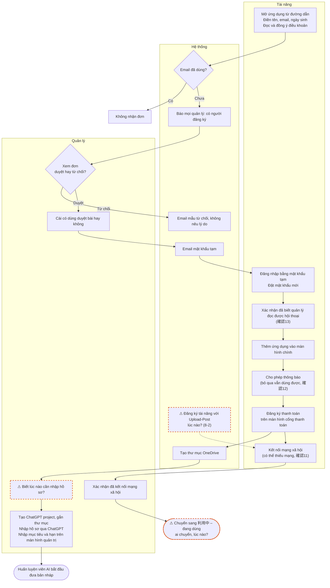

Tài khoản công ty không đi luồng này. Quản lý tạo tài khoản trên màn hình quản trị, hệ thống tạo thư mục ngay, không có bước thanh toán (UC-01 前提, 6-4 chức năng 2-2).

| Bước | Tác nhân | Trạng thái tài năng | Điều kiện để đi tiếp | Nguồn [YK2] |
| --- | --- | --- | --- | --- |
| Gửi đơn đăng ký | Tài năng | ⚠ Chưa có tên trạng thái cho đơn chờ duyệt | Email chưa được dùng, đã đồng ý điều khoản | UC-01, 6-4 (2-2), 確認1 |
| Duyệt hoặc từ chối | Quản lý | ⚠ 利用前 (trước khi dùng)? | Từ chối người lạ và người đã rời công ty | UC-01, 6-1 (1-4) |
| Đăng nhập lần đầu | Tài năng | 利用前 | Có mật khẩu tạm trong email | UC-03 前提, 6-1 (1-4) |
| Hướng dẫn lần đầu | Tài năng | 利用前 | Bỏ dở thì lần sau làm tiếp từ bước đang dở | 6-1 (6-2) |
| Tạo thư mục | Hệ thống | 利用前 | Đã đăng ký thanh toán | UC-01 前提, 6-4 (2-2) |
| Nhập hồ sơ, mục tiêu | Quản lý | 利用前 | Đã có thư mục và ChatGPT project | UC-01 前提, UC-02 前提 |
| Dùng huấn luyện viên AI | Tài năng | ⚠ 利用中 (đang dùng) | Đã thanh toán. Bản nháp chỉ có sau khi quản lý nhập hồ sơ | UC-03 前提, UC-01 前提 |

**Luồng chưa rõ:**

- Đăng ký tài năng với Upload-Post lúc nào. Mục 8-2 vẫn ghi "khi đăng ký tài năng", nhưng không còn bước quản lý đăng ký. Upload-Post tính phí theo số tài năng đã đăng ký (UC-08 前提), nên thời điểm này ảnh hưởng chi phí.
- Quản lý biết lúc nào cần nhập hồ sơ. Tài năng đã trả phí nhưng chưa có bản nháp cho tới khi quản lý nhập xong.
- Khi nào tài năng chuyển từ 利用前 sang 利用中, và đơn chờ duyệt hoặc bị từ chối có phải là một trạng thái không.
- Đơn bị từ chối giữ bao lâu. Người bị từ chối có đăng ký lại bằng email đó được không. Có chặn đăng ký rác không.
- Người ngoài công ty và người vị thành niên tự đăng ký: ai lấy đồng ý về dữ liệu cá nhân và đồng ý của phụ huynh (2-3, 10-3 chỉ nói tới hợp đồng với người thuộc công ty).
- Đăng ký thanh toán lỗi hoặc bỏ dở thì tài khoản ở trạng thái nào, có bị xóa sau một thời gian không.

## Workflow 2. Đăng bài hằng ngày (luồng cốt lõi)

Mỗi ngày đi theo một vòng: tin nhắn buổi sáng, chọn chủ đề, viết bản nháp, gửi tư liệu, 採用 (chấp nhận), đặt lịch, đăng bài, sáng hôm sau nhận xét. Bài chỉ được đặt lịch khi đủ ba điều kiện: đã 採用, có tư liệu, và việc đăng tự động (toàn bộ và của tài năng đó) đang bật. Theo v2, tài năng yêu cầu bao nhiêu bản nháp thì AI tạo bấy nhiêu (5-3).

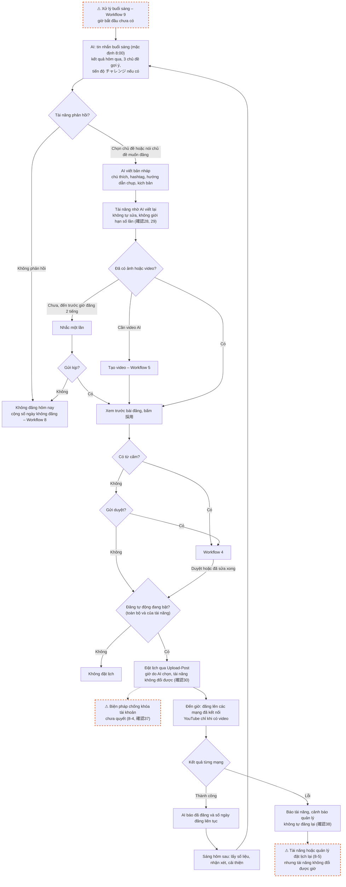

**Điều kiện ở các điểm rẽ nhánh:**

- Huấn luyện viên AI chỉ đưa bản nháp khi quản lý đã nhập hồ sơ tài năng (UC-01 前提).
- 採用 cần có ảnh hoặc video (6-6, chức năng 4-3). Không có tư liệu thì không đăng (確認26).
- Kiểm tra từ cấm chạy khi bấm 採用 (6-6, chức năng 4-4).
- Chỉ tài năng được cài "dùng duyệt bài" mới thấy lựa chọn gửi duyệt (6-9, chức năng 7-7).
- Đăng tự động bị dừng (toàn bộ hoặc riêng tài năng) thì không đặt lịch mới, và các bài đã đặt lịch bị hủy (6-10, chức năng 7-5).
- Mạng chưa kết nối thì bỏ qua (6-10, chức năng 8-3, 確認11).
- Bài tài năng tự đăng ngoài hệ thống vẫn tính là có đăng nếu Upload-Post đọc được (UC-09).

**Luồng chưa rõ:**

- Xử lý buổi sáng chưa có giờ bắt đầu. Giờ nhắn tin cho mọi người cùng lúc hay không sẽ quyết sau khi thử tải (確認18).
- Biện pháp chống khóa tài khoản chưa có (8-4). Con số 1 ảnh + 1 video mỗi ngày đã bị bỏ (確認37).
- Đăng lỗi thì 8-5 cho "tài năng hoặc quản lý đặt lịch lại", nhưng 確認30 đề xuất tài năng không đổi được giờ đăng. Chỉ một mạng lỗi thì có đăng lại riêng mạng đó không?
- Tài năng 採用 sau giờ đăng dự kiến thì bài đăng lúc nào.
- Nhiều bản nháp được 採用 trong một ngày thì mỗi bài đăng giờ nào.
- Bản nháp không 採用 trong ngày thì hết hiệu lực hay giữ sang hôm sau.
- Tài năng có biết trước giờ đăng để gửi tư liệu kịp không.

## Workflow 3. Trạng thái bài đăng

[YK2] vẫn nói bài đăng có 6 trạng thái nhưng không liệt kê (5-1). Chức năng 7-2 nêu 4 trạng thái: đã hẹn, chờ duyệt, đã đăng, lỗi. Ghép mô tả các chức năng và các 確認 của v2 thì ra 8 trạng thái. So với v1, bỏ "Hết hạn chưa duyệt" và "Bỏ qua vì đang dừng": cả hai nay đều thành "Đã hủy". Những trạng thái không nằm trong 4 trạng thái của 7-2 được ghi ⚠.

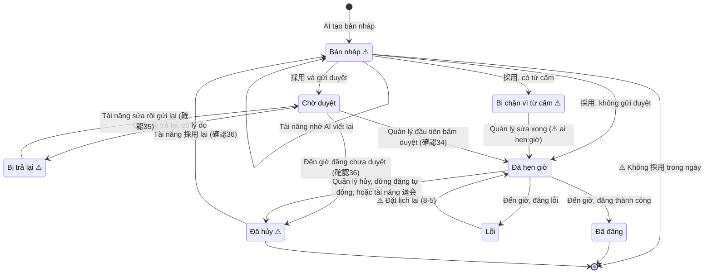

| Từ trạng thái | Sang trạng thái | Điều kiện | Tác nhân | Nguồn [YK2] |
| --- | --- | --- | --- | --- |
| Bản nháp | Bị chặn vì từ cấm | 採用, AI phát hiện từ cấm. Báo quản lý | Tài năng, AI | 6-6 (4-4), UC-05 前提 |
| Bản nháp | Chờ duyệt | 採用, tài năng được cài dùng duyệt bài và chọn gửi duyệt | Tài năng | 6-6 (4-3), 確認33 |
| Bản nháp | Đã hẹn giờ | 採用, có tư liệu, không có từ cấm, không gửi duyệt, đăng tự động đang bật | Tài năng | 6-6 (4-3), 6-10 (7-5) |
| Chờ duyệt | Đã hẹn giờ / Bị trả lại | Quản lý bấm trước thì quyết. Trả lại kèm lý do | Quản lý | 6-9 (7-7), 確認34, 確認35 |
| Chờ duyệt | Đã hủy | Đến giờ đăng chưa duyệt. Hệ thống hủy lịch, báo tài năng và quản lý | Hệ thống | 5-3, 確認36 |
| Bị trả lại | Chờ duyệt | Tài năng đọc lý do, nhờ AI sửa, gửi duyệt lại | Tài năng | 確認35 |
| Đã hẹn giờ | Đã đăng / Lỗi | Kết quả đăng, ghi riêng cho từng mạng | Hệ thống | 6-10 (8-3, 8-5) |
| Đã hẹn giờ | Đã hủy | Quản lý hủy trên màn hình quản trị, dừng đăng tự động (toàn bộ hoặc từng tài năng), hoặc tài năng chuyển sang 退会 (rời đi). Hệ thống hủy bên Upload-Post. Chạy lại đăng tự động cũng không đăng các bài đã hủy | Quản lý, hệ thống | 6-10 (7-2, 7-5), UC-08 前提, UC-13 |
| Đã hủy | Bản nháp | Muốn đăng thì tài năng 採用 lại | Tài năng | 確認36 |

**Luồng chưa rõ:**

- 6 trạng thái chính thức là những trạng thái nào.
- Bài chờ duyệt đã được đặt lịch trên Upload-Post hay chưa. 確認36 nói "hủy lịch", tức là có thể đã đặt lịch.
- Đăng thành công trên một mạng nhưng lỗi trên mạng khác thì cả bài ở trạng thái nào.
- Đặt lịch lại sau khi lỗi: tài năng có được làm không, khi 確認30 đề xuất tài năng không đổi được giờ.

## Workflow 4. Duyệt bài và xử lý từ cấm

Hai nhánh đều bắt đầu khi tài năng bấm 採用. Kiểm tra từ cấm chạy trước, theo danh sách chung do quản lý đăng ký trên màn hình quản trị (UC-02 前提). Duyệt bài chỉ dành cho bài công việc cần khách hàng cho phép (確認33). V2 đề xuất thêm: quản lý bấm trước thì quyết, bài bị trả lại được gửi lại, quá giờ thì hủy lịch.

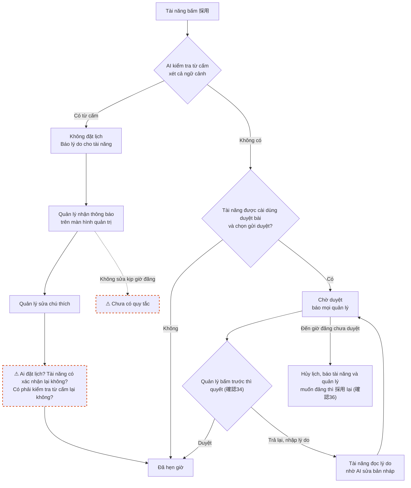

| Bước | Tác nhân | Điều kiện | Nguồn [YK2] |
| --- | --- | --- | --- |
| Kiểm tra từ cấm | AI | Mọi lần 採用. Xét chú thích và hashtag theo danh sách từ cấm chung. Có thể bỏ sót | 6-6 (4-4), UC-02 前提 |
| Sửa bài dính từ cấm | Quản lý | Sau khi nhận thông báo, sửa trên màn hình quản trị | 5-3, UC-05 前提 |
| Gửi duyệt | Tài năng | Chỉ bài công việc cần khách hàng cho phép. AI không tự xác định | 5-3, UC-07 前提, 確認33 |
| Duyệt hoặc trả lại | Quản lý bấm trước | Trước giờ đăng. Trả lại thì bắt buộc có lý do | 6-9 (7-7), 確認34, 確認35 |
| Quá giờ chưa duyệt | Hệ thống | Hủy lịch. Tài năng 採用 lại nếu muốn đăng | 5-3, 確認36 |

**Luồng chưa rõ:**

- Sau khi quản lý sửa bài dính từ cấm, ai đặt lịch. Nếu bài đó cũng cần duyệt thì có phải duyệt tiếp không.
- Có nhắc quản lý khi bài chờ duyệt sắp đến giờ không. Thông báo chỉ hiện trên màn hình quản trị (確認45).
- Quản lý có được sửa nội dung khi duyệt, hay chỉ được duyệt hoặc trả lại.
- Gửi lại sau khi bị trả lại có giới hạn số lần không, và có kiểm tra từ cấm lại không.

## Workflow 5. Tạo video

Video có hai nguồn: AI tạo từ ảnh (tính phí ngay từ lần đầu), hoặc tài năng tự làm (miễn phí). Lần tạo video được tính khi tài năng xác nhận giá, kể cả khi tạo lại. Trong lúc AI đang tạo, tài năng có thể đóng ứng dụng, xong thì được báo (UC-06 前提).

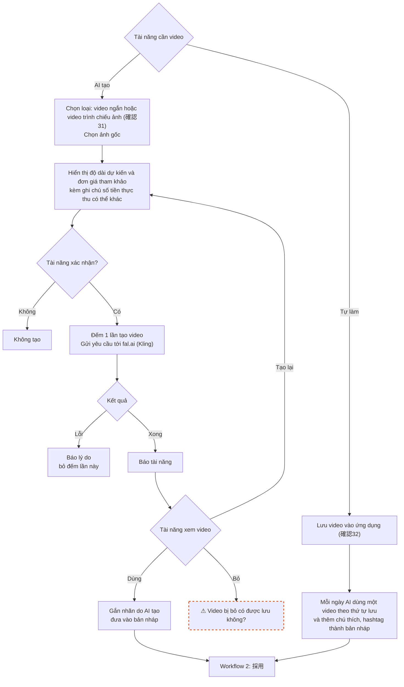

**Ai trả phí tạo video:**

- Tài năng: cộng vào hóa đơn tháng (6-3, chức năng 5-4). Đơn giá do アデッソ quyết (UC-06 前提).
- Tài khoản công ty: không thu qua cổng thanh toán. Hệ thống đếm số lần, hiện trên màn hình quản trị, アデッソ quyết toán nội bộ (UC-12 前提).
- Không còn tài năng miễn phí (5-4).

**Luồng chưa rõ:**

- Quy tắc khi video chưa xong trước giờ đăng.
- Video tự làm có thay cho bản nháp từ chủ đề gợi ý không, hay thành thêm một bài trong ngày (v2 cho tạo bao nhiêu bản nháp cũng được).
- Quản lý tạo video thay cho tài năng hay chỉ cho tài khoản công ty (確認27). Nếu thay tài năng thì phí tính vào hóa đơn của ai.
- Vì sao số tiền thực thu có thể khác đơn giá hiển thị (mâu thuẫn M5 ở tab "Quy tắc nghiệp vụ").

## Workflow 6. Thu phí hằng tháng

Hệ thống chỉ tính số tiền và gửi đi. Cổng thanh toán mới là bên thu tiền. Theo v2, mọi tài năng đều trả phí. Chỉ tài khoản công ty không bị thu. Thu lỗi thì hệ thống không tự dừng, quản lý quyết.

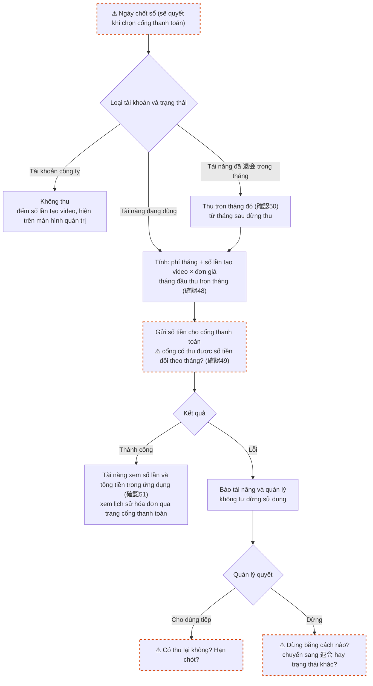

Nguồn: [YK2] UC-11, UC-12 前提, 5-4, 6-3 (chức năng 1-1, 1-2, 5-4), 確認48–51.

**Luồng chưa rõ:** phí tháng đầu tính từ lúc đăng ký thanh toán hay từ lúc huấn luyện viên AI bắt đầu đưa bản nháp (hai mốc này cách nhau vì quản lý còn phải nhập hồ sơ). Dùng lại sau 退会 thì thu phí thế nào.

## Workflow 7. Trạng thái tài năng

Tài năng có 3 trạng thái (利用前, 利用中, 利用終了). Quản lý đổi trạng thái, và mỗi lần đổi đều phải qua màn hình xác nhận. V2 bỏ phân loại trả phí / miễn phí. Thay vào đó có hai thuộc tính riêng, không phải trạng thái: loại tài khoản (tài năng hoặc tài khoản công ty, không đổi được), và cờ dừng đăng tự động của từng tài năng.

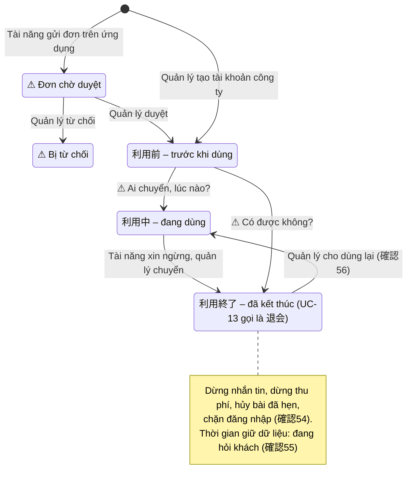

| Chuyển | Điều kiện | Tác nhân | Việc hệ thống tự làm | Nguồn [YK2] |
| --- | --- | --- | --- | --- |
| Đơn → 利用前 | Quản lý duyệt, cài có dùng duyệt bài hay không | Quản lý | Gửi email mật khẩu tạm | UC-01, 6-1 (1-4) |
| Đơn → bị từ chối | Quản lý từ chối | Quản lý | Gửi email mẫu, không nêu lý do | UC-01 前提 |
| Tạo tài khoản công ty | — | Quản lý | Tạo thư mục OneDrive | UC-01 前提, 6-4 (2-2) |
| 利用前 → 利用中 | ⚠ chưa nêu | ⚠ | — | 6-2 (7-3) |
| 利用中 → 利用終了 | Tài năng xin ngừng với quản lý. Quản lý xác nhận | Quản lý | Dừng nhắn tin, dừng thu phí, hủy bài đã hẹn, chặn đăng nhập | 6-2 (7-3), UC-13, 確認53, 確認54 |
| 利用終了 → 利用中 | Quản lý xác nhận | Quản lý | ⚠ Có thu phí lại, bật lại nhắn tin, cần kết nối lại mạng xã hội không? | 6-2 (7-3), 確認56 |

**Luồng chưa rõ:** đơn chờ duyệt và đơn bị từ chối chưa được [YK2] gọi là trạng thái. Mình vẽ ra vì hệ thống phải lưu đơn. Chưa có bảng chuyển trạng thái đầy đủ (5-1 nói "sẽ viết ở bản cuối"). Chưa có trạng thái tạm khóa, dù thanh toán lỗi có thể cần. Tên 利用終了 và 退会 chưa thống nhất.

## Workflow 8. Nhắc nhở và báo quản lý

Hai loại tình huống được chuyển cho con người: tài năng lâu không đăng bài, và tài năng kể chuyện nghiêm trọng. Thông báo cho quản lý chỉ hiện trên màn hình quản trị (確認45). V2 đổi cách góp ý: quản lý ghi vào chỉ dẫn cho AI để huấn luyện viên AI chuyển lời, chỉ liên hệ trực tiếp khi nghiêm trọng hoặc gấp (確認43).

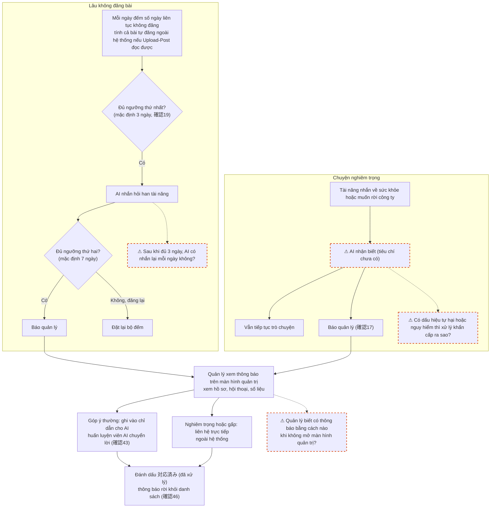

Nguồn: [YK2] UC-04, UC-10, 5-2, 6-5 (chức năng 3-3, 3-9), 6-12 (chức năng 7-4), 確認17, 19, 43, 45, 46.

**Luồng chưa rõ:** góp ý ghi vào chỉ dẫn cho AI thì đến sáng hôm sau tài năng mới nhận (AI đọc chỉ dẫn mỗi sáng, 7-5). Có cần chuyển lời ngay trong ngày không?

## Workflow 9. Xử lý buổi sáng và số liệu

Số liệu phải được lấy về và ghi vào OneDrive trước khi AI đọc. Nếu sai thứ tự, nhận xét buổi sáng sẽ dùng số liệu cũ. Tài liệu chưa quy định thứ tự và giờ chạy. V2 nói giờ nhắn tin sáng (mặc định trong khoảng 8 giờ) có gửi cùng lúc cho mọi người hay không sẽ quyết sau khi thử tải (確認18).

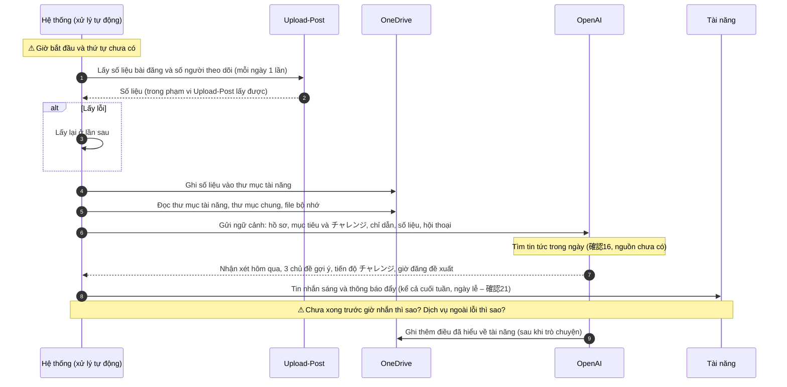

Nguồn: [YK2] 6-4 (chức năng 2-1), 6-5 (3-1, 3-2, 3-6), 6-11 (8-1, 8-7, 8-8), 9-2, UC-04, UC-09 前提, 確認14, 16, 18, 21.

**Luồng chưa rõ:** quy mô mới là khoảng 30 người lúc đầu, thêm 10 người mỗi tháng, sớm lên khoảng 100 (2-2). Chưa rõ xử lý tuần tự hay song song, cần bao lâu, và có bị giới hạn tốc độ của OneDrive và OpenAI không. Quản lý và AI cùng ghi một file thì có thể ghi đè nhau.

## Workflow 10. Kết nối mạng xã hội

Mỗi mạng xã hội của tài năng có trạng thái kết nối riêng, hiển thị trên ứng dụng và màn hình quản trị. Tài năng tự kết nối (確認9), mỗi mạng một tài khoản (確認10), và không bắt buộc kết nối đủ 3 mạng (確認11). Mạng chưa kết nối hoặc mất kết nối thì bài sẽ bỏ qua mạng đó.

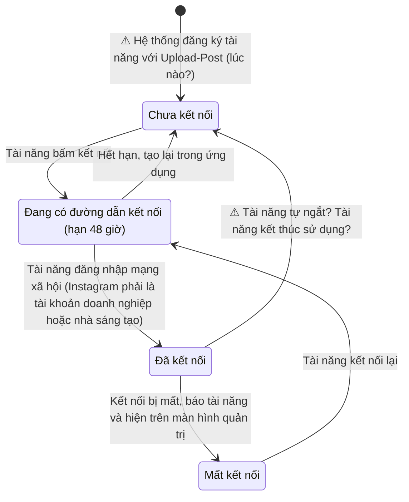

Nguồn: [YK2] UC-03 前提, 6-10 (chức năng 8-2, 8-3, 8-6), 確認9, 10, 11.

**Luồng chưa rõ:** thời điểm đăng ký tài năng với Upload-Post (8-2 còn ghi theo luồng cũ). Tài năng kết thúc sử dụng thì có ngắt kết nối và xóa khỏi Upload-Post không (Upload-Post tính phí theo số tài năng đã đăng ký). Ai kết nối cho tài khoản công ty. Kiểm tra loại tài khoản Instagram ở bước nào.

## Workflow 11. Chỉ dẫn cho AI (đề xuất, đang hỏi khách)

Hiện tại quản lý chỉ dẫn cho huấn luyện viên AI qua ChatGPT project và file OneDrive (UC-02 前提). Bản thiết kế của khách có thêm màn hình "AIへの指示" (chỉ dẫn cho AI). [YK2] mô tả cách hiểu của bên phát triển trong 確認6, 7, 8 và ghi rõ phần theo nhóm tài năng "cần kiểm chứng kỹ thuật". Cả luồng này chưa được chốt và chưa có mã chức năng ở mục 6.

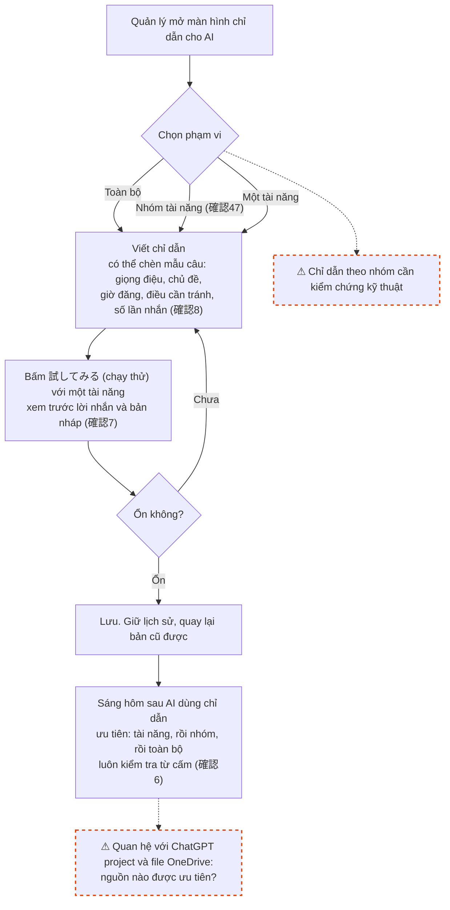

**Luồng chưa rõ:**

- Chức năng này có nằm trong phạm vi không. Nó chưa có mã chức năng hay mức ưu tiên ở mục 6.
- Chỉ dẫn trên màn hình này và chỉ dẫn trong ChatGPT, OneDrive cùng tồn tại thì nguồn nào được ưu tiên.
- Mẫu câu có cố định không, hay quản lý tự thêm được (確認8).
- Góp ý của quản lý cho tài năng cũng đi qua đây (確認43). Vậy có cần lần chạy ngay, không chờ sáng hôm sau không.

## Tổng hợp các luồng chưa rõ

Có 15 luồng chưa rõ, xếp theo mức ảnh hưởng. So với bản theo v1, v2 đã làm rõ 4 luồng: hủy bài (hủy từ màn hình quản trị), giới hạn số bài (đã bỏ con số), tài năng miễn phí (đã bỏ), và bước kiểm tra huấn luyện viên AI (đã bỏ). Duyệt bài, gửi lại và quá giờ đã có đề xuất nhưng còn chờ khách trả lời. Nhóm **Cao** làm sơ đồ trạng thái hoặc luồng cốt lõi chưa chốt được, nên cần hỏi khách trước khi thiết kế dữ liệu.

| STT | Luồng chưa rõ | Workflow | Mức ảnh hưởng | Nguồn [YK2] |
| --- | --- | --- | --- | --- |
| 1 | Thời điểm đăng ký tài năng với Upload-Post (ảnh hưởng chi phí) | 1, 10 | Cao | 6-10 (8-2), UC-08 前提 |
| 2 | Đồng ý về dữ liệu và đồng ý của phụ huynh với người ngoài công ty tự đăng ký | 1 | Cao (pháp lý) | 2-3, 10-3, 確認1 |
| 3 | 6 trạng thái chính thức của bài đăng. Bài chờ duyệt đã đặt lịch trên Upload-Post chưa | 3 | Cao | 5-1, 確認36 |
| 4 | Đặt lịch lại sau khi đăng lỗi, khi tài năng không đổi được giờ. Trạng thái khi chỉ một mạng lỗi | 2, 3 | Cao | 6-10 (8-5), 確認30 |
| 5 | Giờ bắt đầu, thứ tự và cách xử lý khi trễ của xử lý buổi sáng | 2, 9 | Cao | 9-2, 6-4 (2-1), 確認18 |
| 6 | Bài bị chặn vì từ cấm: ai đặt lịch sau khi sửa, tài năng có xác nhận lại không, không sửa kịp thì sao | 3, 4 | Cao | 5-3, 6-6 (4-4) |
| 7 | Ai chuyển tài năng từ 利用前 sang 利用中, và đơn chờ duyệt có phải trạng thái không | 1, 7 | Cao | 6-2 (7-3) |
| 8 | Thanh toán lỗi: có thu lại không, hạn chót, dừng sử dụng bằng cách nào | 6, 7 | Cao | 6-3 (1-1), 確認48 |
| 9 | Màn hình chỉ dẫn cho AI và nhóm tài năng có trong phạm vi không | 11 | Cao (phạm vi, chi phí) | 確認6, 7, 8, 47 |
| 10 | Khoảng trống giữa thanh toán và lúc quản lý nhập hồ sơ. Phí tháng đầu tính từ lúc nào | 1, 6 | Trung bình | UC-01 前提, 確認48 |
| 11 | Tài khoản công ty đăng bài từ ứng dụng hay từ màn hình quản trị, có duyệt không | 2 | Trung bình | UC-12, 6-10 (9-1), 7-4, 確認52 |
| 12 | Tiêu chí nhận biết chuyện nghiêm trọng và cách xử lý khẩn cấp | 8 | Trung bình (nhưng rủi ro về an toàn con người cao) | 6-5 (3-3), 確認17 |
| 13 | Quản lý biết có thông báo bằng cách nào khi không mở màn hình quản trị | 4, 8 | Trung bình | 6-12 (7-4), 確認45 |
| 14 | Đơn bị từ chối: giữ bao lâu, đăng ký lại được không, chặn đăng ký rác | 1 | Trung bình | UC-01, 6-4 (2-2) |
| 15 | Bản nháp không 採用 trong ngày, giờ đăng khi có nhiều bài, video tự làm so với bản nháp từ chủ đề, video bị bỏ | 2, 5 | Thấp | 5-3, 6-7 (6-4), 6-8 (5-3) |
