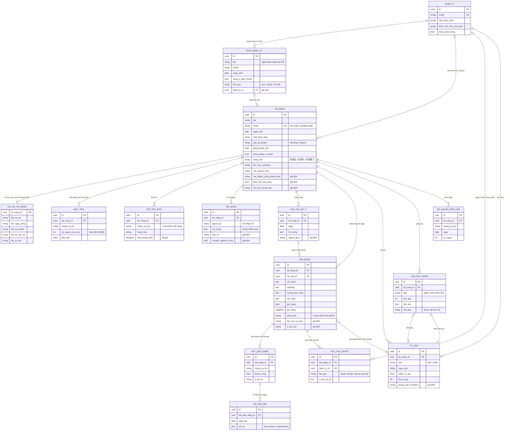
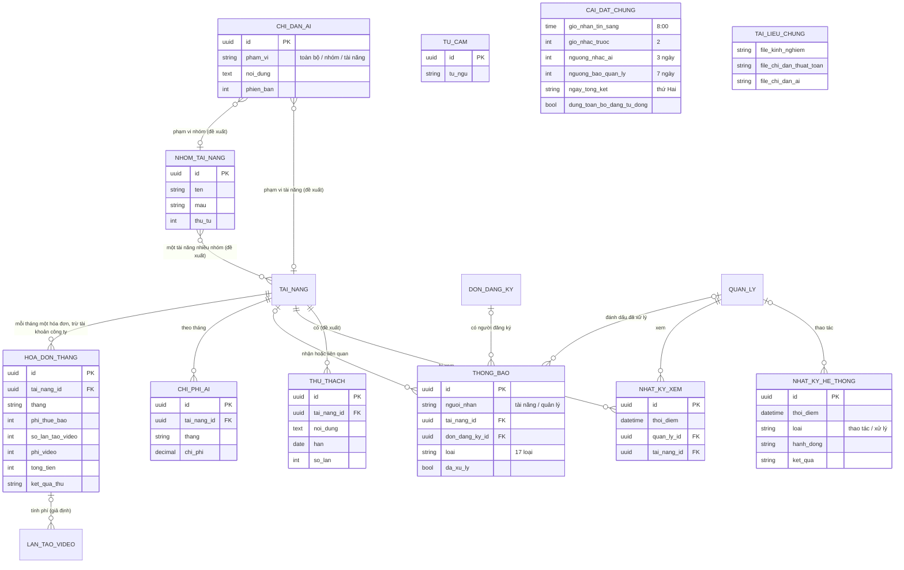
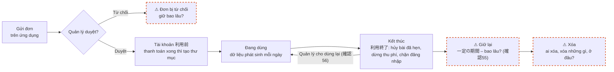

# Dữ liệu và ERD sơ bộ

## Cập nhật ngày 17/11/2026 theo Q&A bản 15/11 và các quyết định nội bộ

Chi tiết ở [19_Doi_chieu_QA_bao_gia.md](19_Doi_chieu_QA_bao_gia.md) (Q&A No.x, CR-xx) và [20_Rui_ro_ky_thuat.md](20_Rui_ro_ky_thuat.md). Nội dung bên dưới khối này chưa được viết lại; chỗ nào khác khối này thì làm theo khối này. File này xuất từ tab Claude Doc; **tab Claude Doc cũng cần thêm khối này**.

- NHOM_TAI_NANG và quan hệ tài năng – nhóm: CR-17, chưa làm. Thứ tự video tự làm: CR-23, chưa làm. Cấu trúc cơ sở dữ liệu sẽ dựng lại sau, file này chỉ là phân tích.
- LAN_TAO_VIDEO: video trình chiếu ghép ở máy chủ, không gọi fal.ai (CR-04). Tính lượt lúc gửi yêu cầu, lỗi phía dịch vụ không tính (Q&A No.1).

Hệ thống cần quản lý 27 entity, nằm ở 3 nơi lưu: cơ sở dữ liệu của hệ thống, OneDrive và các dịch vụ ngoài. Trong đó 3 entity chỉ cần nếu khách chấp nhận đề xuất mới của v2 (thử thách, chỉ dẫn cho AI, nhóm tài năng). [YK2] chỉ mô tả dữ liệu ở mức nghiệp vụ (mục 7 データ要件 – yêu cầu dữ liệu), nên cấu trúc bảng, khóa và kiểu dữ liệu ở đây đều là đề xuất của mình. Tab này đã viết lại theo bản yêu cầu v2.

**So với bản theo v1:** bỏ entity đường dẫn mời (LOI_MOI), thêm đơn đăng ký (DON_DANG_KY). Bỏ thuộc tính có trả phí, thay bằng loại tài khoản (tài năng / công ty). Thêm ngày sinh và cờ dừng đăng tự động cho từng tài năng. Thêm 3 entity đề xuất: THU_THACH, CHI_DAN_AI, NHOM_TAI_NANG.

**Cách đọc:**

- [YK2] = AI育成OS_概要要件定義書_v2.docx. Số 確認 (mục cần xác nhận) theo đánh số của v2.
- **Đã xác nhận:** dữ liệu hoặc thuộc tính có ghi trong [YK2]. Có kèm 確認 thì ghi "Đã xác nhận ⚠" vì có thể đổi khi khách trả lời.
- **Giả định:** mình suy ra từ chức năng hoặc đề xuất để chức năng chạy được. Tài liệu không ghi. Cần xác nhận khi thiết kế.
- Tên entity và thuộc tính trong ERD viết tiếng Việt không dấu (ví dụ TAI_NANG, ho_ten) vì cú pháp Mermaid không nhận dấu cách. Bảng ở mục 2 có tên đầy đủ.

## 1. Nơi lưu dữ liệu

| Nơi lưu | Dữ liệu | Ai được xem | Trạng thái | Nguồn [YK2] |
| --- | --- | --- | --- | --- |
| OneDrive, thư mục riêng của từng tài năng | Hồ sơ, mục tiêu, チャレンジ (thử thách) ⚠, kinh nghiệm đăng bài riêng, số liệu, ngày riêng, file bộ nhớ do AI ghi, ảnh và video. Thư mục tạo khi tài năng đăng ký thanh toán xong, được gắn với ChatGPT project của tài năng | Quản lý, AI (chỉ tài năng đó). Ảnh và video thì tài năng và quản lý xem | Đã xác nhận | 7-1, 7-2, 7-5, UC-01 前提, 確認5 |
| OneDrive, thư mục chung | Kinh nghiệm đăng bài, chỉ dẫn thuật toán, chỉ dẫn cho AI. Bên phát triển gửi mẫu định dạng file | Quản lý, AI | Đã xác nhận | 7-1, 6-4 (2-1), UC-02 前提 |
| Cơ sở dữ liệu của hệ thống (Supabase theo dự kiến) | Hội thoại với AI | Tài năng, quản lý | Đã xác nhận | 7-2, 8 |
| Cơ sở dữ liệu của hệ thống | Đơn đăng ký, tài khoản, bài đăng, duyệt, thông báo, hóa đơn, cài đặt, nhật ký, từ cấm (quản lý đăng ký trên màn hình quản trị) | Theo từng loại | Giả định: tài liệu không nói nơi lưu, nhưng các chức năng cần | 6, 9-4, UC-02 前提 |
| Cổng thanh toán (GMO theo dự kiến) | Phương thức thanh toán, thông tin thẻ, lịch sử hóa đơn | Tài năng (qua trang của cổng thanh toán) | Đã xác nhận. Hệ thống không lưu thẻ | 7-2, 10-2, 6-3 (1-1) |
| Upload-Post | Tài năng đã đăng ký, kết nối mạng xã hội, bài đã hẹn, số liệu gốc | Hệ thống đọc và hủy qua kết nối. Quản lý không cần vào màn hình Upload-Post để hủy bài nữa | Đã xác nhận | 8, 6-10 (7-2), UC-08 前提 |

**Mâu thuẫn về nơi lưu:** mục 7-2 đặt mục tiêu và số liệu trên OneDrive, nhưng mục tiêu lại được nhập trên màn hình quản trị và phải hiển thị "ngay" trên ứng dụng (chức năng 2-4, UC-02 前提). Số liệu cũng phải hiển thị trên ứng dụng (6-7, 3-10). Giả định của mình là lưu cả hai nơi: cơ sở dữ liệu là bản gốc, OneDrive là bản chép ra để AI đọc. Cần xác nhận.

## 2. Danh sách entity và thuộc tính chính

Trong cột thuộc tính, phần trước dấu "|| Giả định:" là đã xác nhận, phần sau là mình đề xuất. Khóa chính (mã định danh) và ngày giờ tạo, sửa có ở mọi entity nên không ghi lại.

### 2.1 Người dùng, tài khoản và đơn đăng ký

| Entity | Ý nghĩa | Nơi lưu | Thuộc tính chính | Entity có trong tài liệu? | Nguồn [YK2] |
| --- | --- | --- | --- | --- | --- |
| DON_DANG_KY (mới) | Đơn người dùng gửi trên ứng dụng | Cơ sở dữ liệu | Tên (nghệ danh hoặc tên thật), email, ngày sinh, đã đồng ý điều khoản, kết quả (duyệt / từ chối) \|\| Giả định: trạng thái chờ duyệt, quản lý xử lý, thời điểm gửi và xử lý, phiên bản điều khoản đã đồng ý | Có (đơn). Tách thành entity riêng là giả định | UC-01, 6-1 (1-4), 6-4 (2-2) |
| TAI_NANG | Tài năng (kể cả người ngoài công ty đã được duyệt) | Cơ sở dữ liệu | Tên, email (duy nhất, là mã đăng nhập), ngày sinh, mật khẩu, loại tài khoản (tài năng / công ty), dùng duyệt bài hay không, đang dừng đăng tự động hay không, trạng thái (利用前 / 利用中 / 利用終了), đường dẫn thư mục OneDrive, mã tài năng trên Upload-Post. Vị thành niên thì tính từ ngày sinh ⚠ \|\| Giả định: phải đổi mật khẩu tạm hay chưa, số lần đăng nhập sai, thời điểm hết khóa, tiến độ hướng dẫn lần đầu, đã xác nhận thông báo "quản lý đọc hội thoại" chưa, ngày kết thúc sử dụng, mã ChatGPT project | Có | 3-1, 5-6, 6-1 (1-4, 6-2), 6-2 (7-3), 6-3 (1-2), 6-10 (7-5), 確認2, 13 |
| TAI_KHOAN_CONG_TY | Tài khoản mạng xã hội của công ty | Cơ sở dữ liệu | Quản lý tạo trên màn hình quản trị, có thể có nhiều tài khoản, không thu phí tháng, đếm số lần tạo video để quyết toán nội bộ \|\| Giả định: lưu như một TAI_NANG có loại tài khoản là "công ty" | Có | 3-1, UC-12 前提, 6-3 (1-2, 5-4) |
| QUAN_LY | Quản lý | Cơ sở dữ liệu | Email, mật khẩu, khóa bí mật của ứng dụng xác thực, đang hoạt động hay đã vô hiệu hóa \|\| Giả định: họ tên, số lần đăng nhập sai, lần thao tác cuối (để tự đăng xuất sau 30 phút) | Có | 6-2 (1-6), 10-1, UC-13 前提 |

### 2.2 Thông tin cho huấn luyện viên AI

| Entity | Ý nghĩa | Nơi lưu | Thuộc tính chính | Entity có trong tài liệu? | Nguồn [YK2] |
| --- | --- | --- | --- | --- | --- |
| HO_SO_TAI_NANG | Các file trong thư mục riêng của tài năng | OneDrive | Profile, định hướng, sở thích, sở trường, mục tiêu tương lai (văn bản tự do). Ngày riêng. Kế hoạch nội dung. Kinh nghiệm riêng cho tài năng. File bộ nhớ do AI ghi. File số liệu \|\| Giả định: tên và định dạng từng file, lần sửa cuối | Có | 7-1, 7-5, UC-02 前提, 6-5 (3-2), 6-11 (8-8) |
| TAI_LIEU_CHUNG | Các file trong thư mục chung | OneDrive | Kinh nghiệm đăng bài, chỉ dẫn thuật toán, chỉ dẫn cho AI (giọng điệu) | Có | 7-1, 7-5, UC-02 前提 |
| MUC_TIEU | Mục tiêu số người theo dõi | Cơ sở dữ liệu và OneDrive (xem mâu thuẫn ở mục 1) | Tài năng, mạng xã hội, số người mục tiêu (mặc định 10.000 ⚠), hạn đạt \|\| Giả định: ngày đạt, đã báo đạt mục tiêu chưa | Có | 6-4 (2-4), UC-02 前提, 確認3, 39 |
| THU_THACH (mới, ⚠) | チャレンジ: mục tiêu nhỏ có thời hạn và số lần, ví dụ đăng 7 ngày liền | Đề xuất: trong file thông tin tài năng trên OneDrive ⚠ | Nội dung, thời hạn, số lần \|\| Giả định: tiến độ, đã hoàn thành chưa. Nếu cần hiển thị tiến độ trên ứng dụng thì phải có bản trong cơ sở dữ liệu | Có (đề xuất) | UC-02 前提, 確認5, 14, 39 |
| TIN_NHAN | Từng tin nhắn trong hội thoại với AI | Cơ sở dữ liệu | Tài năng, người gửi (tài năng / AI), nội dung chữ (tài năng gửi tối đa 1.000 ký tự), thời điểm \|\| Giả định: loại tin (trả lời / tin sáng / nhắc / tổng kết tuần / chúc mừng), có phải chuyện nghiêm trọng không, số token AI đã dùng | Có | 6-5 (3-4), 7-2, UC-04 前提 |
| CHU_DE_GOI_Y | 3 chủ đề gợi ý mỗi sáng | Cơ sở dữ liệu | Tài năng, ngày, nội dung \|\| Giả định: thứ tự (1–3), nguồn gợi ý (sở thích / bài cũ / tin tức / chỉ dẫn công ty), đã được chọn chưa | Có | 5-3, 6-6 (4-1), 確認15 |
| CHI_DAN_AI (mới, ⚠) | Chỉ dẫn nhập trên màn hình "AIへの指示" (chỉ dẫn cho AI) | Đề xuất: cơ sở dữ liệu | Phạm vi (toàn bộ / nhóm / tài năng), nội dung chỉ dẫn, lịch sử phiên bản (quay lại bản cũ được) \|\| Giả định: người sửa, thời điểm có hiệu lực | Có (đề xuất) | 確認6, 7, 8 |
| NHOM_TAI_NANG (mới, ⚠) | Nhóm tài năng (カテゴリー), ví dụ người mẫu, diễn viên, ca sĩ | Đề xuất: cơ sở dữ liệu | Tên, màu, thứ tự. Một tài năng thuộc nhiều nhóm (cần bảng trung gian) | Có (đề xuất) | 確認47 |

### 2.3 Bài đăng, tư liệu, video

| Entity | Ý nghĩa | Nơi lưu | Thuộc tính chính | Entity có trong tài liệu? | Nguồn [YK2] |
| --- | --- | --- | --- | --- | --- |
| BAI_DANG | Một bài, từ bản nháp đến khi đăng xong. Mỗi ngày có thể có nhiều bài | Cơ sở dữ liệu | Tài năng, chủ đề, chú thích, hashtag, hướng dẫn chụp, kịch bản (nếu là video), có gửi duyệt không, giờ đăng, trạng thái (6 trạng thái, chưa liệt kê) \|\| Giả định: gộp bản nháp và bài đã hẹn vào một entity, thời điểm 採用, kết quả kiểm tra từ cấm và lý do, mã bài trên Upload-Post, tiêu đề YouTube, lý do hủy | Có | 5-1, 5-3, 6-6, 6-10 (7-2, 8-3) |
| KET_QUA_DANG | Kết quả đăng trên từng mạng xã hội | Cơ sở dữ liệu | Bài đăng, mạng xã hội, thành công hay lỗi, lý do lỗi \|\| Giả định: mã bài trên mạng xã hội, thời điểm đăng thực tế, đã gắn nhãn AI chưa | Có | 5-1, 6-10 (8-3, 8-5) |
| YEU_CAU_DUYET | Mỗi lần gửi duyệt một bài | Cơ sở dữ liệu | Bài đăng, kết quả (duyệt / trả lại / hủy do quá giờ ⚠), lý do trả lại (bắt buộc khi trả lại), quản lý đã quyết ⚠. Một bài có thể gửi lại nhiều lần ⚠ \|\| Giả định: thời điểm gửi và xử lý | Có | 6-9 (7-7), 確認34, 35, 36 |
| TU_LIEU | Ảnh hoặc video gốc | File trên OneDrive, thông tin trên cơ sở dữ liệu | Tài năng, loại (ảnh / video), người gửi (tài năng / quản lý ⚠), video tự làm hay không, thứ tự lưu (với video tự làm ⚠) \|\| Giả định: đường dẫn file, dung lượng, định dạng, đã dùng cho bài nào, do AI tạo hay không | Có | 6-7 (6-3, 6-4), 確認27, 32 |
| LAN_TAO_VIDEO | Mỗi lần yêu cầu AI tạo video | Cơ sở dữ liệu | Tài năng hoặc tài khoản công ty, loại (video ngắn / video trình chiếu ảnh ⚠), ảnh gốc, đơn giá lúc xác nhận, có tính lần không (lỗi thì không tính), kết quả (dùng / tạo lại / bỏ), video kết quả \|\| Giả định: người yêu cầu (tài năng / quản lý), mã việc trên fal.ai, tháng tính | Có | 5-4, 5-7, 6-8, 6-3 (5-4), UC-12 前提, 確認31 |
| TU_CAM | Danh sách từ cấm chung, quản lý đăng ký trên màn hình quản trị | Cơ sở dữ liệu | Từ hoặc cách nói \|\| Giả định: nhóm (vi phạm quy định mạng xã hội / gây hiểu lầm / công ty không dùng), người sửa cuối | Có | 6-6 (4-4), UC-02 前提, 確認4 |

### 2.4 Mạng xã hội và số liệu

| Entity | Ý nghĩa | Nơi lưu | Thuộc tính chính | Entity có trong tài liệu? | Nguồn [YK2] |
| --- | --- | --- | --- | --- | --- |
| KET_NOI_MXH | Kết nối của tài năng với từng mạng xã hội | Cơ sở dữ liệu (bản gốc ở Upload-Post) | Tài năng, mạng xã hội (Instagram / TikTok / YouTube), trạng thái kết nối, hạn đường dẫn kết nối (48 giờ) \|\| Giả định: tên tài khoản mạng xã hội, lần kiểm tra cuối | Có | 6-10 (8-2, 8-6), 確認10, 11 |
| SO_LIEU_BAI | Số liệu của từng bài trên từng mạng xã hội | Cơ sở dữ liệu và OneDrive | Kết quả đăng, ngày lấy. Các chỉ số (lượt hiển thị, lượt thích…) trong phạm vi Upload-Post cung cấp \|\| Giả định: số liệu theo khung giờ (chức năng 8-9) | Có | 6-11 (8-7, 8-9), UC-09 前提, 別紙B |
| SO_NGUOI_THEO_DOI | Số người theo dõi của tài năng trên từng mạng, theo ngày | Cơ sở dữ liệu và OneDrive | Tài năng, mạng xã hội, ngày, số người \|\| Giả định: lưu mỗi ngày một dòng để vẽ diễn biến và phát hiện đạt mục tiêu | Có | 6-11 (8-7, 3-10, 6-7), 6-5 (3-7) |

### 2.5 Thu phí, thông báo, cài đặt, nhật ký

| Entity | Ý nghĩa | Nơi lưu | Thuộc tính chính | Entity có trong tài liệu? | Nguồn [YK2] |
| --- | --- | --- | --- | --- | --- |
| HOA_DON_THANG | Hóa đơn mỗi tháng của tài năng | Cơ sở dữ liệu (thanh toán thật và lịch sử ở cổng thanh toán) | Tài năng, tháng, phí thuê bao, số lần tạo video, phí video, tổng tiền, kết quả thu \|\| Giả định: mã giao dịch của cổng thanh toán, phương thức, mã khách hàng trên cổng thanh toán (lưu ở TAI_NANG) | Có | 5-4, 6-3 (1-1, 5-4), UC-11 |
| CHI_PHI_AI | Chi phí AI theo tài năng, theo tháng | Cơ sở dữ liệu | Tài năng, tháng, chi phí (tách riêng khỏi phí ChatGPT) \|\| Giả định: số token, tính từ TIN_NHAN và xử lý buổi sáng | Có | 6-5 (3-5), 5-5 |
| THONG_BAO | Thông báo cho tài năng hoặc quản lý | Cơ sở dữ liệu | Người nhận (tài năng / quản lý), loại (17 loại trong 別紙A – phụ lục A), tài năng hoặc đơn đăng ký liên quan, đã xử lý hay chưa (với thông báo cho quản lý) \|\| Giả định: nội dung, màn hình mở khi bấm vào, đã gửi thông báo đẩy chưa, đã đọc chưa, ai đánh dấu đã xử lý | Có | 6-12 (6-1, 7-4), 6-13, 別紙A, 確認46 |
| CAI_DAT_CHUNG | Các giá trị quản lý tự đổi | Cơ sở dữ liệu | Giờ nhắn tin buổi sáng, giờ nhắc trước giờ đăng, hai ngưỡng số ngày không đăng, ngày tổng kết tuần, dừng toàn bộ đăng tự động \|\| Giả định: đơn giá tạo video, phí thuê bao, giới hạn chống khóa tài khoản (chưa quyết) | Có | 5-2, 5-6 |
| NHAT_KY_XEM | Nhật ký việc quản lý xem thông tin tài năng | Cơ sở dữ liệu | Ngày giờ, quản lý, tài năng. Không sửa được \|\| Giả định: màn hình đã xem (thông tin / hội thoại / số liệu) | Có | 6-2 (7-6), 9-4, 確認44 |
| NHAT_KY_HE_THONG | Nhật ký thao tác và nhật ký xử lý | Cơ sở dữ liệu | Thao tác (duyệt, đổi trạng thái, dừng hoặc chạy lại đăng tự động). Xử lý (đăng bài, lấy số liệu, tạo video, thu phí) \|\| Giả định: gộp hai loại vào một entity, thêm duyệt đơn đăng ký và hủy bài | Có | 9-4 |

Các giá trị tính ra từ dữ liệu khác, không cần entity riêng: số ngày đăng liên tục, số ngày không đăng (từ KET_QUA_DANG và số liệu Upload-Post), mức đạt mục tiêu (từ MUC_TIEU và SO_NGUOI_THEO_DOI), vị thành niên (từ ngày sinh).

## 3. ERD sơ bộ

ERD chia làm hai sơ đồ cho dễ đọc: phần lõi (đơn đăng ký, tài năng, bài đăng, tư liệu, số liệu) và phần hỗ trợ (thu phí, thông báo, nhật ký, cài đặt, các entity đề xuất mới). Thuộc tính nào có ghi chú "giả định" là mình đề xuất. Quan hệ có chữ "(giả định)" là tài liệu không nói, có chữ "(đề xuất)" là chỉ cần nếu khách chấp nhận 確認 tương ứng.

### 3.1 Phần lõi

### 3.2 Phần hỗ trợ

### 3.3 Quan hệ giữa các entity

| Quan hệ | Bội số | Xác nhận hay giả định | Căn cứ [YK2] |
| --- | --- | --- | --- |
| Đơn đăng ký – tài năng | 1 – 0..1 (đơn được duyệt thì thành tài năng) | Xác nhận (luồng). Lưu tách hai entity là giả định | UC-01, 6-1 (1-4) |
| Tài năng – thư mục OneDrive | 1 – 0..1 (chỉ có sau khi thanh toán) | Xác nhận | UC-01 前提, 6-4 (2-2) |
| Tài năng – kết nối mạng xã hội | 1 – 0..3 (mỗi mạng một tài khoản, không bắt buộc đủ) | Xác nhận ⚠ | 6-10 (8-2), 確認10, 11 |
| Tài năng – mục tiêu | 1 – tối đa 3 (mỗi mạng một mục tiêu) | Xác nhận | 6-4 (2-4) |
| Tài năng – chủ đề gợi ý | 1 – nhiều (3 mỗi ngày) | Xác nhận ⚠ | 5-3, 確認15 |
| Tài năng – bài đăng | 1 – nhiều, mỗi ngày bao nhiêu cũng được | Xác nhận | 5-3, UC-05 前提 |
| Chủ đề gợi ý – bài đăng | 0..1 – nhiều. Bài có thể đến từ chủ đề tài năng tự nói hoặc video tự làm | Giả định | 5-3, UC-06 |
| Bài đăng – kết quả đăng | 1 – tối đa 3 | Xác nhận | 6-10 (8-3) |
| Bài đăng – yêu cầu duyệt | 1 – 0..nhiều (gửi lại sau khi bị trả lại) | Xác nhận ⚠ | 6-9 (7-7), 確認35 |
| Bài đăng – tư liệu | Nhiều – nhiều (một bài có thể nhiều ảnh, tư liệu có thể dùng lại) | Giả định. Tài liệu chỉ nói "dùng lại sau" | 6-7 (6-4) |
| Lần tạo video – tư liệu | Nhiều ảnh gốc, một video kết quả | Giả định (số ảnh gốc chưa có) | 6-8 (5-1) |
| Tài năng – hóa đơn tháng | 1 – nhiều. Tài khoản công ty không có hóa đơn | Xác nhận | 5-4, UC-12 前提 |
| Hóa đơn – lần tạo video | 1 – nhiều | Giả định (tài liệu chỉ nói cộng gộp) | 5-4 |
| Quản lý – tài năng | Không có phân công. Mọi quản lý đều thấy mọi tài năng | Xác nhận ⚠ | 3-3, 確認41 |
| Thông báo cho quản lý – quản lý | Một thông báo dùng chung cho mọi quản lý, ghi lại ai đã xử lý | Giả định | 3-3, 6-12 (7-4), 確認46 |
| Tài năng – nhóm tài năng | Nhiều – nhiều | Đề xuất, đang hỏi khách | 確認47 |
| Chỉ dẫn cho AI – phạm vi | Mỗi chỉ dẫn áp cho toàn bộ, một nhóm hoặc một tài năng. Ưu tiên tài năng > nhóm > toàn bộ | Đề xuất, đang hỏi khách | 確認6 |

## 4. Ràng buộc dữ liệu

Có 20 ràng buộc lấy từ quy tắc nghiệp vụ. Mã BR trỏ tới tab "Quy tắc nghiệp vụ". Cuối bảng là các ràng buộc mình đề xuất thêm. So với bản theo v1: bỏ ràng buộc về đường dẫn mời, chuyển trả phí sang miễn phí và giới hạn số bài mỗi ngày.

| Entity | Ràng buộc | Loại | Xác nhận hay giả định | Căn cứ |
| --- | --- | --- | --- | --- |
| DON_DANG_KY, TAI_NANG | Email không trùng. Email đã dùng thì không gửi đơn được | Duy nhất | Xác nhận | BR-A02 |
| DON_DANG_KY | Phải đồng ý điều khoản mới gửi được. Bắt buộc có tên, email, ngày sinh | Bắt buộc | Xác nhận | BR-A01 |
| TAI_NANG | Chỉ đăng nhập được khi đơn đã được duyệt và trạng thái không phải 利用終了 | Điều kiện | Xác nhận (利用終了: ⚠) | BR-A01, BR-A08 |
| TAI_NANG, QUAN_LY | Mật khẩu ít nhất 8 ký tự, có cả chữ và số. Sai 5 lần thì khóa 15 phút | Định dạng | Xác nhận | BR-A03 |
| TAI_NANG | Trạng thái chỉ nhận 3 giá trị | Miền giá trị | Xác nhận | BR-A08 |
| TAI_NANG | Loại tài khoản không đổi được sau khi tạo | Không đổi | Xác nhận | BR-A11 |
| TAI_NANG | Chưa đăng ký thanh toán thì chưa có thư mục và chưa dùng huấn luyện viên AI (trừ tài khoản công ty) | Điều kiện | Xác nhận | BR-F05 |
| KET_NOI_MXH | Mỗi tài năng tối đa một kết nối cho mỗi mạng. Đường dẫn kết nối hết hạn sau 48 giờ | Duy nhất theo (tài năng, mạng). Thời hạn | Xác nhận ⚠ | BR-A04, BR-E08 |
| MUC_TIEU | Mỗi tài năng một mục tiêu cho mỗi mạng. Mặc định 10.000. Chỉ quản lý sửa | Duy nhất, giá trị mặc định, quyền | Xác nhận (mặc định: ⚠) | BR-B05, 確認3 |
| TIN_NHAN | Tin của tài năng tối đa 1.000 ký tự | Độ dài | Xác nhận | BR-H02 |
| CHU_DE_GOI_Y | 3 chủ đề mỗi tài năng mỗi ngày | Số lượng | Xác nhận ⚠ | BR-C01 |
| BAI_DANG | Không 採用 được nếu chưa có tư liệu | Điều kiện | Xác nhận | BR-C05 |
| BAI_DANG | Độ dài chú thích và số hashtag nằm trong giới hạn chung của 3 mạng (con số chưa có) | Độ dài | Xác nhận (chưa có số) | BR-C03 |
| BAI_DANG | Chỉ được gửi duyệt khi tài năng được cài dùng duyệt bài. Không đặt lịch mới khi đăng tự động bị dừng | Điều kiện | Xác nhận | BR-D01, BR-E06, BR-E09 |
| KET_QUA_DANG | Không có kết quả YouTube nếu bài không có video. Mỗi bài mỗi mạng một kết quả | Điều kiện, duy nhất | Xác nhận (duy nhất: giả định) | BR-E01, BR-E02 |
| YEU_CAU_DUYET | Trả lại thì bắt buộc có lý do. Mỗi yêu cầu chỉ được quyết một lần, quản lý bấm trước thắng | Bắt buộc có điều kiện, chỉ một lần | Xác nhận (bấm trước thắng: ⚠) | BR-D04, BR-D07 |
| LAN_TAO_VIDEO | Loại chỉ nhận 2 giá trị. Tạo lỗi thì không tính lần | Miền giá trị, điều kiện | Xác nhận | BR-G01, BR-F02 |
| HOA_DON_THANG | Chỉ tài khoản loại tài năng mới có hóa đơn. Mỗi tài năng mỗi tháng một hóa đơn | Điều kiện, duy nhất | Xác nhận (duy nhất: giả định) | BR-F01, BR-F08 |
| NHAT_KY_XEM | Không sửa, không xóa được | Chỉ ghi thêm | Xác nhận | BR-A07 |
| Thông tin thẻ | Không lưu trong hệ thống. Khóa kết nối dịch vụ ngoài không hiện ra. Mã hóa khi lưu | Bảo mật | Xác nhận | BR-I01, BR-I02 |

**Ràng buộc mình đề xuất thêm (giả định):**

- Mỗi truy vấn dữ liệu từ phía tài năng và AI đều lọc theo mã tài năng (bảo mật theo dòng). Dùng để đảm bảo BR-H01 – không lộ dữ liệu giữa các tài năng.
- Khóa bản ghi khi duyệt để đảm bảo "quản lý bấm trước thắng" (BR-D07), áp dụng cho cả duyệt đơn đăng ký.
- Không xóa hẳn tài năng khi còn trong thời gian giữ dữ liệu. Chỉ đánh dấu trạng thái 利用終了 (đã kết thúc).
- Lưu đơn giá tại thời điểm tài năng xác nhận vào từng lần tạo video, để đổi đơn giá về sau không làm sai hóa đơn cũ.
- Ngày sinh là dữ liệu nhạy cảm: chỉ gửi tuổi hoặc cờ vị thành niên cho AI, không gửi ngày sinh đầy đủ.

## 5. Vòng đời dữ liệu

Phần tạo và cập nhật dữ liệu đã rõ nhờ các chức năng. Phần lưu trữ và xóa vẫn gần như chưa có. [YK2] chỉ nói dữ liệu tài năng đã rời đi được giữ 一定の期間 (một khoảng thời gian nhất định), và đang hỏi khách có quy định nào không (確認55). Thời gian lưu nhật ký và sao lưu "sẽ quyết khi thiết kế" (7-3, 9-3, 9-4).

| Dữ liệu | Tạo | Cập nhật | Lưu trữ và xóa | Xác nhận hay giả định |
| --- | --- | --- | --- | --- |
| Đơn đăng ký | Người dùng gửi trên ứng dụng | Quản lý duyệt hoặc từ chối | Đơn bị từ chối hoặc chờ quá lâu giữ bao lâu? | Chưa có |
| Tài năng, hồ sơ, mục tiêu | Duyệt đơn thì có tài khoản. Thanh toán xong thì có thư mục. Quản lý nhập hồ sơ qua ChatGPT | Quản lý sửa bất cứ lúc nào, có tác dụng từ sáng hôm sau | Sau khi kết thúc thì giữ 一定の期間 rồi xóa ⚠ | Thời gian giữ: đang hỏi (確認55) |
| File bộ nhớ do AI ghi | AI ghi sau mỗi lần trò chuyện | AI ghi thêm, quản lý có thể sửa | Như hồ sơ. File lớn dần theo thời gian | Chưa có cách thu gọn |
| Tin nhắn | Tài năng và AI | Không sửa (giả định) | Xem lại được toàn bộ, kể cả khi đổi điện thoại. Thời gian lưu chưa có | Xem lại: xác nhận. Lưu: chưa có |
| Chủ đề gợi ý, bản nháp | AI mỗi sáng và khi tài năng yêu cầu | AI viết lại theo yêu cầu của tài năng | Bản nháp không 採用 có hết hiệu lực cuối ngày không? | Chưa có |
| Bài đăng, kết quả đăng | Khi 採用 | Chuyển trạng thái (tab "Workflow", workflow 3) | Giả định: giữ cùng thời gian với tài năng | Chưa có |
| Ảnh, video | Tài năng hoặc quản lý gửi, AI tạo video | Đánh dấu đã dùng, thứ tự video tự làm | Tổng dung lượng và thời gian lưu chưa có. Video bị bỏ có xóa không? | Chưa có (9-2) |
| Số liệu, số người theo dõi | Mỗi ngày lấy từ Upload-Post | Không sửa | Lấy số liệu của bài trong bao nhiêu ngày? Lưu bao lâu? | Chưa có |
| Hóa đơn, chi phí AI | Mỗi tháng | Cập nhật kết quả thu | Giả định: giữ theo quy định kế toán và thuế của Nhật, cần khách xác nhận. Lịch sử chi tiết nằm ở cổng thanh toán | Chưa có |
| Chỉ dẫn cho AI (đề xuất) | Quản lý lưu trên màn hình | Mỗi lần sửa thành một phiên bản, quay lại bản cũ được | Giữ bao nhiêu phiên bản? | Chưa có (確認7) |
| Thông báo | Theo sự kiện (17 loại) | Đánh dấu đã xử lý, rời khỏi danh sách | Thông báo đã xử lý có xem lại được không? | Chưa có (確認46) |
| Nhật ký | Mỗi lần xem, thao tác, xử lý | Không sửa | "Sẽ quyết khi thiết kế" | Chưa có (9-4) |
| Sao lưu | — | — | Đối tượng, tần suất, thời gian giữ "sẽ quyết khi thiết kế" | Chưa có (9-3) |

## 6. Giả định cần xác nhận và điểm chưa rõ

Có 13 điểm. 7 điểm đầu ảnh hưởng tới cấu trúc ERD, nên cần chốt trước khi tạo bảng. So với bản theo v1, v2 đã làm rõ tài khoản công ty là một loại tài khoản riêng (5-4), và đưa màn hình chỉ dẫn cho AI cùng nhóm tài năng vào diện đề xuất.

| STT | Giả định hoặc điểm chưa rõ | Ảnh hưởng tới ERD | Căn cứ [YK2] |
| --- | --- | --- | --- |
| 1 | **Bản gốc nằm ở đâu:** giả định cơ sở dữ liệu là bản gốc của mục tiêu và số liệu, OneDrive là bản chép cho AI đọc. Mục 7-2 lại ghi các dữ liệu này lưu trên OneDrive | Quyết định MUC_TIEU, SO_LIEU_BAI, SO_NGUOI_THEO_DOI có nằm trong cơ sở dữ liệu hay không | 7-2, 6-4 (2-4) |
| 2 | **Đơn đăng ký là bảng riêng hay là TAI_NANG ở trạng thái chờ:** giả định tách riêng để đơn bị từ chối không lẫn vào danh sách tài năng | Thêm DON_DANG_KY, hoặc thêm trạng thái "chờ duyệt" vào TAI_NANG | UC-01, 6-1 (1-4) |
| 3 | **Tài khoản công ty lưu chung bảng với tài năng:** giả định dùng bảng TAI_NANG với loại tài khoản là "công ty" | Cột loại tài khoản, hoặc tách thành bảng riêng | 3-1, 5-4, UC-12 前提 |
| 4 | **6 trạng thái của bài đăng:** giả định gộp bản nháp và bài đã hẹn vào một bảng BAI_DANG có cột trạng thái. V2 cho tạo không giới hạn bản nháp nên bảng này sẽ lớn nhanh | Miền giá trị của cột trạng thái. Có tách bản nháp ra bảng riêng hay không | 5-1, 5-3 |
| 5 | **Bài đăng và tư liệu là quan hệ nhiều – nhiều:** một bài được kèm bao nhiêu ảnh, và tư liệu có dùng lại cho nhiều bài không? | Cần bảng trung gian BAI_DANG_TU_LIEU | 6-7 (6-3, 6-4) |
| 6 | **Thông báo cho quản lý:** một bản ghi dùng chung cho mọi quản lý, hay mỗi quản lý một bản ghi? "Đã xử lý" tính chung hay tính riêng từng người? | Cấu trúc THONG_BAO | 3-3, 6-12 (7-4), 確認46 |
| 7 | **Chỉ dẫn cho AI, nhóm tài năng, thử thách:** có làm không. Nếu làm, chỉ dẫn nằm trong cơ sở dữ liệu hay vẫn là file OneDrive, và ưu tiên thế nào so với ChatGPT project. Thử thách nằm trong file hay cơ sở dữ liệu | Thêm CHI_DAN_AI, NHOM_TAI_NANG, THU_THACH và bảng trung gian tài năng – nhóm | 確認5, 6, 7, 8, 47 |
| 8 | **Các chỉ số của bài đăng:** phụ thuộc Upload-Post, chưa kiểm chứng với tài khoản thật | Các cột của SO_LIEU_BAI (tạm lưu dạng JSON) | 6-11 (8-7), UC-09 前提 |
| 9 | **Thiết bị nhận thông báo đẩy:** công nghệ chưa chọn. Có thể cần bảng lưu đăng ký nhận thông báo theo từng thiết bị | Có thể thêm một entity | 8, 6-12 (6-1) |
| 10 | **Cấu trúc file trên OneDrive:** tên file, định dạng, cách AI ghi thêm vào file bộ nhớ mà không ghi đè phần quản lý đã sửa. Bên phát triển sẽ gửi mẫu file kinh nghiệm đăng bài | HO_SO_TAI_NANG, TAI_LIEU_CHUNG | 7-5, 6-5 (3-2), UC-02 前提 |
| 11 | **Thời gian giữ và xóa** cho từng loại dữ liệu (mục 5), kể cả đơn bị từ chối | Thiết kế việc xóa tự động và lưu trữ | 7-3, 9-3, 9-4, 確認55 |
| 12 | **Dữ liệu cá nhân gửi cho dịch vụ ngoài:** gửi những trường nào cho OpenAI, Upload-Post, fal.ai, cổng thanh toán? V2 thêm ngày sinh để AI biết tuổi, nên cần quyết gửi ngày sinh hay chỉ tuổi | Cần đánh dấu trường nhạy cảm | 10-2, 10-3, UC-01 前提 |
| 13 | **Mã tài năng trên Upload-Post được tạo lúc nào:** khi duyệt đơn, khi thanh toán, hay khi bấm kết nối | Thời điểm có giá trị của cột ma_upload_post | 6-10 (8-2), UC-01 |
