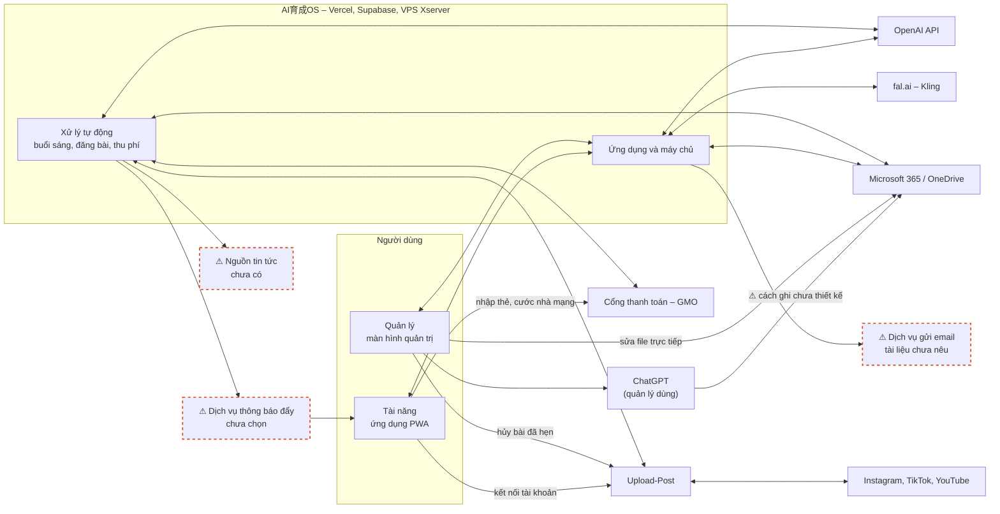

# Tích hợp hệ thống bên ngoài

> ⚠ File này viết theo bản yêu cầu v1. Bản v2 đã đổi một số nội dung và đánh lại toàn bộ số 確認 (mục cần xác nhận). Đọc [12_Cap_nhat_theo_v2.md](12_Cap_nhat_theo_v2.md) trước khi dùng nội dung bên dưới.

Hệ thống cần tích hợp với 6 dịch vụ mà [YK] đã nêu tên, chạy trên 3 nền tảng hạ tầng, và cần thêm ít nhất 3 dịch vụ tài liệu chưa nhắc tới. [YK] mục 8 chỉ nêu mục đích và dịch vụ dự kiến. Phương thức kết nối, xác thực và định dạng dữ liệu chưa được nêu.

**Cách đọc:**

- **Đã xác nhận:** có ghi trong [YK]. Các dịch vụ ở mục 8 đều là 弊社の想定 (dự kiến của FutureCore), chưa chốt.
- **Giả định:** mình suy ra từ cách dịch vụ đó thường vận hành, hoặc từ [SM] (tài liệu cũ hơn). Cần kiểm tra với tài liệu chính thức của nhà cung cấp trước khi thiết kế. Mình chưa tra cứu tài liệu API của bất kỳ nhà cung cấp nào.
- Theo [YK] mục 8, mọi dịch vụ ngoài do アデッソ ký hợp đồng và trả phí, kể cả trong giai đoạn phát triển và kiểm thử.

## 1. Sơ đồ tích hợp

## 2. Bảng tóm tắt

| STT | Hệ thống ngoài | Mục đích | Hướng dữ liệu | Cách kết nối | Trong tài liệu? | Nguồn |
| --- | --- | --- | --- | --- | --- | --- |
| 1 | Upload-Post | Đăng bài hẹn giờ lên 3 mạng xã hội, lấy số liệu và số người theo dõi, cho tài năng tự kết nối tài khoản | Hai chiều | API (xác nhận) | Có | [YK] 8, [SM] tr.39–40 |
| 2 | OpenAI API | Huấn luyện viên AI, bản nháp, nhận xét, kiểm tra từ cấm | Hệ thống gọi, nhận kết quả | API (giả định, [SM] tr.38) | Có | [YK] 8, 10-2 |
| 3 | ChatGPT | Quản lý nhập hồ sơ tài năng | ChatGPT ghi vào OneDrive | ⚠ Chưa thiết kế | Có | [YK] 8, 6-4 (2-3) |
| 4 | Microsoft 365 / OneDrive | Lưu hồ sơ, kinh nghiệm đăng bài, số liệu, ảnh, video | Hai chiều | ⚠ Chưa nêu | Có | [YK] 8, 7-2 |
| 5 | fal.ai (Kling) | Tạo video từ ảnh | Hệ thống gửi yêu cầu, nhận video | API ([SM] tr.9) | Có | [YK] 8, 6-8 |
| 6 | Cổng thanh toán (GMO Payment Gateway) | Đăng ký phương thức thanh toán, thu tiền hằng tháng | Hai chiều | ⚠ Chưa nêu | Có | [YK] 8, 6-3 |
| 7 | Dịch vụ thông báo đẩy | Gửi thông báo tới điện thoại tài năng | Hệ thống gửi đi | "今後検討" (sẽ xem xét sau) | Có, chưa chọn | [YK] 8, 6-12 (6-1) |
| 8 | Dịch vụ gửi email | Đặt lại mật khẩu qua email | Hệ thống gửi đi | ⚠ Chưa nêu | Không (nhưng chức năng 1-4 cần) | [YK] 6-1 (1-4) |
| 9 | Nguồn tin tức và xu hướng | Gợi ý chủ đề theo tin trong ngày | Hệ thống lấy về | ⚠ Chưa nêu | Không (chỉ có trong 確認11) | [YK] 5-3, 確認11 |
| — | Vercel, Supabase, VPS Xserver | Hạ tầng chạy hệ thống | — | — | Có (cần nâng lên gói trả phí) | [YK] 8 |
| — | Ứng dụng アデッソ hiện có, ứng dụng tự động nhắn tin Instagram | Không tích hợp. Chỉ dùng tên và logo, và không được ảnh hưởng ứng dụng nhắn tin đang chạy | — | — | Có | [YK] 2-6, 9-1 |

## 3. Upload-Post

Upload-Post là integration quan trọng nhất: mọi bài đăng và mọi số liệu đều đi qua đây. [YK] mục 8 ghi các khả năng của dịch vụ "sẽ kiểm tra với tài khoản thật", nghĩa là chưa kiểm chứng.

| Hạng mục | Nội dung |
| --- | --- |
| Mục đích | Xác nhận: đăng ký tài năng, tạo màn hình kết nối mạng xã hội cho từng tài năng, đăng bài hẹn giờ lên 3 mạng, lấy số liệu từng bài và số người theo dõi ([YK] 8, 6-10, 6-11) |
| Dữ liệu gửi đi | Xác nhận: thông tin tài năng khi đăng ký, ảnh hoặc video, chú thích, hashtag, giờ đăng. Giả định: tiêu đề YouTube, nhãn "do AI tạo" |
| Dữ liệu nhận về | Xác nhận: đường dẫn kết nối (hạn 48 giờ), trạng thái kết nối, kết quả đăng trên từng mạng và lý do lỗi, số liệu bài, số người theo dõi, khung giờ tương tác (nếu có). Cả bài tài năng tự đăng ngoài hệ thống (nếu Upload-Post đọc được, UC-09) |
| Hướng và thời điểm | Hệ thống → Upload-Post: khi quản lý đăng ký tài năng, khi tài năng bấm kết nối, khi bài được hẹn giờ. Upload-Post → hệ thống: số liệu mỗi ngày một lần (8-7). Giả định: kết quả đăng và việc mất kết nối nhận qua webhook hoặc hỏi định kỳ |
| API hoặc webhook | Xác nhận: kết nối bằng API ([YK] 8). [SM] tr.40: "không ghi giới hạn số lần gọi". Giả định: có webhook báo kết quả, chưa kiểm tra. Hủy bài đã hẹn thì quản lý làm trên màn hình Upload-Post, không qua API (確認28) |
| Xác thực | Giả định: khóa API của tài khoản アデッソ, lưu ở máy chủ và không hiện ra (BR-I02). Tài năng đăng nhập mạng xã hội trực tiếp trên màn hình kết nối của Upload-Post, hệ thống không giữ mật khẩu mạng xã hội |
| Xử lý lỗi | Xác nhận: đăng lỗi thì báo tài năng và cảnh báo quản lý, không tự đăng lại (8-5). Mất kết nối thì báo tài năng kết nối lại (8-6). Lấy số liệu lỗi thì lấy lại ở lần sau (8-7). Dịch vụ lỗi thì chỉ dừng chức năng liên quan (9-3) |
| Chưa rõ | Đăng ký tài năng lỗi thì xử lý sao. Các chỉ số cụ thể và độ trễ của số liệu. Có gắn được nhãn AI và tiêu đề YouTube không. Hệ thống biết bài bị hủy trên màn hình Upload-Post bằng cách nào. Gói dịch vụ cho hơn 150 tài năng. Gỡ tài năng khỏi Upload-Post khi tài năng kết thúc sử dụng |

## 4. OpenAI API

| Hạng mục | Nội dung |
| --- | --- |
| Mục đích | Xác nhận: trò chuyện với huấn luyện viên AI, tạo bản nháp, nhận xét ([YK] 8). Theo chức năng còn có: kiểm tra từ cấm (4-4), nhận biết chuyện nghiêm trọng (3-3), ghi file bộ nhớ (3-2), chọn giờ đăng (8-1) |
| Dữ liệu gửi đi | Xác nhận: chỉ phần thông tin cần cho hội thoại và bản nháp (10-2), gồm hồ sơ, mục tiêu, kinh nghiệm đăng bài, chỉ dẫn, hội thoại, số liệu (3-1). Giả định: có gửi ảnh hay không thì chưa rõ |
| Dữ liệu nhận về | Câu trả lời, chủ đề gợi ý, bản nháp, kết quả kiểm tra từ cấm. Giả định: số token đã dùng, để tính chi phí (3-5) |
| Hướng và thời điểm | Hệ thống gọi và nhận kết quả: mỗi khi tài năng nhắn tin, mỗi sáng trong xử lý buổi sáng, mỗi lần 採用 |
| API hoặc webhook | API tính phí theo mức dùng, ký riêng với gói ChatGPT, vì gói ChatGPT không gọi được từ ứng dụng ([SM] tr.38). Không cần webhook |
| Xác thực | Giả định: khóa API của tổ chức アデッソ trên OpenAI. Xác nhận: cài đặt không cho dùng dữ liệu để huấn luyện (8, 10-2) |
| Xử lý lỗi | Xác nhận: dịch vụ AI lỗi thì báo trên màn hình và cho gửi lại sau (3-4) |
| Chưa rõ | Lỗi trong xử lý buổi sáng thì sao (tin sáng có bị trễ không). Gọi cho 1.000 tài năng cùng lúc có vượt giới hạn tốc độ không. Dùng mô hình nào. Có mức trần chi phí không. Tin tức trong ngày lấy qua OpenAI hay nguồn khác (確認11) |

## 5. ChatGPT (quản lý dùng để nhập hồ sơ)

| Hạng mục | Nội dung |
| --- | --- |
| Mục đích | Xác nhận: quản lý trò chuyện với ChatGPT để nhập hồ sơ tài năng vào file trong thư mục của tài năng. ChatGPT nêu rõ sẽ ghi gì cho ai, quản lý xác nhận rồi mới ghi ([YK] 6-4 chức năng 2-3). Khoảng 5 quản lý dùng ([YK] 8) |
| Dữ liệu | Gửi đi: tên tài năng, profile, định hướng, sở thích, sở trường, mục tiêu tương lai. Ghi vào: file hồ sơ trên OneDrive |
| Hướng | ChatGPT → OneDrive. Không đi qua hệ thống AI育成OS (theo [YK] 2-6) |
| API, xác thực | ⚠ Chưa thiết kế. Giả định có hai cách: (a) một Custom GPT gọi API của hệ thống, hệ thống ghi vào OneDrive; (b) dùng bộ kết nối OneDrive có sẵn của ChatGPT. Cách (a) kiểm soát được việc nhận đúng tài năng và ghi nhật ký. Cách (b) phụ thuộc gói ChatGPT mà アデッソ đang dùng |
| Xử lý lỗi | Chưa nêu |
| Chưa rõ | アデッソ dùng gói ChatGPT nào (cá nhân, Team hay Enterprise), dùng chung hay riêng từng quản lý. Chức năng này là 高 (cao) nhưng chưa có cơ chế |

## 6. Microsoft 365 / OneDrive

| Hạng mục | Nội dung |
| --- | --- |
| Mục đích | Xác nhận: lưu hồ sơ, mục tiêu, kinh nghiệm đăng bài, số liệu, ảnh và video. Dùng gói Microsoft 365 mà アデッソ đang có ([YK] 8, 7-2) |
| Dữ liệu gửi đi | Xác nhận: tạo thư mục khi đăng ký tài năng (2-2), ghi số liệu (8-8), ghi file bộ nhớ của AI (3-2), lưu ảnh và video (6-4) |
| Dữ liệu nhận về | Xác nhận: mỗi sáng đọc thư mục tài năng và thư mục chung (2-1). Hiển thị ảnh và video trong ứng dụng (6-4) |
| Hướng và thời điểm | Hai chiều. Đọc mỗi sáng trước giờ nhắn tin. Ghi khi có sự kiện. Quản lý sửa file trực tiếp trên OneDrive, không qua hệ thống, có tác dụng từ sáng hôm sau (7-5) |
| API hoặc webhook | Giả định: Microsoft Graph API. Tài liệu không nêu tên. Có thể không cần webhook vì hệ thống đọc theo lịch |
| Xác thực | Giả định: đăng ký một ứng dụng trong Microsoft Entra ID của アデッソ, quản trị viên bên アデッソ cấp quyền truy cập file. Giới hạn quyền trong đúng thư mục của hệ thống, không cho đọc toàn bộ OneDrive của công ty |
| Xử lý lỗi | Chỉ có quy tắc chung 9-3 (dừng chức năng liên quan) |
| Chưa rõ | OneDrive cá nhân của ai hay SharePoint dùng chung. Đọc lỗi trong xử lý buổi sáng thì AI dùng dữ liệu cũ hay bỏ qua tài năng đó. Giới hạn tốc độ khi đọc cho 1.000 tài năng. AI và quản lý cùng ghi một file. Có ghi nhật ký việc quản lý xem file trực tiếp không (7-6). Dung lượng còn trống trong gói Microsoft 365 hiện tại |

## 7. fal.ai (Kling)

| Hạng mục | Nội dung |
| --- | --- |
| Mục đích | Xác nhận: tạo video ngắn hoặc video trình chiếu ảnh từ ảnh. Chọn Kling vì rẻ và làm video người Nhật đẹp khi thử nghiệm ([YK] 8) |
| Dữ liệu gửi đi | Ảnh gốc, loại video. [SM] tr.9 có nói gửi cả kịch bản. Giả định: câu mô tả cho AI, tỉ lệ khung dọc |
| Dữ liệu nhận về | Video đã tạo, hoặc lý do lỗi (5-1). Giả định: chi phí thực tế của lần tạo |
| Hướng và thời điểm | Hệ thống gửi yêu cầu khi tài năng xác nhận giá. Video trả về sau vài phút ([SM] tr.9), xong thì báo tài năng (5-1) |
| API hoặc webhook | Xác nhận: gửi qua API ([SM] tr.9). Giả định: vì phải chờ, nhận kết quả qua webhook hoặc hỏi định kỳ |
| Xác thực | Giả định: khóa API của tài khoản fal.ai do アデッソ ký |
| Xử lý lỗi | Xác nhận: lỗi thì báo lý do và không tính vào số lần tạo video (5-1, 5-4) |
| Chưa rõ | Chờ quá lâu thì xử lý sao. Video trình chiếu ảnh có cần Kling không hay tự ghép ảnh. Đơn giá thu tài năng so với chi phí thực của fal.ai (mâu thuẫn M7). Kling có cho dùng ảnh người thật và ảnh người vị thành niên không |

## 8. Cổng thanh toán (GMO Payment Gateway theo dự kiến)

| Hạng mục | Nội dung |
| --- | --- |
| Mục đích | Xác nhận: thu tiền qua cước nhà mạng và thẻ. Mỗi tháng thu số tiền thay đổi (thuê bao + phí video). Chỉ kết nối với một cổng thanh toán ([YK] 5-4, 8) |
| Dữ liệu gửi đi | Giả định: mã khách hàng, số tiền từng tháng (UC-11: "hệ thống tính số tiền và báo cho cổng thanh toán") |
| Dữ liệu nhận về | Giả định: đã đăng ký phương thức thanh toán chưa, kết quả thu (thành công hoặc lỗi). Thông tin thẻ không về hệ thống (xác nhận, 10-2) |
| Hướng và thời điểm | Tài năng nhập thông tin trên màn hình của cổng thanh toán (1-1). Hệ thống gửi số tiền vào ngày chốt sổ. Cổng thanh toán trả kết quả. Ngày chốt sổ và ngày thu tiền sẽ quyết sau khi chọn cổng |
| API hoặc webhook | Giả định: chuyển tài năng sang màn hình của cổng để đăng ký, dùng API để thu tiền, nhận thông báo kết quả từ cổng |
| Xác thực | Giả định: mã cửa hàng và mật khẩu do cổng thanh toán cấp cho アデッソ. Phải có môi trường kiểm thử riêng (12-4) |
| Xử lý lỗi | Xác nhận: thu lỗi thì báo tài năng và quản lý, không tự dừng sử dụng (1-1). Quản lý quyết có dừng không (確認20) |
| Chưa rõ | **Rủi ro lớn nhất:** cổng thanh toán, nhất là cước nhà mạng, có thu được số tiền thay đổi hằng tháng không (確認33). Thẩm định cổng thanh toán mất thời gian (14-4). Ngoài ra: có thu lại khi lỗi không. Tài năng vị thành niên dùng cước nhà mạng có bị giới hạn không. Thu tiền khi tài năng kết thúc giữa tháng |

## 9. Các integration khác

| Hệ thống | Mục đích và dữ liệu | Cách kết nối và xác thực | Xử lý lỗi | Trạng thái | Nguồn [YK] |
| --- | --- | --- | --- | --- | --- |
| Dịch vụ thông báo đẩy | Gửi 15 loại thông báo tới điện thoại tài năng. Bấm vào thì mở màn hình liên quan | "今後検討" (sẽ xem xét sau). Giả định: chuẩn Web Push của trình duyệt, lưu đăng ký nhận thông báo cho từng thiết bị. iPhone cần iOS 16.4 trở lên và phải thêm ứng dụng vào màn hình chính | Không đảm bảo luôn tới nơi (11). Tài năng không bật thông báo thì vẫn xem được trong ứng dụng (6-1) | Chưa chọn | 8, 9-1, 6-12 (6-1), 11 |
| Dịch vụ gửi email | Gửi email đặt lại mật khẩu cho tài năng (1-4). Giả định: email mời, email cho quản lý mới, kênh dự phòng khi không nhận được thông báo đẩy | Giả định: một dịch vụ gửi email giao dịch, xác thực bằng khóa API, gửi từ tên miền của アデッソ | Chưa nêu | **Thiếu trong mục 8.** Chức năng 1-4 cần nhưng không có dịch vụ nào được nêu | 6-1 (1-4) |
| Nguồn tin tức và xu hướng | AI tìm tin trong ngày hợp với định hướng của tài năng để gợi ý chủ đề | Giả định: dùng chức năng tìm kiếm web của OpenAI hoặc một API tin tức riêng | Chưa nêu | **Thiếu trong mục 8.** Chỉ có trong 5-3 và 確認11. Ảnh hưởng chi phí và bản quyền nội dung | 5-3, 確認11 |
| Ứng dụng xác thực hai bước | Quản lý nhập mã 6 số từ ứng dụng xác thực | Giả định: chuẩn mã dùng một lần theo thời gian (TOTP), không cần kết nối bên ngoài | Chưa có cách xử lý khi mất điện thoại xác thực | Xác nhận (có trong tài liệu) | 6-2 (1-6) |
| Vercel, Supabase, VPS Xserver | Hạ tầng chạy hệ thống. Supabase là cơ sở dữ liệu theo dự kiến | Dùng các tài khoản アデッソ đang có. Phải nâng Vercel và Supabase lên gói trả phí | Sao lưu và khung giờ hoạt động "sẽ quyết khi thiết kế" (9-3) | Xác nhận | 8, 9-1, 9-3 |
| Ứng dụng tự động nhắn tin Instagram đang chạy | Không tích hợp, nhưng không được làm ảnh hưởng tới ứng dụng này | — | — | Xác nhận. Chưa rõ hai ứng dụng có dùng chung tài khoản Instagram, chung VPS hay chung giới hạn API không | 9-1 |
| Ứng dụng アデッソ hiện có | Không tích hợp. Chỉ dùng tên, logo, màu. Dùng chung đăng nhập để sau (mục 13) | — | — | Xác nhận | 2-6, 6-14, 13 |

## 10. Thông tin kỹ thuật cần khách cung cấp

[YK] 14-4 yêu cầu アデッソ ký hợp đồng và làm thẩm định với các dịch vụ ngoài, cung cấp tài khoản và thông tin kết nối cho giai đoạn phát triển và kiểm thử. Thời hạn "sẽ điều chỉnh sau". Các dịch vụ chưa xong hợp đồng trước đợt kiểm thử nghiệm thu (giữa tháng 1/2027) sẽ bị bỏ khỏi nghiệm thu (12-1).

Mức ưu tiên dưới đây là đề xuất của mình: **Gấp** là việc cần làm ngay vì thẩm định lâu hoặc chặn việc thiết kế.

| STT | Thông tin cần cung cấp | Dịch vụ | Ưu tiên | Căn cứ |
| --- | --- | --- | --- | --- |
| 1 | Chốt cổng thanh toán. Xác nhận cổng thu được số tiền thay đổi hằng tháng qua cước nhà mạng và thẻ. Bắt đầu thẩm định | Cổng thanh toán | Gấp | 8, 14-4, 確認33 |
| 2 | Mã cửa hàng, thông tin xác thực của môi trường kiểm thử, tài liệu kết nối, cách kiểm thử thanh toán | Cổng thanh toán | Cao | 12-4 |
| 3 | Tài khoản Upload-Post (gói đủ cho số tài năng dự kiến), khóa API, logo để hiển thị trên màn hình kết nối ([SM] tr.39) | Upload-Post | Gấp | 8 |
| 4 | Tài khoản Instagram (doanh nghiệp hoặc nhà sáng tạo), TikTok, YouTube dùng để kiểm thử | Upload-Post | Gấp | 12-4 |
| 5 | Tổ chức và khóa API OpenAI, đã tắt việc dùng dữ liệu để huấn luyện. Mức chi tiêu tối đa hằng tháng | OpenAI | Cao | 8, 10-2 |
| 6 | Thông tin Microsoft 365: loại lưu trữ (OneDrive của ai, hay SharePoint), thư mục gốc cho hệ thống. Quản trị viên đăng ký ứng dụng trong Microsoft Entra ID và cấp quyền | OneDrive | Gấp | 8, 7-2 |
| 7 | Gói ChatGPT đang dùng, số tài khoản, dùng chung hay riêng từng quản lý. Có cho dùng Custom GPT hoặc bộ kết nối không | ChatGPT | Gấp | 8, 6-4 (2-3) |
| 8 | Tài khoản fal.ai và khóa API. Mức chi tiêu tối đa | fal.ai | Cao | 8 |
| 9 | Quyền quản trị hoặc tài khoản thành viên trên Vercel, Supabase, VPS Xserver. Chấp thuận nâng lên gói trả phí | Hạ tầng | Cao | 8 |
| 10 | Tên miền cho ứng dụng và cho email gửi đi, quyền chỉnh DNS | Hạ tầng, email | Cao | Giả định (tài liệu không nêu) |
| 11 | Ứng dụng nhắn tin Instagram đang chạy dùng tài khoản, máy chủ và API nào, để tránh ảnh hưởng lẫn nhau | Hệ thống hiện có | Trung bình | 9-1 |
| 12 | Ảnh logo, mã màu của ứng dụng アデッソ | Giao diện | Trung bình | 6-14 |
| 13 | Kinh nghiệm đăng bài, chỉ dẫn thuật toán, danh sách từ cấm đã xem lại, dữ liệu tài năng ban đầu | OneDrive, hệ thống | Trung bình | 7-4 |
| 14 | Xác nhận đã lấy đồng ý của tài năng (và phụ huynh với người vị thành niên) trước khi gửi dữ liệu cho các dịch vụ ngoài. Nếu kiểm thử bằng dữ liệu thật thì cần đồng ý bằng văn bản | Mọi dịch vụ | Cao | 10-3 |

## 11. Rủi ro tích hợp

| Rủi ro | Ảnh hưởng | Căn cứ |
| --- | --- | --- |
| Cổng thanh toán không thu được số tiền thay đổi, hoặc thẩm định không kịp | Phải đổi mô hình thu phí, hoặc phần thu phí bị bỏ khỏi nghiệm thu | 確認33, 12-1, 14-4 |
| Upload-Post là công ty mới (TONVI TECH, Tây Ban Nha, thành lập 2024) và các khả năng chưa kiểm chứng | Toàn bộ việc đăng bài và số liệu phụ thuộc một nhà cung cấp. Nếu thiếu chức năng thì phải thỏa thuận cách thay thế bằng văn bản | [SM] tr.39, [YK] 8 |
| Luồng nhập liệu từ ChatGPT chưa có cơ chế | Chức năng 高 (cao) 2-3 không làm được nếu gói ChatGPT không hỗ trợ | 6-4 (2-3) |
| OneDrive và OpenAI bị giới hạn tốc độ khi xử lý buổi sáng cho nhiều tài năng cùng giờ | Tin nhắn buổi sáng bị trễ | 9-2, 確認24 |
| Chưa chọn cách gửi thông báo đẩy, và trên iPhone phải thêm ứng dụng vào màn hình chính | Huấn luyện viên AI mất tác dụng nếu tin nhắn không tới được tài năng | 8, 9-1, 11 |
| Dịch vụ ngoài đổi đặc tả, giá hoặc điều khoản | Do hợp đồng bảo trì xử lý, nằm ngoài phạm vi dự án | 11 |
