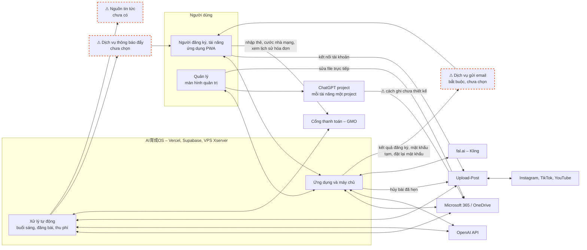

<!-- DELIVERY24112026 -->
## Cập nhật nguồn24/11 — đối chiếu25/11/2026

Phần cập nhật này thay nhận định cũ trên đúng chủ đề bên dưới; giữ nội dung trước để truy vết. [Báo cáo và hash](../docs/requirement-review/corrections-2026-11-19/DELIVERY_24112026_REVIEW.md). Chưa là baseline/AC đã duyệt.

### AI agent và dữ liệu

G/H ghi xác nhận24/11: AI Coach là agent đọc/ghi Supabase; nhận chỉ thị, khen, đề xuất và ghi tiến độ Challenge, nhập chỉ thị qua hội thoại M-17 trong phạm vi; dữ liệu trong DB có backup; Adesso trả token và chỉnh prompt; không bảo đảm phán đoán đúng. J101 là phân vai NỘI BỘ25/11: OS nhập dữ liệu dịch vụ ngoài; agent quyết định giờ rồi ghi lịch để OS thực thi.

**Còn mở/giới hạn:** YK3 §2-5/3-3/3-8/AC chưa đồng bộ. Không suy agent được SQL tùy ý hoặc bỏ kiểm quyền. Vị trí byte media và vai trò OneDrive chưa chốt lại toàn bộ. Căn cứ: `QA Q&A!G101:J101 (No.101)`; `EV-1311`; QA No.101;TR-2-1;TR-2-2;TR-2-3;TR-2-4;TR-3-1;TR-3-2;TR-3-5;TR-8-8.

### Cổng thanh toán

G17 ghi khách thông báo qua điện thoại sau họp sẽ chọn Square; GMO trong YK3 §2-4-11 và sheet dự án là ứng viên cũ.

**Còn mở/giới hạn:** Ngày cuộc điện thoại chưa rõ; chưa chứng minh đã ký/xét duyệt. Đội/provider kiểm Square đáp ứng nhà mạng, trả trước, phí biến đổi, giữa kỳ, quá hạn và lịch sử. Không mặc định Square hỗ trợ các yêu cầu này. Căn cứ: `KS アクション一覧!B17:G17 (No.16)`; `EV-1312`; QA No.46;QA No.49;QA No.86;TR-1-1;TR-5-4.

### TikTok: giữ đăng trực tiếp

Nguồn ghi tiếp tục đăng trực tiếp qua Upload-Post, không gửi nháp; giữ lịch/autopost và không thêm ô Talent chọn phạm vi công khai từng bài. Nguồn đồng thời ghi câu trả lời TikTok và Upload-Post khác nhau.

**Còn mở/giới hạn:** Đây là hướng đi và lời thuật lại của nguồn, không chứng minh TikTok duyệt mô hình. Giữ rủi ro hạn chế bài/tài khoản và kiểm provider; không ghi tuân thủ đã xác minh. Căn cứ: `KS 20261122!G20:H24 (No.19–23)`; `EV-1320`; QA No.70;QA No.71;TR-8-2;TR-8-3;TR-8-4.

<!-- /DELIVERY24112026 -->

# Tích hợp hệ thống bên ngoài

## Đối chiếu nguồn mới — 20/11/2026

Phần dưới cập nhật hiệu lực theo nguồn mới; các mã [AG]/SD18 trong phân tích trước vẫn là trích dẫn lịch sử. Không suy nguồn FCP hoặc mục cần xác nhận thành khách đã duyệt.

- **8-2** — Mở màn login/cho phép của từng SNS, không mở giao diện dịch vụ đăng; quay về T-07. Một tài khoản mỗi SNS; business/creator Instagram; không cần nối đủ 3 SNS. Còn mở: Luồng nhà cung cấp/48 h là thiết kế tích hợp phải kiểm, không hỏi khách chọn API hoặc khẳng định đã kiểm tài khoản thật. Căn cứ: `T19:10,26;BF19:5`.
- **1-1** — Phí tháng cộng phí video; giá AI video từ lượt đầu; tạo lại tính thêm, lỗi dịch vụ không tính. Không lưu thẻ; đổi thanh toán/lịch sử qua nhà cung cấp. Còn mở: Chưa chốt trả trước/sau, ngày bắt đầu tính phí, cổng chính thức; Square ở H105 là nhận định cần provider kiểm, không tự chọn GMO hay Square/thu ngay/ngày 1/thử lại 3 ngày. Căn cứ: `T19:9,20,21,25,26;M19:15;BF19:15;KS:20261120:23,24,25,26`.
- **6-4** — Dùng lại ảnh/video đã gửi; OneDrive vẫn là kho hồ sơ/chỉ thị. GJ19§14 cho phép cân nhắc kho ảnh/video khác nếu không thêm chi phí. Còn mở: Không tự chuyển kho lưu. Video tự làm lần lượt 1 bài/ngày vẫn KS 20261120 No.18/QA No.37; tư liệu Manager dùng trong kỳ và quyền xem còn No.19. Căn cứ: `T19:19;BF19:11,18;GJ19:14`.

Chi tiết từng finding/Q&A và hiệu lực gate: [báo cáo đối chiếu hiện hành](../docs/requirement-review/corrections-2026-11-19/NEW_DELIVERY_IMPACT.md). Không dùng các giả định mâu thuẫn bên dưới làm kết luận hiện hành.

Hệ thống cần tích hợp với 6 dịch vụ mà [YK2] đã nêu tên, chạy trên 3 nền tảng hạ tầng, và cần thêm ít nhất 3 dịch vụ tài liệu chưa nêu tên. V2 làm dịch vụ gửi email trở thành bắt buộc (kết quả đăng ký, mật khẩu tạm), cho hủy bài qua Upload-Post từ màn hình quản trị, và cho biết phí Upload-Post tính theo số tài năng. Tab này đã viết lại theo bản yêu cầu v2.

**Cách đọc:**

- [YK2] = AI育成OS_概要要件定義書_v2.docx. Số 確認 (mục cần xác nhận) theo đánh số của v2.
- **Đã xác nhận:** có ghi trong [YK2]. Các dịch vụ ở mục 8 đều là 弊社の想定 (dự kiến của FutureCore), chưa chốt.
- **Giả định:** mình suy ra từ cách dịch vụ đó thường vận hành, hoặc từ [SM] (tài liệu cũ hơn). Mình chưa tra cứu tài liệu API của nhà cung cấp nào.
- Theo [YK2] mục 8, mọi dịch vụ ngoài do アデッソ ký hợp đồng và trả phí, kể cả trong giai đoạn phát triển và kiểm thử.

## 1. Sơ đồ tích hợp

## 2. Bảng tóm tắt

| STT | Hệ thống ngoài | Mục đích | Hướng dữ liệu | Cách kết nối | Trong tài liệu? | Nguồn |
| --- | --- | --- | --- | --- | --- | --- |
| 1 | Upload-Post | Đăng bài hẹn giờ lên các mạng đã kết nối, hủy lịch, lấy số liệu và số người theo dõi, cho tài năng tự kết nối tài khoản | Hai chiều | API (xác nhận) | Có | [YK2] 8, UC-08 前提, [SM] tr.39–40 |
| 2 | OpenAI API | Huấn luyện viên AI, bản nháp, nhận xét, kiểm tra từ cấm | Hệ thống gọi, nhận kết quả | API (giả định, [SM] tr.38) | Có | [YK2] 8, 10-2 |
| 3 | ChatGPT | Quản lý tạo một project cho mỗi tài năng, nhập hồ sơ | ChatGPT ghi vào OneDrive | ⚠ Chưa thiết kế | Có | [YK2] 8, 6-4 (2-3), UC-01 前提 |
| 4 | Microsoft 365 / OneDrive | Lưu hồ sơ, kinh nghiệm đăng bài, số liệu, ảnh, video | Hai chiều | ⚠ Chưa nêu | Có | [YK2] 8, 7-2 |
| 5 | fal.ai (Kling) | Tạo video từ ảnh | Hệ thống gửi yêu cầu, nhận video | API ([SM] tr.9) | Có | [YK2] 8, 6-8 |
| 6 | Cổng thanh toán (GMO Payment Gateway) | Đăng ký phương thức thanh toán, thu tiền hằng tháng, lịch sử hóa đơn | Hai chiều | ⚠ Chưa nêu | Có | [YK2] 8, 6-3 |
| 7 | Dịch vụ thông báo đẩy | Gửi thông báo tới điện thoại tài năng | Hệ thống gửi đi | "今後検討" (sẽ xem xét sau) | Có, chưa chọn | [YK2] 8, 6-12 (6-1) |
| 8 | Dịch vụ gửi email | Email kết quả đăng ký (kèm mật khẩu tạm hoặc báo từ chối), đặt lại mật khẩu | Hệ thống gửi đi | ⚠ Chưa nêu | Chức năng cần, nhưng mục 8 không nêu dịch vụ | [YK2] 6-1 (1-4), UC-01, 別紙A |
| 9 | Nguồn tin tức và xu hướng | Gợi ý chủ đề theo tin trong ngày | Hệ thống lấy về | ⚠ Chưa nêu | Không (chỉ có trong 確認16) | [YK2] 5-3, 確認16 |
| — | Vercel, Supabase, VPS Xserver | Hạ tầng chạy hệ thống | — | — | Có (cần nâng lên gói trả phí) | [YK2] 8 |
| — | Ứng dụng アデッソ hiện có, ứng dụng tự động nhắn tin Instagram | Không tích hợp. Chỉ dùng tên và logo, và không được ảnh hưởng ứng dụng nhắn tin đang chạy | — | — | Có | [YK2] 2-6, 9-1 |

## 3. Upload-Post

Upload-Post là tích hợp quan trọng nhất: mọi bài đăng và mọi số liệu đều đi qua đây. [YK2] ghi phí trả theo tháng, tính theo số tài năng đã đăng ký, không tính theo số bài (UC-08 前提). Vì vậy thời điểm đăng ký và xóa tài năng ảnh hưởng trực tiếp chi phí.

| Hạng mục | Nội dung |
| --- | --- |
| Đã chốt | Có Best Time to Post và Audience Insights (số người theo dõi TikTok); bộ Upload-Post §11 |
| Mục đích | Xác nhận: đăng ký tài năng, tạo màn hình kết nối mạng xã hội, đăng bài hẹn giờ, hủy lịch khi quản lý hủy hoặc khi dừng đăng tự động, lấy số liệu từng bài và số người theo dõi (8, 6-10, 6-11, UC-08 前提) |
| Dữ liệu gửi đi | Xác nhận: thông tin tài năng khi đăng ký, ảnh hoặc video, chú thích, hashtag, giờ đăng, lệnh hủy lịch. Giả định: tiêu đề YouTube, nhãn "do AI tạo" |
| Dữ liệu nhận về | Xác nhận: đường dẫn kết nối (hạn 48 giờ), trạng thái kết nối, kết quả đăng trên từng mạng và lý do lỗi, số liệu bài trong phạm vi Upload-Post lấy được, số người theo dõi, khung giờ tương tác (nếu có). Cả bài tài năng tự đăng ngoài hệ thống (UC-09) |
| Hướng và thời điểm | Hệ thống → Upload-Post: khi đăng ký tài năng (⚠ lúc nào, xem dòng "Chưa rõ"), khi tài năng bấm kết nối, khi bài được hẹn giờ, khi hủy. Upload-Post → hệ thống: số liệu mỗi ngày một lần (8-7). Giả định: kết quả đăng và việc mất kết nối nhận qua webhook hoặc hỏi định kỳ |
| API hoặc webhook | Xác nhận: kết nối bằng API ([YK2] 8). Hủy bài qua API, không còn làm tay trên màn hình Upload-Post (7-2). Giả định: có webhook báo kết quả, chưa kiểm tra |
| Xác thực | Giả định: khóa API của tài khoản アデッソ, lưu ở máy chủ và không hiện ra (BR-I02). Tài năng đăng nhập mạng xã hội trực tiếp trên màn hình kết nối của Upload-Post, hệ thống không giữ mật khẩu mạng xã hội |
| Xử lý lỗi | Xác nhận: đăng lỗi thì báo tài năng trong ứng dụng và cảnh báo quản lý, không tự đăng lại (8-5, 確認38). Mất kết nối thì báo tài năng kết nối lại (8-6). Lấy số liệu lỗi thì lấy lại ở lần sau (8-7). Dịch vụ lỗi thì chỉ dừng chức năng liên quan (9-3) |
| Chưa rõ | **Đăng ký tài năng lúc nào:** 8-2 vẫn ghi "khi đăng ký tài năng", nhưng luồng mới là gửi đơn, duyệt, thanh toán. **Xóa tài năng lúc nào** (khi 退会, khi bỏ thanh toán) để không tốn phí. Đăng ký lỗi thì xử lý sao. Các chỉ số cụ thể và độ trễ của số liệu. Có gắn được nhãn AI và tiêu đề YouTube không. Hủy lịch thất bại thì sao. Bảng giá theo số tài năng "sẽ gửi riêng" |

## 4. OpenAI API

| Hạng mục | Nội dung |
| --- | --- |
| Đã chốt | Nguồn tin tức: chức năng tìm web của AI, 1 lần mỗi ngày, chung cho mọi tài năng (CR-05). Không trần chi phí (Q&A No.17) |
| Mục đích | Xác nhận: trò chuyện với huấn luyện viên AI, tạo bản nháp, nhận xét (8). Theo chức năng còn có: kiểm tra từ cấm (4-4), nhận biết chuyện nghiêm trọng (3-3), ghi file bộ nhớ (3-2), chọn giờ đăng (8-1). Nếu làm màn hình chỉ dẫn cho AI thì có thêm lần gọi "chạy thử" ⚠ (確認7) |
| Dữ liệu gửi đi | Xác nhận: chỉ phần thông tin cần cho hội thoại và bản nháp (10-2), gồm hồ sơ, mục tiêu, thử thách, kinh nghiệm đăng bài, chỉ dẫn, hội thoại, số liệu (3-1). V2 thêm ngày sinh để AI biết tuổi (UC-01 前提). Giả định: có gửi ảnh hay không thì chưa rõ |
| Dữ liệu nhận về | Câu trả lời, chủ đề gợi ý, bản nháp, kết quả kiểm tra từ cấm. Giả định: số token đã dùng, để tính chi phí (3-5) |
| Hướng và thời điểm | Hệ thống gọi và nhận kết quả: mỗi khi tài năng nhắn tin hoặc nhờ viết lại, mỗi sáng trong xử lý buổi sáng, mỗi lần 採用 |
| API hoặc webhook | API tính phí theo mức dùng, ký riêng với gói ChatGPT ([SM] tr.38). Không cần webhook |
| Xác thực | Giả định: khóa API của tổ chức アデッソ trên OpenAI. Xác nhận: cài đặt không cho dùng dữ liệu để huấn luyện (8, 10-2) |
| Xử lý lỗi | Xác nhận: dịch vụ AI lỗi thì báo trên màn hình và cho gửi lại sau (3-4) |
| Chưa rõ | Viết lại tối đa 2 lần ([KS] 確認29); trò chuyện chưa giới hạn (khách muốn đặt giới hạn, chưa chốt, 確認23); mỗi bản nháp tốn khoảng 0,2–3 yên, nên cần quyết có trần chi phí không. Lỗi trong xử lý buổi sáng thì sao. Giới hạn tốc độ khi gọi cho nhiều tài năng cùng giờ. Dùng mô hình nào. Tin tức lấy qua OpenAI hay nguồn khác (確認16) |

## 5. ChatGPT (quản lý dùng để nhập hồ sơ)

| Hạng mục | Nội dung |
| --- | --- |
| Mục đích | Xác nhận: khi thư mục tài năng được tạo, quản lý tạo một ChatGPT project cho tài năng và gắn với thư mục OneDrive của tài năng đó (UC-01 前提). Quản lý trò chuyện trong project để nhập hồ sơ. ChatGPT nêu rõ sẽ ghi gì cho ai, quản lý xác nhận rồi mới ghi (6-4 chức năng 2-3, UC-02 前提). Thử thách cũng có thể nhập cách này ⚠ (確認5) |
| Dữ liệu | Gửi đi: profile, định hướng, sở thích, sở trường, mục tiêu tương lai. Ghi vào: file hồ sơ trên OneDrive |
| Hướng | ChatGPT → OneDrive. Không đi qua hệ thống AI育成OS |
| API, xác thực | ⚠ Chưa thiết kế. Việc gắn project với thư mục OneDrive có vẻ dựa vào bộ kết nối có sẵn của ChatGPT [Giả định], nên phụ thuộc gói ChatGPT mà アデッソ đang dùng |
| Xử lý lỗi | Chưa nêu |
| Chưa rõ | Gói ChatGPT nào, dùng chung hay riêng từng quản lý. Làm tay cho từng tài năng, với tốc độ thêm 10 tài năng mỗi tháng (2-2). Quản lý biết lúc nào thư mục đã được tạo. Nếu làm màn hình chỉ dẫn cho AI thì project và màn hình đó quan hệ thế nào (確認6) |

## 6. Microsoft 365 / OneDrive

| Hạng mục | Nội dung |
| --- | --- |
| Đã chốt | Lưu ảnh, video (CR-10); dịch vụ ngoài lấy tệp từ bản tạm trên Supabase Storage (phương án B của Q&A No.8). Kết nối và quyền: `agent_spec/onedrive-agent-spec/HUONG_DAN_TICH_HOP_VI.md` |
| Mục đích | Xác nhận: lưu hồ sơ, mục tiêu, kinh nghiệm đăng bài, số liệu, ảnh và video. Dùng gói Microsoft 365 mà アデッソ đang có (8, 7-2) |
| Dữ liệu gửi đi | Xác nhận: tạo thư mục khi tài năng thanh toán xong, hoặc khi quản lý tạo tài khoản công ty (2-2). Ghi số liệu (8-8), ghi file bộ nhớ của AI (3-2), lưu ảnh và video (6-4) |
| Dữ liệu nhận về | Xác nhận: mỗi sáng đọc thư mục tài năng và thư mục chung (2-1). Hiển thị ảnh và video trong ứng dụng (6-4) |
| Hướng và thời điểm | Hai chiều. Đọc mỗi sáng trước giờ nhắn tin. Ghi khi có sự kiện. Quản lý sửa file trực tiếp hoặc qua ChatGPT project, có tác dụng từ sáng hôm sau (7-5). Bên phát triển gửi mẫu định dạng file kinh nghiệm đăng bài (UC-02 前提) |
| API hoặc webhook | Giả định: Microsoft Graph API. Tài liệu không nêu tên. Có thể không cần webhook vì hệ thống đọc theo lịch |
| Xác thực | Giả định: đăng ký một ứng dụng trong Microsoft Entra ID của アデッソ, quản trị viên bên アデッソ cấp quyền. Giới hạn quyền trong đúng thư mục của hệ thống |
| Xử lý lỗi | Chỉ có quy tắc chung 9-3 (dừng chức năng liên quan) |
| Chưa rõ | OneDrive cá nhân của ai hay SharePoint dùng chung. Tạo thư mục lỗi sau khi thanh toán thì sao. Đọc lỗi trong xử lý buổi sáng thì AI dùng dữ liệu cũ hay bỏ qua tài năng đó. Giới hạn tốc độ khi đọc cho nhiều tài năng. AI, ChatGPT và quản lý cùng ghi một file. Dung lượng còn trống |

## 7. fal.ai (Kling)

| Hạng mục | Nội dung |
| --- | --- |
| Đã chốt | Chỉ dùng cho video ngắn; video trình chiếu ghép ảnh ở máy chủ (CR-04) |
| Mục đích | Xác nhận: tạo video ngắn hoặc video trình chiếu ảnh từ ảnh (8, 確認31) |
| Dữ liệu gửi đi | Ảnh gốc, loại video. [SM] tr.9 có nói gửi cả kịch bản. Giả định: câu mô tả cho AI, tỉ lệ khung dọc |
| Dữ liệu nhận về | Video đã tạo, hoặc lý do lỗi (5-1). Giả định: chi phí thực tế của lần tạo |
| Hướng và thời điểm | Hệ thống gửi yêu cầu khi tài năng xác nhận giá. Tài năng được đóng ứng dụng trong lúc chờ. Xong thì báo tài năng (5-1, UC-06 前提) |
| API hoặc webhook | Xác nhận: gửi qua API ([SM] tr.9). Giả định: vì phải chờ, nhận kết quả qua webhook hoặc hỏi định kỳ |
| Xác thực | Giả định: khóa API của tài khoản fal.ai do アデッソ ký |
| Xử lý lỗi | Xác nhận: lỗi thì báo lý do và không tính vào số lần tạo video (5-1, 5-4) |
| Chi phí tham khảo | [YK2] ước tính (確認37): bài video trình chiếu ảnh khoảng 2–18 yên khi dùng ảnh tài năng chụp. Nếu ảnh cũng do AI tạo thì khoảng 33–67 yên (chất lượng trung bình) hoặc 126–216 yên (chất lượng cao) |
| Chưa rõ | Chờ quá lâu thì xử lý sao. Video trình chiếu ảnh có cần Kling không hay tự ghép ảnh. Đơn giá thu tài năng so với chi phí thực của fal.ai (mâu thuẫn M5 ở tab "Quy tắc nghiệp vụ"). Kling có cho dùng ảnh người thật và ảnh người vị thành niên không |

## 8. Cổng thanh toán (GMO Payment Gateway theo dự kiến)

| Hạng mục | Nội dung |
| --- | --- |
| Mục đích | Xác nhận: thu tiền của mọi tài năng qua cước nhà mạng và thẻ. Mỗi tháng thu số tiền thay đổi (thuê bao + phí video). Tài năng xem lịch sử hóa đơn trên trang của cổng. Chỉ kết nối với một cổng (5-4, 8, 6-3 chức năng 1-1, UC-11 前提) |
| Dữ liệu gửi đi | Giả định: mã khách hàng, số tiền từng tháng (UC-11: "hệ thống tính số tiền và báo cho cổng thanh toán") |
| Dữ liệu nhận về | Giả định: đã đăng ký phương thức thanh toán chưa (dùng để mở khóa huấn luyện viên AI và tạo thư mục), kết quả thu. Thông tin thẻ không về hệ thống (xác nhận, 10-2) |
| Hướng và thời điểm | Tài năng nhập thông tin trên màn hình của cổng lúc hướng dẫn lần đầu. Hệ thống gửi số tiền vào ngày chốt sổ. Ngày chốt sổ và ngày thu tiền sẽ quyết sau khi chọn cổng |
| API hoặc webhook | Giả định: chuyển tài năng sang màn hình của cổng để đăng ký, dùng API để thu tiền, nhận thông báo kết quả từ cổng |
| Xác thực | Giả định: mã cửa hàng và mật khẩu do cổng cấp cho アデッソ. Phải có môi trường kiểm thử riêng (12-4) |
| Xử lý lỗi | Xác nhận: thu lỗi thì báo tài năng và quản lý, không tự dừng sử dụng. Quản lý quyết có dừng không ⚠. Chu kỳ một tháng tính từ ngày đăng ký ([KS] 確認48) |
| Chưa rõ | **Rủi ro lớn nhất:** cổng thanh toán, nhất là cước nhà mạng, có thu được số tiền thay đổi hằng tháng không (確認49). Vì mọi tài năng phải thanh toán mới dùng được AI, cổng chưa sẵn sàng thì chặn cả luồng chính. Ngoài ra: có thu lại khi lỗi không. Tài năng vị thành niên dùng cước nhà mạng có bị giới hạn không. Rời đi giữa tháng thu trọn tháng ⚠ (確認50) |

## 9. Các tích hợp khác

| Hệ thống | Mục đích và dữ liệu | Cách kết nối và xác thực | Xử lý lỗi | Trạng thái | Nguồn [YK2] |
| --- | --- | --- | --- | --- | --- |
| Dịch vụ gửi email | Email kết quả đăng ký (mật khẩu tạm hoặc báo từ chối theo mẫu), email đặt lại mật khẩu | Giả định: một dịch vụ gửi email giao dịch, xác thực bằng khóa API, gửi từ tên miền của アデッソ | Chưa nêu. Email không tới thì người được duyệt không vào được | **Bắt buộc nhưng thiếu trong mục 8** | 6-1 (1-4), UC-01, 別紙A |
| Dịch vụ thông báo đẩy | Gửi thông báo dành cho tài năng (trong 17 loại ở 別紙A). Bấm vào thì mở màn hình liên quan | "今後検討" (sẽ xem xét sau). Giả định: chuẩn Web Push. iPhone cần iOS 16.4 trở lên và phải thêm ứng dụng vào màn hình chính | Không đảm bảo luôn tới nơi (11). Không bật thông báo vẫn xem được trong ứng dụng ⚠ (確認12) | Chưa chọn | 8, 9-1, 6-12 (6-1), 11 |
| Nguồn tin tức và xu hướng | AI tìm tin trong ngày hợp với định hướng của tài năng | Giả định: tìm kiếm web của OpenAI hoặc một API tin tức riêng | Chưa nêu | **Thiếu trong mục 8.** Chỉ có trong 5-3 và 確認16 | 5-3, 確認16 |
| Ứng dụng xác thực hai bước | Quản lý nhập mã 6 số | Giả định: chuẩn mã dùng một lần theo thời gian (TOTP) | Chưa có cách xử lý khi mất điện thoại xác thực | Xác nhận | 6-2 (1-6) |
| Vercel, Supabase, VPS Xserver | Hạ tầng chạy hệ thống | Dùng các tài khoản アデッソ đang có. Nâng Vercel và Supabase lên gói trả phí | Sao lưu và khung giờ hoạt động "sẽ quyết khi thiết kế" (9-3) | Xác nhận | 8, 9-1, 9-3 |
| Ứng dụng tự động nhắn tin Instagram đang chạy | Không tích hợp, nhưng không được làm ảnh hưởng | — | — | Xác nhận. Chưa rõ có dùng chung tài khoản, VPS hay giới hạn API không | 9-1 |
| Ứng dụng アデッソ hiện có | Không tích hợp. Chỉ dùng tên, logo, màu | — | — | Xác nhận | 2-6, 6-14, 13 |

## 10. Thông tin kỹ thuật cần khách cung cấp

[YK2] 14-4 yêu cầu アデッソ ký hợp đồng và làm thẩm định với các dịch vụ ngoài, cung cấp tài khoản và thông tin kết nối. Dịch vụ chưa xong hợp đồng trước đợt kiểm thử nghiệm thu (giữa tháng 1/2027) sẽ bị bỏ khỏi nghiệm thu (12-1). Tài liệu trao đổi qua thư mục Google Drive (14-2).

Mức ưu tiên dưới đây là đề xuất của mình: **Gấp** là việc cần làm ngay vì thẩm định lâu hoặc chặn việc thiết kế.

| STT | Thông tin cần cung cấp | Dịch vụ | Ưu tiên | Căn cứ |
| --- | --- | --- | --- | --- |
| 1 | Chốt cổng thanh toán. Xác nhận cổng thu được số tiền thay đổi hằng tháng qua cước nhà mạng và thẻ. Bắt đầu thẩm định | Cổng thanh toán | Gấp | 8, 14-4, 確認49 |
| 2 | Mã cửa hàng, thông tin xác thực của môi trường kiểm thử, tài liệu kết nối, cách kiểm thử thanh toán | Cổng thanh toán | Cao | 12-4 |
| 3 | Tài khoản Upload-Post, bảng giá theo số tài năng, khóa API, logo để hiển thị trên màn hình kết nối ([SM] tr.39) | Upload-Post | Gấp | 8, UC-08 前提 |
| 4 | Tài khoản Instagram (doanh nghiệp hoặc nhà sáng tạo), TikTok, YouTube dùng để kiểm thử | Upload-Post | Gấp | 12-4 |
| 5 | Tổ chức và khóa API OpenAI, đã tắt việc dùng dữ liệu để huấn luyện. Mức chi tiêu tối đa hằng tháng (quan trọng vì trò chuyện chưa giới hạn, 確認23) | OpenAI | Cao | 8, 10-2, 確認23, 29 |
| 6 | Thông tin Microsoft 365: loại lưu trữ (OneDrive của ai, hay SharePoint), thư mục gốc. Quản trị viên đăng ký ứng dụng trong Microsoft Entra ID và cấp quyền | OneDrive | Gấp | 8, 7-2 |
| 7 | Gói ChatGPT đang dùng, số tài khoản, dùng chung hay riêng. Cách gắn ChatGPT project với thư mục OneDrive | ChatGPT | Gấp | 8, 6-4 (2-3), UC-01 前提 |
| 8 | Tài khoản fal.ai và khóa API. Mức chi tiêu tối đa. Đơn giá mỗi lần tạo video thu tài năng | fal.ai | Cao | 8, UC-06 前提 |
| 9 | Quyền quản trị hoặc tài khoản thành viên trên Vercel, Supabase, VPS Xserver. Chấp thuận nâng lên gói trả phí | Hạ tầng | Cao | 8 |
| 10 | Tên miền cho ứng dụng và cho email gửi đi, quyền chỉnh DNS. Chọn dịch vụ gửi email | Hạ tầng, email | Gấp (email nay bắt buộc cho đăng ký) | 6-1 (1-4), UC-01. Tên miền: giả định |
| 11 | Văn bản điều khoản sử dụng hiển thị trên màn hình đăng ký, mẫu email từ chối | Giao diện, email | Cao | 2-3, UC-01 前提, 確認1 |
| 12 | Ứng dụng nhắn tin Instagram đang chạy dùng tài khoản, máy chủ và API nào | Hệ thống hiện có | Trung bình | 9-1 |
| 13 | Ảnh logo, mã màu, hình nhân vật モモ (Momo) | Giao diện | Trung bình | 6-14 |
| 14 | Kinh nghiệm đăng bài, chỉ dẫn thuật toán, danh sách từ cấm đã xem lại và cách nói công ty không dùng, dữ liệu ban đầu | OneDrive, hệ thống | Trung bình | 7-4, 確認4 |
| 15 | Xác nhận phạm vi ủy thác dữ liệu trong hợp đồng với tài năng thuộc công ty có bao gồm gửi dữ liệu cho các dịch vụ ngoài không. Cách xử lý với người ngoài công ty | Mọi dịch vụ | Cao | 2-3, 10-3, 確認1 |

## 11. Rủi ro tích hợp

| Rủi ro | Ảnh hưởng | Căn cứ |
| --- | --- | --- |
| Cổng thanh toán không thu được số tiền thay đổi, hoặc thẩm định không kịp | Mọi tài năng phải thanh toán mới dùng được AI, nên cả luồng chính bị chặn | 確認49, 12-1, 14-4, UC-03 前提 |
| Upload-Post là công ty mới (TONVI TECH, Tây Ban Nha, thành lập 2024), các khả năng chưa kiểm chứng | Toàn bộ việc đăng bài, hủy lịch và số liệu phụ thuộc một nhà cung cấp | [SM] tr.39, [YK2] 8 |
| Đăng ký tài năng với Upload-Post quá sớm (ví dụ ngay khi có đơn) | Tốn phí cho người chưa thanh toán hoặc bị từ chối | UC-08 前提, 8-2 |
| Luồng ChatGPT project → OneDrive chưa có cơ chế, lại làm tay cho từng tài năng | Chức năng 高 (cao) 2-3 không làm được, hoặc quản lý quá tải khi thêm 10 tài năng mỗi tháng | 6-4 (2-3), UC-01 前提, 2-2 |
| Email không tới (vào thư rác, sai địa chỉ) | Người được duyệt không nhận mật khẩu tạm, không bắt đầu dùng được | 6-1 (1-4) |
| OneDrive và OpenAI bị giới hạn tốc độ khi xử lý cho nhiều tài năng cùng khung giờ (sáng, trưa, tối, [KS] 確認18) | Tin nhắn bị trễ | 9-2, [KS] 確認18 |
| Chưa chọn cách gửi thông báo đẩy, và trên iPhone phải thêm ứng dụng vào màn hình chính | Huấn luyện viên AI mất tác dụng nếu tin nhắn không tới được tài năng | 8, 9-1, 11 |
| Dịch vụ ngoài đổi đặc tả, giá hoặc điều khoản | Do hợp đồng bảo trì xử lý, nằm ngoài phạm vi dự án | 11 |
