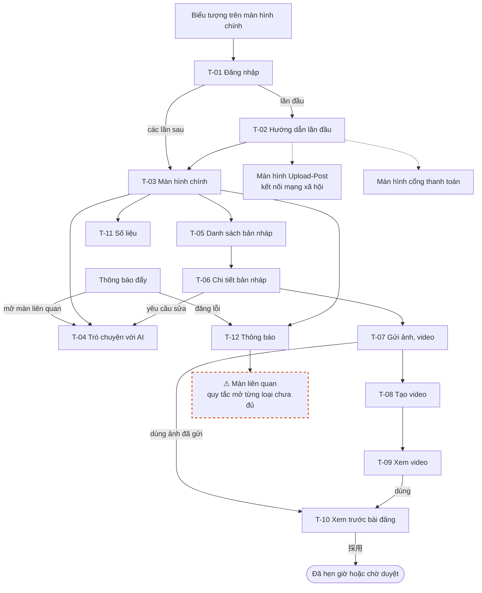

# Yêu cầu giao diện và trải nghiệm người dùng

> ⚠ File này viết theo bản yêu cầu v1. Bản v2 đã đổi một số nội dung và đánh lại toàn bộ số 確認 (mục cần xác nhận). Đọc [12_Cap_nhat_theo_v2.md](12_Cap_nhat_theo_v2.md) trước khi dùng nội dung bên dưới.

Có 3 tài liệu màn hình, nhưng chúng lệch nhau về mã màn hình, số màn hình và cả hành vi. Một số chỗ trong thiết kế còn trái với [YK] (bản yêu cầu, ngày 13/11). Cần chọn một bộ mã màn hình chung trước khi làm 画面定義 (bản định nghĩa màn hình).

| Ký hiệu | Tài liệu | Ngày | Mã màn hình | Đặc điểm |
| --- | --- | --- | --- | --- |
| [SD] | 画面遷移図と画面案 (sơ đồ chuyển màn hình và phương án màn hình), 8 trang | 11/11/2026 | T-01…T-12 (tài năng), M-01…M-10 (quản lý) | Mỗi màn hình đều ghi mã chức năng ở mục 6 của [YK]. Có 3 phương án màn hình chính. Ghi rõ "mã và cách chia màn hình sẽ chốt trong bản định nghĩa màn hình" (tr.1) |
| [TK-T] | Thiết kế ứng dụng tài năng, phiên bản dễ thương | 11/2026 | L-00…L-09 và Trang cá nhân (màn mới) | Kiểu Instagram, Trang cá nhân là trung tâm, nhân vật "モモ" (Momo). Không có L-08. Một số nội dung còn theo bản cũ (LINE, lượt video miễn phí) |
| [TK-M] | Thiết kế màn hình quản trị cho máy tính và điện thoại, có phân loại và chỉ dẫn cho AI | 11/2026 | M-01…M-11 (đánh số khác [SD]) | Có hai màn đề xuất thêm (M-10, M-11). Có cả giao diện điện thoại |

**Cách đọc:** bảng màn hình dùng mã của [SD] làm cột chính, vì [SD] gắn với mã chức năng trong [YK]. Cột bên cạnh là màn hình tương ứng trong thiết kế. ⚠ là chỗ thiết kế lệch với [YK] hoặc còn để ngỏ.

**Quy tắc chung cho mọi màn hình** ([YK] 6-14):

- Ưu tiên dễ dùng hơn đẹp (đã chốt trong SOW).
- Dùng tên, logo và màu của ứng dụng アデッソ hiện có.
- Luôn cho biết đang xảy ra gì khi lỗi, khi không có dữ liệu, khi đang tải.
- Cấu trúc menu sẽ ghi trong bản định nghĩa màn hình.

## 1. Màn hình của tài năng (ứng dụng trên điện thoại)

[SD] có 12 màn hình, [TK-T] có 10 màn hình. Ba màn có trong [SD] nhưng không có trong [TK-T]: tạo video (T-08), danh sách thông báo (T-12), xem trước riêng (T-10). Hai màn có trong [TK-T] nhưng không có trong [SD]: lịch và kết quả đăng bài (L-07), thanh toán (L-09).

| [SD] | [TK-T] | Màn hình | Chức năng trên màn | Mã chức năng [YK] | Ghi chú |
| --- | --- | --- | --- | --- | --- |
| T-01 | L-01 | Đăng nhập | Nhập email và mật khẩu, link "quên mật khẩu". Lần đầu mở từ đường dẫn mời và tự đặt mật khẩu | 1-4 | ⚠ [SD] tr.3 và [TK-T] tr.4 ghi "cách đăng nhập sẽ quyết", trong khi [YK] đã chốt email và mật khẩu. Chưa có màn đặt mật khẩu lần đầu và màn đặt lại mật khẩu |
| T-02 | L-02 (chỉ phần kết nối) | Hướng dẫn lần đầu | 4 bước: thêm vào màn hình chính, cho phép thông báo, kết nối 3 mạng (mở màn hình Upload-Post), đăng ký thanh toán (mở màn hình cổng thanh toán, chỉ người có trả phí). Bỏ dở thì làm tiếp | 6-2, 8-2 | Thứ tự các bước trong [SD] (kết nối trước thanh toán) ngược với [YK] 6-2 (thanh toán trước kết nối). [TK-T] không có bước thêm vào màn hình chính và bước cho phép thông báo |
| T-03 | L-03 và Trang cá nhân | Màn hình chính | Cho thấy việc cần làm hôm nay. [SD] có 3 phương án: A (một việc cần làm), B (bắt đầu từ lời của AI), C (số người theo dõi). [TK-T] làm thêm Trang cá nhân làm trung tâm: tỷ lệ đạt mục tiêu, số người theo dõi từng mạng, số ngày đăng liên tục | 6-8 | ⚠ Bố cục chọn từ 3 phương án (確認30). [TK-T] lại theo một hướng thứ tư. Cả hai đều hiển thị 2 bản nháp mỗi ngày, trong khi [YK] 5-3 nói cơ bản 1 bài mỗi ngày |
| T-04 | L-00 | Trò chuyện với AI | Tin nhắn sáng, nhiệm vụ mỗi ngày, chúc mừng, trả lời. Nút "xem bản nháp" và "gửi ảnh, video". Nhập tin tối đa 1.000 ký tự. Xem lại lịch sử | 3-4, 3-3 | — |
| T-05 | L-03 (phần bản nháp), L-07 | Danh sách bản nháp | Bản nháp hôm nay và các bài trước với trạng thái (đã hẹn, đã đăng, lỗi) | 4-1 | — |
| T-06 | L-04 | Chi tiết bản nháp | Xem chú thích, hashtag, kịch bản, giờ đăng. Nút 採用 (chấp nhận), yêu cầu sửa (sang trò chuyện), gửi ảnh, tạo video. Lựa chọn "gửi quản lý duyệt" chỉ hiện với tài năng được cài cần duyệt | 4-2, 4-3 | ⚠ Không có thao tác tự sửa chú thích và hashtag, dù [YK] 4-2 cho phép |
| T-07 | L-05 | Gửi ảnh, video | Chọn nhiều file hoặc chụp ngay, xem trước, gửi. Gửi video tự làm | 6-3, 6-4 | ⚠ Dung lượng tối đa chưa có |
| T-08 | (không có) | Tạo video | Chọn loại video và ảnh gốc, hiện độ dài dự kiến và đơn giá, xác nhận | 5-1, 5-4 | ⚠ [TK-T] chỉ có nút "tạo video" ở L-04, chưa có màn xác nhận giá |
| T-09 | L-06 | Xem video đã tạo | Xem video, chọn dùng, tạo lại hoặc bỏ. Ghi rõ video do AI tạo | 5-3, 5-5 | ⚠ [TK-T] hiển thị "12 lượt miễn phí, còn 2" và "tài khoản miễn phí không tạo được video". Cả hai đều trái [YK] 5-4 (không có lượt miễn phí, đã chốt ngày 20/10) |
| T-10 | L-04 (nằm trong) | Xem trước bài đăng | Ảnh hoặc video cùng chú thích trên một màn | 6-6 | — |
| T-11 | Trang cá nhân, L-07 | Số liệu | Tổng số người theo dõi 3 mạng, tiến độ mục tiêu, số liệu từng bài | 3-10, 6-7 | ⚠ Các chỉ số hiển thị chưa chốt ([TK-T] tr.11) |
| T-12 | (không có) | Danh sách thông báo | Thông báo cho tài năng, bấm thì mở màn liên quan | 6-1 | ⚠ [TK-T] không có màn này |
| (không có) | L-07 | Lịch và kết quả đăng bài | Lọc theo tất cả, sắp đăng, đã đăng. Trạng thái chờ duyệt, đã hẹn, đã đăng, lỗi. Số liệu từng bài | 6-7, 7-2 (phần của tài năng) | — |
| (không có) | L-09 | Sử dụng và thanh toán | Phí dự kiến trong tháng, lịch sử thanh toán, đăng ký hoặc đổi phương thức thanh toán | 1-1, 5-4 | ⚠ Có "mức trần phí video hằng tháng" (đã bị loại trong SOW) và nút "hủy đăng ký" (trái UC-13: tài năng báo quản lý, quản lý chuyển trạng thái) |

## 2. Màn hình của quản lý (màn hình quản trị)

[SD] và [TK-M] đều dùng mã M-01 đến M-1x, nhưng cùng một mã lại là hai màn khác nhau. Ví dụ M-02 trong [SD] là danh sách tài năng, còn trong [TK-M] là danh sách thông báo. Màn hình đầu tiên sau khi đăng nhập cũng khác: [SD] mở danh sách tài năng, [TK-M] mở danh sách thông báo.

| [SD] | [TK-M] | Màn hình | Chức năng trên màn | Mã chức năng [YK] | Ghi chú |
| --- | --- | --- | --- | --- | --- |
| M-01 | M-01 | Đăng nhập (hai bước) | Email, mật khẩu, mã 6 số từ ứng dụng xác thực. Lần đầu quét mã QR | 1-6 | ⚠ [TK-M] còn để ngỏ phương án gửi mã qua SMS. [YK] chỉ nói ứng dụng xác thực |
| M-02 | M-05 | Danh sách tài năng | Tìm theo họ tên, lọc theo trạng thái và số ngày không đăng bài. [SD] có thêm chi phí AI (3-5). [TK-M] có lọc theo nhóm phân loại | 7-1, 3-5 | ⚠ [SD] ghi "tài năng mình phụ trách", trái 確認3 (mọi quản lý xem mọi tài năng). [TK-M] thì đúng theo 確認3 |
| M-03 | M-06 (tab thông tin) | Chi tiết tài năng | Hồ sơ, mục tiêu và mức đạt, trạng thái kết nối mạng xã hội, hội thoại với AI. Nhập và sửa mục tiêu. Ghi nhật ký xem | 2-4, 7-1, 7-6 | ⚠ [TK-M] cho hồ sơ "chỉ xem, sửa bằng file" và không có ô nhập mục tiêu. [YK] 2-4 yêu cầu nhập mục tiêu trên màn hình quản trị |
| M-04 | M-06 (tab bài đăng) | Bài đăng của tài năng | Lọc theo đã hẹn, chờ duyệt, đã đăng, lỗi. Số liệu. Bấm bài chờ duyệt thì sang màn duyệt | 7-2 | ⚠ [TK-M] có nút "hủy bài đã hẹn" ngay trên màn hình quản trị, trái 確認28 (hủy trên Upload-Post). Cách "thay bài đã hẹn" chưa có |
| M-05 | M-03 + M-04 | Duyệt bài | Danh sách chờ duyệt (hạn duyệt, kết quả kiểm tra từ cấm). Xem bài, duyệt hoặc trả lại kèm lý do | 7-7 | ⚠ [TK-M] M-04 ghi "không có thao tác trả lại", trái [YK] 7-7 (có trả lại, bắt buộc có lý do) |
| M-06 | M-02 | Danh sách thông báo | Lọc theo loại và đã xử lý hay chưa. Bấm thì mở màn của tài năng liên quan | 7-4 | ⚠ [TK-M] có loại "bị chặn trên LINE" (LINE đã bị bỏ) và "bài đăng trễ", không có trong [YK] 7-4 |
| M-07 | M-06 (tab cài đặt) | Cài đặt tài năng | Có trả phí / miễn phí (chỉ chuyển sang miễn phí), trạng thái, cần duyệt hay không. Hiện màn xác nhận trước khi đổi | 1-2, 1-3, 7-3, 7-7 | ⚠ [SD] còn ghi các loại trạng thái "cần xác nhận", dù [YK] 7-3 đã có 3 trạng thái |
| M-08 | (không có) | Đăng bài tài khoản công ty | [SD]: quản lý ra chỉ dẫn đăng bài, xem bản nháp, duyệt | 9-1 | ⚠ Khác UC-12 ([YK]): quản lý đăng nhập vào ứng dụng bằng tài khoản công ty và dùng như tài năng, không duyệt. [TK-M] không có màn này |
| M-09 | M-07 | Cài đặt chung và dừng đăng tự động | [SD]: dừng và chạy lại toàn bộ việc đăng tự động, đổi các giá trị cài đặt chung. [TK-M]: chỉ có dừng và chạy lại, kèm lịch sử dừng | 7-5, 5-6 | ⚠ [TK-M]: chỉ quản lý "có quyền dừng" mới bấm được, trái [YK] 1-6 (mọi quản lý cùng một quyền). [TK-M] còn "hủy luôn bài đã hẹn" khi dừng, [YK] 7-5 không nói vậy. [TK-M] không có màn cài đặt chung |
| M-10 | M-09 | Nhật ký xem | Ngày giờ, quản lý, màn hình đã xem, tài năng. Lọc theo khoảng thời gian và tài năng | 7-6 | — |
| (không có) | M-08 | Quản lý tài khoản quản lý | Thêm, sửa, xóa quản lý. Có cột "quyền dừng đăng tự động" | 1-6 | ⚠ [SD] thiếu màn này dù [YK] 1-6 cần. [TK-M] có quyền riêng, trái [YK] |
| (không có) | M-10 | Nhóm phân loại tài năng | Tạo nhóm (tên, màu, thứ tự), một tài năng thuộc nhiều nhóm | Không có | ⚠ Đề xuất thêm, ngoài 54 chức năng |
| (không có) | M-11 | Chỉ dẫn cho AI | Viết chỉ dẫn theo toàn bộ, theo nhóm, theo tài năng (ưu tiên tài năng, rồi nhóm, rồi toàn bộ). Thử trước khi lưu, bắt buộc kiểm tra từ cấm | Không có | ⚠ Đề xuất thêm. Trái với cách của [YK] 7-5 (chỉ dẫn nằm trong file OneDrive) |

**Chức năng của quản lý chưa có màn hình trong cả hai tài liệu:**

- Đăng ký tài năng mới (2-2) và cấp lại đường dẫn mời (1-4).
- Quản lý danh sách từ cấm (4-4). [SD] M-03 có hiện dòng "đã đăng ký 12 từ cấm" nhưng không có màn riêng.
- Sửa bài dính từ cấm (4-4).
- Gửi ảnh, video hoặc tạo video thay tài năng (6-3, 確認16).
- Xem số lần tạo video và phí của từng tài năng (5-4).

## 3. Điều hướng

Sơ đồ dưới đây vẽ theo [SD] trang 1. Phần khác biệt của [TK-T] nằm ở bảng menu ngay sau sơ đồ.

| Nội dung | [SD] | [TK-T] / [TK-M] | Chưa thống nhất |
| --- | --- | --- | --- |
| Menu dưới của ứng dụng tài năng | 4 mục: màn chính, AI, bài đăng, số liệu (tr.2) | 5 mục: màn chính, trò chuyện, nút "+", lịch đăng, Trang cá nhân. Thêm lối tắt dạng "tin nổi bật" kiểu Instagram ([TK-T] tr.2) | ⚠ Số mục và các mục |
| Màn hình mở ra đầu tiên của tài năng | T-03 màn hình chính | Trang cá nhân | ⚠ |
| Màn hình mở từ mọi nơi (tài năng) | T-03, T-04, T-05, T-11 | Mọi màn đều về được Trang cá nhân | — |
| Bấm thông báo đẩy | Mở màn liên quan, ví dụ tin của AI mở T-04, đăng lỗi mở T-12 | Không nói | ⚠ Chưa có bảng đầy đủ cho 15 loại thông báo |
| Menu của màn hình quản trị | Menu bên (M-02, 04, 06, 08, 09, 10) mở từ mọi màn | 8 mục. Máy tính: menu bên trái. Điện thoại: menu dưới (thông báo, chờ duyệt, tài năng, menu khác) | ⚠ Các mục và thứ tự |
| Màn đầu tiên sau khi quản lý đăng nhập | Danh sách tài năng | Danh sách thông báo | ⚠ |
| Bấm thông báo trên màn hình quản trị | Mở màn của tài năng liên quan ([YK] 7-4) | Mở màn duyệt hoặc chi tiết tài năng | — |
| Chuyển sang dịch vụ ngoài | Màn hình Upload-Post và cổng thanh toán. Ứng dụng không tự làm các màn này | Giống [SD] | ⚠ Sau khi xong thì quay về ứng dụng thế nào, và cập nhật trạng thái ra sao |

## 4. Kiểm tra dữ liệu nhập

Các quy tắc dưới đây lấy từ [YK]. Các con số đều là 弊社の想定 (giả định của FutureCore), sẽ chốt khi khách xem màn hình thật ([YK] mục 6).

| Màn hình | Trường hoặc thao tác | Quy tắc kiểm tra | Thông báo khi sai | Nguồn [YK] |
| --- | --- | --- | --- | --- |
| Đăng nhập (tài năng, quản lý) | Mật khẩu | Ít nhất 8 ký tự, có cả chữ và số. Sai 5 lần liên tiếp thì khóa 15 phút | ⚠ Câu chữ chưa có | 6-1 (1-4), 6-2 (1-6) |
| Đăng nhập lần đầu | Đường dẫn mời | Hết hạn sau 7 ngày | ⚠ Báo đã hết hạn và bảo liên hệ quản lý (chưa ghi rõ) | 6-1 (1-4) |
| Đăng nhập quản lý | Mã xác thực | 6 số từ ứng dụng xác thực | — | 6-2 (1-6) |
| Đăng ký tài năng | Email | Không trùng với tài năng khác | ⚠ Chưa có | 6-4 (2-2) |
| Đăng ký tài năng | Các trường còn lại | ⚠ Chưa nói trường nào bắt buộc, độ dài, định dạng | — | 6-4 (2-2) |
| Cài đặt mục tiêu | Số người theo dõi, hạn đạt | Mặc định 10.000. ⚠ Chưa có khoảng giá trị hợp lệ, hạn đạt có được là ngày quá khứ không | — | 6-4 (2-4) |
| Trò chuyện với AI | Tin nhắn | Tối đa 1.000 ký tự | ⚠ Chưa có | 6-5 (3-4) |
| Chi tiết bản nháp | Nút 採用 | Phải có ảnh hoặc video | ⚠ Câu chữ chưa có | 6-6 (4-3) |
| Chi tiết bản nháp | Lựa chọn gửi duyệt | Chỉ hiện khi tài năng được cài cần duyệt | — | 6-6 (4-3) |
| Chi tiết bản nháp | Chú thích và hashtag | AI kiểm tra từ cấm khi 採用. Độ dài và số hashtag nằm trong giới hạn chung của 3 mạng | Dính từ cấm thì báo lý do. ⚠ Giới hạn độ dài chưa có số, cũng chưa rõ có kiểm tra khi tài năng tự sửa không | 6-6 (4-1, 4-4) |
| Gửi ảnh, video | File | Định dạng và dung lượng tối đa (chưa có số) | Vượt giới hạn thì báo lý do. Mất mạng thì báo và cho gửi lại | 6-7 (6-3) |
| Tạo video | Xác nhận giá | Phải hiện độ dài dự kiến và đơn giá trước khi gửi | Tạo lỗi thì báo lý do | 6-8 (5-1) |
| Duyệt bài | Trả lại | Bắt buộc nhập lý do | ⚠ Chưa có | 6-9 (7-7) |
| Cài đặt tài năng | Đổi trạng thái, đổi loại trả phí | Có màn xác nhận. Chỉ chuyển từ có trả phí sang miễn phí | — | 6-2 (7-3), 6-3 (1-3) |
| Cài đặt chung | Dừng đăng tự động | Có màn xác nhận | — | 6-10 (7-5) |
| Cài đặt chung | Giờ nhắn tin, giờ nhắc, số ngày | ⚠ Chưa có khoảng giá trị hợp lệ | — | 5-6 |
| Danh sách từ cấm | Từ thêm mới | ⚠ Có cho trùng không, độ dài tối đa | — | 6-6 (4-4) |

## 5. Hiển thị trên các kích thước màn hình

| Giao diện | Yêu cầu trong [YK] | Thiết kế | Chưa rõ | Nguồn |
| --- | --- | --- | --- | --- |
| Ứng dụng tài năng | Chạy trên điện thoại iPhone và Android dưới dạng PWA (ứng dụng web cài lên màn hình chính). Thông báo đẩy trên iPhone cần iOS 16.4 trở lên | Chỉ có bản cho điện thoại | ⚠ Danh sách hệ điều hành và trình duyệt được hỗ trợ ("sẽ ghi ở bản cuối"). Máy tính bảng, màn hình ngang, chữ phóng to có cần hỗ trợ không | [YK] 9-1, 6-12 (6-8) |
| Màn hình quản trị | Dùng trên trình duyệt máy tính. Mở được trên điện thoại nhưng không làm giao diện riêng cho điện thoại (確認31) | [SD]: chỉ có bản máy tính. [TK-M]: có cả bản máy tính và bản điện thoại cho mọi màn | ⚠ Mâu thuẫn: có làm giao diện điện thoại hay không. Nếu có thì khối lượng thiết kế và kiểm thử tăng | [YK] 9-1, [TK-M] tr.1, 2, 18 |

## 6. Trạng thái đang tải, trống và lỗi

[YK] 6-14 chỉ đưa quy tắc chung: luôn cho biết đang xảy ra gì khi lỗi, khi không có dữ liệu, khi đang tải. Chỉ một số tình huống có hành vi cụ thể. Hai bộ thiết kế không vẽ trạng thái nào trong số này.

| Tình huống | Màn hình | Hành vi đã có trong [YK] | Chưa rõ |
| --- | --- | --- | --- |
| Đang tải: chờ AI trả lời | T-04 | Chưa có | Hiển thị gì trong lúc chờ. Có cho gửi tin tiếp không |
| Đang tải: gửi file lớn | T-07 | Mất mạng thì báo và cho gửi lại (6-3) | Có hiện tiến độ không. Có cho hủy giữa chừng không |
| Đang tải: tạo video (vài phút) | T-08, T-09 | Xong thì báo tài năng (5-1) | Trong lúc chờ hiển thị gì. Rời ứng dụng rồi quay lại thì thấy gì |
| Trống: sáng nay chưa có bản nháp (xử lý buổi sáng trễ hoặc lỗi) | T-03, T-05 | Chưa có | Hiển thị gì |
| Trống: tài năng mới chưa có bài, chưa có số liệu | T-03, T-11, L-07 | Chưa có | [SD] tr.2 phương án C tự nêu câu hỏi: số người theo dõi không tăng thì hiển thị gì |
| Trống: chưa kết nối mạng xã hội | T-02, L-02, màn chính | Có hiển thị trạng thái kết nối (8-2) | Màn chính có nhắc tài năng kết nối không |
| Trống: không có thông báo, không có bài chờ duyệt | T-12, M-05, M-06 | Chưa có | — |
| Lỗi: dịch vụ AI không dùng được | T-04 | Báo trên màn hình và cho gửi lại sau (3-4) | Câu chữ thông báo |
| Lỗi: vượt dung lượng, sai định dạng | T-07 | Báo lý do (6-3) | Câu chữ thông báo |
| Lỗi: tạo video thất bại | T-08, T-09 | Báo lý do, không tính phí (5-1) | Có nút thử lại không |
| Lỗi: bài dính từ cấm | T-06 | Báo lý do cho tài năng (4-4) | Sau đó tài năng làm gì tiếp trên màn này |
| Lỗi: đăng bài thất bại | T-12, L-07, M-04 | Báo tài năng kèm tên mạng và lý do, cảnh báo trên màn hình quản trị (8-5) | Nút hẹn giờ lại nằm ở đâu |
| Lỗi: mất mạng toàn bộ | Mọi màn của ứng dụng tài năng | Chưa có | Có cho xem nội dung đã tải trước đó không |
| Lỗi: phiên đăng nhập hết hạn (tài năng sau 30 ngày, quản lý sau 30 phút không thao tác) | Mọi màn | Phải đăng nhập lại (1-4, 1-6) | Nội dung đang nhập dở có bị mất không |
| Tài năng có trả phí chưa đăng ký thanh toán | T-04, các màn khác | Chưa dùng được huấn luyện viên AI (確認8) | Màn nào bị chặn, hiển thị gì |

## 7. Điểm thiếu thiết kế hoặc chưa rõ hành vi

Có 18 điểm, chia 3 nhóm. Nhóm A cần sửa thiết kế vì đang trái với [YK]. Nhóm B cần thêm màn hình. Nhóm C cần khách chọn hoặc xác nhận.

### A. Thiết kế trái với [YK] (cần sửa thiết kế hoặc xác nhận lại yêu cầu)

| STT | Điểm | Thiết kế | [YK] |
| --- | --- | --- | --- |
| 1 | Duyệt bài không có nút trả lại | [TK-M] M-04 | 7-7 có trả lại, bắt buộc có lý do |
| 2 | Lượt tạo video miễn phí, tài khoản miễn phí không tạo được video, mức trần phí video hằng tháng | [TK-T] L-06, L-09 | 5-4: không có lượt miễn phí, không có mức trần. Tài năng miễn phí dùng đủ chức năng (1-2) |
| 3 | Tài năng tự bấm "hủy đăng ký" | [TK-T] L-09 | UC-13: tài năng báo quản lý, quản lý chuyển trạng thái |
| 4 | Hủy bài đã hẹn ngay trên màn hình quản trị | [TK-M] M-06 | 確認28: hủy trên màn hình Upload-Post |
| 5 | Quyền riêng để dừng đăng tự động. Dừng thì hủy luôn bài đã hẹn | [TK-M] M-07, M-08 | 1-6: một mức quyền. 7-5: bài đến giờ thì không đăng, không nói hủy |
| 6 | Thông báo "bị chặn trên LINE" | [TK-M] M-02 | LINE đã bị bỏ (別紙B – phụ lục B, số 17) |
| 7 | "Tài năng mình phụ trách" | [SD] M-02 | 確認3: mọi quản lý xem mọi tài năng |
| 8 | Không có ô nhập mục tiêu, hồ sơ chỉ xem | [TK-M] M-06 | 2-4: nhập mục tiêu trên màn hình quản trị |
| 9 | Quản lý ra chỉ dẫn và duyệt bài của tài khoản công ty | [SD] M-08 | UC-12: quản lý đăng nhập vào ứng dụng bằng tài khoản công ty, không duyệt |
| 10 | Thứ tự hướng dẫn lần đầu: kết nối trước, thanh toán sau | [SD] T-02 | 6-2: thanh toán trước, kết nối sau |
| 11 | Mỗi ngày 2 bản nháp (thường và video), đăng lúc 12:00 và 19:00 | [SD] tr.2–3, [TK-T] L-03 | 5-3: cơ bản 1 bài mỗi ngày |
| 12 | [SD] tham chiếu "mục 14 số 5, 11, 30, 34, 40, 42" của bản yêu cầu | [SD] tr.3–7 | Mục 14 của [YK] bản 0.1 là lịch dự án, không có các số này. [SD] được làm theo một bản yêu cầu cũ hơn |

### B. Thiếu màn hình

| STT | Màn hình còn thiếu | Chức năng [YK] |
| --- | --- | --- |
| 13 | Màn đặt mật khẩu lần đầu, màn quên mật khẩu. Quản lý lần đầu đăng ký ứng dụng xác thực | 1-4, 1-6 |
| 14 | Quản lý: đăng ký tài năng và cấp lại đường dẫn mời. Quản lý danh sách từ cấm. Sửa bài dính từ cấm. Gửi ảnh, video thay tài năng. Xem số lần tạo video và phí. Quản lý tài khoản quản lý ([SD] thiếu) | 2-2, 1-4, 4-4, 6-3, 5-4, 1-6 |
| 15 | Tài năng: danh sách thông báo và màn tạo video có xác nhận giá ([TK-T] thiếu). Tự sửa chú thích và hashtag (cả hai thiếu) | 6-1, 5-1, 4-2 |

### C. Cần khách chọn hoặc xác nhận

| STT | Điểm | Nguồn |
| --- | --- | --- |
| 16 | Chọn bố cục màn hình chính: phương án A, B, C của [SD], hay hướng Trang cá nhân của [TK-T]. Chọn menu 4 mục hay 5 mục. Chọn một bộ mã màn hình chung | 確認30, [SD] tr.2, [TK-T] tr.2 |
| 17 | Hai màn đề xuất thêm M-10 (nhóm phân loại) và M-11 (chỉ dẫn cho AI) có làm không. Nếu làm thì nằm trong hay ngoài SOW. Màn hình quản trị có làm giao diện điện thoại không | [TK-M], 確認31, [YK] 14-3 |
| 18 | Không tài liệu nào nói tới khả năng truy cập cho người khuyết tật (cỡ chữ, độ tương phản, đọc màn hình), ngôn ngữ hiển thị, hay câu chữ cho thông báo và lỗi. Theo [YK] 6-13, câu chữ thông báo "sẽ xác nhận trên màn hình thật" | 6-13, 6-14 |
