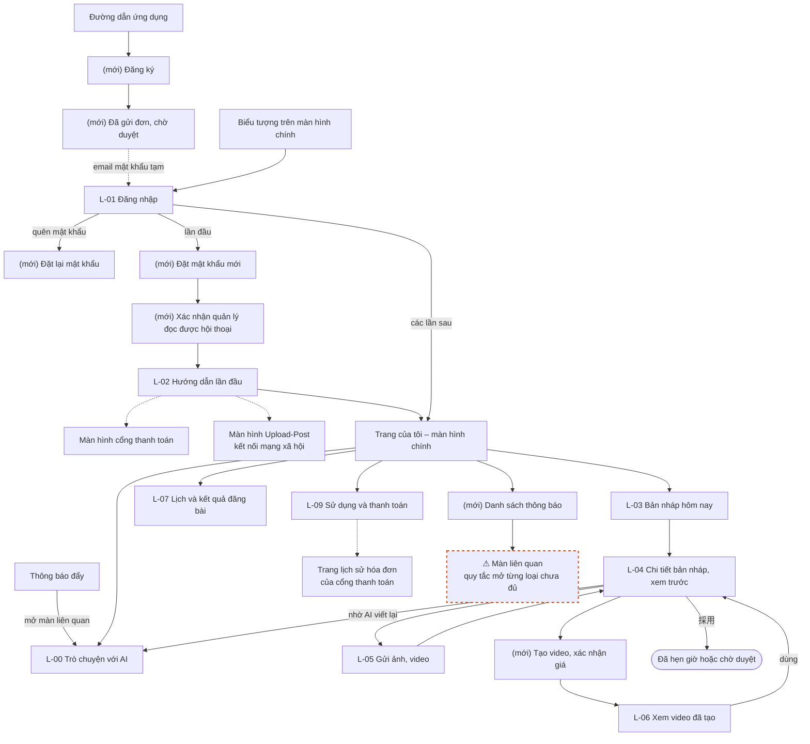

# Yêu cầu giao diện và trải nghiệm người dùng

## Đối chiếu nguồn mới — 20/11/2026

Phần dưới cập nhật hiệu lực theo nguồn mới; các mã [AG]/SD18 trong phân tích trước vẫn là trích dẫn lịch sử. Không suy nguồn FCP hoặc mục cần xác nhận thành khách đã duyệt.

- **C-06** — T19 có 19 màn, M19 có 21 màn; đăng nhập xong mở Mypage; thanh điều hướng 5 mục Home/AI/tư liệu/lịch/Mypage; chuông ở Home/Mypage. Số/chữ/tên trong hình là minh họa. Còn mở: Mục lục các PDF và KS có số trang cũ; trích trang PDF thực tế, không dùng số màn AG/18 thay cho 19. Căn cứ: `T19:1,32,33;M19:1,4`.
- **6-2** — Bắt buộc đăng ký phương thức thanh toán và mở từ biểu tượng màn hình chính; thêm biểu tượng bằng hướng dẫn thủ công theo máy. SNS và cho phép thông báo có thể làm sau. Thanh toán đăng ký xong tự kích hoạt, tạo folder và báo Manager; sau khởi tạo mở Mypage T-08, không phải Home T-09. Office bỏ bước thanh toán. Còn mở: Cần kiểm thiết bị/PWA quay lại sau kết nối, không coi hình minh họa là kiểm chứng tương thích. Căn cứ: `T19:5,6,8,9,11,26,33;BF19:4`.
- **7-1** — Danh sách gồm Talent và office; lọc tên/trạng thái/ngày không đăng/category/người phụ trách. M-07 có nút sang M-21 để sửa hồ sơ; không còn mô tả hồ sơ chỉ nhập qua ChatGPT. Còn mở: Loại phân công theo category hay cá nhân vẫn KS 20261120 No.10/QA No.6. Căn cứ: `M19:10,11,13,15,26`.

Chi tiết từng finding/Q&A và hiệu lực gate: [báo cáo đối chiếu hiện hành](../docs/requirement-review/corrections-2026-11-19/NEW_DELIVERY_IMPACT.md). Không dùng các giả định mâu thuẫn bên dưới làm kết luận hiện hành.

Theo [YK2] 6-14, bản thiết kế của アデッソ ([TK-T], [TK-M]) là căn cứ để làm lại 画面定義書 (bản định nghĩa màn hình). Những chỗ thiết kế còn sót từ bản cũ (LINE, lượt video miễn phí, hạn mức tiền video, không có bước trả lại bài, quyền riêng để dừng đăng tự động) sẽ sửa theo [YK2]. V2 còn thêm luồng tự đăng ký, nên cả hai bộ thiết kế đều thiếu màn đăng ký và màn duyệt đơn. Mã màn hình chuẩn là mã T/M của [AG]; trang 1 của [AG] có bảng đối chiếu với mã L/M của thiết kế khách, L-08 ngoài phạm vi (Q&A No.30, đóng 17/11). 画面定義書 do FutureCore làm, dự kiến gửi sáng 20/11 (Q&A No.68; biên bản họp 17/11, việc số 5). Tab này đã viết lại theo bản yêu cầu v2.

| Ký hiệu | Tài liệu | Ngày | Mã màn hình | Vai trò theo v2 |
| --- | --- | --- | --- | --- |
| [YK2] | AI育成OS_概要要件定義書_v2.docx | Trang bìa ghi 13/11/2026 | Không có mã màn hình | Yêu cầu. Thắng khi mâu thuẫn với thiết kế (6-14) |
| [TK-T] | Thiết kế ứng dụng tài năng, phiên bản dễ thương | 11/2026 | L-00…L-09 và Trang của tôi | Căn cứ thiết kế: giống Instagram, Trang của tôi là trung tâm, nhân vật モモ (Momo) (6-14) |
| [TK-M] | Thiết kế màn hình quản trị cho máy tính và điện thoại, có nhóm tài năng và chỉ dẫn cho AI | 11/2026 | M-01…M-11 | Căn cứ thiết kế. Phần nhóm tài năng và chỉ dẫn cho AI: khách quyết làm ([KS] 確認6–8, 47) |
| [SD] | 画面遷移図と画面案 (sơ đồ chuyển màn hình và phương án màn hình) của FutureCore | 11/11/2026 | T-01…T-12, M-01…M-10 | Bản cũ, làm theo một bản yêu cầu cũ hơn. Chỉ dùng để đối chiếu mã chức năng |
| [AG] | アプリ画面案_AI育成OS.pdf (phương án màn hình ứng dụng) của FutureCore | 12/11/2026 | T-01…T-15, M-01…M-19 | Mới nhất: giữ phong cách của [TK], sửa nội dung theo [YK2]. Phân tích chi tiết ở file 14; đối chiếu với tab này ở mục 8 |

**Cách đọc:** bảng màn hình dùng mã của thiết kế (L-xx, M-xx của [TK]) làm cột chính, cột bên cạnh là mã [SD] tương ứng. Mã [AG] tương ứng tra ở mục 8. Màn còn thiếu ghi "(mới)". ⚠ là chỗ thiết kế lệch với [YK2] hoặc còn để ngỏ. Số 確認 (mục cần xác nhận) theo đánh số của v2.

⚠ Mục 1–7 viết trước khi có [AG]. Phần lớn điểm thiếu ở mục 7 đã được [AG] thể hiện; tình trạng từng điểm xem ở mục 8.2.

**Quy tắc chung cho mọi màn hình** ([YK2] 6-14):

- Ưu tiên dễ dùng hơn đẹp (đã chốt trong SOW).
- Lấy thiết kế của アデッソ làm tham khảo. Ứng dụng tài năng giống Instagram, đi từ Trang của tôi sang các màn khác. Dùng nhân vật モモ (Momo). Có thể cho chọn nhân vật (đang xem xét).
- Màn hình đầu tiên của tài năng cho thấy ngay việc cần làm hôm nay. V2 bỏ câu hỏi chọn 1 trong 3 bố cục.
- Luôn cho biết đang xảy ra gì khi lỗi, khi không có dữ liệu, khi đang tải.

## 1. Màn hình của tài năng (ứng dụng trên điện thoại)

[TK-T] có 10 màn hình. Theo v2, còn thiếu 4 màn mới cho luồng đăng ký (đăng ký, đã gửi đơn, đặt mật khẩu lần đầu, quên mật khẩu), màn xác nhận "quản lý đọc được hội thoại", màn tạo video có xác nhận giá và màn danh sách thông báo.

| [TK-T] | [SD] | Màn hình | Chức năng trên màn | Mã chức năng [YK2] | Ghi chú |
| --- | --- | --- | --- | --- | --- |
| (mới) | (không có) | Đăng ký | Nhập tên (nghệ danh hoặc tên thật), email, ngày sinh. Đọc điều khoản và đánh dấu đồng ý. Gửi đơn | 1-4, 2-2 | ⚠ Cả hai bộ thiết kế thiếu. Văn bản điều khoản do アデッソ soạn (確認1) |
| (mới) | (không có) | Đã gửi đơn, chờ duyệt | Báo đã nhận đơn, kết quả sẽ gửi qua email | 1-4 | ⚠ Tài liệu chưa nói màn này, nhưng luồng UC-01 cần |
| L-01 | T-01 | Đăng nhập | Email và mật khẩu. Liên kết "quên mật khẩu". Lần đầu dùng mật khẩu tạm trong email rồi đặt mật khẩu mới | 1-4 | ⚠ [TK-T] tr.4 ghi "cách đăng nhập sẽ quyết". Cần thêm màn đặt mật khẩu lần đầu và màn đặt lại mật khẩu (mới) |
| (mới) | (không có) | Xác nhận "quản lý đọc được hội thoại" | Hiện lần đầu mở ứng dụng, tài năng bấm nút xác nhận | 3-2 | ⚠ Đề xuất trong 確認13 |
| L-02 | T-02 | Hướng dẫn lần đầu | 4 bước: thêm vào màn hình chính, cho phép thông báo, đăng ký thanh toán (mở màn hình cổng thanh toán, trừ tài khoản công ty), kết nối mạng xã hội (mở màn hình Upload-Post, không bắt buộc đủ 3 mạng ⚠). Bỏ dở thì làm tiếp | 6-2, 8-2 | [TK-T] chỉ có phần kết nối. [SD] đặt kết nối trước thanh toán, ngược với 6-2. 確認11, 12 |
| Trang của tôi, L-03 | T-03 | Màn hình chính | Việc cần làm hôm nay, tỷ lệ đạt mục tiêu, số người theo dõi từng mạng, số ngày đăng liên tục, tiến độ thử thách ⚠ | 6-8, 6-7 | Theo hướng Trang của tôi của [TK-T] (6-14). Hiển thị 2 bản nháp mỗi ngày nay không trái [YK2], vì số bản nháp không giới hạn (5-3) |
| L-00 | T-04 | Trò chuyện với AI | Tin nhắn sáng, nhiệm vụ mỗi ngày, chúc mừng, trả lời. Nút "xem bản nháp" và "gửi ảnh, video". Nhập chữ tối đa 1.000 ký tự. Xem lại lịch sử | 3-4, 3-3 | Chưa có hồ sơ thì chưa có bản nháp (UC-01 前提) |
| L-03 (phần bản nháp), L-07 | T-05 | Danh sách bản nháp | Bản nháp hôm nay và các bài trước với trạng thái | 4-1 | — |
| L-04 | T-06 | Chi tiết bản nháp | Xem chú thích, hashtag, kịch bản, giờ đăng (giờ đăng chỉ xem, tài năng không đổi được, 確認30). Tài năng tự sửa chữ được ([KS] 確認28). Nút 採用 (chấp nhận, chỉ với cách đăng 要確認), nhờ AI viết lại tối đa 2 lần ([KS] 確認29), gửi ảnh, tạo video. Lựa chọn "gửi quản lý duyệt" chỉ hiện với tài năng được cài duyệt bài | 4-2, 4-3 | Tài năng không tự sửa chữ ⚠ (確認28), nên thiết kế không có ô sửa là đúng. 確認30 |
| L-05 | T-07 | Gửi ảnh, video | Chọn nhiều file hoặc chụp ngay, xem trước, gửi. Gửi video tự làm (phần video tự làm thành bản nháp là CR-23, chờ khách) | 6-3, 6-4 | ⚠ Dung lượng tối đa chưa có |
| (mới) | T-08 | Tạo video | Chọn loại video và ảnh gốc, hiện độ dài dự kiến và đơn giá kèm ghi chú số tiền thực thu có thể khác, xác nhận. Báo được đóng ứng dụng trong lúc chờ | 5-1, 5-4 | ⚠ [TK-T] chỉ có nút "tạo video" ở L-04. UC-06 前提 |
| L-06 | T-09 | Xem video đã tạo | Xem video, chọn dùng, tạo lại hoặc bỏ. Ghi rõ video do AI tạo | 5-3, 5-5 | ⚠ [TK-T] hiển thị lượt miễn phí và "tài khoản miễn phí". [YK2] 6-14 nói rõ sẽ sửa |
| L-04 (nằm trong) | T-10 | Xem trước bài đăng | Ảnh hoặc video cùng chú thích trên một màn | 6-6 | — |
| Trang của tôi, L-07 | T-11 | Số liệu | Số người theo dõi, tiến độ mục tiêu, số liệu từng bài. Chỉ số liệu của mình, không xếp hạng ⚠ | 3-10, 6-7 | 確認40. Các chỉ số trong phạm vi Upload-Post cung cấp |
| (mới) | T-12 | Danh sách thông báo | Thông báo cho tài năng, bấm thì mở màn liên quan | 6-1 | ⚠ [TK-T] không có màn này. Tài năng không bật thông báo đẩy thì xem ở đây (確認12) |
| L-07 | (không có) | Lịch và kết quả đăng bài | Lọc theo tất cả, sắp đăng, đã đăng. Trạng thái chờ duyệt, đã hẹn, đã đăng, lỗi, đã hủy | 6-7, 7-2 (phần của tài năng) | Tài năng không hủy được bài (7-2) |
| L-09 | (không có) | Sử dụng và thanh toán | Số lần tạo video và tổng tiền trong tháng, đường dẫn sang trang lịch sử hóa đơn của cổng thanh toán, đăng ký hoặc đổi phương thức thanh toán | 1-1, 5-4 | ⚠ Thiết kế có hạn mức tiền video (sẽ sửa theo 6-14) và nút "hủy đăng ký" (trái UC-13: tài năng báo quản lý, 確認53). Lịch sử hóa đơn xem trên trang của cổng, không phải trong ứng dụng (1-1) |

## 2. Màn hình của quản lý (màn hình quản trị)

[TK-M] có 11 màn, có cả bản máy tính và bản điện thoại, đúng với [YK2] 9-1. Theo v2 còn thiếu màn duyệt đơn đăng ký, tạo tài khoản công ty, danh sách từ cấm, và vài thao tác khác.

| [TK-M] | [SD] | Màn hình | Chức năng trên màn | Mã chức năng [YK2] | Ghi chú |
| --- | --- | --- | --- | --- | --- |
| M-01 | M-01 | Đăng nhập (hai bước) | Email, mật khẩu, mã 6 số từ ứng dụng xác thực. Lần đầu quét mã QR. Chỉ dùng ứng dụng xác thực; phương án SMS trong [TK-M] chờ bàn với khách (S01-11) | 1-6 | ⚠ [TK-M] còn để ngỏ phương án gửi mã qua SMS. [YK2] chỉ nói ứng dụng xác thực |
| M-02 | M-06 | Danh sách thông báo | 8 loại, kể cả "có người đăng ký". Lọc theo loại, theo đã xử lý, theo nhóm ([KS] 確認47). Đánh dấu 対応済み (đã xử lý); khách muốn thêm ô 「未対応」 (chưa xử lý), chưa chốt (確認46). Bấm thì mở màn liên quan | 7-4 | ⚠ [TK-M] có loại "bị chặn trên LINE" (sẽ sửa theo 6-14) và "bài đăng trễ" (không có trong 7-4). 確認45, 46, 47 |
| (mới) | (không có) | Duyệt đơn đăng ký | Danh sách đơn, xem tên, email, ngày sinh, tuổi. Duyệt (cài luôn có dùng duyệt bài hay không) hoặc từ chối | 1-4, 2-2 | ⚠ Cả hai bộ thiết kế thiếu. UC-01 |
| M-03 + M-04 | M-05 | Duyệt bài | Danh sách chờ duyệt (hạn duyệt, kết quả kiểm tra từ cấm). Xem bài, duyệt hoặc trả lại kèm lý do. Yêu cầu tới quản lý của nhóm hoặc phụ trách, người bấm trước quyết ([KS] 確認34). Thao tác được trên điện thoại ([KS] 前提 UC-10-1) | 7-7 | ⚠ [TK-M] M-04 ghi "không có thao tác trả lại". [YK2] 6-14 nói rõ sẽ sửa. 確認34, 35 |
| M-05 | M-02 | Danh sách tài năng | Tìm theo họ tên, lọc theo trạng thái, số ngày không đăng bài, nhóm ([KS] 確認47). Hiện tài năng và tài khoản công ty | 7-1, 3-5 | [SD] ghi "tài năng mình phụ trách", trái 確認41. [TK-M] đúng |
| M-06 (tab thông tin) | M-03 | Chi tiết tài năng | Hồ sơ, mục tiêu và hạn, mức đạt, (ô 「目標%」 chung trong thiết kế khách chỉnh theo từng mạng, Q&A No.14), trạng thái kết nối mạng xã hội, hội thoại với AI, nhãn dưới 18 tuổi (từ ngày sinh, [KS] 確認2). Nhập mục tiêu. Ghi nhật ký xem | 2-4, 7-1, 7-6 | ⚠ [TK-M] cho hồ sơ "chỉ xem, sửa bằng file" (đúng với cách nhập qua ChatGPT), nhưng không có ô nhập mục tiêu, trái 2-4. 確認2 |
| M-06 (tab bài đăng) | M-04 | Bài đăng của tài năng | Lọc theo đã hẹn, chờ duyệt, đã đăng, lỗi. Hủy bài đã hẹn. Sửa bài dính từ cấm | 7-2, 4-4 | Nút hủy bài của [TK-M] nay đúng với [YK2] 7-2. ⚠ Chưa có thao tác đặt lịch lại sau khi đăng lỗi |
| M-06 (tab cài đặt) | M-07 | Cài đặt tài năng | Trạng thái, dùng duyệt bài hay không, dừng hoặc chạy lại đăng tự động của tài năng. Hiện màn xác nhận trước khi đổi | 7-3, 7-5, 7-7 | Không còn lựa chọn trả phí / miễn phí (5-4). 確認53–56 |
| M-07 | M-09 | Dừng đăng tự động toàn bộ, cài đặt chung | Dừng hoặc chạy lại, dừng thì hủy luôn bài đã hẹn. Lịch sử dừng. Đổi giờ nhắn tin, giờ nhắc, số ngày | 7-5, 5-6 | Việc hủy bài khi dừng của [TK-M] nay đúng với [YK2]. ⚠ "Chỉ quản lý có quyền dừng" sẽ sửa theo 6-14. [TK-M] chưa có phần cài đặt chung |
| M-08 | (không có) | Quản lý tài khoản quản lý | Thêm, sửa, vô hiệu hóa quản lý | 1-6 | ⚠ Cột "quyền dừng đăng tự động" sẽ bỏ theo 6-14 |
| M-09 | M-10 | Nhật ký xem | Ngày giờ, quản lý, màn hình đã xem, tài năng. Lọc theo khoảng thời gian và tài năng | 7-6 | 確認44 |
| M-10 | (không có) | Nhóm tài năng | Tạo nhóm (tên, màu, thứ tự), một tài năng thuộc nhiều nhóm | Chưa có mã | Làm (CR-17, [KS] 確認47) |
| M-11 | (không có) | Chỉ dẫn cho AI | Chọn phạm vi (toàn bộ / nhóm / tài năng), viết chỉ dẫn (không có nút mẫu câu 「書き出しの部品」), chạy thử 「試してみる」 (khách muốn ghi 「確認」) với một tài năng, lưu 「保存」 (khách muốn ghi 「指示」), xem lịch sử và quay lại bản cũ | Chưa có mã | Làm (CR-18, [KS] 確認6–8) |
| (mới) | M-08 | Tài khoản công ty | Tạo tài khoản công ty. Xem số lần tạo video để quyết toán nội bộ | 1-2, 9-1, 5-4 | ⚠ [TK-M] thiếu. [SD] M-08 cho quản lý chỉ dẫn và duyệt, trái 確認52. Cách đăng bài (ứng dụng hay màn hình quản trị) chưa thống nhất |

**Chức năng của quản lý chưa có màn hình trong cả hai bộ tài liệu:**

- Duyệt đơn đăng ký (1-4) và tạo tài khoản công ty (1-2).
- Đăng ký danh sách từ cấm (4-4, UC-02 前提).
- Gửi ảnh, video hoặc tạo video thay cho tài khoản công ty (6-3, [KS] 確認27).
- Xem số lần tạo video và phí của từng tài năng và tài khoản công ty (5-4).

## 3. Điều hướng

Sơ đồ dưới đây vẽ luồng của tài năng theo v2, dùng mã của [TK-T]. Màn "(mới)" là màn chưa có trong thiết kế.

| Nội dung | Theo thiết kế [TK-T] / [TK-M] | Chưa thống nhất |
| --- | --- | --- |
| Menu dưới của ứng dụng tài năng | 5 mục: màn chính, trò chuyện, nút "+", lịch đăng, Trang của tôi. Lối tắt dạng "tin nổi bật" kiểu Instagram ([TK-T] tr.2) | ⚠ Chỗ đặt danh sách thông báo (màn mới) |
| Màn hình mở ra đầu tiên của tài năng | Trang của tôi (6-14) | — |
| Bấm thông báo đẩy | Mở màn liên quan (6-12 chức năng 6-1) | ⚠ Chưa có bảng đầy đủ cho từng loại trong 17 loại thông báo |
| Menu của màn hình quản trị | 8 mục. Máy tính: menu bên trái. Điện thoại: menu dưới (thông báo, chờ duyệt, tài năng, menu khác) | ⚠ Thêm mục duyệt đơn, tài khoản công ty, từ cấm |
| Màn đầu tiên sau khi quản lý đăng nhập | Danh sách thông báo (M-02) | — |
| Chuyển sang dịch vụ ngoài | Màn hình Upload-Post và cổng thanh toán (đăng ký và lịch sử hóa đơn) | ⚠ Sau khi xong thì quay về ứng dụng thế nào, và cập nhật trạng thái ra sao |

## 4. Kiểm tra dữ liệu nhập

Các quy tắc dưới đây lấy từ [YK2]. Các con số đều là 弊社の想定 (giả định của FutureCore), sẽ chốt khi khách xem màn hình thật ([YK2] mục 6).

| Màn hình | Trường hoặc thao tác | Quy tắc kiểm tra | Thông báo khi sai | Nguồn [YK2] |
| --- | --- | --- | --- | --- |
| Đăng ký | Email | Bắt buộc. Không trùng với email đã có | ⚠ Câu chữ chưa có. Có nói rõ "email đã dùng" không (lộ thông tin)? | 6-4 (2-2) |
| Đăng ký | Tên, ngày sinh | Bắt buộc. ⚠ Chưa có độ dài, định dạng, khoảng ngày sinh hợp lệ | — | UC-01 前提 |
| Đăng ký | Đồng ý điều khoản | Phải đánh dấu mới gửi được | — | UC-01, 確認1 |
| Đăng nhập (tài năng, quản lý) | Mật khẩu | Ít nhất 8 ký tự, có cả chữ và số. Sai 5 lần liên tiếp thì khóa 15 phút | ⚠ Câu chữ chưa có | 6-1 (1-4), 6-2 (1-6) |
| Đăng nhập lần đầu | Mật khẩu tạm | ⚠ Thời hạn của mật khẩu tạm chưa có. Phải đặt mật khẩu mới | — | 6-1 (1-4), UC-03 前提 |
| Đăng nhập quản lý | Mã xác thực | 6 số từ ứng dụng xác thực | — | 6-2 (1-6) |
| Duyệt đơn | Duyệt hoặc từ chối | Duyệt thì chọn có dùng duyệt bài hay không. ⚠ Có màn xác nhận không | Email mẫu, không nêu lý do từ chối | 6-4 (2-2), UC-01 前提 |
| Cài đặt mục tiêu | Số người theo dõi, hạn đạt | Mặc định 10.000 ⚠. ⚠ Chưa có khoảng giá trị hợp lệ, hạn đạt có được là ngày quá khứ không | — | 6-4 (2-4), 確認3 |
| Trò chuyện với AI | Tin nhắn | Tối đa 1.000 ký tự | ⚠ Chưa có | 6-5 (3-4) |
| Chi tiết bản nháp | Nút 採用 | Phải có ảnh hoặc video | ⚠ Câu chữ chưa có | 6-6 (4-3) |
| Chi tiết bản nháp | Lựa chọn gửi duyệt | Chỉ hiện khi tài năng được cài dùng duyệt bài | — | 6-6 (4-3) |
| Chi tiết bản nháp | Chú thích và hashtag | AI kiểm tra từ cấm khi 採用. Độ dài và số hashtag nằm trong giới hạn chung của 3 mạng | Dính từ cấm thì báo lý do. ⚠ Giới hạn độ dài chưa có số | 6-6 (4-1, 4-4) |
| Gửi ảnh, video | File | Định dạng và dung lượng tối đa (chưa có số) | Vượt giới hạn thì báo lý do. Mất mạng thì báo và cho gửi lại | 6-7 (6-3) |
| Tạo video | Xác nhận giá | Phải hiện độ dài dự kiến và đơn giá trước khi gửi | Tạo lỗi thì báo lý do | 6-8 (5-1), UC-06 前提 |
| Duyệt bài | Trả lại | Bắt buộc nhập lý do | ⚠ Chưa có | 6-9 (7-7) |
| Cài đặt tài năng | Đổi trạng thái, dừng đăng tự động của tài năng | Có màn xác nhận | — | 6-2 (7-3), 6-10 (7-5) |
| Cài đặt chung | Dừng đăng tự động toàn bộ | Có màn xác nhận, nói rõ bài đã hẹn sẽ bị hủy | — | 6-10 (7-5) |
| Cài đặt chung | Giờ nhắn tin, giờ nhắc, số ngày | ⚠ Chưa có khoảng giá trị hợp lệ | — | 5-6 |
| Danh sách từ cấm | Từ thêm mới | ⚠ Có cho trùng không, độ dài tối đa | — | 6-6 (4-4) |

## 5. Hiển thị trên các kích thước màn hình

| Giao diện | Yêu cầu trong [YK2] | Thiết kế | Chưa rõ | Nguồn |
| --- | --- | --- | --- | --- |
| Ứng dụng tài năng | Chạy trên điện thoại iPhone và Android dưới dạng PWA (ứng dụng web cài lên màn hình chính). Thông báo đẩy trên iPhone cần iOS 16.4 trở lên | Chỉ có bản cho điện thoại | ⚠ Danh sách hệ điều hành và trình duyệt được hỗ trợ. Màn đăng ký có cần chạy trên máy tính không (đường dẫn có thể mở từ máy tính) | [YK2] 9-1, 6-12 (6-8) |
| Màn hình quản trị | Chủ yếu dùng trên máy tính, nhưng phải dễ xem trên trình duyệt điện thoại | [TK-M]: có cả bản máy tính và bản điện thoại | Đã khớp. Mâu thuẫn của v1 đã được giải quyết | [YK2] 9-1, UC-10 前提, [TK-M] tr.1, 2, 18 |

## 6. Trạng thái đang tải, trống và lỗi

[YK2] 6-14 chỉ đưa quy tắc chung: luôn cho biết đang xảy ra gì khi lỗi, khi không có dữ liệu, khi đang tải. Chỉ một số tình huống có hành vi cụ thể. Hai bộ thiết kế không vẽ trạng thái nào trong số này.

| Tình huống | Màn hình | Hành vi đã có trong [YK2] | Chưa rõ |
| --- | --- | --- | --- |
| Chờ duyệt đơn | Màn đã gửi đơn | Kết quả gửi qua email (UC-01) | Người đăng ký mở lại ứng dụng thì thấy gì |
| Đã thanh toán nhưng quản lý chưa nhập hồ sơ | Trang của tôi, L-00 | Huấn luyện viên AI chưa đưa bản nháp (UC-01 前提) | Hiển thị gì, báo tài năng chờ bao lâu |
| Chưa đăng ký thanh toán | L-00, các màn khác | Chưa dùng được huấn luyện viên AI (UC-03 前提) | Màn nào bị chặn, hiển thị gì |
| Đang tải: chờ AI trả lời | L-00 | Chưa có | Hiển thị gì trong lúc chờ. Có cho gửi tin tiếp không |
| Đang tải: gửi file lớn | L-05 | Mất mạng thì báo và cho gửi lại (6-3) | Có hiện tiến độ không |
| Đang tải: tạo video (vài phút) | Tạo video, L-06 | Được đóng ứng dụng, xong thì báo (5-1, UC-06 前提) | Mở lại ứng dụng trong lúc chờ thì thấy gì |
| Trống: sáng nay chưa có bản nháp (xử lý buổi sáng trễ hoặc lỗi) | Trang của tôi, L-03 | Chưa có | Hiển thị gì |
| Trống: tài năng mới chưa có bài, chưa có số liệu | Trang của tôi, L-07 | Chưa có | Hiển thị gì |
| Trống: chưa kết nối mạng xã hội, hoặc kết nối thiếu mạng | L-02, Trang của tôi | Có hiển thị trạng thái kết nối (8-2). Vẫn dùng được ⚠ (確認11) | Có nhắc tài năng kết nối không |
| Trống: không có thông báo, không có bài chờ duyệt, không có đơn chờ duyệt | Danh sách thông báo, M-02, M-03 | Thông báo đã xử lý rời khỏi danh sách (確認46; khách muốn thêm ô 「未対応」, chưa chốt) | — |
| Lỗi: dịch vụ AI không dùng được | L-00 | Báo trên màn hình và cho gửi lại sau (3-4) | Câu chữ thông báo |
| Lỗi: tạo video thất bại | Tạo video, L-06 | Báo lý do, không tính phí (5-1) | Có nút thử lại không |
| Lỗi: bài dính từ cấm | L-04 | Báo lý do cho tài năng (4-4) | Sau đó tài năng làm gì tiếp |
| Lỗi: đăng bài thất bại | Danh sách thông báo, L-07, M-06 | Báo tài năng kèm tên mạng và lý do, cảnh báo trên màn hình quản trị (8-5, 確認38) | Nút đặt lịch lại nằm ở đâu |
| Lỗi: phiên đăng nhập hết hạn (tài năng sau 30 ngày, quản lý sau 30 phút không thao tác) | Mọi màn | Phải đăng nhập lại (1-4, 1-6) | Nội dung đang nhập dở có bị mất không |
| Lỗi: tài năng đã kết thúc sử dụng mở ứng dụng | L-01 | Không đăng nhập được ⚠ (確認54) | Hiển thị gì |

## 7. Điểm thiếu thiết kế hoặc chưa rõ hành vi

Có 17 điểm, chia 3 nhóm. So với bản theo v1, 5 điểm không còn là vấn đề: hủy bài trên màn hình quản trị, dừng thì hủy bài đã hẹn, 2 bản nháp mỗi ngày, màn hình quản trị trên điện thoại, và việc chọn bố cục màn hình chính. Nhóm A1 là những chỗ [YK2] 6-14 đã nói sẽ sửa, nhóm A2 là những chỗ còn cần thống nhất.

### A1. Thiết kế trái [YK2], v2 đã nói sẽ sửa trong 画面定義書

| STT | Điểm | Thiết kế | [YK2] |
| --- | --- | --- | --- |
| 1 | Duyệt bài không có nút trả lại | [TK-M] M-04 | 7-7, 6-14 |
| 2 | Lượt tạo video miễn phí, tài khoản miễn phí, hạn mức tiền video hằng tháng | [TK-T] L-06, L-09 | 5-4, 6-14 |
| 3 | Quyền riêng để dừng đăng tự động | [TK-M] M-07, M-08 | 1-6, 6-14 |
| 4 | Thông báo "bị chặn trên LINE" | [TK-M] M-02 | 別紙B số 17, 6-14 |

### A2. Thiết kế trái [YK2], cần thống nhất

| STT | Điểm | Thiết kế | [YK2] |
| --- | --- | --- | --- |
| 5 | Tài năng tự bấm "hủy đăng ký" | [TK-T] L-09 | UC-13: tài năng báo quản lý, quản lý chuyển trạng thái (確認53) |
| 6 | Không có ô nhập mục tiêu | [TK-M] M-06 | 2-4, UC-02 前提: quản lý nhập mục tiêu và hạn trên màn hình quản trị |
| 7 | "Tài năng mình phụ trách" | [SD] M-02 | Mọi quản lý xem mọi tài năng; có quản lý phụ trách để nhận yêu cầu duyệt ([KS] 確認34, ý kiến ở 確認41) |
| 8 | Quản lý ra chỉ dẫn và duyệt bài của tài khoản công ty | [SD] M-08 | 確認52: không duyệt. Chính [YK2] cũng chưa thống nhất (9-1 và UC-12 前提) |
| 9 | Thứ tự hướng dẫn lần đầu: kết nối trước, thanh toán sau | [SD] T-02 | 6-2: thanh toán trước, kết nối sau |
| 10 | Phương án gửi mã xác thực qua SMS | [TK-M] M-01 | 6-2 (1-6): ứng dụng xác thực |

### B. Thiếu màn hình

| STT | Màn hình còn thiếu | Chức năng [YK2] |
| --- | --- | --- |
| 11 | Tài năng: đăng ký, đã gửi đơn, đặt mật khẩu lần đầu, quên mật khẩu, xác nhận "quản lý đọc được hội thoại" | 1-4, 6-2, 確認13 |
| 12 | Tài năng: danh sách thông báo, tạo video có xác nhận giá | 6-1, 5-1 |
| 13 | Quản lý: duyệt đơn đăng ký, tạo tài khoản công ty, danh sách từ cấm, gửi ảnh và video thay tài năng, xem số lần tạo video và phí, cài đặt chung, đặt lịch lại sau khi đăng lỗi | 1-4, 1-2, 4-4, 6-3, 5-4, 5-6, 8-5 |

### C. Cần khách chọn hoặc xác nhận

| STT | Điểm | Nguồn |
| --- | --- | --- |
| 14 | Hai màn M-10 (nhóm tài năng) và M-11 (chỉ dẫn cho AI) có làm không. Nếu làm thì nằm trong hay ngoài SOW | 確認6, 7, 8, 47, 14-3 |
| 15 | Cho tài năng chọn nhân vật hay chỉ dùng モモ (Momo) | 6-14 |
| 16 | Mã màn hình dùng trong 画面定義書: theo [TK] hay đánh lại | 6-14, [SD] tr.1 |
| 17 | Không tài liệu nào nói tới khả năng truy cập cho người khuyết tật (cỡ chữ, độ tương phản), ngôn ngữ hiển thị, hay câu chữ cho thông báo và lỗi. Câu chữ thông báo "sẽ xác nhận trên màn hình thật" | 6-13, 6-14 |

## 8. Đối chiếu với phương án màn hình [AG] (12/11/2026)

Cập nhật ngày 16/11/2026. Nguồn: [AG] trang 1 (bảng đối chiếu mã) và trang 12 (những chỗ đã đổi so với thiết kế của khách). Phân tích từng màn của [AG] nằm ở file 14.

### 8.1 Bảng đối chiếu ba bộ mã màn hình

Cùng một mã có thể chỉ màn khác nhau trong ba tài liệu (ví dụ M-10). Chưa chốt bộ mã nào dùng chung với khách (câu A10 trong file 15). Cột [SD] là đối chiếu của mình theo tên màn, [AG] không ghi.

**Ứng dụng tài năng**

| [AG] | Màn hình | [TK-T] | [SD] |
| --- | --- | --- | --- |
| T-01 | 利用の申し込み (đăng ký dùng) | (mới) | (không có) |
| T-02 | ログイン (đăng nhập) | L-01 | T-01 |
| T-03 | パスワードの設定 (đặt mật khẩu lần đầu, kèm xác nhận quản lý xem hội thoại) | (mới) | (không có) |
| T-04 | はじめに行うこと (4 bước đầu) | (mới) | T-02 |
| T-05 | SNS の接続 (kết nối mạng xã hội) | L-02 | T-02 (một phần) |
| T-06 | マイページ (Trang của tôi) | Trang của tôi | T-03 |
| T-07 | ホーム (việc hôm nay) | L-03 | T-03, T-05 |
| T-08 | AIコーチとの会話 (trò chuyện với AI) | L-00 | T-04 |
| T-09 | 投稿案の詳細 (chi tiết bản nháp, xem trước) | L-04 | T-06, T-10 |
| T-10 | 写真・動画の送付 (gửi ảnh, video) | L-05 | T-07 |
| T-11 | 動画の作成 (tạo video) | (mới) | T-08 |
| T-12 | 動画の確認 (xem video đã tạo) | L-06 | T-09 |
| T-13 | 投稿の予定と結果 (lịch và kết quả đăng) | L-07 | T-11 (một phần) |
| T-14 | お知らせ (thông báo) | (mới) | T-12 |
| T-15 | ご利用とお支払い (sử dụng và thanh toán) | L-09 | (không có) |

**Màn hình quản trị**

| [AG] | Màn hình | [TK-M] | [SD] |
| --- | --- | --- | --- |
| M-01 | ログイン（二段階認証）(đăng nhập hai bước) | M-01 | M-01 |
| M-02 | お知らせ一覧 (danh sách thông báo) | M-02 | M-06 |
| M-03 | 申し込みの確認 (duyệt đơn đăng ký) | (mới) | (không có) |
| M-04 | 承認待ち一覧 (danh sách chờ duyệt) | M-03 | M-05 (một phần) |
| M-05 | 投稿の承認 (duyệt bài) | M-04 | M-05 |
| M-06 | タレント一覧 (danh sách tài năng) | M-05 | M-02 |
| M-07 | タレントの詳細（情報）(chi tiết – thông tin) | M-06 | M-03 |
| M-08 | タレントの詳細（投稿）(chi tiết – bài đăng) | M-06 | M-04 |
| M-09 | タレントの詳細（会話）(chi tiết – hội thoại) | (mới) | (không có) |
| M-10 | タレントの詳細（設定）(chi tiết – cài đặt) | M-06 | M-07 |
| M-11 | 使ってはいけない言葉が入っていた投稿の確認 (bài dính từ cấm) | (mới) | (không có) |
| M-12 | 事務所アカウントの作成 (tạo tài khoản công ty) | (mới) | M-08 (một phần) |
| M-13 | カテゴリーの管理 (nhóm tài năng) | M-10 | (không có) |
| M-14 | AIへの指示（一覧）(danh sách chỉ dẫn AI) | M-11 | (không có) |
| M-15 | AIへの指示（入力）(soạn chỉ dẫn AI) | M-11 | (không có) |
| M-16 | すべての自動投稿の停止 (dừng toàn bộ đăng tự động) | M-07 | M-09 (một phần) |
| M-17 | 全体の設定 (cài đặt chung, gồm danh sách từ cấm) | (mới) | M-09 (một phần) |
| M-18 | マネージャーの管理 (quản lý tài khoản quản lý) | M-08 | (không có) |
| M-19 | 閲覧の記録 (nhật ký xem) | M-09 | M-10 |

### 8.2 Tình trạng 17 điểm ở mục 7 sau khi có [AG]

| STT (mục 7) | Tình trạng | Căn cứ trong [AG] |
| --- | --- | --- |
| 1 | Đã thể hiện: có nút 差し戻す (trả lại) kèm lý do | M-05 |
| 2 | Đã thể hiện: bỏ lượt miễn phí, phân loại miễn phí, trần tiền video | T-11, T-12, T-15, M-10 |
| 3 | Đã thể hiện: mọi quản lý dừng được, bỏ cột quyền | M-16, M-18 |
| 4 | Đã thể hiện: bỏ LINE, còn 9 loại thông báo khớp 別紙A | M-02 |
| 5 | Đã thể hiện: bỏ nút hủy, ghi "muốn ngừng thì báo quản lý". Vẫn chờ 確認53 | T-15 |
| 6 | Đã thể hiện: nhập mục tiêu từng mạng và hạn | M-10 |
| 7 | Đã thể hiện: mọi quản lý xem mọi tài năng. Cần thêm quản lý phụ trách cho yêu cầu duyệt ([KS] 確認34) | M-06 |
| 8 | Đã chọn theo UC-12: tài khoản công ty đăng nhập ứng dụng tài năng, không duyệt. [YK2] 9-1 vẫn nói khác (câu A1, A2 trong file 15) | M-12 |
| 9 | Đã thể hiện: thanh toán trước, kết nối sau | T-04 |
| 10 | Đã thể hiện: chỉ dùng ứng dụng xác thực | M-01 |
| 11 | Gần đủ: có đăng ký, đặt mật khẩu, xác nhận quản lý xem hội thoại (gộp vào T-03). "Đã gửi đơn" là dòng chữ trên T-01. **Còn thiếu màn đặt lại mật khẩu** | T-01, T-02, T-03 |
| 12 | Đã thể hiện | T-11, T-14 |
| 13 | Đã thể hiện: duyệt đơn, tạo tài khoản công ty, từ cấm (trong cài đặt chung), gửi ảnh và tạo video thay tài năng (khung đỏ; [KS] 確認27: chỉ cho tài khoản công ty), số lần video và chi phí AI, cài đặt chung, nút 予約し直す (đặt lịch lại) | M-03, M-08, M-10, M-12, M-17 |
| 14 | Vẫn chờ: [AG] giữ nguyên M-13〜M-15 kèm 【要確認】 (cần xác nhận) | M-13, M-14, M-15 |
| 15 | Vẫn mở: [AG] chỉ dùng モモ, không nói chọn nhân vật | — |
| 16 | Vẫn mở, nay có ba bộ mã (mục 8.1) | Trang 1 |
| 17 | Vẫn mở | — |

### 8.3 Điều hướng theo [AG]

- **Menu dưới của ứng dụng tài năng:** 5 mục ホーム (Trang chủ), チャット (Trò chuyện), 送る (Gửi), 予定 (Lịch), マイページ (Trang của tôi). Danh sách thông báo mở từ biểu tượng chuông trên T-06, T-07. Điểm "chỗ đặt danh sách thông báo" ở mục 3 đã có câu trả lời.
- **Bấm thông báo:** T-14 ghi mở T-08, T-12, T-13, T-05 hoặc T-15 tùy loại. Vẫn chưa có bảng đủ cho từng loại.
- **Màn mở đầu tiên của tài năng:** [AG] mở T-06 Trang của tôi, còn việc hôm nay nằm ở T-07. Chức năng 6-8 nói màn đầu tiên phải cho thấy việc hôm nay (câu B13 trong file 15).
- **Menu bên trái của màn hình quản trị:** 9 mục お知らせ (thông báo), 承認待ち (chờ duyệt), タレント (tài năng), カテゴリー (nhóm), AIへの指示 (chỉ dẫn AI), 自動投稿の停止 (dừng đăng tự động), 全体の設定 (cài đặt chung), マネージャー (quản lý), 閲覧の記録 (nhật ký xem). Trên điện thoại: menu dưới gồm thông báo, chờ duyệt, tài năng và một mục menu chung. Duyệt đơn mở từ thông báo, tài khoản công ty mở từ danh sách tài năng, từ cấm nằm trong cài đặt chung.
