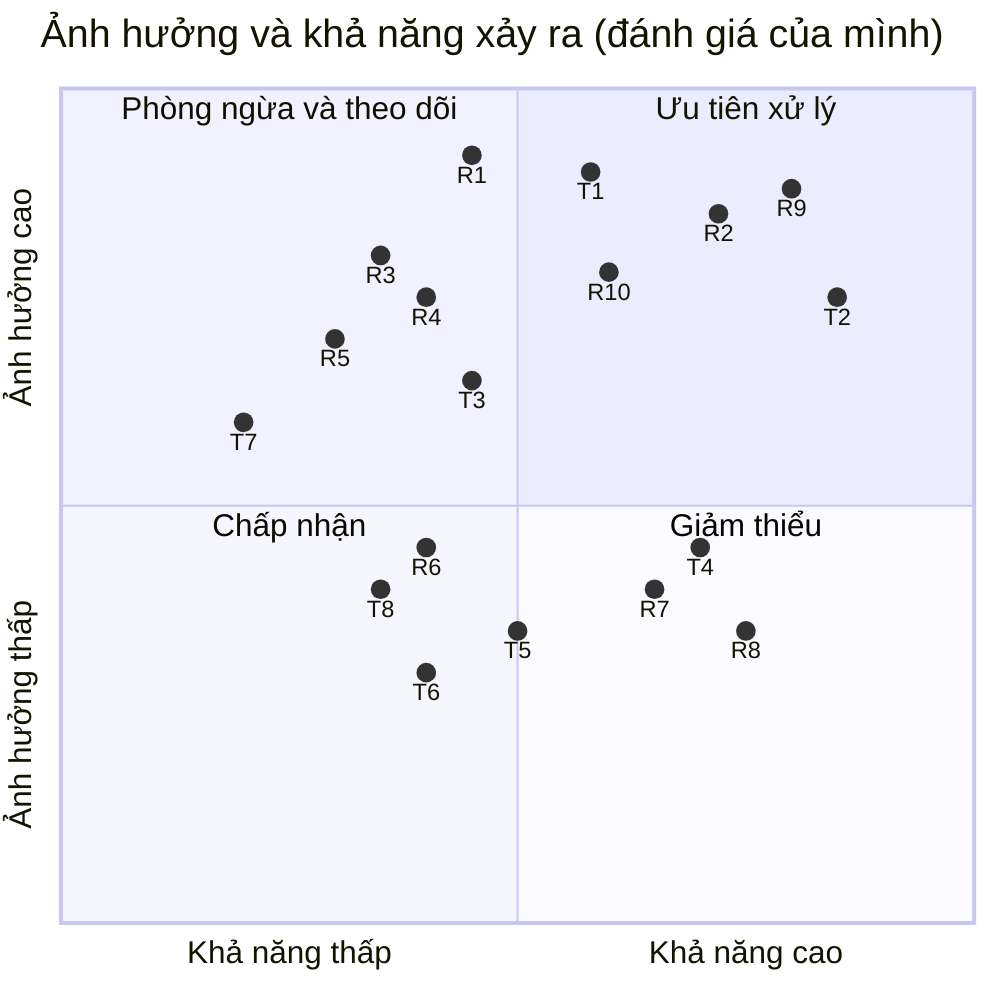

# Edge case, xung đột dữ liệu và rủi ro

> ⚠ File này viết theo bản yêu cầu v1. Bản v2 đã đổi một số nội dung và đánh lại toàn bộ số 確認 (mục cần xác nhận). Đọc [12_Cap_nhat_theo_v2.md](12_Cap_nhat_theo_v2.md) trước khi dùng nội dung bên dưới.

Có 26 edge case, 8 xung đột dữ liệu, 10 rủi ro nghiệp vụ và 8 rủi ro kỹ thuật. Trong đó có 26 mục ảnh hưởng cao. Bốn rủi ro cần xử lý trước đợt kiểm thử nghiệm thu (giữa tháng 1/2027):

- cổng thanh toán (R1);
- việc thiếu tiêu chí nghiệm thu (R9);
- các khả năng của Upload-Post chưa được kiểm chứng (T1);
- luồng nhập liệu từ ChatGPT chưa có cơ chế (T2).

**Cách đọc:**

- **Mức ảnh hưởng** là đánh giá của mình:
  - **Cao:** làm hỏng luồng cốt lõi (đăng bài, thu phí), lộ dữ liệu, hoặc gây hậu quả pháp lý hay uy tín.
  - **Trung bình:** sai dữ liệu hoặc trải nghiệm nhưng có cách khắc phục.
  - **Thấp:** ảnh hưởng nhỏ, ít gặp.
- **Phương án xử lý** là đề xuất của mình, chưa được khách đồng ý. Phương án nào đổi hành vi nghiệp vụ thì đều có câu hỏi tương ứng ở mục 5, để khách quyết trước khi thiết kế.
- Cột nguồn ghi mục, mã chức năng hoặc 確認 (mục cần xác nhận) trong [YK]. Mã BR trỏ tới tab "Quy tắc nghiệp vụ".

## 1. Edge case và lỗi có thể xảy ra

### 1.1 Đăng bài và duyệt bài

| Mã | Tình huống | Ảnh hưởng | Phương án đề xuất | Nguồn |
| --- | --- | --- | --- | --- |
| E01 | Tài năng 採用 (chấp nhận) sau khi giờ đăng dự kiến đã qua | Trung bình | Khi 採用 thì kiểm tra giờ đăng. Nếu đã qua thì cho tài năng chọn đăng ngay hoặc chọn giờ tiếp theo do AI gợi ý | 6-6 (4-3), 6-11 (8-1) |
| E02 | Đăng thành công trên một mạng nhưng lỗi trên mạng khác | Cao | Ghi kết quả riêng từng mạng (đã có BR-E02). Thêm trạng thái "đăng được một phần". Cho đăng lại riêng mạng bị lỗi | 5-1, 6-10 (8-3, 8-5) |
| E03 | Mất kết nối mạng xã hội ngay trước giờ đăng | Cao | Kiểm tra kết nối của bài đã hẹn trước giờ đăng một khoảng, báo tài năng kết nối lại kịp (ghép với lời nhắc 6-5) | 6-10 (8-3, 8-6) |
| E04 | Instagram kết nối bằng tài khoản cá nhân, không phải tài khoản doanh nghiệp hoặc nhà sáng tạo | Cao | Kiểm tra loại tài khoản ngay lúc kết nối (nếu Upload-Post trả về thông tin này). Hiện hướng dẫn chuyển loại tài khoản | UC-03, BR-E08 |
| E05 | Hai quản lý cùng duyệt hoặc trả lại một bài, cùng lúc | Trung bình | Ai xử lý trước thì được, người sau thấy "đã được xử lý bởi …". Ghi nhật ký thao tác | 3-3, 6-9 (7-7), 9-4 |
| E06 | Quản lý đang sửa bài dính từ cấm, cùng lúc tài năng cũng sửa hoặc 採用 lại bài đó | Trung bình | Khóa bài khi đang chờ quản lý sửa, hoặc kiểm tra phiên bản khi lưu | 6-6 (4-4) |
| E07 | Bài dính từ cấm hoặc chờ duyệt mà không ai xử lý trước giờ đăng | Trung bình | Báo nhắc quản lý trước giờ đăng. Quá giờ thì không đăng và báo tài năng (BR-D03) | 5-3, 6-9 (7-7) |
| E08 | AI viết lại nhiều lần mà vẫn dính từ cấm, hoặc kiểm tra từ cấm báo nhầm | Trung bình | Giới hạn số lần viết lại tự động. Cho quản lý bỏ qua kết quả báo nhầm và ghi nhật ký | 6-6 (4-2, 4-4), 11 |
| E09 | Dừng toàn bộ đăng tự động đúng lúc có bài đang gửi sang Upload-Post | Trung bình | Xác định rõ "đã gửi" tính từ lúc nào. Bài đã hẹn trên Upload-Post có cần hủy bên đó không | 6-10 (7-5), 確認29 |
| E10 | Một ngày có cả bản nháp từ chủ đề và bản nháp từ video tự làm, vượt giới hạn số bài mỗi ngày | Trung bình | Kiểm tra giới hạn ngay khi 採用, không đợi đến giờ đăng. Báo tài năng chọn bài nào đăng trước | 5-3, 6-7 (6-4), 6-10 (8-4) |
| E11 | Bài chỉ có ảnh nên không đăng YouTube. Không rõ việc này ảnh hưởng thế nào tới số ngày đăng liên tục và mục tiêu người theo dõi YouTube | Thấp | Quy định rõ "đã đăng" tính theo bài hay theo từng mạng | 6-10 (8-3) |
| E12 | Bài tài năng tự đăng ngoài hệ thống mà Upload-Post không đọc được, nên bị tính là "không đăng" | Trung bình | Kiểm tra Upload-Post đọc được gì. Nếu không đọc được thì ghi rõ trong tin nhắn hỏi han, tránh trách nhầm tài năng | UC-09, 6-5 (3-9) |

### 1.2 Tài khoản, trạng thái, thu phí

| Mã | Tình huống | Ảnh hưởng | Phương án đề xuất | Nguồn |
| --- | --- | --- | --- | --- |
| E13 | Tài năng chuyển sang 利用終了 (đã kết thúc) khi còn bài chờ duyệt, video đang tạo dở, hoặc hóa đơn tháng chưa thu | Cao | Liệt kê việc hệ thống phải làm khi kết thúc: hủy bài chờ duyệt, bỏ video đang tạo, xử lý phí video đã phát sinh, gỡ khỏi Upload-Post | 6-2 (7-3), UC-13 |
| E14 | Chuyển từ 利用終了 về 利用中 (đang dùng) | Trung bình | Quy định thu phí lại từ khi nào, có phải kết nối lại mạng xã hội và đăng ký lại thanh toán không | 6-2 (7-3) |
| E15 | Chuyển có trả phí sang miễn phí giữa tháng, khi đã có phí video trong tháng đó | Trung bình | Tháng đó vẫn thu phí tháng và phí video. Từ tháng sau hết phí tháng. Cần quy định phí video về sau | 6-3 (1-3), 5-4 |
| E16 | Thu tiền lỗi nhiều tháng liền mà quản lý không xử lý | Cao | Nhắc quản lý định kỳ, hiện số tháng chưa thu được trên danh sách tài năng | 6-3 (1-1), 確認20 |
| E17 | Tài năng vị thành niên thanh toán qua cước nhà mạng bị giới hạn hạn mức. Tài năng đủ tuổi nhưng hệ thống vẫn ghi là vị thành niên | Trung bình | Hỏi cổng thanh toán về hạn mức. Cân nhắc lưu ngày sinh thay cho cờ vị thành niên | 3-1, 6-4 (2-2) |
| E18 | Đường dẫn mời đã hết hạn hoặc đã dùng, hoặc tài năng đổi email | Thấp | Báo rõ "đã hết hạn, liên hệ quản lý". Có chức năng đổi email cho quản lý | 6-1 (1-4) |
| E19 | Vô hiệu hóa quản lý cuối cùng, hoặc quản lý tự vô hiệu hóa mình | Cao | Không cho vô hiệu hóa quản lý cuối cùng. Có quy trình cấp lại quyền khi cần | 6-2 (1-6) |
| E20 | Quản lý mất điện thoại có ứng dụng xác thực | Trung bình | Một quản lý khác đặt lại xác thực hai bước, hoặc dùng mã khôi phục | 6-2 (1-6) |

### 1.3 Huấn luyện viên AI và xử lý buổi sáng

| Mã | Tình huống | Ảnh hưởng | Phương án đề xuất | Nguồn |
| --- | --- | --- | --- | --- |
| E21 | Xử lý buổi sáng chưa xong trước 8:00 với một số tài năng | Cao | Xử lý song song và bắt đầu sớm. Tài năng nào xong thì gửi tin ngay. Ghi lại và cảnh báo người vận hành khi trễ | 9-2, 確認24 |
| E22 | Tài năng mới chưa có hồ sơ. File trên OneDrive bị xóa, đổi tên hoặc sai định dạng | Cao | Dùng mẫu file cố định. Kiểm tra file mỗi sáng, báo quản lý khi file thiếu hoặc lỗi. Không cho tài năng vào 利用中 khi chưa có hồ sơ | 6-4 (2-1), 7-5 |
| E23 | Tài năng nhắn rất nhiều tin, hoặc cố ý lách quy tắc (bảo AI bỏ qua chỉ dẫn, viết nội dung không liên quan) | Trung bình | Giới hạn số tin mỗi ngày. Chống lách chỉ dẫn. Theo dõi chi phí theo tài năng | 6-5 (3-3, 3-4, 3-5) |
| E24 | AI viết sai sự thật (ngày diễn, tên nhãn hàng) hoặc nội dung không hợp với người vị thành niên | Cao | Tài năng luôn phải 採用 trước khi đăng (đã có). Thêm chỉ dẫn riêng cho tài năng vị thành niên | 11, 5-5 |
| E25 | Chuyện nghiêm trọng lúc nửa đêm hoặc ngày nghỉ, quản lý không xem màn hình quản trị | Cao | Gửi thêm qua email hoặc điện thoại của quản lý. AI trả lời theo kịch bản an toàn và đưa số đường dây hỗ trợ khi có dấu hiệu tự hại | 6-5 (3-3), 6-12 (7-4) |
| E26 | Tài năng tắt thông báo, đổi điện thoại, hoặc iPhone chưa thêm ứng dụng vào màn hình chính | Cao | Hiện nhắc bật thông báo khi mở ứng dụng. Lưu đăng ký nhận thông báo cho từng thiết bị. Cân nhắc email làm kênh dự phòng | 6-1 (6-2), 6-12 (6-1), 11 |

## 2. Xung đột dữ liệu

| Mã | Xung đột | Ảnh hưởng | Phương án đề xuất | Nguồn |
| --- | --- | --- | --- | --- |
| D1 | Mục tiêu và số liệu: OneDrive hay cơ sở dữ liệu giữ bản gốc? Mục 7-2 nói OneDrive, nhưng ứng dụng cần hiển thị ngay | Cao | Cơ sở dữ liệu giữ bản gốc, OneDrive giữ bản chép cho AI đọc. Chỉ chép theo một chiều | 7-2, 6-4 (2-4), 6-11 (8-8) |
| D2 | AI ghi thêm vào file bộ nhớ đúng lúc quản lý đang sửa file hồ sơ trên OneDrive, ghi đè lên nhau | Cao | Tách file do AI ghi ra khỏi file do quản lý sửa. AI chỉ ghi vào file riêng của mình | 6-5 (3-2), 7-5 |
| D3 | Quản lý sửa file trực tiếp trên OneDrive, làm hỏng cấu trúc khiến AI đọc sai | Trung bình | Dùng mẫu file cố định. Kiểm tra khi đọc mỗi sáng. Nếu làm màn M-11 thì chuyển chỉ dẫn cho AI vào cơ sở dữ liệu | 7-5, [TK-M] M-11 |
| D4 | Quản lý hủy bài trên màn hình Upload-Post nhưng hệ thống vẫn ghi là "đã hẹn" | Cao | Đồng bộ trạng thái từ Upload-Post (qua webhook hoặc hỏi định kỳ), hoặc làm nút hủy trong hệ thống gọi API của Upload-Post | 6-10 (7-2), 確認28 |
| D5 | Số liệu của Upload-Post trễ so với thực tế, khiến nhận xét buổi sáng dùng số liệu cũ. [SM] tr.40 ghi Buffer trễ khoảng một ngày, chưa biết Upload-Post | Trung bình | Kiểm chứng độ trễ với tài khoản thật. Ghi rõ mốc thời gian của số liệu trong tin nhắn | 6-11 (8-7), [SM] tr.40 |
| D6 | Tên trạng thái tài năng lệch nhau: 利用終了 (đã kết thúc) và 退会 (hủy đăng ký) | Thấp | Chốt một bộ tên trạng thái duy nhất | 6-2 (7-3), UC-13 |
| D7 | Thiết kế màn hình lệch với yêu cầu (12 điểm, xem tab "Giao diện" mục 7A) | Cao | Coi [YK] là gốc, sửa thiết kế. Điểm nào khách muốn giữ theo thiết kế thì cập nhật [YK] theo quy trình thay đổi | [YK] 14-3 |
| D8 | Email của tài năng, tài khoản công ty và quản lý có thể trùng nhau (một người vừa là quản lý vừa đăng nhập tài khoản công ty) | Thấp | Quy định email duy nhất theo từng loại tài khoản hay trong toàn hệ thống | 6-4 (2-2), UC-12 |

## 3. Rủi ro nghiệp vụ và kỹ thuật

Năm rủi ro nằm ở ô "ưu tiên xử lý" (ảnh hưởng cao, khả năng xảy ra cao): R2, R9, R10, T1, T2. Khả năng xảy ra và vị trí trên ma trận là đánh giá của mình, dựa trên mức độ rõ ràng của tài liệu hiện tại.

### 3.1 Rủi ro nghiệp vụ

| Mã | Rủi ro | Ảnh hưởng | Khả năng | Phương án đề xuất | Nguồn |
| --- | --- | --- | --- | --- | --- |
| R1 | Cổng thanh toán không thu được số tiền thay đổi hằng tháng, hoặc thẩm định không kịp đợt kiểm thử nghiệm thu | Cao | Trung bình | アデッソ hỏi cổng thanh toán ngay. Chuẩn bị phương án dự phòng: thu phí video riêng, hoặc phát hành phần thu phí sau (12-1 cho phép) | 5-4, 12-1, 14-4, 確認33 |
| R2 | Tin nhắn của AI không tới được tài năng (không bật thông báo, iPhone chưa thêm ứng dụng vào màn hình chính), khiến huấn luyện viên AI mất tác dụng | Cao | Cao | Chốt sớm cách gửi thông báo đẩy. Thêm kênh dự phòng. Hướng dẫn cài đặt rõ khi bắt đầu. Theo dõi tỷ lệ bật thông báo | 8, 9-1, 11 |
| R3 | Tài khoản mạng xã hội của tài năng bị khóa dù đã giới hạn số bài | Cao | Trung bình | Chốt giới hạn số bài. Giãn giờ đăng giữa các tài khoản. Có nút dừng toàn bộ. Khách đã chấp nhận đây là rủi ro không được đảm bảo | 9-5, 11, 6-10 (8-4) |
| R4 | Bài đăng có nội dung không phù hợp: bỏ sót từ cấm, sai sự thật, không hợp với người vị thành niên | Cao | Trung bình | Tài năng luôn 採用 trước khi đăng. Danh sách từ cấm do khách xem lại. Chỉ dẫn riêng cho người vị thành niên. Cân nhắc bắt buộc duyệt với tài năng vị thành niên | 5-3, 11, 確認34 |
| R5 | Quyền riêng tư: mọi quản lý đọc toàn bộ hội thoại, không lưu bằng chứng đồng ý, dữ liệu gửi ra nước ngoài (OpenAI, Upload-Post ở Tây Ban Nha) | Cao | Thấp – trung bình | Hiện thông báo và cho tài năng bấm đồng ý khi bắt đầu, có lưu lại. Khách kiểm tra luật dữ liệu cá nhân của Nhật về việc chuyển dữ liệu ra nước ngoài | 3-2, 10-3, [SM] tr.39 |
| R6 | Quyền đối với nội dung: nhạc, ảnh người khác, logo nhãn hàng trong tư liệu. Bài dựa trên tin tức | Trung bình | Trung bình | Thêm lời nhắc trong bản nháp. Chốt cách kiểm tra (mục 11 ghi "sẽ viết ở bản cuối") | 11, 確認11 |
| R7 | Chi phí AI và chi phí tạo video vượt dự kiến vì không có mức trần | Trung bình | Cao | Đặt mức chi tiêu tối đa trên tài khoản nhà cung cấp. Cảnh báo khi một tài năng dùng bất thường. [SM] tr.9 ước tính chi phí theo mức 3 lượt hỏi đáp mỗi ngày | 6-5 (3-5), 5-4, [SM] tr.9 |
| R8 | Phạm vi nở thêm: M-10, M-11, giao diện điện thoại cho màn hình quản trị, ý tưởng mới từ 確認35 | Trung bình | Cao | Đưa mọi mục ngoài 54 chức năng qua quy trình thay đổi (14-3). Chốt phạm vi trước khi làm bản định nghĩa màn hình | 14-3, 確認35 |
| R9 | Lịch gấp: kiểm thử nghiệm thu từ giữa tháng 1/2027, chưa có tiêu chí nghiệm thu, yêu cầu chốt song song với phát triển | Cao | Cao | Viết tiêu chí nghiệm thu cho các chức năng 高 (cao) trước. Đề xuất phát hành từng phần (12-1 cho phép). Bám thời hạn khách trả lời (BR-J02) | 12-1, 14-1, 1-5 |
| R10 | Tài năng không dùng đều, nên mục tiêu duy trì đăng bài không đạt. Không có chỉ số để đo | Cao | Trung bình | Thống nhất chỉ số đo (tỷ lệ ngày có đăng, tỷ lệ 採用). Thử với nhóm nhỏ trước (đúng kế hoạch bắt đầu ít người) | 2-1, 9-2, 12-6 |

### 3.2 Rủi ro kỹ thuật

| Mã | Rủi ro | Ảnh hưởng | Khả năng | Phương án đề xuất | Nguồn |
| --- | --- | --- | --- | --- | --- |
| T1 | Upload-Post là công ty mới (thành lập 2024). Các khả năng chưa kiểm chứng: chỉ số số liệu, webhook, nhãn AI, tiêu đề YouTube, hủy bài, gói cho hơn 150 tài năng | Cao | Trung bình | Làm bản thử kỹ thuật với tài khoản thật ngay. Tách phần gọi Upload-Post thành một lớp riêng để có thể thay nhà cung cấp | 8, [SM] tr.39–40 |
| T2 | Luồng nhập liệu từ ChatGPT vào OneDrive chưa có cơ chế, phụ thuộc gói ChatGPT khách đang dùng | Cao | Cao | Xác nhận gói ChatGPT. Thử một Custom GPT gọi API của hệ thống. Dự phòng bằng màn nhập hồ sơ trên màn hình quản trị | 6-4 (2-3) |
| T3 | Xử lý buổi sáng cho nhiều tài năng cùng một giờ bị giới hạn tốc độ của OneDrive và OpenAI, trễ tin nhắn | Cao | Trung bình (thấp với 80–150 tài năng, cao với 1.000) | Chạy theo hàng đợi, song song có giới hạn, thử lại khi lỗi. Giữ bản chép dữ liệu trong cơ sở dữ liệu để ít phải đọc OneDrive | 9-2, 確認24 |
| T4 | Giới hạn của PWA trên iPhone: phải thêm vào màn hình chính mới nhận được thông báo đẩy, dữ liệu lưu trên máy có thể bị xóa, hạn chế khi gửi file lớn | Trung bình | Cao | Thử sớm trên các đời iPhone phổ biến của tài năng. Gửi file thẳng lên kho lưu trữ, có thể gửi tiếp khi đứt mạng | 9-1, 6-12 (6-8) |
| T5 | Cần quản trị viên Microsoft 365 của khách cấp quyền. Việc này có thể chậm hoặc bị chính sách nội bộ chặn | Trung bình | Trung bình | Gửi khách danh sách quyền cần cấp sớm. Chỉ xin quyền trong đúng thư mục của hệ thống | 8, 7-2 |
| T6 | fal.ai (Kling): thời gian chờ, chi phí thực tế, chính sách về ảnh người thật và người vị thành niên | Trung bình | Trung bình | Đọc điều khoản sử dụng. Giới hạn thời gian chờ và báo lỗi rõ. Lưu chi phí thực tế của từng lần tạo | 8, 6-8 |
| T7 | Làm ảnh hưởng tới ứng dụng tự động nhắn tin Instagram đang chạy (chung tài khoản, chung VPS, chung giới hạn API) | Cao | Thấp (chưa đủ thông tin) | Hỏi khách về cách ứng dụng đó đang chạy. Tách môi trường chạy | 9-1 |
| T8 | Phụ thuộc 6 dịch vụ ngoài, không có cam kết tỷ lệ hoạt động | Trung bình | Trung bình | Áp dụng quy tắc 9-3: lỗi thì chỉ dừng chức năng đó. Theo dõi và cảnh báo cho người vận hành | 8, 9-3 |

## 4. Câu hỏi cần xác nhận với khách hàng

Có 20 câu hỏi, xếp theo thứ tự cần hỏi. Mã trong ngoặc trỏ tới các mục ở trên. Các câu chặn tiến độ nằm trong nhóm "Hỏi ngay".

### Hỏi ngay (chặn thiết kế hoặc cần thẩm định lâu)

- [ ] Cổng thanh toán đã xác nhận thu được số tiền thay đổi hằng tháng qua cước nhà mạng và thẻ chưa? Thẩm định đã bắt đầu chưa? (R1)
- [ ] アデッソ đang dùng gói ChatGPT nào, có cho dùng Custom GPT hoặc bộ kết nối không? Nếu không, có chấp nhận nhập hồ sơ trên màn hình quản trị không? (T2)
- [ ] Khi nào có tài khoản Upload-Post và các tài khoản mạng xã hội để làm bản thử kỹ thuật? (T1)
- [ ] Mục tiêu và số liệu có được lưu trong cơ sở dữ liệu của hệ thống làm bản gốc, OneDrive chỉ giữ bản chép không? (D1)
- [ ] Khi nào có tiêu chí nghiệm thu? Có đồng ý phát hành từng phần không? (R9)
- [ ] Với 12 điểm thiết kế trái yêu cầu (tab "Giao diện" mục 7A), khách theo bên nào? (D7)

### Hỏi trước khi thiết kế chi tiết

- [ ] Đăng thành công một phần thì tính là đã đăng hay lỗi? Có cho đăng lại riêng mạng bị lỗi không? Ai đăng lại, bằng thao tác nào? (E02)
- [ ] Có kiểm tra và báo mất kết nối trước giờ đăng không? (E03)
- [ ] Bài dính từ cấm: quản lý sửa xong thì ai hẹn giờ, tài năng có xác nhận lại không, không kịp giờ đăng thì sao? (E06, E07)
- [ ] Khi tài năng kết thúc sử dụng: xử lý thế nào với bài chờ duyệt, video đang tạo, phí đã phát sinh, tài khoản trên Upload-Post? Khi dùng lại thì thu phí từ lúc nào? (E13, E14, E15)
- [ ] Thu tiền lỗi thì có thu lại không, sau bao lâu? "Dừng sử dụng" là chuyển sang 利用終了 hay có trạng thái tạm khóa riêng? (E16)
- [ ] Khi có chuyện nghiêm trọng ngoài giờ làm việc thì liên hệ ai, qua kênh nào? Khi có dấu hiệu tự hại thì AI trả lời theo kịch bản nào? (E25)
- [ ] Quyết cách gửi thông báo đẩy. Có cho dùng email làm kênh dự phòng không? (R2, E26)
- [ ] Giới hạn số bài mỗi ngày là bao nhiêu? Bài vượt giới hạn thì hoãn hay bỏ? (E10, R3)

### Hỏi để chốt chính sách

- [ ] Tài năng có bấm đồng ý việc quản lý đọc hội thoại không, và có lưu lại không? Việc chuyển dữ liệu tài năng ra nước ngoài (OpenAI, Upload-Post) có cần thủ tục riêng không? (R5)
- [ ] Tài năng vị thành niên có bắt buộc quản lý duyệt bài không? Có lưu ngày sinh thay cho cờ vị thành niên không? (R4, E17)
- [ ] Có đặt mức chi tiêu tối đa cho chi phí AI và tạo video không? Có giới hạn số tin nhắn mỗi ngày của tài năng không? (R7, E23)
- [ ] Cách kiểm tra quyền đối với nội dung (nhạc, ảnh người khác, logo, tin tức). (R6)
- [ ] Chỉ số nào dùng để đánh giá mục tiêu duy trì đăng bài? (R10)
- [ ] Ứng dụng tự động nhắn tin Instagram đang chạy dùng tài khoản, máy chủ, API nào? (T7)
