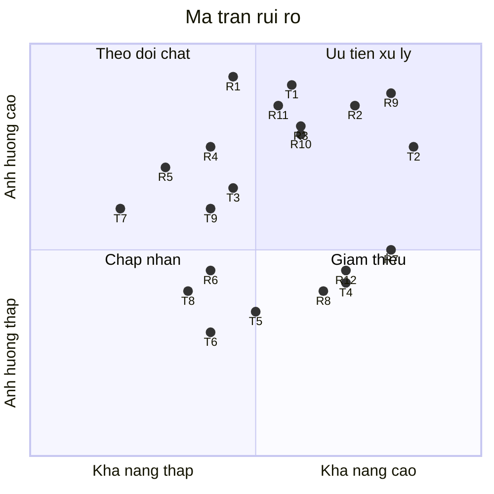

# Edge case, xung đột dữ liệu và rủi ro

Có 28 edge case, 9 xung đột dữ liệu, 12 rủi ro nghiệp vụ và 9 rủi ro kỹ thuật. Trong đó có 27 mục ảnh hưởng cao. Sáu rủi ro cần xử lý trước đợt kiểm thử nghiệm thu (giữa tháng 1/2027):

- cổng thanh toán, nay chặn cả luồng chính vì mọi tài năng phải thanh toán (R1);
- việc thiếu tiêu chí nghiệm thu (R9);
- đồng ý của người ngoài công ty tự đăng ký (R11);
- các khả năng và thời điểm đăng ký tài năng của Upload-Post (T1);
- luồng ChatGPT project → OneDrive chưa có cơ chế (T2);
- dịch vụ gửi email, nay bắt buộc để tài năng vào được hệ thống (T9).

Tab này đã viết lại theo bản yêu cầu v2. Mã cũ được giữ khi tình huống vẫn còn. Mã có nội dung đổi hoặc mới thì ghi "(đổi)" hoặc "(mới)".

**Cách đọc:**

- [YK2] = AI育成OS_概要要件定義書_v2.docx. Số 確認 (mục cần xác nhận) theo đánh số của v2. Mã BR trỏ tới tab "Quy tắc nghiệp vụ".
- **Mức ảnh hưởng** là đánh giá của mình:
  - **Cao:** làm hỏng luồng cốt lõi (đăng ký, đăng bài, thu phí), lộ dữ liệu, hoặc gây hậu quả pháp lý hay uy tín.
  - **Trung bình:** sai dữ liệu hoặc trải nghiệm nhưng có cách khắc phục.
  - **Thấp:** ảnh hưởng nhỏ, ít gặp.
- Rủi ro kỹ thuật chi tiết ở tệp 20 (RT01–RT12).
- **Phương án xử lý** là đề xuất của mình, chưa được khách đồng ý. Phương án nào đổi hành vi nghiệp vụ thì có câu hỏi tương ứng ở mục 4.

## 1. Edge case và lỗi có thể xảy ra

### 1.1 Đăng bài và duyệt bài

| Mã | Tình huống | Ảnh hưởng | Phương án đề xuất | Nguồn [YK2] |
| --- | --- | --- | --- | --- |
| E01 | Tài năng 採用 (chấp nhận) sau khi giờ đăng dự kiến đã qua | Trung bình | Vì tài năng không đổi được giờ (⚠ 確認30), hệ thống tự chọn giờ tiếp theo và báo cho tài năng | 6-6 (4-3), 6-11 (8-1) |
| E02 | Đăng thành công trên một mạng nhưng lỗi trên mạng khác | Cao | Ghi kết quả riêng từng mạng (BR-E02). Thêm trạng thái "đăng được một phần". Cho quản lý đăng lại riêng mạng bị lỗi (8-5 và 確認30 nói khác nhau về việc tài năng đặt lịch lại) | 5-1, 6-10 (8-3, 8-5) |
| E03 | Mất kết nối mạng xã hội ngay trước giờ đăng | Cao | Kiểm tra kết nối của bài đã hẹn trước giờ đăng một khoảng, báo tài năng kết nối lại kịp | 6-10 (8-3, 8-6) |
| E04 | Instagram kết nối bằng tài khoản cá nhân, không phải doanh nghiệp hoặc nhà sáng tạo | Cao | Kiểm tra loại tài khoản ngay lúc kết nối (nếu Upload-Post trả về thông tin này). Hiện hướng dẫn chuyển loại tài khoản | UC-03 前提, BR-E08 |
| E05 | Hai quản lý cùng duyệt hoặc trả lại một bài, cùng lúc | Trung bình | Người bấm trước quyết; yêu cầu chỉ gửi tới quản lý của nhóm hoặc phụ trách ([KS] 確認34). Người sau thấy "đã được xử lý bởi …". Ghi nhật ký thao tác | 6-9 (7-7), 9-4 |
| E06 | Quản lý đang sửa bài dính từ cấm, cùng lúc tài năng nhờ AI viết lại hoặc 採用 lại bài đó | Trung bình | Khóa bài khi đang chờ quản lý sửa, hoặc kiểm tra phiên bản khi lưu | 6-6 (4-4) |
| E07 (đổi) | Bài dính từ cấm hoặc chờ duyệt mà không ai xử lý trước giờ đăng | Trung bình | V2 đề xuất hủy lịch khi quá giờ chưa duyệt (⚠ 確認36). Thêm nhắc quản lý trước giờ đăng, vì thông báo chỉ hiện trên màn hình quản trị (確認45). Bài dính từ cấm quá giờ thì xử lý tương tự | 5-3, 6-9 (7-7) |
| E08 | AI viết lại nhiều lần mà vẫn dính từ cấm, hoặc kiểm tra từ cấm báo nhầm | Trung bình | Cho quản lý bỏ qua kết quả báo nhầm và ghi nhật ký. Nhờ AI viết lại tối đa 2 lần ([KS] 確認29), nên vòng lặp có điểm dừng; tài năng tự sửa chữ được ([KS] 確認28) | 6-6 (4-2, 4-4), 11 |
| E09 (đổi) | Dừng đăng tự động đúng lúc có bài đang gửi sang Upload-Post, hoặc hủy lịch bên Upload-Post bị lỗi | Trung bình | V2 quy định dừng thì hủy luôn bài đã đặt lịch. Cần xác định bài đang gửi dở tính thế nào, và thử lại khi hủy lỗi | 6-10 (7-5), UC-08 前提 |
| E10 (đổi) | Nhiều bản nháp được 採用 trong một ngày (v2 không giới hạn số bản nháp, đề xuất không giới hạn số bài), dễ bị mạng xã hội chặn | Trung bình | Giãn giờ đăng giữa các bài cùng ngày. Chốt biện pháp chống khóa tài khoản theo quy định từng mạng | 5-3, 6-10 (8-4), 確認37 |
| E11 | Bài chỉ có ảnh nên không đăng YouTube. Không rõ việc này ảnh hưởng thế nào tới số ngày đăng liên tục và mục tiêu YouTube | Thấp | Quy định rõ "đã đăng" tính theo bài hay theo từng mạng. V2 đề xuất tính theo ngày có ít nhất 1 bài (⚠ 確認22) | 6-10 (8-3) |
| E12 | Bài tài năng tự đăng ngoài hệ thống mà Upload-Post không đọc được, nên bị tính là "không đăng" | Trung bình | Kiểm tra Upload-Post đọc được gì. Nếu không đọc được thì ghi rõ trong tin nhắn hỏi han | UC-09, 6-5 (3-9) |

### 1.2 Đăng ký, tài khoản, trạng thái, thu phí

| Mã | Tình huống | Ảnh hưởng | Phương án đề xuất | Nguồn [YK2] |
| --- | --- | --- | --- | --- |
| E13 | Tài năng chuyển sang 退会 (đã rời khỏi hệ thống) khi còn bài chờ duyệt, video đang tạo dở, hoặc hóa đơn tháng chưa thu | Cao | Liệt kê việc hệ thống phải làm khi chuyển trạng thái: hủy bài chờ duyệt, bỏ video đang tạo, thu trọn tháng (⚠ 確認50), chặn đăng nhập (⚠ 確認54), gỡ khỏi Upload-Post để không tốn phí | 6-2 (7-3), UC-13, UC-08 前提 |
| E14 | Chuyển từ 退会 về 利用中 (đang dùng) | — | Không xảy ra: 退会 không quay lại được ([KS] 確認56). Người đó muốn dùng lại thì đăng ký mới; dữ liệu cũ tự xóa sau 6 tháng ([KS] 確認55) | 6-2 (7-3), 確認56 |
| E15 (đổi) | Đơn đã được duyệt nhưng tài năng không đăng nhập hoặc bỏ dở bước thanh toán | Trung bình | Tài khoản treo ở 利用前 (trước khi dùng). Nhắc tài năng và báo quản lý sau một thời gian. Chưa đăng ký với Upload-Post khi chưa thanh toán | UC-01 前提, 6-10 (8-2) |
| E16 | Thu tiền lỗi nhiều tháng liền mà quản lý không xử lý | Cao | Nhắc quản lý định kỳ, hiện số tháng chưa thu được trên danh sách tài năng | 6-3 (1-1), 確認48 |
| E17 (đổi) | Người vị thành niên ngoài công ty tự đăng ký, không có đồng ý của phụ huynh | Cao | Hiện nhãn dưới 18 tuổi (từ ngày sinh, [KS] 確認2) trên màn duyệt đơn. Khách quyết cách lấy đồng ý của phụ huynh trước khi duyệt. Cước nhà mạng của người vị thành niên có thể bị giới hạn | 3-1, 10-3, 確認1, 2 |
| E18 (đổi) | Email mật khẩu tạm không tới, bị lộ, hoặc người đăng ký gõ sai email | Trung bình | Mật khẩu tạm có hạn và chỉ dùng một lần. Cho quản lý gửi lại email. Cho sửa email trước khi duyệt | 6-1 (1-4), UC-01 |
| E19 | Vô hiệu hóa quản lý cuối cùng, hoặc quản lý tự vô hiệu hóa mình | Cao | Không cho vô hiệu hóa quản lý cuối cùng. Có quy trình cấp lại quyền | 6-2 (1-6), UC-13 前提 |
| E20 | Quản lý mất điện thoại có ứng dụng xác thực | Trung bình | Một quản lý khác đặt lại xác thực hai bước, hoặc dùng mã khôi phục | 6-2 (1-6) |
| E27 (mới) | Đường dẫn ứng dụng bị lộ, có đơn đăng ký rác hoặc hàng loạt | Cao | Xác minh email trước khi đơn vào danh sách của quản lý, giới hạn số lần gửi đơn, cho từ chối hàng loạt. Cần khách đồng ý vì thêm bước | UC-01 |
| E28 (mới) | Hai quản lý cùng xử lý một đơn đăng ký, một người duyệt và một người từ chối | Thấp | Áp dụng "người bấm trước quyết" như duyệt bài | UC-01, 確認34 |

### 1.3 Huấn luyện viên AI và xử lý buổi sáng

| Mã | Tình huống | Ảnh hưởng | Phương án đề xuất | Nguồn [YK2] |
| --- | --- | --- | --- | --- |
| E21 | Xử lý buổi sáng chưa xong trước giờ nhắn tin với một số tài năng | Cao | Xử lý song song và bắt đầu sớm. Tin gửi theo khung sáng, trưa, tối ([KS] 確認18), nên tải chia ra ba khung. Tài năng nào xong thì gửi tin ngay. V2 đã cho phép giờ gửi khác nhau tùy kết quả thử tải (確認18) | 9-2, 確認18 |
| E22 (đổi) | Tài năng đã thanh toán nhưng quản lý chưa tạo ChatGPT project và nhập hồ sơ. File trên OneDrive bị xóa, đổi tên hoặc sai định dạng | Cao | Báo quản lý ngay khi thư mục được tạo. Hiện cho tài năng biết đang chờ chuẩn bị. Dùng mẫu file cố định, kiểm tra file mỗi sáng | UC-01 前提, 6-4 (2-1), 7-5 |
| E23 | Tài năng nhắn rất nhiều tin, hoặc cố ý lách quy tắc (bảo AI bỏ qua chỉ dẫn, viết nội dung không liên quan) | Trung bình | Số lần trò chuyện chưa giới hạn (khách muốn đặt giới hạn, chưa chốt; ⚠ 確認23), nên cần chống lách chỉ dẫn và cảnh báo khi một tài năng dùng bất thường | 6-5 (3-3, 3-4, 3-5) |
| E24 | AI viết sai sự thật (ngày diễn, tên nhãn hàng) hoặc nội dung không hợp với người vị thành niên | Cao | Tài năng luôn phải 採用 trước khi đăng (đã có). Dùng tuổi từ ngày sinh để điều chỉnh nội dung | 11, 5-5, UC-01 前提 |
| E25 | Chuyện nghiêm trọng lúc nửa đêm hoặc ngày nghỉ, quản lý không xem màn hình quản trị | Cao | Gửi thêm qua email hoặc điện thoại của quản lý (khách đã ghi muốn thêm email, chưa chốt; trái đề xuất 確認45 chỉ hiện trên màn hình quản trị, cần khách quyết). AI trả lời theo kịch bản an toàn khi có dấu hiệu tự hại | 6-5 (3-3), 6-12 (7-4), 確認17, 45 |
| E26 | Tài năng tắt thông báo, đổi điện thoại, hoặc iPhone chưa thêm ứng dụng vào màn hình chính | Cao | Hiện nhắc bật thông báo khi mở ứng dụng. Lưu đăng ký nhận thông báo cho từng thiết bị. Đổi điện thoại thì dùng tiếp (UC-13 前提) | 6-1 (6-2), 6-12 (6-1), 11, 確認12 |

## 2. Xung đột dữ liệu có thể xảy ra

| Mã | Xung đột | Ảnh hưởng | Cách xử lý đề xuất | Nguồn |
| --- | --- | --- | --- | --- |
| D1 | Số liệu đọc từ Upload-Post khác số trên ứng dụng mạng xã hội (độ trễ, cách đếm) | Cao | Ghi thời điểm lấy số liệu bên cạnh mỗi con số. Chốt với khách: số của hệ thống là số tham khảo | [YK2] 6-5 (3-9), 6-7 |
| D2 | Hồ sơ tài năng nằm ở nhiều nơi: cơ sở dữ liệu của hệ thống, thư mục OneDrive, và ChatGPT project mà quản lý ghi vào bằng cách trò chuyện | Cao | Quy định nơi nào là gốc cho từng loại thông tin (ví dụ ngày sinh, trạng thái lấy từ cơ sở dữ liệu; cá tính, bí quyết lấy từ OneDrive) | [YK2] UC-01 前提, 6-4, 7-5 |
| D3 | Thay đổi chỉ dẫn AI trên màn hình M-11 trong lúc đang xử lý buổi sáng | Trung bình | M-11 (thiết kế khách) là CR-18, làm ([KS] 確認6–8).  Chỉ dẫn mới áp dụng từ lần xử lý sau. Lưu lịch sử phiên bản chỉ dẫn | [YK2] 6-13, 確認6; [TK-M] M-11 |
| D4 (đổi) | Quản lý hủy lịch đăng thành công trong hệ thống nhưng lệnh hủy gửi sang Upload-Post bị lỗi, bài vẫn đăng | Trung bình | Chỉ đổi trạng thái khi Upload-Post xác nhận đã hủy. Thử lại và báo quản lý nếu vẫn lỗi | [YK2] 6-10 (7-5) |
| D5 | Tài năng tự xóa bài trực tiếp trên mạng xã hội, hệ thống vẫn ghi "đã đăng" và vẫn lấy số liệu | Trung bình | Khi lấy số liệu không thấy bài thì đánh dấu "đã xóa ngoài hệ thống" | [YK2] 6-7 |
| D6 | Mục tiêu người theo dõi bị sửa giữa kỳ, tiến độ và thông báo đạt mục tiêu bị lệch | Thấp | Lưu lịch sử mục tiêu, tính tiến độ theo mục tiêu hiện tại | [YK2] 6-4, 確認3, 39 |
| D7 | Thiết kế của khách khác nội dung [YK2] | Trung bình | [YK2] 6-14 nói theo [YK2]. Phương án màn hình [AG] (12/11) đã sửa gần hết theo [YK2]. Còn lại: bộ mã màn hình trùng nhau giữa [TK], [SD], [AG], màn đặt lại mật khẩu, chọn nhân vật (xem tab Giao diện mục 8.2 và file 14) | [YK2] 6-14; [TK-T], [TK-M]; [AG] |
| D8 | Giờ hệ thống và giờ hiển thị khác múi giờ (máy chủ nước ngoài) | Thấp | Lưu giờ chuẩn quốc tế, hiển thị giờ Nhật | Suy ra từ kế hoạch dùng Vercel và Supabase |
| D9 (mới) | Chỉ dẫn cho huấn luyện viên AI đến từ ba nơi (ChatGPT project, file trên OneDrive, màn hình chỉ dẫn AI) và có thể trái nhau | Trung bình | Quy định thứ tự ưu tiên, ví dụ tài năng > nhóm > toàn bộ. Phải chờ khách trả lời 確認6–8 | [YK2] 6-13, 7-5, 確認5–8 |

## 3. Rủi ro

### 3.1 Rủi ro nghiệp vụ

| Mã | Rủi ro | Ảnh hưởng | Cách giảm | Nguồn |
| --- | --- | --- | --- | --- |
| R1 | Chưa chốt giá và cách tính tiền (phí tháng cố định cộng phí tạo video). Vì mọi người đăng ký phải thanh toán trước khi dùng, việc này chặn cả luồng đăng ký | Cao | Hỏi ngay, kèm hợp đồng với GMO Payment Gateway | [YK2] 6-3, 確認48–51 |
| R2 | Thuật toán mạng xã hội thay đổi, đăng đều mà không tăng người theo dõi, khách thấy hệ thống không hiệu quả | Cao | Chốt với khách: hệ thống hỗ trợ đăng đều, không cam kết số người theo dõi | [YK2] 1, 6-4 |
| R3 | Tài khoản bị khóa do đăng qua công cụ tự động. V2 bỏ giới hạn số bài mỗi ngày mà chưa chốt biện pháp thay thế | Cao | Tìm hiểu quy định từng mạng, đề xuất giới hạn cụ thể để khách chốt | [YK2] 5-3, 11, 確認37 |
| R4 | Danh sách từ cấm chưa có. Kiểm tra bằng AI nên có thể báo nhầm hoặc bỏ sót | Cao | Xin danh sách sớm, thử với bài mẫu trước kiểm thử chấp nhận | [YK2] 6-6, 確認4 |
| R5 | Pháp lý dữ liệu: đồng ý của tài năng thuộc công ty đã rõ hơn, nhưng việc quản lý đọc hội thoại, dữ liệu gửi ra nước ngoài (OpenAI, máy chủ) và người ngoài công ty vẫn chưa có căn cứ | Cao | Khách soạn điều khoản sử dụng; chúng ta liệt kê dữ liệu nào đi đâu | [YK2] 10-3, 確認1, 13, 42 |
| R6 | Đưa tin tức vào đề xuất chủ đề cần nguồn tin, có thể tốn phí và vướng bản quyền | Trung bình | Đã chốt dùng tìm web của AI (CR-05).  Chốt nguồn tin trước khi thiết kế | [YK2] 6-5, 確認16 |
| R7 | Không giới hạn trò chuyện và số bài (viết lại đã giới hạn 2 lần, [KS] 確認29), nên chi phí AI và Upload-Post khó đoán | Trung bình | Theo dõi chi phí theo từng tài năng, báo khi vượt ngưỡng khách đặt | [YK2] 確認23, 29, 37 |
| R8 | Phạm vi phình ra: AMCOLAB đã phân loại thành CR-01〜CR-25. CR-17 (nhóm tài năng: M-10 thiết kế khách = M-13 [AG]), CR-18 (màn chỉ thị cho AI: M-11 thiết kế khách = M-14, M-15 [AG]), CR-19 (duyệt theo nhóm hoặc quản lý phụ trách) và CR-21 (tài năng sửa chữ trực tiếp) **làm**; CR-20 (nhiều tài khoản trên một mạng) **không làm**; CR-22 (thử thách) đã chốt hướng, chờ khái niệm アデッソ viết; CR-23 (video tự làm thành bản nháp mỗi ngày) vẫn chờ khách (Q&A No.50); CR-24 (hội thoại riêng tư) **không làm** vì quản lý xem toàn bộ hội thoại (Q&A No.7 đóng 17/11); CR-25 **không cần** vì 画面定義書 do FutureCore làm (Q&A No.68 đóng 17/11). Ảnh hưởng tới báo giá và lịch của các CR nay làm: chưa rõ ([KS], tệp 21) | Trung bình | Chốt phạm vi bằng văn bản trước khi thiết kế chi tiết | [YK2] 確認6–8, 47 |
| R9 | Lịch gấp: kiểm thử chấp nhận từ giữa tháng 1/2027, nghiệm thu tuần 2–3 tháng 2, chạy thật cuối tháng 2 | Cao | Chia đợt, làm trước luồng chính (đăng ký, bài hàng ngày, đăng bài) | [YK2] 12 |
| R10 | 56 mục 確認 (mục cần xác nhận) chưa trả lời, khách trả lời chậm làm trễ thiết kế | Cao | Xếp thứ tự câu hỏi (mục 4), hỏi theo đợt trong các buổi họp định kỳ | [YK2] 4 |
| R11 (mới) | Cho người ngoài công ty tự đăng ký: trách nhiệm pháp lý với người vị thành niên, đồng ý xử lý dữ liệu, nội dung của người không thuộc công ty | Cao | Khách chốt điều kiện nhận người ngoài và điều khoản sử dụng trước khi mở đăng ký | [YK2] UC-01, 3-1, 確認1, 2 |
| R12 (mới) | Việc tay của quản lý tăng: tạo ChatGPT project và nhập hồ sơ cho từng tài năng, khoảng 10 người mới mỗi tháng | Trung bình | Cung cấp mẫu hồ sơ và hướng dẫn. Hiện danh sách tài năng chưa có hồ sơ | [YK2] UC-01 前提, 2 |

### 3.2 Rủi ro kỹ thuật

> Cập nhật 17/11/2026: danh sách đầy đủ và mới hơn ở [20_Rui_ro_ky_thuat.md](20_Rui_ro_ky_thuat.md) (RT01–RT12, có người phụ trách, hạn và kế hoạch POC). Bảng dưới giữ để tham chiếu mã cũ T1–T9.

| Mã | Rủi ro | Ảnh hưởng | Cách giảm | Nguồn |
| --- | --- | --- | --- | --- |
| T1 | Phụ thuộc Upload-Post (đăng bài và số liệu). Thêm: chưa rõ thời điểm đăng ký tài năng với Upload-Post, phí tăng theo số tài năng | Cao | Làm thử sớm với tài khoản thật, hỏi khách thời điểm đăng ký | [YK2] 6-10 (8-2), 8 |
| T2 | Mỗi tài năng một ChatGPT project liên kết OneDrive: chưa rõ hệ thống đọc được project đó qua OpenAI API không | Cao | Kiểm tra kỹ thuật ngay. Nếu không được, đề xuất cách khác và báo khách | [YK2] UC-01 前提, 7-5 |
| T3 | Xử lý buổi sáng cho nhiều tài năng cùng lúc (100 rồi 200–300) vượt giới hạn gọi API | Cao | Xử lý song song có giới hạn, thử tải trước | [YK2] 9-2, 確認18 |
| T4 | Thông báo đẩy trên iPhone cần iOS 16.4 trở lên và phải thêm ứng dụng vào màn hình chính | Trung bình | Hướng dẫn trong ứng dụng, có cách xem thông báo khác | [YK2] 11, 確認12 |
| T5 | Kling qua fal.ai: tạo video chậm hoặc lỗi, giá thay đổi | Trung bình | Xử lý nền, báo khi xong, chỉ tính phí khi thành công (cần khách chốt) | [YK2] 6-8, 確認31 |
| T6 | Phân quyền OneDrive: hệ thống phải tạo thư mục tự động | Trung bình | Khách cấp quyền Microsoft 365 sớm | [YK2] 7-5 |
| T7 | Ảnh hưởng ứng dụng tự động trả lời tin nhắn Instagram đang chạy của khách | Cao | Tách hẳn hệ thống, không dùng chung kết nối | [YK2] 11 |
| T8 | Phụ thuộc 7 dịch vụ bên ngoài (Upload-Post, OpenAI, fal.ai, GMO, Microsoft 365, dịch vụ email, thông báo đẩy) | Trung bình | Dịch vụ nào lỗi thì chỉ tắt chức năng đó và báo | [YK2] 11 |
| T9 (mới) | Email mật khẩu tạm và email từ chối bị vào thư rác hoặc bị chặn | Trung bình | Dùng dịch vụ gửi email có xác thực tên miền, cho quản lý gửi lại | [YK2] UC-01, 6-1 |

### 3.3 Ma trận rủi ro

Trục ngang là khả năng xảy ra, trục dọc là mức ảnh hưởng. Vị trí là ước lượng của nhóm phân tích, không phải số đo.

Bảy rủi ro nằm ở ô "ưu tiên xử lý" (khả năng và ảnh hưởng đều cao): R2, R3, R9, R10, R11, T1, T2.

## 4. Câu hỏi cần hỏi khách

Các câu dưới đây gắn với edge case và rủi ro ở trên. Số 確認 theo [YK2]. Câu không có số 確認 là câu mới chúng ta đề xuất hỏi thêm.

### 4.1 Hỏi ngay (chặn thiết kế)

1. Giá phí tháng và phí tạo video; tháng rời đi (確認50, khách muốn thu đủ tháng). Chu kỳ đã chốt hướng: một tháng tính từ ngày đăng ký ([KS] 確認48) (R1).
2. Thời điểm đăng ký tài năng với Upload-Post: lúc duyệt đơn hay lúc thanh toán xong ([YK2] 8-2 và UC-01; T1, E15).
3. Hệ thống có cần đọc ChatGPT project của từng tài năng không, hay chỉ đọc thư mục OneDrive (UC-01 前提; T2, D2).
4. Điều kiện nhận người ngoài công ty và cách lấy đồng ý của phụ huynh với người vị thành niên (確認1, 2; R11, E17).
5. Danh sách từ cấm (確認4; R4).

### 4.2 Hỏi trước khi thiết kế chi tiết

1. Biện pháp chống khóa tài khoản thay cho giới hạn số bài mỗi ngày (確認37; R3, E10).
2. Bài chờ duyệt hoặc dính từ cấm quá giờ đăng thì hủy (確認36; E07).
3. Ai đặt lại lịch sau khi đăng lỗi, khi tài năng không được đổi giờ ([YK2] 8-5 và 確認30; E01, E02).
4. Màn hình chỉ dẫn AI, nhóm tài năng, và thứ tự ưu tiên khi chỉ dẫn trái nhau (確認6–8, 47; R8, D9).
5. Nguồn tin tức cho đề xuất chủ đề (確認16; R6).
6. Thông báo gấp cho quản lý có gửi qua email hoặc điện thoại không (khách muốn thêm email, chưa chốt; 確認45; E25).
7. Có xác minh email và chặn đơn đăng ký rác không (E27).
8. Tài năng 採用 (chấp nhận) sau khi giờ đăng đã qua thì đăng ngay, dời sang giờ tốt kế tiếp trong ngày, hay để sang hôm sau ([YK2] chức năng 4-3, mục 5-2, 確認30; E01).
9. Cách đăng 要確認: bản nháp không ai chấp nhận thì hết hạn cuối ngày hay giữ lại để hôm sau dùng tiếp ([YK2] mục 5-1). Cách 自動投稿 không có bước chấp nhận ([KS] 確認25).
10. Có nhắc tài năng khi đã gửi ảnh hoặc video nhưng chưa bấm chấp nhận không. Chức năng 6-5 hiện chỉ nhắc khi thiếu ảnh hoặc video ([YK2] chức năng 6-5).

### 4.3 Hỏi để chốt chính sách

1. Việc hệ thống làm khi tài năng rời đi và khi quay lại (確認53–56; E13, E14).
2. Xử lý khi thu tiền lỗi nhiều tháng (確認48; E16).
3. "Đã đăng" tính theo ngày hay theo từng mạng: quyết khi vận hành ([KS] 確認22; E11).
4. Số liệu của hệ thống là số tham khảo, không cam kết số người theo dõi (D1, R2).
5. Ngưỡng chi phí AI mỗi tài năng để báo quản lý (trò chuyện chưa giới hạn, 確認23; R7).
6. Ngày không đăng có làm đứt chuỗi ngày đăng liên tục không, và có báo quản lý ngay trong ngày không, hay chỉ báo ở mốc 7 ngày (số ngày nhắc và báo quản lý xác nhận lại, [KS] 確認19; cách đếm quyết khi vận hành, 確認22; E11).
