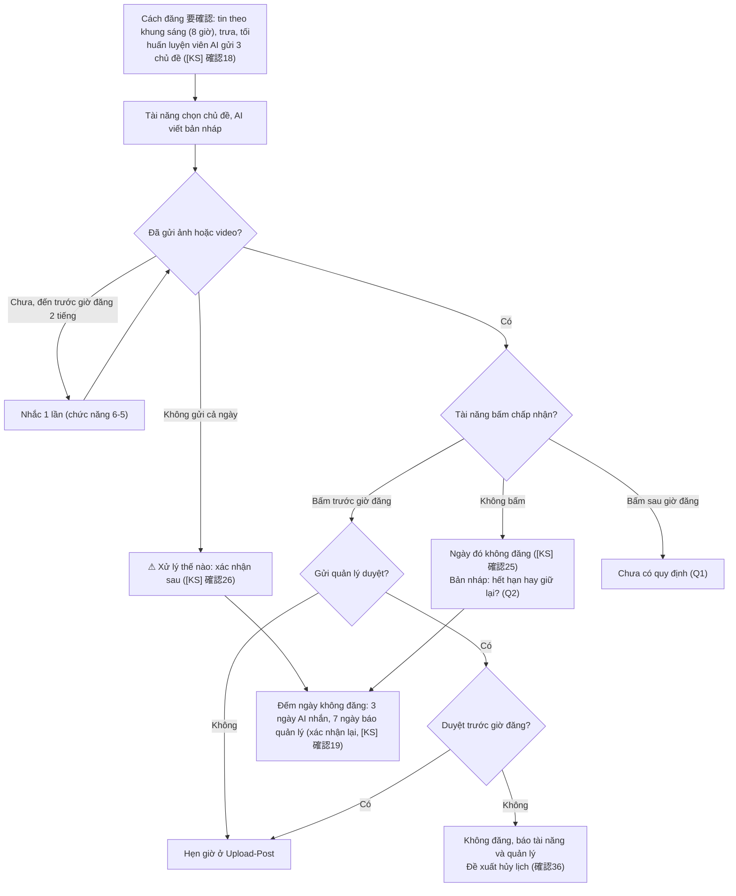

<!-- QA26112026 -->
## Nội dung hiện hành theo Q&A — 26/11/2026

Áp dụng các trả lời và phần chấp thuận được nêu dưới đây theo yêu cầu cập nhật tài liệu của người dùng. Đây là FACT về phản hồi nguồn; chưa tự cấp G7/G8, phê duyệt thiết kế hoặc thương mại. Phần lịch sử chỉ còn hiệu lực ở chủ đề không bị thay. Mã màn trong trả lời25–26/11 theo YK3 bản0.3, không đổi mã SD18/SD19.

### Giờ đăng và tư liệu đến muộn

Giờ đăng chốt khi tạo nháp; bài thứ hai trở đi dùng khung tiếp theo, cách bài trước ít nhất 3 giờ theo đề xuất được chấp thuận. AI chọn giờ trong khoảng chỉ thị, lệch vài phút giữa Talent và tách khung theo SNS; 採用 quá giờ chuyển khung tiếp theo. Nếu chưa có tư liệu mới, AI chọn tư liệu đã lưu phù hợp bài. Không có thì không đăng, báo Talent trước và sau giờ dự kiến; gửi bổ sung sau đó chuyển khung tiếp theo. Không giới hạn số lần dùng lại tư liệu cho luồng này, AI chọn theo độ phù hợp, không bắt buộc chọn ảnh lâu chưa dùng nhất.

**Phần còn mở/giới hạn:** Auto theo kỳ có giới hạn riêng tại No.83: không dùng cùng ảnh/video hai lần trong kỳ; không áp quy tắc tái sử dụng của No.56 để bỏ giới hạn đó. Thuật toán giờ chi tiết thuộc thiết kế đội.

Căn cứ: QA `Q&A!A56:J56 (No.56)`; `EV-1335` / `DEC-0019`.

### Đăng hằng ngày, tự động theo kỳ và cài đặt xác nhận

Đăng hằng ngày luôn dùng được; đăng tự động theo kỳ chỉ chạy khi bắt đầu ở T-10; hai cách dùng đồng thời, không có cài đặt chuyển độc quyền giữa hai cách. T-08 ❺ chọn xác nhận trước khi đăng hay không và áp dụng cả hai. Auto lấy chủ đề qua hội thoại, tư liệu thêm tại T-10 ❹, nhịp theo chỉ thị. AI chọn ảnh hợp chủ đề rồi tạo chữ/hashtag; không dùng thứ tự tải lên và không dùng lại cùng ảnh/video hai lần trong kỳ. Tạo bài hằng ngày trước ngày đăng, không tạo tất cả từ đầu. Chủ đề đổi qua hội thoại trong kỳ. Báo khi còn tư liệu cho 2 ngày; ngày thiếu bỏ qua, thêm tư liệu thì chạy tiếp từ hôm sau. Hết kỳ kết thúc và báo Talent đặt kỳ mới. Đổi cài đặt xác nhận giữ lịch đã có, áp cài đặt mới từ bài chưa đặt lịch. Talent chưa xác nhận tới giờ thì không đăng và báo Talent.

**Phần còn mở/giới hạn:** Mã T-08/T-10 ở đây theo YK3 được câu trả lời26/11 dẫn chiếu, không đổi mã lịch sử SD18/SD19. Auto không có Manager duyệt theo No.71/84; xác nhận Talent và duyệt Manager là hai việc khác nhau.

Căn cứ: QA `Q&A!A70:J70 (No.70); Q&A!A71:J71 (No.71); Q&A!A83:J83 (No.83)`; `EV-1336` / `DEC-0020`.

### Duyệt bài và trả lại

Auto theo kỳ không có bước Manager duyệt. Với bài hằng ngày của Talent chọn không cần xác nhận, vẫn mở lịch T-16 → chi tiết T-12 rồi tick T-12 ❼ để chuyển từ đặt lịch sang chờ Manager duyệt. Duyệt xong đăng giờ đã định; trả lại có lý do, Talent sửa và gửi lại. Gửi duyệt lại là cùng một bài, giữ lịch sử; giữ giờ nếu còn kịp, quá giờ chuyển khung tiếp theo.

**Phần còn mở/giới hạn:** Không mặc định mọi bài công việc auto phải qua Manager. Fallback người nhận khi Manager vắng mặt vẫn No.87.

Căn cứ: QA `Q&A!A58:J58 (No.58); Q&A!A71:J71 (No.71); Q&A!A84:J84 (No.84)`; `EV-1338` / `DEC-0022`.

### Dừng đăng, mở lại và huỷ lịch

Manager dừng/mở lại việc đặt lịch theo từng Talent; dừng huỷ lịch đã có. Không có nút dừng toàn hệ thống; vận hành dừng hệ thống phải xử lý huỷ lịch ngoài theo KS20261122 No.29/34. Trong lúc chỉ dừng đăng, AI coach vẫn chạy, Talent vẫn 採用 được; bài mới ở 停止中のため保留. Mở lại: bài giữ còn kịp thì đặt lịch, bài quá giờ cần Talent 採用 lại. Bài đã huỷ không tự phục hồi; báo Talent trong app và đưa về nháp để 採用 lại. T-10 có nút Talent dừng kỳ auto, huỷ lịch theo kỳ đó.

**Phần còn mở/giới hạn:** Chỉ dừng đăng khác 支払い待ち (No.63/86: dừng cả AI/video) và khác kết thúc sử dụng. No.77/91 là đối chiếu0.3 ngày25/11, không áp phần câu hỏi cũ về nút dừng toàn bộ.

Căn cứ: QA `Q&A!A60:J60 (No.60); Q&A!A61:J61 (No.61); Q&A!A70:J70 (No.70); Q&A!A77:J77 (No.77); Q&A!A91:J91 (No.91)`; `EV-1340` / `DEC-0024`.

[Phiên bản nguồn, hash và phạm vi kiểm](../docs/requirement-review/corrections-2026-11-19/QA_KS_UPDATE_2026-11-26.md).
<!-- /QA26112026 -->

Nội dung trước cập nhật26/11 — giữ để truy vết; phần mâu thuẫn đã được thay ở trên

# Xử lý khi đến giờ đăng mà tài năng chưa chấp nhận bài

## Đối chiếu nguồn mới — 20/11/2026

Phần dưới cập nhật hiệu lực theo nguồn mới; các mã [AG]/SD18 trong phân tích trước vẫn là trích dẫn lịch sử. Không suy nguồn FCP hoặc mục cần xác nhận thành khách đã duyệt.

- **7-7** — Duyệt bài công việc khi Talent xin duyệt; trả lại phải có lý do; chờ duyệt không sửa theoGJ19§13. Quá giờ chưa duyệt thì không đăng/hủy và báo cả hai bên. Còn mở: Bật tính năng có áp mọi bài không, đích category/cá nhân và phê duyệt trên đường tự động vẫn KS 20261120 No.9,10,14. Căn cứ: `T19:18,22,30;M19:8,9;BF19:8`.
- **8-5** — Manager thao tác đăng lại tại M-08; nguồn mới mô tả đăng lại ngay, không có màn chọn giờ. Không tự động thử lại khi lỗi. Còn mở: BF19 trang 9 vẫn có nhánh Talent đăng lại dưới nhãn đề xuất, trong khi màn T17 không có nút; ghi khác biệt tác nhân. Đích SNS lỗi vẫn No.59; bỏ giả định hẹn sau 15 phút. Căn cứ: `M19:12;BF19:9;GJ19:17`.

Chi tiết từng finding/Q&A và hiệu lực gate: [báo cáo đối chiếu hiện hành](../docs/requirement-review/corrections-2026-11-19/NEW_DELIVERY_IMPACT.md). Không dùng các giả định mâu thuẫn bên dưới làm kết luận hiện hành.

Tổng hợp những gì [YK2] (AI育成OS_概要要件定義書_v2.docx) nói về trường hợp đến giờ đăng mà tài năng chưa 採用 (chấp nhận) bản nháp, kèm vị trí của từng điểm trong các file phân tích và các điểm còn thiếu cần hỏi khách. Viết ngày 16/11/2026.

**Ký hiệu:** ⚠ = nội dung dựa trên một mục 確認 (mục cần xác nhận); chỗ khách đã chốt ngày 17/11 ghi `[KS] 確認N` (tệp 21). Tệp này chỉ mô tả cách đăng 要確認; cách 自動投稿 không có bước chấp nhận ([KS] 確認25). Chức năng ghi theo mã trong [YK2] mục 6 (ví dụ 4-3).

## 1. Kết luận ngắn

- [YK2] chỉ tạo lịch đăng **sau khi** tài năng bấm 採用 (chấp nhận). Trước đó chưa có gì được hẹn giờ ở Upload-Post. Vì vậy không có tình huống "đã hẹn giờ mà tài năng chưa xác nhận" ([YK2] chức năng 4-3).
- Trường hợp **không chấp nhận** (không có bài) có quy định: ngày đó không đăng.
- Trường hợp **chấp nhận trễ, sau giờ đăng đã định** thì tài liệu không nói.

## 2. Những gì tài liệu có nói

| Tình huống | Xử lý | Nguồn [YK2] |
| --- | --- | --- |
| Tài năng không chấp nhận bản nháp trong ngày (cách đăng 要確認) | Ngày đó không đăng. Cách 自動投稿 không có bước chấp nhận | [KS] 確認25 |
| Không gửi ảnh hoặc video | Không đăng, vì Instagram, TikTok, YouTube không đăng được bài chỉ có chữ. Bản nháp không có ảnh hoặc video thì không chấp nhận được | ⚠ 確認26; chức năng 4-3 |
| Đến 2 giờ trước giờ đăng mà chưa có ảnh hoặc video | Gửi thông báo 催促 (nhắc nhở) cho tài năng, 1 lần mỗi ngày. Quản lý đổi được mốc 2 giờ | Chức năng 6-5, mục 5-2 |
| Nhiều ngày liên tục không đăng | 3 ngày thì huấn luyện viên AI nhắn tài năng; 7 ngày thì báo quản lý (số ngày xác nhận lại, [KS] 確認19). Quản lý đổi được hai mốc này | Mục 5-2, chức năng 3-9, ⚠ 確認19 |
| Bài cần quản lý duyệt nhưng đến giờ đăng chưa được duyệt | Không đăng, báo cả tài năng lẫn quản lý. Đề xuất: hủy lịch; muốn đăng thì tài năng chấp nhận lại | Chức năng 7-7, UC-07, ⚠ 確認36 |
| Giờ đăng do ai quyết | Hệ thống quyết theo từng tài năng: chưa đủ số liệu thì theo chỉ dẫn thuật toán của アデッソ, đủ số liệu thì theo khung giờ tương tác tốt. Tài năng không đổi được giờ | Mục 5-2, chức năng 8-1, UC-08, ⚠ 確認30 |

## 3. Các điểm này nằm ở đâu trong các file phân tích

| Điểm | File |
| --- | --- |
| 確認25: không chấp nhận thì không đăng | [04_Yeu_cau_chuc_nang.md:132](04_Yeu_cau_chuc_nang.md:132) (chức năng 4-3), [05_Quy_tac_nghiep_vu.md:61](05_Quy_tac_nghiep_vu.md:61) (quy tắc BR-C05) |
| 確認26: không có ảnh hoặc video thì không đăng | Hai chỗ trên, cộng [06_Workflow.md:139](06_Workflow.md:139) |
| Chức năng 6-5: nhắc 2 giờ trước giờ đăng | [02_Pham_vi.md:65](02_Pham_vi.md:65), [04_Yeu_cau_chuc_nang.md:150](04_Yeu_cau_chuc_nang.md:150), [05_Quy_tac_nghiep_vu.md:48](05_Quy_tac_nghiep_vu.md:48) (BR-B02), [06_Workflow.md:110](06_Workflow.md:110) (sơ đồ), [07_Du_lieu_va_ERD.md:79](07_Du_lieu_va_ERD.md:79) (bảng cài đặt chung) |
| 確認19: mốc 3 ngày và 7 ngày | [04_Yeu_cau_chuc_nang.md:107](04_Yeu_cau_chuc_nang.md:107) (chức năng 3-9), [05_Quy_tac_nghiep_vu.md:49](05_Quy_tac_nghiep_vu.md:49) (BR-B03), [06_Workflow.md:359](06_Workflow.md:359) |
| 確認36: quá giờ chưa duyệt thì hủy lịch | 03, 04, 05, 06 (8 chỗ), 11 (mục E07), 12 |
| 確認30: tài năng không đổi được giờ đăng | 00, 03, 04, 05, 06, 10, 11, 12 |

## 4. Điểm tài liệu chưa nói (cần hỏi khách)

| STT | Câu hỏi | Vì sao cần | Đã ghi ở file nào |
| --- | --- | --- | --- |
| Q1 | Tài năng chấp nhận **sau khi giờ đăng đã qua** thì hệ thống đăng ngay, dời sang giờ tốt kế tiếp trong ngày, hay để sang hôm sau? | Tài năng không tự đổi giờ được (⚠ 確認30), nên hệ thống phải tự quyết. Giờ đăng được định trước khi chấp nhận, vì mốc nhắc 2 giờ tính theo giờ đó (mục 5-2) | Mục 4.2 câu 8 và mục E01 trong [11_Edge_case_va_rui_ro.md](11_Edge_case_va_rui_ro.md); câu hỏi gần giống ở [06_Workflow.md:154](06_Workflow.md:154)  Q&A No.56 đang hỏi: đề xuất dời sang khung giờ tốt kế tiếp. Bản nháp chưa dùng giữ 7 ngày rồi ẩn (Q&A No.55, đang hỏi). |
| Q2 | Bản nháp **không ai chấp nhận** thì hết hạn cuối ngày, hay giữ lại để hôm sau dùng tiếp? | Ảnh hưởng trạng thái bài đăng (6 trạng thái, mục 5-1) và màn hình danh sách bài | Mục 4.2 câu 9 trong [11_Edge_case_va_rui_ro.md](11_Edge_case_va_rui_ro.md) |
| Q3 | Có nhắc tài năng khi **đã gửi ảnh hoặc video nhưng chưa bấm chấp nhận** không? | Chức năng 6-5 chỉ nhắc khi thiếu ảnh hoặc video. Tài năng đã gửi ảnh mà quên bấm thì không được nhắc, bài không đăng | Mục 4.2 câu 10 trong [11_Edge_case_va_rui_ro.md](11_Edge_case_va_rui_ro.md) |
| Q4 | Ngày bỏ lỡ có làm đứt chuỗi ngày đăng liên tục không, và có báo quản lý ngay trong ngày không? | 確認22 đề xuất đếm theo ngày có ít nhất 1 bài. Quản lý hiện chỉ được báo ở mốc 7 ngày (確認19) | Mục 4.3 câu 6 và mục E11 trong [11_Edge_case_va_rui_ro.md](11_Edge_case_va_rui_ro.md) |

## 5. Luồng hiện tại theo tài liệu

Sơ đồ chỉ vẽ những gì [YK2] đã nói. Nhánh "chấp nhận sau giờ đăng" để dấu hỏi vì chưa có quy định (Q1).

