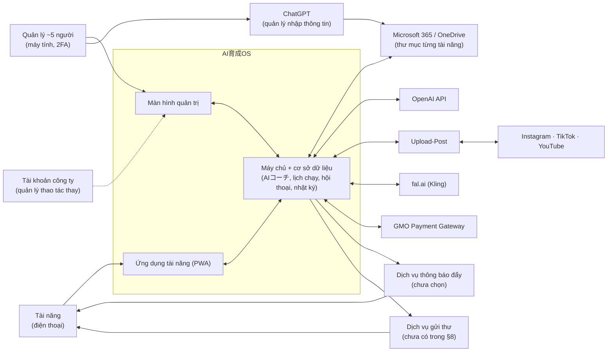

# Tài liệu bối cảnh hệ thống (SCD) – AI育成OS

Nguồn: [YK2] = `AI育成OS_概要要件定義書_v2.docx` (bản định nghĩa yêu cầu tổng quan, bản 2). [AG] = `アプリ画面案_AI育成OS.pdf` (phương án màn hình ứng dụng). File 15 = bảng câu hỏi [15_Cau_hoi_lam_ro_luong.csv](15_Cau_hoi_lam_ro_luong.csv). File 16 = [16_Chia_module_phat_trien.md](16_Chia_module_phat_trien.md).

Tài liệu này nhìn hệ thống **từ bên ngoài**: hệ thống là gì, ai dùng, nối với dịch vụ nào, ranh giới ở đâu. Nó không mô tả bên trong hệ thống.
- Bên trong chia thành module nào: xem file 16.
- Từng chức năng chạy ra sao: xem file 04.
- Phân tích chi tiết theo chủ đề: file 01 (bối cảnh kinh doanh), 03 (vai trò), 08 (tích hợp), 09 (yêu cầu phi chức năng).

Tài liệu này chỉ nên sửa khi ranh giới, tác nhân hoặc dịch vụ ngoài thay đổi.

## 1. Hệ thống là gì

AI育成OS (hệ điều hành đào tạo bằng AI) là ứng dụng giúp tài năng của アデッソ (công ty quản lý tài năng) đăng bài đều đặn lên Instagram, TikTok, YouTube để tăng người theo dõi và có thêm việc làm [YK2] §2-1.

Ba mục tiêu [YK2] §2-1:
1. Đạt 10.000 người theo dõi trên mỗi mạng (giá trị mặc định, sửa được cho từng tài năng, §7-1).
2. Tài năng vốn không hay đăng bài cũng đăng đều được: AIコーチ (huấn luyện viên AI) chuẩn bị nội dung mỗi ngày, tài năng chỉ chụp ảnh hoặc quay video rồi gửi.
3. Quản lý chỉ thiết lập lúc đầu. Việc hằng ngày do AI làm, quản lý chỉ xử lý khi có thông báo.

Trung tâm của hệ thống là AIコーチ. Tạo video, đăng hẹn giờ, lấy kết quả chỉ là công cụ phụ trợ [YK2] §2-1.

Hệ thống gồm ba phần [YK2] §2-6:
- **Ứng dụng tài năng:** PWA (ứng dụng web cài lên màn hình chính) chạy trên điện thoại.
- **Màn hình quản trị:** dùng trên trình duyệt máy tính, xem được trên điện thoại.
- **Các dịch vụ bên ngoài.**

Hệ thống dùng tên và logo của ứng dụng アデッソ hiện có, nhưng **không dùng** hệ thống cũ [YK2] §2-6.

## 2. Sơ đồ bối cảnh

Đường nét đứt: tài khoản công ty không có người dùng riêng. Quản lý đăng nhập màn hình quản trị và thao tác thay [YK2] §3-1.

## 3. Tác nhân

| Tác nhân | Dùng gì | Được làm gì | Nguồn |
|---|---|---|---|
| Tài năng | Ứng dụng tài năng | Xin dùng, chọn chủ đề, gửi ảnh và video, tạo video AI, chấp nhận bản nháp, xin duyệt, đăng ký thanh toán. Chỉ thấy dữ liệu của mình. Không vào màn hình quản trị | §3-1, §3-2 |
| Tài khoản công ty (事務所アカウント) | Màn hình quản trị (quản lý thao tác) | Chức năng như tài năng nhưng không bị thu phí. Số lần tạo video được hiện ra để công ty tự quyết toán nội bộ | §3-1, §6-3 chức năng 1-2, 5-4 |
| Quản lý (khoảng 5 người) | Màn hình quản trị, ChatGPT | Duyệt đơn, nhập thông tin và mục tiêu, duyệt bài, hủy bài hẹn giờ, đổi trạng thái, dừng đăng tự động, quản lý từ cấm. Chỉ một loại quyền: mọi quản lý xem được mọi tài năng, kể cả hội thoại, và nhận mọi thông báo | §2-4, §3-2, §3-3, §6-2 chức năng 1-6 |
| アデッソ (công ty, ngoài hệ thống) | — | Ký hợp đồng dịch vụ ngoài, quyết định điều khoản sử dụng và cách hiển thị phí, chuẩn bị kiến thức nghề và chỉ dẫn thuật toán, lấy đồng ý của phụ huynh tài năng vị thành niên | §2-3, §8, §10-3 |

AIコーチ là một phần **bên trong** hệ thống, không phải tác nhân. Nó dùng OpenAI API và đọc thư mục OneDrive của đúng tài năng đang được xử lý [YK2] §6-1 chức năng 1-5.

## 4. Dịch vụ bên ngoài

Mọi dịch vụ ngoài đều do アデッソ ký hợp đồng đứng tên mình và trả phí, kể cả trong giai đoạn phát triển và thử [YK2] §8. Bảng dưới là **giả định của FutureCore**, chưa phải lựa chọn đã chốt (§8 ghi "弊社の想定", tức giả định của chúng tôi).

| Dịch vụ | Hệ thống dùng để | Chiều dữ liệu | Ghi chú | Module (file 16) |
|---|---|---|---|---|
| Upload-Post | Đăng hẹn giờ lên 3 mạng; lấy kết quả và số người theo dõi; đăng ký tài năng và tạo đường dẫn kết nối mạng xã hội | Hai chiều, qua API | Phí theo số tài năng đăng ký. Lấy được những chỉ số nào: sẽ kiểm tra trên tài khoản thật | EP06, EP07 |
| OpenAI | Hội thoại với AIコーチ, tạo bản nháp, tổng kết | Hai chiều | Bật cài đặt không cho dùng dữ liệu gửi lên để huấn luyện | EP03, EP04 |
| fal.ai (Kling) | Tạo video từ ảnh hoặc video | Hai chiều | Đã kiểm thử: chi phí thấp, video người Nhật đẹp | EP05 |
| GMO Payment Gateway | Thu phí qua nhà mạng và thẻ | Hai chiều | Thu được số tiền thay đổi mỗi tháng hay không: chờ 確認49 (mục cần xác nhận số 49). Hệ thống không giữ thông tin thẻ | EP08 |
| Microsoft 365 / OneDrive | Lưu thông tin tài năng, kiến thức nghề, kết quả, ảnh, video | Hai chiều | Dùng Microsoft 365 hiện có của アデッソ | EP02, EP05, EP07 |
| ChatGPT | Quản lý trò chuyện để nhập thông tin tài năng vào OneDrive | Qua MCP (御見積書 前提条件 A4, Q&A No.45); cách ghi vào OneDrive chưa chứng minh (S02-01, rủi ro RT02) | Khoảng 5 người dùng. Phía ChatGPT ai thiết lập: câu hỏi C4 | EP02 |
| Thông báo đẩy | Gửi thông báo về điện thoại tài năng | Ra | Chưa chọn cơ chế (§8): câu hỏi C6 | EP09 |
| Dịch vụ gửi thư | Thư mật khẩu tạm, thư từ chối, thư đặt lại mật khẩu | Ra | Chức năng 1-4 cần dịch vụ này nhưng §8 không có: câu hỏi C1 | EP01 |
| Vercel, Supabase, Xserver VPS | Chạy hệ thống | — | Dùng tài khoản アデッソ đang có, Vercel và Supabase phải lên gói trả phí | EP10 |

Hai hệ thống khác cần biết ranh giới:
- **Ứng dụng tự động hóa tin nhắn Instagram đang chạy:** không được gây ảnh hưởng [YK2] §9-1.
- **Ứng dụng アデッソ hiện có:** chỉ lấy tên, logo, màu. Không kết nối, kể cả đăng nhập chung [YK2] §2-6, §6-14. Đăng nhập chung nằm trong danh sách xem xét sau (§13).

Nếu Upload-Post không làm được chức năng nào, cách thay thế sẽ thỏa thuận bằng văn bản [YK2] §8.

## 5. Dữ liệu nằm ở đâu

| Dữ liệu | Nơi lưu | Ai xem được | Nguồn |
|---|---|---|---|
| Thông tin tài năng, mục tiêu, kiến thức nghề, kết quả | OneDrive, thư mục từng tài năng | Quản lý; AIコーチ (chỉ của tài năng đó) | §7-2 |
| Ảnh, video | OneDrive | Chính tài năng đó và quản lý | §7-2 |
| Hội thoại với AIコーチ | Cơ sở dữ liệu của hệ thống | Chính tài năng đó và quản lý | §7-2 |
| Thông tin thanh toán | GMO | Hệ thống không giữ thông tin thẻ | §7-2, §10-2 |
| Danh sách từ cấm, cài đặt chung | Hệ thống (quản lý chỉnh trên màn hình quản trị) | Quản lý | §5-6, §7-1 |

Quản lý sửa file trong OneDrive thì AIコーチ áp dụng **từ sáng hôm sau**, không cần sửa mã [YK2] §7-5.

## 6. Ràng buộc

| Loại | Ràng buộc | Nguồn |
|---|---|---|
| Thiết bị | Tài năng dùng iPhone hoặc Android. Muốn nhận thông báo đẩy trên iPhone cần iOS 16.4 trở lên. Màn hình quản trị dùng trình duyệt máy tính là chính, trên điện thoại vẫn phải dễ xem | §9-1 |
| Quy mô | Bắt đầu khoảng 30 tài năng, thêm 10 người mỗi tháng, sắp tới khoảng 100. Mục tiêu 200–300, sau này 1.000 | §9-2 |
| Thời gian | Việc buổi sáng (đọc dữ liệu, tạo bản nháp) phải xong trước giờ nhắn (mặc định 8:00) | §9-2, §5-2 |
| Môi trường | Có môi trường thật và môi trường thử | §9-1 |
| Khi lỗi | Dịch vụ ngoài lỗi thì chỉ dừng chức năng đó, chức năng khác vẫn chạy; đăng lỗi thì báo | §9-3 |
| Nhật ký | Ghi lượt xem, thao tác và kết quả xử lý (đăng bài, lấy kết quả, tạo video, thu phí) | §9-4 |
| Bảo mật | Quản lý đăng nhập 2FA (xác thực hai bước). Mã hóa đường truyền và dữ liệu lưu. Không hiện khóa API trên màn hình hay trong nhật ký. Chỉ gửi cho AI phần dữ liệu cần thiết | §10-1, §10-2 |
| Dữ liệu thử | Mặc định dùng dữ liệu giả. Muốn dùng dữ liệu tài năng thật phải có văn bản đồng ý của アデッソ | §10-3 |
| Không cam kết | Thông báo đẩy luôn đến; tài khoản không bao giờ bị khóa; chất lượng nội dung do AI tạo | §11 |
| Lịch | Mục tiêu chạy thật cuối tháng 2/2027. Kiểm thử chấp nhận từ giữa tháng 1/2027. Nghiệm thu khoảng tuần 2–3 tháng 2/2027. Lúc chạy thật phải có các chức năng mức 高 (cao) và 中 (trung bình) | §12-3, §14-1 |
| Hợp đồng | Dịch vụ ngoài chưa xong thẩm định hoặc hợp đồng trước khi kiểm thử chấp nhận thì chức năng đó tách khỏi nghiệm thu, phát hành sau | §12-1 |

## 7. Phạm vi

**Trong phạm vi:** chức năng của 9 hạng mục lớn trong SOW (bản mô tả phạm vi công việc), tức 54 chức năng ở [YK2] chương 6 [YK2] §1-3, 別紙C (phụ lục C). Các chức năng này được chia module ở file 16.

**Cập nhật 17/11 (Q&A bản 15/11):** quản lý làm thay tài năng (確認27) đã chốt làm ở đợt đầu (CR-09); không làm OTP qua email; xác thực hai bước chỉ dùng ứng dụng xác thực, SMS chờ bàn (S01-11).

**Ngoài phạm vi:**
- Những mục SOW "4.2 作業対象外" (ngoài phạm vi công việc) [YK2] §1-3.
- Chức năng để xem xét sau [YK2] §13: X (Twitter), phát trực tiếp, bảng xếp hạng, hội thoại bằng giọng nói, trả lời bình luận, đăng nhập chung với hệ thống hiện có, chạy AI trên máy chủ riêng…
- Bảo trì sau phát hành (hợp đồng riêng) [YK2] §11.
- Lưu bằng chứng đồng ý của phụ huynh [YK2] §10-3.

**Chưa rõ, chưa xếp vào hai nhóm trên:**
- Quản lý nhóm tài năng (確認47, nay là CR-17).
- Chỉ thị cho AI theo nhóm (確認6, nay là CR-18).
- Các thay đổi khác ngoài báo giá CR-19〜CR-25 (xem `19_Doi_chieu_QA_bao_gia.md` mục 3). Tất cả chờ Q&A No.50.
- Nội dung chống khóa tài khoản (§9-5).

Chi tiết ở file 16 mục 3.

## 8. Những quyết định đã chốt mà dễ bị hiểu nhầm

| Quyết định | Nguồn |
|---|---|
| Ứng dụng tài năng là PWA, **không** dùng LINE | 別紙B (phụ lục B) dòng 17; họp 20/10/2026 |
| Không có gói miễn phí. Mọi tài năng xin dùng qua ứng dụng đều trả phí; chỉ tài khoản công ty không bị thu phí | §3-1, §6-3 chức năng 1-2, 1-3 |
| Một bài đăng giống hệt nhau (cùng ảnh hoặc video, cùng chú thích) lên cả 3 mạng. Không có video thì không đăng YouTube | §6-10 chức năng 8-3 |
| Quản lý chỉ có một loại quyền | §6-2 chức năng 1-6 |
| Giờ đăng do hệ thống chọn: lúc đầu theo chỉ dẫn thuật toán của công ty, sau đó theo kết quả | §6-11 chức năng 8-1 |
| Đăng lỗi thì không tự đăng lại | §6-10 chức năng 8-5 |

## 9. Câu hỏi mở ảnh hưởng tới ranh giới hệ thống

Đây chỉ là những câu hỏi làm thay đổi sơ đồ ở mục 2 hoặc bảng ở mục 4. Các câu hỏi còn lại xem file 15.

| Mã | Nội dung |
|---|---|
| C1 | Dùng dịch vụ gửi thư nào |
| C6 | Dùng cơ chế thông báo đẩy nào |
| C4 | Phía ChatGPT do ai thiết lập và vận hành |
| C2 | Nơi lưu tạm ảnh và video trước khi chuyển vào OneDrive |
| 確認49 | GMO có thu được số tiền thay đổi mỗi tháng không |
| 確認9 | Ai kết nối mạng xã hội với Upload-Post |
| A10 | Chọn bộ mã màn hình nào làm bộ chính thức |

## 10. Thuật ngữ chung với khách

Dùng nguyên các từ này trong tên nhánh, PR, mã nguồn và khi trao đổi. Danh sách đầy đủ ở [YK2] 別紙E (phụ lục E).

| Tiếng Nhật | Nghĩa | Gợi ý tên trong mã nguồn |
|---|---|---|
| タレント | Tài năng (người dùng ứng dụng) | talent |
| マネージャー | Quản lý | manager |
| 事務所アカウント | Tài khoản công ty | office account |
| AIコーチ | Huấn luyện viên AI | coach |
| 投稿案 | Bản nháp bài đăng | draft |
| 採用 | Tài năng chấp nhận bản nháp | adopt |
| 承認 / 差し戻し | Duyệt / trả lại | approve / return |
| 予約投稿 | Đăng hẹn giờ | scheduled post |
| 使ってはいけない言葉 | Từ cấm | forbidden word |
| 実績 | Kết quả bài đăng | metrics |
| 利用前 / 利用中 / 利用終了 | Chưa dùng / đang dùng / đã ngừng | status |
| UC-01〜UC-13 | Tình huống sử dụng | — |
| 確認N | Mục cần khách xác nhận số N | — |
