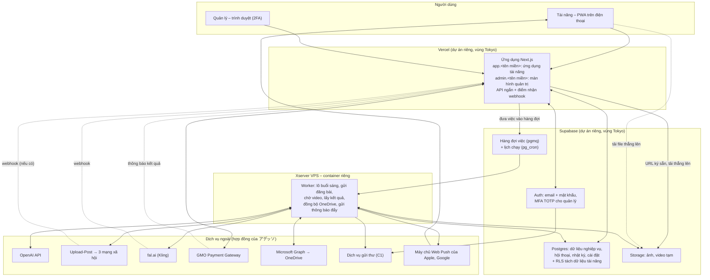

<!-- DELIVERY24112026 -->
## Cập nhật nguồn24/11 — đối chiếu25/11/2026

Phần cập nhật này thay nhận định cũ trên đúng chủ đề bên dưới; giữ nội dung trước để truy vết. [Báo cáo và hash](../docs/requirement-review/corrections-2026-11-19/DELIVERY_24112026_REVIEW.md). Chưa là baseline/AC đã duyệt.

### Cổng thanh toán

G17 ghi khách thông báo qua điện thoại sau họp sẽ chọn Square; GMO trong YK3 §2-4-11 và sheet dự án là ứng viên cũ.

**Còn mở/giới hạn:** Ngày cuộc điện thoại chưa rõ; chưa chứng minh đã ký/xét duyệt. Đội/provider kiểm Square đáp ứng nhà mạng, trả trước, phí biến đổi, giữa kỳ, quá hạn và lịch sử. Không mặc định Square hỗ trợ các yêu cầu này. Căn cứ: `KS アクション一覧!B17:G17 (No.16)`; `EV-1312`; QA No.46;QA No.49;QA No.86;TR-1-1;TR-5-4.

### Chi phí dịch vụ và hợp đồng

H34 ghi đã giải thích24/11 và khách thấy mức phí tháng ngoài video không vấn đề; phí video do Talent trả. Slide EXT24 p13 tách phí video khỏi tổng và tính50/100/150người.

**Còn mở/giới hạn:** Chỉ là xác nhận mức ước tính theo nguồn; không là ký hợp đồng dịch vụ, phí duy trì hoặc bảo đảm giá. Square/provider và mức lưu/truyền vẫn cần kiểm. Căn cứ: `KS 20261122!G34:H34 (No.33)`; `EV-1326`; TR-3-5;TR-5-4.

<!-- /DELIVERY24112026 -->

# Hạ tầng hệ thống – AI育成OS

## Đối chiếu nguồn mới — 20/11/2026

Phần dưới cập nhật hiệu lực theo nguồn mới; các mã [AG]/SD18 trong phân tích trước vẫn là trích dẫn lịch sử. Không suy nguồn FCP hoặc mục cần xác nhận thành khách đã duyệt.

- **6-8** — Bắt buộc đăng ký phương thức thanh toán và mở từ biểu tượng màn hình chính; thêm biểu tượng bằng hướng dẫn thủ công theo máy. SNS và cho phép thông báo có thể làm sau. Thanh toán đăng ký xong tự kích hoạt, tạo folder và báo Manager; sau khởi tạo mở Mypage T-08, không phải Home T-09. Office bỏ bước thanh toán. Còn mở: Cần kiểm thiết bị/PWA quay lại sau kết nối, không coi hình minh họa là kiểm chứng tương thích. Căn cứ: `T19:5,6,8,9,11,26,33;BF19:4`.
- **8-2** — Mở màn login/cho phép của từng SNS, không mở giao diện dịch vụ đăng; quay về T-07. Một tài khoản mỗi SNS; business/creator Instagram; không cần nối đủ 3 SNS. Còn mở: Luồng nhà cung cấp/48 h là thiết kế tích hợp phải kiểm, không hỏi khách chọn API hoặc khẳng định đã kiểm tài khoản thật. Căn cứ: `T19:10,26;BF19:5`.
- **1-1** — Phí tháng cộng phí video; giá AI video từ lượt đầu; tạo lại tính thêm, lỗi dịch vụ không tính. Không lưu thẻ; đổi thanh toán/lịch sử qua nhà cung cấp. Còn mở: Chưa chốt trả trước/sau, ngày bắt đầu tính phí, cổng chính thức; Square ở H105 là nhận định cần provider kiểm, không tự chọn GMO hay Square/thu ngay/ngày 1/thử lại 3 ngày. Căn cứ: `T19:9,20,21,25,26;M19:15;BF19:15;KS:20261120:23,24,25,26`.

Chi tiết từng finding/Q&A và hiệu lực gate: [báo cáo đối chiếu hiện hành](../docs/requirement-review/corrections-2026-11-19/NEW_DELIVERY_IMPACT.md). Không dùng các giả định mâu thuẫn bên dưới làm kết luận hiện hành.

## Quyết định ngày 17/11/2026: tách FE và BE

Thay cho phần "API trên Vercel" ở dưới. Phần thân file chưa viết lại; chỗ nào khác khối này thì làm theo khối này.

- **FE** (`apps/web`, sau này `apps/admin`): chỉ giao diện, không có API. Đặt trên Vercel hoặc CDN.
- **BE thuần trên VPS** (`apps/api`): Node.js 22 + TypeScript + Hono; chạy bằng PM2 trong Docker Compose; Caddy lo HTTPS. Gồm API, worker (sau này là tiến trình PM2 thứ hai) và điểm nhận webhook của Upload-Post và GMO.
- **Supabase**: Auth, Storage và Postgres (dữ liệu nghiệp vụ). FE không đọc DB trực tiếp; các bảng của app bật RLS nhưng không mở quyền.
- **Hàng đợi và lịch chạy**: pg-boss trên Postgres, thay cho Supabase Queues (pgmq) và pg_cron.
- **Đăng nhập** đi qua `POST /api/v1/auth/login` của BE, để khóa sau 5 lần sai có hiệu lực.
- **Rủi ro**: API, worker và webhook cùng một VPS (RT07). VPS không giữ dữ liệu nên dựng lại được nhanh.

Nguồn:
- [YK2] = `AI育成OS_概要要件定義書_v2.docx` (bản định nghĩa yêu cầu tổng quan, bản 2).
- [SM] = `要件説明資料_AI育成OS.pdf` (tài liệu giải thích yêu cầu, bản cũ, viết khi còn dùng LINE).
- File 17 = [17_Tai_lieu_boi_canh_he_thong.md](17_Tai_lieu_boi_canh_he_thong.md) (bối cảnh hệ thống). File 16 = [16_Chia_module_phat_trien.md](16_Chia_module_phat_trien.md) (module EP01–EP10). File 08 = [08_Tich_hop.md](08_Tich_hop.md) (tích hợp).

Cách đánh dấu trong tài liệu:
- **[Chốt]**: có trong [YK2].
- **[Cũ]**: chỉ có trong [SM], là tài liệu cũ hơn. Phải xác nhận lại.
- **[Đề xuất]**: đề xuất của đội phân tích, khách chưa đồng ý. Cần duyệt nội bộ và hỏi khách theo mục 10.

## 1. Những gì tài liệu đã nói về hạ tầng

| Nội dung | Mức | Nguồn |
|---|---|---|
| Chạy trên Vercel, Supabase, Xserver VPS mà アデッソ đang thuê. Vercel và Supabase phải lên gói trả phí | [Chốt] | [YK2] §8 |
| Mọi dịch vụ ngoài ký hợp đồng đứng tên アデッソ. Phí trong giai đoạn phát triển và thử cũng do アデッソ trả | [Chốt] | [YK2] §8 |
| Có môi trường thật và môi trường thử | [Chốt] | [YK2] §9-1 |
| Không được làm ảnh hưởng ứng dụng tự động hóa tin nhắn Instagram đang chạy | [Chốt] | [YK2] §9-1 |
| Mã hóa đường truyền và dữ liệu lưu. Không hiện khóa API trên màn hình hay trong nhật ký. Hệ thống không giữ thông tin thẻ | [Chốt] | [YK2] §10-2 |
| Việc buổi sáng phải xong trước giờ nhắn. Bắt đầu khoảng 30 tài năng, sau tăng tới 1.000 | [Chốt] | [YK2] §9-2 |
| Dịch vụ ngoài lỗi thì chỉ tắt chức năng đó | [Chốt] | [YK2] §9-3 |
| Sao lưu, khung giờ hoạt động, thời gian giữ nhật ký: quyết định khi thiết kế | [Chốt] (là việc còn mở) | [YK2] §9-3, §9-4 |
| Dùng Next.js | [Cũ] | [SM] tr.3 |
| Việc buổi sáng chạy bằng n8n, là công cụ tự động hóa mà ứng dụng tin nhắn đang dùng, tách thành một quy trình riêng | [Cũ] | [SM] tr.9 |
| Xác thực hai bước của quản lý dùng TOTP (mã dùng một lần theo thời gian) qua Supabase Auth MFA. SMS chờ bàn với khách (S01-11); không làm OTP qua email | [Chốt] 17/11 | [SM] tr.28; [YK2] §6-2; quyết định nội bộ 17/11 |
| Đăng hẹn giờ do dịch vụ đăng bài chạy, hệ thống chỉ gửi lịch sang | [Cũ] | [SM] tr.9 |

[YK2] không nói phần nào chạy ở Vercel, phần nào ở Supabase, phần nào ở VPS. Mục 2 trở đi là đề xuất.

## 2. Nguyên tắc thiết kế [Đề xuất]

1. **Tách hẳn khỏi ứng dụng tin nhắn đang chạy.** Dùng dự án Vercel riêng, dự án Supabase riêng, và trên VPS chạy trong container riêng, có giới hạn CPU và bộ nhớ. **Không** đặt việc buổi sáng vào n8n mà ứng dụng tin nhắn đang dùng như [SM] tr.9 đề xuất. Nếu việc buổi sáng làm n8n quá tải thì chính ứng dụng tin nhắn bị ảnh hưởng, trái với §9-1.
2. **Mỗi loại việc chạy đúng chỗ của nó:**
   - Vercel: giao diện và các lệnh gọi ngắn.
   - Supabase: dữ liệu, đăng nhập, lưu file tạm, hàng đợi việc.
   - VPS: các việc chạy lâu hoặc chạy theo lịch, như lô buổi sáng, chờ video, lấy kết quả, đồng bộ OneDrive.
3. **Không thêm dịch vụ khi dịch vụ đã có làm được.** Hàng đợi và lịch chạy dùng ngay Postgres của Supabase, không thêm Redis hay một trình lập lịch riêng. Thông báo đẩy dùng chuẩn Web Push tự gửi, không thuê dịch vụ ngoài. Có thể thay nếu khách chọn khác ở C6.
4. **Đặt tại Nhật:** Supabase ở vùng Tokyo, hàm của Vercel chạy ở Tokyo, Xserver VPS vốn đặt tại Nhật. Lý do là người dùng ở Nhật và dữ liệu cá nhân nên nằm trong nước. Khách cần đồng ý điểm này (câu I7).

## 3. Sơ đồ hạ tầng [Đề xuất]

## 4. Đặt từng thành phần ở đâu [Đề xuất]

| Thành phần | Đặt ở | Lý do | Module |
|---|---|---|---|
| Ứng dụng tài năng (PWA) và màn hình quản trị | **Một** dự án Next.js trên Vercel, hai tên miền con | Một mã nguồn, một lần triển khai. Hai tên miền để áp quy tắc phiên đăng nhập khác nhau: tài năng giữ 30 ngày, quản lý hết phiên sau 30 phút không thao tác (§6-1, §6-2). Next.js là lựa chọn trong [SM] tr.3 | EP09, toàn bộ giao diện |
| API ngắn (đọc, ghi dữ liệu, tạo URL tải lên, đưa việc vào hàng đợi) | Hàm của Vercel | Thời gian chạy ngắn, tự co giãn | Mọi module |
| Điểm nhận webhook (fal.ai, GMO, Upload-Post) | Hàm của Vercel | Cần địa chỉ HTTPS công khai và luôn sẵn sàng. Chỉ kiểm tra chữ ký, ghi nhận, rồi đưa việc vào hàng đợi | EP05, EP06, EP08 |
| Đăng nhập | Supabase Auth | Có sẵn email và mật khẩu, đặt lại mật khẩu, MFA TOTP ([SM] tr.28) | EP01 |
| Cơ sở dữ liệu | Supabase Postgres | Dùng RLS (bảo mật theo dòng) để chặn tài năng xem dữ liệu của người khác ngay ở tầng dữ liệu (1-5, §10-1) | Mọi module |
| Hàng đợi việc và lịch chạy | Supabase Queues (pgmq) và pg_cron | Có sẵn trong Postgres, không thêm dịch vụ. Lịch đọc giờ từ bảng cài đặt, nên quản lý đổi giờ là áp dụng ngay (§5-6) | EP10 |
| Ảnh và video tạm | Supabase Storage | Điện thoại tải thẳng lên qua URL ký sẵn. Hàm Vercel giới hạn kích thước dữ liệu gửi lên, video không đi qua được. Nơi lưu chính thức là OneDrive (§7-2); thời gian giữ bản tạm: câu C2 | EP05 |
| Worker (tiến trình chạy nền) | Container Docker trên Xserver VPS | Việc chạy lâu (lô buổi sáng cho tới 1.000 người, chờ video vài phút) vượt giới hạn thời gian của hàm Vercel. VPS có địa chỉ IP cố định, dùng được nếu GMO hay Microsoft yêu cầu danh sách IP được phép (câu I5) | EP03, EP04, EP05, EP06, EP07 |
| Thông báo đẩy | Chuẩn Web Push với khóa VAPID (khóa định danh máy chủ gửi), worker tự gửi | Không cần dịch vụ ngoài. iPhone cần iOS 16.4 trở lên và đã thêm ứng dụng vào màn hình chính (§9-1). Chờ câu C6 | EP09 |
| Gửi thư | Dịch vụ gửi thư giao dịch, gửi từ tên miền của アデッソ, cấu hình làm SMTP riêng cho Supabase Auth | Thư mặc định của Supabase không dùng được cho môi trường thật. Chờ câu C1 | EP01 |
| Tệp OneDrive | Microsoft Graph API, ứng dụng đăng ký trong Microsoft 365 của アデッソ | Đọc thông tin tài năng mỗi sáng, ghi kết quả, lưu ảnh và video. Cần quản trị viên của アデッソ cấp quyền, nên chỉ xin quyền tối thiểu (câu I3) | EP02, EP05, EP07 |

## 5. Môi trường [Đề xuất]

| Môi trường | Vercel | Supabase | VPS | Dịch vụ ngoài |
|---|---|---|---|---|
| Máy lập trình viên | Chạy Next.js trên máy | Supabase CLI chạy trên máy (Docker) | Worker chạy trên máy | Khóa thử, tài khoản mạng xã hội thử |
| Thử (テスト用, §9-1; cũng dùng cho kiểm thử chấp nhận) | Dự án riêng hoặc môi trường xem trước | **Dự án Supabase riêng** | Container riêng (`stg`) | Môi trường thử của GMO; gói Upload-Post và tài khoản mạng xã hội thử (§12-4) |
| Thật (本番用) | Dự án thật | **Dự án Supabase riêng** | Container riêng (`prod`) | Hợp đồng thật |

Hai môi trường phải dùng khóa API riêng và thư mục OneDrive riêng, để môi trường thử không bao giờ đăng bài lên tài khoản thật của tài năng.

## 6. Việc chạy theo lịch và chạy nền [Đề xuất]

Mọi giờ trong bảng là giá trị mặc định, quản lý đổi được trên màn hình quản trị ([YK2] §5-6).

| Việc | Khi chạy | Chạy ở | Nội dung | Chức năng |
|---|---|---|---|---|
| Lô trước giờ nhắn | Trước mỗi khung sáng (mặc định 8:00), trưa, tối ([KS] 確認18). Lô khung sáng đề xuất bắt đầu khoảng 5:00 | Worker | Mỗi tài năng: đọc OneDrive và kết quả hôm qua → gọi OpenAI → lưu lời tổng kết và 3 chủ đề → 8:00 gửi thông báo. Chạy song song có giới hạn, lỗi thì thử lại từng người, không dừng cả lô | 2-1, 3-6, 4-1 |
| Khoảng 自動投稿 | Hằng ngày trong khoảng tài năng đặt ([KS] 確認25) | Worker | Tự soạn bài từ chủ đề và tư liệu của khoảng, kiểm tra từ cấm, hẹn giờ qua Upload-Post. Nhịp đăng, duyệt, hết tư liệu: chưa rõ |
| Xóa dữ liệu tài năng rời đi | Mỗi ngày | Worker | Tài năng 利用終了 đủ 6 tháng: xóa dữ liệu trong DB, Supabase Storage, thư mục OneDrive; không khôi phục ([KS] 確認55) |
| Nhắc trước giờ đăng | 2 giờ trước giờ đăng của từng bài | pg_cron → worker | Nhắc gửi tư liệu, chấp nhận bản nháp | 6-5 |
| Hủy bài quá giờ chưa duyệt | Đến giờ đăng | pg_cron → worker | Không đăng, báo tài năng và quản lý | 7-7 |
| Nhắc khi không đăng | Mỗi ngày | pg_cron → worker | 3 ngày không đăng thì AIコーチ nhắc tài năng; 7 ngày thì báo quản lý | 3-9 |
| Tổng kết tuần | Thứ Hai | Worker | Tổng kết hằng tuần | 3-8 |
| Lấy kết quả | Mỗi ngày một lần, đề xuất chạy trước lô buổi sáng (câu C5) | Worker | Lấy từ Upload-Post → lưu cơ sở dữ liệu → ghi vào OneDrive. Lỗi thì lấy lại lần sau | 8-7, 8-8, 3-10 |
| Gửi bài hẹn giờ | Khi tài năng chấp nhận bản nháp (và đã được duyệt nếu cần) | Hàng đợi → worker | Kiểm tra từ cấm → gửi lịch sang Upload-Post → lưu mã đặt lịch | 4-4, 8-3 |
| Tạo video | Khi tài năng yêu cầu | Hàng đợi → worker, webhook của fal.ai | Gửi yêu cầu sang fal.ai → nhận webhook → lưu video → đếm số lần tính phí | 5-1, 5-4 |
| Dừng đăng tự động | Khi quản lý bấm | Hàng đợi → worker | Hủy các bài đã hẹn giờ trên Upload-Post | 7-5 |
| Thu phí tháng | Ngày chốt (quyết khi chọn xong cổng thanh toán) | Worker, thông báo kết quả từ GMO | Cộng phí tháng với phí video → thu tiền → thu lỗi thì báo, không khóa tài khoản | 1-1, 5-4 |

Ước tính thô cho lô buổi sáng: 1.000 tài năng, mỗi người khoảng 30 giây gọi AI, chạy song song 20 người thì mất khoảng 25 phút. Chạy được trên một worker. Con số thật phải đo khi có lời nhắc (prompt) thật và kiểm tra giới hạn tốc độ của OpenAI (§9-2).

## 7. Bảo mật [Đề xuất, dựa trên [YK2] §10]

| Yêu cầu | Cách làm |
|---|---|
| Tài năng chỉ thấy dữ liệu của mình (1-5, §10-1) | RLS trên mọi bảng có dữ liệu tài năng. Worker dùng khóa quản trị (service role) nhưng chỉ chạy trên VPS, không bao giờ đưa xuống trình duyệt |
| Quản lý đăng nhập 2FA (1-6) | Supabase MFA TOTP. Mọi đường dẫn quản trị đều đòi đã qua bước 2 (mức xác thực AAL2) |
| Khóa 15 phút sau 5 lần sai; quản lý hết phiên sau 30 phút (1-4, 1-6) | Supabase Auth không có sẵn kiểu khóa theo tài khoản như vậy, và cài đặt phiên của nó áp cho cả dự án. Phải tự làm: đếm số lần sai trong cơ sở dữ liệu, kiểm tra thời gian không thao tác ở tầng trung gian (middleware) của Next.js cho tên miền quản trị. **Đã quyết 17/11:** khóa ở BE qua `POST /api/v1/auth/login`; Password Verification Hook chỉ có ở gói Team nên gọi thẳng Supabase Auth không bị đếm (rủi ro RT12 đã chấp nhận) |
| Không lộ khóa API (§10-2) | Khóa để trong biến môi trường của Vercel và tệp bí mật của container trên VPS. Không ghi khóa vào nhật ký. Mỗi môi trường một bộ khóa |
| Webhook giả mạo | Kiểm tra chữ ký hoặc mã bí mật của từng dịch vụ. Nhận lặp lại không bị xử lý hai lần |
| Mã hóa (§10-2) | HTTPS ở mọi đầu. Supabase mã hóa dữ liệu lưu sẵn |
| Chỉ gửi AI phần dữ liệu cần (§10-2) | Mỗi lần gọi OpenAI chỉ đọc thư mục của đúng tài năng đó. Tắt việc dùng dữ liệu để huấn luyện ở cài đặt tổ chức của OpenAI |
| Quyền OneDrive | Xin quyền tối thiểu trên Microsoft Graph, giới hạn vào khu vực chứa thư mục tài năng, không xin quyền trên toàn bộ Microsoft 365 của công ty (câu I3). Tra lại 17/11: các trang endpoint chỉ ghi quyền toàn tenant; quyền Selected phải chứng minh bằng POC P02 (bộ OneDrive §4.2, rủi ro RT02) |
| VPS | Chỉ mở cổng SSH, đăng nhập bằng khóa. Worker không mở cổng nào, chỉ gọi ra ngoài |

## 8. Sao lưu, theo dõi, nhật ký [Đề xuất]

[YK2] §9-3, §9-4 để việc này quyết khi thiết kế. Đề xuất ban đầu:

- **Sao lưu:**
  - Cơ sở dữ liệu: dùng sao lưu hằng ngày có sẵn trong gói trả phí của Supabase. Có cần khôi phục về đúng thời điểm (PITR, gói bổ sung) không thì hỏi khách.
  - OneDrive: theo chính sách lưu giữ của Microsoft 365 của アデッソ.
  - VPS: không giữ dữ liệu, chỉ chạy mã, hỏng thì triển khai lại.
- **Nhật ký nghiệp vụ** (§9-4: lượt xem, thao tác, kết quả xử lý): ghi vào bảng trong Postgres, chỉ được thêm, không sửa, không xóa. Các bảng này cũng là nguồn để theo dõi lỗi, ví dụ "hôm nay có bao nhiêu bài đăng lỗi", không cần dựng thêm hệ thống theo dõi riêng.
- **Nhật ký kỹ thuật:** dùng nhật ký có sẵn của Vercel và Supabase, cộng nhật ký container trên VPS. Thêm một dịch vụ báo lỗi ứng dụng (ví dụ Sentry) khi cần.
- **Cảnh báo:** lô buổi sáng chưa xong trước giờ nhắn, worker ngừng chạy, hoặc một dịch vụ ngoài lỗi liên tục thì báo cho đội vận hành. Báo cho quản lý nghiệp vụ thì theo 別紙A (phụ lục A).

## 9. Triển khai

| Phần | Cách triển khai [Đề xuất] |
|---|---|
| Next.js | Đẩy mã lên kho → Vercel tự triển khai. Nhánh chính lên môi trường thật, nhánh thử lên môi trường thử |
| Cơ sở dữ liệu | Viết thay đổi cấu trúc thành tệp migration (Supabase CLI), chạy qua quy trình tích hợp liên tục: lên môi trường thử trước, môi trường thật sau |
| Worker | Đóng gói ảnh Docker trong quy trình tích hợp liên tục → VPS kéo về và chạy lại bằng docker compose |
| Kho mã | Chưa chốt (GitHub hay dịch vụ khác, ai sở hữu). Hỏi khách cùng với câu I1 |

## 10. Câu hỏi về hạ tầng cần hỏi khách hoặc thống nhất nội bộ

Các câu này đã có trong file 15 (mã I1–I8, module EP10) và có bản tiếng Nhật ở `SCD/EP10_Nen_tang_chung_va_quan_tri_he_thong/00_Cau_hoi_cho_khach.md`. I3 trùng với S02-02.

| Mã | Câu hỏi | Vì sao cần |
|---|---|---|
| I1 | Ứng dụng tin nhắn đang dùng chung tài khoản Vercel, Supabase, VPS nào? n8n chạy trên VPS này phải không? Có cấp cho đội phát triển tài khoản thành viên không? | Để tách hẳn hai hệ thống (§9-1). File 08 cũng ghi đây là điểm chưa rõ |
| I2 | Hệ thống dùng tên miền nào (ví dụ tên miền con của アデッソ)? Ai quản lý DNS? | Cần cho PWA, màn hình quản trị và gửi thư (cấu hình SPF, DKIM để thư không vào hộp thư rác) |
| I3 | Quản trị viên Microsoft 365 của アデッソ có đồng ý cấp quyền Microsoft Graph cho hệ thống không? Thư mục tài năng đặt trong OneDrive của tài khoản nào, hay trong một site SharePoint? | Thiếu quyền này thì không đọc ghi được dữ liệu tài năng. Vị trí thư mục quyết định có giới hạn được quyền hay không |
| I4 | Cấu hình VPS hiện tại (CPU, bộ nhớ, hệ điều hành), có chạy được Docker không, có dư sức chạy thêm worker không, hay thuê VPS mới | Worker không được làm chậm ứng dụng tin nhắn (§9-1) |
| I5 | GMO gửi thông báo kết quả về địa chỉ nào? Có yêu cầu địa chỉ IP cố định không? | Quyết định điểm nhận đặt ở Vercel hay ở VPS |
| I6 | Môi trường thử có hợp đồng riêng không: môi trường thử của GMO, gói Upload-Post, khóa fal.ai và OpenAI riêng? | Để môi trường thử không đụng dữ liệu và tiền thật (§12-4) |
| I7 | Đặt dữ liệu ở Tokyo được không? Có yêu cầu nào về nơi lưu dữ liệu cá nhân không? | Liên quan dữ liệu cá nhân của tài năng (§10-3) |
| I8 | Có cần khôi phục cơ sở dữ liệu về đúng thời điểm (PITR, phát sinh phí) không? Giữ bản sao lưu bao lâu? | §9-3 để việc này quyết khi thiết kế |

Các câu đã có trong file 15 cũng ảnh hưởng hạ tầng:
- C1: dịch vụ gửi thư.
- C2: nơi lưu tạm ảnh và video.
- C5: giờ lấy kết quả.
- C6: cơ chế thông báo đẩy.

## 11. Thứ tự dựng hạ tầng

1. Nhận quyền truy cập Vercel, Supabase, VPS (I1, I4) và tên miền (I2).
2. Tạo dự án Supabase thử, dự án Vercel, khung Next.js, worker kèm tệp docker compose, quy trình tích hợp liên tục. Tức là phần lõi kỹ thuật của EP10.
3. Kết nối Microsoft Graph (I3) và dịch vụ gửi thư (C1). EP01 và EP02 cần hai phần này.
4. Kết nối OpenAI, Upload-Post, fal.ai, GMO theo thứ tự module trong file 16 mục 4.
5. Dựng môi trường thật trước kiểm thử chấp nhận (giữa tháng 1/2027, §14-1).
