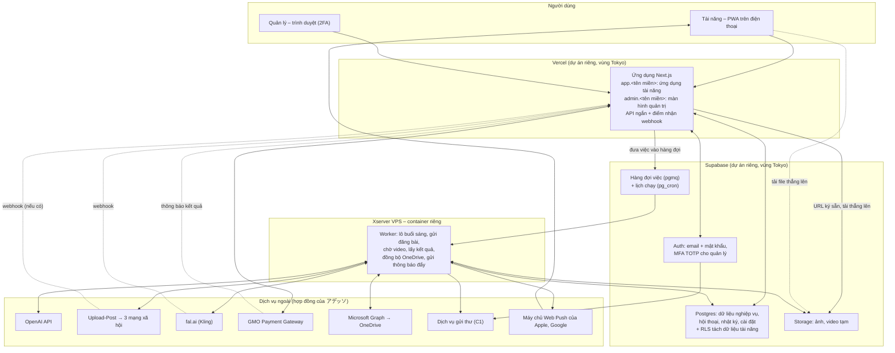

<!-- DELIVERY24112026 -->
## Cập nhật nguồn24/11 — đối chiếu25/11/2026

Phần cập nhật này thay nhận định cũ trên đúng chủ đề bên dưới; giữ nội dung trước để truy vết. [Báo cáo và hash](../docs/requirement-review/corrections-2026-11-19/DELIVERY_24112026_REVIEW.md). Chưa là baseline/AC đã duyệt.

### Cổng thanh toán

G17 ghi khách thông báo qua điện thoại sau họp sẽ chọn Square; GMO trong YK3 §2-4-11 và sheet dự án là ứng viên cũ.

**Còn mở/giới hạn:** Ngày cuộc điện thoại chưa rõ; chưa chứng minh đã ký/xét duyệt. Đội/provider kiểm Square đáp ứng nhà mạng, trả trước, phí biến đổi, giữa kỳ, quá hạn và lịch sử. Không mặc định Square hỗ trợ các yêu cầu này. Căn cứ: `KS アクション一覧!B17:G17 (No.16)`; `EV-1312`; QA No.46;QA No.49;QA No.86;TR-1-1;TR-5-4.

### Chi phí dịch vụ và hợp đồng

H34 ghi đã giải thích24/11 và khách thấy mức phí tháng ngoài video không vấn đề; phí video do Talent trả. Slide EXT24 p13 tách phí video khỏi tổng và tính50/100/150người.

**Còn mở/giới hạn:** Chỉ là xác nhận mức ước tính theo nguồn; không là ký hợp đồng dịch vụ, phí duy trì hoặc bảo đảm giá. Square/provider và mức lưu/truyền vẫn cần kiểm. Căn cứ: `KS 20261122!G34:H34 (No.33)`; `EV-1326`; TR-3-5;TR-5-4.

<!-- /DELIVERY24112026 -->

# Hạ tầng hệ thống – AI育成OS

## Đối chiếu nguồn mới — 20/11/2026

Phần dưới cập nhật hiệu lực theo nguồn mới; các mã [AG]/SD18 trong phân tích trước vẫn là trích dẫn lịch sử. Không suy nguồn FCP hoặc mục cần xác nhận thành khách đã duyệt.

- **6-8** — Bắt buộc đăng ký phương thức thanh toán và mở từ biểu tượng màn hình chính; thêm biểu tượng bằng hướng dẫn thủ công theo máy. SNS và cho phép thông báo có thể làm sau. Thanh toán đăng ký xong tự kích hoạt, tạo folder và báo Manager; sau khởi tạo mở Mypage T-08, không phải Home T-09. Office bỏ bước thanh toán. Còn mở: Cần kiểm thiết bị/PWA quay lại sau kết nối, không coi hình minh họa là kiểm chứng tương thích. Căn cứ: `T19:5,6,8,9,11,26,33;BF19:4`.
- **8-2** — Mở màn login/cho phép của từng SNS, không mở giao diện dịch vụ đăng; quay về T-07. Một tài khoản mỗi SNS; business/creator Instagram; không cần nối đủ 3 SNS. Còn mở: Luồng nhà cung cấp/48 h là thiết kế tích hợp phải kiểm, không hỏi khách chọn API hoặc khẳng định đã kiểm tài khoản thật. Căn cứ: `T19:10,26;BF19:5`.
- **1-1** — Phí tháng cộng phí video; giá AI video từ lượt đầu; tạo lại tính thêm, lỗi dịch vụ không tính. Không lưu thẻ; đổi thanh toán/lịch sử qua nhà cung cấp. Còn mở: Chưa chốt trả trước/sau, ngày bắt đầu tính phí, cổng chính thức; Square ở H105 là nhận định cần provider kiểm, không tự chọn GMO hay Square/thu ngay/ngày 1/thử lại 3 ngày. Căn cứ: `T19:9,20,21,25,26;M19:15;BF19:15;KS:20261120:23,24,25,26`.

Chi tiết từng finding/Q&A và hiệu lực gate: [báo cáo đối chiếu hiện hành](../docs/requirement-review/corrections-2026-11-19/NEW_DELIVERY_IMPACT.md). Không dùng các giả định mâu thuẫn bên dưới làm kết luận hiện hành.

## Quyết định ngày 17/11/2026: tách FE và BE

Thay cho phần "API trên Vercel" ở dưới. Phần thân file chưa viết lại; chỗ nào khác khối này thì làm theo khối này.

- **FE** (`apps/web`, sau này `apps/admin`): chỉ giao diện, không có API. Đặt trên Vercel hoặc CDN.
- **BE thuần trên VPS** (`apps/api`): Node.js 22 + TypeScript + Hono; chạy bằng PM2 trong Docker Compose; Caddy lo HTTPS. Gồm API, worker (sau này là tiến trình PM2 thứ hai) và điểm nhận webhook của Upload-Post và GMO.
- **Supabase**: Auth, Storage và Postgres (dữ liệu nghiệp vụ). FE không đọc DB trực tiếp; các bảng của app bật RLS nhưng không mở quyền.
- **Hàng đợi và lịch chạy**: pg-boss trên Postgres, thay cho Supabase Queues (pgmq) và pg_cron.
- **Đăng nhập** đi qua `POST /api/v1/auth/login` của BE, để khóa sau 5 lần sai có hiệu lực.
- **Rủi ro**: API, worker và webhook cùng một VPS (RT07). VPS không giữ dữ liệu nên dựng lại được nhanh.

Nguồn:
- [YK2] = `AI育成OS_概要要件定義書_v2.docx` (bản định nghĩa yêu cầu tổng quan, bản 2).
- [SM] = `要件説明資料_AI育成OS.pdf` (tài liệu giải thích yêu cầu, bản cũ, viết khi còn dùng LINE).
- File 17 = [17_Tai_lieu_boi_canh_he_thong.md](17_Tai_lieu_boi_canh_he_thong.md) (bối cảnh hệ thống). File 16 = [16_Chia_module_phat_trien.md](16_Chia_module_phat_trien.md) (module EP01–EP10). File 08 = [08_Tich_hop.md](08_Tich_hop.md) (tích hợp).

Cách đánh dấu trong tài liệu:
- **[Chốt]**: có trong [YK2].
- **[Cũ]**: chỉ có trong [SM], là tài liệu cũ hơn. Phải xác nhận lại.
- **[Đề xuất]**: đề xuất của đội phân tích, khách chưa đồng ý. Cần duyệt nội bộ và hỏi khách theo mục 10.

## 1. Những gì tài liệu đã nói về hạ tầng

| Nội dung | Mức | Nguồn |
|---|---|---|
| Chạy trên Vercel, Supabase, Xserver VPS mà アデッソ đang thuê. Vercel và Supabase phải lên gói trả phí | [Chốt] | [YK2] §8 |
| Mọi dịch vụ ngoài ký hợp đồng đứng tên アデッソ. Phí trong giai đoạn phát triển và thử cũng do アデッソ trả | [Chốt] | [YK2] §8 |
| Có môi trường thật và môi trường thử | [Chốt] | [YK2] §9-1 |
| Không được làm ảnh hưởng ứng dụng tự động hóa tin nhắn Instagram đang chạy | [Chốt] | [YK2] §9-1 |
| Mã hóa đường truyền và dữ liệu lưu. Không hiện khóa API trên màn hình hay trong nhật ký. Hệ thống không giữ thông tin thẻ | [Chốt] | [YK2] §10-2 |
| Việc buổi sáng phải xong trước giờ nhắn. Bắt đầu khoảng 30 tài năng, sau tăng tới 1.000 | [Chốt] | [YK2] §9-2 |
| Dịch vụ ngoài lỗi thì chỉ tắt chức năng đó | [Chốt] | [YK2] §9-3 |
| Sao lưu, khung giờ hoạt động, thời gian giữ nhật ký: quyết định khi thiết kế | [Chốt] (là việc còn mở) | [YK2] §9-3, §9-4 |
| Dùng Next.js | [Cũ] | [SM] tr.3 |
| Việc buổi sáng chạy bằng n8n, là công cụ tự động hóa mà ứng dụng tin nhắn đang dùng, tách thành một quy trình riêng | [Cũ] | [SM] tr.9 |
| Xác thực hai bước của quản lý dùng TOTP (mã dùng một lần theo thời gian) qua Supabase Auth MFA. SMS chờ bàn với khách (S01-11); không làm OTP qua email | [Chốt] 17/11 | [SM] tr.28; [YK2] §6-2; quyết định nội bộ 17/11 |
| Đăng hẹn giờ do dịch vụ đăng bài chạy, hệ thống chỉ gửi lịch sang | [Cũ] | [SM] tr.9 |

[YK2] không nói phần nào chạy ở Vercel, phần nào ở Supabase, phần nào ở VPS. Mục 2 trở đi là đề xuất.

## 2. Nguyên tắc thiết kế [Đề xuất]

1. **Tách hẳn khỏi ứng dụng tin nhắn đang chạy.** Dùng dự án Vercel riêng, dự án Supabase riêng, và trên VPS chạy trong container riêng, có giới hạn CPU và bộ nhớ. **Không** đặt việc buổi sáng vào n8n mà ứng dụng tin nhắn đang dùng như [SM] tr.9 đề xuất. Nếu việc buổi sáng làm n8n quá tải thì chính ứng dụng tin nhắn bị ảnh hưởng, trái với §9-1.
2. **Mỗi loại việc chạy đúng chỗ của nó:**
   - Vercel: giao diện và các lệnh gọi ngắn.
   - Supabase: dữ liệu, đăng nhập, lưu file tạm, hàng đợi việc.
   - VPS: các việc chạy lâu hoặc chạy theo lịch, như lô buổi sáng, chờ video, lấy kết quả, đồng bộ OneDrive.
3. **Không thêm dịch vụ khi dịch vụ đã có làm được.** Hàng đợi và lịch chạy dùng ngay Postgres của Supabase, không thêm Redis hay một trình lập lịch riêng. Thông báo đẩy dùng chuẩn Web Push tự gửi, không thuê dịch vụ ngoài. Có thể thay nếu khách chọn khác ở C6.
4. **Đặt tại Nhật:** Supabase ở vùng Tokyo, hàm của Vercel chạy ở Tokyo, Xserver VPS vốn đặt tại Nhật. Lý do là người dùng ở Nhật và dữ liệu cá nhân nên nằm trong nước. Khách cần đồng ý điểm này (câu I7).

## 3. Sơ đồ hạ tầng [Đề xuất]

## 4. Đặt từng thành phần ở đâu [Đề xuất]

| Thành phần | Đặt ở | Lý do | Module |
|---|---|---|---|
| Ứng dụng tài năng (PWA) và màn hình quản trị | **Một** dự án Next.js trên Vercel, hai tên miền con | Một mã nguồn, một lần triển khai. Hai tên miền để áp quy tắc phiên đăng nhập khác nhau: tài năng giữ 30 ngày, quản lý hết phiên sau 30 phút không thao tác (§6-1, §6-2). Next.js là lựa chọn trong [SM] tr.3 | EP09, toàn bộ giao diện |
| API ngắn (đọc, ghi dữ liệu, tạo URL tải lên, đưa việc vào hàng đợi) | Hàm của Vercel | Thời gian chạy ngắn, tự co giãn | Mọi module |
| Điểm nhận webhook (fal.ai, GMO, Upload-Post) | Hàm của Vercel | Cần địa chỉ HTTPS công khai và luôn sẵn sàng. Chỉ kiểm tra chữ ký, ghi nhận, rồi đưa việc vào hàng đợi | EP05, EP06, EP08 |
| Đăng nhập | Supabase Auth | Có sẵn email và mật khẩu, đặt lại mật khẩu, MFA TOTP ([SM] tr.28) | EP01 |
| Cơ sở dữ liệu | Supabase Postgres | Dùng RLS (bảo mật theo dòng) để chặn tài năng xem dữ liệu của người khác ngay ở tầng dữ liệu (1-5, §10-1) | Mọi module |
| Hàng đợi việc và lịch chạy | Supabase Queues (pgmq) và pg_cron | Có sẵn trong Postgres, không thêm dịch vụ. Lịch đọc giờ từ bảng cài đặt, nên quản lý đổi giờ là áp dụng ngay (§5-6) | EP10 |
| Ảnh và video tạm | Supabase Storage | Điện thoại tải thẳng lên qua URL ký sẵn. Hàm Vercel giới hạn kích thước dữ liệu gửi lên, video không đi qua được. Nơi lưu chính thức là OneDrive (§7-2); thời gian giữ bản tạm: câu C2 | EP05 |
| Worker (tiến trình chạy nền) | Container Docker trên Xserver VPS | Việc chạy lâu (lô buổi sáng cho tới 1.000 người, chờ video vài phút) vượt giới hạn thời gian của hàm Vercel. VPS có địa chỉ IP cố định, dùng được nếu GMO hay Microsoft yêu cầu danh sách IP được phép (câu I5) | EP03, EP04, EP05, EP06, EP07 |
| Thông báo đẩy | Chuẩn Web Push với khóa VAPID (khóa định danh máy chủ gửi), worker tự gửi | Không cần dịch vụ ngoài. iPhone cần iOS 16.4 trở lên và đã thêm ứng dụng vào màn hình chính (§9-1). Chờ câu C6 | EP09 |
| Gửi thư | Dịch vụ gửi thư giao dịch, gửi từ tên miền của アデッソ, cấu hình làm SMTP riêng cho Supabase Auth | Thư mặc định của Supabase không dùng được cho môi trường thật. Chờ câu C1 | EP01 |
| Tệp OneDrive | Microsoft Graph API, ứng dụng đăng ký trong Microsoft 365 của アデッソ | Đọc thông tin tài năng mỗi sáng, ghi kết quả, lưu ảnh và video. Cần quản trị viên của アデッソ cấp quyền, nên chỉ xin quyền tối thiểu (câu I3) | EP02, EP05, EP07 |

## 5. Môi trường [Đề xuất]

| Môi trường | Vercel | Supabase | VPS | Dịch vụ ngoài |
|---|---|---|---|---|
| Máy lập trình viên | Chạy Next.js trên máy | Supabase CLI chạy trên máy (Docker) | Worker chạy trên máy | Khóa thử, tài khoản mạng xã hội thử |
| Thử (テスト用, §9-1; cũng dùng cho kiểm thử chấp nhận) | Dự án riêng hoặc môi trường xem trước | **Dự án Supabase riêng** | Container riêng (`stg`) | Môi trường thử của GMO; gói Upload-Post và tài khoản mạng xã hội thử (§12-4) |
| Thật (本番用) | Dự án thật | **Dự án Supabase riêng** | Container riêng (`prod`) | Hợp đồng thật |

Hai môi trường phải dùng khóa API riêng và thư mục OneDrive riêng, để môi trường thử không bao giờ đăng bài lên tài khoản thật của tài năng.

## 6. Việc chạy theo lịch và chạy nền [Đề xuất]

Mọi giờ trong bảng là giá trị mặc định, quản lý đổi được trên màn hình quản trị ([YK2] §5-6).

| Việc | Khi chạy | Chạy ở | Nội dung | Chức năng |
|---|---|---|---|---|
| Lô trước giờ nhắn | Trước mỗi khung sáng (mặc định 8:00), trưa, tối ([KS] 確認18). Lô khung sáng đề xuất bắt đầu khoảng 5:00 | Worker | Mỗi tài năng: đọc OneDrive và kết quả hôm qua → gọi OpenAI → lưu lời tổng kết và 3 chủ đề → 8:00 gửi thông báo. Chạy song song có giới hạn, lỗi thì thử lại từng người, không dừng cả lô | 2-1, 3-6, 4-1 |
| Khoảng 自動投稿 | Hằng ngày trong khoảng tài năng đặt ([KS] 確認25) | Worker | Tự soạn bài từ chủ đề và tư liệu của khoảng, kiểm tra từ cấm, hẹn giờ qua Upload-Post. Nhịp đăng, duyệt, hết tư liệu: chưa rõ |
| Xóa dữ liệu tài năng rời đi | Mỗi ngày | Worker | Tài năng 利用終了 đủ 6 tháng: xóa dữ liệu trong DB, Supabase Storage, thư mục OneDrive; không khôi phục ([KS] 確認55) |
| Nhắc trước giờ đăng | 2 giờ trước giờ đăng của từng bài | pg_cron → worker | Nhắc gửi tư liệu, chấp nhận bản nháp | 6-5 |
| Hủy bài quá giờ chưa duyệt | Đến giờ đăng | pg_cron → worker | Không đăng, báo tài năng và quản lý | 7-7 |
| Nhắc khi không đăng | Mỗi ngày | pg_cron → worker | 3 ngày không đăng thì AIコーチ nhắc tài năng; 7 ngày thì báo quản lý | 3-9 |
| Tổng kết tuần | Thứ Hai | Worker | Tổng kết hằng tuần | 3-8 |
| Lấy kết quả | Mỗi ngày một lần, đề xuất chạy trước lô buổi sáng (câu C5) | Worker | Lấy từ Upload-Post → lưu cơ sở dữ liệu → ghi vào OneDrive. Lỗi thì lấy lại lần sau | 8-7, 8-8, 3-10 |
| Gửi bài hẹn giờ | Khi tài năng chấp nhận bản nháp (và đã được duyệt nếu cần) | Hàng đợi → worker | Kiểm tra từ cấm → gửi lịch sang Upload-Post → lưu mã đặt lịch | 4-4, 8-3 |
| Tạo video | Khi tài năng yêu cầu | Hàng đợi → worker, webhook của fal.ai | Gửi yêu cầu sang fal.ai → nhận webhook → lưu video → đếm số lần tính phí | 5-1, 5-4 |
| Dừng đăng tự động | Khi quản lý bấm | Hàng đợi → worker | Hủy các bài đã hẹn giờ trên Upload-Post | 7-5 |
| Thu phí tháng | Ngày chốt (quyết khi chọn xong cổng thanh toán) | Worker, thông báo kết quả từ GMO | Cộng phí tháng với phí video → thu tiền → thu lỗi thì báo, không khóa tài khoản | 1-1, 5-4 |

Ước tính thô cho lô buổi sáng: 1.000 tài năng, mỗi người khoảng 30 giây gọi AI, chạy song song 20 người thì mất khoảng 25 phút. Chạy được trên một worker. Con số thật phải đo khi có lời nhắc (prompt) thật và kiểm tra giới hạn tốc độ của OpenAI (§9-2).

## 7. Bảo mật [Đề xuất, dựa trên [YK2] §10]

| Yêu cầu | Cách làm |
|---|---|
| Tài năng chỉ thấy dữ liệu của mình (1-5, §10-1) | RLS trên mọi bảng có dữ liệu tài năng. Worker dùng khóa quản trị (service role) nhưng chỉ chạy trên VPS, không bao giờ đưa xuống trình duyệt |
| Quản lý đăng nhập 2FA (1-6) | Supabase MFA TOTP. Mọi đường dẫn quản trị đều đòi đã qua bước 2 (mức xác thực AAL2) |
| Khóa 15 phút sau 5 lần sai; quản lý hết phiên sau 30 phút (1-4, 1-6) | Supabase Auth không có sẵn kiểu khóa theo tài khoản như vậy, và cài đặt phiên của nó áp cho cả dự án. Phải tự làm: đếm số lần sai trong cơ sở dữ liệu, kiểm tra thời gian không thao tác ở tầng trung gian (middleware) của Next.js cho tên miền quản trị. **Đã quyết 17/11:** khóa ở BE qua `POST /api/v1/auth/login`; Password Verification Hook chỉ có ở gói Team nên gọi thẳng Supabase Auth không bị đếm (rủi ro RT12 đã chấp nhận) |
| Không lộ khóa API (§10-2) | Khóa để trong biến môi trường của Vercel và tệp bí mật của container trên VPS. Không ghi khóa vào nhật ký. Mỗi môi trường một bộ khóa |
| Webhook giả mạo | Kiểm tra chữ ký hoặc mã bí mật của từng dịch vụ. Nhận lặp lại không bị xử lý hai lần |
| Mã hóa (§10-2) | HTTPS ở mọi đầu. Supabase mã hóa dữ liệu lưu sẵn |
| Chỉ gửi AI phần dữ liệu cần (§10-2) | Mỗi lần gọi OpenAI chỉ đọc thư mục của đúng tài năng đó. Tắt việc dùng dữ liệu để huấn luyện ở cài đặt tổ chức của OpenAI |
| Quyền OneDrive | Xin quyền tối thiểu trên Microsoft Graph, giới hạn vào khu vực chứa thư mục tài năng, không xin quyền trên toàn bộ Microsoft 365 của công ty (câu I3). Tra lại 17/11: các trang endpoint chỉ ghi quyền toàn tenant; quyền Selected phải chứng minh bằng POC P02 (bộ OneDrive §4.2, rủi ro RT02) |
| VPS | Chỉ mở cổng SSH, đăng nhập bằng khóa. Worker không mở cổng nào, chỉ gọi ra ngoài |

## 8. Sao lưu, theo dõi, nhật ký [Đề xuất]

[YK2] §9-3, §9-4 để việc này quyết khi thiết kế. Đề xuất ban đầu:

- **Sao lưu:**
  - Cơ sở dữ liệu: dùng sao lưu hằng ngày có sẵn trong gói trả phí của Supabase. Có cần khôi phục về đúng thời điểm (PITR, gói bổ sung) không thì hỏi khách.
  - OneDrive: theo chính sách lưu giữ của Microsoft 365 của アデッソ.
  - VPS: không giữ dữ liệu, chỉ chạy mã, hỏng thì triển khai lại.
- **Nhật ký nghiệp vụ** (§9-4: lượt xem, thao tác, kết quả xử lý): ghi vào bảng trong Postgres, chỉ được thêm, không sửa, không xóa. Các bảng này cũng là nguồn để theo dõi lỗi, ví dụ "hôm nay có bao nhiêu bài đăng lỗi", không cần dựng thêm hệ thống theo dõi riêng.
- **Nhật ký kỹ thuật:** dùng nhật ký có sẵn của Vercel và Supabase, cộng nhật ký container trên VPS. Thêm một dịch vụ báo lỗi ứng dụng (ví dụ Sentry) khi cần.
- **Cảnh báo:** lô buổi sáng chưa xong trước giờ nhắn, worker ngừng chạy, hoặc một dịch vụ ngoài lỗi liên tục thì báo cho đội vận hành. Báo cho quản lý nghiệp vụ thì theo 別紙A (phụ lục A).

## 9. Triển khai

| Phần | Cách triển khai [Đề xuất] |
|---|---|
| Next.js | Đẩy mã lên kho → Vercel tự triển khai. Nhánh chính lên môi trường thật, nhánh thử lên môi trường thử |
| Cơ sở dữ liệu | Viết thay đổi cấu trúc thành tệp migration (Supabase CLI), chạy qua quy trình tích hợp liên tục: lên môi trường thử trước, môi trường thật sau |
| Worker | Đóng gói ảnh Docker trong quy trình tích hợp liên tục → VPS kéo về và chạy lại bằng docker compose |
| Kho mã | Chưa chốt (GitHub hay dịch vụ khác, ai sở hữu). Hỏi khách cùng với câu I1 |

## 10. Câu hỏi về hạ tầng cần hỏi khách hoặc thống nhất nội bộ

Các câu này đã có trong file 15 (mã I1–I8, module EP10) và có bản tiếng Nhật ở `SCD/EP10_Nen_tang_chung_va_quan_tri_he_thong/00_Cau_hoi_cho_khach.md`. I3 trùng với S02-02.

| Mã | Câu hỏi | Vì sao cần |
|---|---|---|
| I1 | Ứng dụng tin nhắn đang dùng chung tài khoản Vercel, Supabase, VPS nào? n8n chạy trên VPS này phải không? Có cấp cho đội phát triển tài khoản thành viên không? | Để tách hẳn hai hệ thống (§9-1). File 08 cũng ghi đây là điểm chưa rõ |
| I2 | Hệ thống dùng tên miền nào (ví dụ tên miền con của アデッソ)? Ai quản lý DNS? | Cần cho PWA, màn hình quản trị và gửi thư (cấu hình SPF, DKIM để thư không vào hộp thư rác) |
| I3 | Quản trị viên Microsoft 365 của アデッソ có đồng ý cấp quyền Microsoft Graph cho hệ thống không? Thư mục tài năng đặt trong OneDrive của tài khoản nào, hay trong một site SharePoint? | Thiếu quyền này thì không đọc ghi được dữ liệu tài năng. Vị trí thư mục quyết định có giới hạn được quyền hay không |
| I4 | Cấu hình VPS hiện tại (CPU, bộ nhớ, hệ điều hành), có chạy được Docker không, có dư sức chạy thêm worker không, hay thuê VPS mới | Worker không được làm chậm ứng dụng tin nhắn (§9-1) |
| I5 | GMO gửi thông báo kết quả về địa chỉ nào? Có yêu cầu địa chỉ IP cố định không? | Quyết định điểm nhận đặt ở Vercel hay ở VPS |
| I6 | Môi trường thử có hợp đồng riêng không: môi trường thử của GMO, gói Upload-Post, khóa fal.ai và OpenAI riêng? | Để môi trường thử không đụng dữ liệu và tiền thật (§12-4) |
| I7 | Đặt dữ liệu ở Tokyo được không? Có yêu cầu nào về nơi lưu dữ liệu cá nhân không? | Liên quan dữ liệu cá nhân của tài năng (§10-3) |
| I8 | Có cần khôi phục cơ sở dữ liệu về đúng thời điểm (PITR, phát sinh phí) không? Giữ bản sao lưu bao lâu? | §9-3 để việc này quyết khi thiết kế |

Các câu đã có trong file 15 cũng ảnh hưởng hạ tầng:
- C1: dịch vụ gửi thư.
- C2: nơi lưu tạm ảnh và video.
- C5: giờ lấy kết quả.
- C6: cơ chế thông báo đẩy.

## 11. Thứ tự dựng hạ tầng

1. Nhận quyền truy cập Vercel, Supabase, VPS (I1, I4) và tên miền (I2).
2. Tạo dự án Supabase thử, dự án Vercel, khung Next.js, worker kèm tệp docker compose, quy trình tích hợp liên tục. Tức là phần lõi kỹ thuật của EP10.
3. Kết nối Microsoft Graph (I3) và dịch vụ gửi thư (C1). EP01 và EP02 cần hai phần này.
4. Kết nối OpenAI, Upload-Post, fal.ai, GMO theo thứ tự module trong file 16 mục 4.
5. Dựng môi trường thật trước kiểm thử chấp nhận (giữa tháng 1/2027, §14-1).

## 12. Yêu cầu hạ tầng từ kiến trúc AI Core [Đề xuất]

Yêu cầu hạ tầng để vận hành [AI Core](../agent_spec/ai-core/README.md). Cấu hình ứng dụng của AI Core (biến môi trường, hàng đợi, giới hạn) ở [Runtime §8](../agent_spec/ai-core/AI_RUNTIME_DESIGN.md) và [Kiến trúc §10–§12](../agent_spec/ai-core/AI_CORE_ARCHITECTURE.md).

### 12.1. Thành phần hạ tầng để vận hành kiến trúc

Mục này xác định các thành phần và điều kiện vận hành cần có. Quyết định nhà cung cấp, nơi đặt FE/BE, cấu hình máy và topology triển khai được quản lý riêng trong thiết kế hạ tầng.

| Thành phần hạ tầng | Đề xuất vận hành | Điều kiện cần đáp ứng |
|---|---|---|
| Frontend Next.js | Triển khai riêng theo phương án web của dự án | HTTPS; gọi REST BE; không đưa API nghiệp vụ vào Next API routes/server actions |
| API/MCP Hono | Một service HTTP, có thể cùng image/mã nguồn với worker nhưng entrypoint riêng | URL HTTPS ổn định cho REST/MCP/webhook; chuyển đúng Authorization và header giao thức; cấu hình timeout theo request |
| Worker agent/effect | Tiến trình/container riêng khỏi HTTP; tách consumer và ngân sách interactive/batch | Chat không bị batch chiếm hết slot; timeout model/provider, heartbeat/fencing, graceful shutdown và restart |
| Dispatcher/scheduler/reconciler | Có thể cùng deployment worker để khởi đầu, tách vai trò khi tải tăng | Claim/lease bền vững, chống chạy trùng khi nhiều process; phục hồi backlog từ DB |
| Redis dành cho BullMQ | Mạng riêng; persistence và volume bền vững; `noeviction` | Không mở cổng công khai; đủ RAM/headroom và disk; theo dõi enqueue lỗi, lag và queue backlog |
| Supabase Postgres/Auth | Dịch vụ DB/xác thực bên ngoài application host | Pool connection được chia theo vai trò; backup và kiểm restore; quyền DB tối thiểu, không dùng role owner cho agent |
| Media/OneDrive | Kho ngoài application host, truy cập qua adapter | Quyền theo asset/owner/version; URL truy cập có hạn phù hợp provider; backup/retention riêng khỏi DB |
| OpenAI và dịch vụ ngoài | Gọi API qua mạng từ BE/worker | Credential ở backend, timeout/quota, request reference và đối soát; không cần GPU hoặc chạy model trên máy BE |
| Giám sát và backup | Log/metric/alert cùng nơi lưu backup ngoài application host | Theo dõi lỗi, queue wait, run quá hạn, usage, RAM/disk; không ghi secret hoặc toàn hội thoại vào log kỹ thuật |

**Phương án khởi đầu tham khảo:** nếu API, worker và Redis cùng một VPS, có thể bắt đầu đánh giá ở mức4 vCPU/8 GB RAM, dành dung lượng SSD cho OS/image/log/Redis persistence; build image ngoài máy phục vụ. Đây là dự toán kỹ thuật chưa benchmark, không là cấu hình đã chốt hoặc cam kết tải. DB, model, video và kho media đặt ngoài VPS; không giữ media lâu dài trên máy ứng dụng. Một VPS cần chấp nhận điểm lỗi chung, persistence không thay high availability.

Sizing dựa trên số lượt giờ cao điểm, model/tool calls mỗi run, latency provider, concurrency agent và kích thước backlog. Khi vượt ngân sách CPU/RAM hoặc queue wait mục tiêu, tăng worker/tài nguyên hoặc tách Redis/worker theo quyết định hạ tầng; phải kiểm DB pool và quota provider trước tăng concurrency.

API trả operation ID; UI nhận tiến độ/kết quả qua polling hoặc stream có kiểm quyền. Nếu chọn SSE, proxy phải hỗ trợ stream, reconnect và đọc lại trạng thái; mất kết nối UI không hủy command đã commit. Trạng thái “đã lưu” dựa trên kết quả service, không dựa vào token model đang stream.

### 12.2. Yêu cầu vận hành và bảo vệ dữ liệu xuyên module

| Yêu cầu nguồn | Thiết kế và phép kiểm phải có trước production |
|---|---|
| Buổi sáng sẵn sàng trước giờ chào; mở rộng quy mô | Tách hàng đợi interactive, daily, media/video và effect; giới hạn theo provider/account, ưu tiên job tới hạn. Lưu deadline/timezone/settings revision, đo queue wait và tổng thời gian đến message ready; test cohort khởi đầu và quy mô thương mại đã chốt. Nguồn nói 30→100→200–300→1.000 nhưng CR09 vẫn chờ; không cam kết 1.000 chỉ vì dùng queue |
| Thời gian/lịch | Lưu instant UTC, business timezone cấu hình rõ theo deployment Nhật (đề xuất `Asia/Tokyo`), định nghĩa localDate/day boundary cho topics/metrics/streak/billing; kỳ ngày gồm bắt đầu/kết thúc phải có contract. Giờ SNS riêng trong khung Manager; user thấy giờ theo cùng timezone. Không lấy timezone máy worker hoặc timestamp ingest làm ngày đăng |
| Provider hỏng chỉ ảnh hưởng chức năng tương ứng | Timeout/circuit breaker/rate limit và health/readiness theo adapter; không chặn chat đọc dữ liệu khi video/push lỗi. Distinguish unavailable/failed/partial/unknown; retry ingestion, retry delivery kỹ thuật và user tạo lượt đăng mới có policy riêng. Provider capability registry chứa bằng chứng sandbox/version, không dựa vào slide so sánh |
| Auth và quyền | Talent email/password, đổi mật khẩu tạm và reset qua email; Manager MFA/TOTP, enrollment/recovery và disable có kiểm phiên. Giá trị 8 ký tự, 5 lần/15 phút, 30 ngày Talent, 30 phút Manager trong YK3 là dự kiến theo P105, cần kiểm cấu hình Auth/support và quyết định thiết kế trước dùng làm AC. Không giả định Supabase mặc định khớp. DB runtime role tối thiểu, RLS/quyền query theo đường truy cập thực, tách credential fixture/production |
| Dữ liệu/secret | TLS, mã hóa lưu trữ/backup và secret quản lý riêng; URL media ký ngắn hạn, scope theo asset/version, log redact. Model/tool không có secret hoặc generic SQL/HTTP. Nội dung user/media/news chống prompt injection bằng scope/schema/service, eval vượt quyền. Cấu hình sử dụng dữ liệu/retention của model/video provider phải kiểm theo hợp đồng thực; không hứa no-training/no-storage chỉ từ prompt |
| Giới hạn và chi phí | File count/type/size, tổng quota, context/output budget và concurrency do team thiết kế/kiểm provider, UI/API đồng bộ; technical run limits không thành giới hạn số lần Talent nhờ viết lại. Usage theo call/model/Talent/month, media analysis/news/video theo loại riêng; ChatGPT subscription tách phí API, office và global/Manager allocations không gán Talent giả |
| Backup/restore, retention và nhật ký | Chốt RPO/RTO, chu kỳ/retention và chủ vận hành; backup DB cùng quyền/schema, object media/OneDrive theo phạm vi, mapping provider và secret recovery an toàn. Redis không là bản lưu duy nhất. Thử restore staging với pending approvals/outbox/effect và deletion manifest. View logs bất biến với Manager; access log, action log, processing log và AI ledger có quyền/retention riêng, CR07 chưa chốt phần mở rộng |
| Môi trường và hệ thống đang chạy | Dev/test/prod tách DB/storage/Redis keys/provider users/OAuth redirect/secrets/webhooks; fixture giả, dữ liệu thật chỉ trong phạm vi chấp thuận bằng văn bản. Domain/network/resource tách ứng dụng Instagram DM, kiểm hồi quy OAuth/webhook/rate limit; không dùng chung user mapping hay đổi integration đang chạy khi chưa có thiết kế |
| Thiết bị và bàn giao | Ma trận OS/browser được team chốt; test PWA install, reconnect callbacks, permission denied, notification mở đúng màn, đổi account và mobile Manager trên thiết bị thật. Asset/text/terms/pricing/NG/profile/goal/instruction/provider test credentials có checklist Adesso cung cấp. Test không tự thay phê duyệt thương mại hoặc quyền dùng dữ liệu thật |

Căn cứ: YK3 P901–950, QA No.18/24/25/29/33/49/65/67/89; CR07/08/09/13; EXT24 là đầu vào so sánh, không là kiểm chứng nhà cung cấp. Những giá trị RPO/RTO/SLA/quota chưa có quyết định phải có owner và kết quả thiết kế trước release; tài liệu không tự đặt cam kết.

## 12.3. Đề xuất cấu hình kiểm tải đồng thời ngày 26/11/2026

**Mức thiết kế hiện hành theo chỉ đạo người dùng:** 30 Talent + 5 quản lý thao tác đồng thời; tối đa 10 agent run tương tác hoạt động trên toàn bộ worker, dùng chung Talent/Manager. Tổng tài khoản vẫn150 ban đầu, mục tiêu1.000. Tách slot batch khỏi10slot tương tác. Các con số155/1.010người,35/220request/giây và30/100slot dưới đây là lịch sử phương án trước, không tiếp tục dùng làm mục tiêu hiện hành; cấu hình cũ cũng không được coi là cấu hình đã chứng minh cho mức mới. Nội dung3-2 hiện hành ưu tiên khi lập kế hoạch; chưa đổi cấu hình chạy thực tế, quota hoặc gate.

**PROPOSAL — chưa benchmark, chưa chốt mua hạ tầng hoặc phê duyệt thương mại.** Phần này cụ thể hóa mức tải mới của [mục 3-2](../docs/non-functional/DE_XUAT_CHI_TIEU_PHI_CHUC_NANG_GUI_KHACH_2026-11-26.md). Thay việc dùng mức tham khảo một VPS 4 vCPU/8 GB tại 12.1 làm mặc định cho tải mới; giữ nguyên 12.1 như phương án khởi đầu cần đánh giá.

### Đính chính sau kiểm tra nghiệp vụ AI

**Chưa đủ cơ sở xác nhận155/1.010người được phục vụ trọn nghiệp vụ, hoặc gọi cấu hình dưới đây là cấu hình đáp ứng.** Cấu hình và30/100slot là giả thuyết kiểm thử. Tài liệu runtime §6.4/8.2 và cấu hình mẫu `apps/api/.env.example` hiện ghi `AGENT_INTERACTIVE_CONCURRENCY=1`, tối đa8bước model, thời gian run tối đa120giây; limiter chung theo quota model còn được ghi chưa hoàn tất. Đây là cấu hình mẫu/thiết kế, không chứng minh deployment thực tế, nhưng không có bằng chứng đã chạy30/100slot với model thật.

Phép tính35/220request/giây chỉ suy từ thao tác mỗi5giây, không quy đổi được thành lượt chat xử lý được. Ví dụ nếu150Talent mỗi người gửi1tin/phút và run chiếm slot trung bình20giây, riêng chat đã cần trung bình50run hoạt động cùng lúc (150÷60×20), chưa dự phòng và chưa tính Manager/batch.30slot không đủ ổn định cho giả định này. Nếu nhịp1tin/2phút thì trung bình25run, nhưng vẫn chưa chứng minh độ trễ95%đạt15/60giây. Với1.000Talent,1tin/phút và20giây/run thì trung bình khoảng334run. Cần đo phân bố latency, số model/tool calls, context/token, pool và tệp thay vì lấy trung bình làm cam kết.

Giữ benchmark tách ordinary traffic và AI nhưng phải chạy kết hợp. Trước chốt cấu hình, lập profile chat ngắn, hội thoại dài, phân tích ảnh, tạo bài/chỉ dẫn qua quản lý, lô buổi sáng, xử lý tư liệu/video, webhook/đăng bài và tình huống provider chậm. Mỗi profile phải có tần suất, kích thước và tỷ lệ; số150Talent không tự xác định nhịp gửi tin. Chỉ sau đó xác nhận quota, số slot, tài nguyên và chi phí. Cập nhật nhận định “một worker concurrency4đủ” ở runtime §8.3 trong lần sizing được giao: đó cũng chỉ là ước tính theo số lượt/ngày, chưa chứng minh cao điểm hoặc150người cùng chat.

### Mức tải và căn cứ

Nguồn YK 3 ngày 24/11 §3-2, w:p 905–908 (đếm từ 0) nói số Talent, lô buổi sáng và chi phí, không chốt concurrent users. Người dùng yêu cầu 150 Talent ban đầu, mục tiêu 1.000 và tăng người đồng thời. Đề xuất mới:150 Talent+5 Manager và 1.000 Talent+10 Manager cùng thao tác, không gán đây là quyết định concurrency có sẵn của khách.

Với một thao tác mỗi 5 giây/người,155 người tạo khoảng 31 request/giây;1.010 người khoảng 202 request/giây. Chọn mục tiêu kiểm 35 và 220 request/giây, là số đã làm tròn có dư nhỏ, chưa phải phép sizing hoàn chỉnh. Polling, làm mới phiên, webhook và traffic nội bộ phải tính thêm, đo riêng rồi chạy kết hợp; không dùng test đọc tĩnh để chứng minh toàn luồng. Kiểm đăng nhập đồng loạt riêng vì hạn mức xác thực khác tải CRUD.

### Cấu hình dùng làm điểm bắt đầu kiểm thử

- Giai đoạn 155 người: một máy API 4 vCPU/8 GBRAM; một máy worker 4 vCPU/8 GBRAM; Redis riêng 2 vCPU/4 GBRAM; Supabase compute Medium 4 GBRAM làm cấu hình DB khởi điểm để đo. Frontend và media đặt ngoài các máy này. Chưa có dự phòng API/worker nên không tự chứng minh high availability.
- Giai đoạn 1.010 người: hai máy API, mỗi máy 4 vCPU/8 GBRAM, qua bộ cân bằng tải; hai máy worker, mỗi máy 8 vCPU/16 GBRAM, tách ngân sách chat và batch; Redis riêng 2 vCPU/4 GBRAM, cần cơ chế phục hồi/dự phòng phù hợp SLO; Supabase compute XL 4 vCPU/16 GBRAM làm điểm bắt đầu kiểm DB. Đây là lựa chọn có dư để thử, chưa chứng minh là cấu hình tối thiểu hoặc bảo đảm 220 request/giây.
- Mỗi máy ứng dụng dự trù 80 GBSSD cho hệ điều hành, image và log luân phiên; Redis dự trù 40 GBSSD cho persistence và theo dõi tăng trưởng. Không dùng các dung lượng này làm quota media/DB. Tính dung lượng DB, media, backup và băng thông từ số file/lượt thực tế và retention trước khi báo giá.
- Có thể thay cấu hình sau benchmark để giảm chi phí hoặc tăng năng lực. Gói Supabase trả phí không tự đồng nghĩa đã chọn đủ compute; theo tài liệu hiện tại, Medium là 4 GB/shared CPU, XL là 4 vCPU dedicated/16 GB. Phải chọn riêng compute, disk và backup.

### AI và hạn mức nhà cung cấp

Mục tiêu kiểm chat:30 và 100 yêu cầu đang chờ/xử lý; dự trù ban đầu tối đa 30 và 100 agent run đang hoạt động trên toàn bộ worker, điều chỉnh theo quota và số đo. Slot batch tách riêng, không được chiếm slot chat. Số lệnh model song song không đồng nhất agent run vì mỗi run có nhiều bước/tool calls. Tạo video tiếp nhận 20/50 việc nhưng số lệnh fal.ai thực chạy theo quota; không dựng GPU nội bộ chỉ để điều phối dịch vụ video bên ngoài.

Ví dụ tính ngân sách **ASSUMPTION**: mỗi run chiếm slot trung bình 20 giây, gọi model trung bình 2 lần, mỗi lần tổng 4.000 token.30 slot tương ứng khoảng 90 run/phút,180 lần gọi/phút và 720.000 token/phút;100 slot khoảng 300 run/phút,600 lần gọi/phút và 2,4 triệu token/phút. Đây là nhu cầu minh họa trước phần dự phòng/batch/retry, không phải quota tài khoản đã được cấp hoặc dự đoán chi phí. Thay bằng prompt/model và số đo thực để xin quota. Tăng vCPU không tự tăng RPM/TPM.

Burst 150/1.000 tin cùng lúc có thể làm hàng đợi chờ lâu hơn thời gian chat thường: nếu mỗi run 20 giây và 30/100 slot, mô hình đơn giản cho 150 tin có 5 đợt,1.000 tin có 10 đợt. Các đợt cuối có thể bắt đầu sau 80/180 giây, chưa tính retry/quota/tool. Không hứa trả lời đầu trong 15 giây cho toàn bộ burst bằng các slot này; phải đo và chốt riêng hoặc tăng slot/quota sau sizing.

### Kết nối DB, truyền media và giám sát

Đội chia ngân sách connection pool cho API, worker, scheduler, migration và vận hành theo khả năng gói DB. Dự trù cap pool ứng dụng 40 kết nối ở giai đoạn đầu và 80 kết nối ở giai đoạn mở rộng để kiểm; đây là tổng mọi process/replica, không phải mỗi máy. Đối chiếu phần quota còn lại sau các dịch vụ Supabase và kết quả chờ pool trước chốt. Không giữ transaction/kết nối DB trong lúc chờ model/provider. Không tạo một DB connection cho mỗi người dùng đang mở ứng dụng.

Media tải trực tiếp tới kho thông qua quyền/đường dẫn do backend cấp nếu thiết kế được chọn cho phép; backend kiểm quyền và metadata. Nếu chuyển file qua backend hoặc ghép/chuyển mã video trên máy worker, sizing trên phải đo lại CPU, RAM và băng thông; không dùng kết quả điều phối thuần để cam kết xử lý media nặng.

Khi CPU/RAM duy trì trên 70%, pool thường xuyên chờ, độ trễ/hàng đợi vượt chỉ tiêu hoặc quota provider gần đầy, đội điều tra nút thắt trước khi tăng máy.70% là ngưỡng cảnh báo thiết kế đề xuất, không là bằng chứng đủ dư tải. Nhiều API replica vẫn cần kiểm lưu phiên, stream, restart và webhook lặp; Redis đơn lẻ vẫn là điểm lỗi chung nếu chưa có phương án dự phòng.

### Bằng chứng cần bổ sung trước cam kết

Chạy kịch bản 155/1.010 người và 35/220 request/giây trong 60 phút, tải tăng gấp đôi 5 phút, chạy 8 giờ ở 50%tải, vừa chat vừa lô buổi sáng, có polling/webhook/thử đăng nhập. Đo thời gian phản hồi, tỷ lệ lỗi, slot/queue wait, DB pool/query, CPU/RAM, quota/token và chi phí. Tách test provider mô phỏng với thử tích hợp thật; kiểm cả tiếp nhận và xử lý hết burst 150/1.000 tin. Trước production chốt cấu hình, quota, chi phí và điều kiện đạt theo kết quả; chưa có các bằng chứng này thì chỉ là đề xuất sizing, không VERIFIED hoặc cam kếtSLA.

Nguồn kỹ thuật tham khảo ngày26/11: [Microsoft performance targets](https://learn.microsoft.com/en-us/azure/well-architected/performance-efficiency/performance-targets), [BullMQ concurrency](https://docs.bullmq.io/guide/workers/concurrency), [Supabase compute](https://supabase.com/docs/guides/platform/compute-and-disk), [OpenAI rate limits](https://developers.openai.com/api/docs/guides/rate-limits), [Upload-Post limits](https://docs.upload-post.com/guides/rate-limits). Các nguồn mô tả cơ chế và cấu hình, không chứng minh ứng dụng đạt tải đề xuất.
