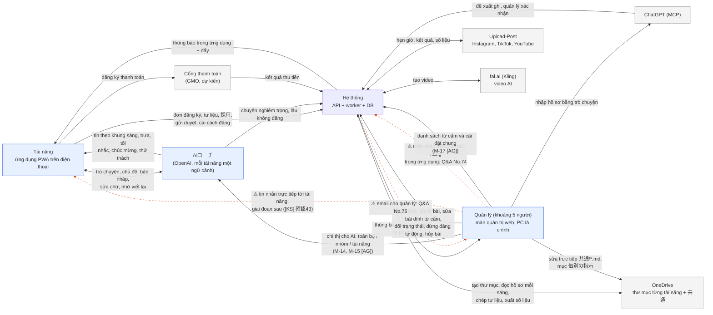
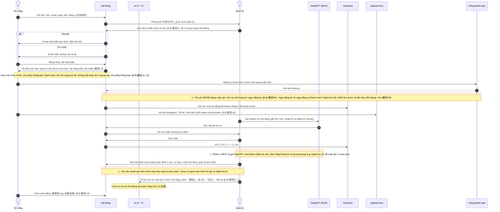
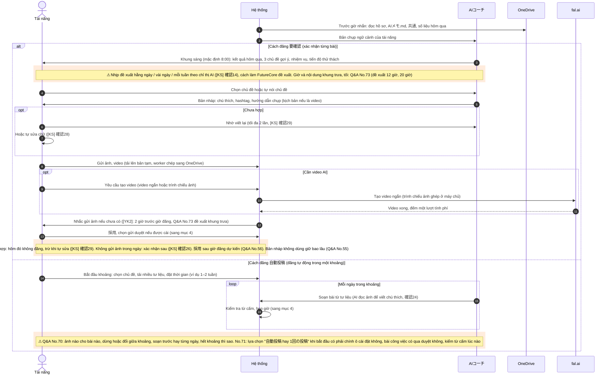
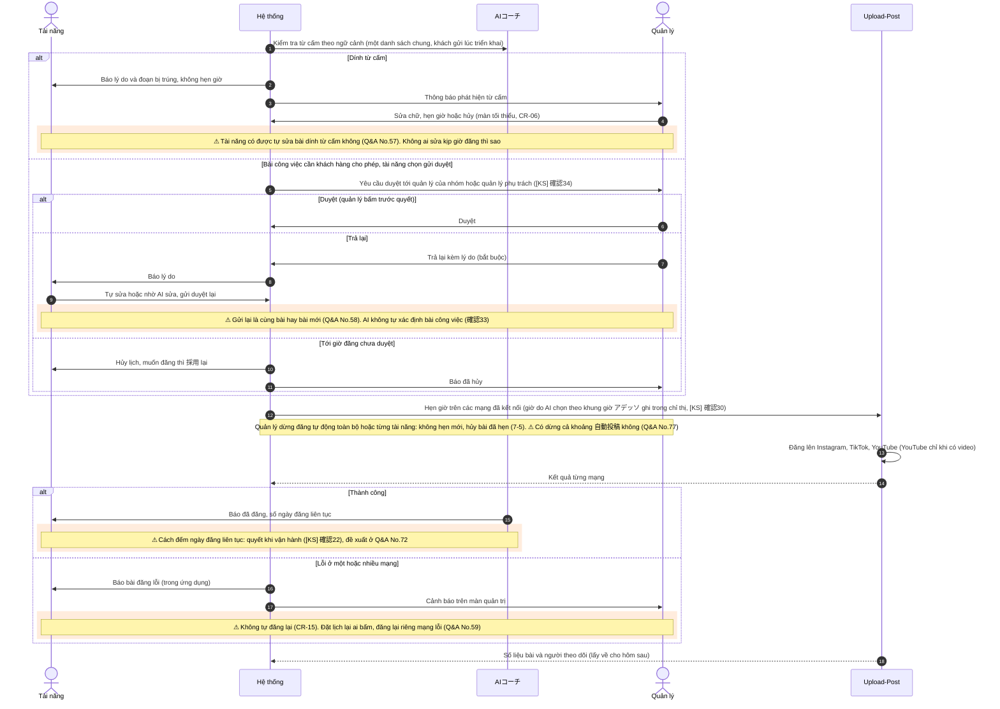
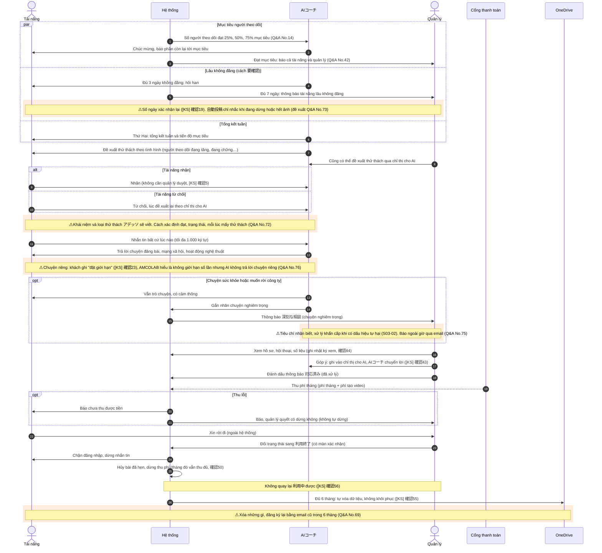
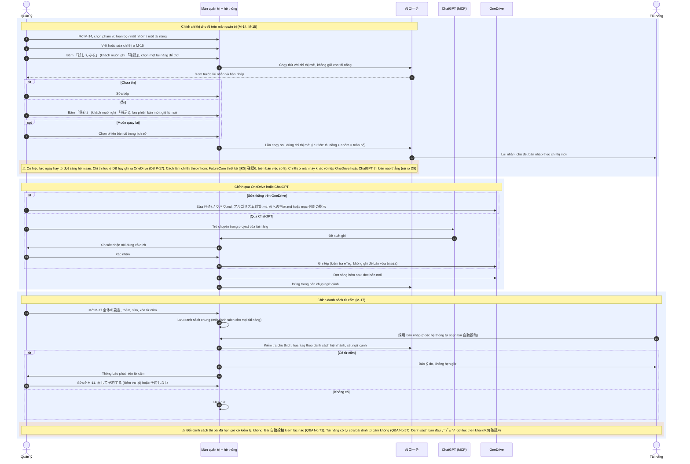

# Sơ đồ tương tác giữa tài năng, quản lý và AIコーチ

Viết ngày 18/11/2026. Mô tả các tác nhân trao đổi với nhau thế nào trong hệ thống, từ lúc đăng ký tới lúc rời đi. Sơ đồ chỉ ghi việc đã có căn cứ; chỗ chưa rõ ghi **⚠** kèm câu hỏi đang mở, không tự quyết thay khách.

**Nguồn:**
- [YK2] = `AI育成OS_概要要件定義書_v2.docx` (bản định nghĩa yêu cầu v2);
- [KS] = bảng xác nhận yêu cầu, quyết định ngày 17/11/2026 (tệp 21);
- Q&A No.x = `AI-Talent-OS_Q&A表.xlsx` bản 17/11 (tệp 19);
- [AG] = `アプリ画面案_AI育成OS.pdf`, mã màn hình T/M là mã chuẩn (Q&A No.30).

**Thuật ngữ:**
- AIコーチ = huấn luyện viên AI của từng tài năng;
- 要確認 = cách đăng xác nhận từng bài; 自動投稿 = đăng tự động trong một khoảng thời gian;
- 採用 = chấp nhận bản nháp; 退会 = rời đi (trạng thái 利用終了, đã ngừng dùng);
- 利用規約 = điều khoản sử dụng.

---

## 1. Tổng quan

### 1.1. Tác nhân và kênh trao đổi

### 1.2. Bản đồ đầy đủ chức năng và điểm chưa rõ

Mỗi ô là một chức năng, ghi theo mã của [YK2] ch.6 (SCD cùng mã), chia khối theo module EP01–EP10 (tệp 16). Để sơ đồ dễ đọc, **không vẽ các chức năng đăng ký, đăng nhập, đăng xuất**: 1-4 (đăng ký, duyệt đơn, đăng nhập), 1-5 (nhận diện tài năng), 1-6 (đăng nhập hai bước, quyền quản lý). Luồng đăng ký ở mục 2; điểm chưa rõ của phần này (hạn mật khẩu tạm Q&A No.65, khôi phục tài khoản quản lý No.67) ở SCD EP01 và `agent_spec/supabase-db-auth-spec`.

**Chú thích màu:**
- ô **xanh lá**: việc mới theo bảng xác nhận 17/11, chưa có mã chức năng;
- ô **viền đứt màu cam**: điểm chưa rõ, kèm số câu hỏi;
- ô **xám**: đã quyết không làm hoặc để giai đoạn sau.

```mermaid
flowchart TB
  T(["Tài năng<br/>ứng dụng PWA"])
  QL(["Quản lý<br/>màn quản trị web"])
  AI(["AIコーチ"])

  subgraph EP01["EP01 Bắt đầu dùng, trạng thái, nhật ký"]
    F62["6-2 Hướng dẫn lần đầu, kết nối mạng<br/>không bắt buộc đủ 3 mạng"]
    F73["7-3 Đổi trạng thái tài năng<br/>利用終了 không quay lại, xóa sau 6 tháng"]
    F76["7-6 Nhật ký xem thông tin"]
    U01["⚠ Xóa những gì sau 6 tháng,<br/>đăng ký lại trong 6 tháng (No.69)"]
  end

  subgraph EP02["EP02 Thông tin tài năng và nguồn cho AI"]
    F21["2-1 Đọc thông tin trước giờ nhắn"]
    F22["2-2 Tạo thư mục OneDrive"]
    F23["2-3 Nhập thông tin qua ChatGPT (MCP)"]
    F24["2-4 Mục tiêu theo từng mạng, có hạn"]
    F71["7-1 Xem thông tin tài năng, lọc theo nhóm"]
    N01["Nhóm tài năng (カテゴリー), quản lý phụ trách<br/>CR-17, M-13 [AG]"]
    U03["⚠ Phạm vi MCP, gói ChatGPT (No.45)"]
    U04["⚠ Màn nhập thông tin trong ứng dụng (No.74)"]
  end

  subgraph EP03["EP03 AIコーチ"]
    F31["3-1 Hiểu tài năng và thuật toán"]
    F32["3-2 Tự cải thiện, ghi AIメモ.md"]
    F33["3-3 Giới hạn chủ đề, báo chuyện nghiêm trọng"]
    F34["3-4 Trò chuyện, tin theo khung sáng, trưa, tối"]
    F35["3-5 Chi phí AI, không trần"]
    F36["3-6 Nhận xét bài hôm trước, gợi ý"]
    F37["3-7 Báo mốc 25/50/75%, đạt mục tiêu"]
    F38["3-8 Tổng kết tuần (thứ Hai)"]
    F39["3-9 Nhắc lâu không đăng (3 / 7 ngày)"]
    N02["Chỉ thị cho AI: toàn bộ / nhóm / tài năng<br/>CR-18, M-14, M-15 [AG]"]
    N03["Thử thách: AI đề xuất, nhận / từ chối<br/>CR-22"]
    U05["⚠ Giờ và nội dung khung trưa, tối (No.73)<br/>số ngày nhắc (確認19)"]
    U06["⚠ Chuyện riêng (No.76),<br/>tiêu chí chuyện nghiêm trọng (S03-02)"]
    U07["⚠ Thử thách: khái niệm, cách tính đạt (No.72)"]
    U08["⚠ Chỉ thị: hiệu lực, nơi lưu,<br/>ưu tiên với OneDrive / ChatGPT (D9, P-17)"]
  end

  subgraph EP04["EP04 Nội dung bài đăng"]
    F41["4-1 Chủ đề và bản nháp<br/>nhịp đề xuất theo chỉ thị"]
    F42["4-2 Nhờ AI viết lại tối đa 2 lần,<br/>tài năng tự sửa chữ"]
    F43["4-3 採用 (cách đăng 要確認)"]
    F44["4-4 Phát hiện từ cấm, quản lý sửa ở M-11"]
    F66["6-6 Xem trước bài đăng"]
    N04["Cách đăng 自動投稿<br/>chủ đề + tư liệu + khoảng 1–2 tuần"]
    U09["⚠ Chi tiết 自動投稿 (No.70, 71),<br/>lựa chọn 1回の投稿"]
    U10["⚠ 採用 sau giờ đăng (No.56), bản nháp cũ (No.55),<br/>không gửi ảnh trong ngày (確認26)"]
    U11["⚠ Tài năng sửa bài dính từ cấm (No.57)"]
  end

  subgraph EP05["EP05 Tư liệu và video AI"]
    F63["6-3 Gửi ảnh, video<br/>quản lý chỉ cho tài khoản công ty"]
    F64["6-4 Lưu tư liệu: bản tạm → OneDrive"]
    F65["6-5 Nhắc gửi tư liệu"]
    F51["5-1 Tạo video (video ngắn qua fal.ai,<br/>trình chiếu ghép ở máy chủ)"]
    F52["5-2 Định dạng video"]
    F53["5-3 Xem và xử lý video đã tạo"]
    F55["5-5 Ghi rõ video do AI tạo"]
    U12["⚠ Video tự làm thành bản nháp<br/>(CR-23, 確認32)"]
    U13["⚠ Dung lượng OneDrive, xóa tư liệu cũ<br/>(No.8, biên bản việc 9)"]
  end

  subgraph EP06["EP06 Duyệt và đăng lên mạng xã hội"]
    F77["7-7 Duyệt bài công việc<br/>gửi theo nhóm / quản lý phụ trách"]
    F82["8-2 Kết nối Upload-Post<br/>một tài khoản mỗi mạng"]
    F83["8-3 Đăng lên 3 mạng"]
    F84["8-4 Chống bị khóa tài khoản"]
    F85["8-5 Báo khi đăng lỗi"]
    F86["8-6 Báo khi mất kết nối"]
    F72["7-2 Xem và hủy bài đã hẹn"]
    F75["7-5 Dừng đăng tự động<br/>toàn bộ / từng tài năng"]
    F91["9-1 Đăng bằng tài khoản công ty"]
    U14["⚠ Duyệt theo nhóm hay phụ trách (No.6),<br/>gửi lại cùng bài hay bài mới (No.58)"]
    U15["⚠ Đặt lịch lại sau lỗi (No.59),<br/>dừng cả khoảng 自動投稿 (No.77)"]
    U16["⚠ Biện pháp chống khóa,<br/>chi tiết tài khoản công ty (No.66)"]
  end

  subgraph EP07["EP07 Kết quả và phân tích"]
    F87["8-7 Lấy số liệu"]
    F88["8-8 Ghi số liệu vào OneDrive"]
    F310["3-10 Hiển thị số người theo dõi"]
    F67["6-7 Số liệu và mức đạt cho tài năng"]
    F81["8-1 Phân tích giờ đăng<br/>AI chọn giờ theo chỉ thị"]
    F89["8-9 Lấy khung giờ tương tác"]
    U17["⚠ Đếm ngày đăng liên tục (確認22, No.72),<br/>chỉ số lấy được từ Upload-Post (U-07)"]
  end

  subgraph EP08["EP08 Thu phí (đang chặn ghi)"]
    F11["1-1 Thu phí thuê bao tháng<br/>chu kỳ từ ngày đăng ký"]
    F12["1-2 Loại tài khoản"]
    F13["1-3 Đổi loại"]
    F54["5-4 Đếm lần tạo video, thu gộp"]
    U18["⚠ GMO thu số tiền thay đổi (確認49),<br/>ngày đăng ký là ngày nào (No.53), đơn giá (No.2)"]
  end

  subgraph EP09["EP09 Thông báo và nền tảng PWA"]
    F61["6-1 Tin trong ứng dụng, thông báo đẩy"]
    F74["7-4 Danh sách thông báo cho quản lý"]
    F68["6-8 Nền tảng PWA"]
    U19["⚠ Email cho quản lý (No.75),<br/>ô 未対応 (No.76)"]
  end

  subgraph EP10["EP10 Nền tảng chung"]
    C01["C-01 Bộ trạng thái"]
    C02["C-02 Cài đặt chung M-17,<br/>danh sách từ cấm"]
    C03["C-03 Nhật ký thao tác và xử lý"]
    C04["C-04 Xử lý khi dịch vụ ngoài lỗi"]
    C05["C-05 Danh mục thông báo"]
    C06["C-06 Quy tắc chung của màn hình"]
    U20["⚠ Trạng thái bài cho 自動投稿 (No.51)"]
  end

  X1["Giai đoạn sau: tin nhắn trực tiếp<br/>quản lý → tài năng (確認43)"]
  X2["Không làm: hội thoại riêng tư (CR-24),<br/>nhiều tài khoản trên một mạng (CR-20)"]

  T -->|"hướng dẫn lần đầu, kết nối mạng"| EP01
  T <-->|"trò chuyện, nhận tin, thử thách"| EP03
  T -->|"chủ đề, bản nháp, sửa, 採用, cách đăng"| EP04
  T -->|"ảnh, video, tạo video"| EP05
  T -->|"xem số liệu, mức đạt"| EP07
  T -->|"đăng ký thanh toán"| EP08
  EP09 -->|"thông báo trong ứng dụng, đẩy"| T

  QL -->|"đổi trạng thái, xem nhật ký"| EP01
  QL -->|"hồ sơ qua ChatGPT, mục tiêu, nhóm"| EP02
  QL -->|"chỉ thị cho AI, đề xuất thử thách"| EP03
  QL -->|"sửa bài dính từ cấm"| EP04
  QL -->|"gửi tư liệu, tạo video cho tài khoản công ty"| EP05
  QL -->|"duyệt, hủy, dừng, tài khoản công ty"| EP06
  QL -->|"cài đặt chung, danh sách từ cấm"| EP10
  EP09 -->|"thông báo M-02"| QL

  AI -->|"đọc ngữ cảnh mỗi sáng"| EP02
  AI -->|"soạn bài, kiểm tra từ cấm"| EP04
  EP07 -->|"số liệu cho nhận xét hôm sau"| AI

  QL -.-> X1
  X1 -.-> T

  classDef actor fill:#e7f0ff,stroke:#3b6fd8,stroke-width:2px
  classDef newf fill:#e3f6e3,stroke:#2f9e44
  classDef unclear fill:#fff4e6,stroke:#d9480f,stroke-width:2px,stroke-dasharray:5 5
  classDef out fill:#eeeeee,stroke:#999,color:#666
  class T,QL,AI actor
  class N01,N02,N03,N04 newf
  class U01,U03,U04,U05,U06,U07,U08,U09,U10,U11,U12,U13,U14,U15,U16,U17,U18,U19,U20 unclear
  class X1,X2 out
```

Ghi chú: đường "quản lý → tài năng" của tin nhắn trực tiếp vẽ nét đứt vì để giai đoạn sau. Luồng chi tiết từng bước nằm ở mục 2–6.

**Ai làm gì (theo [YK2] §3, [KS]):**
- **Tài năng:** chỉ thấy dữ liệu của mình, không vào màn quản trị.
- **Quản lý:** một loại quyền, thấy mọi tài năng và toàn bộ hội thoại (Q&A No.7); đăng nhập hai bước.
- **AIコーチ:** chỉ đọc dữ liệu của tài năng đang xử lý cùng thư mục 共通 (dùng chung); không tự quyết duyệt bài.

---

## 2. Đăng ký và bắt đầu dùng

---

## 3. Vòng hằng ngày: hai cách đăng

---

## 4. Kiểm tra, duyệt, đăng bài và kết quả

---

## 5. Theo dõi, nhắc nhở, thử thách, trò chuyện và rời đi

---

## 6. Quản lý chỉnh chỉ thị cho AI và danh sách từ cấm

### 6.1. Chỉnh ở đâu

| Nội dung | Chỉnh ở đâu | Có hiệu lực khi nào | Nguồn |
|---|---|---|---|
| Chỉ thị cho AI theo **toàn bộ / nhóm / tài năng**: giọng văn, nhịp đề xuất, khung giờ đăng hiệu quả, cách đề xuất thử thách, quy tắc với tài năng dưới 18 tuổi, cách xử lý chuyện riêng | Màn **M-14** AIへの指示（一覧） (danh sách: phạm vi, người sửa cuối, ngày sửa, bật/tắt) và **M-15** AIへの指示（入力） (soạn: chọn phạm vi, viết chỉ thị, thử 「試してみる」 trên một tài năng, lưu 「保存」, xem lịch sử, quay lại bản cũ) [AG]. Khách muốn đổi chữ trên nút thành 「確認」 và 「指示」. Không có nút mẫu câu 「書き出しの部品」. Thao tác được trên điện thoại | ⚠ Ngay khi lưu hay từ đợt sáng hôm sau: chưa nói | [KS] 確認6, 7, 8, 14, 30, 前提 UC-10-1; CR-18 |
| Kiến thức nghề, chỉ dẫn thuật toán, giọng văn chung | OneDrive `共通/ノウハウ.md`, `共通/アルゴリズム対策.md`, `共通/AIへの指示.md`: quản lý sửa thẳng trên OneDrive | Từ đợt sáng hôm sau | [YK2] UC-02 前提, §7-5 |
| Chỉ dẫn riêng cho một tài năng | Mục `## 個別の指示` trong `プロフィール.md`: qua ChatGPT (MCP, có xác nhận) hoặc sửa thẳng trên OneDrive | Từ đợt sáng hôm sau | [YK2] UC-02 前提, §7-5 |
| Hồ sơ tài năng | ChatGPT project (MCP). ⚠ Màn nhập trong ứng dụng: Q&A No.74 | Từ đợt sáng hôm sau | [YK2] §6-4 2-3; Q&A No.45, 74 |
| **Danh sách từ cấm** (một danh sách chung cho mọi tài năng) | Màn **M-17** 全体の設定 (cài đặt chung) [AG]. FutureCore đưa mẫu; アデッソ gửi danh sách lúc triển khai. Không có danh sách riêng cho từng tài năng; không lưu trên OneDrive | ⚠ Áp cho các lần kiểm tra sau khi lưu; bài đã hẹn giờ có kiểm lại không: chưa nói | [YK2] §6-6 4-4, UC-02 前提; [KS] 確認4; Q&A No.41, CR-07 |
| Giá trị cài đặt khác: giờ các khung, mốc nhắc gửi ảnh, số ngày không đăng, ngày tổng kết tuần, đơn giá video | Màn M-17 | Từ lần chạy sau | [YK2] §5-2, §5-6; Q&A No.41, 62 |
| Sửa bài đã dính từ cấm | Màn **M-11** [AG]: sửa chữ rồi 直して予約する (sửa và hẹn giờ, có kiểm tra lại) hoặc 予約しない (không đăng). ⚠ Tài năng có được tự sửa không: Q&A No.57 | Ngay | [YK2] §6-6 4-4; CR-06 |

**Thứ tự ưu tiên khi trùng** (M-14 [AG], SCD 3-1): chỉ thị theo tài năng > theo nhóm > toàn bộ; `個別の指示` của tài năng ưu tiên hơn chỉ dẫn chung; chỉ dẫn của アデッソ ưu tiên hơn gợi ý của AI. Mọi nội dung AI tạo ra vẫn qua kiểm tra từ cấm.

### 6.2. Luồng

---

## 7. Các điểm chưa rõ trong sơ đồ

| Điểm | Mục | Câu hỏi đang mở |
|---|---|---|
| Chi tiết đăng tự động (ảnh cho bài, dừng, hết ảnh, duyệt, từ cấm, "1回の投稿") | 3, 4 | Q&A No.70, 71, 77 |
| Nhịp đề xuất; giờ và nội dung khung trưa, tối | 3, 5 | [KS] 確認14 (cách làm), Q&A No.73 |
| Không gửi ảnh trong ngày (要確認); 採用 sau giờ đăng; bản nháp không dùng | 3 | [KS] 確認26, Q&A No.55, 56 |
| Gửi duyệt theo nhóm hay theo quản lý phụ trách | 2, 4 | Q&A No.6 |
| Gửi duyệt lại; tài năng sửa bài dính từ cấm | 4 | Q&A No.57, 58 |
| Đặt lịch lại sau khi đăng lỗi | 4 | Q&A No.59 |
| Thử thách: khái niệm, cách xác định đạt; đếm ngày đăng liên tục | 4, 5 | [KS] 確認5, 22, Q&A No.72 |
| Chuyện riêng; tiêu chí chuyện nghiêm trọng; email cho quản lý | 5 | Q&A No.75, 76, S03-02 |
| Màn nhập thông tin tài năng; phạm vi MCP | 1, 2 | Q&A No.45, 74 |
| Thu phí: chu kỳ, số tiền thay đổi | 2, 5 | [KS] 確認48, 49, Q&A No.53 |
| Xóa sau 6 tháng và đăng ký lại | 5 | Q&A No.69 |
| Tin nhắn trực tiếp quản lý → tài năng | 1 | Giai đoạn sau ([KS] 確認43) |
| Chỉ thị cho AI: có hiệu lực ngay hay sáng hôm sau; lưu ở DB hay OneDrive; ưu tiên giữa màn M-15, ChatGPT và tệp OneDrive; cách làm chỉ thị theo nhóm | 6 | [KS] 確認6 (FutureCore thiết kế), rủi ro D9, DB P-17 |
| Danh sách từ cấm: đổi danh sách thì bài đã hẹn giờ có kiểm lại không; bài 自動投稿 kiểm lúc nào | 6 | Q&A No.57, 71; [KS] 確認4 |
