# Sơ đồ tương tác Quản lý – Talent – AI Core

## Đối chiếu nguồn mới — 20/11/2026

Phần dưới cập nhật hiệu lực theo nguồn mới; các mã [AG]/SD18 trong phân tích trước vẫn là trích dẫn lịch sử. Không suy nguồn FCP hoặc mục cần xác nhận thành khách đã duyệt.

- **6-2** — Bắt buộc đăng ký phương thức thanh toán và mở từ biểu tượng màn hình chính; thêm biểu tượng bằng hướng dẫn thủ công theo máy. SNS và cho phép thông báo có thể làm sau. Thanh toán đăng ký xong tự kích hoạt, tạo folder và báo Manager; sau khởi tạo mở Mypage T-08, không phải Home T-09. Office bỏ bước thanh toán. Còn mở: Cần kiểm thiết bị/PWA quay lại sau kết nối, không coi hình minh họa là kiểm chứng tương thích. Căn cứ: `T19:5,6,8,9,11,26,33;BF19:4`.
- **4-4** — Manager sửa bài bị từ cấm, AI kiểm lại; sạch thì đặt lịch, còn từ cấm thì giữ ở màn xử lý. Không cần trả bản Manager sửa cho Talent xác nhận lại theo GJ19§12. Còn mở: Quyền Talent tự sửa chính bài đã bị chặn chưa được mô tả rõ như quyền sửa bản nháp thường; chỉ giữ phần này ở No.57. Căn cứ: `M19:16,23;BF19:17;GJ19:12`.
- **7-4** — Bỏ nút đánh dấu xử lý; mở dòng thông báo sang màn liên quan thì đánh dấu đã xử lý và bỏ khỏi số chưa xử lý. Lọc mặc định chưa mở, bỏ lọc xem cả đã mở. Yêu cầu duyệt nằm danh sách M-04 riêng. Thông báo và email gửi Manager phụ trách, không mọi người. Còn mở: Phân công category/cá nhân và fallback vẫn No.6; email loại nào và câu chữ còn cần rà mẫu. Không tự chốt đã xử lý chung hay riêng từng Manager. Căn cứ: `M19:6,8;BF19:14;GJ19:6,7`.
- **9-1** — Office nhập tên/email ở M-12; tạo folder ngay; Manager login app Talent bằng office, tự nối SNS; không thanh toán/không phí tháng/không duyệt; phí video nội bộ. Unit là office, hiện cùng Talent list. Còn mở: Vòng đời kết thúc/xóa office cần No.66; không suy ngoại lệ streak/nhắc ngày không đăng từ việc miễn phí. Căn cứ: `T19:5,9,25,30;M19:10,17;BF19:20`.

Chi tiết từng finding/Q&A và hiệu lực gate: [báo cáo đối chiếu hiện hành](../docs/requirement-review/corrections-2026-11-19/NEW_DELIVERY_IMPACT.md). Không dùng các giả định mâu thuẫn bên dưới làm kết luận hiện hành.

> **Hiệu lực từ20/11 — DEC-0001:** số lần AI viết lại hiện không giới hạn theo chỉ đạo người dùng áp dụng H65. Giới hạn hai lần và vấn đề bộ đếm/RV-01/L23-01 bên dưới là lịch sử; không dùng để chặn lần viết lại thứ ba. Phục hồi lỗi/gửi lặp vẫn cần đội thiết kế. Workbook15 và các dòng xác nhận nguồn được giữ nguyên. [Quyết định](../docs/requirement-review/corrections-2026-11-19/REPORT.md).

> **Bổ sung sau đối chiếu9 nguồn gốc:** xem [file26](26_Doi_chieu_9_nguon_va_cau_hoi_khach.md). Đã xem hình tổng quan92 trang PDF và26 ảnh DOCX; giới hạn “chưa xem hình” trong lần quét trước là lịch sử. Workbook15 hiện thêm `Gui_khach`/`Noi_bo`;4 RV đã đồng bộ một phần, không có câu trả lời khách mới và chưa đóng toàn bộ RV.

Rà soát ngày **18/11/2026**. Mục tiêu: đi được từ **tác nhân / màn hình / dữ liệu đầu vào → điều kiện và xử lý → kết quả / nơi hiển thị → chức năng tiếp theo**, kể cả nhánh lỗi và phần chưa đáp ứng. Phạm vi rà soát là **độ đầy đủ và nhất quán của tài liệu nghiệp vụ**; không đánh giá hiện trạng cài đặt hoặc mức độ hoàn thành phần mềm.

## 0. Kết quả rà soát và cách đọc

**Tài liệu vẫn còn những luồng, dữ liệu và quyết định chưa khép kín.** Bản trước có tên phần lớn chức năng nhưng còn thiếu hợp đồng đầu vào–đầu ra, một số liên kết và nhánh dừng. Đặc biệt: đã cố ý bỏ đăng nhập/phân quyền ở bản đồ tổng; thiếu quản lý tài khoản quản lý, luồng tài khoản công ty, bộ nhớ/chi phí AI, chuẩn hóa/nhãn video và đầu ra số liệu; sau từ chối/không duyệt/từ cấm vẫn có thể đọc thành đi tiếp tới đăng bài. Các sơ đồ dưới đây thay thế cách diễn đạt đó.

### 0.1. Nguồn và thứ tự đối chiếu

- **[KS]**: [tệp 21 – quyết định 17/11 và biên bản](21_Cap_nhat_theo_bang_xac_nhan_17-11.md); quyết định mới ưu tiên hơn giả định cũ. Hợp đồng/SOW/báo giá vẫn đứng trên; yêu cầu ngoài báo giá cần xác nhận phạm vi.
- **[QA]**: [tệp 19 – Q&A và CR](19_Doi_chieu_QA_bao_gia.md), [bảng câu hỏi 15](15_Cau_hoi_lam_ro_luong.xlsx). Đề xuất trong câu hỏi chưa trả lời **không** được coi là đã chốt.
- **[AG]**: mã chuẩn **T-01–T-15, M-01–M-19**, theo [tệp 10 §8](10_Giao_dien.md) và [tệp 14](14_Phan_tich_Phuong_an_man_hinh_ung_dung.md). Không dùng nhầm mã của thiết kế khách cũ.
- **[SCD]**: [60 đặc tả chức năng EP01–EP10](../SCD/README.md); [tệp 16 – module](16_Chia_module_phat_trien.md), [tệp 17 – ranh giới hệ thống](17_Tai_lieu_boi_canh_he_thong.md), [tệp 03 – phân quyền](03_Vai_tro_va_phan_quyen.md). Nếu đầu file SCD và phần cập nhật cuối file trái nhau, chỉ rõ xung đột thay vì chọn mặc định.

### 0.2. Trạng thái yêu cầu và đặc tả

| Trục | Ký hiệu | Nghĩa |
|---|---|---|
| Đặc tả | **YC** | Có yêu cầu/căn cứ; các chi tiết còn thiếu vẫn phải đánh dấu CHỜ |
| Đặc tả | **CHỜ Gxx** | Thiếu quyết định khách, thiết kế đội hoặc hợp đồng tích hợp; xem mục 12 |
| Đặc tả | **ĐX** | Cách xử lý được đề xuất để thiết kế an toàn, chưa tự thay thành business rule |
| Phạm vi | **SAU / KHÔNG LÀM** | Để sau hoặc loại khỏi phạm vi, vẫn vẽ để không bị bỏ sót |

Trong Mermaid: **xanh dương** là xử lý/yêu cầu, **xanh lá** là kết quả/đầu ra, **cam nét đứt** là phần chưa đáp ứng có mã G, **xám** là ngoài phạm vi/để sau. **Đường liền là luồng yêu cầu được mô tả trong tài liệu**, không phải xác nhận chức năng đã được xây dựng. Một ô CHỜ nối tới bước nào thì chính bước đó còn thiếu điều kiện; không có nghĩa các tính năng khác đều phải dừng phát triển.

### 0.3. Phạm vi nguồn và kết quả rà soát sâu

Bản sơ đồ ban đầu đối chiếu SCD và phân tích/Q&A dẫn xuất. Đợt quét sâu cùng ngày đã mở rộng tới text hai DOCX, text theo trang của 5 PDF (92 trang), cell text mọi sheet Q&A/CR/bảng xác nhận, biên bản17/11 và các tài liệu thiết kế/tích hợp. Xem [báo cáo23](23_Ket_qua_quet_luong_va_do_san_sang.md) và [danh mục128 nguồn cùng giới hạn đọc](23_Danh_muc_nguon_ra_soat.csv). Chưa kiểm toán hình nhúng/connector từng trang hoặc bản hợp đồng ký độc lập; không dùng mã nguồn hay kết quả phần mềm.

**Có mặt trên sơ đồ không đồng nghĩa đặc tả đã nhất quán.** Đợt quét xác định33 vấn đề RV (26 HIGH,7 MEDIUM); [ma trận24](24_Ma_tran_truy_vet_yeu_cau_luong.csv) nối60 mã SCD và7 nhóm luồng bổ sung tới84 scenario [file25](25_Kich_ban_kiem_tra_luong_dau_cuoi.csv), tất cả chưa chạy. Đặc biệt phần sửa NG→hẹn vẫn phải qua gate duyệt, partial success có trạng thái tổng mâu thuẫn, kỳ thu chưa chốt; office thao tác qua app hay quản trị còn xung đột No.20 với cập nhật No.43/66. Những đường vẽ theo hướng hiện có phải đọc kèm RV/CHỜ, không dùng sơ đồ để tự đóng câu hỏi.

## 1. Ba tác nhân và liên kết tổng thể

**AI Core** ở đây là **khối chức năng AI nội bộ thực hiện AIコーチ**: chuẩn bị ngữ cảnh, gọi OpenAI, tạo nội dung, phân loại và trả kết quả. Đây là tên nhóm để đọc sơ đồ, không phải thêm vai trò người dùng, tài khoản đăng nhập hay kiến trúc dịch vụ mới. **ChatGPT/MCP** là kênh quản lý nhập thông tin, **không phải AI Core**. API/worker là bộ điều phối và nơi thực thi quyền, lịch, lưu trữ, tích hợp; mô hình AI không tự cấp quyền, duyệt bài, thu tiền hoặc đăng trực tiếp.

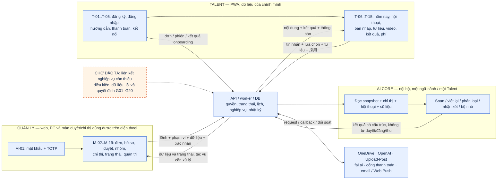

**Quyền xuyên suốt:** Talent chỉ đọc/ghi của mình; Manager cùng một loại quyền, xem mọi Talent và hội thoại, nhưng nơi nhận yêu cầu duyệt còn G04; tài khoản công ty là loại tài khoản do Manager vận hành, không phải thêm một actor ngang hàng; AI Core chỉ nhận dữ liệu của Talent đang xử lý và nội dung chung được phép. Không dùng tin nhắn chứa một `talent_id` để đổi chủ sở hữu dữ liệu (1-5).

## 2. EP01 — Danh tính, bắt đầu dùng và kết thúc

### 2.1. Đăng ký, quyền và điều kiện bắt đầu

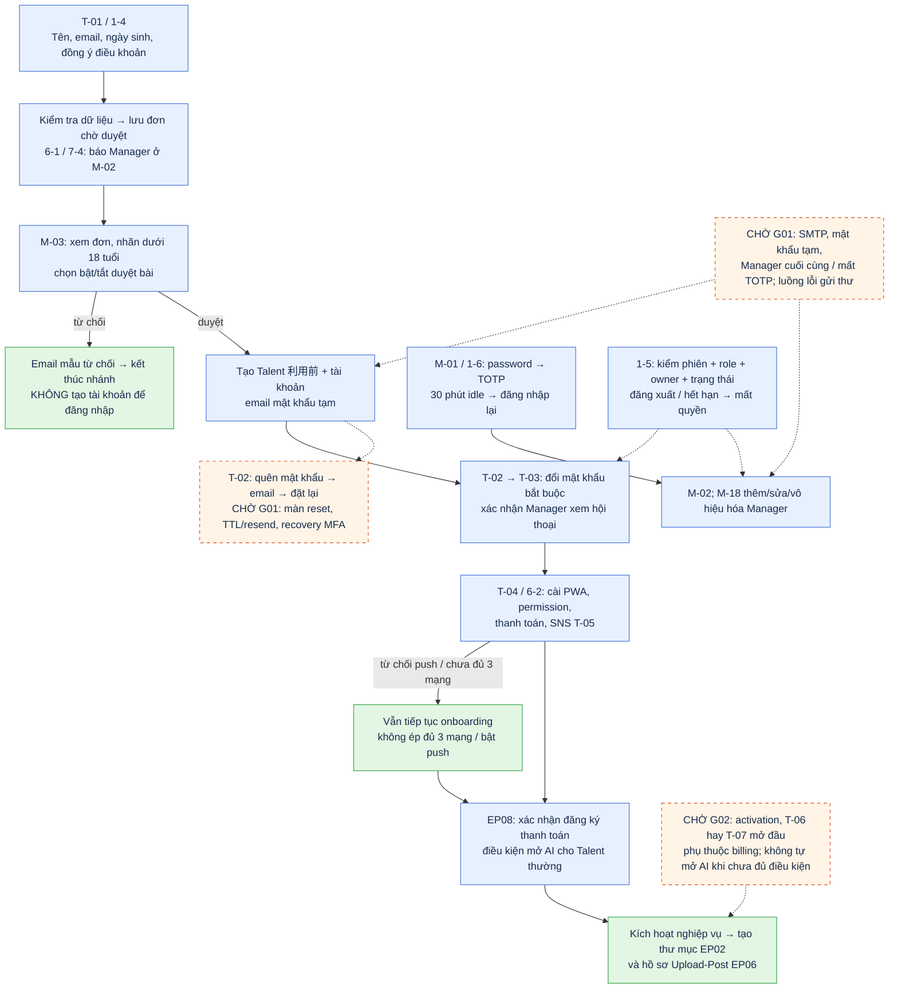

### 2.2. Đổi trạng thái và rời hệ thống

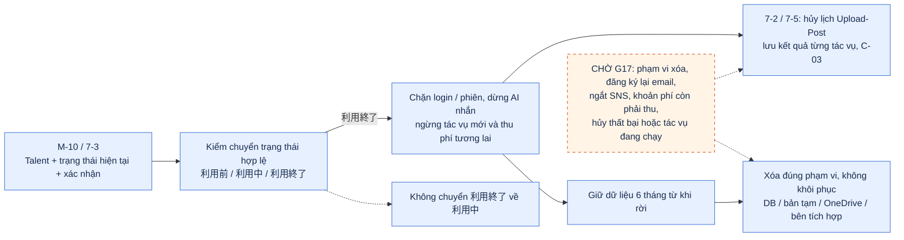

## 3. EP02 — Hồ sơ, mục tiêu và nguồn dữ liệu cho AI

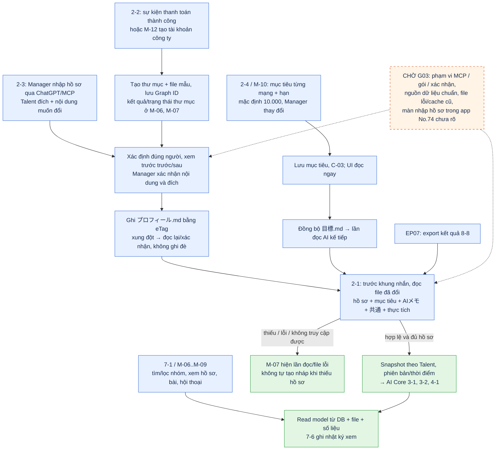

**Nguồn dữ liệu không được nhập nhằng:** hồ sơ/file chung nằm OneDrive; hội thoại, quyền, trạng thái nghiệp vụ và bản ghi kết quả nằm hệ thống; mục tiêu được nhập ở M-10 và đồng bộ ra file cho AI. Đồng bộ lỗi phải được thể hiện là lỗi/chưa cập nhật, không coi DB và file luôn giống nhau. Tài liệu cần xác định rõ dữ liệu nào được dùng khi các nguồn chưa đồng bộ.

## 4. EP03 — AI Core: ngữ cảnh, hội thoại, chủ động và phản hồi

### 4.1. Luồng xử lý AI chung

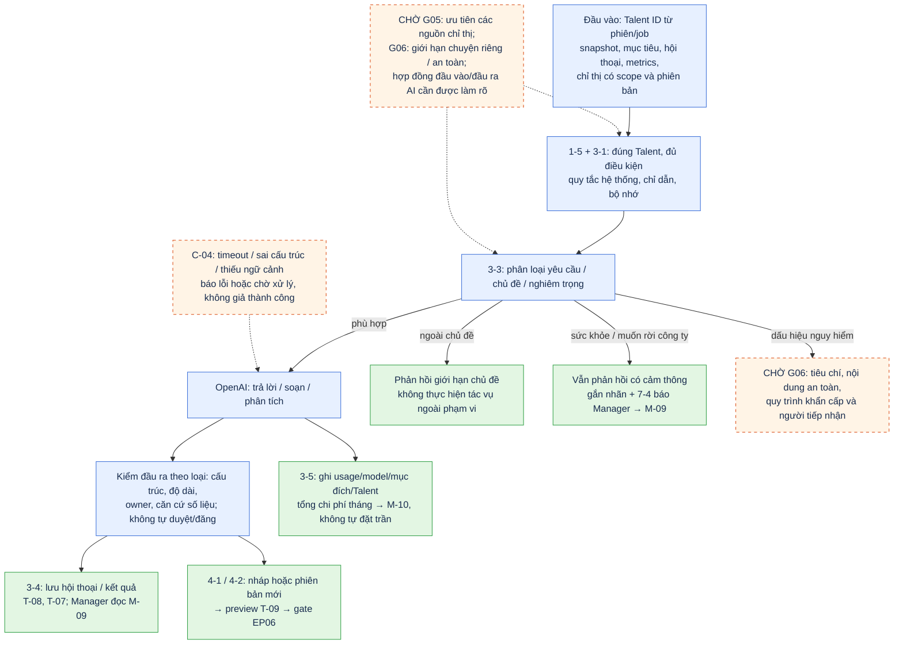

### 4.2. Vòng chủ động và bộ nhớ

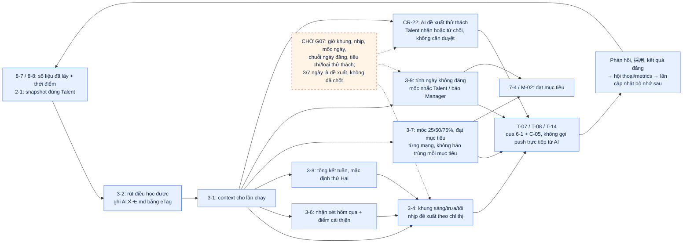

**Ràng buộc:** chưa có hồ sơ thì không tạo bản nháp; không tự coi số liệu lỗi là 0; chi phí OpenAI (3-5) khác phí video tính cho Talent (5-4). Quy tắc riêng cho người dưới 18 tuổi do khách viết trong chỉ thị (QA No.18), không tự thêm vai trò hay luật tuổi mới. Chuyện nghiêm trọng và recovery vận hành vẫn cần thiết kế G06.

## 5. EP04 — Chủ đề, bản nháp và hai cách đăng

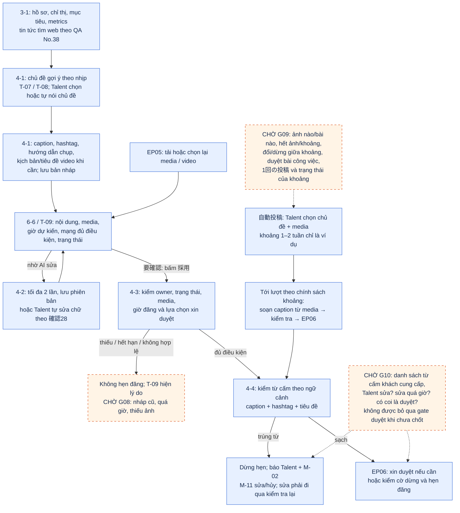

**Không đọc nhầm:** 自動投稿 theo khoảng là lựa chọn nội dung của Talent; cờ dừng toàn bộ/từng Talent (7-5) là điều khiển vận hành của Manager. Hai khái niệm có liên hệ nhưng không được gộp thành một boolean. Các màn nhập/chỉnh khoảng tự động chưa có mã [AG] đã xác nhận — G09 phải hiện là thiếu màn/định nghĩa, không tự đặt T-16.

## 6. EP05 — Tư liệu, tạo video, xem và dùng lại

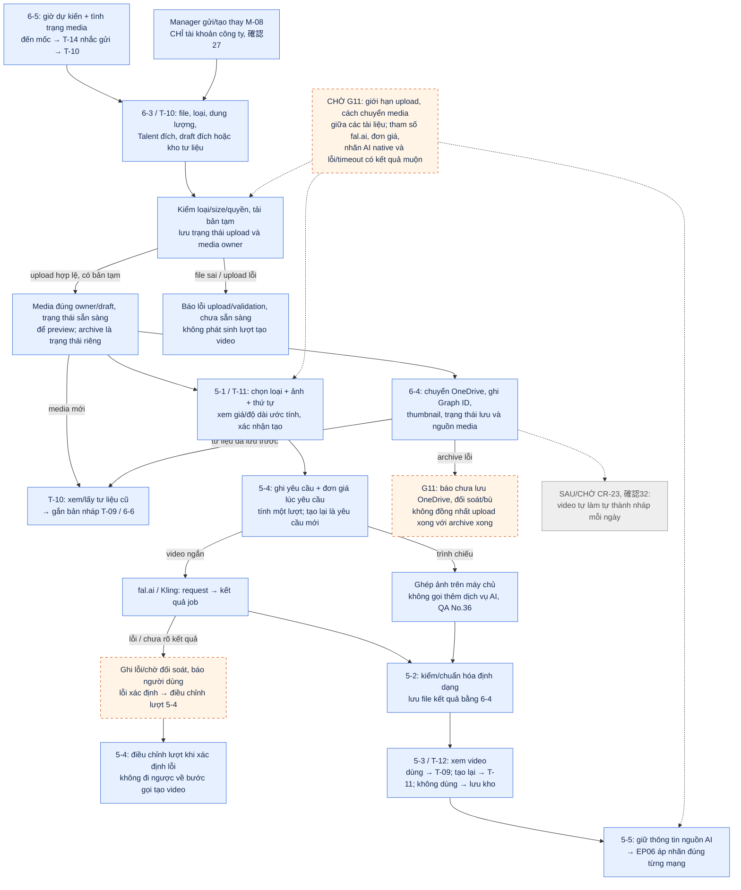

**Đính chính so với bản trước:** lượt video tính khi xác nhận yêu cầu, không đợi video hoàn thành; lỗi dịch vụ điều chỉnh lượt, cách xử lý timeout/kết quả muộn cần G11. Video trình chiếu dùng ghép ảnh ở máy chủ đã có căn cứ, không tiếp tục coi S05-05 là chưa chọn công nghệ. Các thông số 1 ảnh / 2–10 ảnh, 15 phút, độ dài/resolution là đề xuất hoặc tham số cần kiểm chứng, không tự nâng thành cam kết khách.

## 7. EP06 — Duyệt, hẹn đăng, kết quả từng mạng và dừng/hủy

### 7.1. Gate bắt buộc trước khi gửi Upload-Post

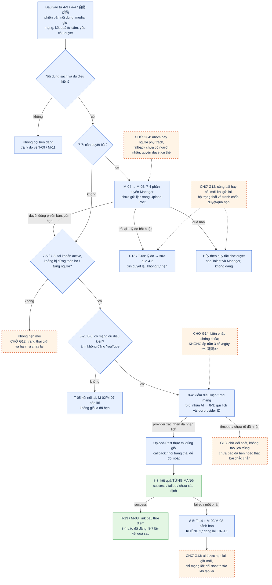

Chỉ các nhánh **đã đủ quyền, đúng phiên bản, đủ nội dung và còn hạn** mới tới 8-3. Sửa bài dính từ cấm không mặc định thay thế quyết định duyệt bài công việc (QA No.57 còn hỏi). Một Manager bấm trước quyết định không có nghĩa hệ thống bỏ qua kiểm tra phiên bản hoặc cuộc đua với hết hạn.

### 7.2. Hủy, dừng, kết nối và tài khoản công ty

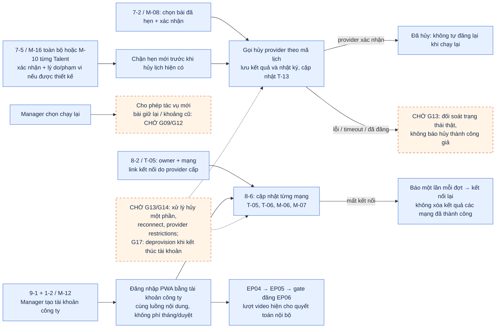

## 8. EP07 — Số liệu, giờ đăng và vòng phản hồi

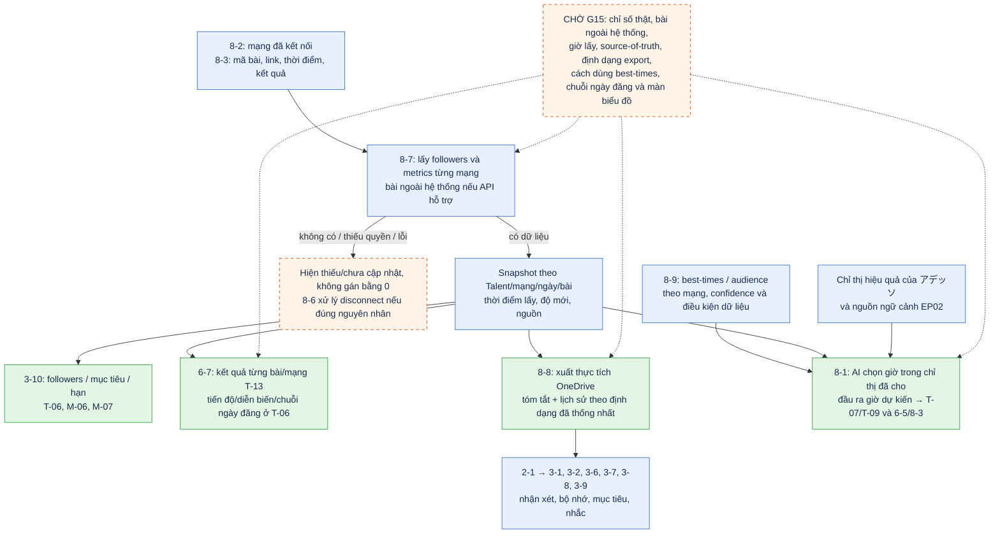

**Đối chiếu khác biệt:** SCD 8-9 đã có mô tả endpoint/điều kiện theo mạng ở phần mới, nên không tiếp tục kết luận “không có API, có thể bỏ”. Tài liệu vẫn cần quy định điều kiện dữ liệu của từng mạng và cách xử lý khi thiếu quyền hoặc không có số liệu. SCD 8-1 còn mô tả thuật toán 20 bài / 3 khung / ±10 phút; đây không phải quyết định mới của khách thay cho [KS] 確認30 (AI chọn dựa chỉ thị). Các con số và fallback phải tách thành thiết kế cần xác nhận/kiểm chứng G15.

## 9. EP08 — Loại tài khoản, thuê bao và phí video

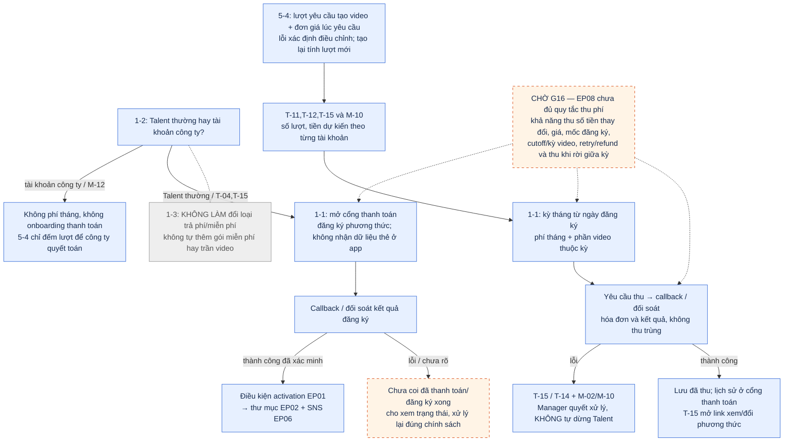

Không lấy đoạn cũ “ngày 1 hàng tháng” hoặc “tự thu lại sau 3 ngày” của SCD làm quyết định đã chốt: phải hòa giải với kỳ một tháng theo [KS] 確認48 và khả năng cổng thanh toán ([KS] 確認49, QA No.53). Khi quy tắc kỳ thu chưa khép kín, tài liệu cũng chưa xác định đầy đủ điều kiện của liên kết **đăng ký thanh toán → mở dùng AI**.

## 10. EP09 — Thông báo, PWA và điều hướng kết quả

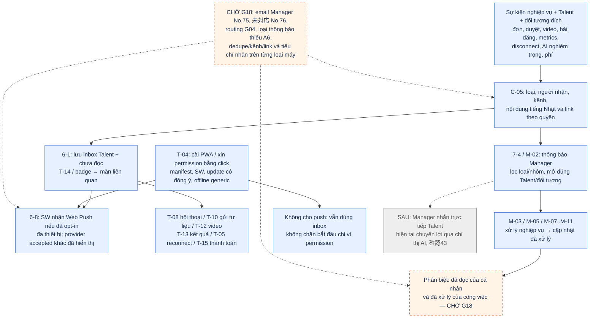

Danh mục phải nối cả **quá hạn duyệt**, **video xong/lỗi**, **hủy bài vì dừng**, **từ cấm phía Talent** tới màn đích; C-05 đánh dấu một số loại là đề xuất bổ sung, không tự tuyên bố khách đã duyệt câu chữ. Mốc followers 25/50/75% ở QA No.14 ưu tiên hơn đề xuất cũ “bỏ thông báo tăng followers” trong C-05. Đọc thông báo không được tự coi là đã xử lý đơn/bài.

## 11. EP10 — Quản trị chung, chỉ thị và kiểm soát xuyên chức năng

### 11.1. Nhóm, chỉ thị AI và cài đặt

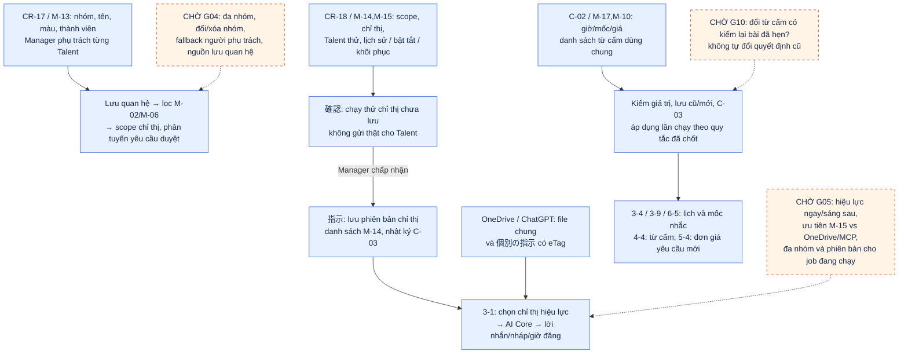

Thứ tự **Talent > nhóm > toàn bộ** có căn cứ ở [AG]/SCD, nhưng chưa giải quyết xung đột **giữa các kênh M-15 / file OneDrive / ChatGPT** hoặc Talent thuộc nhiều nhóm. Không ghi thứ tự tuyệt đối nếu G05 chưa đóng. Nút mẫu câu 「書き出しの部品」 không làm ([KS] 確認8); màn nhập riêng hồ sơ No.74 không được mặc định thay bằng M-15.

### 11.2. Trạng thái, nhật ký, lỗi và chất lượng giao diện

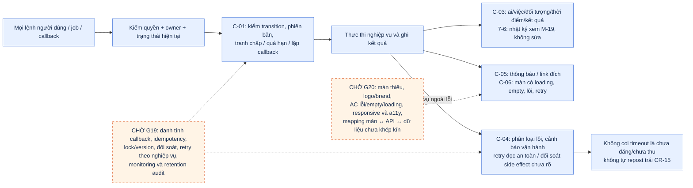

## 12. Danh sách phần chưa đáp ứng — đã gắn mã lên sơ đồ

Các G dưới đây là **kết quả rà soát**, không phải mã yêu cầu mới của khách. “Thiếu” gồm thiếu quyết định, hợp đồng xử lý, màn hình/dữ liệu hoặc tiêu chí chấp nhận; không tự coi mọi ý trong SCD là customer-approved.

| Mã | Phần chưa đáp ứng / ảnh hưởng | Cần ai làm / căn cứ | Xuất hiện ở sơ đồ |
|---|---|---|---|
| **G01** | Chuỗi đơn → tài khoản → gửi thư → đổi mật khẩu còn thiếu quy định lỗi gửi thư; thiếu màn reset, TTL/resend mật khẩu tạm, khóa/khôi phục Manager, người quản lý cuối cùng | Đội + khách; QA No.65,67, SCD 1-4/1-6; chọn/cấu hình email C1 và xử lý tạo tài khoản thành công nhưng gửi thư lỗi | §2.1 |
| **G02** | Điều kiện activation, khi nào mở AI/khởi tạo folder/SNS; không ép đủ 3 mạng/push; T-06 hay T-07 mở đầu | Khách + đội; [KS] 確認11–13,48; QA No.53; B13; liên quan EP08 còn thiếu quy tắc thu phí | §2.1, §3, §9 |
| **G03** | MCP có căn cứ hợp đồng nhưng phạm vi/gói/xác thực/quyền/xác nhận ghi chưa được mô tả và thống nhất đầy đủ; màn nhập hồ sơ No.74 chưa rõ. Cần chốt schema file, source-of-truth, lỗi đọc/cache cũ/thiếu hồ sơ và đồng bộ mục tiêu | Khách/FutureCore + đội làm rõ giới hạn và quy tắc nền tảng; QA No.22,45,54,74, [KS] 確認8; cần đặc tả đầy đủ provisioning/context và lỗi đọc/ghi | §3, §11.1 |
| **G04** | Nhóm/phụ trách đã chốt hướng nhưng thiếu quan hệ/màn đầy đủ, fallback khi không có phụ trách, đa nhóm/xóa nhóm, quyền người không nhận yêu cầu có được duyệt không | FutureCore thiết kế + khách xác nhận; [KS] 確認34,47, CR-17/19, QA No.6 | §1, §7.1, §11.1 |
| **G05** | Có thứ tự scope nhưng chưa có thứ tự giữa M-15/OneDrive/MCP; hiệu lực ngay hay hôm sau, job đang chạy dùng phiên bản nào, xung đột nhiều nhóm, lưu ở đâu | Đội/FutureCore + khách; [KS] 確認6–8, D9, P-17 | §4.1, §11.1 |
| **G06** | Giới hạn chuyện riêng/số lần chưa chốt; tiêu chí chuyện nghiêm trọng/nguy hiểm, lời phản hồi, người nhận và vận hành khẩn cấp chưa khép kín | Khách + đội; QA No.18,75,76, [KS] 確認17,23; S03-02/S03-04. Chỉ dẫn tuổi không giải quyết toàn bộ quy trình an toàn | §4.1 |
| **G07** | Giờ/nội dung sáng–trưa–tối, nhịp đề xuất, mốc nhắc và cách tính ngày đăng liên tiếp chưa hoàn thiện; thử thách thiếu loại/tiêu chí đạt/trạng thái/màn | Khách + FutureCore; QA No.72,73, [KS] 確認5,14,18,19,22; 3/7 ngày, 8/12/20 giờ là mặc định/đề xuất từng phần | §4.2 |
| **G08** | Nháp cũ, hết hạn, 採用 quá giờ, không gửi ảnh trong ngày, nhắc đã có media nhưng chưa 採用; phiên bản được khóa/kiểm tra cần rõ | Khách + đội; QA No.55,56, [KS] 確認26,29; B1/B2, S04-03; T-09/T-13 | §5 |
| **G09** | Khoảng 自動投稿 đã chốt hướng nhưng chưa đủ màn, dữ liệu, trạng thái: phân ảnh cho bài, hết ảnh, hết khoảng, đổi/dừng, soạn trước hay mỗi lượt, duyệt bài công việc; quan hệ với 1回の投稿 | Khách + FutureCore; QA No.70,71,77, [KS] 確認19,25,26; thiếu SCD riêng đầy đủ cho khoảng tự động | §5, §7.2 |
| **G10** | Từ cấm: danh sách khách chưa gửi; Talent được sửa không; Manager sửa có thay duyệt không; quá giờ chuyển thế nào; đổi danh sách có kiểm lại lịch cũ không | Khách + đội; QA No.57,71, [KS] 確認4, CR-06/07. Không suy diễn “sửa xong = đã duyệt” | §5, §11.1 |
| **G11** | Các tài liệu còn khác đường upload (Storage→worker→OneDrive / upload Graph / chuyển qua máy chủ); limits và retention chưa thống nhất. Thiếu hợp đồng tham số/kết quả fal.ai, định dạng, nhãn AI từng mạng; giá, timeout/kết quả muộn và điều chỉnh lượt chưa đủ | Đội + khách phần giá/nhãn và hợp đồng tích hợp; QA No.2,8,36,62; C3/B9; CR-23/確認32 vẫn chờ cho tự động dùng video tự làm | §6 |
| **G12** | Bộ trạng thái chưa thống nhất: hình 5-1, returned, resend cùng bài/bài mới, giữ vì dừng, trạng thái khoảng tự động; cạnh tranh approve/timeout/stop và phiên bản nội dung | Đội + khách; QA No.51,58,60,61,77; C-01. Đội có thể thiết kế CAS nhưng không tự chốt ý nghĩa business | §7.1, §7.2, §11.2 |
| **G13** | Hẹn/hủy/reconnect lỗi hoặc timeout chưa có kết quả: phải đối soát. Ai được đặt lại, giờ mới, chỉ mạng lỗi; hủy một phần/đã đăng và thông báo khi dừng chưa khép kín | Đội + khách thống nhất quy tắc và hợp đồng tích hợp; QA No.59–61; CR-15 cấm tự đăng lại; A6. Mô tả API chưa thay thế được quy tắc xử lý nghiệp vụ đầu-cuối | §7.1, §7.2 |
| **G14** | Chưa chốt/kiểm chứng biện pháp chống khóa và ràng buộc mạng. Đề xuất “3 bài/ngày” ở SCD 8-4 trái [KS] 確認37; không được dùng làm default business rule | FutureCore + đội làm rõ giới hạn và quy tắc nền tảng; S06-03, [KS] 確認37; không cam kết tài khoản không bị khóa | §7.1 |
| **G15** | Metric thật/thiếu quyền/độ mới, bài ngoài hệ thống, best-times theo từng mạng, xuất file/schema, cách chọn giờ/chỉ thị, cách đếm chuỗi ngày; biểu đồ chưa có màn rõ | Đội + khách thống nhất quy tắc và hợp đồng dữ liệu; QA No.72, [KS] 確認22,30; S07-05/06; 8-9 có tài liệu endpoint nhưng còn cần thống nhất điều kiện và giới hạn dữ liệu | §8 |
| **G16** | Billing chưa đủ chạy thật: GMO thu variable amount, đơn giá/mốc đăng ký, kỳ video/cutoff, retry/refund, callback thu trùng và thu khi rời giữa kỳ; “ngày 1 mỗi tháng” không tự áp dụng | Khách/cổng thanh toán + đội; [KS] 確認48–51, QA No.2,49,53,62. Khối EP08 phải thể hiện rõ các bước còn chờ quy tắc được xác nhận | §9 |
| **G17** | Kết thúc không thể bật lại đã chốt, nhưng thiếu phạm vi xóa sau 6 tháng, đăng ký lại email cũ, gỡ profile/SNS, khoản phí còn lại, hủy tác vụ đang chạy và xóa một phần | Khách + đội xác định quy tắc và tiêu chí tích hợp; [KS] 確認50,55,56, QA No.69 | §2.2, §7.2 |
| **G18** | Tài liệu inbox/phân tuyến còn thiếu quy định email Manager, 未対応, read/handled, dedupe, thông báo quá hạn/video/hủy, deeplink theo quyền và tiêu chí nhận trên từng loại máy | Khách + đội xác định quy tắc và tiêu chí tích hợp; QA No.75,76, A6, C-05; không đánh dấu delivered chỉ vì provider accepted | §10 |
| **G19** | Thiếu hợp đồng vận hành xuyên chức năng: quyền callback, idempotency/replay, phiên bản/khóa, retry theo tác vụ, job/callback chưa rõ, cảnh báo, retention/xóa dữ liệu audit | Đội; C-01/03/04, tệp 11/20. Đây là yêu cầu thiết kế để không làm sai kết quả, không phải mặc định một cơ chế hạ tầng cụ thể | §11.2 |
| **G20** | Thiếu định nghĩa màn reset/onboarding failure/khoảng tự động/thử thách/biểu đồ; trạng thái loading-empty-error; brand, thiết bị, a11y; thiếu liên kết màn hình/dữ liệu/AC cho các nhánh nghiệp vụ | FutureCore/khách + đội; [AG], B13, S07-05, C-06; mã màn mới phải được xác nhận, không tự đặt | §2.1, §5, §8, §11.2 |

### 12.1. Phân biệt yêu cầu đã rõ, còn chờ và ngoài phạm vi

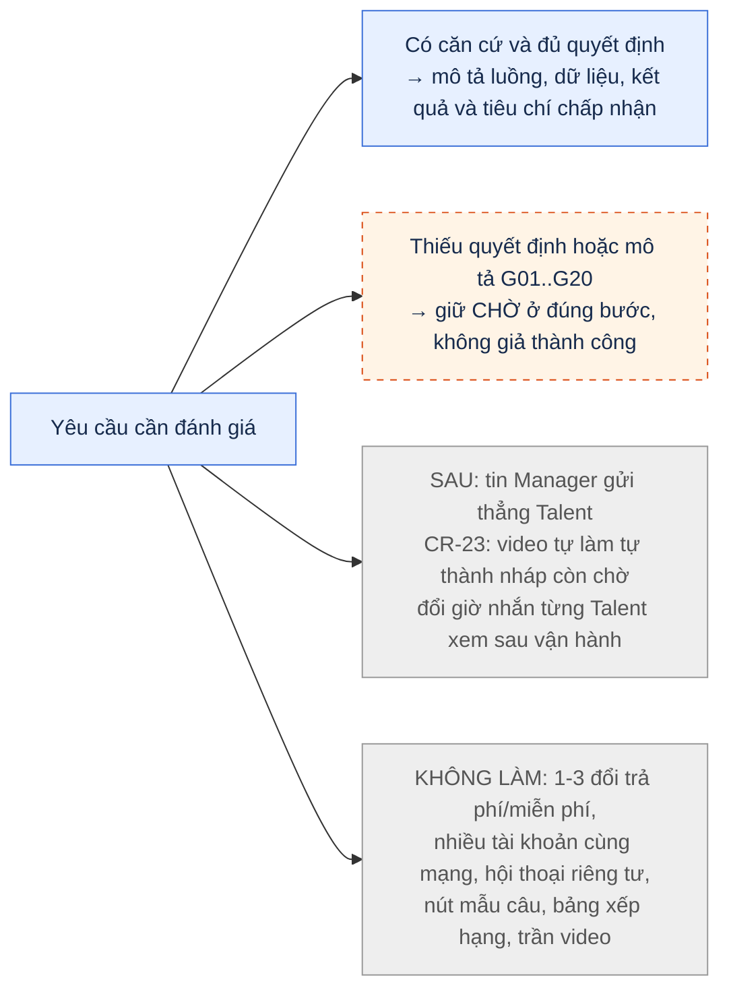

## 13. Ma trận kiểm đủ 60 chức năng: đầu vào → xử lý → đầu ra → liên kết

Các tên dữ liệu dưới đây là **khái niệm nghiệp vụ**, không tuyên bố đã có bảng/API/schema tương ứng. Mỗi mã trỏ tới SCD để xem quy tắc chi tiết; khi trái [KS]/Q&A mới, áp dụng phần đối chiếu và G ở trên. “Không có màn” là job/AI nội bộ, vẫn phải có dữ liệu và kết quả quan sát được.

### EP01 — 6 chức năng

| Mã / SCD | Tác nhân và màn đầu vào | Dữ liệu đầu vào | Cách xử lý | Kết quả, liên kết và phần thiếu |
|---|---|---|---|---|
| [1-4](../SCD/EP01_Danh_tinh_va_quyen_truy_cap/1-4_Dang_ky_duyet_don_va_dang_nhap.md) | Talent T-01..T-03; Manager M-03 | Tên/email/ngày sinh, consent; quyết định duyệt; credentials | Validate/lưu đơn, duyệt hoặc từ chối; gửi email, đổi mật khẩu; login/reset/logout | Đơn/trạng thái tài khoản/phiên; thông báo M-02; tiếp 6-2, 1-5; G01/G02 |
| [1-5](../SCD/EP01_Danh_tinh_va_quyen_truy_cap/1-5_Nhan_dien_tai_nang.md) | Talent, Manager, AI Core/job; không màn riêng | Phiên hoặc job có Talent đích, role, trạng thái | Ràng buộc owner ở API/job/context/file; không lấy ID từ lời nhắn để cấp quyền | Dữ liệu đúng người hoặc từ chối; áp cho mọi chức năng; G19 |
| [1-6](../SCD/EP01_Danh_tinh_va_quyen_truy_cap/1-6_Dang_nhap_va_quyen_cua_quan_ly.md) | Manager M-01,M-18 | Email/password/TOTP, tên/email Manager, lệnh vô hiệu hóa | Xác thực 2 bước, idle, thêm/sửa/vô hiệu hóa; thu hồi phiên/quyền nhận | Vào M-02 hoặc bị chặn; audit C-03; G01 |
| [6-2](../SCD/EP01_Danh_tinh_va_quyen_truy_cap/6-2_Huong_dan_lan_dau_va_ket_noi_mang_xa_hoi.md) | Talent T-04,T-05 | Trạng thái từng bước, install/permission, kết quả payment và SNS | Khôi phục bước chưa xong; bỏ payment với công ty; không ép push/đủ 3 mạng | Tiến độ onboarding, activation theo điều kiện; nối 1-1, 2-2, 8-2, 6-8; G02/G16 |
| [7-3](../SCD/EP01_Danh_tinh_va_quyen_truy_cap/7-3_Doi_trang_thai_tai_nang.md) | Manager M-10; hệ thống | Talent, trạng thái cũ/mới, xác nhận | Kiểm chuyển trạng thái; 利用終了 dừng login/AI/thu phí tương lai và hủy lịch; retention 6 tháng | Trạng thái + kết quả từng tác vụ; 7-2, 7-5, 1-1, 2-2/C-03; G17/G19 |
| [7-6](../SCD/EP01_Danh_tinh_va_quyen_truy_cap/7-6_Nhat_ky_xem_thong_tin.md) | Manager M-07..M-09,M-19 | Người xem, Talent, màn, thời điểm; bộ lọc | Ghi lượt xem ở máy chủ, lọc theo ngày và Talent, không sửa | Nhật ký xem M-19; khác nhật ký xử lý C-03; G19 |

### EP02 — 5 chức năng

| Mã / SCD | Tác nhân và màn đầu vào | Dữ liệu đầu vào | Cách xử lý | Kết quả, liên kết và phần thiếu |
|---|---|---|---|---|
| [2-1](../SCD/EP02_Thong_tin_tai_nang_va_nguon_du_lieu_cho_AI/2-1_Doc_thong_tin_tai_nang.md) | AI Core/job; M-07 xem lỗi | Thư mục đúng người, file/eTag, trạng thái sử dụng, thời điểm | Đọc dữ liệu thay đổi và nội dung chung; kiểm đủ hồ sơ, lưu snapshot và tình trạng đọc | Snapshot cho 3-1/3-2/4-1; trạng thái M-07; G03 |
| [2-2](../SCD/EP02_Thong_tin_tai_nang_va_nguon_du_lieu_cho_AI/2-2_Tao_thu_muc_rieng_cho_tai_nang.md) | Hệ thống; Manager M-06,M-07 | Sự kiện payment xong hoặc office tạo xong, Talent ID | Tạo cây/file mẫu an toàn khi chạy lại, lưu Graph IDs và trạng thái | Thư mục cho 2-3, 2-1, 6-4, 8-8; UI link/trạng thái; G02/G03 |
| [2-3](../SCD/EP02_Thong_tin_tai_nang_va_nguon_du_lieu_cho_AI/2-3_Nhap_thong_tin_tu_ChatGPT.md) | Manager qua ChatGPT/MCP | Talent đích, nội dung đổi, bản trước/sau, xác nhận, eTag | Xác định đích, preview, ghi có kiểm phiên bản và quyền; audit | Hồ sơ OneDrive; M-07 đọc; 2-1 lấy ở lần sau; G03/G05 |
| [2-4](../SCD/EP02_Thong_tin_tai_nang_va_nguon_du_lieu_cho_AI/2-4_Dang_ky_muc_tieu.md) | Manager M-10; Talent T-06 đọc | Mục tiêu và hạn từng mạng, giá trị hiện tại | Kiểm/lưu mục tiêu, giá trị đầu 10.000; đồng bộ 目標.md | UI 3-10/6-7 đổi theo dữ liệu; AI 2-1/3-7 dùng đúng phiên bản; G03/G15 |
| [7-1](../SCD/EP02_Thong_tin_tai_nang_va_nguon_du_lieu_cho_AI/7-1_Xem_thong_tin_tai_nang.md) | Manager M-06..M-09 | Từ khóa/bộ lọc/nhóm/Talent; profile, metrics, conversation | Tổng hợp read model, phân quyền, ghi nhật ký xem | Danh sách/chi tiết/link bài và cảnh báo; nối 2-1, 2-4, 3-10, 7-6; G03/G04/G15 |

### EP03 — 9 chức năng

| Mã / SCD | Tác nhân và màn đầu vào | Dữ liệu đầu vào | Cách xử lý | Kết quả, liên kết và phần thiếu |
|---|---|---|---|---|
| [3-1](../SCD/EP03_Huan_luyen_vien_AI/3-1_Hieu_tai_nang_va_thuat_toan.md) | AI Core; không màn riêng | Snapshot đúng người, chỉ thị có scope/version, memory, hội thoại và metrics | Ghép context theo quyền/ưu tiên đã chốt; không trộn người | Context cho 3-4/3-6/4-1/4-2, version để giải thích kết quả; G03/G05 |
| [3-2](../SCD/EP03_Huan_luyen_vien_AI/3-2_Tu_cai_thien.md) | AI Core/job; không màn riêng | Hội thoại/kết quả mới, AIメモ cũ và eTag | Rút điều học được, ghi bộ nhớ có kiểm phiên bản | AIメモ mới → 2-1/3-1; lỗi ghi không mất bản cũ; G03/G19 |
| [3-3](../SCD/EP03_Huan_luyen_vien_AI/3-3_Gioi_han_chu_de_tro_chuyen.md) | AI Core, Talent T-08, Manager M-02/M-09 | Tin nhắn, policy/chỉ thị, ngữ cảnh | Phân loại chủ đề/nghiêm trọng; trả lời phù hợp, gắn nhãn và báo đúng nơi | Câu trả lời + event nghiêm trọng → 3-4/7-4; G06/G18 |
| [3-4](../SCD/EP03_Huan_luyen_vien_AI/3-4_Tro_chuyen_voi_huan_luyen_vien_AI.md) | Talent T-07,T-08; Manager M-09; AI Core | Tin nhắn ≤1.000 ký tự theo SCD, ngữ cảnh; lịch khung giờ; sự kiện đăng | Lưu/stream câu trả lời; chủ động theo khung, phân tuyến sang tạo nháp | Conversation/history, chủ đề/lời nhắn → 4-1, 6-1; usage → 3-5; G06/G07 |
| [3-5](../SCD/EP03_Huan_luyen_vien_AI/3-5_Quan_ly_chi_phi_AI.md) | AI Core ghi, Manager M-10 xem | Model/token/mục đích/Talent hoặc chi phí chung, đơn giá/quy đổi | Ghi usage từng call, tổng hợp theo Talent/tháng; không áp trần tự dừng | Chi phí AI M-10; audit vận hành; KHÔNG gộp thành phí video 5-4; G19 |
| [3-6](../SCD/EP03_Huan_luyen_vien_AI/3-6_Nhan_xet_bai_hom_truoc_va_goi_y_cai_thien.md) | AI Core; Talent T-07/T-08 | Bài và metrics hôm qua, baseline/độ mới | Viết nhận xét có căn cứ, thiếu dữ liệu phải hiện đúng | Nhận xét/điểm cải thiện → 3-4/6-1; G15 |
| [3-7](../SCD/EP03_Huan_luyen_vien_AI/3-7_Thong_bao_khi_dat_muc_tieu.md) | AI Core/job; T-06,T-08,T-14; M-02 | Followers từng mạng, mục tiêu/version, mốc đã báo; tiến độ thử thách | Xác định mốc 25/50/75% và đạt mục tiêu, chống trùng; thử thách theo rule còn chờ | Chúc mừng/tiến độ; đạt mục tiêu báo Talent và Manager → 6-1/7-4; G07/G15/G18 |
| [3-8](../SCD/EP03_Huan_luyen_vien_AI/3-8_Tong_ket_tuan.md) | AI Core/job; T-08, cài M-17 | Metrics tuần trước, mục tiêu, lịch/ranh giới ngày | Tổng hợp và viết tổng kết, mặc định thứ Hai theo SCD | Tin tuần → 3-4/6-1; G07/G15 |
| [3-9](../SCD/EP03_Huan_luyen_vien_AI/3-9_Nhac_tai_nang_lau_khong_dang_bai.md) | AI Core/job; Talent T-08/T-14; Manager M-02 | Bài thành công/ngày cuối đăng, trạng thái, cờ dừng, mốc nhắc | Tính ngày không đăng, nhắc đúng mốc, reset sau đăng; cách đăng ảnh hưởng rule | Nhắc Talent/cảnh báo Manager → 6-1/7-4; G07/G09/G15 |

### EP04 — 5 chức năng

| Mã / SCD | Tác nhân và màn đầu vào | Dữ liệu đầu vào | Cách xử lý | Kết quả, liên kết và phần thiếu |
|---|---|---|---|---|
| [4-1](../SCD/EP04_Tao_noi_dung_bai_dang/4-1_Tu_tao_ban_nhap.md) | Talent T-07/T-08; AI Core | Context, tin tức, chủ đề được chọn, loại bài, media và chỉ thị | Gợi ý theo nhịp; soạn caption/hashtag/hướng dẫn/kịch bản; lưu nháp | Nháp/version → 6-6/4-2/6-3/8-1; G07/G08/G09 |
| [4-2](../SCD/EP04_Tao_noi_dung_bai_dang/4-2_Yeu_cau_sua_va_viet_lai.md) | Talent T-08/T-09; AI Core | Nháp/version, yêu cầu sửa hoặc chữ tự sửa, số lần AI rewrite | Nhờ AI tối đa 2 lần, lưu phiên bản; Talent tự sửa chữ được | Phiên bản mới → 6-6/4-3/4-4; G08/G12 |
| [4-3](../SCD/EP04_Tao_noi_dung_bai_dang/4-3_Chap_nhan_ban_nhap.md) | Talent T-09; hệ thống | Nháp/version, media, giờ, networks, xin duyệt, phiên/trạng thái | Kiểm điều kiện 採用, từ cấm, policy duyệt và cờ dừng | Bị chặn/chờ duyệt/đủ điều kiện hẹn → 4-4/7-7/7-5/8-3; G08/G09/G12 |
| [4-4](../SCD/EP04_Tao_noi_dung_bai_dang/4-4_Phat_hien_tu_cam.md) | AI Core; Manager M-11/M-17; Talent T-09/T-13 | Caption/hashtag/title, danh sách từ cấm/version, bản Manager sửa | Kiểm ngữ cảnh, trả đoạn/lý do; sửa phải kiểm lại; hủy nếu chọn không đăng | Kết quả sạch hoặc blocked, M-02/Talent báo; quay gate 7-7/8-3; G10/G12 |
| [6-6](../SCD/EP04_Tao_noi_dung_bai_dang/6-6_Xem_truoc_bai_dang.md) | Talent T-09 | Phiên bản nội dung mới nhất, media, giờ, mạng và trạng thái | Hiển thị preview thực tế, nút theo quyền/điều kiện; ảnh không YouTube | Xem/sửa/đính media/tạo video/採用 → 4-2/4-3/5-1/6-3; G08/G20 |

### EP05 — 7 chức năng

| Mã / SCD | Tác nhân và màn đầu vào | Dữ liệu đầu vào | Cách xử lý | Kết quả, liên kết và phần thiếu |
|---|---|---|---|---|
| [5-1](../SCD/EP05_Tu_lieu_va_video_AI/5-1_Tao_video.md) | Talent T-11; Manager M-08 chỉ office | Loại video, source media/order, xác nhận và giá/độ dài ước tính | Ghi yêu cầu; short qua fal.ai, slide ghép máy chủ; xử lý kết quả async | Job + lượt 5-4; video chuẩn 5-2/6-4; T-12 và notification; G11/G16 |
| [5-2](../SCD/EP05_Tu_lieu_va_video_AI/5-2_Dinh_dang_video.md) | Hệ thống xử lý; không màn riêng | Video nguồn, loại, metadata codec/size/duration | Kiểm/chuẩn hóa theo định dạng dịch vụ/mạng đã kiểm chứng | Media dùng đăng + lỗi validation → 6-4/5-3/8-3; G11/G14 |
| [5-3](../SCD/EP05_Tu_lieu_va_video_AI/5-3_Xem_va_xu_ly_video_da_tao.md) | Talent T-12 | Video job kết quả, media, nhãn nguồn, số lượt/giá | Preview; dùng/generate lại/không dùng | Dùng → 6-6; tạo lại → 5-1/5-4; không dùng → kho 6-4; G11 |
| [5-5](../SCD/EP05_Tu_lieu_va_video_AI/5-5_Ghi_ro_video_do_AI_tao.md) | Hệ thống; nhãn T-12/bài đăng | Nguồn media AI-generated/AI-edited, mạng đích, khả năng native label | Áp cờ AI theo mạng; fallback text/hashtag chỉ khi phù hợp đã xác nhận | Payload/nhãn AI và bản ghi cách áp → 8-3/6-6; G11 |
| [6-3](../SCD/EP05_Tu_lieu_va_video_AI/6-3_Gui_anh_va_video.md) | Talent T-10; Manager M-08 chỉ office | File/chụp mới, dung lượng, type, owner, draft hoặc đích lưu | Validate/tải theo hợp đồng thống nhất, ghi media và đích; báo lỗi upload | Media/tiến độ → 6-4/6-6/5-1; G11; tự thành nháp video vẫn chờ CR-23 |
| [6-4](../SCD/EP05_Tu_lieu_va_video_AI/6-4_Luu_tu_lieu.md) | Talent T-10; hệ thống | Media mới/cũ, owner, loại nguồn, trạng thái bản tạm | Lưu OneDrive, ID/thumbnail; liệt kê và dùng lại theo quyền | Kho media và attach vào nháp; nguồn cho 5-1/5-5; G03/G11/G17 |
| [6-5](../SCD/EP05_Tu_lieu_va_video_AI/6-5_Nhac_gui_tu_lieu.md) | Hệ thống/AI Core; Talent T-14→T-10 | Giờ dự kiến, trạng thái media/採用, cài đặt nhắc | Tính mốc, kiểm còn cần nhắc, dedupe; chưa tự chốt nhắc đã có media | Thông báo nhắc → 6-1/6-3; G07/G08 |

### EP06 — 9 chức năng

| Mã / SCD | Tác nhân và màn đầu vào | Dữ liệu đầu vào | Cách xử lý | Kết quả, liên kết và phần thiếu |
|---|---|---|---|---|
| [7-2](../SCD/EP06_Phe_duyet_va_dang_len_mang_xa_hoi/7-2_Xem_va_huy_bai_dang.md) | Manager M-08; Talent T-13 chỉ xem | Bài/lịch/provider ID/version, trạng thái, xác nhận hủy | Liệt kê; gọi hủy; đối soát lỗi/đã đăng; không báo hủy giả | Trạng thái/link/kết quả từng mạng, audit, thông báo → 8-3/8-5/6-1; G13/G18 |
| [7-5](../SCD/EP06_Phe_duyet_va_dang_len_mang_xa_hoi/7-5_Dung_dang_tu_dong_toan_bo_hoac_tung_tai_nang.md) | Manager M-10/M-16 | Phạm vi global/Talent, trạng thái cờ, bài đã hẹn, xác nhận | Chặn hẹn mới; hủy lịch hiện có; chạy lại không phục hồi bài đã hủy | Cờ dừng/lịch sử/kết quả hủy; gate 4-3/7-7/8-3; G09/G12/G13 |
| [7-7](../SCD/EP06_Phe_duyet_va_dang_len_mang_xa_hoi/7-7_Duyet_bai_dang.md) | Talent T-09; Manager M-04/M-05 | Nội dung/version đã sạch, giờ/hạn, xin duyệt, recipient, lý do trả lại | Route yêu cầu; duyệt/trả lại/quá hạn; chỉ một quyết định có hiệu lực | Kết quả T-13/T-14/M-02; duyệt → gate 8-3, trả lại → 4-2/4-3; G04/G12/G18 |
| [8-2](../SCD/EP06_Phe_duyet_va_dang_len_mang_xa_hoi/8-2_Ket_noi_dich_vu_dang_bai.md) | Talent T-05; hệ thống; Manager xem | Talent/office profile, mạng, link kết nối và kết quả provider | Tạo profile đúng mốc, nối/reconnect một account mỗi mạng, lưu trạng thái | Connection state → 8-3/8-6/8-7 và UI; G02/G13/G17 |
| [8-3](../SCD/EP06_Phe_duyet_va_dang_len_mang_xa_hoi/8-3_Dang_len_3_mang_xa_hoi.md) | Hệ thống/Upload-Post; T-13/M-08 | Nội dung/media/nhãn, networks, giờ, các gate đã qua | Gửi lịch; lưu provider ID; nhận callback/đối soát và kết quả mỗi mạng | Post/link/error per network → 8-5/3-4/8-7; không đăng trực tiếp từ AI; G12/G13/G14 |
| [8-4](../SCD/EP06_Phe_duyet_va_dang_len_mang_xa_hoi/8-4_Chong_bi_khoa_tai_khoan.md) | Hệ thống; không màn riêng | Policy nền tảng, network/account state, lịch và loại media | Áp biện pháp đã chốt/kiểm chứng; không bảo đảm tránh khóa; không tự áp trần3 | Lịch đủ điều kiện hoặc lý do chặn → 8-3; G14 |
| [8-5](../SCD/EP06_Phe_duyet_va_dang_len_mang_xa_hoi/8-5_Thong_bao_khi_dang_loi.md) | Talent T-13/T-14; Manager M-02/M-08 | Kết quả lỗi theo mạng, provider code, dữ liệu đối soát | Báo lỗi dễ hiểu; không tự repost; hẹn lại theo quyền/giờ/rule còn chờ | Notification + trạng thái; nếu được yêu cầu mới quay 8-3; G13/G18 |
| [8-6](../SCD/EP06_Phe_duyet_va_dang_len_mang_xa_hoi/8-6_Thong_bao_khi_mat_ket_noi.md) | Hệ thống; Talent T-05; Manager M-02/M-07 | Trạng thái kết nối/callback hoặc lỗi xác định mất quyền | Đánh dấu disconnect, báo một lần mỗi đợt, hướng reconnect | UI/notification → 8-2; không làm mất thành công các mạng khác; G13/G18 |
| [9-1](../SCD/EP06_Phe_duyet_va_dang_len_mang_xa_hoi/9-1_Dang_bai_bang_tai_khoan_cong_ty.md) | Manager M-12 rồi PWA của office | Tên/email office, credentials office, media/nội dung/connection | Tạo/vận hành office đúng quyền; cùng luồng đăng, không phí tháng/duyệt | Office M-06, thư mục 2-2, SNS8-2, bài8-3, lượt5-4; QA No.66/G17 |

### EP07 — 6 chức năng

| Mã / SCD | Tác nhân và màn đầu vào | Dữ liệu đầu vào | Cách xử lý | Kết quả, liên kết và phần thiếu |
|---|---|---|---|---|
| [3-10](../SCD/EP07_Ket_qua_va_phan_tich/3-10_Hien_thi_so_nguoi_theo_doi.md) | Talent T-06; Manager M-06/M-07 | Followers gần nhất + mục tiêu/hạn từng mạng, timestamp | Tính tiến độ/mức tăng và còn lại theo từng mạng; không xếp hạng | Read model từng mạng → 6-7/3-7; G15 |
| [6-7](../SCD/EP07_Ket_qua_va_phan_tich/6-7_So_lieu_va_muc_dat_cho_tai_nang.md) | Talent T-06/T-13 | Số liệu bài/mạng, followers/history, mục tiêu, ngày đăng | Tổng hợp/hiển thị metrics, progress/biểu đồ/chuỗi ngày theo rule | Thành tích cá nhân, deeplink bài, dữ liệu không có hiển thị đúng; G07/G15/G20 |
| [8-1](../SCD/EP07_Ket_qua_va_phan_tich/8-1_Phan_tich_gio_dang.md) | AI Core/hệ thống; T-07/T-09 hiển thị | Chỉ thị khung giờ, số liệu/độ tin cậy, mạng đích | Chọn giờ theo chỉ thị và thuật toán được thống nhất, ghi nguồn/phiên bản | Giờ dự kiến → 4-1/6-5/8-3; Talent không tự đổi giờ; G08/G15 |
| [8-7](../SCD/EP07_Ket_qua_va_phan_tich/8-7_Lay_so_lieu.md) | Hệ thống/Upload-Post; không màn riêng | Tài khoản kết nối, mã bài, khoảng thời gian, API permissions | Lấy/lưu chỉ số theo mạng + timestamp; bài ngoài hệ thống nếu hỗ trợ | Snapshots → 8-8/3-10/6-7/3-6/3-7/3-9; G15 |
| [8-8](../SCD/EP07_Ket_qua_va_phan_tich/8-8_Ghi_so_lieu_vao_file.md) | Hệ thống/OneDrive; không màn riêng | Metrics đã thu, Talent folder, schema/phiên bản file | Xuất tóm tắt và lịch sử, eTag, không ghi đè mù | File thực tích → 2-1/AI Core/Manager; lỗi sync hiện trạng thái; G03/G15 |
| [8-9](../SCD/EP07_Ket_qua_va_phan_tich/8-9_Lay_khung_gio_tuong_tac.md) | Hệ thống; không màn riêng | Network, quyền insights, dữ liệu lịch sử, APIbest-times/audience | Lấy theo khả năng từng mạng, giữ confidence/sample/warnings | Nguồn khung giờ → 8-1; không coi không có dữ liệu là 0; G15 |

### EP08 — 4 chức năng

| Mã / SCD | Tác nhân và màn đầu vào | Dữ liệu đầu vào | Cách xử lý | Kết quả, liên kết và phần thiếu |
|---|---|---|---|---|
| [1-1](../SCD/EP08_Thu_phi/1-1_Thu_phi_thue_bao_thang.md) | Talent T-04/T-15; Manager M-02/M-10 | Đăng ký phương thức, reference provider, kỳ phí, video, callback | Xác minh kết quả, tính/thu/đối soát; thất bại báo, không tự dừng | Billing state, link hóa đơn, activation → 6-2/2-2/8-2; G16/G17 |
| [1-2](../SCD/EP08_Thu_phi/1-2_Loai_tai_khoan.md) | Manager M-12; hệ thống | Đơn được duyệt hoặc lệnh tạo office tên/email | Gán loại tài khoản, policy phí/duyệt, tạo office theo quyền | Talent/office record và credentials, M-06; nối 1-4/2-2/8-2/9-1; G01/G16 |
| [1-3](../SCD/EP08_Thu_phi/1-3_Doi_loai.md) | Không có actor/màn trong scope | Không có đầu vào hợp lệ | KHÔNG LÀM đổi trả phí/miễn phí | Không tạo luồng đổi loại/gói miễn phí; không nhầm với đổi trạng thái 7-3 |
| [5-4](../SCD/EP08_Thu_phi/5-4_Dem_so_lan_tao_video_va_thu_gop_voi_phi_thang.md) | Talent T-11/T-12/T-15; Manager M-10 | Yêu cầu tạo/lỗi/tạo lại, đơn giá tại yêu cầu, account type, kỳ | Đếm khi xác nhận; điều chỉnh lỗi; office chỉ đếm nội bộ; tính phần video đúng kỳ | Lượt/tiền dự kiến và chi tiết → 1-1/5-1; G11/G16 |

### EP09 — 3 chức năng

| Mã / SCD | Tác nhân và màn đầu vào | Dữ liệu đầu vào | Cách xử lý | Kết quả, liên kết và phần thiếu |
|---|---|---|---|---|
| [6-1](../SCD/EP09_Thong_bao_va_nen_tang_PWA/6-1_Tin_nhan_trong_ung_dung_va_thong_bao_day.md) | Talent T-14/badge; hệ thống | Event nghiệp vụ, type, recipient, object, link, subscription | Lưu inbox, unread/read, push khi opt-in; click kiểm quyền đích | Inbox/push/deeplink → T-08/T-10/T-12/T-13/T-05/T-15; G18 |
| [6-8](../SCD/EP09_Thong_bao_va_nen_tang_PWA/6-8_Nen_tang_PWA.md) | Talent toàn bộ PWA; không Manager app | Manifest/brand, thiết bị, install/permission, SW version, network | Install guide, SW push, update có đồng ý, offline không dữ liệu cũ | PWA cài được/nhận push hoặc fallback; nối 6-2/6-1; G18/G20 |
| [7-4](../SCD/EP09_Thong_bao_va_nen_tang_PWA/7-4_Danh_sach_thong_bao_cho_quan_ly.md) | Manager M-02; hệ thống | Event/type/Talent, nhóm/phụ trách, xử lý nghiệp vụ | Route đúng người, danh sách/lọc/badge, mark handled theo quy tắc | M-03/M-05/M-07..M-11 và trạng thái xử lý; G04/G18 |

### EP10 — 6 chức năng

| Mã / SCD | Tác nhân và màn đầu vào | Dữ liệu đầu vào | Cách xử lý | Kết quả, liên kết và phần thiếu |
|---|---|---|---|---|
| [C-01](../SCD/EP10_Nen_tang_chung_va_quan_tri_he_thong/C-01_Bo_trang_thai.md) | Mọi actor qua hệ thống | Loại đối tượng, trạng thái/version hiện tại, command/result | Kiểm transition/CAS/quá hạn; thống nhất bài/Talent/job/connection/payment | Trạng thái hợp lệ cho EP01/04/05/06/08; G09/G12/G19 |
| [C-02](../SCD/EP10_Nen_tang_chung_va_quan_tri_he_thong/C-02_Cai_dat_do_quan_ly_tu_chinh.md) | Manager M-17/M-10 | Giờ/mốc/đơn giá/từ cấm; giá trị cũ/mới | Validate/lưu cấu hình, xác định hiệu lực, audit | Config phiên bản cho AI/nhắc/kiểm từ cấm/giá mới; G05/G07/G10/G16 |
| [C-03](../SCD/EP10_Nen_tang_chung_va_quan_tri_he_thong/C-03_Nhat_ky_thao_tac_va_xu_ly.md) | Hệ thống; Manager chỉ phần M-19 theo 7-6 | Actor/action/target/time/before-after/result, correlation | Ghi nhật ký thao tác và xử lý, append-only theo retention | Audit/đối soát, không tự thêm quyền sửa/xem mọi log; G17/G19 |
| [C-04](../SCD/EP10_Nen_tang_chung_va_quan_tri_he_thong/C-04_Xu_ly_khi_dich_vu_ngoai_loi.md) | Hệ thống/vận hành; UI liên quan | Provider error/timeout, operation/reference ID, attempt | Phân loại, retry đọc có giới hạn, side-effect chưa rõ phải đối soát; cảnh báo | Kết quả lỗi/chờ phục hồi; không auto repost/thu trùng; G13/G19 |
| [C-05](../SCD/EP10_Nen_tang_chung_va_quan_tri_he_thong/C-05_Danh_muc_thong_bao.md) | Talent T-14; Manager M-02; hệ thống | Catalog type/trigger/recipient/channel/deeplink/dedupe | Map thống nhất, nội dung Nhật và kết quả cần xử lý | Hợp đồng cho 6-1/7-4; loại thiếu, mốc followers và kênh email còn G18 |
| [C-06](../SCD/EP10_Nen_tang_chung_va_quan_tri_he_thong/C-06_Quy_tac_chung_cua_man_hinh.md) | Talent T-01..T-15; Manager M-01..M-19 | Screen contract, brand, quyền, device, trạng thái dữ liệu | Loading/empty/error/success, validation, responsive và accessibility | Giao diện nhất quán và AC kiểm được; thiếu màn/brand/device → G20 |

## 14. Hợp đồng dữ liệu và bàn giao giữa các tính năng

Đây là **checklist đầu vào/đầu ra cần có trong đặc tả chức năng**. Các trường phiên bản, dấu thời gian, mã thao tác/đối soát dưới đây là đề xuất kỹ thuật để kiểm soát tính nhất quán (**ĐX**), chưa được coi là cấu trúc dữ liệu đã chốt. Cần quyết định rõ nơi lưu và validation khi đóng G tương ứng.

| Dữ liệu bàn giao | Nội dung phải xác định | Producer → consumer | Nếu thiếu/sai thì kết quả nào phải thấy |
|---|---|---|---|
| Danh tính và quyền | User/Talent, role, account type, session, trạng thái, phạm vi được truy cập | 1-4/1-6/7-3 → mọi API/job và 1-5 | Từ chối truy cập; không trả dữ liệu người khác; UI về bước phù hợp |
| Đơn và onboarding | Thông tin đăng ký/consent, quyết định, bật duyệt bài; trạng thái từng bước và payment reference | 1-4/6-2/1-1 → activation/2-2/8-2 | Chờ xử lý/thiếu bước; không giả đã active hoặc đã gửi email |
| Snapshot AI | Talent, nguồn và phiên bản/eTag file, thời điểm đọc, đủ hồ sơ?, chỉ thị/scope/version, mục tiêu, memory, metrics có timestamp | 2-1/2-3/2-4/8-8/CR-18 → 3-1 và các lời gọi AI | M-07 báo file lỗi/thiếu; không soạn nháp khi chưa có hồ sơ; policy cache cũ còn G03 |
| Yêu cầu/kết quả AI | Mục đích, Talent, context version, tin nhắn/đề bài; response theo loại, usage/model và lỗi | 3-1 → 3-4/4-1/4-2/3-5, hoặc event3-3 | Không parse được/thiếu căn cứ phải lỗi/chờ, không tự tạo trạng thái thành công |
| Nháp và phiên bản duyệt | Chủ đề, caption/hashtag/title, media IDs/nguồn, giờ dự kiến, networks, rewrite count, version, từ cấm và yêu cầu duyệt | 4-1/4-2/6-3/5-3 → 6-6/4-3/4-4/7-7 | T-09 thiếu gì nói rõ; sửa nội dung sau kiểm/duyệt cần xử lý version, không âm thầm dùng kết quả cũ |
| Media và video job | Owner, định dạng/size/duration, bản tạm/OneDrive ID, trạng thái sẵn sàng, nguồn AI; job/provider ref, đơn giá lúc yêu cầu, kết quả và điều chỉnh lượt | 6-3/6-4/5-1/5-2 → 5-3/5-5/8-3/5-4 | Không attach file chưa sẵn sàng; lỗi upload/job phải hiện; timeout chưa rõ không tự giả provider thất bại |
| Quyết định duyệt | Bài/version, Manager, thời điểm, hạn duyệt, quyết định và lý do trả lại | 7-7/M-05 → gate8-3/notification/C-03 | Quyết định cũ/quá hạn hoặc đã có người quyết → báo xung đột, không gửi lịch mới |
| Lịch và kết quả từng mạng | Bài/version, target account/network, giờ, provider schedule/job/post IDs, link/status/error và thời điểm đối soát | 8-3 → 7-2/7-5/8-5/8-7/T-13/M-08 | Giữ trạng thái từng mạng; partial/unknown không bị gộp thành tất cả thành công hoặc tất cả lỗi |
| Snapshot thực tích | Talent/network/date/post, giá trị chỉ số, nguồn, thời điểm/độ mới, confidence khi có, thiếu quyền/không hỗ trợ khác với0 | 8-7/8-9 → 3-10/6-7/8-8/8-1/AI Core | Hiện chưa cập nhật/không hỗ trợ; không đưa số0 bịa vào nhận xét hoặc tiến độ |
| Kỳ thu và lượt video | Account type, activation date đã chốt, kỳ/cutoff, đơn giá snapshot, billable adjustments, payment operation/provider IDs | 5-4/1-1 → T-15/M-10/cổng thanh toán | Chưa chốt kỳ/giá/provider → giữ chặn, không gửi yêu cầu thu tiền thật |
| Event thông báo | Event/object/version, type, recipient/scope, kênh, deep link, dedupe, read vs handled | Mọi module → C-05/6-1/7-4 → đúng màn xử lý | Inbox còn dùng khi push lỗi; link không đủ quyền không mở dữ liệu; không coi đã đọc là đã xử lý |
| Audit và tác vụ ngoài | Actor/action/target, correlation/operation/provider IDs, before-after, kết quả, attempts và state đã đối soát | Mọi lệnh/job/callback → C-03/C-04/7-6 | Có đường điều tra lỗi; không tự lặp side effect chưa biết kết quả; retention/xóa theo G17/G19 |

### 14.1. Các liên kết phải có ca kiểm thử xuyên chức năng

| Chuỗi cần khép kín | Oracle đầu ra và nhánh phải thử |
|---|---|
| T-01 → M-03 → email → T-03 → T-04 | Từ chối dừng; duyệt nhưng gửi thư lỗi không mất trạng thái; không vượt first-password/consent |
| Payment hoặc office → folder/profile SNS → đủ điều kiện AI | Callback lặp không tạo trùng; thiếu payment/profile không tự mở AI; office bỏ payment đúng quy tắc |
| M-13/M-15/M-17 + OneDrive → context AI | Đúng Talent/nhóm/version; preview không gửi thật; conflict không mất file, thay đổi có hiệu lực theo rule |
| T-08/T-07 → nháp → T-10/T-12 → T-09 | Media đúng owner, nháp đúng version, giới hạn rewrite, giá/lượt và nhãn AI không bị mất |
| 採用 → từ cấm → duyệt → cờ dừng → SNS | Nhánh bị chặn không tới provider; approve/expiry/stop đồng thời chỉ có kết quả hợp lệ |
| Provider → kết quả từng mạng → retry/cancel | Partial success, timeout, webhook lặp/đến muộn; không tự repost, không giả hủy thành công |
| Metrics → export → snapshot → nhận xét/memory/mục tiêu | Không đảo thứ tự thời điểm; lỗi/thiếu quyền khác số0; mốc mục tiêu không báo trùng |
| Event → inbox → push → deep link → xử lý | Từ chối permission vẫn xem inbox; đa thiết bị; quyền đích; read/handled; thiếu loại A6 |
| Yêu cầu video → kết quả/lỗi → lượt phí → kỳ thu | Tạo lại tính lượt riêng; lỗi/late result không thu/lùi lượt sai; office không bị thu phí tháng |
| 利用終了 → thu hồi quyền → hủy lịch → giữ6tháng → xóa | Tác vụ đang chạy, hủy lỗi, callback muộn, đăng ký lại email; không hồi sinh phiên/job đã kết thúc |

## 15. Kết luận và tiêu chí coi tài liệu đã khép kín

- Ma trận bao phủ **60/60 mã chức năng SCD**, **10/10 module**, **15/15 màn Talent** và **19/19 màn Manager**; bổ sung nhóm/phụ trách, chỉ thị, thử thách và khoảng 自動投稿 vốn chưa có mã chức năng riêng.
- Cả **Quản lý, Talent, AI Core** đều có đầu vào, xử lý, đầu ra, quyền và đường bàn giao; phần AI Core không còn chỉ là một hộp “AI trả lời”.
- **G01–G20** được thể hiện trực tiếp trên sơ đồ và có nơi xử lý/nguồn cần xác nhận; **Không làm/để sau** vẫn hiện bằng nút riêng. Bao phủ trong sơ đồ **không** có nghĩa mọi quy tắc và chi tiết đã được khách hàng xác nhận.
- Trước khi coi đặc tả từng chuỗi là đầy đủ: đóng các quyết định ảnh hưởng chuỗi; xác định màn hình, trường dữ liệu, quyền, điều kiện, trạng thái, lỗi/khôi phục, đầu ra và AC; thống nhất các mâu thuẫn giữa yêu cầu, Q&A và SCD.

**Kết quả rà soát tài liệu:** sơ đồ đã bổ sung phạm vi và liên kết bị thiếu; **đặc tả nghiệp vụ vẫn chưa khép kín đầu-cuối**, đặc biệt luồng AI Core, duyệt/đăng, thu phí và các quyết định G đang mở. Đây là kết luận về tài liệu đã đối chiếu, không phải kết luận về phần mềm.

**Kiểm tra tài liệu:** 16/16 khối Mermaid parse và render SVG thành công bằng Mermaid 11.12.2; 60/60 mã SCD có đúng một dòng ma trận; đủ 34 mã màn T/M; G01–G20 đều có mặt trong sơ đồ; các liên kết file nội bộ đều tồn tại. Đây chỉ là kiểm tra cấu trúc, liên kết và khả năng hiển thị của tài liệu.

**Bổ sung kết luận rà soát sâu:** [báo cáo23](23_Ket_qua_quet_luong_va_do_san_sang.md) xác định bộ đặc tả **chưa đủ để triển khai toàn bộ ngay**. 60/60 mã có dòng không phải chứng minh bao phủ mọi hành vi; còn7 nhóm luồng chưa có SCD độc lập đầy đủ và33 RV đang mở. Xem file24/25 để theo dõi điều kiện thay vì coi16 L22 là toàn bộ câu hỏi còn lại.
