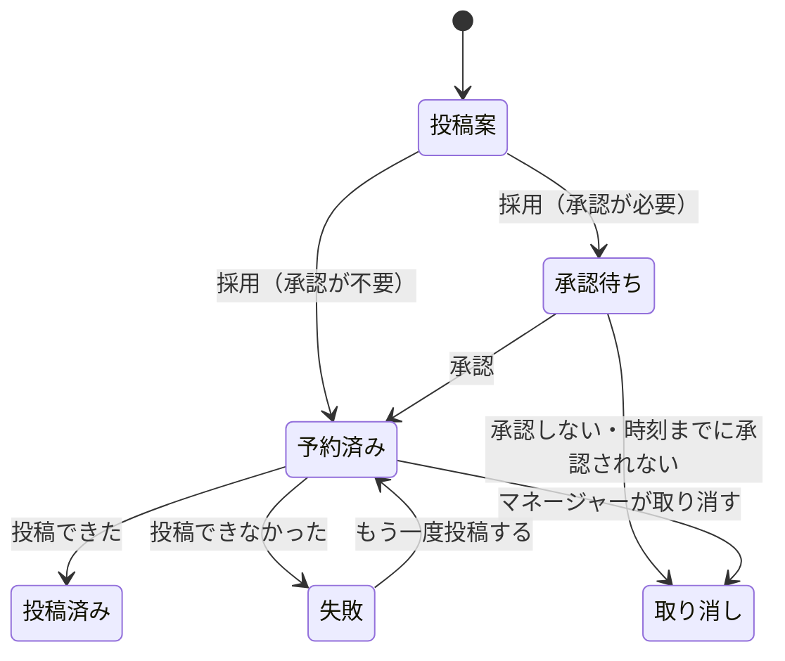
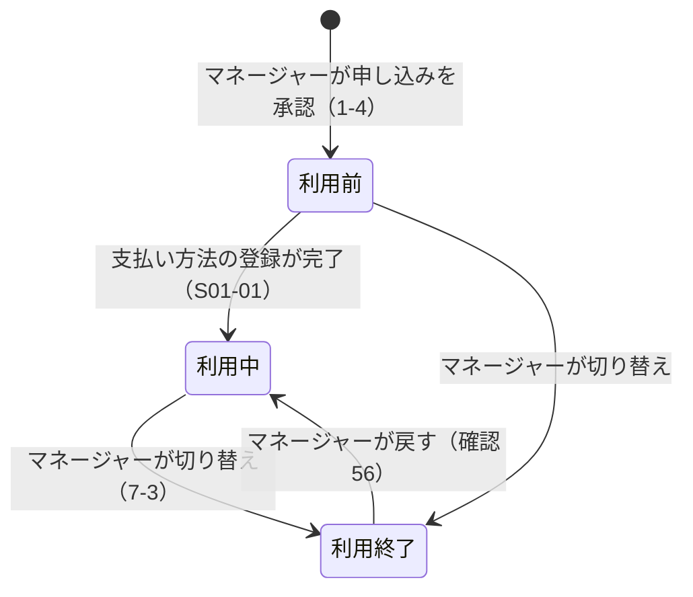

# C-01 Bộ trạng thái

| Mục | Giá trị |
|---|---|
| Module | EP10 – Nền tảng chung và quản trị hệ thống |
| Mã | C-01 (mã nội bộ; không phải chức năng mới, xem file 16 mục 1.2) |
| Mục [YK2] | §5-1 (hình 5-1); §6-2 chức năng 7-3; UC-13 |
| Mức sẵn sàng | 🟡 Vàng – trạng thái bài đăng đã có trong hình 5-1 của [YK2]. Các bộ trạng thái khác là đề xuất của đội, chờ A3, S01-01, S10-01 |

## Mục đích

Một nơi duy nhất định nghĩa trạng thái và cách chuyển trạng thái của: bài đăng, tài năng, đơn đăng ký, lần tạo video, kết nối mạng xã hội, hóa đơn tháng. Mọi module dùng chung định nghĩa này. §5-1 ghi: bài đăng có 6 trạng thái, thành công hay lỗi ghi theo từng mạng; các bộ khác "sẽ viết ở bản cuối".

## 1. Bài đăng – theo hình 5-1 [Chốt]

Sáu trạng thái: 投稿案 (bản nháp), 承認待ち (chờ duyệt), 予約済み (đã hẹn giờ), 投稿済み (đã đăng), 失敗 (lỗi), 取り消し (đã hủy).

**Cách ghép các tình huống của đặc tả vào 6 trạng thái [Đề xuất nội bộ, S10-01]:**

| Tình huống (đặc tả) | Trạng thái | Ghi thêm |
|---|---|---|
| Dính từ cấm khi chấp nhận (4-4) | 投稿案 | Cờ `ng_blocked`; quản lý sửa xong thì sang 予約済み |
| Quản lý bấm 予約しない ở M-11 (S04-08) | 取り消し | Lý do `ng_rejected` |
| Bị trả lại (7-7) | 取り消し | Lý do `returned`; T-13 hiện nhãn 差し戻し. Tài năng sửa và chấp nhận lại thì thành bài mới |
| Quá hạn duyệt (7-7) | 取り消し | Lý do `approval_expired` |
| Chấp nhận khi đang dừng đăng tự động (B6) | 予約済み | Cờ `held` (chưa gửi Upload-Post) |
| Dừng đăng tự động hủy bài đã hẹn (7-5) | 取り消し | Lý do `auto_post_stopped` |
| Quản lý hủy (7-2) | 取り消し | Lý do `manager_cancel` |
| Upload-Post hẹn giờ lỗi | 失敗 | Lý do `schedule_failed` |
| Có mạng lỗi, có mạng được | 失敗 | Kết quả từng mạng ở `post_platform_results`; "đăng lại" chỉ đăng mạng lỗi (S06-05) |
| Bản nháp quá 7 ngày không dùng (S04-02) | 取り消し | Lý do `expired` |

Ngày đăng liên tục (3-4) và ngày có đăng (3-9) tính theo **ít nhất một mạng thành công**, không theo trạng thái cả bài.

## 2. Tài năng [Đề xuất; chờ A3, S01-01]

Tài khoản công ty tạo ra là 利用中 ngay. 退会 (UC-13) = 利用終了 (A3).

## 3. Đơn đăng ký [Đề xuất]

`pending` (chờ duyệt) → `approved` (đã duyệt) hoặc `rejected` (đã từ chối). Chỉ chuyển một lần (1-4).

## 4. Lần tạo video [Đề xuất]

`queued` → `generating` → `done` hoặc `failed`. `failed` thì không tính phí (5-1, 5-4).

## 5. Kết nối mạng xã hội [Đề xuất]

`not_connected` (これから) → `connected` (接続済み) → `disconnected` (接続切れ) → `connected`. Theo từng mạng (8-2, 8-6).

## 6. Hóa đơn tháng [Đề xuất]

`pending` → `charging` → `paid` hoặc `failed` → (thu lại) `charging`. Không có trạng thái tạm khóa tài năng (B7 phương án A).

## Quy tắc chung

- Mọi lần chuyển trạng thái đi qua một hàm chung, kiểm tra đường chuyển có hợp lệ không, và ghi nhật ký (C-03).
- Chuyển không hợp lệ thì từ chối và ghi lỗi.

## Tiêu chí chấp nhận [Đề xuất nội bộ]

1. Mọi đường chuyển của bài đăng trong hình 5-1 đều có kiểm thử; mọi đường chuyển khác bị từ chối.
2. Mỗi lần chuyển có một dòng nhật ký: trước, sau, ai, lúc nào, lý do.
3. Bài có Instagram thành công, TikTok lỗi thì là 失敗, và ngày đó vẫn tính là có đăng.

## Phụ thuộc

Dùng bởi 1-4, 7-3, 4-3, 4-4, 7-7, 7-2, 7-5, 8-3, 8-5, 5-1, 8-2, 8-6, 1-1.

## Câu hỏi mở

| Mã | Nội dung | Chặn? | Giả định tạm dùng |
|---|---|---|---|
| S10-01 | Cách ghép các tình huống vào 6 trạng thái của hình 5-1 | Không | Như bảng mục 1 |
| A3 | 退会 = 利用終了 | Không | Như A3 |
| S01-01 | 利用前 sang 利用中 khi đăng ký thanh toán xong | Có (cho 7-3) | Như S01-01 |

Câu hỏi gửi khách, đề xuất và kiểm tra phạm vi của cả EP10: [00_Cau_hoi_cho_khach.md](00_Cau_hoi_cho_khach.md).

## Nguồn

- [YK2] §5-1 (hình 5-1), §6-2 (7-3), UC-13. Các đặc tả liên quan trong SCD/EP01–EP08.

## Cập nhật theo Q&A (bản ngày 15/11/2026)

- Q&A No.51 (đang hỏi): người hỏi tạm ghép 8 trạng thái vì không xem được hình 5-1. **Hình 5-1 có trong tệp v2 dạng ảnh**, mục 1 ở trên lấy từ hình đó; nên đưa hình vào câu trả lời.
- Q&A No.58: đề xuất "bài xin duyệt lại là cùng một bài" khác dòng "Bị trả lại" ở mục 1 (sang 取り消し, chấp nhận lại thành bài mới). Phải thống nhất.
- Q&A No.60: có thể cần trạng thái "giữ lại vì đang dừng đăng tự động".
- Q&A No.10 (đã chốt): trạng thái tài năng 利用前・利用中・利用終了; "退会" = 利用終了. Q&A No.63 (đang hỏi): dừng vì thu tiền lỗi dùng 利用終了, không thêm trạng thái.
