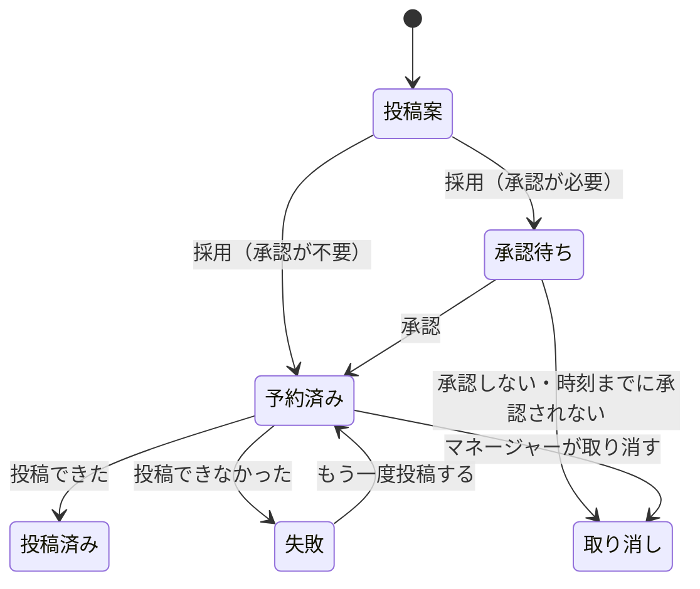
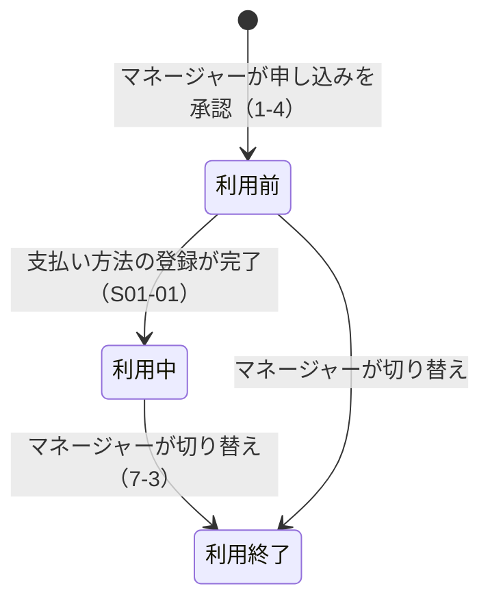

<!-- QA26112026 -->
## Nội dung hiện hành theo Q&A — 26/11/2026

Áp dụng các trả lời và phần chấp thuận được nêu dưới đây theo yêu cầu cập nhật tài liệu của người dùng. Đây là FACT về phản hồi nguồn; chưa tự cấp G7/G8, phê duyệt thiết kế hoặc thương mại. Phần lịch sử chỉ còn hiệu lực ở chủ đề không bị thay. Mã màn trong trả lời25–26/11 theo YK3 bản0.3, không đổi mã SD18/SD19.

### Kích hoạt tài khoản và hồ sơ

Talent được duyệt nhưng chưa đăng ký phương thức thanh toán vẫn ở 利用前; mỗi lần đăng nhập mở hướng dẫn khởi tạo. Đăng ký phương thức thanh toán xong tự chuyển 利用中, tạo thư mục riêng và báo Manager. Manager bấm 「登録完了」 để đánh dấu hoàn tất hồ sơ và bắt đầu AI coach; không tự kiểm đủ trường bắt buộc. M-08 của YK3 có hồ sơ, định hướng, sở thích/sở trường, mục tiêu tương lai, giọng điệu; không trường nào bắt buộc.

**Phần còn mở/giới hạn:** Ngày bắt đầu thu và cách xử lý khởi đầu giữa tháng vẫn theo No.49; đăng ký phương thức thanh toán không tự chứng minh đã thu tiền.

Căn cứ: QA `Q&A!A52:J52 (No.52); Q&A!A53:J53 (No.53); Q&A!A54:J54 (No.54); Q&A!A92:J92 (No.92)`; `EV-1331` / `DEC-0015`.

### Đăng hằng ngày, tự động theo kỳ và cài đặt xác nhận

Đăng hằng ngày luôn dùng được; đăng tự động theo kỳ chỉ chạy khi bắt đầu ở T-10; hai cách dùng đồng thời, không có cài đặt chuyển độc quyền giữa hai cách. T-08 ❺ chọn xác nhận trước khi đăng hay không và áp dụng cả hai. Auto lấy chủ đề qua hội thoại, tư liệu thêm tại T-10 ❹, nhịp theo chỉ thị. AI chọn ảnh hợp chủ đề rồi tạo chữ/hashtag; không dùng thứ tự tải lên và không dùng lại cùng ảnh/video hai lần trong kỳ. Tạo bài hằng ngày trước ngày đăng, không tạo tất cả từ đầu. Chủ đề đổi qua hội thoại trong kỳ. Báo khi còn tư liệu cho 2 ngày; ngày thiếu bỏ qua, thêm tư liệu thì chạy tiếp từ hôm sau. Hết kỳ kết thúc và báo Talent đặt kỳ mới. Đổi cài đặt xác nhận giữ lịch đã có, áp cài đặt mới từ bài chưa đặt lịch. Talent chưa xác nhận tới giờ thì không đăng và báo Talent.

**Phần còn mở/giới hạn:** Mã T-08/T-10 ở đây theo YK3 được câu trả lời26/11 dẫn chiếu, không đổi mã lịch sử SD18/SD19. Auto không có Manager duyệt theo No.71/84; xác nhận Talent và duyệt Manager là hai việc khác nhau.

Căn cứ: QA `Q&A!A70:J70 (No.70); Q&A!A71:J71 (No.71); Q&A!A83:J83 (No.83)`; `EV-1336` / `DEC-0020`.

### Kiểm và sửa từ cấm

Kiểm từ cấm trước khi đặt lịch; phát hiện thì AI viết lại rồi đặt lịch. Không dùng nhánh Manager sửa, không thông báo Manager vì phát hiện này và không bắt Talent xác nhận lại sau AI sửa. Danh sách từ cấm mới chỉ áp dụng từ lần kiểm tiếp theo; bài đã kiểm và đặt lịch giữ nguyên, Manager muốn dừng thì huỷ lịch. Không tự quét lại toàn bộ lịch khi sửa danh sách.

**Phần còn mở/giới hạn:** Quy tắc26/11 thay đề nghị22/11 yêu cầu xác nhận lại và nhánh Manager sửa tại QA90/GJ19 trên đúng chủ đề. Số vòng tự sửa nếu vẫn không sạch/lỗi AI là thiết kế lỗi còn cần đội xác định; không tự đặt bảo đảm AI sửa luôn thành công.

Căn cứ: QA `Q&A!A57:J57 (No.57); Q&A!A71:J71 (No.71); Q&A!A96:J96 (No.96)`; `EV-1337` / `DEC-0021`.

### Duyệt bài và trả lại

Auto theo kỳ không có bước Manager duyệt. Với bài hằng ngày của Talent chọn không cần xác nhận, vẫn mở lịch T-16 → chi tiết T-12 rồi tick T-12 ❼ để chuyển từ đặt lịch sang chờ Manager duyệt. Duyệt xong đăng giờ đã định; trả lại có lý do, Talent sửa và gửi lại. Gửi duyệt lại là cùng một bài, giữ lịch sử; giữ giờ nếu còn kịp, quá giờ chuyển khung tiếp theo.

**Phần còn mở/giới hạn:** Không mặc định mọi bài công việc auto phải qua Manager. Fallback người nhận khi Manager vắng mặt vẫn No.87.

Căn cứ: QA `Q&A!A58:J58 (No.58); Q&A!A71:J71 (No.71); Q&A!A84:J84 (No.84)`; `EV-1338` / `DEC-0022`.

### Dừng đăng, mở lại và huỷ lịch

Manager dừng/mở lại việc đặt lịch theo từng Talent; dừng huỷ lịch đã có. Không có nút dừng toàn hệ thống; vận hành dừng hệ thống phải xử lý huỷ lịch ngoài theo KS20261122 No.29/34. Trong lúc chỉ dừng đăng, AI coach vẫn chạy, Talent vẫn 採用 được; bài mới ở 停止中のため保留. Mở lại: bài giữ còn kịp thì đặt lịch, bài quá giờ cần Talent 採用 lại. Bài đã huỷ không tự phục hồi; báo Talent trong app và đưa về nháp để 採用 lại. T-10 có nút Talent dừng kỳ auto, huỷ lịch theo kỳ đó.

**Phần còn mở/giới hạn:** Chỉ dừng đăng khác 支払い待ち (No.63/86: dừng cả AI/video) và khác kết thúc sử dụng. No.77/91 là đối chiếu0.3 ngày25/11, không áp phần câu hỏi cũ về nút dừng toàn bộ.

Căn cứ: QA `Q&A!A60:J60 (No.60); Q&A!A61:J61 (No.61); Q&A!A70:J70 (No.70); Q&A!A77:J77 (No.77); Q&A!A91:J91 (No.91)`; `EV-1340` / `DEC-0024`.

### Chờ thanh toán và khôi phục

Khi Square thanh toán lại mà vẫn chưa xác nhận được thanh toán, báo Talent và Manager rồi tự chuyển 支払い待ち (Chờ thanh toán). Dừng AI coach, tạo video và đăng bài; vẫn thu phí tháng. Talent vẫn đăng nhập để đổi phương thức thanh toán. Xác nhận đã thanh toán thì tự trở lại 利用中. Trong lúc dừng không đăng; các bài lỡ giờ không tự đăng bù sau mở lại. Dùng cơ chế thu lại của cổng nếu có, không làm cơ chế thu lại riêng.

**Phần còn mở/giới hạn:** Thay đúng câu trả lời No.46 về không tự dừng. Không tự đặt số lần/ngày thu lại vì No.4/49 còn chờ kiểm Square. H86 bản Việt nói rõ bài tương lai tiếp tục; G86 không mô tả riêng chi tiết đó, không suy phục hồi các bài đã huỷ vì lý do khác.

Căn cứ: QA `Q&A!A63:J63 (No.63); Q&A!A86:J86 (No.86)`; `EV-1341` / `DEC-0025`.

### Tài khoản office và lưu dữ liệu

Manager nhập email khi tạo office, đăng nhập app office để nối SNS; hiện trong danh sách Talent với nhãn 事務所. Manager sửa email ở quản trị, mật khẩu đặt lại qua Quên mật khẩu. Kết thúc office huỷ lịch, khoá đăng nhập, gỡ SNS. Giữ dữ liệu 6 tháng rồi tự xoá như Talent theo phương án A của No.94; FCP sẽ bổ sung yêu cầu12-4.

**Phần còn mở/giới hạn:** Office là loại riêng miễn phí tháng; không áp 支払い待ち chỉ vì các trạng thái tài khoản dùng chung. Phần dữ liệu thu tiền giữ riêng vẫn No.98.

Căn cứ: QA `Q&A!A66:J66 (No.66); Q&A!A67:J67 (No.67); Q&A!A94:J94 (No.94)`; `EV-1344` / `DEC-0028`.

### Kết thúc sử dụng và khoản phí cuối

Talent đã 利用終了 không trở lại 利用中 trực tiếp; email còn đăng ký không được đăng ký lại trong thời gian giữ dữ liệu. Dữ liệu Talent/office giữ 6 tháng rồi tự xoá. Có phí đã phát sinh chưa thu vẫn được kết thúc ngay; thu khoản cuối (phí tháng cuối và video) một lần ở lần thu tiếp theo, sau đó ngừng thu.

**Phần còn mở/giới hạn:** No.98 mới chấp thuận việc kết thúc và khoản thu cuối; có lưu lịch sử thu tiền riêng trong OS và giữ bao lâu còn chờ Adesso (KS20261122 No.36). Không tự xoá hoặc giữ vô hạn dữ liệu tài chính.

Căn cứ: QA `Q&A!A69:J69 (No.69); Q&A!A94:J94 (No.94); Q&A!A98:J98 (No.98)`; `EV-1345` / `DEC-0029`.

[Phiên bản nguồn, hash và phạm vi kiểm](../../docs/requirement-review/corrections-2026-11-19/QA_KS_UPDATE_2026-11-26.md).
### Bộ trạng thái bài đăng theo No.51

QA `Q&A!G51:H51` ngày26/11 là tổng hợp thiết kế dựa trên No.58/60/61/70/71/84/86, không phải chữ ký xác nhận khách riêng: nháp chưa採用, chờ duyệt, trả lại, đã đặt lịch, giữ vì đang dừng, đã đăng, lỗi; kết quả thành công/thất bại ghi theo SNS. Huỷ là thao tác đưa về nháp để採用 lại. Không đăng khi quá hạn duyệt/xác nhận, thiếumedia hoặc đang dừng; không có trạng thái chặn riêng do từcấm vì AI sửa trước lịch. Không phục hồi sơ đồ6trạng thái cũ làm bộ duy nhất.

<!-- /QA26112026 -->

Nội dung trước cập nhật26/11 — giữ để truy vết; phần mâu thuẫn đã được thay ở trên

# C-01 Bộ trạng thái

## Đợt23112026 — đề nghị và điểm cần đối chiếu

**Không tự thay quyết định20/11 bằng đề nghị/hình minh họa mới.** Các mục dưới ghi nội dung nguồn mới và phần còn mở; chưa là AC hoặc phạm vi được phê duyệt.

**TikTok: tách gửi nháp và đăng công khai — PROPOSAL của nguồn:** Đề nghị gửi TikTok vào inbox/nháp để Talent hoàn tất trong app, thay nhánh tự động không xác nhận; nguồn đề nghị Instagram/YouTube giữ hai chế độ. **Giới hạn:** Chưa chọn phương án thay thế quyết định hai chế độ đã có. Gửi nháp chưa phải đã đăng; cần kiểm đồng ý trước khi gửi, quyền upload, ảnh/video, lịch, caption và đối soát. Draft không tự giải quyết điều kiện sử dụng cho agency. Nguồn `ISS22-P PDFtrang2; ISS22-P PDFtrang3; ADV22 PDFtrang5; ADV22 PDFtrang10`; EV `EV-1242;EV-1243;EV-1256;EV-1261`.

**Xác nhận lại bài AI sửa từ cấm — PROPOSAL của nguồn:** Đề nghị bài có từ cấm phải được Talent xem lại sau AI sửa dù đang chọn không xác nhận từng bài. UI-M20 M-11 vẫn vẽ Manager sửa rồi AI kiểm lại. **Giới hạn:** Có ba nhánh: KS K59 AI sửa/đặt lịch; báo cáo 22/11 thêm Talent xác nhận; UI M-11 Manager sửa. Không tự chọn hoặc đóng No.57/71/90/96 bằng hình minh họa. Nguồn `ISS22-P PDFtrang7; ADV22 PDFtrang7; ADV22 PDFtrang10; UI-M20 PDFtrang18`; EV `EV-1247;EV-1258;EV-1261;EV-1228`.

[Đối chiếu và phân tuyến](../../docs/requirement-review/corrections-2026-11-19/DELIVERY_23112026_REVIEW.md).

## Cập nhật nguồn tiếp nhận23/11/2026

**FACT về nội dung nguồn; bản tác giả chưa qua G5/G8.** Phần này thay mô tả cũ bên dưới cho đúng chủ đề có căn cứ; không kế thừa màu sẵn sàng/AC cũ hoặc xác nhận thương mại.

- **Tạm dừng Talent:** Thêm trạng thái 一時停止 bên cạnh trước dùng/đang dùng/kết thúc. Tạm dừng vẫn tiếp tục tính phí; dừng các chức năng như lời nhắn AI, mở lại thì khôi phục. **Còn mở/giới hạn:** Chưa có ma trận quyền AI/video/đăng nhập, xử lý lịch đang có và ai được khôi phục. Tạm dừng khác kết thúc sử dụng và dừng riêng việc đăng. Nguồn `KS 確認事項!K116;20261120!F5;20261120!F32`; bằng chứng `EV-0964`.

Đối chiếu/hash và khác biệt nguồn: [báo cáo23/11](../../docs/requirement-review/corrections-2026-11-19/QA_KS_UPDATE_2026-11-23.md).

Đặc tả trước tiếp nhận23/11 — giữ để truy vết; không dùng phần mâu thuẫn làm hành vi hiện hành

## Đối chiếu nguồn hiện hành — 20/11/2026

Ba trạng thái nguồn mô tả: chưa dùng/đang dùng/đã kết thúc. Kết thúc dừng lời nhắn/thu phí/hủy lịch/chặn login; không trở lại đang dùng; giữ 6 tháng rồi xóa. Thanh toán đăng ký xong tự chuyển có thể dùng theo T19 trang 8–9.

Tạm dừng vì nợ và ảnh hưởng thu phí chưa được trả lời; không đồng nhất dừng đăng với kết thúc sử dụng.

Căn cứ: `M19:14,15;BF19:3,16` (T19=SD-T19, M19=SD-M19; số sau dấu hai chấm là trang PDF thực tế; KS là sheet/mục). Bằng chứng: `EV-0599;EV-0600;EV-0615;EV-0628`. Nội dung mới là mô tả/đề xuất nguồn trong phạm vi nêu trên, chỉ DEC-0001 là quyết định trực tiếp của người dùng. Các mã màn gắn [AG] và các mục nguồn bên dưới giữ để tra lịch sử; chưa có G5/G8 cho bản sửa.

| Mục | Giá trị |
|---|---|
| Module | EP10 – Nền tảng chung và quản trị hệ thống |
| Mã | C-01 (mã nội bộ; không phải chức năng mới, xem file 16 mục 1.2) |
| Mục [YK2] | §5-1 (hình 5-1); §6-2 chức năng 7-3; UC-13 |
| Mức sẵn sàng | 🟡 Vàng – trạng thái bài đăng đã có trong hình 5-1 của [YK2]. Các bộ trạng thái khác là đề xuất của đội, chờ A3, S01-01, S10-01 |

## Mục đích

Một nơi duy nhất định nghĩa trạng thái và cách chuyển trạng thái của: bài đăng, tài năng, đơn đăng ký, lần tạo video, kết nối mạng xã hội, hóa đơn tháng. Mọi module dùng chung định nghĩa này. §5-1 ghi: bài đăng có 6 trạng thái, thành công hay lỗi ghi theo từng mạng; các bộ khác "sẽ viết ở bản cuối".

## 1. Bài đăng – theo hình 5-1 [Chốt]

> **[Chưa rõ] Cách đăng 自動投稿** ([KS] 確認19, 25): bài được hệ thống tự soạn và tự đăng trong khoảng tài năng đặt, không qua bước chấp nhận. Bộ trạng thái dưới đây mới mô tả cách 要確認; trạng thái của bài trong khoảng 自動投稿 (có qua "chờ duyệt", "dính từ cấm" không) chưa thiết kế; chờ Q&A No.70, 71 rồi cập nhật danh sách trạng thái (Q&A No.51).

Sáu trạng thái: 投稿案 (bản nháp), 承認待ち (chờ duyệt), 予約済み (đã hẹn giờ), 投稿済み (đã đăng), 失敗 (lỗi), 取り消し (đã hủy).

**Cách ghép các tình huống của đặc tả vào 6 trạng thái [Đề xuất nội bộ, S10-01]:**

| Tình huống (đặc tả) | Trạng thái | Ghi thêm |
|---|---|---|
| Dính từ cấm khi chấp nhận (4-4) | 投稿案 | Cờ `ng_blocked`; quản lý sửa xong thì sang 予約済み |
| Quản lý bấm 予約しない ở M-11 (S04-08) | 取り消し | Lý do `ng_rejected` |
| Bị trả lại (7-7) | 取り消し | Lý do `returned`; T-13 hiện nhãn 差し戻し. Tài năng sửa và chấp nhận lại thì thành bài mới |
| Quá hạn duyệt (7-7) | 取り消し | Lý do `approval_expired` |
| Chấp nhận khi đang dừng đăng tự động (B6) | 予約済み | Cờ `held` (chưa gửi Upload-Post) |
| Dừng đăng tự động hủy bài đã hẹn (7-5) | 取り消し | Lý do `auto_post_stopped` |
| Quản lý hủy (7-2) | 取り消し | Lý do `manager_cancel` |
| Upload-Post hẹn giờ lỗi | 失敗 | Lý do `schedule_failed` |
| Có mạng lỗi, có mạng được | 失敗 | Kết quả từng mạng ở `post_platform_results`; "đăng lại" chỉ đăng mạng lỗi (S06-05) |
| Bản nháp quá 7 ngày không dùng (S04-02) | 取り消し | Lý do `expired` |

Ngày đăng liên tục (3-4) và ngày có đăng (3-9) tính theo **ít nhất một mạng thành công**, không theo trạng thái cả bài.

## 2. Tài năng [Đề xuất; chờ A3, S01-01]

Tài khoản công ty tạo ra là 利用中 ngay. 退会 (UC-13) = 利用終了 (A3). 利用終了 không quay lại 利用中 được ([KS] 確認56); đủ 6 tháng thì dữ liệu tự xóa ([KS] 確認55).

## 3. Đơn đăng ký [Đề xuất]

`pending` (chờ duyệt) → `approved` (đã duyệt) hoặc `rejected` (đã từ chối). Chỉ chuyển một lần (1-4).

## 4. Lần tạo video [Đề xuất]

`queued` → `generating` → `done` hoặc `failed`. `failed` thì không tính phí (5-1, 5-4).

## 5. Kết nối mạng xã hội [Đề xuất]

`not_connected` (これから) → `connected` (接続済み) → `disconnected` (接続切れ) → `connected`. Theo từng mạng (8-2, 8-6).

## 6. Hóa đơn tháng [Đề xuất]

`pending` → `charging` → `paid` hoặc `failed` → (thu lại) `charging`. Không có trạng thái tạm khóa tài năng (B7 phương án A).

## Quy tắc chung

- Mọi lần chuyển trạng thái đi qua một hàm chung, kiểm tra đường chuyển có hợp lệ không, và ghi nhật ký (C-03).
- Chuyển không hợp lệ thì từ chối và ghi lỗi.

## Tiêu chí chấp nhận [Đề xuất nội bộ]

1. Mọi đường chuyển của bài đăng trong hình 5-1 đều có kiểm thử; mọi đường chuyển khác bị từ chối.
2. Mỗi lần chuyển có một dòng nhật ký: trước, sau, ai, lúc nào, lý do.
3. Bài có Instagram thành công, TikTok lỗi thì là 失敗, và ngày đó vẫn tính là có đăng.

## Phụ thuộc

Dùng bởi 1-4, 7-3, 4-3, 4-4, 7-7, 7-2, 7-5, 8-3, 8-5, 5-1, 8-2, 8-6, 1-1.

## Câu hỏi mở

| Mã | Nội dung | Chặn? | Giả định tạm dùng |
|---|---|---|---|
| S10-01 | Cách ghép các tình huống vào 6 trạng thái của hình 5-1 | Không | Như bảng mục 1 |
| A3 | 退会 = 利用終了 | Không | Như A3 |
| S01-01 | 利用前 sang 利用中 khi đăng ký thanh toán xong | Có (cho 7-3) | Như S01-01 |

Câu hỏi gửi khách, đề xuất và kiểm tra phạm vi của cả EP10: [00_Cau_hoi_cho_khach.md](00_Cau_hoi_cho_khach.md).

## Nguồn

- [YK2] §5-1 (hình 5-1), §6-2 (7-3), UC-13. Các đặc tả liên quan trong SCD/EP01–EP08.

## Quyết định từ Q&A (bản ngày 15/11/2026)

- Q&A No.51 (đang hỏi): người hỏi tạm ghép 8 trạng thái vì không xem được hình 5-1. **Hình 5-1 có trong tệp v2 dạng ảnh**, mục 1 ở trên lấy từ hình đó; nên đưa hình vào câu trả lời.
- Q&A No.58: đề xuất "bài xin duyệt lại là cùng một bài" khác dòng "Bị trả lại" ở mục 1 (sang 取り消し, chấp nhận lại thành bài mới). Phải thống nhất.
- Q&A No.60: có thể cần trạng thái "giữ lại vì đang dừng đăng tự động".
- Q&A No.10 (đã chốt): trạng thái tài năng 利用前・利用中・利用終了; "退会" = 利用終了. Q&A No.63 (đang hỏi): dừng vì thu tiền lỗi dùng 利用終了, không thêm trạng thái.

