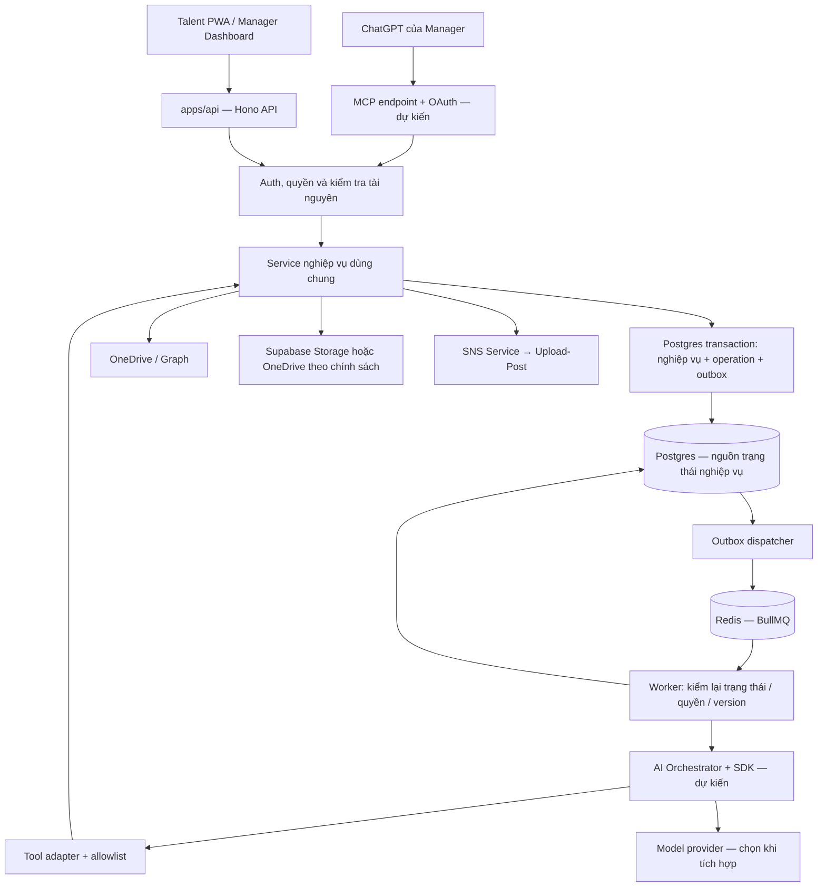

# AI Talent OS — Kiến trúc AI Core và kế hoạch tích hợp

**Phiên bản:** 2.1 — review theo nguồn hiện hành và code repository. Bản trước: 2.0 ngày 19/11/2026.  
**Trạng thái:** thiết kế nội bộ; BullMQ + Redis đã được người dùng chốt. Các lựa chọn khác giữ nhãn đề xuất; chưa Independent Verification, chưa phải đặc tả khách phê duyệt hoặc tính năng đã triển khai.  
**Phạm vi:** AI Coach, điều phối, MCP, OneDrive, Upload-Post, Postgres, worker và các ranh giới nghiệp vụ.

## 1. Kết quả review và căn cứ

Giữ hướng **AI Core bằng TypeScript + service nghiệp vụ + worker BullMQ/Redis**. Cần chỉnh cách ghép dữ liệu, gửi job, phân quyền và thứ tự triển khai để phù hợp dự án; không cần tự xây nền tảng multi-agent hoặc thêm một backend song song.

| Nội dung | Căn cứ và cách áp dụng |
|---|---|
| BullMQ + Redis | Người dùng chỉ định “chốt sử dụng bullmq đi”. Quyết định kỹ thuật nội bộ, thay pg-boss; chưa cài thư viện hoặc Redis. |
| Next.js FE, Hono BE | Theo [tech stack](TECH_STACK_VA_CAU_TRUC_DU_AN.md) và repository: FE chỉ giao diện; API trong `apps/api`, worker dùng chung service/container. Không mặc định chuyển BE lên Vercel. |
| Sửa hồ sơ và chỉ thị | BF19 trang PDF18; SD-M19 M-15 trang20, M-21 trang26: qua quản trị hoặc ChatGPT, không sửa trực tiếp file OneDrive. Phải có màn chỉ thị nghiệp vụ; việc không xây màn cấu hình Agent/Model không loại bỏ màn này. |
| Ưu tiên chỉ thị | BF19 trang18: từng Talent → category → toàn bộ. Nhiều category xung đột hoặc hồ sơ trái chỉ thị chưa được tự giải quyết; QA No.92 vẫn mở. |
| Thông tin và media | OneDrive phục vụ hồ sơ/chỉ thị; QA No.8 G9/H9 cho media lưu Supabase/OneDrive. Không tự bắt lưu kép mọi media hoặc coi Supabase Storage chỉ chứa tệp tạm. |
| Quyền Manager | QA No.88 G88/H88 ghi Manager cùng cập nhật mọi Talent; assign không phải rào cản mọi thao tác. No.87/88 và SD-M19 trang1/8 còn lệch người nhận thông báo; chưa chọn một bên. |
| Nhịp AI và số liệu | YK2 §5/§6/§7 mô tả đọc dữ liệu và nhập thống kê hằng ngày; SD-M19 M-17 trang22 có khung sáng/trưa/tối cấu hình được. Không cố định 08:00. Live fetch là tùy chọn kỹ thuật có kiểm soát, không thay daily ingestion. |
| Nội dung đã duyệt | QA No.85: Talent không sửa bài đã xin duyệt/duyệt/đặt lịch. No.90/GJ19 §12: Manager sửa từ cấm có thể đi tiếp, không trả Talent xác nhận lại. Hai ứng viên về đổi SNS khi còn lịch và danh sách từ cấm mới chưa là quy tắc đã chốt. |
| Lượt viết lại | DEC-0001: người dùng chốt H65 không giới hạn số lần AI viết lại. Giới hạn kỹ thuật từng execution không được biến thành cap số lần Talent yêu cầu viết lại. |
| Video, thanh toán, phạm vi hội thoại | Slideshow còn cần đối chiếu QA No.36/CR-04 với màn mới; provider thanh toán chưa chốt; tâm sự nghiêm trọng còn hỏi. Không mở chức năng bằng giả định hoặc lấy việc rút câu giá khỏi Q&A làm xác nhận nghiệp vụ. |

Nguồn chính: [catalog](../TAI_LIEU_NGUON.md), [kiểm kê/hash hiện hành](../docs/requirement-review/source-inventory-current.json), [QA](../source_requiments/Q&A/AI-Talent-OS_Q&A表.xlsx), [BF19](../source_requiments/19112926/業務フロー_AI育成OS.pdf), [SD-M19](../source_requiments/19112926/画面定義書_管理画面_AI育成OS.pdf), [GJ19](../source_requiments/19112926/20261119_AMCOLAB様打ち合わせ_画面定義書の確認_議事録.md). Trang là trang PDF thực tế. Nguồn mô tả giao diện hoặc biên bản FCP–AMCOLAB không tự chứng minh khách đã phê duyệt mọi nội dung.

**Hiện trạng code được đọc:** module demo Auth/PWA/OneDrive/Upload-Post gắn qua `ENABLE_AUTH_DEMO`; demo bị chặn production. Chưa có worker, Redis, BullMQ hoặc AI SDK trong cấu hình triển khai/dependencies hiện hành. Service nghiệp vụ AI/đăng bài không được coi là có sẵn chỉ vì schema đã có.

## 2. Kiến trúc tổng thể



API và worker là các entrypoint trong cùng `apps/api`, cùng composition root và service; đây là hướng triển khai theo cấu trúc hiện hành, chưa phải Docker đã chạy. Redis đặt trong mạng riêng; không đưa kết nối Redis hoặc khóa nhà cung cấp vào FE/model. Nơi triển khai API/worker thực tế và phiên bản thư viện vẫn cần chốt theo môi trường.

## 3. Chọn thư viện và ranh giới tự xây

| Thành phần | Vai trò | Trạng thái |
|---|---|---|
| BullMQ + Redis | Hàng đợi, lịch, concurrency, retry kỹ thuật | Đã chốt công nghệ, chưa triển khai |
| SDK mô hình | Gọi model, tool calling, kết quả có cấu trúc | Vercel AI SDK hoặc SDK nhà cung cấp là ứng viên; chưa chốt phiên bản/tương thích |
| MCP TypeScript SDK | Giao thức endpoint cho ChatGPT khi cần | Đề xuất; theo bộ MCP hiện có, chưa kiểm chứng |
| Zod | Kiểm đầu vào/đầu ra tool và kết quả | Đã dùng trong API; phần AI chưa triển khai |
| Orchestrator mỏng | Context, vòng gọi tool, chính sách thực thi | Tự xây trong module AI |
| Service nghiệp vụ | Quyền, chuyển trạng thái, duyệt, lịch, thông báo | Bổ sung/tái sử dụng đúng phần thực sự đã có, không nhân đôi trong MCP |

Tên “Vercel AI SDK” không yêu cầu BE chạy trên Vercel. Chưa cần LangGraph/Mastra hoặc một nền tảng multi-agent; đánh giá lại khi có luồng cụ thể mà service/worker hiện tại không đáp ứng. Không cài SDK chỉ từ ví dụ của tài liệu này.

### 3.1. Phân biệt Orchestrator, Agent SDK, provider và model

| Lớp | Vai trò | Đề xuất hiện tại / trạng thái |
|---|---|---|
| AI Orchestrator | Code dự án: chuẩn bị context, cấp tool, giới hạn thực thi, kiểm output và lưu kết quả | Tự xây lớp mỏng trong `apps/api`; gọi Agent hoặc lời gọi AI đơn giản theo use case |
| Agent SDK | Thư viện thực hiện vòng lặp model/tool | Ưu tiên thử Vercel AI SDK; SDK không có model riêng. Chưa chốt phiên bản hoặc triển khai |
| Provider adapter | Kết nối SDK đến API nhà cung cấp | Đề xuất bắt đầu với OpenAI qua `@ai-sdk/openai`, dùng API key riêng của dự án; chưa phải quyết định đã được người dùng phê duyệt |
| Model | Model cụ thể thực hiện suy luận/sinh nội dung | Chưa chốt; chọn bằng benchmark tiếng Nhật, tool calling, output có cấu trúc, độ trễ và chi phí |

Luồng đề xuất:

```text
BullMQ worker / API
  → AI Orchestrator
  → CoachAgent dùng Vercel AI SDK
  → provider adapter @ai-sdk/openai
  → OpenAI API → model cấu hình theo tác vụ
```

Vercel AI SDK hỗ trợ nhiều provider, ví dụ OpenAI, Anthropic và Google; lựa chọn SDK không đồng nghĩa đã chọn provider hoặc model. Tên SDK cũng không bắt buộc chạy backend trên Vercel. Với phương án gọi trực tiếp ở trên, không bắt buộc dùng Vercel AI Gateway; phải cấu hình adapter trực tiếp rõ ràng, không nhầm chuỗi tên model qua Gateway với kết nối trực tiếp. Model và bí mật được quản lý ở backend/worker, không cho Talent tự truyền tùy ý.

CoachAgent là tên tác vụ do dự án định nghĩa, không phải một model hay sản phẩm Agent có sẵn của nhà cung cấp. Tác vụ viết caption có đầu vào đầy đủ có thể dùng lời gọi AI một lần thay vì Agent loop. Không trộn lựa chọn provider cho AI Coach với dịch vụ tạo video hoặc endpoint MCP cho ChatGPT.

Tham chiếu kỹ thuật: [danh sách provider của AI SDK](https://ai-sdk.dev/providers/ai-sdk-providers), [OpenAI adapter và cách kết nối trực tiếp](https://ai-sdk.dev/providers/ai-sdk-providers/openai). Đây là cơ sở mô tả khả năng thư viện, không phải nguồn khách chốt công nghệ. Việc đề xuất OpenAI/Vercel AI SDK ở đây chưa thay các mục lựa chọn SDK/model còn mở trong kế hoạch.

## 4. Transactional outbox và tính bền vững của BullMQ

**Postgres là nguồn trạng thái; Redis là phương tiện phân phối job.** Theo [phạm vi DB](../database-design/07_implementation_scope_and_rules.md) §4.4, đã có `domain_operations` và `outbox_events`; không ghi DB rồi gọi `queue.add()` như hai bước độc lập và coi đã bảo đảm giao việc.

1. Service xác thực người gọi, kiểm trạng thái/điều kiện nghiệp vụ và version.
2. Ghi thay đổi nghiệp vụ + operation + outbox trong cùng transaction.
3. Dispatcher nhận lease outbox, gửi job có định danh ổn định. Sau khi Redis nhận, cập nhật trạng thái giao việc bằng cơ chế phù hợp; hết lease thì có thể gửi lại an toàn.
4. Worker nhận job, tra lại operation/trạng thái trong DB và giành quyền xử lý bằng cập nhật có điều kiện. Job trùng không tạo execution hoặc tác động ngoài trùng.
5. Ghi kết quả/lỗi và trạng thái nghiệp vụ trước khi xác nhận job hoàn tất; thất bại hoặc kết quả không rõ cần đối soát.

Các bước trên là yêu cầu thiết kế tích hợp, chưa là giao thức đã triển khai. Cần chốt mapping outbox event ↔ BullMQ job và bảo toàn outbox hiện hành: trạng thái đã giao Redis không đồng nghĩa tác vụ nghiệp vụ đã hoàn tất. Có khả năng phát lại từ operation/outbox còn lưu khi Redis mất dữ liệu; kiểm tra khoảng giữ, retention và đối soát trước khi dọn job.

- Job chỉ mang ID/tham chiếu và dữ liệu điều phối tối thiểu; không chứa token, mật khẩu, hồ sơ đầy đủ hoặc file media.
- Dùng cấu hình lưu bền vững, dung lượng, eviction, backup và giám sát Redis được kiểm thử theo môi trường; chưa ấn định cấu hình production trong báo cáo này.
- Worker chết sau khi provider đã xử lý nhưng trước khi ghi DB: ưu tiên idempotency provider hoặc tra kết quả theo request ID; không hứa xử lý “đúng một lần”.
- BullMQ retry dùng cho lỗi kỹ thuật phù hợp, có backoff và giới hạn; **không tự đăng lại bài SNS lỗi**, vì QA No.15/CR-15 đã bỏ chức năng đó.
- Chống trùng ở DB/service vẫn bắt buộc, kể cả khi queue có cơ chế chống lặp hoặc dọn job cũ.

## 5. AI Orchestrator và ghép context

Registry TypeScript giữ mã tác vụ, schema, tool allowlist, revision và cấu hình model theo môi trường. Thiếu model/config hợp lệ phải báo lỗi rõ, không âm thầm chọn model mẫu. Agent chỉ đề nghị tool call; tool executor kiểm quyền và gọi service. Với tác vụ cố định, gọi service trực tiếp là mặc định; không buộc mọi thao tác nội bộ đi vòng qua MCP hoặc HTTP.

Ghép context theo thứ tự rõ ràng:

1. Chính sách hệ thống và quyền được code kiểm soát: dữ liệu OneDrive không được ghi đè.
2. Nhiệm vụ tác vụ và schema kết quả.
3. Chỉ thị nghiệp vụ theo nguồn: từng Talent ưu tiên hơn category, category ưu tiên hơn toàn bộ. Snapshot phải lưu đủ version/eTag của từng lớp.
4. Hồ sơ/mục tiêu và dữ liệu Talent. Nếu mâu thuẫn với chỉ thị, giữ phần chưa chốt của QA No.92; không tự dùng thứ tự prompt để thay quyết định khách.
5. Metrics có nguồn, thời điểm, account mapping và độ mới. Dữ liệu thiếu không được bịa thành 0.

Bản registry chỉ cấu hình kỹ thuật. Không bỏ màn M-15/M-21 hoặc bộ nhập hồ sơ/chỉ thị nghiệp vụ. Không tự tạo vai trò System Admin mới cho khách; quyền vận hành kỹ thuật tách khỏi vai trò Manager/Talent.

Giới hạn mỗi execution: thời gian, số bước/tool calls, token và concurrency do team đo/đề xuất. Phân biệt giới hạn bảo vệ hạ tầng với trần chi phí nghiệp vụ hoặc số lần viết lại: No.17 không có cơ chế tự dừng theo trần chi phí, H65 không giới hạn lượt viết lại. Không dùng giới hạn kỹ thuật để lặng lẽ thay hai quyết định này; nếu tạo ra hành vi hạn chế mới phải nêu rõ để duyệt.

## 6. OneDrive, media và ghi từ Manager

Hồ sơ/chỉ thị được cập nhật qua **màn quản trị hoặc ChatGPT/MCP**, cùng một service kiểm tra quyền, validation và version. Không hướng dẫn Manager sửa trực tiếp file OneDrive. BF19 trang18 đã mô tả cách làm này.

- Context builder đọc qua adapter OneDrive, không gọi Graph trực tiếp từ model.
- Snapshot context gắn profile/instruction versions, eTag và thời điểm đọc; tránh trộn một nửa phiên bản cũ với một nửa phiên bản mới trong một lần chạy.
- Cache có invalidation sau ghi từ cả quản trị và MCP. Xung đột version trả lại cho Manager kiểm tra, không ghi đè thay đổi mới hơn.
- Ghi từ ChatGPT theo bộ [MCP](chatgpt-mcp-spec/README.md): chuẩn bị thay đổi → xem Talent đích và phần thay đổi → xác nhận → commit có kiểm lại quyền/version. Hội thoại “đồng ý” hoặc một tool read không tự trở thành quyền ghi.
- OAuth/Graph dùng adapter và cấu hình theo [bộ OneDrive](onedrive-agent-spec/HUONG_DAN_TICH_HOP_VI.md); các trạng thái live cần kiểm lại trước triển khai.
- Media dùng adapter lưu trữ được chọn theo QA No.8; không bắt buộc nằm trong cây hồ sơ OneDrive. DB giữ owner, storage reference và metadata cần thiết. Không tự cấp link công khai lâu dài để model hoặc dịch vụ ngoài lấy file.

Cấu trúc file và quyền OAuth chi tiết tái sử dụng bộ tích hợp hiện có; không tạo một cây thư mục chuẩn thứ hai chỉ từ ví dụ AI Core.

## 7. Quyền của API, worker và MCP

Ba lớp kiểm tra: danh tính/phiên người dùng; tool allowlist; quyền với tài nguyên/hành động cụ thể. API public và MCP cần xác thực độc lập đúng luồng. Worker có danh tính hệ thống được giới hạn cho event cụ thể, không mượn token Manager hết hạn để chạy mọi tác vụ.

- Talent chỉ truy cập dữ liệu của mình. Manager có một loại quyền theo nguồn; No.88 cho phép cùng cập nhật mọi Talent. “Người phụ trách” và đích thông báo chưa là điều kiện giới hạn mọi quyền Manager.
- Worker dùng kết nối DB với role tối thiểu theo `apps/api/PRISMA.md`; không mặc định dùng `SUPABASE_SERVICE_ROLE_KEY` để truy cập toàn bộ dữ liệu. Quyền `talent_dispatcher` hiện chưa tự cấp đủ quyền cho mọi worker: cần migration/quyền riêng và test khi triển khai, không mở DDL hoặc role owner cho worker.
- Lệnh MCP chọn Talent đích qua ngữ cảnh được server xác thực/kiểm quyền. Không tin ID do model tự đưa. Với Manager thao tác nhiều Talent, phải có bước chọn đích và khóa đích đó trong yêu cầu đã xác nhận; không lấy Talent gần nhất trong hội thoại làm mặc định.
- Không mở tool tùy ý như `execute_sql`, `read_any_file`, `call_arbitrary_url` hay cho model chọn API key.
- Trước ghi hoặc tác động ngoài, kiểm lại trạng thái Talent, operation, version bài, lịch và tài khoản SNS hiện hành. Thay đổi quyền hoặc việc dừng đăng sau enqueue phải có hiệu lực ở worker, theo quy tắc nghiệp vụ đã chốt.
- Không ghi token/QR/TOTP/secret hoặc hội thoại đầy đủ vào log kỹ thuật. Audit và dữ liệu hội thoại nghiệp vụ có chính sách giữ riêng.

## 8. Dữ liệu SNS: nhập hằng ngày và đọc theo nhu cầu

Giữ daily ingestion theo YK2; lưu `follower_snapshots` và `post_metric_snapshots` hiện có hoặc mapping đã được review, không tạo kho lịch sử trùng. Service SNS đọc từ snapshot là đường cơ sở; live fetch là tùy chọn cần kiểm quota/quyền và nhu cầu.

Tool đọc metrics chuẩn hóa ít nhất: `source`, `platform`, account mapping, kỳ dữ liệu, `retrievedAt`, độ mới và trường không có. Thiếu trường là không có dữ liệu, không mặc định bằng 0. Chỉ định nghĩa các trường được API/provider kiểm chứng; không lấy ví dụ JSON trong báo cáo làm hợp đồng Upload-Post đã chạy.

Nếu provider lỗi, chỉ trả snapshot cũ khi use case cho phép và gắn nhãn cũ rõ; thiếu dữ liệu bắt buộc thì hoãn/báo lỗi use case đó. Không tự bịa số, không gọi mỗi tool call một lần ra provider nếu có snapshot/cache phù hợp. Chưa chốt policy fallback hoặc SLA độ mới thì không tuyên bố use case đạt.

MCP cho ChatGPT có thể expose cùng service; worker nội bộ không bắt buộc gọi MCP chỉ để lấy dữ liệu trong cùng codebase. Các adapter Upload-Post hiện có là demo kết nối; không chứng minh đã có service thống kê production.

## 9. Luồng worker và điều kiện nghiệp vụ

```mermaid
sequenceDiagram
  participant S as Scheduler / API
  participant DB as Postgres
  participant D as Dispatcher
  participant Q as BullMQ / Redis
  participant W as Worker
  participant B as Service + Orchestrator
  S->>DB: Ghi operation + outbox trong transaction
  D->>DB: Nhận lease event đến hạn
  D->>Q: Enqueue theo event/operation ID
  Q->>W: Giao job, có thể giao lại
  W->>DB: Claim; kiểm trạng thái / version / đã xử lý
  W->>B: Build context + chạy tác vụ được phép
  B->>DB: Ghi output / usage / trạng thái có chống trùng
  W-->>Q: Xác nhận job hoàn tất
```

Daily Coach: lịch theo múi giờ nghiệp vụ đã cấu hình; không dùng giờ máy chủ làm ngày Talent và không đóng cứng 08:00. Kiểm Talent đủ điều kiện sử dụng và có hồ sơ trước khi tạo đề xuất. Tạo ba chủ đề theo nguồn là use case khác với tự động tạo/đăng bài trong một kỳ; không gộp chúng thành cùng job làm phát sinh bài ngoài ý muốn.

Tách trạng thái execution với trạng thái bài/duyệt/lịch/SNS. Worker hoàn tất AI không đồng nghĩa đã được phép đăng. Việc chọn chế độ, duyệt bài công việc và xử lý quá giờ tiếp tục theo No.71/84/56/58; không lấp phần còn mở bằng quyết định của model.

Execution có thể dùng khung `PENDING → QUEUED → RUNNING → COMPLETED | FAILED | TIMED_OUT | CANCELLED`, nhưng đây chỉ là đề xuất lifecycle kỹ thuật. Cancel execution không tự hủy được lịch đã gửi Upload-Post hoặc thu hồi tác động ngoài đã thực hiện; phải đi qua use case hủy/đối soát phù hợp. Khi provider chưa rõ đã thực hiện hay chưa, giữ trạng thái cần đối soát thay vì retry mù.

## 10. Dữ liệu AI và API: mở rộng trên nền hiện có

Không tạo ngay ba bảng `ai_executions`, `ai_tool_calls`, `ai_results` như thể dự án chưa có dữ liệu liên quan. Schema hiện đã có `coach_messages`, `theme_suggestions`, `ai_usage_events`, `domain_operations`, `outbox_events`, dữ liệu bài/video và snapshot SNS.

Đề xuất execution/tool-call cần được map với operation, kết quả nghiệp vụ và audit hiện có. Chỉ thêm cấu trúc khi chứng minh thiếu thông tin phục hồi/truy vết; không lưu cùng output đầy đủ ở nhiều bảng. Quyết định DDL thuộc đợt thiết kế DB riêng, theo [phạm vi DB](../database-design/07_implementation_scope_and_rules.md), không được cấp quyền/migration chỉ từ báo cáo này. Các phần DEFERRED vẫn bị chặn cho tới khi tái đánh giá theo nguồn mới.

API dùng `/api/v1/me/...` cho Talent và `/api/v1/admin/...` cho Manager theo tech stack; execution chỉ là resource của use case, không mặc định expose endpoint cho người dùng tự chọn agent/model/tool. Nếu cần endpoint theo dõi execution, kiểm owner/actor và không lộ prompt, bí mật hoặc dữ liệu Talent khác. Lệnh API/MCP/worker gọi chung service. Không bắt buộc mở `/internal/sns/analytics` qua HTTP chỉ để cùng module đọc metrics.

## 11. Triển khai và cấu hình

Đề xuất mở rộng Docker Compose hiện có: `api`, `web`, `migrate` vẫn giữ; thêm `worker`, dispatcher/scheduler entrypoint phù hợp và `redis`. Có thể gộp dispatcher/scheduler trong tiến trình worker nếu đã kiểm cơ chế lease/leader và chống chạy lặp; chưa cần container MCP nội bộ riêng. Remote MCP gắn trong backend hoặc entrypoint riêng nếu có lý do vận hành, dùng chung quyền/service.

Cấu hình cần thiết kế thêm: Redis connection/persistence, cấu hình model/provider, concurrency, timeout, tool limits, queue namespace theo môi trường. Tên biến chính thức phải đồng bộ `config/env.ts` và `.env.example` khi triển khai; không tạo một bộ env thứ hai trong báo cáo. Secret ở backend/worker, không đưa vào `NEXT_PUBLIC_*`, payload job hoặc log. DB runtime dùng `DATABASE_URL` của role riêng; `DIRECT_URL` chỉ dành migration.

Quan sát: operation/event/job/execution/request IDs xuyên suốt; độ trễ outbox, queue backlog, job lặp, worker stale, retry, lỗi provider, token/usage và dữ liệu snapshot cũ. Redis mất dữ liệu, provider timeout và deploy khi đang có job đều phải có phương án phục hồi được thử. Không dùng demo pass thay kiểm môi trường production.

## 12. Thứ tự triển khai đề xuất

| Giai đoạn | Nội dung | Điều kiện trước khi chuyển tiếp |
|---|---|---|
| P0 — Chốt ranh giới | Đối chiếu use case, phần nguồn còn mở, tài khoản provider, schema và quyền | Scope rõ; không dùng code/demo như xác nhận khách |
| P1 — Nền tảng worker | BullMQ/Redis + outbox dispatcher + quyền + chống trùng + quan sát | Kiểm crash, mất enqueue, gửi lặp, replay, dừng tác vụ |
| P2 — Dữ liệu/context | OneDrive, version/cache, daily SNS snapshot, quyền tài nguyên | Đúng Talent/account, ghi xung đột được phát hiện, không lộ bí mật |
| P3 — AI tối thiểu | Chốt SDK/model theo benchmark; tác vụ đọc và tạo chủ đề | Output hợp lệ, ghi đúng usage, hồi phục lỗi, không tự đăng |
| P4 — Kết nối nghiệp vụ | Duyệt/đăng/video/thông báo chỉ theo scope đã chốt | Gate yêu cầu và kiểm provider đạt cho đúng phần; tác động ngoài chống trùng |
| P5 — ChatGPT/MCP | OAuth + chuẩn bị/xác nhận/commit qua service chung | Theo bộ MCP, còn quyền/version/scope khi commit; không ghi tùy ý |
| P6 — Vận hành | Tải thực, bảo mật, Redis restart, deploy, backup/replay | Kết quả được review độc lập; UAT/release có điều kiện riêng |

Các giai đoạn trên là kế hoạch kỹ thuật đề xuất, không tự cấp G1–G8 PASS hoặc mở phạm vi chưa có quyết định. Không đưa estimate trước khi kiểm tải và các adapter thật.

## 13. Kiểm chứng cần có

- API commit DB nhưng Redis lỗi: event còn và được gửi lại; Redis nhận job nhưng dispatcher chưa ghi ack: không tạo tác động ngoài trùng.
- Worker chết trước/sau provider call; Redis restart/mất queue; scheduler chạy hai bản: có đối soát/replay an toàn.
- Talent ngừng dùng, Manager bị vô hiệu hóa, bài bị hủy hoặc account mapping đổi sau enqueue: worker kiểm điều kiện lại, không dùng context cũ để vượt quyết định hiện hành.
- AI timeout, tool vượt allowlist, prompt injection, output sai schema: không tự ghi kết quả hợp lệ hoặc tự duyệt bài.
- Cả UI và MCP sửa hồ sơ/chỉ thị: version/cache đúng, không ghi đè; nhiều category/hồ sơ mâu thuẫn không được tự chọn quy tắc chưa chốt.
- Daily snapshots và live fetch: phân biệt trường không có, dữ liệu cũ, rate limit và account ID; không trộn lịch sử hai tài khoản SNS.
- Kỹ thuật retry không tạo thêm lần đăng; giới hạn từng execution không thành hạn hai lần viết lại; hủy execution không bị hiểu là đã hủy lịch ngoài.
- Manager TOTP và quyền production không lấy optional MFA/self-registration demo làm baseline.

Đây là danh sách kiểm chứng **chưa chạy trong lượt review tài liệu**. Ca cụ thể bổ sung vào bộ kiểm thử hiện có khi được giao triển khai; không tạo một bộ checklist release độc lập chỉ từ báo cáo.

## 14. Quyết định còn mở và chủ xử lý

| Mã | Nội dung | Chủ xử lý / giới hạn |
|---|---|---|
| AIC-01 | Môi trường chạy API/worker, dung lượng và persistence Redis | Tech Lead/ops; API vẫn thuộc `apps/api`; không tự chọn Vercel |
| AIC-02 | Phần tool nào cần MCP nội bộ | Team; ưu tiên service/adapter trong tiến trình cho luồng cố định |
| AIC-03 | Chính sách snapshot/live | Daily ingestion giữ nguyên; team đề xuất cache, khách chỉ quyết phần hành vi cần thay đổi |
| AIC-04 | Endpoint metrics, quota, account thật | Team/provider kiểm trực tiếp; không hỏi khách thiết kế API |
| AIC-05 | Tenant và phương thức Graph | Theo bộ OneDrive; kiểm cấu hình/tài khoản thật |
| AIC-06 | Scope ghi ChatGPT/MCP và OAuth/commit | Theo bộ MCP; cần kiểm chứng và phê duyệt đúng phạm vi |
| AIC-07 | Đồng bộ màn nghiệp vụ, thứ tự chỉ thị và phần mâu thuẫn | M-15/M-21 đã được mô tả, không hỏi lại có cần màn hay không. No.92 và nhiều category tiếp tục mở |
| AIC-08 | SDK/model, số bước, concurrency, SLA | Team benchmark; không tự biến thành giới hạn lượt viết lại hoặc trần chi phí nghiệp vụ |
| AIC-09 | Fallback dữ liệu, lỗi provider và thông báo | Đề xuất kỹ thuật có giới hạn; No.87/88 còn lệch người nhận |

**BullMQ + Redis không còn là quyết định mở.** Các nội dung trên không chặn sửa những lỗi mô tả đã rõ trong báo cáo, nhưng chặn tuyên bố sẵn sàng triển khai/release toàn bộ khi chưa kiểm chứng.

## 15. Tài liệu tham chiếu và giới hạn review

- [Tech stack và cấu trúc](TECH_STACK_VA_CAU_TRUC_DU_AN.md), [Prisma và DB runtime](../apps/api/PRISMA.md), [phạm vi DB](../database-design/07_implementation_scope_and_rules.md).
- [ChatGPT/MCP](chatgpt-mcp-spec/README.md); các bộ tích hợp OneDrive/Upload-Post đang có trong `agent_spec`, tái sử dụng adapter/service phù hợp sau kiểm scope.
- [Danh mục nguồn khách](../TAI_LIEU_NGUON.md), [báo cáo yêu cầu hiện hành](../docs/requirement-review/corrections-2026-11-19/NEW_DELIVERY_IMPACT.md), [Q&A nội bộ](../docs/requirement-review/qa-drafting-2026-11-19/qa-draft.md).

`CLAUDE.md`, `TIEP_TUC.md`, code và báo cáo nội bộ không là nguồn khách phê duyệt. Review này đọc source/code để sửa kiến trúc và ghi phần còn mở; không kiểm live provider, không benchmark hoặc chốt phiên bản SDK, không sửa DB/code/dependencies và không ký Independent Verification. Bản trước được giữ trong nhật ký thay đổi hiện có.
