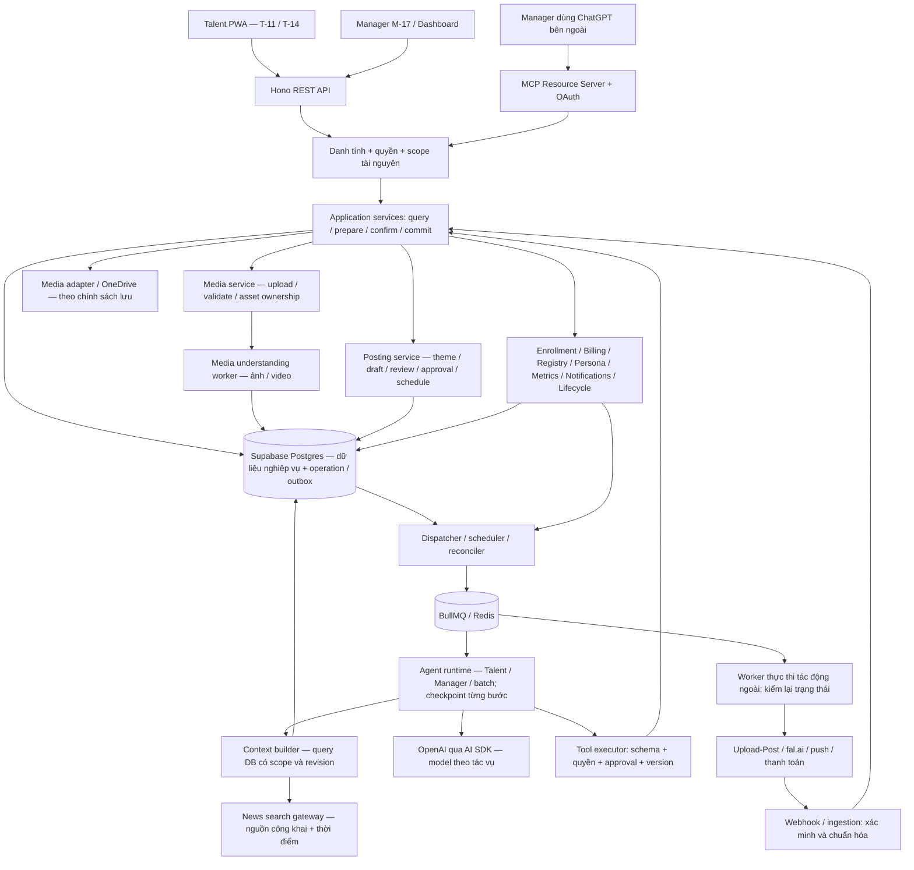

# AI Talent OS — Kiến trúc AI Core và kế hoạch tích hợp

**Phiên bản 2.10 ·25/11/2026 · Codex.** Đặc tả kiến trúc và hợp đồng triển khai AI Core theo YK3 bản 0.3/QA No.101. Các lựa chọn kỹ thuật trong tài liệu là thiết kế nội bộ; chưa có review độc lập, benchmark hoặc baseline được duyệt.

**Kiến trúc đề xuất:** backend TypeScript/Hono, service nghiệp vụ dùng chung, Supabase Postgres, BullMQ/Redis và runtime agent gọi model/tool theo từng bước. Runtime dùng context từ DB, xác nhận theo hành động và checkpoint để phục hồi. Mô tả dưới đây là thiết kế đích; mức đáp ứng thực tế cần được kiểm chứng khi triển khai.

**Phạm vi kiến trúc:** AI Core cùng hợp đồng tích hợp với các module của toàn hệ thống tại mục 2.6–2.11; đối chiếu chức năng tại mục 16. Bao gồm (1) Talent hội thoại để chọn chủ đề, gửi ảnh/video, tạo và sửa bài, xác nhận theo chế độ rồi đặt lịch/đăng SNS; (2) Manager dùng M-17 hoặc ChatGPT để xem/sửa hồ sơ và chỉ thị; (3) các tác vụ định kỳ và tiếp nhận kết quả provider. Runtime, quyền, dữ liệu và worker phải nối được cả ba luồng. Giới hạn của một đợt triển khai hoặc demo nằm ở mục 15 và không thu hẹp phạm vi kiến trúc.

**Đánh giá khả năng đáp ứng:** stack đã chọn hỗ trợ các luồng trên. Thiết kế đăng bài cần các service và hợp đồng riêng tại mục 2.5 và 8.1–8.4; một vòng tool calling hoặc một worker provider chung chưa đủ mô tả luồng nghiệp vụ. Phần còn mở tại mục 14 được giữ theo từng nhánh, không dùng để loại toàn bộ chức năng đăng bài đã có trong nguồn.

**Cách đọc:** mục 2 mô tả tương tác; mục 4–7 là hợp đồng bắt buộc cho runtime/data/tool; mục 10 là HTTP/MCP; mục 12 là thứ tự tích hợp; mục 13 là điều kiện kiểm chứng. Tên bảng/route/tool có nhãn “đích” là thiết kế để lập trình, chưa là thành phần đã tồn tại. DDL được tạo bằng quy trình Prisma của dự án; tài liệu không phải lệnh áp migration hay cấp quyền live.

## 1. Căn cứ và đánh giá độ phù hợp

| Nguồn/locator đọc lại25/11 | FACT từ nguồn | Hệ quả thiết kế — PROPOSAL nếu không ghi khác |
|---|---|---|
| YK3 § 2-4-14, nghiệp vụ14-4; đoạn 728–729; § 2-5 đoạn 897 | Manager xem/sửa thông tin Talent và chỉ thị AI qua quản trị hoặc ChatGPT; trình bày Talent/nội dung trước khi đăng ký | Hai kênh quản trị gọi chung service; xác nhận đúng đích, patch và version trước ghi |
| YK3 § 2-4-14 M-17, đoạn 767–777 | Manager chat trong hệ thống; AI đề xuất target/situation/instruction; chỉ lưu sau khi Manager yêu cầu lưu | M-17 dùng runtime Manager trong BE; khác ChatGPT bên ngoài qua MCP. Cùng quy tắc xác nhận và service |
| QA `Q&A!G101:H101`, ghi xác nhận 24/11 | AI Coach là agent đọc/ghi Supabase; nhận chỉ thị hội thoại, lời khen, Challenge/tiến độ, M-17 trong phạm vi; dữ liệu DB có backup | Agent thực sự gọi command ghi nghiệp vụ khi được phép. Không giới hạn chức năng ở text trả lời; không diễn giải thành cấp SQL/credential tùy ý |
| QA `Q&A!J101` | Phân vai NỘI BỘ25/11: OS nhập dữ liệu dịch vụ ngoài; agent quyết định giờ rồi ghi lịch; OS thực thi | Tách agent quyết định và worker tác động provider. Không gán phân vai nội bộ thành xác nhận khách |
| YK3 § 2-4-4 đoạn 289; § 2-4-2 đoạn 160–161 | Talent chỉ dùng dữ liệu mình; Manager thấy hội thoại; chưa có profile thì không đề xuất bài | Scope Talent do server suy từ principal, kiểm ngay trong query/tool; gate profile trước đề xuất |
| YK3 § 2-4-4/7/8; đoạn 296,437,439,464 | Chat chọn chủ đề, nhận/từ chối Challenge, sửa ý tưởng video; tạo video sau khi xác nhận giá | Chat có ghi nhưng không mặc định có quyền tạo video tính phí chỉ từ ý định trao đổi |
| YK3 § 2-4-14 đoạn 705,741,744–745 | Talent > category > toàn bộ; chỉ thị theo tình huống, có lịch sử/rollback; kiểm từ cấm luôn thực hiện | Chính sách service độc lập prompt; version chỉ thị và provenance trong context. Xung đột nhiều category vẫn QA99 |
| YK3 § 2-3 đoạn 86; § 2-4-4 đoạn 245–250, 274, 294–295, 303–333; § 2-4-5 đoạn 355–359; § 2-4-6 đoạn 386–387 | Talent chọn chủ đề, gửi media, AI tạo/sửa caption/hashtag; xác nhận theo chế độ, duyệt bài công việc và đăng/nhận kết quả SNS | Bắt buộc có chuỗi hội thoại–media–bản nháp–xác nhận–lịch–delivery. Ghi chủ đề/bản nháp và yêu cầu đăng là quyền nghiệp vụ của Talent trong scope của mình, không suy giới hạn chỉ đọc từ demo |
| QA101 G/H so với YK3 § 2-5 đoạn 885 | QA ghi DB; YK3 vẫn ghi profile/know-how/metrics trên OneDrive | Lấy DB làm dữ liệu nghiệp vụ của agent; vai trò OneDrive và byte media tiếp tục thiết kế theo đúng phạm vi, không mặc định chuyển/xóa kho |

Nguồn: [YK3 bản 0.3 ngày24/11](../source_requiments/24112026/AI育成OS_要件定義書.docx), [QA hiện hành](../source_requiments/Q&A/AI-Talent-OS_Q&A表.xlsx), [KS hiện hành](../source_requiments/Q&A/要件定義確認シート_AI育成OS.xlsx). Locator đoạn là thứ tự XML w:p từ1 kể cả trống. [Catalog/hash](../TAI_LIEU_NGUON.md), [đối chiếu24/11](../docs/requirement-review/corrections-2026-11-19/DELIVERY_24112026_REVIEW.md). VERIFIED câu chữ không là G7 hoặc duyệt thiết kế.

## 2. Kiến trúc đích và trách nhiệm



Ba đường vào có vai trò khác nhau:

- **Talent:** UI gửi hội thoại tới BE; runtime Talent gọi model và các tool trong phạm vi chính Talent đó.
- **Manager M-17:** UI gửi hội thoại tới runtime Manager của BE; runtime soạn chỉ thị, trình bản thay đổi và tiếp nhận thao tác xác nhận.
- **Manager ChatGPT:** ChatGPT bên ngoài đã thực hiện suy luận/tool calling; MCP server xác thực và gọi service. Không bắt mọi MCP call chạy thêm một vòng LLM của BE. Nếu về sau cần tác vụ AI nội bộ qua MCP thì khai báo use case và usage riêng.

Service nghiệp vụ và tool executor là nơi thực thi quyền/chuyển trạng thái. Agent có năng lực đọc/ghi dữ liệu thực qua các service này; model không nhận kết nối DB, SQL tùy ý hoặc secret. Worker provider thực hiện lệnh đã được service chấp nhận, không tự hỏi model lại để đoán đã có quyền đăng/thu tiền hay chưa.

### 2.1. Trách nhiệm và tương tác giữa các thành phần

| Thành phần | Nhiệm vụ | Nhận từ và gửi đến |
|---|---|---|
| Talent PWA | Nhận tin nhắn/media; hiển thị tiến độ, kết quả và yêu cầu xác nhận phù hợp | Gọi REST API; đọc trạng thái operation qua API |
| Manager Dashboard/M-17 | Nhận yêu cầu hội thoại, hiển thị đối tượng và nội dung thay đổi để Manager kiểm tra/lưu | Gọi REST API bằng phiên Manager; nhận proposal và kết quả commit |
| ChatGPT bên ngoài | Hiểu yêu cầu Manager, chọn tool MCP và dùng kết quả tool để trả lời | Gọi MCP server; không truy cập DB trực tiếp |
| Hono REST API | Xác thực đầu vào HTTP, nhận tin nhắn/lệnh/xác nhận và trả operation hoặc kết quả | Nhận UI; gọi authorization và application services |
| MCP Resource Server | Chuyển lời gọi tool MCP thành query/command nghiệp vụ; xác minh OAuth resource token | Nhận ChatGPT; gọi authorization/service chung; trả tool result hoặc operation ID |
| Authorization | Kiểm danh tính, tài khoản, capability và phạm vi tài nguyên; kiểm lại khi thực hiện | Được gọi tại API/MCP, tool executor và trước command/effect; trả cho phép hoặc từ chối |
| Application services | Thực thi query, chuẩn bị đề xuất, ghi nhận xác nhận và commit; kiểm luật nghiệp vụ/version | Gọi DB; ghi nghiệp vụ, command result, audit và outbox trong transaction; trả kết quả thực tế |
| Supabase Postgres | Lưu dữ liệu nghiệp vụ, hội thoại, proposal, operation, outbox, checkpoint và usage | Được truy cập qua service/adapter có quyền; là căn cứ tra trạng thái và phục hồi |
| Scheduler | Xác định công việc đến hạn theo lịch/múi giờ và điều kiện nghiệp vụ | Tạo operation/outbox qua service; không tự gọi model rồi bỏ qua lưu ý định |
| Dispatcher | Đọc outbox đến hạn và giao job có tham chiếu ổn định | Đọc/ghi handoff ở DB; enqueue BullMQ; Redis nhận job chưa là nghiệp vụ hoàn tất |
| BullMQ/Redis | Phân phối job, điều phối concurrency và lịch vận chuyển | Nhận từ dispatcher; giao cho worker agent hoặc worker effect |
| Agent runtime trong worker | Dựng context, gọi model, xử lý tool calls, lưu checkpoint/usage; tiếp tục hoặc dừng theo kết quả | Đọc context builder; gọi OpenAI và tool executor; công bố kết quả qua service |
| Context builder | Chọn dữ liệu trong quyền, đúng Talent/scope và revision; chuẩn hóa nguồn/độ mới | Query DB qua adapter; trả context cần thiết cho runtime, không tải toàn bộ DB vào prompt |
| OpenAI/model | Hiểu yêu cầu, phân tích dữ liệu, đề xuất tool call hoặc sinh câu trả lời | Nhận context/tool definitions; trả text hoặc yêu cầu tool; không tự cấp quyền ghi |
| Tool executor | Kiểm tên tool, schema, capability, target, approval và version; chuyển tới service | Nhận tool call; trả kết quả thật để runtime gửi lại model, kể cả từ chối/lỗi |
| Worker effect | Thực hiện đăng SNS/tạo video/gửi thông báo hoặc tác động khác đã được service chấp nhận | Nhận job; kiểm lại điều kiện; gọi provider; lưu ref/trạng thái để đối soát |
| Webhook/ingestion | Xác minh thông báo hoặc lấy dữ liệu provider, chuẩn hóa và cập nhật sự kiện | Nhận provider; gọi service ghi DB. Không để model tự xác nhận trạng thái provider |
| Reconciler | Phát hiện lease hết hạn, job thất lạc và kết quả chưa rõ; đối soát theo bằng chứng | Đọc DB/provider; phục hồi hoặc giữ unknown; không chạy lại tác động ngoài mù |
| Media service và media-understanding worker | Quản lý upload/kiểm file/quyền asset; phân tích nội dung theo khả năng adapter, lưu kết quả có version | Nhận UI upload hoặc asset ref qua service; gọi adapter/model cần thiết; trả metadata và analysis cho runtime |
| Posting service | Lưu chủ đề/bản nháp, binding media/nội dung, trạng thái duyệt và lịch; phát lệnh delivery | Nhận tool hoặc UI action đã xác thực; ghi DB/outbox; worker effect trả kết quả qua delivery service |
| Media/OneDrive adapter | Đọc/ghi file và cấp truy cập đúng asset/version/chính sách lưu | Service gọi adapter; adapter gọi kho file/provider, không trao secret cho model |

Các thành phần trên là trách nhiệm logic. API/MCP có thể chung tiến trình Hono; runtime và các tác vụ điều phối có thể chung mã nguồn worker. Cách đặt tiến trình lên máy nào thuộc thiết kế hạ tầng ở mục 11.

### 2.2. Luồng mẫu: Talent đọc dữ liệu và nhận tư vấn

**Yêu cầu:** “Đọc hồ sơ và mục tiêu SNS của tôi rồi gợi ý một hướng cải thiện.” Talent đã có profile đủ điều kiện theo policy tại mục 6.1.

1. **PWA → API:** xác minh phiên và Talent đích; lưu tin nhắn, run và outbox. UI nhận run ID.
2. **Dispatcher → BullMQ → runtime:** giao job và claim; context builder đọc snapshot DB đúng Talent.
3. **Runtime → model:** gửi yêu cầu và tool `context_read`. Model yêu cầu sections `profile`, `instructions` hoặc `goals`.
4. **Executor → service → DB:** kiểm scope rồi trả dữ liệu và version. Runtime lưu result và gửi lại model.
5. **Model → runtime → PWA:** trả tư vấn bằng tiếng Nhật; completionKind=answer_only và không có receipt ghi.

Đây là lượt tư vấn chỉ đọc. Khi yêu cầu bao gồm đổi chủ đề, Challenge hoặc tạo bài, runtime dùng capability nghiệp vụ tương ứng tại mục 7–8. Giới hạn tool của demo được ghi riêng tại mục 15.

### 2.3. Luồng mẫu: Manager chat tại M-17

**Yêu cầu:** “Đổi giọng văn của AI Coach cho Talent A sang thân thiện, ngắn gọn.”

1. **M-17 → API:** kiểm phiên/quyền Manager; lưu yêu cầu và tạo run profile Manager qua operation/outbox/queue.
2. **Runtime → context builder/model:** lấy dữ liệu đúng phạm vi; model gọi tool đọc chỉ thị hiện hành của Talent A qua executor/service.
3. **Model → tool prepare → service:** chuẩn bị proposal gồm Talent A, tình huống áp dụng, nội dung trước/sau và base version. Chưa ghi chỉ thị có hiệu lực.
4. **Runtime → M-17:** trình bản thay đổi và yêu cầu xác nhận. Lưu checkpoint, giải phóng lượt xử lý worker trong khi chờ Manager.
5. **Manager → API → approval service:** Manager yêu cầu lưu bản đã thấy; BE kiểm actor, proposal/hash, quyền và version. Nếu nhiều bản hoặc ý “lưu” mơ hồ thì yêu cầu chọn lại.
6. **Resume coordinator → command service → DB:** ngay khi nhận wake confirmed, backend tự commit proposal đã xác nhận, cùng transaction với receipt và kết quả tool đang chờ. Runtime gửi kết quả đã lưu cho model sau đó. Bước này chạy trước mọi model call tiếp theo và không phụ thuộc model gọi `change_commit`.
7. **M-17:** hiển thị kết quả và chỉ thị có thể tra tại danh sách M-15. Các run đọc chỉ thị theo revision/thời điểm có hiệu lực; không tự thay các bài đã tạo.

Nếu version đã đổi bởi Dashboard/ChatGPT, service trả conflict; user thấy cần kiểm tra bản mới trước khi lưu. Chat hội thoại và câu model thuật lại “đã đồng ý” không tự tạo approval của Manager.

### 2.4. Luồng mẫu: Manager đưa yêu cầu từ ChatGPT

**Yêu cầu:** “Cập nhật sở thích của Talent A thành luyện vũ đạo và chụp ảnh.”

1. **Manager → ChatGPT:** ChatGPT hiểu yêu cầu; kết nối MCP ứng dụng bằng OAuth theo grant đã cấp.
2. **ChatGPT → MCP → authorization/service:** gọi tool tìm/đọc Talent A. Server kiểm quyền và trả dữ liệu trong scope; ID do model đưa không thay kiểm quyền.
3. **ChatGPT → MCP prepare → service:** tạo proposal cập nhật profile, trả diff và ID. ChatGPT trình đúng Talent và nội dung cần xác nhận.
4. **Manager → kênh xác nhận:** xác nhận qua phương án đã được POC/duyệt; bộ MCP đang đề xuất trang PWA có phiên Manager/TOTP. BE lưu approval ràng buộc người, client/grant, proposal và version.
5. **Approval service → command operation:** khi kênh xác nhận ghi approval, backend tạo command operation idempotent để worker tự commit; đây là counterpart của resume trong M-17 vì MCP có thể không có run nội bộ. Kênh xác nhận trả operation ID. ChatGPT tra `operation_read`; tool `change_commit` chỉ là cổng phục hồi/tương thích, không là bước bắt buộc để bắt đầu lưu.
6. **MCP → ChatGPT → Manager:** trả kết quả thực tế; nếu bất đồng bộ, ChatGPT tra operation bằng tool trạng thái trước khi thông báo đã lưu. ChatGPT dùng kết quả tool để soạn phản hồi.

Vòng suy luận của luồng này do ChatGPT thực hiện. MCP phục vụ tool và gọi service; không thêm một vòng model AI Core để hiểu lại mỗi lời gọi MCP. Runtime nội bộ chỉ tham gia nếu use case cụ thể yêu cầu một tác vụ AI riêng.

### 2.5. Luồng kiến trúc bắt buộc: Talent từ hội thoại đến đăng SNS

1. **Chọn chủ đề:** Talent trao đổi tại T-11 hoặc chọn ứng viên từ T-09. Runtime gọi service lưu chủ đề và liên kết với conversation/bài đang soạn. Mỗi bài có topic/revision cụ thể; đổi chủ đề của bài thường khác đổi chủ đề kỳ autopost.
2. **Nhận tư liệu:** UI đưa nút gửi ảnh/video trong luồng hội thoại, có thể mở T-13 theo mô tả nguồn. UI gọi media API bằng danh tính Talent; file đi vào kho qua adapter, tạo asset có owner/version/status. Backend kiểm file và xác nhận ready trước sử dụng. Model chỉ nhận asset ref hoặc dữ liệu phân tích được cấp quyền, không tự chọn bucket/URL tùy ý.
3. **Hiểu ảnh/video:** media worker phân tích asset ready theo MediaUnderstandingGateway. Kết quả gắn asset/version và nguồn, ví dụ mô tả chủ thể/bối cảnh. Với video, adapter phải xác định được cách lấy thông tin cần thiết như frame/transcript khi phù hợp; lựa chọn model hiện có không tự chứng minh đọc trực tiếp mọi video. Asset chưa phân tích xong trả trạng thái chờ; lỗi rõ ràng, không bịa nội dung tư liệu.
4. **Tạo và sửa bài:** runtime lấy chủ đề, chỉ thị, thông tin Talent và media analysis; model tạo caption/hashtag, service lưu draft/version cùng danh sách asset. UI cho xem T-12; yêu cầu AI sửa tiếp tục run/task có draft ID và expected version. Talent có quyền sửa phần nguồn cho phép, trong trạng thái được service kiểm.
5. **Xác nhận/duyệt:** review policy đọc chế độ “xác nhận trước” hay “không xác nhận”. Chế độ xác nhận trước dùng thao tác adopt của Talent ở T-12; chế độ không xác nhận dùng policy đã lưu, không tạo consent giả từ model. Bài công việc do Talent đánh dấu để yêu cầu Manager duyệt; autopost/office theo ngoại lệ nguồn. Proposal Manager sửa profile không thay được bằng chứng adopt/duyệt bài.
6. **Đặt lịch:** agent quyết định giờ trong khung được chỉ dẫn, posting service kiểm nội dung/media, policy, quyền, account mapping và version đủ điều kiện; commit kế hoạch và publish command/outbox. Bài chưa đủ duyệt không đi vào đường đăng; quá hạn duyệt xử lý theo nguồn.
7. **Gửi SNS:** worker effect nhận publish command và gọi Upload-Post qua adapter; lưu delivery/request ref theo từng SNS. Chỉ gửi media có phiên bản xác định, có cơ chế URL/ingest phù hợp provider. Một bài nhiều SNS có thể thành công một phần, không đánh dấu toàn bài thành công từ một response.
8. **Trả kết quả:** webhook hoặc reconciler xác định trạng thái delivery; service cập nhật DB và tạo thông báo. T-16/T-17/T-18 hiển thị lịch, kết quả và lỗi. Model nhận kết quả có nguồn để giải thích cho Talent; câu trả lời model không xác nhận bài đã được đăng.

Đây là luồng kiến trúc đích cho yêu cầu khách. Có thể triển khai theo lát cắt riêng, nhưng đánh giá bao phủ yêu cầu phải đi hết chuỗi, gồm cả nhánh “không xác nhận trước” và bài công việc. Một câu chat “đăng giúp tôi” chưa tự thay thao tác adopt tại màn hình hoặc policy chế độ đã được lưu.

### 2.6. Phân chia toàn hệ thống và điều kiện truy cập AI

AI Core chịu trách nhiệm suy luận, hội thoại, tạo nội dung, phân tích và đề xuất hành động. Các module dưới đây sở hữu luật và dữ liệu nghiệp vụ; Dashboard, PWA, MCP, agent và scheduler dùng chung application service. Tên module/port là **PROPOSAL thiết kế đích**, không xác nhận đã có code. Mục 16 đối chiếu từng chức năng nguồn; giao diện chi tiết vẫn theo screen definition đúng phiên bản.

| Module chủ quản | Dữ liệu/cổng tích hợp với Core và hệ thống | Điều kiện và nhánh lỗi bắt buộc |
|---|---|---|
| Identity & Enrollment | Đơn, đồng ý điều khoản/version, quyết định duyệt, danh tính, bước đổi mật khẩu, onboarding; `EnrollmentService`, `AccessPolicy` | Talent chưa duyệt không đăng nhập; duyệt/từ chối qua Manager thật, gửi email mẫu; duplicate email phân biệt đang chờ và đã đăng ký; đơn không tự hết hạn. reCAPTCHA kiểm tại BE. Ngày sinh phục vụ tuổi tham khảo, không tự thêm sổ đồng ý phụ huynh |
| Billing & Entitlement | Customer/subscription/payment-method refs, kỳ phí và trạng thái thanh toán; `BillingGateway`, `EntitlementQuery` | Callback/webhook xác minh + chống trùng mới kích hoạt sau đăng ký phương thức thanh toán; redirect browser không chứng minh hoàn tất. Không lưu số thẻ. Phí lỗi tạo thông báo, không tự khóa AI theo suy đoán; chính sách thu lại/quá hạn theo QA4/49/53/63/86 |
| Talent & Office Registry | Profile, category, người phụ trách nhận tin, account kind, goal và account status; `TalentService` | Một loại quyền Manager có thể xem/cập nhật tất cả Talent theo QA88, không giới hạn bằng assignee. MCP grant có thể hẹp hơn. Office/unit dùng principal riêng, đăng nhập lại để chuyển account; miễn phí tháng, usage video tách cho Adesso |
| SNS Connection | Mapping Talent–provider user–platform account, trạng thái và connection revision; `SnsConnectionService` | Một account mỗi SNS, dùng được khi chỉ nối một phần; Talent tự OAuth, không đưa mật khẩu SNS cho model. Hiển thị lỗi/kết nối lại/hủy kết nối. Thay account có lịch theo QA95; callback bind owner/state và chống replay |
| Coach & Personalization | Hội thoại, morning topics, lời nhắc, review, memory và Challenge; dùng runtime/context/usage chung | Profile chưa đủ chặn đề xuất bài, không chặn mọi màn. Tin nhắn chỉ dẫn trong file/media/news là dữ liệu không đáng tin; không thay system policy/quyền |
| Media, Posting, Approval & Delivery | Asset, draft, review snapshot, approval, lịch theo SNS, provider delivery; mục 8 | Chỉ gửi tài nguyên ready của đúng owner; kiểm mode, media, NG, duyệt, account/status/version trước lập và trước gửi lịch. Không tự đăng lại bài đã thất bại |
| Video Generation | Ý tưởng/scenario, lựa chọn video cơ bản, estimate, request/attempt, preview/adopt/reject/remake và usage ledger | Ý tưởng/sửa scenario không sinh phí. Request tạo chỉ sau consent gắn đúng giá/estimate/asset/model revision; mỗi remake là request có quan hệ gốc, quy tắc tính lượt còn mở phải thể hiện riêng |
| Metrics & Goals | Snapshot theo SNS/bài, freshness, availability, goal/version, aggregation; `MetricsQuery` | Missing/unsupported/stale khác số 0; thực hiện ingestion trước phân tích; goal đổi phản ánh ngay, không đợi model. Talent chỉ thấy chính mình; Manager xem toàn bộ |
| Notifications | Domain event, recipient inbox, read/handled state, push/email deliveries; `NotificationService` | Inbox DB là căn cứ; push best effort. Gửi Manager phụ trách theo nguồn mới, còn bàn giao khi vô hiệu hóa theo QA88. Không coi email/push delivered là đã đọc hoặc đã xử lý |
| Administration & Audit | Category CRUD/màu/thứ tự/membership; global settings; Manager invite/disable/MFA; view/action/process audit | Ghi lịch sử xem theo Manager/thời gian/Talent/màn, phân trang/lọc; Talent không vào admin. Log action/process theo phạm vi CR07, không đồng nhất với raw prompt hoặc view log |
| Lifecycle & Retention | Trạng thái, posting gate, termination workflow, lịch xóa và receipts từng kho/provider | Chuyển trạng thái và hủy lịch ngoài là saga có đối soát; dừng worker không hủy lịch Upload-Post. Retention và thương mại CR08 quyết định tập bật, không bỏ mô hình vòng đời |

**Căn cứ:** YK3 P112–238, P516–661, P679–847; QA `Q&A!G88:H88`; `追加要件!A2:N15`; KS `20261122!G18:H18`, `アクション一覧!G17`. Lựa chọn Square mới hơn hướng GMO nhưng chưa chứng minh Square đáp ứng carrier/variable billing. Module payment giữ adapter boundary, team kiểm năng lực và ghi phương án thiếu bằng văn bản; không tự đổi yêu cầu thanh toán sang chỉ thẻ.

### 2.7. AI chủ động, học theo Talent, Challenge và nhân vật

1. **Chuẩn bị buổi sáng:** scheduler tạo operation theo Talent/ngày địa phương/tình huống/settings revision. Ingestion cập nhật metrics và context trước giờ chào; runtime tạo ba chủ đề, nội dung nhắc và review hôm trước. Có `NewsSearchGateway` lấy tin/thời sự kèm URL, thời điểm, provenance và phạm vi; model thiếu nguồn không tự nhận đã tìm tin. Cache tin dùng chung chỉ chứa dữ liệu công khai, personalization và context vẫn tách từng Talent.
2. **Gửi chủ động:** các lịch sáng/trưa/tối kể cả cuối tuần/ngày lễ, nhắc thiếu media theo giờ trước đăng, weekly review theo ngày cấu hình, nhắc không hoạt động theo dữ liệu bài thực đăng. Scheduler tạo domain event và message/inbox rồi fan-out push; user mở lại thấy nội dung đã lưu, không phụ thuộc giữ phiên chat hoặc push thành công. Hủy/đổi lịch kiểm settings/status và period version lúc chạy. Autopost không tạo thêm lời chào riêng cho từng bài.
3. **Cải thiện:** `LearningService` lưu observations từ hội thoại và kết quả bài, gắn owner/source refs/time/confidence/version; suy luận của AI có nhãn riêng với profile/chỉ thị do Manager nhập. Append và revision thay vì ghi đè nguồn. Summary không xóa provenance. Context hôm sau đọc các observations hợp lệ cùng metrics freshness. Đây là memory/RAG có chọn lọc, không mặc định fine-tune model hay cho AI tự sửa chỉ thị Manager.
4. **Challenge:** có instance thuộc Talent với mục tiêu/thời hạn/số lần và nguồn đề xuất; nhận/từ chối qua chat được lưu bằng command. Tiến độ giữ event và bằng chứng (bài/delivery hoặc lời Talent tự báo có nhãn), chống cộng lặp. Quy tắc xác nhận đạt, ngày liên tục và tính partial SNS còn mở theo QA72; service trả `assessment_pending`, không tự ghi đạt hoặc tự thêm thưởng. Lời khen dùng kết quả có căn cứ, không cần Manager duyệt mỗi câu.
5. **Giới hạn hội thoại:** instruction theo tình huống áp dụng hướng hoạt động nghệ sĩ/công việc/follower; redirect đề tài theo policy. Không tự tạo cảnh báo “tư vấn nghiêm trọng” tới Manager vì KS mới bỏ loại cảnh báo này. Conversation vẫn được lưu và Manager có thể đọc theo quyền; privacy disclosure ở onboarding là phần bắt buộc.
6. **Nhân vật:** `CoachPersonaService` cung cấp catalog nhân vật chuẩn bị sẵn, ảnh và style do Adesso cung cấp; Talent chọn qua UI command, lưu persona/version rồi context và UI dùng cùng lựa chọn. Không cố định Momo theo YK3 cũ; CR14 cập nhật phần này. Đổi tên riêng còn mở; không thêm upload avatar tùy ý. Persona không vượt ưu tiên chỉ thị, NG hoặc quyền.

**Căn cứ:** YK3 P243–255, P289–296, P390–407, P436–442, P516–539, P574–578, P704–745, P803–809; QA No.9/14/18/38/72/73/93/101; KS `20261122!G17:I17`, `G32:H32`; QA `追加要件!A15:N15`. Các ngưỡng/độ dài nêu trong nguồn là dự kiến theo P105; lưu giá trị và revision, không tuyên bố đã được duyệt chỉ vì cấu hình được.

### 2.8. Video và tiền: một workflow khác với soạn bài

Luồng đích: `idea → scenario_ready → awaiting_cost_consent → requested → generating → preview_ready / failed / unknown → adopted / rejected`; remake tạo request mới liên kết request gốc. Runtime có thể sửa ý tưởng nhiều lượt; chỉ service tạo video mới phát outbox tới gateway. Talent xem preview, chọn dùng/làm lại/không dùng; chọn dùng biến output đã kiểm thành media asset để vào pipeline bài, không tự đăng ngay khi video hoàn tất. Manager gửi tư liệu/tạo video thay Talent qua Dashboard dùng cùng service, actor là Manager và beneficiary là Talent, phí gắn Talent theo CR02; không tự mở tất cả quyền này qua MCP.

Mỗi request lưu asset refs/versions, scenario, model/format revision, estimate/price revision, consent ref, provider ref, trạng thái và cost/usage state. `VideoUsagePolicy` phân biệt số request, số thành công, failed/unknown, số lượt tính cho Talent và cost thật provider. Provider failure không tự coi là billable; mỗi lần làm lại vẫn tính một lượt theo nguồn. Thời điểm ghi lượt, loại lượt lỗi và điều chỉnh phí còn cần thống nhất giữa YK3 P475/485/644 và QA1/62; không hard-code theo slide hoặc bỏ quyết định remake đã rõ. Báo cáo tháng và invoice dùng ledger đã đối soát; giá đổi không tính lại request cũ từ settings hiện hành. Không có lượt miễn phí/trần chi riêng được tự thêm cho trẻ vị thành niên.

Output cần đáp ứng dọc/âm thanh/format dùng cho ba SNS, AI label theo capability đã kiểm. Nhạc miễn phí bản quyền thuộc pipeline; nhạc trending nền tảng do Talent thêm thủ công. Loại cơ bản là ảnh Talent chuyển động; video phức tạp nhập từ ngoài theo nguồn mới. Provider từ chối ảnh trẻ em: trả lỗi có hướng dẫn dùng video tự làm, không thay identity hay đổi provider bí mật. Chỉ bật khi format/preview/label/usage/billing đều có contract đã kiểm; độ dài/chất lượng/số ảnh tiếp tục 確認61/62.

**Căn cứ:** YK3 P462–510, P617–645; QA `追加要件!A3:N3`, No.1–4/60/62; KS `20261122!G3:I10`, `G33:I34`; EXT24 slide4–6/13. Nhận định năng lực/giá/provider trên slide là báo cáo của bên lập, không phải kết quả kiểm provider của tài liệu này.

### 2.9. Trạng thái tài khoản, dừng và xóa xuyên hệ thống

Account lifecycle tách khỏi `autopost_enabled`, billing status, connection status và run status. Bốn trạng thái nguồn là `before_use / in_use / paused / terminated`; chuyển vào/ra paused và tự xóa cần phạm vi CR08 được chốt. Terminated không có nút khôi phục trực tiếp; đăng ký lại email và kế thừa dữ liệu tiếp tục QA69. Office/unit dùng account kind riêng, không suy account miễn phí là Talent được miễn tháng.

`LifecycleService` nhận command Manager với version/confirmation phù hợp, ghi trạng thái có hiệu lực và outbox trong transaction. Mọi điểm mở run/tạo video/lập lịch/gửi effect gọi `AccessPolicy` hiện hành. Workflow tiếp theo thu hồi hoặc chặn phiên theo thiết kế Auth, dừng lời nhắc/AI, chấm dứt subscription theo chính sách, tìm lịch provider để hủy và theo dõi từng kết quả. Cancel timeout giữ `cancellation_pending/unknown`, Manager nhìn thấy lịch chưa chắc đã hủy. Effect đã xảy ra không bị coi là đảo ngược thành công. Không tự đăng bù khi mở lại nếu chính sách chưa chốt.

Dữ liệu sau termination được gắn mốc lưu sáu tháng theo nguồn; `RetentionService` lập manifest phạm vi DB/media/OneDrive/provider/cache/vector nếu dùng, tài nguyên dùng chung và dữ liệu tài chính phải xử lý theo chính sách lưu được duyệt. Xóa là workflow có receipt từng kho, retry/đối soát và kiểm chặn tái tạo từ outbox cũ; không chỉ xóa hàng Talent rồi báo hoàn tất. Backup có lịch hết hạn và quy trình restore tái áp deletion manifest để tránh hồi sinh dữ liệu. Phạm vi tự động so với thủ công tiếp tục CR08/QA29/69/94/98, thời hạn log và xử lý hóa đơn chưa thu có owner riêng.

Không có nút nghiệp vụ dừng toàn bộ lịch của mọi Talent theo KS24. Quy trình vận hành dừng hệ thống vẫn phải có kế hoạch hủy lịch đang giữ bên provider; tắt API/Redis/worker đơn thuần không đáp ứng. Trạng thái tạm dừng vẫn thu phí tháng theo YK3; payment failed chỉ thông báo, không tự chuyển terminated. Đội không dùng feature flag để tự quyết các chính sách này.

**Căn cứ:** YK3 P657–674, P815–819, P888; KS `20261122!G30:H30`, `G35:I35`; QA No.10/12/29/46/63/64/69/86/94/98, `追加要件!A9:N9`.

### 2.10. Notifications, metrics, quản trị và giao diện

**Notifications:** một sự kiện nghiệp vụ có event ID/version, Talent, loại, nguyên nhân và resource ref. `NotificationService` tạo bản inbox đúng recipient và delivery outbox riêng cho push/email; unique theo event/recipient/channel tránh gửi lặp. Trạng thái read, handled và delivery tách nhau; thao tác mở từ notification gọi command đánh dấu theo policy QA97, không tự thêm nút “xử lý xong” từ bản cũ. Manager lọc loại/category/chưa đọc, approval queue riêng. Payment/SNS/video/posting failure có reason classification để áp đúng người nhận; lỗi SNS/mạng không tự gửi cảnh báo lỗi đăng tới Manager theo P388/1318. Nội dung email/push dùng template do Adesso cung cấp, tránh gửi hội thoại/PII vào payload màn khóa.

**Metrics và goal:** ingestion theo ngày và provider-supported fields, lưu platform/post ref, observedAt/fetchedAt, metric name/value/availability. Query phục vụ cùng dữ liệu cho dashboard, lịch sử, follower hiện tại, tăng giảm bảy ngày, tiến độ từng SNS và context review; không cộng follower thành một mục tiêu chung. Goal mặc định trong nguồn là 10.000 từng SNS, Manager sửa và UI phản ánh ngay. Event đạt mục tiêu có goal version và metric snapshot chống thông báo trùng; ngưỡng tăng/giảm, streak và ranking không do model tự đặt. Ranking vẫn là đề nghị QA100/action15, không bị biến thành tính năng đã xác nhận. Fetch lỗi giữ snapshot cũ có nhãn, retry ingestion khác với tự retry đăng bài bị cấm.

**Quản trị:** query Talent có search/filter trạng thái, không hoạt động, category, assignee và office; xem profile/chat/metrics/post lịch sử đúng màn. Category nhiều giá trị, màu/thứ tự, CRUD có membership/instruction revision và tác động context; nhiều category xung đột giữ QA99. Profile có năm nhóm dữ liệu tại P728; tiêu chuẩn đủ profile vẫn QA54/92, không lấy một field demo làm production rule. Instruction test chạy sandbox với candidate revision có nhãn, trả ví dụ nhưng không thay instruction có hiệu lực, không tạo bài/lịch/video tính phí; history/restore tạo revision mới qua confirm. Global settings và NG list là command có version/audit; cập nhật không tự quyết việc sửa lịch cũ theo QA96.

**UI/PWA:** dữ liệu cho Home, MyPage, hội thoại, upload, draft preview, kết quả/notifications và phí phải tra qua API module; Manager có dashboard/approval/instructions/profile/category/settings/audit. API trả state/actions/missing requirements từ service để các màn và chat nhất quán. Client có operation refs để phục hồi khi đổi thiết bị/reload; cache/service worker tách account, clear khi logout, không cache secret hoặc trả dữ liệu account trước sau khi chuyển office. PWA hướng dẫn iPhone/Android và xin quyền push; callback SNS/payment có màn quay lại và poll server khi browser/PWA tách ngữ cảnh. Manager PC là chính, approval và instruction hoạt động trên mobile theo CR13. Màu trắng/asset/logo theo nguồn và phản hồi thiết kế; chọn nhân vật theo CR14. Ngôn ngữ demo không quyết locale bàn giao.

**Căn cứ:** YK3 P203–237, P516–609, P679–847, phụ lục B P1277–1347; QA đủ năm sheet, nhất là `お知らせ・メール文章`, No.14/21/31/33/54/72/75/87/88/92/95–100; CR03/04/13/14; SD-T18 PDF trang1–28 và SD-M18 PDF trang1–34 dùng mã đúng bản; SD19/UI-M20 dùng mapping riêng. Mục 16 giữ đường truy vết, không coi UI mockup là phê duyệt hành vi.

### 2.11. Hợp đồng liên module trước khi giao lập trình

Các module bên ngoài agent không bị ép dùng model/tool. Ví dụ: webhook payment → BillingService → Entitlement/Registry → folder provisioning + notification; user chọn nhân vật → PersonaService → context revision; metrics ingestion → MetricsService → review operation. Đây là command/event bình thường, dùng operation/outbox/idempotency như mục 4, không cần LLM quyết định callback có thành công hay không.

Mỗi port phải có bản OpenAPI/schema hoặc TypeScript contract được review gồm: actor/scope; request/expectedVersion/requestKey; state và allowed actions; output/receipt; error và retry semantics; ownership/ACL; dependency/readiness; event cùng consumer; timeout/unknown/reconciliation; retention và test oracle có nguồn. Common event envelope đề xuất: `{eventId,eventType,schemaVersion,aggregateId,aggregateVersion,talentId?,actorRef,occurredAt,correlationId,payload}`. Payload tối thiểu, không đặt token/ảnh raw/hội thoại đầy đủ trong queue. Consumer chống trùng và đọc state/version hiện hành trước effect.

Logical data owner ở bảng 2.6 phải map vào schema canonical hiện có trước bổ sung bảng; reuse profile/posts/media/delivery/billing thay vì tạo bản sao dưới `agent_*`. Ledger runtime ghi execution/provenance, không thay sổ tiền hoặc trạng thái bài. Nếu cần search/vector, derived index không là nguồn quyền hay dữ liệu gốc và nằm trong deletion manifest. Mọi contract thiếu chi tiết giữ `DESIGN_PENDING` cho đúng nhánh; module có trong sơ đồ chưa đồng nghĩa đủ để agent tự triển khai toàn dự án.

## 3. Thư viện được chọn và lý do

| Thư viện | Sử dụng trong kiến trúc | Lý do chọn |
|---|---|---|
| Hono | REST API, webhook và tích hợp endpoint MCP tại BE | Phù hợp backend TypeScript của dự án, dùng chung middleware và composition root |
| Vercel AI SDK (`ai`) | Gọi model, xử lý text/structured output và vòng tool calling | Dùng chung cơ chế gọi model/tool cho các task; runtime dự án bổ sung quyền, checkpoint và phục hồi |
| OpenAI adapter (`@ai-sdk/openai`) | Kết nối AI SDK tới OpenAI | Phù hợp nhà cung cấp AI theo nguồn; giữ cấu hình model và credential ở backend |
| MCP TypeScript SDK chính thức (`@modelcontextprotocol/sdk`) | Endpoint/giao thức MCP cho ChatGPT Manager | Dùng implementation giao thức sẵn có; nối tool với service nghiệp vụ chung. Phiên bản cần pin sau POC tương thích transport/OAuth |
| Zod | Schema đầu vào API/tool và output có cấu trúc | Kiểm tra cấu trúc thống nhất trong TypeScript trước khi chuyển dữ liệu vào service |
| Prisma + `@prisma/adapter-pg` + `pg` | Query/transaction và truy cập Postgres | Phù hợp lớp DB hiện hữu; giữ luật nghiệp vụ và quyền truy cập tại service/adapter |
| BullMQ + `ioredis` | Queue producer/consumer, phân phối và điều phối job | Phù hợp worker Node.js; kết hợp outbox/checkpoint DB để giao việc và phục hồi |
| `@supabase/supabase-js` | Tích hợp Supabase Auth/Storage theo adapter | Tái sử dụng cơ chế tích hợp của dự án; truy vấn DB nghiệp vụ đi qua service và Prisma |

Redis là dịch vụ phục vụ BullMQ, không phải thư viện gọi model. Model cụ thể và phiên bản thư viện được khóa khi triển khai; lựa chọn thư viện không tự chứng minh đủ quyền/OAuth, độ trễ hoặc tải.

Tham chiếu: [AI SDK tool calling](https://ai-sdk.dev/docs/ai-sdk-core/tools-and-tool-calling), [MCP TypeScript SDK](https://github.com/modelcontextprotocol/typescript-sdk), [MCP authorization](https://modelcontextprotocol.io/specification/2025-11-25/basic/authorization), [BullMQ idempotent jobs](https://docs.bullmq.io/patterns/idempotent-jobs).

## 4. Operation, execution và checkpoint từng bước

Operation/outbox lưu ý định và giao việc; execution/attempt theo dõi thực thi và quyền sở hữu lượt xử lý. Các trường, CHECK và index tại mục 4.1–4.2 là **thiết kế đích phải được triển khai bằng migration**. Migration nguồn trong repo và catalog DB thực tế quyết định thành phần đã có; việc sửa tài liệu không tự áp DDL hoặc cấp quyền lên DB live.

Một execution có nhiều bước. Cần lưu bền vững các đối tượng logic sau, map vào schema sau review DB:

| Đối tượng | Nội dung tối thiểu | Quy tắc phục hồi |
|---|---|---|
| Agent run | Actor thật, kênh vào, Talent hoặc scope chỉ thị, task/revision, phiên bản context/policy, input ref, state, lease/fence | Worker hết lease không được commit hoặc mở bước tiếp theo |
| Model step | Run/step ID, input/output ref có kiểm soát truy cập, provider request ref, model, usage và kết quả | Output hợp lệ đã lưu thì dùng lại; không gọi lại chỉ vì worker chết sau đó |
| Tool invocation | Tool/schema version, tham số chuẩn hóa/hash, đích, call ID, trạng thái, kết quả hoặc command ref | Retry cùng logical call trả kết quả cũ; không dựa riêng toolCallId do model mới sinh |
| Proposal/confirmation | Người xác nhận, client/grant/kênh, target/scope, diff/hash, base version, policy revision, hạn và trạng thái dùng | Không dùng approval cho nội dung/đích khác; sửa đề xuất phải xác nhận lại |
| Domain command | Actor/capability, payload hash, idempotency key, expected version, approval ref nếu cần | Ghi nghiệp vụ + kết quả command + audit + outbox cùng transaction |
| Provider effect | Lệnh nghiệp vụ, request/ref và trạng thái planned/sent/known/unknown | Timeout sau khi có thể đã gửi phải đối soát; không replay cả run hoặc gọi provider mù |

Một attempt là lần sở hữu execution lease, **không đồng nghĩa một model call**. Usage phân biệt từng model/provider call trong loop, bao gồm lần gọi thất bại có thể phát sinh phí. Mapping/index/ACL và cardinality usage thuộc đợt thiết kế DB riêng.

Lifecycle run đề xuất: `ready → running → completed / failed / outcome_unknown`; khi chờ con người dùng trạng thái chờ xác nhận bền vững và trả quyền xử lý cho worker. Sau xác nhận tạo lượt resume có checkpoint, kiểm quyền/version lại. Tên trạng thái là logic đích, không tự thêm vào CHECK/schema hiện có.

Khi chờ con người, runtime giải phóng transaction DB, connection và lease compute. Transaction DB ngắn cho claim/commit, model/provider gọi bên ngoài transaction. Mỗi transaction chỉ bao phủ một thay đổi nguyên tử.

**Ví dụ phục hồi:** tool chấp nhận Challenge đã commit nhưng process chết trước trả lời. Run tiếp tục dùng kết quả command đã lưu, không chấp nhận Challenge lần nữa. Nếu phát sinh model call mới để soạn câu trả lời sau phục hồi thì ghi usage riêng; không hứa model retry không phát sinh thêm chi phí.

### 4.1. Phương án lưu dữ liệu và tương thích schema

**Chọn mở rộng nền hiện có, không tạo một hệ thống queue/execution thứ hai.** `domain_operations` và `outbox_events` tiếp tục giữ ý định/giao việc; `ai_executions` là run, `ai_execution_attempts` là lần worker sở hữu lease. Thêm ledger theo bước và đề xuất/command. Schema hiện có bó chặt Talent và 1 call/attempt; migration phải mở rộng có điều kiện cho task revision agent, không sửa migration đã áp.

| Đối tượng đích | Trường bắt buộc / mapping | Ràng buộc cần có |
|---|---|---|
| `agent_conversations` mới, app_private | UUID `id`; `actor_user_id` FK auth principal; `channel` talent/manager_ui; `version bigint`; created/updated timestamptz | Conversation thuộc actor; task Talent có Talent đích server xác định; scope Manager được kiểm mỗi query. Không tạo conversation nội bộ cho mọi lời gọi MCP |
| `agent_entries` mới, app_private | UUID `id`, conversation FK, `sequence bigint`, role user/assistant/system_result, body text, created_at | UNIQUE(conversation_id,sequence). Chỉ lưu user/assistant messages phục vụ UI; tool transcript nằm ở step ledger, không nhân bản vào mọi message |
| Mở rộng `ai_executions` | `actor_user_id`, channel talent/manager_ui/system; `scope_kind` talent/category/global; `scope_id uuid NULL`; conversation/input_entry/output_entry FK nullable; `policy_revision`, `context_manifest jsonb`, `cursor bigint`, `wake_sequence bigint`, `waiting_proposal_id` nullable | Thêm task_key `agent.talent`/`agent.manager`, task_revision tương ứng `agent.talent@1`/`agent.manager@1`; talent_id nullable chỉ cho Manager global/category. CHECK scope talent ⇔ talent_id=scope_id, category/global ⇔ talent_id NULL; global ⇔ scope_id NULL. Task agent Talent/Manager dùng input_entry/output_entry, không coach_messages; CHECK succeeded yêu cầu output_entry_id với task hội thoại agent hoặc output_message_id với task legacy, không yêu cầu cả hai. CHECK finished_at chỉ non-null ở terminal known, unknown giữ mốc riêng cho đối soát; output chỉ tồn tại ở succeeded theo task profile. FK kép entry_id/conversation_id kiểm cùng conversation; conversation actor/run actor và channel phải khớp, system batch không có user conversation và dùng output nghiệp vụ theo task profile. FK đơn operation_id bắt buộc cả khi talent_id NULL; FK kép owner hiện có giữ cho Talent. Kiểm consistency actor/subject/operation bằng trigger cùng transaction; không dựa NULL trong FK kép để kiểm owner |
| Mở rộng execution state | pending/running/waiting_confirmation/succeeded/failed/unknown/cancelled; `last_error_code`, version, lease/heartbeat hiện có | Lease chỉ tồn tại khi running; waiting giải phóng lease. Một active run trên conversation qua partial unique pending/running/waiting_confirmation/unknown; conversation bận trả 409. Task legacy vẫn theo constraint/index riêng |
| Mở rộng `ai_execution_attempts` | Giữ execution_id, attempt_no, token; thêm `step_ledger boolean NOT NULL DEFAULT false`; talent_id nullable chỉ với Manager global/category, FK đơn execution_id bắt buộc và kiểm scope với run; thêm phase executing/waiting cho tool loop | UNIQUE(execution_id,attempt_no), một active attempt/execution; index active phải bao gồm executing. Provider/model/usage 1 call ở attempt chỉ dùng legacy; task agent lấy chi tiết từ step ledger |
| `agent_steps` mới, app_private | UUID id; execution/attempt FK; `sequence bigint`, kind model/tool; state prepared/calling/succeeded/denied/failed/unknown; input/output jsonb; hashes; provider_request_ref/call_id; input/output/cached_tokens bigint NULL; usage_state not_called/known/unknown; provider/model/price_revision, cost_amount numeric(20,8) NULL, currency char(3) NULL; started/finished timestamptz | UNIQUE(execution_id,sequence). Tool step có FK `source_model_step_id` cùng execution và call_id; UNIQUE(source_model_step_id,call_id). Model step output lưu đủ items cần tiếp tục API, không chỉ text. FK kép (attempt_id,execution_id) và (source_model_step_id,execution_id) giữ đúng run; thêm UNIQUE(id,execution_id) tại đích cần thiết. Output chứa PII là dữ liệu private, không đưa vào log kỹ thuật |
| `agent_change_proposals` mới, app_private | UUID id; actor/grant/client/channel, scope_kind/id, command_type, patch jsonb, payload_hash, base_version bigint, policy_revision, expires_at timestamptz, state prepared/confirmed/consumed/rejected/expired/conflicted; confirmed_at/by; run FK nullable | Proposal bất biến sau prepare; sửa nội dung tạo ID mới. CHECK confirmed/consumed phải có confirmed_by và đúng actor; grant/client phải trùng lúc confirm/commit. Không lưu token trong proposal |
| `agent_commands` mới, app_private | UUID id; operation FK; proposal FK nullable; execution/step FK nullable; actor/subject, kind, payload_hash, idempotency_key text, state committed/denied; result jsonb; created_at | UNIQUE(idempotency_key), UNIQUE(proposal_id) khi khác NULL. FK step/execution cùng owner; mutation + command result + step result + audit + outbox commit nguyên tử. MCP trực tiếp có thể không gắn execution nội bộ |
| Context nghiệp vụ | `agent_talent_profiles` mới: talent_id PK/FK, profile/attributes jsonb, version bigint; `agent_instructions` mới: UUID id, scope_kind/id, situation text, enabled boolean, current_version bigint; `agent_instruction_versions`: instruction_id/version PK, text, actor FK, created_at | Profile attributes allowlist ở mục 7.2; không JSON tùy ý từ model. Instruction unique scope+situation: partial unique cho global; unique scope_id+situation cho talent/category. Version bất biến, rollback tạo version mới trỏ nội dung cũ; không UPDATE/xóa version lịch sử |

Mọi bảng mới dùng id UUID theo convention hiện tại hoặc khóa ghép được chỉ rõ; JSON schemas strict tại service và CHECK loại/field tối thiểu tại DB. Scope references dạng đa hình cần trigger xác minh tồn tại/ownership ở create/update, không chỉ FK NULL. Mọi bảng mới có FK ON DELETE RESTRICT, version tăng khi sửa, timestamps UTC; không tự cascade xóa bằng run. Các row dữ liệu nghiệp vụ thuộc policy retention được chốt riêng. Instruction history và profile history dùng audit/domain history hiện hữu khi đủ thông tin; nếu audit chưa giữ diff/actor/version thì bổ sung version record trước mở ghi, không chỉ log câu “updated”.

Category scope cần FK tới catalog category canonical; hiện schema chưa đủ thì adapter category trả `FEATURE_NOT_READY`, không tạo category giả hoặc dùng UUID không có chủ sở hữu. Global/talent scope có thể triển khai trước; nguồn vẫn yêu cầu đủ ba scope khi bàn giao chức năng chỉ thị.

**Usage:** ledger model step là nguồn chi phí cho task agent; không ghi thêm tổng agent vào `ai_usage_events` theo kiểu 1 attempt=1 call. Báo cáo chi phí đọc hợp nhất legacy usage và agent model steps theo task family, không cộng hai lần. Manager/global có Adesso là bên trả, Talent đích nullable; không mượn Talent bất kỳ để gán chi phí. Có token nhưng chưa có giá thì amount=NULL, usage_state known và giá chờ xác định; không bịa 0. Cost dùng decimal/numeric, không float để quyết toán.

### 4.2. Chỉ mục, quyền và thứ tự migration

Chỉ mục cho query thực: executions conversation/state và lease_until khi running; steps(execution_id,sequence); proposal(actor_user_id,state,expires_at); command idempotency unique; instruction scope+situation; conversation entries(conversation_id,sequence). Giữ index dispatch hiện có. Không GIN toàn bộ input/output khi chưa có nhu cầu query.

Bảng app_private bật RLS theo convention BE; anon/authenticated không có DML trực tiếp. API/worker dùng LOGIN tối thiểu theo [PRISMA.md](../apps/api/PRISMA.md); dispatcher chỉ lease outbox/read operation, không được ghi profile/chỉ thị. Worker model ghi execution/ledger, command writer chỉ được mutation allowlist. Nếu dùng cùng DB role trong bước đầu, ghi rõ ACL hợp nhất được Tech Lead review; quyền actor vẫn kiểm trong service mỗi lệnh, JWT không tự áp vào Prisma query. Không dùng service_role/owner hoặc SECURITY DEFINER để né thiếu grant.

Triển khai migration theo thứ tự: thêm bảng ledger/proposal/context và FK/index → mở scope/state/event CHECK cho revision mới → backfill metadata cho record legacy khi cần (giữ task legacy) → kiểm ACL và invariant → deploy reader nhận cả revision → bật writer agent. Dùng expand/contract; không đổi NOT NULL/unique/enum mà thiếu preflight dữ liệu. Chưa migrate record legacy thành agent run hoặc replay outbox cũ hàng loạt. Task đích dùng operation kind `agent.run` và event type `agent.run.wake`; proposal commit dùng `agent.change.commit` khi cần operation riêng. Những giá trị này cần migration CHECK, không gắn nhãn coach.respond để vượt gate.

### 4.2.1. CHECK attempt theo hai chế độ

Migration `20261123000000_ai_core_executions` đã có ba CHECK liên quan: phase phải khớp metadata call, call_started_at NULL tương đương usage_state=not_called, và phase active tương đương finished_at NULL. Chỉ thêm phase executing vào enum/CHECK phase sẽ vẫn bị CHECK metadata call từ chối.

Migration đích phải có `step_ledger boolean NOT NULL DEFAULT false` và các nhánh sau:

| Chế độ | Invariant |
|---|---|
| Legacy, step_ledger=false | Giữ contract một call/attempt và trạng thái hợp lệ của migration legacy; provider/model/context/call_started_at đi cùng call thực tế |
| Agent, step_ledger=true | phase executing khi sở hữu lease, waiting khi nhường compute; provider/model/call_started_at ở attempt là NULL và usage_state=not_called; từng call và usage nằm tại agent_steps |

CHECK active-phase/finished_at và partial unique active attempt phải thêm executing, nhưng waiting là đã khép attempt nên finished_at có giá trị. Trigger insert/update kiểm step_ledger khớp task revision agent, tránh gắn cờ để bỏ qua constraint legacy. Migration `20261125000000_agent_core` hiện có phần mở rộng này trong working tree; cần kiểm catalog/replay để biết môi trường thực tế đã áp hay chưa. Integration phải tạo được executing/waiting multi-step, đồng thời từ chối attempt lai có step_ledger=true nhưng metadata call cấp attempt hoặc task legacy sai cờ.

### 4.3. Transaction và khóa chống trùng

Khóa theo thứ tự cố định: conversation → resource nghiệp vụ → proposal → operation/run → attempt/step → command/audit/outbox. Dispatcher chỉ khóa outbox, commit rồi enqueue; không chờ Redis trong transaction. Dùng DB clock cho lease/expiry, CAS expected version khi ghi.

- **Submit:** khóa conversation; kiểm request key và payload hash; tạo user entry + operation + pending run + wake outbox trong một transaction. Cùng key/payload trả cùng run; cùng key khác payload409. Request mới khi conversation có active run409, không tạo user entry orphan. User có thể bắt đầu conversation khác theo quyền nhưng mọi mutation vẫn CAS resource.
- **Commit tool:** khóa run/lease và đối tượng; kiểm quyền/policy/approval; nếu command key đã có và payload khớp trả kết quả cũ. Nếu mới, mutation + command + tool-step result + audit/outbox commit cùng transaction. Có lỗi rollback toàn bộ, không báo đã ghi khi checkpoint chưa lưu.
- **Confirm:** endpoint kiểm actor/client/grant, proposalHash, hạn và trạng thái bằng DB clock; ghi approval và tạo wake idempotent. Trả confirmed nghĩa “đã nhận xác nhận”, UI hiển thị “Confirmed, saving…” và tiếp tục đợi receipt. Reject/expiry chỉ khép đề xuất, không mutation.
- **Commit sau xác nhận:** khi resume, coordinator đọc proposal và gọi `ChangeService.commit` trước khi gọi model. Service kiểm lại quyền/version/approval, rồi commit mutation + lịch sử/audit + consume proposal + command receipt + result của tool prepare đang chờ trong cùng transaction có fencing. Result gồm `{decision:'confirmed',saved:true,receipt}`. Nếu model-step budget đã hết, coordinator vẫn xử lý quyết định đã nhận qua domain command và backend trả action_result từ receipt; không để confirmed bị treo vì thiếu lượt suy luận. Nếu conflict/expired/revoked thì lưu result lỗi thay receipt; model nhận trạng thái thực tế sau đó. Crash sau commit chỉ đọc receipt đã có. Backend không chờ model tự chọn `change_commit`.
- **Proposal không gắn run:** confirmation endpoint tạo command operation và outbox trong cùng transaction với approval; worker dùng cùng commit service. Nút Save hoặc tool `change_commit` được giữ như cổng phục hồi/tương thích và trả cùng command/receipt nếu đã xử lý. Chỉ một command được consume proposal. Đây là đường lưu thống nhất cho M-17, Dashboard và MCP; khác nhau ở việc wake run hay wake command operation.
- **Wait/resume:** lưu proposal và cursor; run→waiting_confirmation, attempt kết thúc, xóa lease, khép wake event hiện tại. Confirm/reject/expiry tạo wake mới với wake_sequence tăng trong transaction và CAS trạng thái; outbox UNIQUE(operation_id,generation,event_type) với generation=wake_sequence ngăn nhận hai lượt resume cho một xác nhận. Khi resume, cập nhật ai_executions.event_id sang wake event mới trong cùng transaction; event_id là wake hiện hành, không là ID bất biến của đầu lượt. Dispatcher join event_id hiện hành, event cũ giữ done để truy vết. Hệ thống không giữ khóa DB hoặc worker slot trong thời gian chờ.

### 4.4. Máy trạng thái và phục hồi

| Từ → đến | Trigger và điều kiện | Event/attempt |
|---|---|---|
| pending → running | Claim đúng thứ tự conversation; quyền/phiên/resource hợp lệ; tăng attempt_no và cấp token lease mới | Wake event chưa hoàn tất; attempt executing |
| running → waiting_confirmation | Proposal đã persist, chưa có mutation cần duyệt; cursor chỉ đúng tool đang đợi | Kết thúc attempt, event done, giải phóng compute |
| waiting_confirmation → pending | Confirm/reject/expiry qua transaction có CAS; coordinator commit hoặc lưu kết quả reject/expiry trước khi model tiếp tục | Wake event mới; không chạy lại prepare/ghi đã thành công |
| running → succeeded | Không còn tool call, output cuối hợp lệ và chưa có effect unknown | Lưu assistant entry/output_entry + usage + trạng thái cùng transaction; event done. Output là câu hỏi làm rõ cũng kết thúc lượt, tin nhắn user trả lời mở run kế tiếp |
| running → failed | Lỗi xác định, output sai schema, vượt giới hạn, quyền bị thu hồi | Lưu lỗi và phần effect đã commit; không giả rollback tác động trước đó |
| running → unknown | Provider có thể đã được gọi nhưng không biết kết quả hoặc lease mất ở calling | Thu hồi lease, giữ vị trí unknown; chặn write/resume mù |
| pending/waiting/running → cancelled | User hủy đúng owner; running kiểm trước bước kế tiếp, không hứa thu hồi effect | Ghi cancel request; đóng run khi bước đang gọi có kết quả rõ; chưa rõ thì unknown |

Wake delivery có thể nhiều lần; job terminal/no-op không được mở model call mới. `done` của wake chờ xác nhận chỉ nghĩa lần xử lý đó đã khép, không nghĩa toàn run đã thành công. Operation chỉ completed khi run succeeded; waiting giữ operation running với step waiting_confirmation. Legacy enum domain operation không có cancelled: map failed với code CANCELLED. Unknown giữ operation unknown và cần đối soát.

Model step trước HTTP ghi calling, commit rồi mới gọi. Response nhận được phải persist đủ items và usage trước thực hiện bất cứ tool nào của response. Crash trước persist output: gọi model có thể đã phát sinh phí nhưng chưa có effect ứng dụng; giữ unknown và đối soát. Chỉ mở generation mới khi có chính sách retry rõ và ghi nhận khả năng tính phí lần nữa; không tự suy request ID là idempotency. Crash sau persist: resume output đã lưu, không sinh lại tool plan.

Tool DB có command/result cùng transaction nên retry đọc lại kết quả. Provider effect tool chỉ tạo lệnh/outbox; worker effect có riêng ledger/ref và đối soát. Timeout hoặc 5xx provider không tự chứng minh chưa tạo effect. Batch/web-search provider-hosted có thể nhiều tác động/tính phí trong một model step; lưu metadata provider trả về, không hứa biết token/fee chưa được trả.

Lease chạy thử:60 giây, heartbeat 5 giây; provider call timeout 45 giây. Mọi write/checkpoint và mở step mới kiểm token+attempt_no+lease còn hạn. Khi gọi provider, policy fence còn đúng tại thời điểm mở call nhưng không thể thu hồi một request ngoài hệ thống sau mất lease; đó là lý do cần idempotency/ref và unknown. Reconciler 10 giây: prepared chưa calling có thể requeue; calling chưa có kết quả→unknown; output/tool result đã commit→resume cursor. Đây là mặc định kỹ thuật staging để kiểm, không SLA.

## 5. Runtime agent và context

Một runtime chung có các task profile, không cần đội nhiều agent tự trao đổi. Tách profile Talent, Manager và batch bằng capability/actor/context; không chỉ dùng một prompt khác để giả lập phân quyền.

1. BE xác minh principal; tạo input và operation/run có khóa chống gửi lặp.
2. Worker nhận run, kiểm scope/trạng thái và dựng context revision từ DB: profile, mục tiêu, chỉ thị theo tình huống, hội thoại, Challenge, kết quả có provenance.
3. Chọn task và tập tool do server quyết định; không nhận tool/model/actor từ client như quyền đã cấp.
4. Model trả text, structured output hoặc yêu cầu tool. Executor kiểm schema, scope, policy và expected version.
5. Tool đọc trả dữ liệu trong quyền; tool ghi gọi service. Nếu cần xác nhận, lưu đề xuất rồi dừng tác động, trả UI nội dung cần kiểm.
6. Lưu kết quả bước, usage và checkpoint; tiếp tục model nếu còn nhiệm vụ. Chỉ báo “đã lưu/đã đặt lịch” khi command/provider có bằng chứng tương ứng.

Cấu hình mỗi run có deadline, số bước, token và concurrency hữu hạn do đội đo. Hết ngân sách kỹ thuật trả kết quả rõ, giữ phần đã commit và checkpoint. Không rollback giả mọi tác động ngoài; không biến giới hạn run thành giới hạn số lượt viết lại hoặc trần chi tiêu nghiệp vụ.

Context có ưu tiên chính sách hệ thống → nhiệm vụ/schema → chỉ thị Talent/category/toàn bộ đúng chủ đề → profile/mục tiêu/hội thoại/metrics. Prompt/file/ảnh/web là dữ liệu không tin cậy về quyền. Nội dung Manager tự nhập cũng không có quyền thay authorization hoặc luật trạng thái.

Nhiều category trái nhau, profile trái chỉ thị hoặc yêu cầu chat trái chỉ thị Manager tiếp tục QA92/99 và các tracking hiện có. Agent chưa được tự chọn chính sách mới để đóng xung đột.

### 5.1. Hợp đồng vòng lặp model/tool

Chọn **runtime điều phối từng model step** để có checkpoint; AI SDK cung cấp adapter/generate/parse, không bật vòng auto-execute nhiều tool rồi mới lưu cuối lượt. Mỗi lần generate không nhận callback execute có tác dụng ghi; runtime nhận tool calls và gọi executor riêng sau khi persist output. Adapter phải lưu cả provider-specific reasoning/continuation items cần thiết, toolCallId và kết quả theo protocol; không dựng lại history chỉ từ assistant text.

```typescript
// Mã giả hợp đồng, không phải implementation SDK để copy nguyên.
// Chạy dù budget model đã hết: hoàn tất quyết định người dùng đã được nhận.
// Đây là domain command có lease/policy riêng; không tự cấp quyền từ text model.
const decision = await store.pendingUserDecision(run)
if (decision) {
  await coordinator.applyDecisionAndPersistReceipt(run, decision, lease)
}
while (withinLimits(run)) {
  const step = await store.nextOrCreateModelStep(run, lease)
  const output = step.savedOutput ?? await model.generateOneStep(
    await context.buildContinuation(run), registry.allowedTools(run))
  await store.persistModelOutputAndUsage(step, output, lease)
  if (!output.isComplete) return store.failOrMarkUnknown(run, output, lease)
  if (output.toolCalls.length === 0) return finishWithVerifiedEffects(run, output, lease)
  for (const call of output.toolCalls) {
    const saved = await store.findToolResult(step.id, call.id)
    const result = saved ?? await executor.execute(call, run, lease)
    if (result.kind === 'waiting_confirmation') return suspend(run, result, lease)
    await store.recordToolResultIfNeeded(step, call, result, lease)
    if (result.kind === 'outcome_unknown') return markUnknown(run, result, lease)
  }
  // Continuation chứa output items và result cho mọi toolCallId của step.
}
return stopAtTechnicalLimit(run)
```

Kết quả tool được lưu theo loại. `INPUT_INVALID` kèm issues cho phép model sửa tham số; denied hoặc conflict có chính sách riêng tại mục 7.4. Runtime giữ mỗi lần thử và mỗi kết quả trong ledger. Sau một denial, policy có thể thu hồi capability trong run; model được giải thích hoặc hỏi lại, không thử thao tác tương đương qua tool khác. Không có tool phù hợp thì trả unsupported, không sinh SQL/code để thêm chức năng khi đang chạy.

Nhiều tool calls trong cùng response xử lý tuần tự theo thứ tự output ở giai đoạn đầu; không giả có quan hệ phụ thuộc giữa tham số chưa biết. Mọi call phải có result (hoặc checkpoint chờ) để continuation hợp lệ. Tool chỉ đọc có thể tối ưu song song sau kiểm, nhưng write vẫn tuần tự/CAS. Không dùng model text như bằng chứng thực thi: UI action receipts do backend dựng từ command committed. Với run đã gọi tool prepare/write hoặc nhận denial/conflict, bản tích hợp đầu chỉ hiển thị thông báo kết quả hành động bằng template backend từ receipts/status, không render câu model tự viết về việc đã lưu. Text AI dùng cho trao đổi/tư vấn; run chỉ trả text và không có receipt được đánh dấu answer_only, không có trạng thái ghi thành công. Không dựa bộ dò câu chữ để hứa phát hiện mọi khẳng định sai của model.

### 5.2. Kết thúc, lỗi và giới hạn kỹ thuật

Tối đa 8 model steps/run, 16 tool calls/run, deadline compute 120 giây, tối đa 4.000 token output/model step; cấu hình trong registry, đo lại khi staging. Thời gian waiting_confirmation không tính compute deadline, resume có compute budget mới nhưng giới hạn toàn run giữ nguyên. Lịch sử dài phải compact có version/provenance; không xóa proposal/receipt/chính sách để nhét context. Nếu provider context limit thấp hơn budget thì dùng giới hạn thực của model.

Không tự retry model sau khi đã calling mà thiếu kết quả; lỗi trước gọi có thể retry có backoff. Hết ngân sách hoặc cancel: lưu bước đã commit, trả mã và receipt; UI không ghi “chưa thay đổi gì” nếu có command đã committed. Số lượt người dùng nhờ viết lại vẫn không giới hạn nghiệp vụ; đây là giới hạn một run kỹ thuật.

## 6. DB là dữ liệu nghiệp vụ; OneDrive và media

Theo QA101 G/H, agent đọc/ghi dữ liệu hệ thống trong Supabase và có backup. Profile/chỉ thị được cập nhật qua service từ quản trị/ChatGPT/M-17; context lấy revision DB, không lấy file OneDrive làm điều kiện bắt buộc mặc định cho mọi run.

- Thay đổi DB công bố revision trong cùng transaction. Run lưu context revision; trước ghi kiểm lại version đối tượng liên quan. Không yêu cầu khóa toàn bộ context trong suốt model call.
- Cache key gồm target/scope/revision; cache TTL chỉ là tối ưu. Ghi qua bất kỳ kênh nào phải làm version mới được nhìn thấy giữa các process. Mốc áp dụng chỉ thị vào run/bài đã tạo là chính sách riêng, không suy xóa/viết lại lịch cũ từ cache invalidation.
- Dữ liệu thực tích từ provider qua ingestion, có platform/account/source/time; suy luận agent hoặc “điều học được” giữ provenance, không ghi đè sự kiện provider như số liệu thật.
- Trong demo, OneDrive chỉ nhận bản xuất `Profile.md` từ DB. Profile commit thành công tạo outbox `agent.profile.export`; AI context không đọc ngược file này. Instruction, goals, memory và media không được tự đưa vào cơ chế export profile; từng loại cần use case riêng.
- Byte media có asset owner/version/location và adapter Storage/OneDrive. QA101 về DB không tự quyết byte video ở Postgres; chính sách Supabase Storage so với OneDrive vẫn theo [kiến trúc lưu trữ](KIEN_TRUC_LUU_TRU_ONEDRIVE_VA_SUPABASE.md).
- Backup DB khác archive media, export OneDrive và Redis persistence. Đội phải xác định phạm vi, retention, RPO/RTO và thử khôi phục; chưa có kết quả phục hồi trong lần review này.

### 6.0. Hợp đồng xuất profile OneDrive cho demo

Profile mutation và event `agent.profile.export` commit cùng transaction. Event tham chiếu Talent và version; worker đọc profile DB mới nhất, render `Talents/<folder>/Profile.md` với version marker rồi ghi qua adapter. DB là nơi ghi nghiệp vụ; file là bản xuất để xem, sửa file ngoài ứng dụng không cập nhật agent context.

Receipt phân biệt `saved_to_db` với export `pending/succeeded/retry/failed`. OneDrive thiếu config/folder hoặc trả lỗi không đảo profile đã commit; UI có thể báo đã lưu DB và export đang chờ. Không yêu cầu export để Talent đọc profile mới. Instruction update không tự tạo Profile.md event.

Worker retry theo outbox, khởi đầu tối đa 10 lần và backoff tăng đến 600 giây; hết retry giữ failed để operator kiểm và replay cùng effect ID. Mỗi lần chạy đọc latest version, bỏ event đã có exported_version lớn hơn hoặc bằng. Khi nhiều worker, phải tuần tự hóa theo Talent và kiểm version/Graph eTag trước overwrite; ack exported_version theo nội dung đã xác minh. Ghi cùng filename chưa tự chứng minh an toàn với hai version chạy đồng thời. Demo một worker có thể kiểm happy path; production cần ca stale export/concurrency và adapter conditional write.

### 6.1. Context manifest và chiến lược đọc

Context DB đọc trong một transaction snapshot ngắn rồi đóng trước model call: actor/scope, profile version, instruction versions đã resolve theo tình huống, conversation tail, Challenge ref nếu module sẵn sàng, metrics account+capturedAt, asset refs được phép. Manifest persist ở run; hash canonical JSON xác định context_revision. Dữ liệu được load thêm qua tool có version/source riêng trong tool result, không âm thầm đổi manifest ban đầu.

**Profile sẵn sàng trong demo:** `profileReady = typeof fields.profile === 'string' && fields.profile.trim().length > 0`. Trường `profile` bắt buộc cho cờ này; direction/hobbiesSkills/futureGoal/tone là tùy chọn. Field thiếu, null hoặc chỉ khoảng trắng → false; fixture phải ghi rõ là dữ liệu thử. Điều kiện này là giả định kỹ thuật được người dùng chọn cho demo, chưa thay tập trường tối thiểu cần khách/BA xác nhận cho production. Khi false, cho chat tư vấn chung, chặn đề xuất bài bằng `PROFILE_NOT_READY`.

Snapshot lưu `profileReadinessPolicy='demo-profile-text@1'` để truy được tiêu chí khi chạy; policy production có revision riêng. Profile.md có tồn tại hoặc đã export không ảnh hưởng profileReady.

Chọn chỉ thị enabled, đúng situation và scope; Talent ưu tiên category rồi global. Nếu nhiều category có nội dung xung đột chưa có policy QA99 thì không gọi model tự chọn bên thắng: trả `INSTRUCTION_CONFLICT`, cho Manager xem scope cần xử lý; phần độc lập không xung đột vẫn hoạt động. Mặc định không đưa thông tin Talent khác hoặc toàn danh sách Manager vào prompt. Metrics thiếu hiển thị missing/stale, không chuyển thành0.

Cache key scope+manifest hash; confirm/commit đọc version DB hiện hành kể cả cache còn. Bản ghi mới phải được DB context nhìn thấy mà không cần đợi OneDrive export. Không suy tác động tức thời lên bài đã đặt lịch từ việc version thay đổi.

## 7. Ma trận quyền và xác nhận

Manager có một loại quyền dùng chung các Talent; assignee định tuyến thông báo, không là bộ lọc quyền mặc định (QA88). Grant MCP vẫn giới hạn theo consent đã cấp.

Tên tool dưới đây là **hợp đồng đề xuất**, không phải tool đang có. Talent ID của Talent do server suy từ phiên; Manager chọn và kiểm target/scope rõ. Quyền Manager xem/sửa nhiều Talent không cấp quyền sửa từ kênh Talent hoặc từ worker bất kỳ.

| Use case/tool logic | Talent agent | Manager M-17 | Manager ChatGPT/MCP | Điều kiện ghi/xác nhận |
|---|---|---|---|---|
| `context.read` | Chính Talent | Trong phạm vi Manager được cấp | Trong grant hiện hành | Query lọc scope; đọc hội thoại Manager cũng cần audit theo nghiệp vụ |
| `profile.prepare/commit` | Chưa có căn cứ cho sửa hồ sơ quản lý qua chat | Chỉ mở nếu use case UI cho phép; M-17 hiện trọng tâm chỉ thị | Có theo YK3 | Trình Talent + diff, Manager xác nhận; check version trước commit |
| `instruction.prepare/commit` | Không sửa chỉ thị Manager | Có | Có theo14-4 | Trình scope toàn bộ/category/Talent, tình huống, diff và phạm vi ảnh hưởng; xác nhận trước ghi |
| `autopost.setTheme` | Có trong kỳ của mình | Không suy từ quyền chỉ thị | Chưa có căn cứ mở | Lưu chủ đề theo ý định rõ; mơ hồ hỏi lại. Xử lý bài đã tạo tiếp tục No.70/83 |
| `draft.create/revise` | Có cho bài của mình, theo trạng thái | Phạm vi thay Talent theo CR-02 qua luồng tương ứng | Chưa có căn cứ mở | Ghi nội dung không đồng nghĩa adopt/duyệt/đăng; giới hạn sửa bài đã duyệt kiểm riêng |
| `challenge.propose/accept/decline/progress` | Có trong phạm vi QA101; Talent nhận/từ chối | Ghi chỉ thị Challenge | Ghi chỉ thị Challenge | Không cần Manager duyệt việc Talent nhận Challenge; tiêu chí đánh giá/ghi tiến độ chưa đủ thì giữ chưa rõ, không tự bịa scoring |
| `schedule.plan` | Agent quyết định trong policy của luồng | Chỉ thị khung giờ/tần suất | Chỉ thị khung giờ/tần suất | Lưu giờ kế hoạch không tự cấp quyền đăng; service kiểm media, account, mode, approval |
| `video.prepare/request` | Soạn ý tưởng; yêu cầu tạo khi xác nhận giá tại T-14 | Chỉ theo luồng Manager được mở riêng | Chưa có căn cứ mở | Xác nhận gắn đúng request/asset/giá hoặc ước tính; tool không tự sinh phí từ đoạn chat soạn ý tưởng |
| Duyệt đơn/bài, đổi trạng thái Talent, thu tiền, xóa dữ liệu | Không tự cấp qua chat | Theo màn quản trị/use case riêng | Chưa có căn cứ mở | Không expose generic admin command cho agent; thực hiện bằng service theo quyền/chính sách riêng |

**Phân biệt:** việc AI đọc/ghi đã được QA101 xác nhận; tập tool cụ thể và cách server enforce là thiết kế đội. Không áp xác nhận Manager cho mọi bước Talent vì sẽ đổi luồng đã nêu trong nguồn. Không dùng lời model “người dùng đồng ý” hoặc `confirmed:true` làm bằng chứng xác nhận.

### 7.1. Hai kênh xác nhận Manager

- **M-17:** hệ thống lưu proposal bất biến khi hiển thị bản thay đổi. Manager gửi yêu cầu lưu sau đó qua phiên đã xác thực; BE gắn yêu cầu đó với proposal và actor cụ thể. Ý “lưu” mơ hồ hoặc nhiều đề xuất thì hỏi lại. Cách UI biểu diễn xác nhận là lựa chọn thiết kế; không bắt model tự phê duyệt đề xuất của mình.
- **ChatGPT bên ngoài:** proposal trả diff và ID; BE yêu cầu bằng chứng approval do người thực hiện qua kênh đã kiểm chứng. Bộ MCP hiện đề xuất trang PWA xác nhận có TOTP. Giữ đây là phương án UX cần POC/duyệt, không coi SDK/tool annotations hoặc câu ChatGPT thuật lại là đủ. Không hạ yêu cầu xuống generic commit để kết nối thành công.
- Cả hai dùng chung approval service: bind actor, client/channel, target/scope, payload hash, base version, policy revision và hạn. Commit dùng một lần, retry trả cùng kết quả; hết hạn, đổi quyền hoặc đổi đối tượng phải xác nhận lại.

MCP OAuth xác thực caller/resource; capability nghiệp vụ ở BE vẫn cần kiểm riêng. Không dùng MCP quản trị Supabase hoặc token Graph làm token truy cập MCP ứng dụng. Tài khoản Manager vô hiệu hóa/grant revoke phải chặn ở thời điểm đọc/commit và xử lý command đang đợi theo policy đã thiết kế.

### 7.2. Registry tool để lập trình

Registry khai báo name/revision/inputSchema/outputSchema/capability/actorChannels/approvalMode/readiness/serviceHandler. Tên dưới đây là tên đích; nội bộ và MCP dùng cùng schema và service. MCP chỉ công bố tool có channel manager_mcp, không public Talent write tools. Tên chấm trong bảng là capability ID nội bộ; tên function gửi model/MCP dùng alias đăng ký tường minh dạng `profile_prepare`, `instruction_prepare`, `change_commit`, `context_read` (chữ/số/gạch dưới), validate không trùng khi khởi động; không gửi capability ID có chấm như tên function nếu provider không hỗ trợ. Args JSON strict: từ chối field lạ, validate UUID/date/bounds; actor, grant, quyền và idempotency không nhận từ model.

| Tool đích | Input model được gửi | Output thành công | Actor/channel và điều kiện |
|---|---|---|---|
| `talent.search` | `{query:string,cursor?:string,limit?:number}`; limit1–20 | `{items:[{talentId,displayName}],nextCursor}` | Manager UI/MCP; scope grant; không đọc tràn dữ liệu để lọc sau |
| `context.read` | `{talentId?:uuid,sections:string[]}`; sections allowlist profile/instructions/metrics/challenges | `{sections,versions,sourceTimes,missing}` | Talent server cố định me; Manager target phải có quyền. challenges trả missing nếu adapter chưa mở |
| `profile.prepare` | `{talentId:uuid,expectedVersion:string,patch:{profile?:string,direction?:string,hobbiesSkills?:string,futureGoal?:string,tone?:string}}` | `{proposalId,diff,baseVersion,expiresAt,confirmation}` | Manager UI/MCP; không sửa tên/account/status/role hoặc field ngoài allowlist. Create dùng expectedVersion='0'; revision thực dạng decimal string |
| `instruction.prepare` | `{scope:{kind:global/talent/category,id?:uuid},situation:string,expectedVersion:string,change:{kind:write,text:string,enabled:boolean} hoặc {kind:set_enabled,enabled:boolean} hoặc {kind:restore,version:string}}` | Cùng proposal result | Manager UI/MCP; situation allowlist theo nguồn ở mục 1; global không id, talent/category bắt buộc id và lookup quyền |
| `change.commit` | `{proposalId:uuid}` | Receipt đã có hoặc command operation hiện hành | Cổng tương thích/phục hồi; Service tự lưu khi resume/command wake. Nếu vẫn expose cho model, mô tả tool phải nói rõ nó không phải bước bắt buộc sau confirm; luôn kiểm approval và chống trùng |
| `instruction.history` | `{instructionId:uuid,cursor?:string,limit?:number}`; limit1–20 | `{items:[{version,text,actorLabel,createdAt}],nextCursor}` | Manager UI/MCP có scope; restore qua instruction.prepare rồi confirm/commit, không sửa lịch sử |
| `operation.read` | `{operationId:uuid}` | `{state,receipt?,errorCode?}` | Actor owner hoặc grant hiện hành cho tài nguyên; không expose raw ledger/prompt |
| `autopost.read` | `{}` cho Talent | `{periodId,theme,version}` hoặc not_found | Talent; adapter sẵn sàng theo module autopost |
| `autopost.setTheme` | `{periodId:uuid,expectedVersion:string,theme:string}` | `{commandId,version,receipt}` | Talent sở hữu kỳ; vẫn chặn nếu xử lý bài/lịch hiện có chưa có policy, không tự giữ hay xóa lịch |
| `challenge.respond` | `{challengeId:uuid,expectedVersion:string,choice:accept/decline}` | `{commandId,state,receipt}` | Talent; phải có Challenge instance/version canonical và policy; không tự chấm điểm/đánh dấu đạt từ câu user chưa kiểm |
| `draft.revise` | `{draftId:uuid,expectedVersion:string,caption:string,hashtags:string[]}` | `{commandId,version,receipt}` | Talent; chỉ trạng thái được phép sửa. Cổng NG/approval thuộc service bài đăng; không suy từ model caption hợp lệ |
| `schedule.plan` | `{postId:uuid,expectedVersion:string,platformTimes:[{platform,scheduledAt}]}` | `{planId,version,state:planned}` | Tác vụ agent có policy được mở; thời gian trong khung cấu hình và account mapping. Không đồng nghĩa published |
| `video.prepare` | `{assetIds:uuid[],brief:string}` | `{proposalId,estimate,confirmation}` | Talent; chỉ soạn đề xuất; `video.request` không mở trong core registry cho tới hợp đồng giá/lượt/approval T-14 đủ |

Situation keys đích: `daily_greeting`, `theme_suggestions`, `post_writing`, `post_results`, `challenge_suggestions`, `media_reminder`, `posting_window_frequency`, `conversation_limits`; mapping đúng tám tình huống nguồn ở mục 1, không tạo nhóm nghiệp vụ mới. Instruction scope lookup kiểm Talent/category tồn tại trước prepare; DB trigger/FK bảo vệ theo từng scope, không chỉ kiểm UUID đúng cú pháp.

Profile text và instruction text dùng giới hạn kỹ thuật cấu hình, khởi đầu 4.000 ký tự/field profile,1.000 ký tự/chỉ thị theo giá trị dự kiến trong nguồn; UI/backend cùng config, chưa tự ghi số này là yêu cầu khách đã duyệt. Tổng body HTTP tối đa 64 KiB theo convention; context/tool result tối đa kích thước registry, result dài dùng page/cursor thay cắt mất receipt/phiên bản.

Capability không có trong registry hoặc readiness=false: không cấp tool cho model; gọi cưỡng bức vẫn trả `FEATURE_NOT_READY`/`ACTION_NOT_ALLOWED`. “Được khách yêu cầu chức năng” khác “adapter và gate để bật đã đủ”. Tool mới phải khai báo test quyền, idempotency, lỗi và source locator trước đăng ký.

**Tool được bật trong demo:** Talent chỉ có `context_read` với sections profile/instructions/goals. Manager UI có `context_read`, `talent_search`, `instruction_history`, `profile_prepare`, `instruction_prepare`; `change_commit` có thể giữ để tương thích demo nhưng luồng lưu chính do coordinator thực hiện. Category scope, metrics bài đăng, mọi tool ghi Talent và MCP production còn chưa ready. Bảng trên mô tả tập đích, không phải danh sách để bật đồng loạt. Schema runtime hiện dùng goals; metrics/challenges chỉ được thêm khi module dữ liệu sẵn sàng.

### 7.3. Envelope kết quả và trải nghiệm user

```typescript
type ToolResult<T> =
  | { kind: 'ok'; data: T; receipt?: { commandId: string; changed: boolean } }
  | { kind: 'waiting_confirmation'; proposalId: string; expiresAt: string }
  | { kind: 'denied' | 'invalid' | 'conflict' | 'unavailable';
      code: string; messageKey: string; retryable: boolean;
      issues?: Array<{ path: string; code?: string; message: string }> }
  | { kind: 'outcome_unknown'; code: string; operationId: string }
```

UI buttons, labels và lỗi thao tác dùng tiếng Anh trong `lib/messages.ts` theo lựa chọn demo hiện hành của người dùng, cũng được ghi tại CLAUDE.md. AI chat và thông báo hội thoại do receipt tạo dùng tiếng Nhật. `messageKey` không quyết định ngôn ngữ; renderer chọn đúng nhóm nội dung. Quy ước này áp dụng demo theo lựa chọn trực tiếp trong phản hồi hiện tại, giải quyết khác biệt với mô tả tiếng Nhật cũ trong AGENTS/báo cáo. Chưa suy thành yêu cầu locale production của khách. Không trả stack trace, credential, scope bí mật, dữ liệu ngoài quyền hoặc câu provider thô. Invalid/refused tool được lưu step result; auth/session hết hạn hoặc actor bị vô hiệu hóa làm run dừng, không cho model tiếp tục gọi write.

| Mã | User thấy / hành vi | Ghi dữ liệu? |
|---|---|---|
| AUTH_REQUIRED | Yêu cầu đăng nhập lại; không tự gửi lại mutation sau login | Không nhận lệnh mới |
| ACTION_NOT_ALLOWED / NOT_FOUND_OR_FORBIDDEN | Thao tác không được phép hoặc không truy cập được đối tượng; không xác nhận đối tượng ngoài quyền có tồn tại | Không mutation bị từ chối |
| CONFIRMATION_REQUIRED | Hiển thị diff/target và nút hoặc hành động xác nhận | Chỉ proposal, chưa đổi nghiệp vụ |
| VERSION_CONFLICT / PROPOSAL_EXPIRED | Cần xem lại bản mới; không tự xác nhận/ghi đè | Không mutation mới |
| FEATURE_NOT_READY / PROFILE_NOT_READY | Chức năng/chức năng phụ thuộc chưa sẵn sàng; hướng dẫn bước tiếp theo có căn cứ | Không tạo dữ liệu mẫu giả |
| MODEL_LIMIT_REACHED / RUN_BUSY | Báo xử lý chưa hoàn tất hoặc đang có lượt cần giải quyết | Hiển thị riêng receipt đã commit nếu có |
| OUTCOME_UNKNOWN | Đang kiểm tra kết quả; user không bấm thử lại tạo effect mới | Có thể đã có effect, phải đối soát |

Một lượt có nhiều mutation không hứa transaction xuyên mọi tool. Response cuối luôn kèm receipts do server dựng; user biết phần nào đã ghi và phần nào bị từ chối/lỗi. Không để model tự diễn đạt mọi lỗi thành “không có thay đổi”.

### 7.4. Lỗi tham số và vòng sửa của model

`INPUT_INVALID` phải trả `issues` ngay cả khi lỗi xuất phát từ service validate sau schema. Tối đa 10 issues; path dùng đường dẫn field hoặc `(root)`; message mô tả kiểu/field cần sửa. Lọc giá trị nhạy cảm, không gửi raw input/stack. `retryable=true` nghĩa model có thể **sửa tham số và tạo một tool call mới**; runtime không lặp nguyên request lỗi.

Ví dụ model gửi sai `{"talentId":"…","format":"uuid"}`: `format` là metadata của JSON Schema, không phải tham số tool. Executor giữ strict schema và trả:

```json
{
  "kind": "invalid",
  "code": "INPUT_INVALID",
  "messageKey": "agent.tool.input_invalid",
  "retryable": true,
  "issues": [{"path":"format","code":"unrecognized_keys","message":"Remove unknown field format; pass talentId as a UUID string."}]
}
```

Runtime persist result, gửi lại model và cho tối đa 2 lần sửa liên tiếp cho cùng tool/ý định, trong giới hạn chung của run. Mỗi lần sửa có call ID/ledger row mới; schema validation không tạo proposal hoặc mutation. Nếu vẫn sai, trả `TOOL_INPUT_REPAIR_EXHAUSTED` kèm thông báo cần làm rõ. Kết quả thành công reset bộ đếm; permission denial không được biến thành chu kỳ thử đường vòng.

| Kết quả | Model/runtime được làm tiếp |
|---|---|
| INPUT_INVALID + issues | Sửa field sai rồi gọi lại tool trong repair budget |
| NO_CHANGE | Giải thích dữ liệu đã như yêu cầu; không gọi write lặp |
| VERSION_CONFLICT | Đọc lại dữ liệu và chuẩn bị proposal mới; user xác nhận bản mới trước ghi |
| ACTION_NOT_ALLOWED / ACTOR_DISABLED | Giải thích hoặc dừng run theo actor state; không thử tool tương đương để vượt quyền |
| FEATURE_NOT_READY | Báo chức năng chưa mở; không tự tạo tool hoặc giả mutation |
| OUTCOME_UNKNOWN | Chờ đối soát, không tự gọi lại effect |

Prompt và mô tả prepare tool phải thống nhất: “user xác nhận xong, backend tự lưu và trả receipt”; hướng dẫn model đọc issues để sửa lỗi, không nhắc change_commit như bước bắt buộc. Bộ test model thật cần bao gồm trường dư format, UUID sai, expectedVersion sai kiểu và repair hết lượt.

## 8. Dữ liệu provider và tác động ngoài

OS nhận webhook hoặc chạy ingestion có kiểm chứng, lưu metrics/SNS/account/video/usage/payment vào DB. Agent đọc dữ liệu đã chuẩn hóa, quyết định nội dung/chủ đề/giờ theo policy rồi gọi command có cấu trúc. Agent không tự viết “đã thanh toán/đã đăng thành công” vào trạng thái xác thực provider.

Daily metrics là đường cơ sở theo YK3, luồng kết quả đăng bài; đọc mới theo yêu cầu chỉ thêm khi đã kiểm quota/quyền. Snapshot gắn account mapping, captured/retrieved time, trường thiếu và độ mới; không dựng0 cho dữ liệu chưa có. Phân tích ảnh/video trong yêu cầu nghiệp vụ cần pipeline kiểm khả năng model/định dạng riêng; câu “AI xem video” không chứng minh model hiện đang đọc trực tiếp toàn bộ video.

Publish flow: agent lưu kế hoạch → service kiểm quyền/điều kiện bài → command/outbox → worker Upload-Post → webhook/đối soát cập nhật sự kiện. Nội dung đang chờ Manager duyệt không được vượt bước đó do model nói đã được duyệt. Autopost/office theo ngoại lệ nguồn, không tự thêm duyệt từng bài.

KS `20261122!G4:I4` đã chốt AI sửa từ cấm rồi đặt lịch, không Talent xác nhận lại. Giữ phần chưa rõ về vòng sửa thất bại và tương tác duyệt công việc ở tracking cũ. YK3 đoạn 387: không tự đăng lại bài đã thất bại; retry truyền tải kỹ thuật phải phân biệt với một lần đăng nghiệp vụ mới.

Thanh toán đi qua adapter; KS action No.16/G17 thuật lại chọn Square sau họp, không còn ghi GMO như hướng chọn hiện hành. Đội/provider vẫn kiểm khả năng nhà mạng, phí biến đổi và chu kỳ. Tính usage model theo call không tự tạo hóa đơn Talent; token agent do Adesso chịu theo QA101.

### 8.1. Phân chia nghiệp vụ và dữ liệu đăng bài

| Service / dữ liệu | Trách nhiệm kiến trúc | Bất biến |
|---|---|---|
| Topic service | Lưu chủ đề do Talent chọn/tự nêu; nối `theme_suggestions` nếu dùng ứng viên | Chủ đề của bài gắn Talent và revision; phân biệt với chủ đề kỳ autopost |
| Media service | Upload, validate, tái dùng asset; dùng `media_assets` và metadata storage | Asset phải đúng owner, ready và đúng version; byte file không nằm trong message/outbox |
| MediaUnderstandingGateway | Phân tích ảnh/video bằng pipeline theo loại media | Kết quả có asset/version/model/provenance; lỗi/không hỗ trợ có trạng thái, không coi là phân tích thành công |
| Draft service | Tạo/sửa bài trên `posts`, nối asset bằng `post_media` | Caption, hashtag và media set có revision/snapshot; không sửa nội dung đã adopt/duyệt mà giữ nguyên bằng chứng cũ |
| Review/approval service | T-12 adopt, mode policy, dấu bài công việc và `post_approval_decisions` | Chủ thể xác nhận, nội dung/version/media, policy và account đích được truy vết; model không tự phê duyệt thay người |
| Scheduling/delivery service | Giờ theo từng SNS, command/outbox và `post_deliveries` | Kế hoạch không đồng nghĩa đã gửi; gửi không đồng nghĩa published; command retry có cùng reference |
| Delivery result/notification service | Nhận webhook/đối soát, cập nhật từng SNS và thông báo | Xác minh nguồn/scope/account; sự kiện trùng/out-of-order không làm lùi trạng thái tùy ý |

Tái sử dụng bảng bài/media/delivery hiện có, bổ sung liên kết conversation–topic–post và snapshot/approval version ở thiết kế DB canonical khi thiếu. `posts.scheduled_at` đơn lẻ không biểu diễn đủ thời gian riêng từng SNS; contract đích cần plan/delivery theo platform và mapping migration tương ứng. Các trạng thái dưới đây là logic nghiệp vụ để map vào CHECK hiện hành, không tự coi là enum đã có.

### 8.2. Capability, UI action và ranh giới xác nhận

Tool đích bổ sung cho Talent: `post_theme_select`, `media_read`, `media_analyze`, `draft_create`, `draft_read`, `draft_revise`, `post_prepare_publish`, `post_delivery_read`. Registry từng tool khai báo owner, input/output schema, version và readiness như mục 7. Model được tạo/cập nhật dữ liệu nghiệp vụ trong quyền Talent; quyền đó không bao gồm sửa profile quản lý, chỉ thị chung hoặc tự cấp consent.

- `post_theme_select`: nhận topic hoặc suggestion ID và post/conversation ref; service lưu topic/revision đúng owner.
- `media_read`/`media_analyze`: nhận asset IDs trong quyền; trả ready/analysis pending/failed cùng version; không nhận tùy ý local path, bucket hoặc external URL.
- `draft_create`: nhận topicRef, assetRefs và context refs; workflow sinh nội dung và lưu draft có operation chống trùng. `draft_revise` nhận draft ID, expectedVersion và nội dung/chỉ dẫn sửa, trả revision mới.
- `post_prepare_publish`: trả preview và các điều kiện còn thiếu: media, account, Talent adopt, Manager approval hoặc lịch. Tool này không tự tiêu thụ xác nhận Manager profile và không tự gắn `approved=true`.
- Adopt/hủy và yêu cầu Manager duyệt đi qua **UI action có principal thật**, được đăng ký thành domain command tương ứng. Nếu sau này cho xác nhận ngay trong chat, cần hợp đồng consent action gắn đúng bài/version tương đương màn T-12, không lấy ý định suy ra từ text để thay bước này.
- Mode không xác nhận trước cho phép service tiếp tục theo policy/mode version đã lưu; không thêm bước duyệt mỗi bài chỉ vì dùng agent. Các ngoại lệ công việc/autopost/office theo nguồn; phần tương tác từ cấm/duyệt còn mở giữ ở nhánh tương ứng.

Tuyến media REST tối thiểu: tạo upload intent → tải file theo ticket/adapter → complete/validate → đọc asset status. Tuyến bài REST tối thiểu: đọc draft/preview → gửi adopt hoặc request approval → đọc schedule/delivery/cancel. Các tuyến này thuộc media/posting module của `apps/api`, dùng chung service với tool; agent runtime không tự xây upload/publication HTTP riêng. Định dạng và giới hạn file là lựa chọn thiết kế cần kiểm provider; không dùng demo upload cap làm yêu cầu khách.

### 8.3. Trạng thái, version và tác động ngoài

Chuỗi logic: `topic_selected → awaiting_media → media_processing → draft_ready → awaiting_talent_review / awaiting_manager_approval / ready_to_schedule → scheduled → delivery_pending → published / failed / partial / unknown`. Nhánh review được tính từ mode và loại bài, không phải bước cố định cho mọi bài.

Trước mỗi transition, posting service kiểm owner, expected version, media/account và policy hiện hành. Một lần adopt/approval tham chiếu snapshot caption+hashtag+asset versions+đích SNS; các trường thuộc phạm vi được xác nhận thay đổi thì bằng chứng cũ mất hiệu lực đúng phần. Quyền sửa sau adopt/đặt lịch vẫn tuân nguồn, không tự mở sửa nhờ agent. `schedule.plan` chỉ lưu kế hoạch; command publish chỉ được tiếp nhận khi gate bài đủ.

Talent tự đánh dấu bài công việc và tự thêm PR; hệ thống không dùng model tự phân loại PR/công việc thay Talent (YK3 P355, KS20261122 G33:I33). Bài công việc cần duyệt theo nhánh nguồn; autopost/office không tự thêm Manager approval (P359).

NG check nằm trong pipeline đăng, AI sửa theo quyết định nguồn và không thêm Talent xác nhận lại chỉ vì AI sửa NG. Cách xử lý sửa vẫn lỗi, đã Manager duyệt hay đã quá giờ là nhánh cần policy riêng được ghi tại mục 14; kiến trúc giữ trạng thái cần xử lý thay vì cho model tự chọn. Lưu generation/command/effect refs để retry kỹ thuật không tạo bài mới hoặc lịch mới. SNS đã đăng lỗi không tự tạo lần đăng nghiệp vụ khác; user retry đi qua command mới theo quyền và đích được chốt.

Media analysis và draft generation dùng checkpoint/usage ở mục 4–5. Upload, tạo draft và publish là các operation khác nhau: draft lỗi không xóa media đã upload; hủy run chat không chứng minh đã hủy lịch provider; xóa asset đang được bài/lịch dùng phải qua policy quản lý dữ liệu. Provider gọi có thể đã thành công khi timeout thì giữ unknown để đối soát.

### 8.4. Điều kiện đánh giá đáp ứng luồng Talent

Kiến trúc đạt coverage cho yêu cầu này khi đã map được: conversation/topic → asset upload/analysis → draft revision → adopt/mode/approval → platform schedule → provider delivery → notification. Các contract chi tiết media/posting được quản lý tại module spec và bộ DB canonical, liên kết về phần này; không kết luận đủ luồng chỉ từ runtime trả text hoặc gọi tool thành công.

Ca nghiệm thu kiến trúc cần có: ảnh đơn/nhiều ảnh; video có analysis hoặc báo không hỗ trợ rõ; sửa draft trước adopt; xác nhận đúng revision; mode không xác nhận; bài công việc chờ duyệt/quá hạn; ảnh bỏ YouTube; video tới SNS đã nối; delivery một phần/lỗi/unknown; replay job và hủy lịch. Điều kiện còn mở được gắn đúng nhánh, không quy toàn bộ quyền ghi Talent thành ngoài kiến trúc.

## 9. Luồng chạy và phục hồi

### 9.1. Luồng đích: đổi chủ đề kỳ tự động

1. API lưu tin nhắn với actor/Talent server xác định, tạo run và outbox idempotent.
2. Runtime đọc kỳ hiện hành, context và chỉ thị đúng revision; không có kỳ hoặc ý định mơ hồ thì hỏi lại, không tự mở kỳ.
3. Model gọi `autopost.setTheme` với kỳ và expected version; executor chỉ cho đổi chủ đề trong quyền, không sửa giá/role/chỉ thị Manager.
4. Service commit chủ đề + command result + audit/checkpoint; runtime báo đã đổi khi có kết quả commit.
5. Bài/lịch đã tạo trước đó không tự bị viết lại; phần này tiếp tục quyết định theo QA70/83. Mất browser không hủy command đã commit.

### 9.2. Manager nói “Talent A từ tuần sau tập trung nội dung hậu trường”

M-17 hoặc ChatGPT đọc chỉ thị hiện có → tạo proposal gồm Talent A, tình huống, thời gian áp dụng và diff → Manager kiểm/xác nhận → command commit DB/version/audit → các run sau đọc revision có hiệu lực. Nếu temporal instruction chưa có hợp đồng hệ thống, không tự biến câu chữ thành delayed job thay tất cả lịch; cần thể hiện nội dung và phần chưa hỗ trợ rõ trong preview.

Cập nhật đồng thời qua Dashboard/MCP/M-17: chỉ một expected version được commit; bên còn lại nhận conflict và xem diff mới. Ghi thành công nhưng response mất: retry cùng command ID trả kết quả đã ghi, không tạo version/lịch sử trùng.

### 9.3. Daily/batch

Scheduler tạo run theo ngày/múi giờ nghiệp vụ và lịch cấu hình; không cố định08:00. Kiểm hồ sơ và trạng thái sử dụng; tạm dừng dừng lời nhắc theo nguồn, không suy cấm mọi chat thủ công. Batch có task riêng để tổng kết, chủ đề, Challenge và autopost; không gộp “tạo ba chủ đề” với “được phép đăng”. Mỗi effect tách idempotency và chứng cứ kết quả.

## 10. Hợp đồng dữ liệu và API

Tái sử dụng schema hiện có khi đáp ứng, bổ sung mapping logic ở § 4 cho phần thiếu: mapping run–scope cho Manager global/category, input/proposal và từng call tuân theo mục 4.1–4.2. Migration trong repo là đầu vào để đối chiếu, trạng thái catalog thực tế cần được kiểm tại môi trường triển khai.

Mỗi task khai báo rõ revision, model/tool policy, cardinality usage, quyền ghi và hợp đồng phục hồi. Tác vụ một call và tác vụ tool loop dùng cùng nền execution nhưng có profile riêng. Worker từ chối task revision không hỗ trợ.

API Talent dùng `/api/v1/me/...`, Manager dùng `/api/v1/admin/...`; MCP là adapter giao thức riêng. REST/MCP trả phân biệt đã tiếp nhận, chờ xác nhận, đã commit DB, đã thực thi provider và chưa rõ kết quả. Theo dõi operation cần check owner; không expose prompt/secret, call input nhạy cảm hoặc Talent khác qua trạng thái run.

### 10.1. Routes REST đích

Demo hiện dùng routes agent dưới đây, gắn vào Hono BE qua Auth demo; coach demo cũ đã được thay trong working tree. Giữ bảng/migration lịch sử để tương thích dữ liệu, không phục hồi route reset/legacy chỉ để chạy kiến trúc này. FE gọi qua `lib/api/client.ts`. `simulate`, daily/reset và closeUnknown của demo không đưa vào API agent production.

| Method / path đích | Request | Response / điều kiện |
|---|---|---|
| POST `/api/v1/me/agent/conversations` | `{requestKey:uuid}` |201 `{conversationId,version}`; retry cùng actor/key trả 200 cùng ID |
| POST `/api/v1/admin/agent/conversations` | `{requestKey:uuid}` | Như trên, Manager UI; không tin client tự cấp role |
| POST `<base>/conversations/{id}/messages` | `{requestKey:uuid,body:string}` |202 RunView; body 1–1.000 ký tự theo giới hạn dự kiến nguồn, cấu hình chung; cùng key/hash trả cùng run; busy 409 |
| GET `<base>/conversations/{id}/messages?after=<sequence>&limit=20` | after sequence dạng decimal string, limit1–100 |200 `{items:[EntryView],nextAfter,hasMore}`; lọc owner, thứ tự sequence tăng |
| GET `<base>/conversations/{id}/runs` | Không body | 200 `{items:RunView[]}`; đúng actor/channel; gồm run active/waiting/unknown và tối đa 20 run terminal mới nhất, thứ tự createdAt DESC, id DESC |
| GET `<base>/runs/{runId}` | Không body |200 RunView, đúng owner; không raw model/tool transcript |
| POST `<base>/runs/{runId}/cancel` | `{requestKey:uuid}` |202 RunView; running chỉ đặt cancel request; không hứa effect đã bị hủy |
| GET `/api/v1/admin/agent/proposals/{id}` | Không body |200 ProposalView gồm target/diff/version/expiry/allowed action; đúng actor và grant |
| POST `/api/v1/admin/agent/proposals/{id}/confirm` | `{requestKey:uuid,proposalHash:string}` |200 `{proposalId,state:confirmed,runId}` cho M-17 hoặc 202 `{proposalId,state:confirmed,operationId}` cho proposal không gắn run; phiên Manager/MFA theo policy; backend tiếp tục commit qua wake |
| POST `/api/v1/admin/agent/proposals/{id}/reject` | `{requestKey:uuid}` |200 `{proposalId,state:rejected}`; ghi kết quả tool để run tiếp tục giải thích |
| POST `/api/v1/admin/agent/proposals/{id}/commit` | `{requestKey:uuid}` |200 CommandView committed cho mutation DB; nếu adapter cần async trả 202 accepted+operationId; cùng service với change.commit |

`<base>` là `/api/v1/me/agent` hoặc `/api/v1/admin/agent`; backend chọn middleware cố định theo route, không theo field body. Model chỉ được gọi MCP/tools registry, không có tool confirm/reject. UI gửi confirmation action tường minh gắn proposal đang hiển thị; chữ “lưu” trong hội thoại phải được UI/BE gắn rõ với proposal trước tạo action, không dùng lời model thuật lại làm consent.

```typescript
type EntryView = { id: string; sequence: string; role: 'user' | 'assistant';
  body: string; createdAt: string }
type RunView = { id: string; operationId: string; conversationId: string;
  completionKind: 'answer_only' | 'action_result' | null;
  state: 'pending' | 'running' | 'waiting_confirmation' | 'succeeded' |
    'failed' | 'unknown' | 'cancelled'; version: string;
  outputEntryId: string | null; proposalId: string | null;
  errorCode: string | null; receipts: Receipt[]; retryAfterMs: number | null }
type Receipt = { commandId: string; action: string; targetLabel: string;
  changed: boolean; resourceVersion: string | null }
```

JSON số bigint/version/sequence trả string; ID là UUID. Receipt targetLabel chỉ dữ liệu trong quyền. POST bắt requestKey, lưu hash canonical payload cùng actor/route/scope; expiry/dọn idempotency không được ngắn hơn vòng đời operation/proposal liên quan. GET không tạo approval hoặc effect. Response success theo convention trực tiếp JSON; lỗi theo app hiện tại `{error:{code,requestId}}`, INPUT_INVALID có issues. Domain errors không nhét raw exception vào code.

HTTP:401 thiếu/sai phiên;403 đúng danh tính nhưng sai capability;404 cho ID không tồn tại/ngoài scope để tránh dò;409 busy/version/key conflict;410 proposal expired;422 sai input;429 backlog kỹ thuật;503 adapter/model/config chưa sẵn sàng. VAPID/CORS không thay auth. Khi dùng cookie cho confirmation phải có CSRF; bearer route theo auth convention vẫn kiểm Origin phù hợp và không thay token validation.

**Polling chọn cho lượt tích hợp đầu:** UI giữ conversationId theo user/channel qua reload; tải messages và GET conversation runs để tìm lại run pending/running/waiting/unknown, rồi khôi phục poll/proposal UI. Nếu storage cũ trỏ conversation ngoài quyền, xóa cache và báo lỗi quyền, không tự lấy conversation của người khác. UI giữ operation/run ID cho request đang chạy; poll 1 giây rồi backoff tối đa 5 giây theo retryAfterMs; dừng ở terminal hoặc waiting_confirmation, mở lại khi user confirm. Timeout hiển thị UI 30 giây chỉ chuyển trạng thái “đang xử lý”, không tự gửi POST mới hoặc coi job thất bại. SSE là tối ưu tùy chọn sau kiểm reconnect, không điều kiện triển khai core.

### 10.1.1. Lưu requestKey cho các nút thao tác

Chọn lưu idempotency bền vững cho confirm/reject/cancel và commit thủ công. Đích là `app_private.agent_action_requests`: id UUID; actor_user_id FK; channel; action confirm/reject/cancel/commit; target_id UUID; request_key UUID; payload_hash text; state processing/completed; response_status integer nullable; response_body jsonb nullable; created_at timestamptz. UNIQUE(actor_user_id,channel,action,target_id,request_key); mọi field NOT NULL trừ phần response chưa hoàn tất trong transaction. CHECK completed yêu cầu response_status và response_body; processing chỉ tồn tại bên trong transaction nhận thao tác, transaction lỗi rollback cả row. Chỉ khép transaction thành công ở completed với response đầy đủ; lỗi validation/auth trước thao tác không tạo receipt giả.

Lookup/insert request row và confirm/reject/cancel mutation đi trong một transaction. Cùng key/hash trả response đã lưu; key cũ nhưng proposalHash/payload khác trả 409 REQUEST_KEY_REUSED. Lookup vẫn kiểm actor/grant hiện hành, replay không được mở quyền đã thu hồi. Key của nút do UI sinh một lần khi user bắt đầu thao tác và giữ qua retry/reload; click hành động mới dùng key mới. Command/proposal unique vẫn là lớp chống ghi nghiệp vụ trùng, requestKey là lớp chống xử lý HTTP trùng.

Response replay là snapshot lúc nhận thao tác; UI tiếp tục GET run/proposal để lấy trạng thái mới. Phân biệt “idempotent theo trạng thái proposal” với việc đã lưu requestKey: code demo hiện yêu cầu key nhưng chưa lưu ở confirm/reject/cancel, nên đây là khoảng lệch cần triển khai; không ghi PASS request-key persistence từ demo cũ. Request row chứa response có PII phải cùng ACL/retention với proposal/operation; không xóa trước vòng đời replay liên quan.

Khóa action request theo thứ tự actor/action/target/key → conversation/resource/proposal/run như mục 4.3. Khi conflict INSERT cùng key, đợi transaction thắng rồi đọc response đã commit; không giữ transaction mở qua model/provider.

### 10.2. MCP và OAuth

Endpoint canonical `/mcp` dùng Streamable HTTP qua SDK MCP; tuân thủ discovery/resource/audience ở [bộ MCP](chatgpt-mcp-spec/HUONG_DAN_TICH_HOP_VI.md#4-transport-và-http-contract). MCP response là JSON-RPC/tool content+structured result, không bọc REST envelope. Tool domain denial trả ToolResult phù hợp và `isError` theo SDK; token sai trả HTTP401/WWW-Authenticate, không redirect HTML hoặc chỉ trả error trong model text.

Trước public phải POC authorization code+PKCE, issuer/JWKS/aud/resource/client registration, refresh/revoke và Manager MFA bằng provider thực tế. Dùng auth adapter chuẩn tương thích; chưa chọn AS bằng suy đoán từ phiên Supabase app. MCP scopes/OIDC identity không tự là capability nghiệp vụ. Grant BE chứa actor/client/resource/capabilities/expiry/revocation; mọi tool kiểm grant hiện hành. Development dùng token fixture chỉ trong test server không public, không thay issuer/audience validation để demo kết nối.

### 10.3. Tổ chức mã và port dùng chung

| File/module đích | Trách nhiệm |
|---|---|
| `modules/ai-coach/routes.ts` | Route conversation/run Talent và Manager; route agent theo phạm vi demo và production gate riêng |
| `modules/ai-coach/service.ts` | Submit/cancel/status, conversation ownership/idempotency, contract RunView |
| `modules/ai-coach/runner.ts` | State machine/loop/checkpoint/resume; không nhúng SQL hay xử lý OAuth |
| `modules/ai-coach/registry.ts`, `tools.ts` | Task policy/tool schema/capability/readiness; map handler port |
| `modules/ai-coach/context.ts` | Context DB manifest và resolve chỉ thị; export profile một chiều qua effect, không import OneDrive cho demo |
| `modules/ai-coach/store.ts` | Transaction claim/steps/run/idempotency/reconcile; query có scope/fencing |
| `modules/ai-coach/changes.ts` | Proposal/approval/commit, gọi profile/instruction gateway và audit trong transaction |
| `modules/mcp/routes.ts`, `service.ts` | Adapter MCP cùng query/prepare/commit service, không tạo luật ghi riêng |
| `infra/ai/`, `infra/mcp/` | Model one-step/continuation adapter và transport/auth adapter; pin SDK |
| `container.ts`, `worker.ts`, `http/app.ts` | Composition root theo role; HTTP mount khác worker/scheduler; không khởi tạo server từ import |
| Web `components/ai-coach/`, `lib/api/client.ts`, `lib/messages.ts` | UI message/run/proposal/receipt, text UI tiếng Anh và hội thoại AI tiếng Nhật; đọc bundled Next docs trước code FE |

Đường dẫn mới là đích triển khai, không chứng minh đã có. Interfaces tối thiểu: `ModelGateway.generateOneStep`, `ContextRepository.snapshot`, `RunStore.claim/persistStep/suspend/resume/finish`, `Authorization.assertCapability`, `ChangeService.prepare/confirm/commit`, `TaskRegistry.resolve`. Truyền verified ActorContext từ server gồm userId/principalKind/channel/clientGrantRef; không để model tạo ActorContext. Module MCP/AI không import trực tiếp route/service nội bộ feature khác; dùng port, inject ở container theo convention.

## 11. Đề xuất hạ tầng để vận hành kiến trúc

Mục này xác định các thành phần và điều kiện vận hành cần có. Quyết định nhà cung cấp, nơi đặt FE/BE, cấu hình máy và topology triển khai được quản lý riêng trong thiết kế hạ tầng.

| Thành phần hạ tầng | Đề xuất vận hành | Điều kiện cần đáp ứng |
|---|---|---|
| Frontend Next.js | Triển khai riêng theo phương án web của dự án | HTTPS; gọi REST BE; không đưa API nghiệp vụ vào Next API routes/server actions |
| API/MCP Hono | Một service HTTP, có thể cùng image/mã nguồn với worker nhưng entrypoint riêng | URL HTTPS ổn định cho REST/MCP/webhook; chuyển đúng Authorization và header giao thức; cấu hình timeout theo request |
| Worker agent/effect | Tiến trình/container riêng khỏi HTTP; tách consumer và ngân sách interactive/batch | Chat không bị batch chiếm hết slot; timeout model/provider, heartbeat/fencing, graceful shutdown và restart |
| Dispatcher/scheduler/reconciler | Có thể cùng deployment worker để khởi đầu, tách vai trò khi tải tăng | Claim/lease bền vững, chống chạy trùng khi nhiều process; phục hồi backlog từ DB |
| Redis dành cho BullMQ | Mạng riêng; persistence và volume bền vững; `noeviction` | Không mở cổng công khai; đủ RAM/headroom và disk; theo dõi enqueue lỗi, lag và queue backlog |
| Supabase Postgres/Auth | Dịch vụ DB/xác thực bên ngoài application host | Pool connection được chia theo vai trò; backup và kiểm restore; quyền DB tối thiểu, không dùng role owner cho agent |
| Media/OneDrive | Kho ngoài application host, truy cập qua adapter | Quyền theo asset/owner/version; URL truy cập có hạn phù hợp provider; backup/retention riêng khỏi DB |
| OpenAI và dịch vụ ngoài | Gọi API qua mạng từ BE/worker | Credential ở backend, timeout/quota, request reference và đối soát; không cần GPU hoặc chạy model trên máy BE |
| Giám sát và backup | Log/metric/alert cùng nơi lưu backup ngoài application host | Theo dõi lỗi, queue wait, run quá hạn, usage, RAM/disk; không ghi secret hoặc toàn hội thoại vào log kỹ thuật |

**Phương án khởi đầu tham khảo:** nếu API, worker và Redis cùng một VPS, có thể bắt đầu đánh giá ở mức4 vCPU/8 GB RAM, dành dung lượng SSD cho OS/image/log/Redis persistence; build image ngoài máy phục vụ. Đây là dự toán kỹ thuật chưa benchmark, không là cấu hình đã chốt hoặc cam kết tải. DB, model, video và kho media đặt ngoài VPS; không giữ media lâu dài trên máy ứng dụng. Một VPS cần chấp nhận điểm lỗi chung, persistence không thay high availability.

Sizing dựa trên số lượt giờ cao điểm, model/tool calls mỗi run, latency provider, concurrency agent và kích thước backlog. Khi vượt ngân sách CPU/RAM hoặc queue wait mục tiêu, tăng worker/tài nguyên hoặc tách Redis/worker theo quyết định hạ tầng; phải kiểm DB pool và quota provider trước tăng concurrency.

API trả operation ID; UI nhận tiến độ/kết quả qua polling hoặc stream có kiểm quyền. Nếu chọn SSE, proxy phải hỗ trợ stream, reconnect và đọc lại trạng thái; mất kết nối UI không hủy command đã commit. Trạng thái “đã lưu” dựa trên kết quả service, không dựa vào token model đang stream.

### 11.1. Cấu hình ứng dụng và quan sát

Cấu hình demo hiện có: `REDIS_URL`, `OPENAI_API_KEY`, `OPENAI_BASE_URL`, `AI_COACH_MODEL`, `AI_QUEUE_PREFIX`, `DATABASE_POOL_MAX`, `ENABLE_AUTH_DEMO`, `ENABLE_AGENT_CORE`, `ENABLE_AGENT_WRITES`, `AGENT_MODEL_MAX_STEPS`, `AGENT_MAX_TOOL_CALLS`, `AGENT_COMPUTE_TIMEOUT_MS`, `AGENT_MODEL_TIMEOUT_MS`, `AGENT_APPROVAL_TTL_SECONDS`, `AGENT_INTERACTIVE_CONCURRENCY`. Giá trị secret do operator cấp; model không chọn URL/key.

Mặc định kỹ thuật: core/writes off, 8 model steps, 16 tool calls, compute 120 giây, model timeout 45 giây, approval TTL 600 giây, interactive concurrency 1. Có thêm repair budget 2 lần liên tiếp cho cùng tool/ý định theo mục 7.4. `ENABLE_MANAGER_MCP` và batch concurrency là cấu hình đích khi mở các module đó, không coi đã có parser. Validate min/max trong env/registry; thiếu model/config cần thiết thì readiness fail.

Lease/heartbeat chạy thử 60 giây/5 giây phải thống nhất store và worker. Các số này là cấu hình kỹ thuật, chưa là SLA hoặc giới hạn nghiệp vụ. Trong demo chỉ bật interactive và effect export profile; queue batch/provider-effects được bổ sung khi có task tương ứng. Khi đổi tên biến/config phải cập nhật env parser, `.env.example`, worker và contract tests cùng lượt.

Queue đích `agent-interactive`, `agent-batch`, `provider-effects` dưới prefix môi trường. Chat/M-17→interactive, daily→batch, publish/video→effects; module chưa mở không consumer. Job chỉ mang eventId/taskRevision, không bearer/PII/media. Dispatcher handoff có delivery_sequence, attempts BullMQ chỉ vận chuyển; claim DB mới có quyền thực thi. Chọn attempts=1 cho processor gọi model, phục hồi qua DB, không bật auto retry cả vòng agent.

API/worker/dispatcher pools giới hạn riêng, tổng pool nằm trong quota project. Demo P1–P3 dùng factory Auth demo hiện có với fixture principal/Talent/Manager đúng role, Manager AAL2. Chỉ mount khi ENABLE_AUTH_DEMO=true và NODE_ENV khác production. Factory Auth/Manager production là phụ thuộc triển khai riêng chưa hoàn tất; giữ guard startup chặn demo production và ghi đây là release blocker, không là blocker để chạy demo trong môi trường cô lập. New writes mặc định off; bật theo task/capability sau migration/ACL/test, không tắt policy check để “chạy được”.

Readiness API kiểm config/auth/DB contract; Redis lỗi có thể degraded nhưng API vẫn nhận DB outbox theo backlog policy. Worker liveness dựa heartbeat process, readiness theo DB/Redis/model config; không dùng queue rỗng làm unhealthy. Shutdown ngừng nhận job, giữ heartbeat cho step đang xử lý, deadline drain lớn hơn provider timeout và không bỏ qua unknown nếu bị kill.

Metric tối thiểu: queue_wait_ms/model_latency_ms/tool_latency_ms, run state/denial/error count, outbox_lag, lease_expired, unknown_age, model_calls/token/cost_known/cost_unknown, pool_wait và Redis memory/disk. Correlate requestId/operationId/runId/stepId/commandId/providerRef, không log prompt/PII/raw tool output. Ledger chứa dữ liệu nhạy cảm phải có ACL, retention và backup riêng. Nếu bổ sung input audit thì chỉ dùng dữ liệu thử trong môi trường dev, có cơ chế dọn; không xem input audit như tính năng đang bật sẵn.

### 11.2. Yêu cầu vận hành và bảo vệ dữ liệu xuyên module

| Yêu cầu nguồn | Thiết kế và phép kiểm phải có trước production |
|---|---|
| Buổi sáng sẵn sàng trước giờ chào; mở rộng quy mô | Tách hàng đợi interactive, daily, media/video và effect; giới hạn theo provider/account, ưu tiên job tới hạn. Lưu deadline/timezone/settings revision, đo queue wait và tổng thời gian đến message ready; test cohort khởi đầu và quy mô thương mại đã chốt. Nguồn nói 30→100→200–300→1.000 nhưng CR09 vẫn chờ; không cam kết 1.000 chỉ vì dùng queue |
| Thời gian/lịch | Lưu instant UTC, business timezone cấu hình rõ theo deployment Nhật (đề xuất `Asia/Tokyo`), định nghĩa localDate/day boundary cho topics/metrics/streak/billing; kỳ ngày gồm bắt đầu/kết thúc phải có contract. Giờ SNS riêng trong khung Manager; user thấy giờ theo cùng timezone. Không lấy timezone máy worker hoặc timestamp ingest làm ngày đăng |
| Provider hỏng chỉ ảnh hưởng chức năng tương ứng | Timeout/circuit breaker/rate limit và health/readiness theo adapter; không chặn chat đọc dữ liệu khi video/push lỗi. Distinguish unavailable/failed/partial/unknown; retry ingestion, retry delivery kỹ thuật và user tạo lượt đăng mới có policy riêng. Provider capability registry chứa bằng chứng sandbox/version, không dựa vào slide so sánh |
| Auth và quyền | Talent email/password, đổi mật khẩu tạm và reset qua email; Manager MFA/TOTP, enrollment/recovery và disable có kiểm phiên. Giá trị 8 ký tự, 5 lần/15 phút, 30 ngày Talent, 30 phút Manager trong YK3 là dự kiến theo P105, cần kiểm cấu hình Auth/support và quyết định thiết kế trước dùng làm AC. Không giả định Supabase mặc định khớp. DB runtime role tối thiểu, RLS/quyền query theo đường truy cập thực, tách credential fixture/production |
| Dữ liệu/secret | TLS, mã hóa lưu trữ/backup và secret quản lý riêng; URL media ký ngắn hạn, scope theo asset/version, log redact. Model/tool không có secret hoặc generic SQL/HTTP. Nội dung user/media/news chống prompt injection bằng scope/schema/service, eval vượt quyền. Cấu hình sử dụng dữ liệu/retention của model/video provider phải kiểm theo hợp đồng thực; không hứa no-training/no-storage chỉ từ prompt |
| Giới hạn và chi phí | File count/type/size, tổng quota, context/output budget và concurrency do team thiết kế/kiểm provider, UI/API đồng bộ; technical run limits không thành giới hạn số lần Talent nhờ viết lại. Usage theo call/model/Talent/month, media analysis/news/video theo loại riêng; ChatGPT subscription tách phí API, office và global/Manager allocations không gán Talent giả |
| Backup/restore, retention và nhật ký | Chốt RPO/RTO, chu kỳ/retention và chủ vận hành; backup DB cùng quyền/schema, object media/OneDrive theo phạm vi, mapping provider và secret recovery an toàn. Redis không là bản lưu duy nhất. Thử restore staging với pending approvals/outbox/effect và deletion manifest. View logs bất biến với Manager; access log, action log, processing log và AI ledger có quyền/retention riêng, CR07 chưa chốt phần mở rộng |
| Môi trường và hệ thống đang chạy | Dev/test/prod tách DB/storage/Redis keys/provider users/OAuth redirect/secrets/webhooks; fixture giả, dữ liệu thật chỉ trong phạm vi chấp thuận bằng văn bản. Domain/network/resource tách ứng dụng Instagram DM, kiểm hồi quy OAuth/webhook/rate limit; không dùng chung user mapping hay đổi integration đang chạy khi chưa có thiết kế |
| Thiết bị và bàn giao | Ma trận OS/browser được team chốt; test PWA install, reconnect callbacks, permission denied, notification mở đúng màn, đổi account và mobile Manager trên thiết bị thật. Asset/text/terms/pricing/NG/profile/goal/instruction/provider test credentials có checklist Adesso cung cấp. Test không tự thay phê duyệt thương mại hoặc quyền dùng dữ liệu thật |

Căn cứ: YK3 P901–950, QA No.18/24/25/29/33/49/65/67/89; CR07/08/09/13; EXT24 là đầu vào so sánh, không là kiểm chứng nhà cung cấp. Những giá trị RPO/RTO/SLA/quota chưa có quyết định phải có owner và kết quả thiết kế trước release; tài liệu không tự đặt cam kết.

## 12. Thứ tự triển khai và điều kiện tích hợp

| Bước | Đầu ra cụ thể | Phụ thuộc / điều kiện chuyển bước |
|---|---|---|
| P0 — Contract và OAuth POC | Registry/schema API-tool; đối chiếu scope nguồn; POC OAuth ChatGPT bằng fixture; ghi Auth demo cho P1–P3 và Auth production là release blocker | Ghi rõ nhánh mục 14 chưa mở. OAuth POC có thể chạy song song phần core, thất bại không chặn unit/runtime fixture |
| P1 — Dữ liệu và service | Migration mở rộng execution/attempt, ledger/conversation/proposal/context; query/prepare/confirm/commit có scope/CAS/audit; OpenAPI DTO | Replay migration disposable và test FK/CHECK/ACL/idempotency/transaction. Chưa gọi model hoặc provider để chứng minh service đúng độc lập |
| P2 — Runtime và queue | generateOneStep adapter, checkpoint/continuation, wait/resume, dispatcher/reconciler, queue interactive/batch, usage từng call | P1 pass; fake model/tool test từng điểm crash và lease; không chờ lát cắt ghi xong mới thiết kế durability |
| P3 — UI và ghi nghiệp vụ core | Talent chat đọc context; Manager M-17 sửa một profile/chỉ thị với proposal/confirm/commit; UI polling/receipt; Talent chỉ đọc qua context_read; các tool ghi Talent giữ tắt | P1/P2 pass; AIC-T01–T13 liên quan pass. Challenge/progress hoặc autopost chưa đủ điều kiện thì chỉ fixture/test, không dùng làm chứng cứ hoàn tất nghiệp vụ |
| P4 — MCP thực tế | Read/prepare/commit/status qua service P1, OAuth và kênh approval đã POC, xử lý revoke/version conflict | POC P0 và write contract P3 pass; AIC-T14, các test quyền/CAS pass. Tương tác ChatGPT không có model loop nội bộ thừa |
| P5 — Daily và effect provider | Daily DB context/metrics, media, kế hoạch lịch; publish/video/payment qua module tương ứng khi scope được mở | Chỉ bật từng adapter sau quyết định mục 14 và kiểm provider; AIC-T05–T10 cho effect liên quan; không auto-enroll toàn bộ Talent từ demo |
| P6 — Vận hành và bàn giao | Tải, backup/restore, log/metric, shutdown/redeploy, UAT theo scope, hồ sơ review độc lập | AIC-T15–T16 và các ca liên quan pass; số đo tải rõ, approval/gate theo phạm vi. Chưa đủ đầu vào thì giữ feature tương ứng off |

P1–P4 là nền và lát cắt tích hợp, không là toàn bộ phạm vi giao hàng. P5 phải tách backlog theo từng module ở mục 2.6, với Enrollment/Billing/Registry/SNS là phụ thuộc cho activation và đăng bài; Persona/Challenge/Notifications/Metrics/Lifecycle không được bỏ khỏi kế hoạch vì chưa có trong demo. Mỗi module có schema/API/events/ACL/test contract theo mục 2.11 và mapping mục 16. Ưu tiên cao/trung bình trong YK3 là đầu vào lập kế hoạch, còn ngày, phạm vi CR và ngoại lệ nghiệm thu cần quyết định đúng thẩm quyền.

Feature flags mở từng task/channel/capability; production không bật demo guard. Chạy smoke bằng cohort/fixture có nhãn sau migration, rồi mới mở cohort được cho phép. Nếu lỗi: tắt tiếp nhận task mới, drain/đánh dấu checkpoint, giữ DB/ledger và đối soát effect đã gửi; rollback image phải đọc được revision đang pending, nếu không giữ writer off. Không down-migrate phá bảng/column chứa job chưa khép hoặc tự chạy lại toàn bộ provider calls.

Lập trình được phần nền/service/adapter giả độc lập với quyết định nghiệp vụ còn mở. Mốc và effort dựa trên kết quả tích hợp; lộ trình này không tự cam kết lịch phát hành hoặc thay phê duyệt khách.

## 13. Kiểm chứng và điều kiện hoàn tất triển khai

Các ca dưới đây là tiêu chí kiểm triển khai. Lần sửa tài liệu này **chưa chạy lại** app/DB/model thật; code test hiện có và kết quả người dùng cung cấp được ghi riêng, không tự nhập PASS. Mỗi ca ghi request/fixture, expected result, dữ liệu trước/sau, command/provider refs và kết quả; model deterministic fake cho test logic, model thật dùng eval riêng.

| Mã | Tình huống | Kết quả bắt buộc |
|---|---|---|
| AIC-T01 | Hai submit đồng thời cùng actor/requestKey/payload; rồi cùng key khác payload | Một message/run/event; retry trả cùng ID; payload khác 409, không thêm dữ liệu |
| AIC-T02 | Talent yêu cầu đọc Talent khác hoặc sửa global instruction; chèn actor giả vào args | Tool không được cấp hoặc bị denied; không leak object/PII; DB không mutation |
| AIC-T03 | Manager confirm proposalA rồi commit patchB/targetB hoặc grant đã revoke | Từ chối; không consume nhầm approval hoặc update resource |
| AIC-T04 | Dashboard và MCP cùng base version sửa cùng chỉ thị | Một commit thành công, bên còn lại409; version/history/receipt đúng và không ghi đè |
| AIC-T05 | Model trả 2 tool calls; crash sau tool 1commit trước tool 2 | Resume tool 1 result cũ; tool 2 thực hiện đúng một lần; đủ call_id results |
| AIC-T06 | Crash model phase calling trước/sau nhận response, trước persist; crash sau persist trước tool | Trước persist→unknown/đối soát; sau persist→dùng output đã lưu, không gọi lại model hoặc lặp write |
| AIC-T07 | Redis restart/job loss; enqueue thành công nhưng ack DB thất bại | Ý định DB còn; dispatcher replay; worker claim/fence ngăn model/effect trùng |
| AIC-T08 | Worker mất lease rồi response/provider trả muộn | Worker cũ không commit hoặc mở step mới; đối soát request đã gửi, không hứa thu hồi effect |
| AIC-T09 | User confirm, model sau resume chỉ trả text và không gọi change_commit; crash sau commit; hai confirm/expire/cancel đồng thời | Service vẫn ghi đúng một lần trước model; receipt/tool result cùng transaction; chỉ một wake/consume; UI không kẹt confirmed chưa lưu |
| AIC-T10 | Manager/global run và multi-call usage; provider có cost chưa rõ | Không gán Talent giả; token/cost theo từng call, không cộng legacy+agent trùng; unknown≠0 |
| AIC-T11 | Adapter thiếu, profile null/rỗng/whitespace hoặc chỉ có field direction, instruction nhiều category xung đột | Mã FEATURE_NOT_READY/PROFILE_NOT_READY/INSTRUCTION_CONFLICT; không dùng dữ liệu mẫu hoặc model tự giải quyết policy |
| AIC-T12 | Tool denied/failed nhưng model nói đã lưu; run có một command thành công và một thất bại | Run có tool mutation/denial render template backend thay lời model về hành động; receipts authoritative; chỉ rõ phần đã đổi |
| AIC-T13 | Browser reload/poll timeout/cancel; user đăng nhập lại | Đọc lại run đúng owner; không POST lặp tự động; cancel không hứa lịch ngoài đã hủy |
| AIC-T14 | Xác nhận API có replay/CSRF hoặc MCP sai issuer/aud/client/resource/refresh/revoke | Không tạo approval/mutation trái quyền; OAuth POC có bằng chứng trước public |
| AIC-T15 | Production config và route demo/reset/closeUnknown | Demo guard giữ nguyên, không mount route nguy hiểm; thiếu config/schema readiness fail; FEATURE flags default off |
| AIC-T16 | Backup/restore DB, queue backlog, ledger/proposal đang chờ | Restore trên staging phục hồi invariant/lease/receipt; không replay effect chưa đối soát hoặc mất record lịch sử |

Unit tests cho registry/continuation/error mapping/policy; integration disposable PostgreSQL cho CAS/unique/FK/transaction/lease/ACL; Hono `app.request()` cho auth/schema/idempotency; MCP transport/OAuth contract test trên sandbox; eval tiếng Nhật cho chọn tool/args/hỏi lại và nói đúng kết quả. `npm run typecheck`, `npm test`, `npm run prisma:validate` trong apps/api; web chỉ chạy build/lint/test phù hợp khi thay UI. Test DB dùng hai kết nối tới **cùng một disposable DB**: `TEST_OWNER_DATABASE_URL` cho fixture/DDL/auth.users stub/cleanup, `TEST_DATABASE_URL` cho runtime role chạy API/worker và kiểm quyền. Khi test ACL, thiếu một trong hai biến thì skip kèm lý do; nếu hai URL dùng cùng role owner, runtime là superuser, owner, BYPASSRLS hoặc kế thừa role elevated thì fail setup. Runtime cần bộ grants của API/worker, không kế thừa quyền fixture. Fallback owner URL sang runtime URL chỉ phục vụ test chức năng không kiểm ACL và phải gắn nhãn, không tính là AIC-T02/T14/ACL PASS. Kiểm cùng host/port/database qua endpoint và catalog, chặn shared/prod, không log URL/mật khẩu. Không tự lấy DATABASE_URL/.env. Fixture viết schema Auth bằng owner trên disposable local, không bootstrap Supabase shared.

Bổ sung ca hồi quy từ demo:

| Mã | Tình huống | Kết quả cần có |
|---|---|---|
| AIC-T17 | Model thêm format hoặc sai UUID, nhận issues, sửa lại đúng; thử quá 2 lần | Có path/message, sửa hợp lệ chạy tiếp; hết lượt báo lỗi rõ; không mutation trước validation |
| AIC-T18 | Replay confirm/cancel cùng key; cùng key khác hash; mất response rồi reload | Có row action request, trả cùng response hoặc409; GET conversation runs khôi phục waiting/pending/proposal |
| AIC-T19 | Attempt step_ledger executing/waiting và attempt legacy sai invariant | Agent multi-step được INSERT/UPDATE; record lai bị DB từ chối; runtime role không DDL |
| AIC-T20 | Profile commit trong khi OneDrive mất kết nối; event version cũ sau version mới | DB receipt thành công độc lập export; latest version không bị file cũ ghi đè; context đọc DB |
| AIC-T21 | Demo UI và model reply, Manager AAL1/AAL2, NODE_ENV production với demo bật | UI English, hội thoại Japanese; AAL1 bị chặn; production không mount/bật Auth demo |

Bổ sung kiểm chứng luồng đăng bài của kiến trúc:

| Mã | Tình huống | Kết quả cần có |
|---|---|---|
| AIC-T22 | Talent chọn chủ đề → gửi ảnh → AI tạo/sửa draft → adopt → lịch → kết quả SNS | Liên kết đúng owner/asset/version; một publish command; UI có receipt và từng delivery; kết quả model không thay kết quả provider |
| AIC-T23 | Cùng chuỗi với video, mode không xác nhận và bài công việc | Media analysis có bằng chứng; service chọn đúng nhánh review; không thêm/bỏ duyệt ngoài nguồn; unsupported/unknown được hiển thị rõ |

Bổ sung kiểm chứng toàn hệ thống (expected result chưa chốt phải giữ `POLICY_PENDING`, không viết test mặc nhiên xác nhận giả định):

| Mã | Chuỗi kiểm | Kết quả cần có |
|---|---|---|
| AIC-T24 | Đăng ký → duyệt → mật khẩu → đăng ký payment method → activation | Callback xác minh/chống lặp; một account/folder/notification; chưa duyệt không login, chưa có profile không sinh bài; duplicate và mất redirect có đường phục hồi |
| AIC-T25 | SNS nối một phần, hết quyền, disconnect/đổi account khi có lịch | Chỉ đúng owner/account/platform; reason/connection revision rõ; lịch cũ không gửi sang account mới; QA95 chưa chốt thì nhánh liên quan bị chặn |
| AIC-T26 | Morning news + metrics → ba chủ đề → nhắc trưa/tối → ngày/tuần sau | Đúng timezone/deadline/weekend/settings; có nguồn tin và freshness, không bịa metrics; replay lịch không lặp message/notification; thiếu profile và provider lỗi có trạng thái rõ |
| AIC-T27 | Memory, nhận/từ chối Challenge, cập nhật tiến độ và khen | Tách Talent; provenance/confidence; idempotent; suy luận không ghi đè profile/chỉ thị; chưa chốt scoring không ghi đạt giả |
| AIC-T28 | Video idea → consent giá → request → preview → remake/adopt/reject | Không tính phí lúc soạn ý tưởng; consent đúng asset/price revision; ledger phân biệt failed/unknown/billable; không gửi lại provider mù; adopt đưa vào media, AI label theo adapter kiểm |
| AIC-T29 | Phí tháng + usage video, đổi giá giữa kỳ, webhook trùng/sai thứ tự, lỗi thu | Không nhân invoice/usage; giữ giá snapshot; failed payment tạo đúng tin, không tự khóa; office miễn tháng và video beneficiary đúng; pending billing policy không giả định |
| AIC-T30 | Pause/stop/terminate khi đang chạy agent và có lịch provider | Chặn lệnh mới theo policy, revoke/phiên kiểm lại; hủy lịch được đối soát; user thấy pending/unknown; dừng server không bị coi là hủy lịch ngoài |
| AIC-T31 | Xóa hết hạn, crash giữa kho, restore backup rồi job cũ chạy | Manifest/receipts đúng phạm vi, không hồi sinh dữ liệu hay chạy lại effect; dữ liệu tài chính theo policy đã duyệt; test fixture, không xóa dữ liệu thật |
| AIC-T32 | Toàn bộ 16 loại notification phụ lục B | Recipient/channel/trigger đúng bảng mục 16; inbox vẫn có khi push lỗi; read khác handled; lỗi SNS/mạng không báo Manager sai; giao phụ trách vô hiệu hóa theo policy được chốt |
| AIC-T33 | Dashboard/category/settings/persona/instruction test/history/restore | Query/filter đúng dữ liệu; Manager xem toàn bộ không bị assignee chặn; Talent không admin; persona/style nhất quán; sandbox thử chỉ thị không tạo tác động/chi phí video; QA99 conflict hiện rõ |
| AIC-T34 | Metrics thiếu/stale/unsupported và goal đổi, fetch retry | UI và AI cùng snapshot; missing khác 0, không nhân thông báo goal; per-SNS mục tiêu; ranking chưa duyệt không tự bật |
| AIC-T35 | Thiết bị thật, cô lập môi trường, tải buổi sáng và fault injection | PWA/mobile flows phục hồi; không rò dữ liệu khi đổi account; không tác động DM; số đo deadline/cohort rõ, backup restore/reconciliation pass theo thiết kế được duyệt |

**Nghiệm thu toàn phạm vi:** test plan nối từng chức năng/luồng mục 16 tới actor, fixture, thao tác, kết quả UI/DB/provider, nguồn oracle và người xác nhận. YK3 P955 còn hẹn bổ sung AC, nên các ca ở đây là đề xuất kỹ thuật, không tự thay AC khách. UAT có Manager/Talent, báo cáo kết quả và kế hoạch kiểm SNS thật sau đưa lên production với tài khoản/dữ liệu/bài đăng được phép; số Talent/SNS/bài cụ thể do test plan chốt. Major defect phải sửa trước phát hành; phân loại minor, loại trừ chức năng do hợp đồng/provider chậm và mốc cuối tháng 2/2027 là nội dung nguồn cần đúng phê duyệt thương mại/phát hành, không được dùng làm mặc định miễn nghiệm thu.

**Hoàn tất một lát cắt triển khai:** migration đã review và replay sạch; OpenAPI/tool schemas khớp service; unit/integration ca liên quan pass; UI hiển thị receipt/trạng thái đúng; static grant/demo safeguards pass; failure injection không ghi trùng; feature flag bật có phạm vi. Load test ghi rõ model, dữ liệu, concurrency, queue wait p50/p95 và tỷ lệ lỗi; chỉ kết luận tải theo số đo, không tự cam kết SLA. Chức năng cần customer/provider decision còn mở phải nằm ngoài tập bật, có owner và điều kiện bổ sung. G8/release cần review/phê duyệt riêng, test pass không tự cấp gate.

## 14. Phần còn mở và trách nhiệm

| Nội dung | Chủ xử lý và cách tiếp tục |
|---|---|
| Mapping DDL/ACL và triển khai contract runtime/tool | Team chuyển mục 4/7/10 thành migration/code, reviewer kiểm constraint/grant/transaction; không tự áp migration từ tài liệu |
| OAuth và UX xác nhận ChatGPT; mở tool chỉ thị ngoài mẫu profile | Team POC theo bộ MCP. Chưa coi Supabase Auth đăng nhập app tự là OAuth grant hợp lệ cho MCP |
| Quy tắc Challenge/progress, nhiều category, profile trái chỉ thị, lịch khi đổi chủ đề | BA tiếp tục No.92/99/70/83 và tracking hiện có; không tự chốt scoring hoặc overwrite từ prompt |
| Ma trận tạm dừng, hủy/đổi SNS và từ cấm thay sau đặt lịch | Đối chiếu No.95/96 và quyết định24/11, phần kỹ thuật thuộc team/provider |
| Độ dài/chất lượng video, sốảnh, thời điểm tính lượt/phí | 確認61/62, QA1/62; đội kiểm provider, khách quyết phần hành vi cần thẩm quyền |
| Square, TikTok, metrics khả dụng và hợp đồng dịch vụ | Provider/team kiểm trực tiếp; ghi nhận hướng đi nguồn không tự là phê duyệt điều khoản hoặc năng lực |
| CR05/07/08/09 và nguồn thương mại | Đầu mối dự án/khách quyết phần còn chờ; không suy code hoặc0.3 phê duyệt thương mại |
| Nơi lưu byte media, vai trò OneDrive, backup/restore | Team đồng bộ tài liệu lưu trữ/OneDrive và thực hiện POC có chủ đích; không tự chuyển kho |

Các hợp đồng DB, MCP, OneDrive và tech stack cần đồng bộ theo kiến trúc này trong bước P0 trước khi mở từng chức năng. [DB scope](../database-design/07_implementation_scope_and_rules.md), [MCP](chatgpt-mcp-spec/README.md), [tech stack](TECH_STACK_VA_CAU_TRUC_DU_AN.md), [lưu trữ](KIEN_TRUC_LUU_TRU_ONEDRIVE_VA_SUPABASE.md).

## 15. Hồ sơ, phạm vi thử nghiệm và mức sẵn sàng

**Hợp đồng demo đang áp dụng:**

| Phần | Lựa chọn để chạy demo | Điều kiện production |
|---|---|---|
| Talent | Chỉ đọc hồ sơ, chỉ thị và mục tiêu follower của chính mình; trò chuyện bằng tiếng Nhật | Các tool ghi của Talent cần module/policy tương ứng trước khi bật |
| Manager M-17 | Đọc dữ liệu, chuẩn bị thay đổi profile/chỉ thị ở scope Talent hoặc global; user xác nhận; service tự commit khi resume | Auth production, ACL và review trước mở dữ liệu thật |
| ChatGPT/MCP | Luồng đích; dùng fixture cho contract test khi OAuth chưa POC | Chứng minh OAuth/grant và kênh xác nhận trước public |
| Auth | Tái sử dụng Auth demo khi ENABLE_AUTH_DEMO=true, NODE_ENV khác production; tài khoản/fixture có role và Manager AAL2 | Factory Auth production là phụ thuộc chưa có đủ; không đổi guard demo để deploy production |
| OneDrive | Xuất một chiều profile DB sang `Talents/<folder>/Profile.md` bằng outbox; context AI đọc DB | Chính sách media/tài liệu khác và vận hành production chốt riêng |
| Ngôn ngữ | UI, nút và lỗi thao tác bằng tiếng Anh; AI chat và thông báo hội thoại từ receipt bằng tiếng Nhật | Locale bàn giao theo yêu cầu dự án; ngôn ngữ demo không tự xác nhận yêu cầu khách |

Các lựa chọn demo ở đây là quyết định kỹ thuật áp dụng theo phản hồi người dùng, không là phê duyệt nghiệp vụ hoặc thương mại. Việc demo chạy được trên máy khác là bằng chứng do người dùng cung cấp; lần sửa tài liệu này kiểm tĩnh code/migration, chưa chạy lại model thật hoặc DB.


Tác giả: Codex; đối chiếu nguồn gốc và code đọc tĩnh 25/11/2026. Dùng skill requirement-review, supabase và nguyên tắc Postgres cho ranh giới dữ liệu/quyền; không chạy migration hoặc kiểm live DB. [Hồ sơ đối chiếu nguồn](../docs/requirement-review/corrections-2026-11-19/ai-core-review-2026-11-25.json); [hồ sơ kiểm phản hồi](../docs/requirement-review/corrections-2026-11-19/ai-core-demo-feedback-2026-11-25.json); [coverage kiến trúc đăng bài tại bản 2.9](../docs/requirement-review/corrections-2026-11-19/ai-core-posting-architecture-2026-11-25.json).

Changelog Supabase đã đọc 25/11; không nâng thư viện hoặc suy khả năng OAuth thực tế từ changelog. Tài liệu nhà cung cấp chỉ hỗ trợ lựa chọn cơ chế, không xác nhận khách chốt quyền hoặc hệ thống đáp ứng tải. Các tiêu chí kiểm chứng ở mục 13 chưa phải kết quả chạy thực tế.

[Hồ sơ rà nguồn và hash hiện hành 2.10](../docs/requirement-review/corrections-2026-11-19/ai-core-full-source-review-2026-11-25.json).

Chưa ký reviewer độc lập, G7/G8 hoặc baseline. Giữ G1 BLOCKED, G2–G4 STALE phần phụ thuộc, G5/G6 BLOCKED theo hồ sơ nguồn hiện hành; đề xuất kiến trúc không tự thay các trạng thái đó. Không sửa nguồn, code, lockfile, env, schema, gate hoặc review approval trong lần biên tập này.


**Mức đủ của tài liệu:** kiến trúc có đường tích hợp cho toàn bộ nhóm chức năng YK3 và các bổ sung QA/KS hiện hành tại mục 16. Đây là coverage thiết kế, chưa là xác nhận mọi chức năng đủ chi tiết để tự triển khai hoặc đã chạy đạt. Các contract module, nhánh chưa chốt và kiểm provider phải hoàn tất theo scope trước khi bật; phần nền runtime có contract cụ thể hơn các module tích hợp. Phạm vi demo không giới hạn kiến trúc. Chưa có review độc lập, G8 hoặc release cho toàn hệ thống.

## 16. Ma trận bao phủ yêu cầu và điều kiện bàn giao

Đối chiếu ngày 25/11/2026 trên **23 tệp** trong catalog hiện hành. YK3 phụ lục A có **61 dòng chức năng**, gồm cả 1-3 là mục lịch sử không còn thao tác chuyển paid/free cho Talent; không đếm tất cả thành 61 tính năng mới. QA đủ năm sheet, KS đủ năm sheet; KS24 trùng byte KS. Bảng dưới là **mapping thiết kế**, không phải chứng nhận đã triển khai, đã kiểm thử hay phê duyệt mọi yêu cầu.

| Chức năng YK3 phụ lục A | Module và phần kiến trúc đáp ứng | Điều kiện còn phải hoàn tất |
|---|---|---|
| 1-1, 1-2, 1-3 | Billing & Entitlement; §2.6/2.8/2.9 | Billing policy/provider; 1-3 không còn chuyển paid/free cho Talent |
| 1-4, 1-5, 1-6, 1-7 | Identity & Enrollment; §2.6/2.10/11.2 | Auth production, MFA/recovery và onboarding contract |
| 2-1, 2-2, 2-3 | Registry / Context / File provisioning; §2.6/6/7 | Profile readiness QA54/92 và OneDrive contract |
| 2-4 | Metrics & Goals; §2.10 | Goal policy/version |
| 2-5, 2-6 | Instructions / MCP; §2.3/2.4/2.10/7/10.2 | QA99; OAuth/approval POC |
| 3-1, 3-2, 3-3, 3-4, 3-6, 3-7, 3-8, 3-9, 3-10, 3-11 | Coach / Memory / Challenge / Metrics; §2.7/2.10/5/6/9.3 | QA72/73/99; nguồn tin và metric availability |
| 3-5 | Usage & Cost; §4/5.2/11.2 | Không tự áp trần chi phí nghiệp vụ |
| 4-1, 4-2, 4-3, 4-4, 4-5 | Posting / NG / Autopost; §2.5/8 | QA56/70/71/83/84/96; CR05 direct edit |
| 5-1, 5-2, 5-3, 5-4, 5-5 | Video / Billing / Media; §2.8/8 | 確認61/62; QA1/62; provider format/label |
| 6-1, 6-5 | Notifications / Scheduler; §2.7/2.10 | QA73/75/97; templates và lịch |
| 6-2, 6-8 | Onboarding / PWA; §2.6/2.10/11.2 | Thiết bị thật, callback và quyền notification |
| 6-3, 6-4, 6-6 | Media / Preview; §2.5/6/8 | Kho byte/quota/format/analysis |
| 6-7 | Metrics / UI; §2.10 | QA72 streak; availability |
| 7-1, 7-2, 7-4 | Dashboard / Queries / Notifications; §2.10 | QA87/88/97; API read models |
| 7-3, 7-5 | Lifecycle / Posting gate; §2.9 | CR08; QA63/69/94/98 |
| 7-6 | View audit; §2.6/2.10/11.2 | Retention/lọc; khác CR07 action/process |
| 7-7 | Approval; §2.5/8 | Trả lý do/resubmit/deadline; không sửa bài đã submit theo QA85 |
| 7-8, 7-9 | Category / Settings; §2.10/2.7 | QA99; không tự sửa lịch cũ |
| 8-1, 8-3 | Scheduling / Delivery; §2.5/8/11.2 | Giờ từng SNS, photo IG/TikTok; video ba SNS; provider kiểm thực |
| 8-2, 8-6 | SNS Connection; §2.6/2.10 | QA95 và callback/reconnect |
| 8-4 | Provider policy / Rate limits; §8/11.2 | Không bảo đảm không khóa; TikTok quyết định nguồn không chứng minh tuân thủ |
| 8-5 | Delivery / Notifications; §2.10/8 | Không auto repost; reason routing |
| 8-7, 8-8, 8-9 | Metrics ingestion / Context; §2.7/2.10/6 | QA101 DB; OneDrive sync; metric phản ứng theo provider |
| 9-1 | Office Registry / Posting / Usage; §2.6/2.9/2.10 | QA66/94; account login riêng, miễn tháng |

[Đối chiếu từng dòng chức năng, locator và SHA-256](../docs/requirement-review/corrections-2026-11-19/ai-core-full-source-coverage-2026-11-25.csv). Đây là chỉ mục tới yêu cầu gốc/canonical, không cấp lại ID yêu cầu hoặc thay các sổ yêu cầu hiện có.

### 16.1. Bao phủ 16 luồng nghiệp vụ YK3

| Luồng / locator YK3 | Đường đi và phần kiến trúc | Kiểm chứng |
|---|---|---|
| 1 — P112–151 | Enrollment → Manager decision → email; §2.6 | T24 |
| 2 — P152–215 | Auth → payment method → activation/folder → PWA → profile gate; §2.6/2.10 | T24/T35 |
| 3 — P216–238 | SNS connect/reconnect/disconnect → account mapping; §2.6 | T25 |
| 4 — P239–350 | Coach/topic → media → draft → review/schedule; §2.5/8 | T22/T23/T26 |
| 5 — P351–381 | Work flag → Manager approval/return → deadline; §2.5/8 | T23/T32 |
| 6 — P382–431 | Delivery → result → metrics → daily/weekly learning; §2.7/2.10 | T26/T34 |
| 7 — P432–457 | Autopost period/theme/media → plan → review mode → end; §8/9.1 | T22/T23/T26 |
| 8 — P458–511 | Video scenario → cost consent → generate → preview/use/remake; §2.8 | T28/T29 |
| 9 — P512–568 | Metrics → per-SNS goals → progress/achievement; §2.10 | T34 |
| 10 — P569–612 | Event → recipient inbox → read/handled → push/email; §2.10 | T32 |
| 11 — P613–652 | Payment provider → month/video ledger → bill/failure; §2.6/2.8 | T29 |
| 12 — P653–682 | Manager status/stop → cancel external schedule → retention; §2.9 | T30/T31 |
| 13 — P683–699 | NG detection → rewrite → recheck → schedule; §8 | T23, QA71/96 nhánh chưa chốt |
| 14 — P700–810 | Profiles/instructions/category/settings/M17/MCP; §2.3/2.4/2.7/2.10 | T04/T14/T33 |
| 15 — P811–830 | Office create → folder/login → posting → separate usage; §2.6/2.9 | T24/T29/T33 |
| 16 — P831–847 | Manager invite/login/MFA/disable → view logs; §2.6/11.2 | T02/T14/T33 |

Txx là AIC-Txx tại mục 13. Các khoảng đoạn là vùng đối chiếu, không tự đóng câu hỏi còn mở trong vùng đó.

### 16.2. Đầy đủ trigger thông báo phụ lục B

| Locator YK3 | Trigger | Người nhận/kênh cần nối trong NotificationService |
|---|---|---|
| P1284–1287 | Kết quả đơn | Người đăng ký/email |
| P1288–1291 | Đơn mới | Manager/dashboard + email |
| P1292–1295 | Bắt đầu sử dụng | Manager/dashboard + email |
| P1296–1299 | Chưa có media trước giờ đăng | Talent/inbox + push |
| P1300–1303 | Xin duyệt bài công việc | Manager/approval queue riêng |
| P1304–1307 | Duyệt/trả lại | Talent/inbox + push |
| P1308–1311 | Đến giờ chưa duyệt | Talent/inbox + push; Manager/dashboard + email |
| P1312–1315 | Đăng thành công | Talent/inbox + push |
| P1316–1319 | Đăng thất bại | Talent/inbox + push; Manager/dashboard + email theo phân loại, loại trừ SNS/mạng theo nguồn |
| P1320–1323 | Video hoàn tất | Talent/inbox + push |
| P1324–1327 | Video thất bại | Talent/inbox + push |
| P1328–1331 | SNS mất kết nối | Talent/inbox + push; Manager/dashboard + email |
| P1332–1335 | Không xác nhận thanh toán | Talent/inbox + push; Manager/dashboard + email |
| P1336–1339 | Nhiều ngày không đăng | Manager/dashboard + email; lời nhắc Talent là lịch Coach riêng |
| P1340–1343 | Đạt mục tiêu | Talent/inbox + push; Manager/dashboard + email |
| P1344–1347 | Kết thúc kỳ autopost | Talent/message trong hội thoại Coach |

Người nhận Manager theo phụ trách ở nguồn mới; đơn chưa có Talent/assignee và tình huống người phụ trách bị vô hiệu hóa phải có policy recipient cụ thể, tiếp tục QA6/87/88. Không gửi sang toàn bộ Manager chỉ vì thiếu mapping. Nội dung nguồn có điểm mở thì giữ pending, không bỏ event hoặc tự chọn người thay.

### 16.3. Các nguồn bổ sung và nguyên tắc chống bỏ sót

| Nguồn | Điều đã đưa vào kiến trúc hoặc giữ đúng trạng thái |
|---|---|
| QA No.101 | Agent đọc/ghi DB, Challenge/progress/praise và M17; §2.3/2.7/4–7. Backup, cost, không cam kết độ chính xác; §11.2 |
| QA CR01–04,06,10–14 | Enrollment; Manager media/video thay Talent; category; instruction test/history; lưu media; autopost; media trong chat; M17; mobile; persona. Mapping §2.6–2.10, không chọn phương án tối giản cũ chỉ vì cột E còn tồn tại |
| QA CR05/07/08/09 | Kiến trúc có chỗ cho direct edit, action/process audit, pause/retention, mở rộng tải; phạm vi/cách bật giữ pending thương mại, không coi YK3 là hợp đồng đã ký |
| QA No.1–100, KS các sheet và GJ17/GJ19 | Dùng cùng ID khi có câu trả lời một phần/mở lại; Open không tự chứng minh chưa có câu trả lời trong KS mới. Không khôi phục LINE/free quota/Manager global stop/alert tư vấn nghiêm trọng từ nguồn cũ |
| SD-T18/SD-M18; SD-T19/SD-M19/BF19; UI-M20 | Tách mã theo bản, giữ UI/API/actions cho toàn bộ nhóm màn và luồng; ảnh placeholder/要確認 không chốt nghiệp vụ. Pixel/layout và chi tiết hình cần screen review riêng trước ký coverage giao diện |
| ISS22-D/P, ADV22 | Đề nghị rủi ro/ưu tiên, không biến pilot, ranking, TikTok draft hoặc lưu phụ huynh thành scope đã duyệt. Ranking tiếp tục QA100 |
| EXT24 | News search, ảnh/video understanding, adapter video, metrics và chi phí có đường tích hợp; giá/điều khoản/no-storage/AI label cần team kiểm provider; mâu thuẫn tính lượt video giữ QA1/62 |
| YK1/YK2/AG/GT/SM/TK-T/TK-M | Nguồn lịch sử để tìm khác biệt; chủ đề đã thay dùng quyết định mới đúng chủ đề, không loại cả tài liệu hoặc hồi sinh yêu cầu cũ chỉ vì vẫn có trong source folder |

### 16.4. Kết luận và giới hạn của lần rà

**Kết luận thiết kế:** giữ stack và runtime hiện tại; bổ sung các service/port, dữ liệu, event và workflow trong mục 2.6–2.11 cùng yêu cầu vận hành mục 11.2 để toàn hệ thống có thể đáp ứng các nhóm yêu cầu đã tìm thấy. 61 dòng chức năng, 16 luồng và 16 trigger thông báo YK3 đều có địa chỉ kiến trúc; NFR/acceptance và bổ sung QA/KS được đối chiếu riêng. Tên module trong bảng chưa đủ làm implementation spec: mỗi module phải đạt hợp đồng mục 2.11, cùng provider test và quyết định áp dụng, trước khi được coi đủ để agent tự triển khai.

**Chưa thể xác nhận “đáp ứng mọi yêu cầu” như một chứng nhận:** nguồn còn yêu cầu/đề nghị xung đột và phạm vi thương mại chưa duyệt; chưa có AC hoàn chỉnh của khách, bằng chứng provider, tải, UAT hoặc reviewer độc lập. Lần rà này mở lại 23 tệp và đối chiếu văn bản/cell; 57 ảnh YK3 đã xem lại qua contact sheet để đối chiếu luồng tổng thể; ảnh PDF/PPT và nhãn nhỏ/chi tiết thị giác chưa được kiểm lại đầy đủ ở kích thước đọc được, nên không cấp VERIFIED toàn bộ màn/hình. Hồ sơ hiện hành ghi hash, phạm vi đọc và giới hạn; không dùng kiểm cơ học hay mapping ở đây để cấp G1–G8 PASS.

**Điều kiện bàn giao:** BA giữ và cập nhật các quyết định còn mở theo ID cũ; Tech Lead hoàn tất/review API/schema/state/ACL/events từng module; team/provider kiểm integration; QA lập oracle theo nguồn và chạy mục 13 cùng ma trận thiết bị/tải; reviewer khác tác giả ký đúng phiên bản. Nhánh không phụ thuộc quyết định còn mở tiếp tục thiết kế/triển khai được; nhánh bị ảnh hưởng có owner và gate cụ thể, không thu hẹp toàn bộ kiến trúc về demo.
