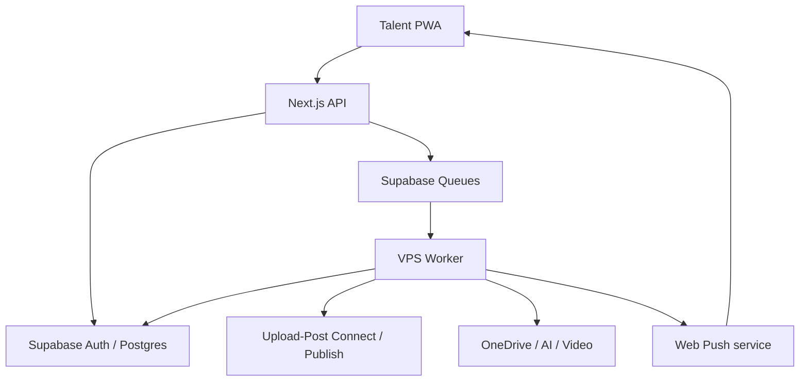
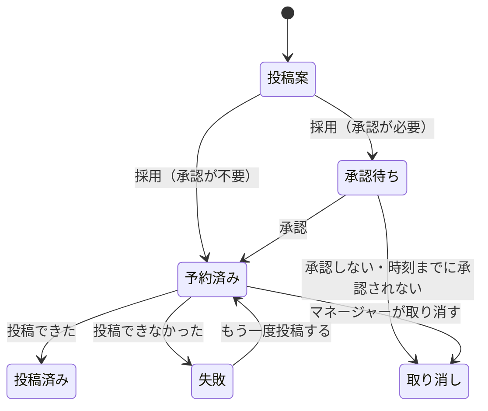

# AI Talent OS — Đặc tả triển khai Talent PWA

Bản 1.1 · 17/11/2026 (đối chiếu lại với [YK2] v2, [AG] và `SCD/`; xem `agent_spec/KET_QUA_KIEM_CHUNG_17-11.md`) · Đối tượng: lập trình viên, AI coding agent, QA, reviewer.

## 1. Phạm vi và mức độ chắc chắn

“WPA” trong yêu cầu được hiểu là **PWA: Progressive Web App dành cho Talent**. Bộ này đặc tả triển khai, không chứa ứng dụng hoàn chỉnh. Màn hình Manager chỉ được mô tả như một bên phụ thuộc để Talent nhận đúng trạng thái. Không mở rộng sang việc code toàn bộ admin.

Ký hiệu: **YC** = yêu cầu có trong [YK2] v2 hoặc [AG]; **TK** = thiết kế kỹ thuật đề xuất để triển khai được; **CĐ** = quyết định cần chốt, ghi kèm mã câu hỏi trong `Phan_tich/15_Cau_hoi_lam_ro_luong.csv` (確認N, S0x-xx, A, B, C). Agent được code contract, mock, kiểm thử cho CĐ; giữ cờ tắt trên production đến khi được duyệt. Không lấy mock làm bằng chứng provider hỗ trợ tính năng.

**Nguồn (bản 1.1):** [YK2] = `AI育成OS_概要要件定義書_v2.docx` là nguồn yêu cầu chính; [AG] = `アプリ画面案_AI育成OS.pdf` (T-01〜T-15) là bộ mã màn hình dùng chung; đặc tả từng chức năng ở `SCD/` (mục 1.2 nối F-ID với chức năng và file SCD). Bản 1.0 dựa trên docx v1 đã bị thay thế; mọi chỗ khác v2 đã được sửa theo v2. Khi spec này và SCD khác nhau về nghiệp vụ thì [YK2] và SCD thắng; spec này giữ phần kỹ thuật PWA.

| Nguồn | Dùng để xác định | Giới hạn |
|---|---|---|
| [YK2] §5–§6, UC-01〜UC-13, 別紙A | Hành vi 54 chức năng, trạng thái bài đăng (hình 5-1), danh mục thông báo | Nhiều giá trị số là giả định của FutureCore; để thành tham số |
| [AG] T-01〜T-15 | Màn hình, điều hướng, nội dung từng màn | Số liệu, giá trên màn là mẫu |
| `SCD/` EP01–EP10 | Luồng chi tiết, luồng lỗi, câu hỏi mở, mức sẵn sàng | Mỗi file ghi rõ phần đã chốt và phần đề xuất |
| ★AI育成OS_タレントアプリ画面_かわいい版.pdf | Phong cách: Momo, pastel, giống Instagram | Bản cũ; nội dung màn đã được [AG] sửa theo v2 |
| Bộ Upload-Post, bộ OneDrive trong `agent_spec/` | Hợp đồng tích hợp | Dùng cùng nhau khi triển khai |

### 1.1. Những khác biệt phải giữ rõ (cập nhật theo v2)

| ID | Nội dung | Trạng thái và hành vi triển khai |
|---|---|---|
| D01 | Đăng ký | **YC:** tài năng tự gửi đơn (T-01) → quản lý duyệt hoặc từ chối (M-03) → thư có mật khẩu tạm → lần đầu đăng nhập đặt mật khẩu mới (T-03). Không có luồng mời ([YK2] §6-1 chức năng 1-4, UC-01) |
| D02 | Sửa chú thích | Chỉ sửa qua AI (chờ 確認28). `manualDraftEdit` tắt |
| D03 | Trả phí | **YC:** không có gói miễn phí; mọi tài năng trả phí; tài khoản công ty không bị thu phí ([YK2] §5-4) |
| D04 | Số bản nháp | **YC:** tạo theo yêu cầu, không giới hạn ([YK2] §6-6 chức năng 4-1) |
| D05 | Kết nối SNS | [YK2] §6-10 chức năng 8-2 tả trang kết nối dựng sẵn hạn 48 giờ (Upload-Post `generate-jwt`). Đội chọn Connect API (state 15 phút) để dựng màn trong app: **CĐ**, phải hỏi khách (Upload-Post Q02). Hạn dùng lấy theo `expiresAt` của server |
| D06 | Trả lại khi duyệt | **YC:** theo hình 5-1, trả lại → 取り消し; tài năng sửa qua AI rồi chấp nhận lại thành bài mới (S10-01) |
| D07 | Giá video | Đề xuất đơn giá cố định × số lần (B9); giá luôn lấy từ server |
| D08 | Video tự làm | **Chưa làm** ([YK2] §6-7 chức năng 6-4, 確認32): mỗi ngày một video tự làm thành bản nháp. Q&A No.37 và CR-23 xếp đây là thay đổi ngoài báo giá, chờ khách quyết (Q&A No.50). Giữ cờ `selfMadeVideoDaily` tắt, không làm phần tự thành bản nháp |

### 1.2. Bảng nối F-ID ↔ chức năng [YK2] ↔ màn [AG] ↔ SCD

| F-ID | Chức năng [YK2] | Màn [AG] | File trong `SCD/` |
|---|---|---|---|
| F01 | 1-4 (đăng nhập) | T-02 | EP01/1-4 |
| F02 | 1-4 (mật khẩu lần đầu, đặt lại) | T-03; màn đặt lại mật khẩu (thiếu trong [AG]) | EP01/1-4 |
| F03 | 1-4 (gửi đơn), 6-2 | T-01, T-04 | EP01/1-4, EP01/6-2 |
| F04 | 6-8 | — | EP09/6-8 |
| F05 | 6-8 (màn đầu), 3-10, 6-7 | T-07, T-06 | EP09/6-8, EP07/3-10, EP07/6-7 |
| F06 | 3-4, 3-3 | T-08 | EP03/3-4, EP03/3-3 |
| F07 | 4-1 (chủ đề) | T-07 | EP04/4-1 |
| F08 | 4-1, 4-2, 6-6 | T-09 | EP04/4-1, 4-2, 6-6 |
| F09 | 4-3, 4-4, 7-7 | T-09 | EP04/4-3, 4-4; EP06/7-7 |
| F10 | 6-3 | T-10 | EP05/6-3 |
| F11 | 6-4 | T-10 (送ったもの) | EP05/6-4 |
| F12 | 5-1, 5-2, 5-3, 5-4 | T-11, T-12 | EP05/5-1, 5-2, 5-3; EP08/5-4 |
| F13 | 8-2, 8-6 | T-05 | EP06/8-2, 8-6 |
| F14 | 8-3, 6-7 | T-13 | EP06/8-3; EP07/6-7 |
| F15 | 8-5, 7-7 (gửi lại sau khi bị trả) | T-13 | EP06/8-5, 7-7 |
| F16 | 3-10, 6-7, 2-4 (xem) | T-06 | EP07/3-10, 6-7 |
| F17 | 6-1, 別紙A | T-14 | EP09/6-1; EP10/C-05 |
| F18 | 6-1 (thông báo đẩy), 6-2 bước 2 | T-04 | EP09/6-1 |
| F19 | 1-1, 5-4 | T-04 bước 3, T-15 | EP08/1-1, 5-4 |
| F20 | 1-4 (đăng xuất), §6-14 | T-15 (mục 設定) | EP10/C-06 |

## 2. Kiến trúc triển khai đề xuất

Next.js App Router + TypeScript trên Vercel phục vụ Talent UI và API ngắn. Worker Node.js trên VPS xử lý AI, video, OneDrive, thống kê, push và gửi SNS qua hàng đợi Supabase Queues. Supabase Auth/Postgres quản lý danh tính/dữ liệu. Đây là phương án thiết kế dựa trên trao đổi, cần chọn phiên bản ổn định tương thích tại lúc khởi tạo và commit lockfile.

PWA không gọi Upload-Post/Graph/OpenAI bằng secret. Microsoft folder không được dùng làm ranh giới phân quyền. AI không tự chọn talentId/driveId. Domain API dùng session -> actor -> tenant/Talent binding ở server; mọi query kiểm tra ownership. Private media chỉ qua assetId và grant ngắn hạn đã kiểm quyền. Supabase publishable key có thể nằm client theo cấu hình SDK; service-role/provider keys tuyệt đối server-only.

Codebase đề xuất: apps/web (routes, layouts, BFF); apps/worker (consumers, scheduler); packages/contracts (runtime validation + type); packages/domain (state machine, policy); packages/db (migration/repository); packages/integrations (provider adapters); packages/ui (component); packages/testing (fixture). Feature modules: auth, onboarding, coach, drafts, media, video, social, publishing, analytics, notifications, billing, profile.

Áp dụng modular monolith, application service/use case, adapter/repository cho tích hợp, state machine cho workflow, transactional outbox/inbox, idempotent command và optimistic concurrency. Không cần microservice/CQRS framework riêng cho 100 Talent. Domain không import React hoặc SDK provider. Route handler chỉ validate, authenticate, authorize, gọi use case và serialize.

Server Components cho shell/read ban đầu; Client Components cho chat, upload, preview, quyền trình duyệt. Một lớp API client duy nhất; cache dữ liệu riêng trong memory theo user/session; không persist transcript/media URL vào localStorage. Có thể dùng TanStack Query, Zod và React Hook Form (đề xuất, khóa version sau POC). Server validation luôn là thẩm quyền.

## 3. Quy tắc dùng chung

- Toàn bộ API dưới /api/v1 dùng JSON UTF-8, timestamp RFC3339 UTC; hiển thị theo timezone IANA từ server (Asia/Tokyo, không dùng timezone máy để lên lịch). Tiền là minor-unit integer dạng chuỗi + currency, không float. Ngôn ngữ giao diện là tiếng Nhật ([YK2] không yêu cầu ngôn ngữ khác); vẫn tách chuỗi ra file, không hardcode trong component.
- ID opaque/UUID; không gửi talentId trong lệnh “me”. Phân trang cursor + limit mặc định 20, tối đa 100 (TK); sort ổn định createdAt,id. Cursor bị đổi filter phải bỏ. Không dùng offset để nối chat liên tục.
- GET trả resource + version + updatedAt; command có commandId, expectedVersion nếu sửa resource. Server lưu key theo actor/usecase và hash payload; cùng key/cùng payload trả kết quả cũ; khác payload 409. Disable nút chỉ là UX, không là cơ chế chống trùng.
- Response lỗi {error:{code,message,requestId,fieldErrors?,retryAfterSeconds?}}; không trả stack/provider token. 401 đăng nhập lại; 403 capability bị chặn; 404 không tiết lộ tài nguyên khác chủ; 409 reload/chọn lại; 410 link/quote hết hạn; 422 lỗi trường/nghiệp vụ; 429 đọc Retry-After; 502/503 lỗi phụ thuộc. Không retry lệnh có thể tính tiền/đăng bài bằng commandId mới khi chưa biết kết quả.
- Accepted job 202 {operationId,status,statusUrl}; URL là đường dẫn nội bộ allowlist. GET operation kiểm quyền. Poll 2s rồi tăng tối đa 15s + jitter (TK), theo Retry-After; dừng khi hidden/offline/terminal, resume khi visible. SSE là tối ưu sau baseline polling, không là yêu cầu để hoàn tất nghiệp vụ.
- Đọc dữ liệu dùng loading/ready/empty/error/offline/stale/forbidden. Mutation thêm submitting/accepted/unknown/conflict. “Unknown” là đang kiểm tra, không là thất bại chắc chắn; không bật nút tạo lệnh mới trước đối soát.
- Một lần refresh session đang chạy cho các request đồng thời; không lặp refresh vô hạn. GET có thể thử lại sau refresh. Mutation đã gửi phải tra command/operation trước; giữ nguyên key nếu replay theo hợp đồng idempotency. Không lưu lệnh nghiệp vụ chờ gửi offline.
- Mọi thao tác nhạy cảm dùng POST, kiểm Origin/CSRF theo auth adapter, không GET mutation. Redirect/callback chỉ cùng origin/allowlist. Encode user text, Markdown sanitize, không render HTML chưa tin cậy; không log email/password/token/caption/media nhạy cảm.
- Tắt capability không chỉ ẩn nút: server từ chối command. Ứng dụng chỉ hiện bước onboarding phù hợp; từ chối push/cài PWA không khóa chat. Yêu cầu payment/SNS để publish do server policy riêng.

## 4. Route, điều hướng và quyền

Public: /apply (T-01, gửi đơn), /login (T-02), /first-password (T-03, đặt mật khẩu lần đầu bằng mật khẩu tạm), /forgot-password, /reset-password, /auth/callback. Private: /onboarding (T-04), /home (T-07, màn đầu), /mypage (T-06), /coach (T-08), /drafts/:id (T-09), /media/upload và /media (T-10), /video/new (T-11), /video/:id (T-12), /schedule và /posts/:id (T-13), /notifications (T-14), /billing (T-15), /connections (T-05), /settings, /help. Callback kết nối SNS có route riêng /connections/return; auth callback không dùng lẫn. /offline là trang chung không có dữ liệu tài năng.

Màn mở đầu sau đăng nhập là **/home (T-07 ホーム)**, cho thấy việc hôm nay ([YK2] §6-12 chức năng 6-8; đề xuất B13). /mypage (T-06 マイページ) là trung tâm điều hướng ([YK2] §6-14). Màn mở đầu là tham số `startRoute` để đổi nếu khách trả lời B13 khác.

Menu dưới 5 mục theo [AG]: ホーム → /home, チャット → /coach, 送る → /media/upload, 予定 → /schedule, マイページ → /mypage. Chuông thông báo ở /home và /mypage mở /notifications. Khi vào chi tiết giữ nút quay lại và vị trí cuộn theo session; deep link luôn qua auth/ownership. URL không chứa bearer token hoặc ảnh private. Desktop dùng cùng chức năng với max-width, không lộ admin.

Bootstrap sau session trả actor/role, profile, accountState, onboarding completed steps, capabilities, policyVersion, timezone, locale, unreadCount, integration provisioning summary. Chưa active vẫn cho đọc trạng thái tài khoản/help/logout, server chỉ cho các lệnh tương ứng accountState. Route guard ở server và client chống flash dữ liệu.

## 5. Danh mục tính năng chi tiết

Mỗi F-ID dưới đây là một lát cắt có thể giao cho agent. Các endpoint NEW là API nội bộ đề xuất, không phải endpoint provider. Những endpoint REUSE phải dùng đúng contract Upload-Post/OneDrive, tránh tạo backend song song.

### F01. Đăng nhập và session

- **Route:** `/login` (T-02).
- **Căn cứ:** YC [YK2] §6-1 chức năng 1-4; `SCD/EP01/1-4`; TK auth adapter.
- **UI/đầu vào:** Email, password; autocomplete username/current-password; nút hiển thị mật khẩu; link パスワードを忘れたとき; link はじめての方は、利用を申し込む → /apply; dòng báo "sai 5 lần thì khóa 15 phút".
- **Luồng và quy tắc:** Email trim theo policy auth, không tự đổi password; server xác minh session và Talent binding, đọc bootstrap trước điều hướng. Đăng nhập bằng mật khẩu tạm thì bắt buộc sang /first-password (F02); ngược lại vào /home. Giá trị theo [YK2] §6-1 (đều là tham số): mật khẩu ≥8 ký tự có chữ và số, sai 5 lần khóa 15 phút, giữ đăng nhập 30 ngày trên cùng thiết bị. Supabase Auth không có sẵn khóa theo tài khoản. Chặn được cả lời gọi thẳng tới Auth chỉ khi dùng Password Verification Hook, mà hook này chỉ có ở gói Team/Enterprise; ở gói Pro chỉ khóa được qua BFF (bộ Supabase, AU05, Q08). Tài năng ở 利用終了 bị từ chối. Manager MFA là luồng admin.
- **Lỗi và nhánh đặc biệt:** Sai thông tin dùng thông báo generic; locked có thời gian từ server; account disabled bỏ toàn bộ cache; network error không tăng counter client. Không gửi password tới analytics. Session hết hạn giữa công việc lưu resource đã ACK trên server, cảnh báo text chưa gửi sẽ mất.
- **API:** NEW POST /auth/login; POST /auth/logout; GET /me/bootstrap; GET /operations/by-command/{commandId}. Tất cả đường dẫn rút gọn trong mục này có prefix `/api/v1` trừ static đã nêu.
- **Nghiệm thu:** Đăng nhập đúng → Đến /home (T-07) sau bootstrap; chỉ dữ liệu của mình; Đăng nhập bằng mật khẩu tạm → Bắt buộc qua /first-password trước màn khác; Sai 5 lần → Server chặn trong lock window dù reload/đổi tab; Tài năng 利用終了 → Bị từ chối đăng nhập; Hai Talent cùng thiết bị → Logout A rồi B không thấy dữ liệu A; 401 khi mutation đã gửi → Tra command trước gửi lại; không tạo hai lệnh.

### F02. Mật khẩu lần đầu và đặt lại mật khẩu

- **Route:** `/first-password; /forgot-password; /reset-password` (T-03; màn đặt lại mật khẩu chưa có trong [AG], làm cùng kiểu T-02).
- **Căn cứ:** YC [YK2] §6-1 chức năng 1-4, UC-01, 確認13; `SCD/EP01/1-4`, S01-05.
- **UI/đầu vào:** Mật khẩu mới + nhập lại; quy tắc mật khẩu; ô xác nhận "マネージャーは、あなたと AIコーチの会話を見られます" (確認13). Password không nằm query.
- **Luồng và quy tắc:** Thư duyệt đơn có mật khẩu tạm. Lần đầu đăng nhập bằng mật khẩu tạm → bắt buộc đặt mật khẩu mới và tích xác nhận → /onboarding. Mật khẩu tạm hạn 7 ngày (tham số, S01-05); quá hạn thì dùng quên mật khẩu. Quên mật khẩu trả cùng thông điệp cho email tồn tại/không tồn tại; link đặt lại một lần sử dụng; reset thành công đổi session theo policy auth. Callback PKCE lấy code theo SDK server; không tự decode JWT để tin quyền.
- **Lỗi và nhánh đặc biệt:** Link sai/hết hạn/đã dùng có màn hình riêng và hướng dẫn xin lại. Không tự tạo tài khoản từ email nhập ở reset. Redirect URL sau auth phải allowlist, token bị dọn khỏi URL và referrer; rate limit server.
- **API:** NEW POST /auth/first-password; POST /auth/password-reset-requests; POST /auth/password-reset. Tất cả đường dẫn rút gọn trong mục này có prefix `/api/v1` trừ static đã nêu.
- **Nghiệm thu:** Mật khẩu tạm đúng → Bắt buộc đặt mật khẩu mới và tích xác nhận trước khi vào màn khác; Mật khẩu tạm quá 7 ngày → Không đăng nhập được, hướng dẫn quên mật khẩu; Email không tồn tại → Response không tiết lộ existence; Redirect ngoài hệ thống → Bị chặn, quay URL an toàn.

### F03. Gửi đơn và hướng dẫn lần đầu

- **Route:** `/apply; /onboarding` (T-01, T-04).
- **Căn cứ:** YC [YK2] §6-1 chức năng 1-4, 6-2; §6-4 chức năng 2-2; UC-01, UC-03; `SCD/EP01/1-4`, `SCD/EP01/6-2`.
- **UI/đầu vào:** /apply: tên (nghệ danh hoặc tên thật), email, ngày sinh, ô đồng ý điều khoản kèm link (確認1). /onboarding: 4 bước theo thứ tự [YK2] 6-2: thêm vào màn hình chính → cho phép thông báo → đăng ký thanh toán (không có với tài khoản công ty) → kết nối SNS.
- **Luồng và quy tắc:** Gửi đơn → đơn chờ duyệt (chưa đăng nhập được) → quản lý duyệt hoặc từ chối ở M-03 → thư. Email đã dùng (kể cả đơn bị từ chối) không gửi đơn được ([YK2] §6-4 chức năng 2-2). Onboarding: server lưu bước hoàn tất để mở lại tiếp tục; quyền thiết bị đọc lại từ trình duyệt, không lấy completedStep làm bằng chứng. Cho bỏ qua cài app và thông báo (確認12). Thanh toán bắt buộc trước khi dùng AIコーチ ([AG] T-04). SNS không bắt buộc đủ 3 mạng (確認11). Thanh toán xong thì server chuyển tài năng sang 利用中, tạo thư mục OneDrive, đăng ký Upload-Post (S01-01, S06-02). Vị thành niên: chỉ là nhãn tham khảo cho quản lý (確認2); đồng ý của phụ huynh do アデッソ lấy khi ký hợp đồng, app không lưu ([YK2] §10-3).
- **Lỗi và nhánh đặc biệt:** Provisioning OneDrive/Upload-Post pending không biến thành mất account; hiện tiến độ và retry có kiểm soát ở server. Không gửi lại form chỉ vì back/refresh. Điều khoản đổi phiên bản thì xin đồng ý lại. Rate limit đơn theo IP và email.
- **API:** NEW POST /applications; GET /me/onboarding; PATCH /me/onboarding; POST /me/consents. Tất cả đường dẫn rút gọn trong mục này có prefix `/api/v1` trừ static đã nêu.
- **Nghiệm thu:** Gửi đơn hợp lệ → Đơn chờ duyệt, chưa đăng nhập được; Email đã từng gửi đơn → Không tạo đơn; Bỏ qua push → Vẫn đi tiếp; Chưa thanh toán → Không dùng được AIコーチ; Đóng app giữa wizard → Mở lại ở bước còn lại; Provisioning lỗi → Hiện pending/error và không tạo folder trùng.

### F04. Cài đặt PWA và cập nhật phiên bản

- **Route:** `/onboarding; /settings/install`.
- **Căn cứ:** YC cài Home Screen; TK PWA.
- **UI/đầu vào:** Nút hướng dẫn cài, manifest icons, trạng thái installed/standalone, banner có bản mới.
- **Luồng và quy tắc:** Manifest name/short_name theo tên ứng dụng アデッソ hiện có ([YK2] §6-14, khách cung cấp), id, start_url=/home, scope=/, display=standalone, theme/background và icon 192/512 + maskable riêng. beforeinstallprompt chỉ dùng khi có; iOS hướng dẫn Add to Home Screen, không hiện nút giả. HTTPS, SW cùng origin. Bản mới waiting hiện banner; chỉ kích hoạt sau người dùng đồng ý và không có upload/payment/chat chưa ACK; asset versioned. Không force reload giữa submit. Rollback tương thích contract ít nhất phiên bản client đang hỗ trợ; API trả minimumClientVersion khi không tương thích.
- **Lỗi và nhánh đặc biệt:** Unsupported vẫn dùng web bình thường. SW install thất bại không chặn login. Tách admin origin ưu tiên; nếu chung origin, root SW phải network-only /admin và không thay navigation bằng shell. Đọc PWA_CACHE_POLICY.json; tuyệt đối không precache authenticated HTML/RSC/API.
- **API:** Static /manifest.webmanifest; /sw.js; NEW GET /client-config. Tất cả đường dẫn rút gọn trong mục này có prefix `/api/v1` trừ static đã nêu.
- **Nghiệm thu:** iOS chưa cài → Hiện hướng dẫn đúng, không gọi push permission vô ích; Bản mới lúc upload → Không reload làm mất upload; Offline lần đầu → Trang offline generic, không giả dữ liệu; Logout rồi offline → Không mở được HTML chứa profile cũ.

### F05. Trang chủ (T-07) và trang của tôi (T-06)

- **Route:** `/home; /mypage`.
- **Căn cứ:** YC [YK2] §6-12 chức năng 6-8, §6-14, chức năng 3-10, 6-7; [AG] T-06, T-07; `SCD/EP09/6-8`, `SCD/EP07/3-10`, `SCD/EP07/6-7`.
- **UI/đầu vào:** /home: dải việc cần xử lý (chờ duyệt, bị trả lại, đăng lỗi), 今日のミッション, 3 chủ đề hôm nay (F07), 今日の投稿案 kèm giờ đăng dự kiến (B1), nút 自分で作った動画を保存する. /mypage: tên/ảnh, số bài, 続けて投稿 N日, người theo dõi từng mạng / mục tiêu và tổng 3 mạng (S07-04), nút SNS の接続 và ご利用とお支払い, các ô đi tới (モモ, 今日の案, 動画, 予定, 素材), lưới bài theo trạng thái.
- **Luồng và quy tắc:** Lấy view model tổng hợp có updatedAt từng widget; không waterfall nhiều request chặn toàn trang. Avatar private qua grant ngắn hạn. Mục tiêu tách TikTok/Instagram/YouTube; tổng người theo dõi chỉ cộng mạng đã kết nối và ghi rõ là tổng cộng, không gọi là người xem duy nhất. Việc cần xử lý ưu tiên đăng lỗi, bị trả lại, thiếu tư liệu, rồi chủ đề hôm nay. Tap card đi resource bằng ID, quyền được kiểm lại.
- **Lỗi và nhánh đặc biệt:** Một widget lỗi không làm trắng trang. Chưa kết nối hiện CTA; chưa có số liệu hiện "—", không số 0 giả. Profile missing không tự tạo từ email. Dữ liệu demo chỉ trong story/test env.
- **API:** NEW GET /me/home; GET /me/dashboard; GET /me/profile; REUSE GET /me/social-connections. Tất cả đường dẫn rút gọn trong mục này có prefix `/api/v1` trừ static đã nêu.
- **Nghiệm thu:** Mở app khi đã đăng nhập → Màn đầu là /home; Một widget lỗi → Các phần còn lại vẫn dùng được; Chưa metrics → Hiện "—", không 0; Goal nhiều SNS → Hiển thị riêng từng mạng kèm tổng; Badge stale → Refetch khi focus, không sửa số âm.

### F06. Chat với AI coach Momo

- **Route:** `/coach`.
- **Căn cứ:** YC [YK2] §6-5.
- **UI/đầu vào:** Text ≤1000 Unicode code points theo TK thống nhất client/server; không đếm UTF-16; hỗ trợ IME Nhật. Không có upload bất kỳ file vào chat ngoài media workflow đã định nghĩa.
- **Luồng và quy tắc:** Lịch sử cursor theo thread; mở ở tin gần nhất, tải cũ giữ scroll; nếu người dùng đang đọc cũ không tự nhảy khi có tin mới. Gửi clientMessageId + commandId, server persist user message + operation/outbox rồi ACK. AI chạy worker dùng snapshot đúng Talent/common hợp lệ theo OneDrive spec. UI pending -> processing -> completed/failed/unknown; reconnect chỉ đọc operation/messages. Baseline polling, SSE có eventId/resume nếu làm. Regenerate reply là lệnh riêng chỉ khi capability cho phép; không tự resend khi mạng ngắt.
- **Lỗi và nhánh đặc biệt:** Off-topic trả lời ngắn đưa về công việc SNS; tư vấn sức khỏe/rời công ty thông báo Manager theo yêu cầu, vẫn giữ hội thoại; không tự tạo chẩn đoán hay hứa bảo mật trái quy trình. Model output không có quyền đổi dữ liệu nghiệp vụ. AI lỗi giữ user message và cho retry cùng operation policy, phân biệt user message với AI response. Markdown sanitize; không hiện chain-of-thought; renderer link allowlist scheme.
- **Bổ sung theo [YK2]:** Mỗi sáng nhận tin buổi sáng (nhận xét hôm qua, 3 chủ đề, nhiệm vụ; thứ Hai có tổng kết tuần) do worker gửi (3-4, 3-6, 3-8). Đăng thành công nhận tin "đã đăng" và số ngày đăng liên tục. Chuyện sức khỏe, rời công ty, dấu hiệu nguy hiểm: báo quản lý (3-3; S03-02, S03-04). Chỉ nhắn bằng chữ (S03-09).
- **API:** NEW GET /me/coach/messages?before=&limit=; POST /me/coach/messages; GET /operations/{id}. Tất cả đường dẫn rút gọn trong mục này có prefix `/api/v1` trừ static đã nêu.
- **Nghiệm thu:** Mạng ngắt sau ACK → Mở lại thấy đúng một user message; Text 1001 code points → Cả client/server chặn với field error; IME đang ghép chữ → Enter không gửi sớm; Response của Talent khác → Server trả 404, không stream dữ liệu; User đọc lịch sử → Tin mới có indicator, không giật scroll.

### F07. Ba chủ đề hằng ngày và kế hoạch riêng

- **Route:** `/suggestions`.
- **Căn cứ:** YC [YK2] §6-6; TK daily batch.
- **UI/đầu vào:** Ngày theo timezone vận hành, ba topic cards, rationale ngắn, nút chọn hoặc tự nhập ý tưởng.
- **Luồng và quy tắc:** Server batch tạo daily_suggestion_set unique(talentId,businessDate,generation) dựa trend/metrics/snapshot; không gọi model đồng loạt từ 100 browser. Scheduler enqueue có jitter, worker có giới hạn theo provider. Read endpoint chỉ đọc trạng thái preparing/ready/failed. Chọn topic tạo draft async có sourceSuggestionId và version; tự nhập idea tạo nguồn own_idea. Ngày đổi khi app mở refetch; không mất draft cũ. Không giới hạn số lần tạo bởi UI cũ nếu business policy chưa chốt.
- **Lỗi và nhánh đặc biệt:** Batch chưa xong hiện giờ cập nhật/đang chuẩn bị và cho own idea nếu capability. Topic hết hiệu lực/version đổi trả 409, reload lựa chọn. Snapshot thiếu thì server quyết định degraded mode có nhãn; không tự bịa trend mới nhất.
- **Bổ sung theo [YK2]:** Chủ đề tạo trong lô buổi sáng trước giờ nhắn (mặc định 8:00); chỉ dẫn của アデッソ ưu tiên hơn gợi ý AI ([YK2] §5-3). Lô buổi sáng chốt giờ đăng dự kiến của ngày (B1) và hiện ở /home, /drafts/:id. Chọn chủ đề thì chọn luôn loại bài ảnh hoặc video (B2). Tin tức trong ngày chỉ làm nếu 確認16 được đồng ý.
- **API:** NEW GET /me/suggestions?date=; POST /me/drafts. Tất cả đường dẫn rút gọn trong mục này có prefix `/api/v1` trừ static đã nêu.
- **Nghiệm thu:** 100 Talent mở cùng giờ → GET không tạo 100 job trùng mỗi refresh; Chọn topic cũ → 409 và hiển thị bộ mới; AI batch thất bại → Có trạng thái lỗi, không topic mẫu giả; Double tap chọn → Một draft/commandId.

### F08. Chi tiết draft và sửa qua AI

- **Route:** `/drafts/:id`.
- **Căn cứ:** YC [YK2] §6-6; CĐ D02.
- **UI/đầu vào:** Caption, hashtags, shot instructions, script, media, conversation revision request; expectedVersion.
- **Luồng và quy tắc:** Draft revision immutable nội dung cũ; mỗi lần AI sửa tạo revision mới và kiểm tra version. Baseline đề xuất chỉ sửa qua AI; manual editor adapter chỉ bật sau D02. Có thể đổi media ở draft chưa adopt bằng command versioned. Preview gồm nội dung + media, chỉ mô phỏng bố cục, không cam kết pixel giống SNS. Validate giới hạn từng platform ở server trên revision cuối, không chỉ tổng ký tự UI; hiển thị cụ thể nền tảng không phù hợp.
- **Lỗi và nhánh đặc biệt:** Đang AI sửa không cho adopt revision chưa hoàn thành. Hai tab cập nhật xung đột 409, cho xem bản mới và nhập lại yêu cầu, không last-write-wins. AI failure không ghi đè revision đang dùng. Draft returned phải tạo revision mới rồi duyệt lại nếu policy bắt buộc.
- **API:** NEW GET /drafts/{id}; POST /drafts/{id}/revisions; PATCH /drafts/{id}/media. Tất cả đường dẫn rút gọn trong mục này có prefix `/api/v1` trừ static đã nêu.
- **Nghiệm thu:** Hai tab sửa → Tab sau nhận conflict, không mất bản trước; AI revision lỗi → Bản đang dùng còn nguyên; Manual edit bị tắt → Server từ chối dù gọi API trực tiếp; Caption quá giới hạn SNS → Báo platform cụ thể trước adopt.

### F09. Adopt, kiểm duyệt và chọn lịch

- **Route:** `/drafts/:id/preview`.
- **Căn cứ:** YC [YK2] §6-6,6-9; TK atomic command.
- **UI/đầu vào:** RevisionId, expectedVersion, mediaIds sẵn sàng; chấp nhận preview; server schedule plan nếu có.
- **Luồng và quy tắc:** Server kiểm quyền, account/capabilities, media ready/ownership, content platform validation, NG context, approval requirement và global stop tại lúc command. Persist snapshot nội dung/media/policy cho post, không trỏ mutable draft. Nếu cần duyệt -> pending_approval; nếu không -> ready và server lên lịch qua domain publishing. NG flagged -> blocked có lý do an toàn và Manager notification, không enqueue publish. AI scan async thì scanning chưa scheduled. Talent không tự chọn giờ arbitrary trong baseline, hiển thị giờ server đề xuất. Adopt 202 rồi theo operation đến kết quả.
- **Lỗi và nhánh đặc biệt:** Approval policy thay đổi sau mở preview phải kiểm lại server. Một commit chứa post/outbox + command result; không mark scheduled trước provider confirmed. Media bị xóa trước adopt ->422. Không có đích phù hợp thì hướng dẫn kết nối hoặc thêm video; không tạo lịch rỗng.
- **Trạng thái theo hình 5-1 [YK2]:** adopt đưa bài từ 投稿案 sang 承認待ち (cần duyệt) hoặc 予約済み. Dính từ cấm thì giữ 投稿案 kèm cờ `ng_blocked`. Giờ đăng là giờ dự kiến của ngày; chấp nhận sau giờ đó thì hẹn sau 15 phút, sau 22:00 thì sang hôm sau (S04-01). Bài thứ hai trong ngày cách bài trước ít nhất 3 giờ (S04-04). Đang dừng đăng tự động thì giữ 予約済み cờ `held` (B6). Xem `SCD/EP10/C-01`.
- **API:** NEW POST /drafts/{id}/adopt; GET /posts/{id}; publishing application service dùng REUSE /posts/{id}/schedule contract. Tất cả đường dẫn rút gọn trong mục này có prefix `/api/v1` trừ static đã nêu.
- **Nghiệm thu:** Cần Manager duyệt → Chỉ pending_approval, chưa đăng; NG context bị chặn → Không có publish job; Policy đổi lúc preview → Server áp dụng policy mới; Không media ready → Không adopt được; Double tap adopt → Chỉ một post snapshot.

### F10. Upload và chụp/chọn media

- **Route:** `/media/upload` (T-10).
- **Căn cứ:** YC [YK2] §6-7 chức năng 6-3; `SCD/EP05/6-3`; file 18 mục 4; câu C2.
- **UI/đầu vào:** Ba thẻ 端末から選ぶ / 撮影する / 送ったもの; chọn nhiều ảnh (có thứ tự) hoặc một video; ô 自分で作った動画として保存する; tùy chọn camera trực tiếp.
- **Luồng và quy tắc:** Xin upload session từ server với metadata (name, size, mime, checksum nếu hỗ trợ); server kiểm quota, định dạng, ownership. **Trình duyệt tải thẳng lên Supabase Storage** (bucket riêng tư, đường dẫn đối tượng do server sinh theo talent_id) bằng giao thức tải tiếp được TUS; không đi qua hàm Vercel. Hoàn tất tải chưa là asset ready: worker kiểm type/magic, size, đổi HEIC sang JPEG, rồi chép sang OneDrive (`素材/`) và đánh dấu ready. Chỉ asset ready mới chọn để đăng. Thống nhất với bộ OneDrive §11 và `SCD/EP05/6-3`.
- **Lỗi và nhánh đặc biệt:** Picker không yêu cầu quyền đọc toàn thư viện. getUserMedia chỉ khi người dùng chọn camera trực tiếp; stop tracks khi rời màn hình. Từ chối camera vẫn chọn file được. Hủy transfer không đồng nghĩa đã xóa dữ liệu server; dọn theo TTL. 413/415/429 có thông điệp; giới hạn lấy từ client-config (tạm theo S05-01). iOS background có thể dừng upload, không hứa tiếp tục khi tắt app. POC: token tải lên ký sẵn dùng được với TUS của Supabase; nếu không, dùng session Supabase của tài năng + policy bucket theo talent_id.
- **API:** NEW POST /me/media/upload-sessions; GET /me/media/upload-sessions/{id}; POST /me/media/upload-sessions/{id}/complete; POST /me/media/upload-sessions/{id}/abort. Tất cả đường dẫn rút gọn trong mục này có prefix `/api/v1` trừ static đã nêu.
- **Nghiệm thu:** Mạng rớt giữa chừng → Resume từ offset Supabase ghi nhận, không ghép byte trùng; File đổi extension → Server từ chối magic type sai; Camera denied → File picker còn dùng được; Upload xong chưa kiểm tra → Không chọn asset để publish; Video lớn → Không đi qua hàm Vercel.

### F11. Thư viện và media detail

- **Route:** `/media; /media/:id`.
- **Căn cứ:** YC [YK2] §6-7; OneDrive ownership.
- **UI/đầu vào:** Grid ảnh/video, filter type, sort createdAt, chọn một/nhiều theo usecase; thumbnail và ready state.
- **Luồng và quy tắc:** List cursor scoped actor, metadata ở DB, file OneDrive private. Thumbnail/grant hết hạn lấy mới qua server sau auth; không cache private ảnh ở SW. UI memory ObjectURL phải revoke khi unmount/replace. Media detail xem loại/kích thước/trạng thái/usage và preview. Xóa chỉ khi mediaDelete capability bật và policy xác định; nếu post snapshot tham chiếu phải soft-delete hoặc chặn, không xóa bản đang chờ đăng. Tái dùng asset không tự tạo đăng.
- **Lỗi và nhánh đặc biệt:** File bị di chuyển/xóa ngoài OneDrive hiện unavailable và báo lỗi chọn media, không dùng tên folder đoán lại. Preview lỗi có retry xin grant, không expose path thật. Empty library CTA upload; pending/quarantined không có action dùng.
- **API:** NEW GET /me/media; GET /media/{id}; POST /media/{id}/preview-grants; DELETE /media/{id} (gated). Tất cả đường dẫn rút gọn trong mục này có prefix `/api/v1` trừ static đã nêu.
- **Nghiệm thu:** Grant hết hạn → Xin grant mới sau kiểm quyền; Asset thuộc người khác → Không lấy thumbnail hoặc bytes; File ngoài OneDrive bị xóa → Hiện unavailable, chặn adopt; Xóa asset đang được post dùng → Policy bảo vệ snapshot.

### F12. Tạo video có xác nhận giá

- **Route:** `/video/new; /video/:id`.
- **Căn cứ:** YC [YK2] §6-8; CĐ D07.
- **UI/đầu vào:** Chọn short/slideshow, photoIds, script/draft revision; ước lượng thời lượng, quote, nhãn AI-generated.
- **Luồng và quy tắc:** Yêu cầu quote server chứa quoteId,inputDigest,currency,amountMinor,priceMode,expiresAt,policyVersion. Đề xuất đơn giá cố định × số lần (B9): priceMode=fixed, số hiện là số thu; nếu khách giữ giá ước lượng thì hiện câu "請求額が表示の金額と変わる場合があります" như [AG] T-11. Tính một lần khi xác nhận; tạo lại cũng tính; dịch vụ lỗi hoặc quá 15 phút thì trả lại lần tính (5-4, S05-08). Không có lượt miễn phí, không có trần tháng ([YK2] §5-4). Confirm phải gửi quoteId+commandId, server xác minh lại inputs và entitlement. Worker chạy async; UI hiển thị queued/generating/processing_media/ready/failed/unknown. Ready có preview, dùng cho draft, regenerate hoặc discard. Regenerate cần quote/confirm mới; discard không được hứa hoàn phí. Ledger server quyết định charge; externalfail theo yêu cầu không tính phí, cần adapter phân biệt lỗi chắc chắn và unknown.
- **Lỗi và nhánh đặc biệt:** Quote hết hạn/giá đổi/ảnh đổi ->410 hoặc409 và xin quote mới, không tự chấp nhận giá mới. Timeout lúc confirm tra command; không tự gọi generator lần hai. App đóng job vẫn ở server; inbox báo hoàn tất. Video không dùng được tới khi asset ready. Không giả tạo free video quota từ PDF.
- **API:** NEW POST /me/video-quotes; POST /me/video-generations; GET /video-generations/{id}; POST .../{id}/discard. Tất cả đường dẫn rút gọn trong mục này có prefix `/api/v1` trừ static đã nêu.
- **Nghiệm thu:** Quote hết hạn → Không charge; yêu cầu xác nhận mới; Double confirm → Một generation/ledger command; Timeout sau confirm → Tra operation, không sinh lần hai; External failure chắc chắn → Ledger không ghi charge theo policy; Regenerate → Quote mới và xác nhận mới.

### F13. Kết nối TikTok/Instagram/YouTube

- **Route:** `/connections; /connections/return`.
- **Căn cứ:** Connect API đã chốt; Upload-Post spec §7.
- **UI/đầu vào:** Ba thẻ platform; account displayName/handle, verifiedAt, trạng thái, nút connect/reconnect.
- **Luồng và quy tắc:** GET /me/social-connections rồi POST platform/attempts -> authorizationUrl,expiresAt,attemptId. Backend tạo profile/attempt và nắm provider credentials; UI điều hướng URL được server allowlist trong cùng tab để ít bị popup block. OAuth provider consent ngoài app, quay callback của backend đã allowlist; backend xác minh attempt/actor/nonce và provider state theo spec. UI gửi returnToken theo contract confirm khi cần, hiển thị verifying cho 202 rồi đọc lại server. Callback query success không là bằng chứng connected. PWA có thể quay Safari khác storage context: yêu cầu login lại đúng actor rồi resume attempt, không chuyển attempt sang tài khoản mới.
- **Lỗi và nhánh đặc biệt:** User cancel/expired/unsupportedaccount/permission thiếu/provider error có lý do và CTA mới chỉ sau attempt terminal. Refresh không tạo OAuth attempt mới. One account/platform; thay tài khoản/disconnect bị gate theo Q03 của Upload-Post. Khi reconnect không xóa dữ liệu connected cũ trước xác minh account mới và kiểm lịch. Không hiện token/provider username nội bộ; không dùng hosted page.
- **Ghi chú D05:** [YK2] §6-10 chức năng 8-2 tả trang kết nối dựng sẵn hạn 48 giờ; Connect API là quyết định của đội, phải hỏi khách (Upload-Post Q02). Instagram phải là tài khoản doanh nghiệp hoặc nhà sáng tạo ([AG] T-05).
- **API:** REUSE GET /me/social-connections; POST /me/social-connections/{platform}/attempts; POST /me/social-connections/attempts/{id}/confirm; disconnect/replacement-confirmation gated. Tất cả đường dẫn rút gọn trong mục này có prefix `/api/v1` trừ static đã nêu.
- **Nghiệm thu:** User cancel consent → Không hiện connected; Callback báo success giả → Backend từ chối hoặc tiếp tục verifying; Return bằng user B → Không bind account vào B; Expired attempt → Hiện hết hạn, tạo lại theo lệnh người dùng; Đổi account có lịch chưa rõ → Không âm thầm thay đích.

### F14. Lịch và chi tiết bài đăng

- **Route:** `/schedule; /posts/:id`.
- **Căn cứ:** YC [YK2] §6-9,6-10; Upload-Post state.
- **UI/đầu vào:** List theo ngày/timezone, status filter, post snapshot và kết quả riêng TikTok/Instagram/YouTube.
- **Luồng và quy tắc:** Baseline list/day view accessible trước calendar tháng. Post detail có pending_approval,returned,blocked,ready,scheduling,scheduled,publishing,published,partial_failed,failed,unknown,skipped,cancelled; derive aggregate từ deliveries, không một cờ success chung. Show approval reason/deadline, lịch hiện tại, attempt/generation, permalink khi đã xác minh. Manager approve -> server cập nhật; Talent refetch/push chỉ là tín hiệu đọc lại. Pending quá giờ không tự đăng. Global stop banner; mở lại không tự đăng bù bài cũ.
- **Lỗi và nhánh đặc biệt:** YouTube khi không video và platform chưa kết nối là skipped với reason, không failed. PerSNS published+failed là partial_failed. Unknown chặn retry tự động. Không có quyền Talent cancel/sửa giờ trong baseline, admin cancel theo spec cũ; nếu nghiệp vụ đổi cần thêm CĐ. Permalink chỉ http(s) từ dữ liệu provider kiểm tra.
- **Trạng thái hiển thị:** 6 trạng thái của hình 5-1 ([YK2] §5-1): 投稿案, 承認待ち, 予約済み, 投稿済み, 失敗, 取り消し (nhãn 差し戻し khi bị trả lại). Các trạng thái kỹ thuật (scheduling, publishing, unknown…) là trạng thái con, không hiện thành nhãn riêng. Kết quả từng mạng hiện riêng (xanh/đỏ/xám như [AG] M-08). Tài năng không hủy được; T-13 ghi "予約の取り消しは、マネージャーにご連絡ください".
- **API:** NEW GET /me/posts?from=&to=&status=&cursor=; GET /posts/{id}; REUSE GET /posts/{id}/deliveries. Tất cả đường dẫn rút gọn trong mục này có prefix `/api/v1` trừ static đã nêu.
- **Nghiệm thu:** IG success TT fail → Hiện partial và từng kết quả; Chưa duyệt đã đến giờ → Không xuất bản; YouTube không video → Skipped đúng reason; Mở lại global stop → Không tự đăng bù; Webhook cũ → UI không lùi published sang failed.

### F15. Gửi lại bài bị trả và đặt lại bài lỗi

- **Route:** `/posts/:id` (T-13).
- **Căn cứ:** YC [YK2] §5-1 (hình 5-1), §6-9 chức năng 7-7, §6-10 chức năng 8-5; `SCD/EP06/7-7`, `SCD/EP06/8-5`.
- **UI/đầu vào:** Bị trả lại: lý do của quản lý, CTA "直して、もう一度依頼する". Lỗi: các mạng đã chắc chắn lỗi và lý do.
- **Luồng và quy tắc:** Bị trả lại là 取り消し (lý do returned), không phải lỗi đăng. Tài năng tạo bản nháp mới từ bài cũ (revision-drafts), sửa qua AI, chấp nhận và xin duyệt lại (確認35); bài cũ giữ nguyên lịch sử. Đặt lại bài lỗi: [YK2] 8-5 cho "tài năng hoặc quản lý", [AG] M-08 chỉ cho quản lý (S06-04): phía tài năng nằm sau cờ `talentRescheduleFailed` (mặc định tắt) và T-13 hướng dẫn liên hệ quản lý. Khi được bật: chỉ chọn failedDeliveryIds, giờ theo plan server, commandId theo REUSE contract; published/skipped/unknown không đưa vào; mỗi lệnh tạo generation mới.
- **Lỗi và nhánh đặc biệt:** Nếu endpoint reschedule-failed cũ chưa có expectedVersion, server khóa/so sánh state trong transaction (X01). Khi kết quả mơ hồ chỉ đọc operation. Không auto retry publish theo lỗi mạng UI. Không có nút Retry all.
- **API:** REUSE POST /posts/{id}/reschedule-failed (sau cờ); NEW POST /posts/{id}/revision-drafts. Tất cả đường dẫn rút gọn trong mục này có prefix `/api/v1` trừ static đã nêu.
- **Nghiệm thu:** Bị trả lại → Bài cũ là 取り消し, tạo được bản nháp mới để xin duyệt lại; Cờ talentRescheduleFailed tắt → Server từ chối lệnh đặt lại từ tài năng; Đặt lại khi được phép → Chỉ delivery failed có generation mới; Unknown delivery → Chặn đặt lại tới khi đối soát.

### F16. Thống kê và mục tiêu

- **Route:** `/analytics; /mypage/goals`.
- **Căn cứ:** YC [YK2] §6-4,6-11.
- **UI/đầu vào:** Khoảng ngày, platform, snapshot followers/posts/views/engagement tùy capability, goal/deadline.
- **Luồng và quy tắc:** Đọc metrics server đã sync ngày; hiển thị collectedAt, dataThrough, freshness và unavailableReason từng metric. Biểu đồ có data table/text tương đương; không cộng metric khác semantics. Chọn platform chưa kết nối hướng dẫn connect. Baseline goal do Manager quản lý theo nguồn; Talent chỉ xem. Nếu cho Talent sửa goal cần cờ/contract mới. Weekly report Monday và daily review hiển thị qua coach/inbox từ job server; không client tự tính thành tích chính thức.
- **Lỗi và nhánh đặc biệt:** API provider không trả metric thì null+reason, không0; stale giữ giá trị kèm timestamp. Khoảng ngày đảo/ngoài retention bị422. Performance tốt không đồng nghĩa targetachieved nếu follower data chưa xác minh. Không có thông báo theo mốc (v2 đã bỏ; chỉ báo khi đạt mục tiêu, 3-7). Chạm một mạng ở /mypage mở biểu đồ 30 ngày (S07-05); tổng 3 mạng chỉ cộng mạng đã kết nối (S07-04).
- **API:** REUSE GET /talents/{id}/metrics; NEW GET /me/goals; GET /me/reports. Tất cả đường dẫn rút gọn trong mục này có prefix `/api/v1` trừ static đã nêu.
- **Nghiệm thu:** Metric unavailable → Null+reason trong UI/chart; Stale snapshot → Có ngày và cảnh báo stale; Range sai → 422 không gọi provider; Talent sửa goal trực tiếp → 403 trong baseline.

### F17. Inbox thông báo và deep link

- **Route:** `/notifications`.
- **Căn cứ:** YC [YK2] §6-12.
- **UI/đầu vào:** Danh sách unread/all, read state, timestamp, type, target nội bộ; phân trang.
- **Luồng và quy tắc:** Inbox DB là nguồn chính; push không thay thế inbox. Event nghiệp vụ commit outbox rồi fan-out inbox/push theo eventId, chống trùng theo actor/event. Mở notification xác thực + ownership resource; mark read idempotent, update badge sau ACK. Target là route kind+resourceId trong allowlist, không navigate arbitrary URL từ payload. Bài bị xóa trả unavailable mà vẫn cho read inbox. Các type: AI ready/daily review/weekly report, missing media reminder, approval/returned, publishresult/reconnect, paymentfailed và video ready/failed; capability và policy server quyết định.
- **Lỗi và nhánh đặc biệt:** Không giả số unread bằng số item trong page. Race nhiều tab refetch aggregate. Push trễ vẫn đọc trạng thái hiện tại; không tự gọi publish khi click. Không gửi nhạy cảm tư vấn sức khỏe lên lock screen.
- **Danh mục loại:** theo `SCD/EP10/C-05` (17 loại của 別紙A; bỏ loại フォロワーの増加 theo A7; thêm video xong/lỗi, quá hạn duyệt, bài bị hủy, dính từ cấm theo A6). Câu chữ tiếng Nhật do khách duyệt trên màn thật (§6-13).
- **API:** NEW GET /me/notifications; POST /me/notifications/{id}/read; POST /me/notifications/read-all. Tất cả đường dẫn rút gọn trong mục này có prefix `/api/v1` trừ static đã nêu.
- **Nghiệm thu:** Event lặp → Một inbox entry/actor-event; Deep link khác chủ → Không lộ resource; Nhiều trang unread → Badge dùng aggregate server; Target đã xóa → Có fallback, đọc thông báo được.

### F18. Web Push và quyền thiết bị

- **Route:** `/settings/notifications`.
- **Căn cứ:** YC push tùy chọn; TK Web Push.
- **UI/đầu vào:** Permission default/granted/denied, hỗ trợ browser, installed state; toggle nhận trên thiết bị này.
- **Luồng và quy tắc:** HTTPS + active SW; iOS/iPadOS từ16.4 cần web app thêm Home Screen cho Web Push. Chỉ requestPermission từ tap rõ ràng. granted -> getSubscription hoặc subscribe(userVisibleOnly:true,applicationServerKey public VAPID) -> POST subscription backend; permission granted chưa đồng nghĩa backend đã bind xong. Server lưu endpoint encrypted/unique và actor/device binding, p256dh/auth, expiry,lastSeen; private VAPID server. Nếu toggle off, deactivate server trước rồi unsubscribe browser; multi-device độc lập. Logout phải revoke server binding trước bỏ session; login B không được kế thừa binding A. Payload generic + opaque notificationId, push worker kiểm generation binding trước gửi.
- **Lỗi và nhánh đặc biệt:** Denied hướng dẫn browser settings, không loop prompt. Unsupported dùng inbox. Endpoint410/404 deactivate; transient retry có TTL, không nhân notification. Khi logout offline không thể chắc đã revoke server: gỡ browser subscription nếu có thể, xóa local dữ liệu, đánh dấu binding cần reconcile trước login tiếp và ghi giới hạn; push đã in-flight có thể còn đến nên payload luôn generic. Không hứa đúng giờ hay nhận100%; reminders do worker lịch, không setTimeout SW. Không xin contacts/location/Bluetooth vì không có chức năng cần.
- **API:** NEW GET /me/push-devices; POST /me/push-subscriptions; DELETE /me/push-subscriptions/{id}; GET /client-config (public VAPID). Tất cả đường dẫn rút gọn trong mục này có prefix `/api/v1` trừ static đã nêu.
- **Nghiệm thu:** Permission denied → App vẫn dùng được; không xin lặp; Granted nhưng bind API lỗi → Hiện chưa bật, không success giả; Logout A login B → A binding bị revoke/không reassign im lặng; Endpoint410 → Server vô hiệu endpoint; Push bị OS chặn → Inbox vẫn có thông báo.

### F19. Thanh toán và ご利用とお支払い

- **Route:** `/billing; /billing/return` (T-15; bước 3 của T-04).
- **Căn cứ:** YC [YK2] §5-4 (hình 5-3), §6-3 chức năng 1-1, 1-2, 5-4, §8, UC-11; `SCD/EP08/1-1`, `SCD/EP08/5-4`.
- **UI/đầu vào:** Số tiền dự kiến tháng này: phí tháng + phí video (số lần × đơn giá) = tổng; nút 支払い方法を変える và 請求の履歴を見る (cả hai mở trang của GMO); mục 設定 (SNS の接続, 通知を許可する手順, 利用規約); câu "利用をやめるときは、マネージャーにお申し出ください".
- **Luồng và quy tắc:** Cổng thanh toán là GMO Payment Gateway (giả định trong [YK2] §8), thanh toán qua nhà mạng hoặc thẻ. Không có gói miễn phí. Đăng ký và đổi cách thanh toán trên trang của GMO; backend không nhận số thẻ. Tạo setup session có commandId, redirect allowlist; return chỉ hiện "đang xác minh", chỉ thông báo kết quả từ GMO đã kiểm chữ ký mới cập nhật trạng thái. **Lịch sử hóa đơn xem ở trang của GMO** (UC-11 前提), app không làm màn lịch sử. Thu lỗi: báo tài năng và quản lý, không tự dừng (§6-3). Tài khoản công ty: không có bước thanh toán (1-2).
- **Lỗi và nhánh đặc biệt:** GMO chưa cấu hình ở môi trường thì billing tắt với trạng thái chưa cấu hình, không fake checkout. Unknown payment không tạo giao dịch mới trước khi tra setup/operation. Phí tháng, ngày thu, đơn giá video chờ S08-01, S08-02 và khách; GMO thu số tiền thay đổi được không chờ 確認49 (dự phòng S08-04). Hủy dịch vụ do quản lý làm (確認53).
- **API:** NEW GET /me/billing; POST /me/billing/setup-sessions; GET /me/billing/setup-sessions/{id}; GET /me/billing/portal-link. Tất cả đường dẫn rút gọn trong mục này có prefix `/api/v1` trừ static đã nêu.
- **Nghiệm thu:** Return query success giả → Không mark paid; Paymentfailed → Thông báo, không tự disable Talent; Company account → Không có bước thanh toán; Xem lịch sử → Mở trang GMO, app không lưu lịch sử thẻ.

### F20. Profile, cài đặt và trợ giúp

- **Route:** `/settings; /help`.
- **Căn cứ:** YC riêng tư/hồ sơ; OneDrive spec.
- **UI/đầu vào:** Profile đọc, timezone/locale tùy quyền, thông báo, hướng dẫn cài, terms/privacy version, logout, liên hệ Manager.
- **Luồng và quy tắc:** Không cho frontend tự ghi tài liệu Talent OneDrive. Yêu cầu sửa hồ sơ chuyển qua quy trình Manager/ChatGPT đã định nghĩa; chưa xác nhận MCP thì không tạo nút Connect ChatGPT giả. Avatar/profile edit chỉ khi ownership policy và capability chốt. Settings locale UI có thể đổi; timezone lịch do tổ chức chọn không tự đồng bộ timezone thiết bị. Logout online deactivate push binding, signOut, xóa memory/query cache và history nhạy cảm, redirectlogin. Đăng xuất thiết bị khác/account deletion chỉ triển khai khi có policy retention và contract.
- **Lỗi và nhánh đặc biệt:** Link hỗ trợ chỉ cấu hình allowlist. Báo lỗi có requestId đã redacted, không đính transcript tự động. Nếu signOut provider lỗi phải ghi rõ đang cần đăng xuất/retry và không hiển thị accountB như đã an toàn. Withdrawconsult là coach/Manager workflow, không xóa tài khoản tự động.
- **API:** NEW GET /me/profile; PATCH /me/preferences; GET /legal/{document}/{version}; POST /auth/logout. Tất cả đường dẫn rút gọn trong mục này có prefix `/api/v1` trừ static đã nêu.
- **Nghiệm thu:** Đổi locale → Không đổi lịch UTC của bài; Yêu cầu sửa hồ sơ → Không ghi OneDrive trực tiếp từ browser; Logout → Memory/cache profile được xóa; Báo lỗi hỗ trợ → Không gửi secret hoặc chat tự động.

## 6. State machine và dữ liệu phải lưu

Trạng thái bài đăng theo hình 5-1 của [YK2] (`SCD/EP10/C-01`):

Các trạng thái kỹ thuật là trạng thái con, không thay 6 trạng thái trên: trong 投稿案 có `editing`, `scanning`, cờ `ng_blocked`; trong 予約済み có `held` (đang dừng đăng tự động), `scheduling`, `scheduled`, `publishing`, `unknown`. Lỗi một phần mạng là 失敗, kết quả từng mạng lưu riêng; ngày có ít nhất một mạng thành công vẫn tính là có đăng. 取り消し kèm lý do (`returned`, `approval_expired`, `manager_cancel`, `auto_post_stopped`, `ng_rejected`, `expired`). Chuyển state chỉ server; unknown phải đối soát trước retry.

Media: selected(local) -> uploading -> verifying -> ready hoặc failed/quarantined/unavailable. Video: queued -> generating -> ready hoặc failed (C-01 mục 4). Account state (利用前/利用中/利用終了) và billing state độc lập, không gom thành một enum "active".

### 6.1. Data model bổ sung cho frontend/BFF (TK)

| Bảng/view | Trường và invariant |
|---|---|
| talent_preferences | talent_id PK, locale, timezone theo quyền, version; không chứa role/paid flag do client ghi |
| onboarding_progress | talent_id + policy_version; step completion server-side; không coi permission là vĩnh viễn |
| daily_suggestion_sets | talent_id,business_date,generation unique; status,snapshot_id,topics JSON validated,operation_id |
| coach_threads/messages | owner,thread_id,role,text,client_message_id,operation_id,created_at; unique(owner,client_message_id); messages immutable trừ retention |
| draft_revisions | draft_id,revision_no unique; caption,hashtags,script,media binding,source snapshot,version; post snapshot không trỏ bản mutable |
| operations/commands | owner,usecase,command_id,payload_hash,result/status,request_id,expires_at; atomic persist với outbox; retention phải dài hơn cửa sổ retry UI |
| media_upload_sessions | owner,asset_id,server transport ref,offset,total,expires_at,state; URL bearer mã hóa, không trả raw Graph URL |
| notification_inbox | owner,event_id unique,kind,target_kind,target_id,read_at,created_at; unread count theo owner |
| push_devices | endpoint_hash unique,binding_generation,owner,encrypted endpoint/keys,state,last_seen; revoke theo endpoint và actor |
| consents | owner,document_type,version,accepted_at,guardian workflow ref khi cần; audit append-only |

Post/delivery/approval/metrics/media/OneDrive/billing tables tái dùng domain tương ứng; không tạo bản copy ghi song song. Tất cả bảng owner-scoped có FK/constraint và RLS defense-in-depth; BFF vẫn kiểm quyền. Migrations có index(owner,created_at,id), trạng thái và businessDate theo query. Mọi thay đổi bảng hiện hữu phải reviewed migration, không `DROP` để reset production.

## 7. Hợp đồng API triển khai

API_CONTRACTS.schema.json là **JSON Schema nội bộ đề xuất**, không phải OpenAPI hoặc SDK provider. Validate `$defs` tương ứng; trường extra bị từ chối cho command để tránh mass assignment. FEATURE_SCREEN_MATRIX.json liệt kê route/API và test. API_ENDPOINTS.md ghi auth, input/output, mã lỗi và reuse. API mới phải được xuất OpenAPI từ runtime schemas trong quá trình code; endpoint NEW chưa có server thật.

### 7.1. Tương thích với spec trước và những thay đổi cần review

- **X01:** Upload-Post /posts/{id}/schedule nhận postVersion,scheduledAt,timezone,commandId. PWA adopt không nhận giờ tùy ý: backend tính giờ theo plan/policy, application service gọi cùng scheduling usecase. Nếu UI phải gọi route schedule, chỉ dùng plan đã server phát và server kiểm scheduledAt/timezone; không tin giờ client. reschedule-failed giữ đúng body cũ; version concurrency xử lý server; thêm expectedVersion cần phát hành contract mới cho cả hai spec.
- **X02:** Connect API attempts/confirm giữ response và body cũ. API key, provider profile_username/Graph path không có trong client contract. Return token dùng một lần, bind actor; raw provider outcome là tín hiệu, không proof.
- **X03:** /talents/{id}/metrics đã có; bootstrap cho id của mình và server kiểm lại. Có thể thêm /me/metrics alias trong code nhưng phải cùng service, không tạo pipeline metric thứ hai.
- **X04:** Upload: trình duyệt tải thẳng lên Supabase Storage (TUS, tải tiếp được); worker chép sang OneDrive và cung cấp tệp cho Upload-Post (file 18 mục 4, `SCD/EP05/6-3`, câu C2; bộ OneDrive §11 đã sửa theo). Frontend không cầm quyền Graph. Không đưa bytes lớn qua hàm Vercel, JSON hoặc Next Server Action.
- **X05:** Chưa chọn payment/video provider nên spec định nghĩa interface/quote/ledger, không dựng URL API nhà cung cấp tưởng tượng. Chỉ mock cho tới khi provider adapter và pricing policy đã được kiểm chứng.

## 8. Offline, cache và phiên bản

PWA_CACHE_POLICY.json là allowlist. Chỉ hashed static JS/CSS/fonts/icons và generic offline document được cache. /api/**, auth, callbacks, billing, connections, private media, authenticated navigation và RSC flight network-only với private/no-store từ server. Không cache-first toàn bộ `GET`. Cookie/session response không shared CDN cache; kiểm Vercel header thực tế trong staging. next/image optimizer không được biến private URL thành public cache; dùng proxy/grant phù hợp hoặc unoptimized cho media private sau review.

Offline hiển thị banner + generic page khi không có view hiện tại; memory hiện tại có thể còn nhưng phải khóa khi session/account đổi. Không promise offline đọc lịch sử. Không lưu draft/chat riêng tư persistent trong baseline; text chưa gửi chỉ memory, cảnh báo trước reload nhưng không hứa browser luôn phát beforeunload. Không Background Sync cho adopt, publish, payment, video, connect. Client chỉ gửi khi online user action; server job đã ACK tiếp tục độc lập.

Cache SW có prefix app và version; cleanup chỉ xóa cache app sở hữu. logout xóa memory và bất kỳ private cache legacy theo danh sách migration; không xóa toàn bộ origin cache vô điều kiện. BroadcastChannel/session event đồng bộ logout nhiều tab; không tin event client để xác thực quyền server.

## 9. UI, responsive và khả năng truy cập

Hướng thiết kế Talent theo PDF: Momo, nền pastel hồng/tím/vàng, card bo góc, chữ dễ đọc. Mascot dùng asset được duyệt, không thay ảnh gốc bằng AI tự vẽ nếu chưa có yêu cầu. Không copy số liệu mẫu vào production. Token màu phải đạt contrast WCAG AA; pastel nền không đồng nghĩa text pastel. Font hỗ trợ Nhật/Việt: system stack có Noto Sans JP/Noto Sans nếu bundle license phù hợp; không cố ép font Nhật khiến dấu Việt lỗi.

Thiết kế mobile-first từ320px, safe-area-inset, min-height:100dvh và fallback, bàn phím không che composer/CTA. Touch target đề xuất44px; focus visible, semantic button/label, aria-live cho operation status không đọc lại toàn transcript, giảm animation theo prefers-reduced-motion. Modal trap focus, Escape/back đóng, trả focus nút gọi. Calendar/chart có list/table thay thế. Error field liên kết aria-describedby; màu không là dấu hiệu duy nhất. Loading skeleton giữ layout, phân biệt empty với API error. Các số đo UX là acceptance mục tiêu cần kiểm trên thiết bị, không khẳng định đã đạt.

## 10. Quan sát và vận hành

Client telemetry chỉ route class, featureId, operation kind, errorCode, requestId, duration và appVersion; không gửi chat/caption/email/media URL/token. Server audit actor/resource/action/version/commandId, redacted. Dashboard: login error, API p95, suggestion ready đúng giờ, queue lag, video unknown, upload completion, Connect completion, unresolved publishing, push invalid endpoints. Alert đi kênh vận hành đã cấu hình, không tự gửi email/Slack trong quá trình viết spec.

Client offline không làm backend job cancelled. Worker concurrency giới hạn riêng AI/video/upload/social; scheduler unique business key + outbox không enqueue trùng khi restart. Với100 Talent cùng giờ, API chỉ ACK và trả operation; heavy CPU/video không nằm Vercel request. Test tải kịch bản100 login/read dashboard +100 yêu cầu AI/video bằng mock provider, đo rồi chọn concurrency theo quota thật; không đặt100 video chạy đồng thời mặc định.

## 11. Cấu hình và ranh giới public/private

Public allowlist: app origin, appVersion, locale, hỗ trợ MIME/maxSize từ server, public VAPID, public Supabase URL/key, capability booleans đã tính cho actor. Private: database/service-role, Upload-Post key/webhook secret, Graph credential, OpenAI/video/payment key, private VAPID. Prefix NEXT_PUBLIC chỉ dùng dữ liệu public; không “ẩn” secret bằng minify. Feature flags trả về UI chỉ để render; source policy ở server.

Các cờ mặc định tắt chờ chốt: manualDraftEdit (確認28), mediaDelete (S05-02), socialDisconnect và socialAccountReplacement (Upload-Post Q03), talentScheduleEdit (確認30), talentRescheduleFailed (S06-04), talentGoalEdit, chatRegenerate. Cờ cho chức năng có trong [YK2] nhưng chưa làm vì là thay đổi ngoài báo giá: selfMadeVideoDaily (確認32, B4, CR-23). manualDraftEdit cũng là CR-21 (Q&A No.39). Tự gửi đơn là yêu cầu của [YK2], không có cờ. MCP không thuộc PWA tài năng (xem bộ OneDrive). billing và videoPaidGeneration chỉ bật sau provider/pricing nghiệm thu; không dùng false để âm thầm bỏ yêu cầu bàn giao, phải hiện trong checklist release. Các bước cơ bản install/inbox/coach mock có thể xây trước.

## 12. CĐ cần chốt và POC trước production

| ID | Câu hỏi/quyết định | Trạng thái (mã câu hỏi ở file 15) | Chặn phạm vi |
|---|---|---|---|
| Q01 | Baseline nghiệp vụ | **Đã xử lý:** [YK2] v2 + [AG] + `SCD/` | — |
| Q02 | Manager tạo hay tự đăng ký | **Đã xử lý:** tự gửi đơn + duyệt (D01) | — |
| Q03 | Sửa chú thích tay | 確認28 | draft editing |
| Q04 | Trả phí, miễn phí, giá | Không có miễn phí (đã chốt); phí tháng S08-01; đơn giá video khách quyết | billing |
| Q05 | Giá video cố định hay ước lượng | B9 | tính phí video |
| Q06 | Cổng thanh toán, dịch vụ video | [YK2] §8: GMO, fal.ai (Kling) là giả định FutureCore; 確認49, S08-04 | adapter production |
| Q07 | Video tự làm, mốc người theo dõi | Video tự làm: 確認32, B4. Mốc: v2 đã bỏ | automation |
| Q08 | Tài năng sửa giờ, đặt lại bài lỗi, hủy, mục tiêu | 確認30, S06-04; hủy và mục tiêu chỉ quản lý ([YK2] §6-10 7-2, UC-02 前提) | quyền |
| Q09 | Quá hạn duyệt | [YK2] §6-9: quá giờ đăng thì không đăng (取り消し); 確認35, 36 | approval |
| Q10 | Giới hạn ảnh, video | S05-01 | upload |
| Q11 | Mật khẩu, khóa, phiên | [YK2] §6-1 (giá trị là tham số); mật khẩu tạm 7 ngày S01-05; không có OTP | auth |
| Q12 | Vị thành niên, điều khoản | 確認1, 2; [YK2] §10-3 (đồng ý phụ huynh do アデッソ lấy); nội dung điều khoản S01-10 | onboarding |
| Q13 | Ngôn ngữ, máy hỗ trợ | Tiếng Nhật; S09-04 | UI |
| Q14 | Nội dung thông báo đẩy | §6-13 (khách duyệt câu chữ); 確認12 | push |
| Q15 | Bước bắt buộc | Thanh toán trước khi dùng AIコーチ ([AG] T-04); SNS không cần đủ 3 (確認11) | capability |
| Q16 | MCP | Không thuộc PWA tài năng; căn cứ 御見積書 前提条件A4 (Q&A số 45), xem bộ OneDrive | — |
| Q17 | Giờ lô buổi sáng | 8:00 tham số ([YK2] §5-2); lô bắt đầu 5:00, lấy số liệu 4:00 (file 18, S07-02) | daily batch |
| Q18 | Xóa dữ liệu khi rời | 確認55 | lifecycle |

POC bắt buộc theo phạm vi: Auth SSR refresh/cookie/lockout không bypass; iPhone thật cài+push+OAuth quay Safari; Android Chrome install/camera/upload background; tải tiếp lên Supabase Storage với file lớn/checksum; Connect3 nền tảng với tài khoản thật và loại account hợp lệ; video quote/ledger thất bại và timeout; gateway webhook/return race; SW update giữa upload; cache/CDN/logout account switch;100 Talent queue burst. Browser automation WebKit không thay kiểm thử iPhone thực.

## 13. Thứ tự giao việc cho agent

1. Đọc file `SCD/` của chức năng sắp làm và lập decision log; dựng monorepo, runtime contracts, mock adapters, CI. Không yêu cầu provider credentials để dựng UI/mock.
2. F01–F05: auth, bootstrap, capability, shell, PWA allowlist cache, onboarding và MyPage. Test chéo user trước tích hợp dữ liệu thật.
3. F06–F09: coach, suggestions, draft/revision/adopt cùng operations, outbox và concurrency.
4. F10–F12: upload qua Supabase Storage/media/video quote job; hoàn thành POC transport và ledger trước bật có phí.
5. F13–F15: Connect API, lịch, approval và perSNS outcome; dùng Upload-Post service đã có, không dựng provider client ở frontend.
6. F16–F20: metrics, inbox/push, billing, settings; feature gate phần chưa chốt.
7. Chạy test suite domain/API/UI, E2E mock, staging provider tests, real-device matrix, load test và migration rollback drill; chỉ đánh dấu case Passed khi có evidence.

Definition of done mỗi lát cắt: route/UI đủ loading/empty/error/offline; schema+ownership+capability server; command idempotency/concurrency; unit cho business invariant, integration cho transaction/RLS, E2E critical path; không secrets; QA evidence case IDs; decision log cập nhật; docs/API không lệch code. Không viết hàng loạt snapshot test chỉ kiểm text mà bỏ invariant.

## 14. Tài liệu kỹ thuật chính thức đã tham khảo

- https://nextjs.org/docs/app/guides/progressive-web-apps — manifest/service worker hướng dẫn PWA.
- https://webkit.org/blog/13878/web-push-for-web-apps-on-ios-and-ipados/ — điều kiện Web Push iOS16.4 Home Screen và user interaction.
- https://developer.mozilla.org/en-US/docs/Web/API/Service_Worker_API/Using_Service_Workers — lifecycle/update/cache service worker.
- https://developer.mozilla.org/en-US/docs/Web/API/PushManager/subscribe — HTTPS, subscription và userVisibleOnly/applicationServerKey.
- https://supabase.com/docs/guides/auth/server-side/creating-a-client?queryGroups=framework&framework=nextjs — browser/server clients và session SSR.

Các chính sách cache, API, state machine và cấu trúc code trong bộ này là thiết kế dự án; không phải nguyên văn hoặc cam kết của các nhà cung cấp. Phải kiểm lại version SDK và platform limits khi triển khai.
