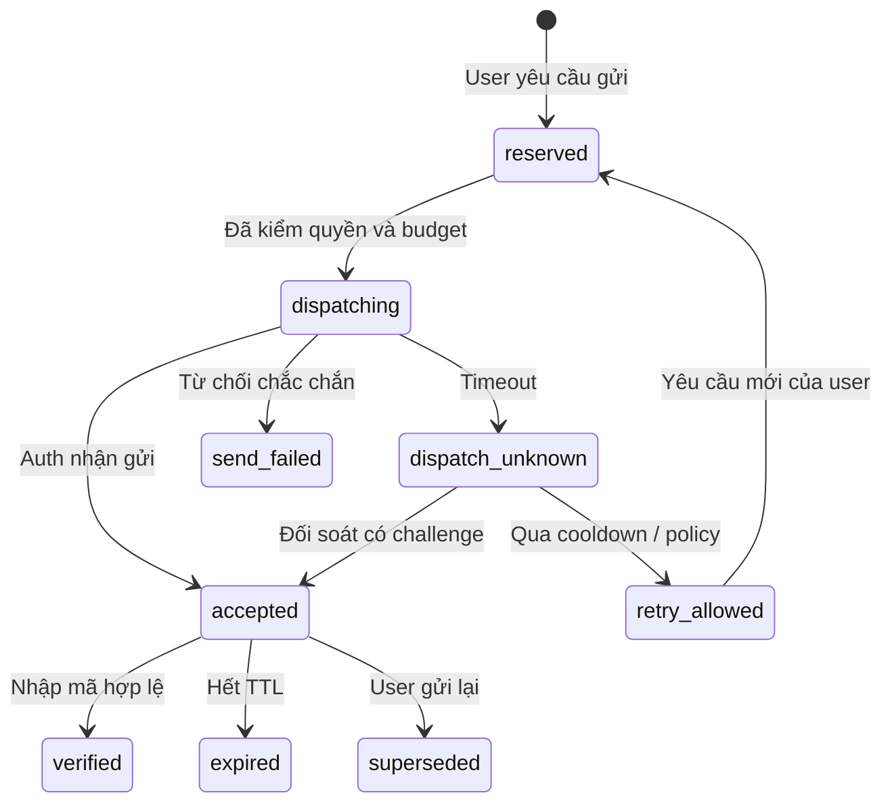

# Triển khai SMS MFA cho Manager

Bản1.2 ngày17/11/2026 · Nhánh phone_sms tùy chọn theo CR-MFA-02. Authenticator TOTP là mặc định, SMS được giữ khi policy/provider cho phép. Các chính sách limiter/recovery/provider dưới đây là thiết kế triển khai cần kiểm với dự án thật.

## 1. API đúng và phương thức gửi

Supabase Phone MFA dùng user session: enroll(factorType=phone,phone), challenge(factorId), verify(factorId,challengeId,code). Challenge mặc định SMS theo ví dụ SDK chính thức. Không dùng signInWithOtp({phone}) như bước thứ hai; đó là luồng phone sign-in khác. Không tự chọn WhatsApp hoặc email khi SMS lỗi. Passwordless email login không thay password-first-factor trong baseline Manager; nếu muốn dùng phương thức đầu khác phải có quyết định mới.

enroll không gửi mã và không cấp aal2. challenge là tác vụ gửi tin có thể phát sinh phí. verify thành công mới nâng AAL; app vẫn kiểm role, enabled, registry, idle và bằng chứng phương thức phone. Trạng thái accepted/delivered/verified tách nhau.

## 2. Máy trạng thái gửi SMS

- Trước external call, reserve sendRequestId unique(user,session,purpose,key), giữ payload hash không chứa code. Double-click cùng key trả attempt hiện tại. Khóa gửi theo user/factor để hai tab không tạo hai challenge đồng thời.
- Không mở DB transaction trong khi gọi provider. Reservation + transition có lease/fencing để timeout worker/request không phát lệnh muộn sau attempt mới.
- Accepted tạo mapping challengeRef -> provider challengeId/factor/user/session/purpose/expiry. Không trả provider credentials hoặc số nguyên vẹn. GET send-attempt chỉ đọc state, không gửi lại.
- Timeout có thể SMS đã gửi nhưng response challengeId bị mất. Giữ dispatch_unknown, không tự loop challenge. Nếu không đối soát được provider challenge, không hứa mã trong SMS đó verify được qua app; hướng dẫn chờ cooldown rồi yêu cầu mới. Không giả state failed chắc chắn.
- Retry lỗi429 theo Retry-After, lỗi outage giữ restricted. Sender blacklist/quota/country denied cần hướng dẫn cấu hình, không chuyển kênh ngầm.

## 3. TTL, gửi lại và SMS đến muộn

Nguồn S19 tại ngày đọc mô tả mã Phone MFA tối đa5 phút và các mã kế tiếp có thể cùng còn hợp lệ tới expiry. Hệ thống dùng expires_at thực của challenge, không lấy TTL10 phút của Email OTP. Kiểm lại trên project/SDK trước release, UI không tạo countdown giả từ thiết bị.

Resend đề xuất cooldown60 giây và tối đa5 lần verify/attempt (TK, cấu hình server). Mỗi resend có sendRequestId mới, app đánh dấu challengeRef cũ superseded và không verify qua reference cũ. **Không khẳng định mọi mã cũ sẽ bị Supabase vô hiệu ngay khi resend.** Nếu nhập mã đến muộn vào challenge mới, validity vẫn do provider quyết định; muốn bắt buộc chỉ mã mới nhất cần POC hoặc phương án bổ sung được duyệt, không tự hứa từ metadata app.

UI có trường6 số inputMode=numeric, autocomplete=one-time-code, hỗ trợ paste và số0 đầu; không input type=number. Hiển thị số che, thời hạn, nút gửi lại có cooldown, đổi số qua workflow, thông báo có thể SMS đến chậm. Không xin quyền đọc SMS/danh bạ trên web. Browser không tự bảo đảm đọc SMS; nhập tay luôn hoạt động.

## 4. Binding, approved phone và chống vượt quyền

- Số nhận SMS dùng E.164, chuẩn hóa server với thư viện hỗ trợ quốc gia. Regex chỉ kiểm định dạng. Không tự cộng +81/+84 khi chưa có quốc gia rõ ràng.
- Approved phone do người có quyền cung cấp khi tạo Manager hoặc trong quy trình thay số/recovery đã xác minh. Session mới password-only không được tùy ý nhận OTP trên số bất kỳ để chiếm quyền Manager.
- Factor phone phải thuộc current user và khớp approved active/pending number của workflow. MaskedPhone do server tạo, không lấy số từ request verify.
- Nhánh SMS: JWTaal2 + proof method=phone_sms,factorId,verifiedAt gắn session do server ghi sau verify. Nhánh TOTP có proof totp và không cần phone proof.
- Khi policy cho TOTP, proof TOTP hợp lệ là đủ cho admin; không ép chuyển SMS. Riêng challenge SMS vẫn phải được verify bằng phone factor và proof phone_sms, không dùng TOTP để đánh dấu SMS verified.
- Failed/unknown verify không ghi proof. Khi response session cookie đã đổi nhưng DB lỗi, operation ở trạng thái cần đối soát. Nếu không chứng minh được kết quả phone verify thì fail-closed và xác minh lại có hướng dẫn, không tự suy ra từ aal2.

## 5. Đổi/mất số và số được cấp lại

Đổi số khi còn số cũ: recent password + SMS proof cũ -> pending change được duyệt -> enroll/verify số mới -> chuyển active binding có version -> revoke registry khác -> unenroll số cũ có audit. Provider có thể giới hạn số factor/không cho trùng số trong cùng user; POC trước bật. Cleanup cũ lỗi không đưa binding cũ trở lại active.

Mất số: recovery case với kiểm tra người thật ngoài kênh đang mất; revoke trước reset; mới đăng nhập/enroll lại. Nếu còn TOTP verified và được phép thì user có thể chọn TOTP để truy cập/thay số theo policy recent-auth. Nếu không còn yếu tố thì không email-only self-service reset hoặc bỏ MFA. Nếu điện thoại được cấp lại/chuyển mạng/SIM swap, đóng băng binding và theo recovery. Số trùng giữa các user là policy riêng, không suy từ unique per-user của Supabase; đề xuất cấm chia sẻ số cho các Manager sau khi PO xác nhận.

## 6. Cấu hình nhà cung cấp và chi phí

- Kiểm plan và bật Phone MFA/Advanced MFA Phone trên project được phép. Không nhầm với MFA của tài khoản quản trị Supabase Dashboard.
- Chọn provider SMS Supabase hỗ trợ cho vùng triển khai, hoặc Send SMS Hook nếu cần adapter riêng. Cấu hình server-side provider credentials, sender ID/đăng ký theo vùng và test bằng số được phép. Không chốt Twilio/nhà cung cấp cụ thể khi khách chưa chọn.
- Nếu dùng hook: xác minh chữ ký webhook/raw body theo tài liệu, chống replay và duplicate delivery, chỉ chuyển OTP do Auth sinh; không log OTP hoặc đưa vào outbox plaintext. Ack chỉ sau provider accepted theo hợp đồng, timeout là unknown; tránh gửi hai lần từ hook retry bằng event/request identity đã kiểm chứng.
- Đặt country allowlist theo người dùng thật, hạn mức theo user/IP/factor/quốc gia, cảnh báo chi phí và hạn mức từ chính nhà cung cấp. API publishable của Auth vẫn gọi trực tiếp được; limiter BFF không đủ chống SMS pumping.
- Theo S23 ngày17/11/2026, phí add-on được tính theo giờ bật project, mức quy đổi công bố cho project đầu là75USD/tháng; project tiếp theo10USD/tháng. Đây là giá tham khảo tại ngày đọc, kiểm Dashboard/billing trước bật. Ngoài ra còn gói nền/compute và phí từng tin từ provider; không tính75USD là tổng hệ thống. Add-on không được Spend Cap bao phủ.
- Dev/staging có thể dùng mock cho UI, nhưng không đánh dấu integration pass từ mock; số/mã test tĩnh không bật trên production. Không bật add-on hoặc gửi SMS thật trong lần cập nhật tài liệu này.

## 7. Dữ liệu bổ sung cần migration

app_private.manager_phone_bindings: id,user_id,phone_ciphertext,phone_hmac,masked_phone,factor_id,approved_by,approved_at,verified_at,state(pending/active/retired/frozen),version,created_at; không password/code. Ràng buộc một active binding/user bằng partial unique index. Không lưu phone plaintext trong audit hoặc URL.

app_private.sms_send_attempts: id,user_id,session_id,factor_id,purpose,send_request_id,payload_hash,state,generation,provider_challenge_id?,challenge_ref?,expires_at?,resend_after,created_at,updated_at,last_error_code?,lease_version; UNIQUE(user_id,session_id,purpose,send_request_id). OTP không là cột. expires_at nullable khi dispatch_unknown, không dựng TTL giả.

auth_challenges bổ sung method=phone_sms,channel=sms,binding_id,generation,superseded_at; purpose thêm legacy_factor_migration khi triển khai migration. Registry dùng proof chung last_mfa_method,last_mfa_factor_id,mfa_verified_at,mfa_policy_version; phone_binding_version là metadata nhánh SMS, chỉ server ghi. auth_time/idle/security_version vẫn theo core spec.

Thêm bảng/constraint/index/grants bằng migration mới đã review; SQL core không tự cung cấp các bảng này. Không coi chỉ thêm field UI phone là hoàn tất MFA.

## 8. Cùng tồn tại với Authenticator

TOTP không còn được gọi là phương thức cũ cần loại bỏ. User TOTP hiện tại tiếp tục sử dụng khi totp trong policy. Bổ sung phone_sms là tự chọn nếu môi trường cho phép: cần recent MFA hợp lệ, số được phê duyệt và verify SMS; không xóa TOTP sau khi thêm SMS.

Một lần đăng nhập chỉ cần một phương thức được phép. Chuyển mặc định giữa hai phương thức là lựa chọn UX/policy; proof của phương thức vừa hoàn tất được guard chấp nhận nếu còn allowed. Nếu tổ chức thay policy, có kế hoạch chuyển tiếp và kiểm Manager cuối, không auto-xóa factor hoặc fallback password-only.

## 9. Checklist nghiệm thu staging

Password + SMS đúng; trong nhánh SMS, chưa hoàn tất MFA thì không đọc admin; TOTP hợp lệ theo policy là lựa chọn độc lập; sai/hết hạn/replay; resend hai tab; SMS cũ đến sau SMS mới; timeout accepted/response lost; provider429/outage/budget exhausted; số sai/quốc gia chặn; approved phone mismatch; đổi số khi provider không cho nhiều factor; mất số/Manager cuối; JWT TOTP cũ; role/disabled/idle guard; logredaction; directAuth abuse; migration rollback. Tất cả phải có evidence thật cho provider/session khi bật production.
