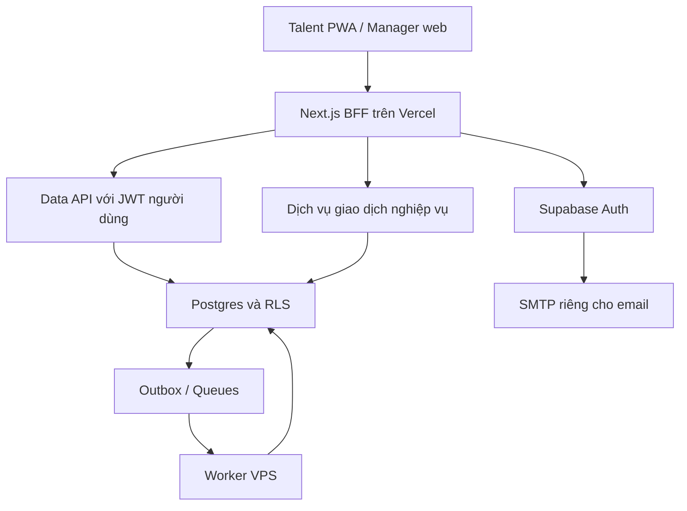
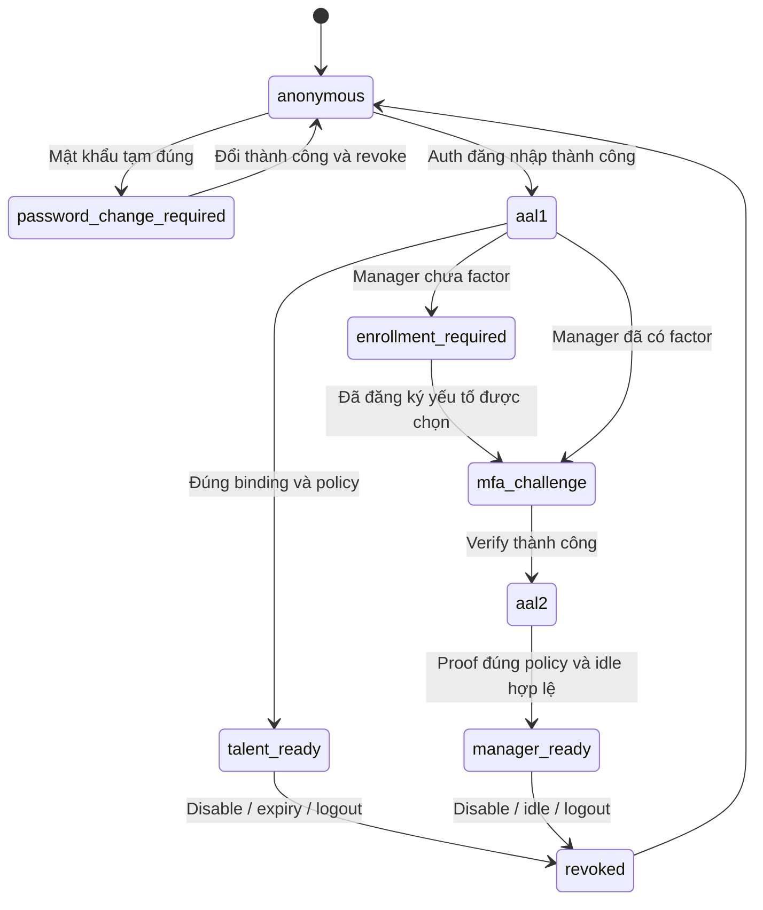

# Triển khai Supabase Database và Auth cho AI Talent OS

Phiên bản1.2 · 17/11/2026 · Dành cho lập trình viên, AI coding agent và QA.

## 1. Kết luận và phạm vi

**Quyết định ngày 17/11/2026:** (1) **không làm OTP qua email**; (2) **ưu tiên Authenticator TOTP**, nhánh SMS giữ đặc tả để bàn với khách, chưa code ở đợt đầu; (3) **khóa sau 5 lần sai mật khẩu làm ở BE (BFF)** trước mắt.

**Bản1.2 / CR-MFA-02:** giữ cả Authenticator TOTP và OTP SMS trong thiết kế. **Authenticator6 số, đăng ký QR lần đầu là mặc định** theo yêu cầu nguồn. SMS là phương án cần trao đổi trong định nghĩa yêu cầu, được giữ đầy đủ API/SDK/case như tùy chọn cấu hình; không tự bật production.

Manager đăng nhập email/password rồi hoàn tất **một** phương thức đã verified và được policy cho phép. Không bắt dùng cả Authenticator và SMS trong một lần đăng nhập. Talent dùng password, không có MFA. Default allowedMethods=[totp], preferredMethod=totp; sau quyết định khách và cấu hình SMS có thể allowedMethods=[totp,phone_sms].

Bản1.1 từng chuyển sang SMS-only theo trao đổi trước; CR-MFA-02 thay phần đó. Đọc MFA_POLICY_AND_REQUIREMENTS_VI.md trước để không hiểu “SMS sẽ trao đổi” là đã được khách duyệt. Không sửa lịch sử nội dung v2.

| Phương thức | API Supabase | Trạng thái |
|---|---|---|
| Email/password | auth.signInWithPassword | Bước đầu Manager; Talent theo baseline |
| Authenticator TOTP | enroll(factorType=totp),challenge,verify | Mặc định; lần đầu QR, sau đó nhập mã6 số |
| OTP SMS / Phone MFA | enroll(factorType=phone,phone),challenge,verify | Lựa chọn nếu policy/provider cho phép; có phí riêng |
| Email OTP | — | **Không làm** (quyết định 17/11/2026) |

Bộ này đặc tả Database/Auth, RLS, session, API/schema/SDK và kiểm thử. Chưa build app, gọi Supabase, gửi SMS hoặc bật add-on thật. YC = yêu cầu nguồn; TK = thiết kế; CĐ = cần chốt. Nguồn và giới hạn ở SOURCE_MANIFEST.json/VALIDATION.md.

## 2. Nguồn và khác biệt với bộ PWA đã soạn

Đã đọc trực tiếp DOCX v2 trong thư mục hiện tại: §4 UC-01/UC-03/UC-13, §6-1 chức năng1-4/1-5, §6-2 chức năng1-6/7-3/7-6, §6-4 chức năng2-2, §9, §10-1. XLSX Q&A đã đọc lại bản 15/11/2026 (đối chiếu đầy đủ ở `Phan_tich/19_Doi_chieu_QA_bao_gia.md`). Liên quan tới bộ này: No.10, No.11, No.20, No.25 đã chốt; No.63, No.64, No.65, No.66, No.67 là câu mới, còn chờ khách.

| Chủ đề | V2 hiện tại | Xử lý trong bộ này |
|---|---|---|
| Đăng ký Talent | Tự đăng ký -> Manager duyệt -> email mật khẩu tạm -> bắt buộc đổi | Đặc tả đầy đủ nhánh v2; Q&A No.11 và CR-01 đã chốt làm ở SP1, không còn chờ phạm vi |
| V1 invitation7 ngày | Không còn là luồng chính của v2 | Nhánh invitation chỉ dùng khi chọn lại hoặc tạo Manager; không ép7 ngày cho mọi OTP |
| Manager MFA | V2 và đoạn trích: app xác thực6 số, QR lần đầu; SMS sẽ trao đổi | CR-MFA-02: TOTP mặc định, SMS tùy chọn; một yếu tố được policy cho phép trước admin |
| Auth lock/session | ≥8 ký tự có chữ/số; sai5 lần khóa15 phút; Talent30 ngày; admin idle30 phút | Tham số theo v2; Q&A No.25 (15/11) xác nhận các giá trị mật khẩu và đăng nhập theo v2 §6-1, §6-2; kiểm ở Auth và ứng dụng, không tin mặc định Supabase |
| Quyền Manager | Một loại quyền, nhìn tất cả Talent của tổ chức | Không tạo vai trò phân cấp tự phát; tổ chức là thiết kế chuẩn bị tenant isolation |
| Ngừng sử dụng | Chặn đăng nhập, dừng phí/nhắn, hủy lịch; có thể bật lại | Thu hồi quyền tức thời ở app, workflow bên ngoài bất đồng bộ; không xóa Auth user |
| OneDrive | Folder Talent sau xác nhận payment; office khi tạo office | Không tạo folder từ trigger auth.users; dùng outbox đúng thời điểm |
| Office account | ID riêng, đăng nhập lại từng tài khoản; không thu phí | Không giả danh bằng sửa talentId trong URL; Q&A No.20 đã chốt đăng nhập lại từng tài khoản, không chuyển tài khoản; chi tiết ở Q&A No.66 (đang hỏi) |

PWA v1 trước đó chưa có v2 đọc lại và còn D01/luồng invitation. Bộ này ghi thay đổi tại COMPATIBILITY_NOTES.md; không tự sửa các ZIP cũ. Cần đồng bộ hợp đồng trong một thay đổi được review, tránh hai cách onboarding cùng bật. Nguồn S15–S18 trong SOURCE_MANIFEST.json.

## 3. Kiến trúc và các loại kết nối

BFF là backend phục vụ giao diện. RLS là chính sách quyền theo từng hàng. JWT là access token có chữ ký. Vai trò nghiệp vụ Manager/Talent không phải Postgres role authenticated/service_role.

| Thành phần | Kết nối đề xuất | Danh tính/quyền |
|---|---|---|
| Trình duyệt | Auth SDK qua HTTPS; domain API qua BFF | Publishable key, phiên người dùng; không DB password hoặc secret key |
| Next.js đọc dữ liệu owner | supabase-js Data API với JWT đã xác minh | RLS vẫn có hiệu lực; client theo từng request |
| Next.js giao dịch nghiệp vụ nhiều bảng | RPC được review hoặc Postgres.js qua shared transaction pooler | Role backend riêng có quyền hẹp; tự authorize trong service nếu không dùng JWT/RLS |
| Worker VPS | Direct hoặc session pooler theo IPv4/IPv6; pool nhỏ | Role worker riêng; không cầm session Talent làm credential lâu dài |
| CI migration | Direct/session connection riêng | DDL role chỉ ở môi trường CI được bảo vệ; không dùng runtime URL |
| Auth admin provisioning | Admin client server-only độc lập | Secret key hoặc legacy service_role; không chèn cookie user vào client này |

S04 phân biệt shared transaction pooler với direct/session. Baseline serverless dùng shared transaction pooler, prepare:false, max:1 mỗi instance (TK khởi điểm theo S04). Một trăm instance vẫn có thể dùng100 connection; max:1 không là giới hạn tổng. Worker và CI có ngân sách connection riêng; đo pool wait/active/idle rồi điều chỉnh, giữ phần dự phòng cho Auth và quản trị. TLS bắt buộc; dùng CA/verify phù hợp driver, không disable kiểm chứng để vượt lỗi chứng chỉ.

Shared transaction pooler không giữ session state giữa giao dịch và không hỗ trợ prepared statement theo S04. Không SET tenant/JWT một lần rồi tái sử dụng connection. Nếu dùng request.jwt.claims/SET LOCAL ROLE để RLS trên kết nối SQL phải set trong đúng transaction, từ JWT đã server xác minh, và kiểm không rò ngữ cảnh khi pool tái sử dụng. Không dùng cách tự nhận claims từ body. Baseline ưu tiên Data API user-scoped cho đọc, backend transaction đã authorize cho ghi.

Không giữ transaction trong khi gọi Auth/SMTP/Upload-Post/Graph/AI. Không thể rollback một API Auth bằng ROLLBACK Postgres ở giao dịch app. Provisioning phải là saga có bước/đối soát; xem UC03 dưới đây.

## 4. Danh tính và cấu trúc dữ liệu

auth.users và auth.mfa_* do Supabase quản lý. Không tự lưu password hash hoặc mã SMS trong bảng ứng dụng; không sửa schema auth bằng migration app. Nhánh TOTP trả QR/secret một lần cho enrollment, không persist ở app; nhánh SMS không dùng QR. Số điện thoại là dữ liệu riêng tư, chỉ lưu bản mã/HMAC/masked theo mục đích. Dữ liệu nghiệp vụ dùng UUID bền vững khác email; đổi email không tạo Talent mới.

| Bảng | Khóa và invariant |
|---|---|
| app_private.organizations | id; hiện một tổ chức nhưng không cho client tùy ý chọn tenant |
| app_private.app_users | auth_user_id FK auth.users; enabled,must_change_password,security_version; quyền không lấy từ user_metadata |
| app_private.memberships | organization_id,user_id unique; role=manager/talent,enabled; một loại Manager; không có self-promotion |
| app_private.talent_accounts | id,organization_id,owner_user_id,account_kind=talent/office,business_state=before_use/in_use/ended; owner binding unique theo baseline |
| app_private.applications | canonical_email unique trong cùng project/baseline,display_name,dob,terms_version,state,version; chưa duyệt không có membership active |
| app_private.auth_session_registry | session_id từ JWT,user_id,security_version_at_issue,auth_time,absolute_expires_at,admin_last_activity_at,revoked_at; không lưu refresh token |
| app_private.auth_flow_attempts | opaque id,purpose,email_hmac,user_id?,expires_at,resend_after,attempt count,state; chỉ metadata, không OTP/QR/password |
| app_private.auth_provisioning | application_id unique,command_id,payload_hash,step,auth_user_id?,result,version; chống double approve và orphan |
| app_private.auth_challenges | local challenge ref,user_id,session_id,factor_id,provider_challenge_id,purpose,expires_at,state; không lưu code |
| app_private.auth_rate_buckets | HMAC email/IP/account theo purpose,count,window,blocked_until; không plaintext email trong key/log |
| app_private.audit_events | actor/session/organization/action/resource/result/requestId/time; append-only; Manager view audit theo v2 §6-2 7-6 |
| app_private.outbox_events | event_id unique,aggregate,generation,event_type,payload_refs,state,next_attempt_at; không chứa mật khẩu/email OTP |
| public.talent_preferences | Ví dụ domain nhỏ: talent_id FK,locale,version,updated_at; SELECT own bằng RLS; không mutation client trực tiếp |

SQL trong gói là lát cắt lõi organization/user/membership/talent/session/preferences/audit/outbox; các bảng flow/provisioning/rate/challenge được đặc tả từ điển dữ liệu và agent phải thêm migration tương ứng. Không được gọi scaffold là schema đầy đủ toàn AI Talent OS. Domain posts/media/billing/social/OneDrive tái dùng spec tương ứng, không tạo bảng bản sao chủ quyền.

Ràng buộc: timestamp timestamptz UTC; DOB là date (không timezone); email canonical policy phải chốt, tối thiểu trim và chuẩn hóa domain, không bỏ dấu chấm hay +tag tự động. V2 không cho trùng email; không trả lỗi existence khác nhau ra màn public. Unique constraint và transaction giải quyết race, không chỉ kiểm trước insert. auth.users toàn project có identity semantics riêng; cần POC trường hợp đã tồn tại email cùng project trước khi liên kết account. Không auto-link bằng text email do client cung cấp.

Không ON DELETE CASCADE xóa tài liệu/billing chỉ vì Auth user bị xóa nhầm. SQL dùng FK restrict mặc định; account lifecycle ưu tiên disable/soft state theo nguồn. Quy tắc retention/anonymization cần chốt, không suy từ GDPR hay quy định chưa được cung cấp.

## 5. Phân quyền và vòng kiểm tra mỗi request

1. Parse input, Origin/CSRF cho mutation, rate-limit theo purpose.
2. getClaims để xác minh JWT; getUser khi cần thông tin Auth mới theo S03. Không lấy getSession().user hoặc decode JWT không kiểm chữ ký để phân quyền.
3. Đọc app_users/membership enabled; so security_version với registry của session. Không tin role do client/user_metadata ghi, kể cả tên field là manager.
4. Registry session phải tồn tại, chưa revoke/chưa absolute expire; direct Auth session chưa được app chấp nhận không có domain quyền. Session mục đích recovery/first-password chỉ vào allowlist endpoint tương ứng.
5. Manager: role đúng, current aal2 và phiên còn idle window30 phút; thiếu factor đi enrollment-only, có factor nhưng aal1 đi challenge-only. Talent không vào admin; office identity không tự thành Manager.
6. Resolve resource bằng organization + owner mapping ở server; kiểm capability và trạng thái nghiệp vụ/payment riêng. Chỉ thấy được record không có nghĩa được publish.
7. Giao dịch atomic cho domain mutation + command result + outbox + audit. Manager GET riêng tư phải append view audit theo policy trước trả dữ liệu; nếu audit bắt buộc mà không ghi được thì fail-closed.

SQL RLS tham khảo chỉ cho Talent đọc preferences của mình khi registry và account hợp lệ; Manager **không được SELECT thẳng qua Data API** vào bảng ví dụ, vì như vậy sẽ bỏ qua ghi lịch sử xem. Manager đọc qua BFF đã kiểm MFA/quyền và giao dịch ghi audit. Endpoint backend dùng service_role/SQL role bỏ qua RLS phải tự áp đủ 7 bước; không được nghĩ RLS vẫn bảo vệ truy vấn service-role. Không cấp endpoint generic query/tableName/where từ body.

Mọi bảng exposed phải bật RLS và thu hồi grants phù hợp. RLS không thay column privileges, function execute grants, storage policy hay audit. Security-definer helper có search_path rỗng, tên object đầy đủ, không dynamic SQL, revoke PUBLIC EXECUTE; không tự quy nó thành API RPC mở. View dùng security_invoker hoặc đặt private/revoke khi không bảo đảm. S05 là căn cứ, thiết kế registry/quyền cụ thể là TK.

## 6. Phiên và cookie SSR

Dùng @supabase/ssr và @supabase/supabase-js theo phiên bản được lock sau POC. Browser client và server client khác nhau; server client tạo theo request, cookie adapter đọc/ghi đúng API Next.js phiên bản đã chọn. Không singleton user client trên server. Admin client riêng persistSession:false,autoRefreshToken:false, không cookie. Postgres connection pool có thể singleton/module scope vì không mang user session.

Baseline là SSR chuẩn của Supabase: cookie token có thể cần truy cập từ browser SDK; **không mặc định khẳng định chúng đều HttpOnly**. Secure/SameSite/path/domain theo origin và SDK; không tự đặt HttpOnly rồi vẫn dùng browser client expecting tokens. Nếu bắt buộc HttpOnly-only thì thiết kế BFF token storage riêng, toàn bộ Auth/MFA ở server và đánh giá lại luồng, không trộn hai mô hình. Kịch bản hiện tại dùng SSR chuẩn cộng registry cho quyền ứng dụng.

Protected response private,no-store kể cả HTML/RSC và response Set-Cookie; không shared CDN/ServiceWorker cache. Middleware/Proxy refresh cookie là tiện ích, không là authorization duy nhất. Route handler/use case luôn kiểm lại. Response refresh phải giữ Set-Cookie khi redirect, không cache theo URL chung.

S06 (tra lại 17/11): mặc định phiên Supabase **không hết hạn**; time-box và inactivity timeout chỉ có từ gói Pro và chỉ được kiểm khi refresh, nên vẫn cần registry của app. Thiết lập timebox theo plan và bổ sung registry absolute_expires_at=auth_time+30 ngày cho Talent (giá trị nguồn còn Q&A). Không reset mốc này mỗi refresh. Admin idle tính từ thao tác user đã xác thực hợp lệ, không polling/refresh/background heartbeat tự kéo dài. Quá 30 phút yêu cầu password và một MFA được policy cho phép lại; không chỉ refresh token hoặc chỉ nhập lại mã MFA trên session đã idle. Chặn ngay ở app; Supabase timeout có thể chỉ áp dụng khi refresh nên không đủ cho kiểm tức thời.

Logout local/all/other cần scope rõ. Backend revoke registry/push binding trước trả success; gọi signOut scope phù hợp, clear cookies và memory client. JWT đã phát có thể còn hợp lệ sau signOut; registry/security_version mới là điều kiện chặn app ngay. Bật lại user không kích hoạt registry đã revoke. Nếu SDK signOut lỗi sau revoke registry, quyền app vẫn bị chặn, báo cần dọn phiên và retry Auth; không khẳng định mọi hệ thống đã logout.

Refresh single-flight mỗi context/tab; browser SDK hỗ trợ đồng bộ theo khả năng, vẫn kiểm race nhiều tab/SSR. Lệnh đã gửi timeout phải tra command, không replay publish/charge bằng key mới. Token thô/refresh tokens không có trong JSON API domain hoặc logs.

## 7. Các luồng triển khai chi tiết

### DB01 Khởi tạo dự án và cấu hình kết nối

**Căn cứ:** TK; S04,S10.

Lấy URL và chuỗi kết nối từ Dashboard của từng môi trường. Tách dev, staging và production; kiểm tra mạng IPv4/IPv6 trước khi chọn direct, session pooler hoặc shared transaction pooler. Dùng publishable key cho trình duyệt; secret key, DB password và migration credential chỉ ở server/CI.

Vercel dùng shared transaction pooler với `prepare:false`, khởi điểm `max:1` mỗi instance. Worker dùng pool riêng có giới hạn; CI migration dùng direct/session theo thao tác. Đặt thời gian chờ connection/query/lock. Kiểm ngân sách tổng, vì nhiều instance vẫn tạo nhiều connection. Client SQL dùng module scope; client Auth có session phải tạo theo request.

Sai key/project/TLS phải báo lỗi có mã tham chiếu, không in connection string. Pool đầy trả lỗi có kiểm soát, không tăng pool vô hạn. Không giữ tenant/JWT bằng SET ở connection dùng chung; nếu cần context RLS qua SQL thì chỉ SET LOCAL bên trong đúng transaction, từ JWT đã xác minh. Chứng minh A/B xen kẽ không rò context trước khi dùng cách này.

Các ca nghiệm thu: xem nhóm DB01 trong TEST_CASES_VI.md.

### DB02 Đọc ghi và tính nhất quán nghiệp vụ

**Căn cứ:** TK; S05.

Đọc dữ liệu owner bằng Data API với JWT người dùng. Ghi nhiều bảng bằng application service và một transaction: kiểm actor/quyền/trạng thái, claim commandId, so payload hash và expectedVersion, cập nhật domain, ghi audit/outbox và kết quả command rồi commit.

Khóa duy nhất `(actor,usecase,commandId)` chống tạo lệnh trùng. Cùng key/cùng payload trả kết quả đã có; cùng key/khác payload trả409. Hai cập nhật cùng version chỉ một lệnh thành công. Nếu mất kết nối sau COMMIT, tra hoặc gửi lại cùng key; không tạo key mới. Kết quả lookup404 chưa đủ chứng minh request cũ không tới.

Query phải parameterized; tên bảng/cột/filter/sort qua allowlist. Không SELECT * vào DTO chứa dữ liệu nhạy cảm. Retry deadlock/serialization có giới hạn trong giao dịch DB; không đặt lời gọi Auth/SMTP/SNS bên trong transaction. Worker claim job có lease/fencing và kiểm lại trạng thái tài khoản trước tác vụ ngoại vi.

Các ca nghiệm thu: xem nhóm DB02 trong TEST_CASES_VI.md.

### AU01 Nộp đơn Talent chưa được phép đăng nhập

**Căn cứ:** YC v2 UC-01,§6-1 1-4; Q&A No.11 và CR-01 đã chốt: làm ở SP1.

Nhận nghệ danh/tên, email, ngày sinh và đồng ý phiên bản điều khoản. Public request không được chọn role, quyền duyệt hoặc trạng thái active. Tạo application pending, consent và outbox thông báo Manager; chưa tạo membership active. Q&A No.11 và CR-01 đã chốt luồng này ở SP1.

Email canonical có unique constraint để chống hai request đồng thời. Trả202 chung cho email mới/đã tồn tại theo chính sách chống dò tài khoản. Không trả trạng thái application riêng tư nếu chưa có email proof hoặc tracking credential được duyệt. Ngày sinh không ở tương lai; tính tuổi tại server, không tin cờ minor từ client. Cần chốt guardian consent trước nhận đăng ký trẻ vị thành niên.

Ưu tiên tắt public signup trong Auth nếu dùng admin provisioning. Dù gọi Auth trực tiếp tạo được user, người đó cũng không có membership/registry và không được đọc dữ liệu domain. Không dùng trigger auth.users để tự cấp role Talent hoặc Manager.

Các ca nghiệm thu: xem nhóm AU01 trong TEST_CASES_VI.md.

### AU02 Manager duyệt/từ chối đơn

**Căn cứ:** YC v2 UC-01,§6-1; TK saga.

Manager phải enabled, aal2 và phiên admin còn hạn. Request có applicationId, expectedVersion, quyết định và commandId. Transaction khóa application; chỉ quyết định đầu tiên khi còn pending được commit. Từ chối ghi audit và gửi email mẫu cố định, không tạo Auth user. Duyệt chuyển sang approved_provisioning và tạo saga/outbox.

Saga gọi `auth.admin.createUser` với mật khẩu ngẫu nhiên do server tạo; sau đó lưu correlation và userId, tạo app_user/membership/talent trước sử dụng, đặt must_change_password. Chỉ gửi thông tin kích hoạt sau khi binding đã hoàn tất. Outbox chứa reference, không chứa mật khẩu.

Auth timeout có thể đã tạo user: đối soát bằng email đã quản lý cộng correlation bất biến của provisioning. Email trùng một identity không thuộc workflow thì manual review, không tự liên kết. Nếu Auth thành công nhưng DB lỗi, user vẫn không có quyền domain; saga phục hồi. Nếu email lỗi sau duyệt, giữ trạng thái provisioning/delivery lỗi để gửi lại có kiểm soát, không rollback application về pending.

Các ca nghiệm thu: xem nhóm AU02 trong TEST_CASES_VI.md.

### AU03 Gửi mật khẩu tạm theo v2 và bắt buộc đổi

**Căn cứ:** YC v2 §6-1; TK secret delivery.

V2 yêu cầu email chứa mật khẩu tạm; `inviteUserByEmail` gửi link nên không tương đương. Nếu giữ v2, dùng transactional mail adapter riêng. Mật khẩu ngẫu nhiên chỉ ở memory hoặc secret store mã hóa có TTL; DB/outbox chỉ giữ reference. Không log nội dung mail. Thời hạn chưa chốt: Q&A No.65 (đang hỏi) đề xuất **7 ngày, quản lý bấm gửi lại** khi quá hạn; dùng giá trị đó làm mặc định cấu hình, không phải mặc định Supabase.

Gửi lại có hai lựa chọn cần thống nhất: lấy secret còn hạn từ secret store hoặc rotate mật khẩu bằng operation mới, vô hiệu bản cũ. Đăng nhập bằng mật khẩu tạm chỉ được đổi mật khẩu/help/logout, không coach hoặc dữ liệu admin. App kiểm must_change_password và hạn dùng ở server.

Đổi mật khẩu gọi `updateUser` trong đúng session. Chỉ sau xác nhận Auth thành công mới clear flag, tăng security_version và revoke registry cũ; đăng nhập lại để tạo phiên mới. Crash giữa Auth và DB phải lưu trạng thái operation để đối soát. Gửi email không chứng minh người dùng đã sở hữu email: `email_confirm:true` là quyết định trust riêng hoặc cần thêm email proof trước cấp quyền đầy đủ. Không âm thầm đổi sang activation link khi khách chưa duyệt.

Các ca nghiệm thu: xem nhóm AU03 trong TEST_CASES_VI.md.

### AU04 Đăng nhập Talent bằng mật khẩu

**Căn cứ:** YC v2 §6-1 1-4/1-5.

Gọi `signInWithPassword` bằng client theo request. Sau Auth thành công, xác minh identity/session rồi đọc app_users, membership và talent binding. Không nhận role/talentId từ body. Kiểm enabled, trạng thái before_use/in_use/ended, yêu cầu đổi mật khẩu và mục đích phiên.

Chỉ backend được tạo registry từ session_id trong JWT đã xác minh, gắn security_version và auth_time. before_use được vào onboarding; coach cần entitlement/payment theo nguồn. Office được miễn payment do policy server, không do cờ client.

Password đúng nhưng account disabled/ended/chưa duyệt thì không có phiên domain. Auth user không có binding trả trạng thái account_not_provisioned, không tự tạo Talent. Auth outage trả503, không báo sai mật khẩu hoặc tăng counter từ client. Login không gọi đồng bộ Graph hoặc Upload-Post để tạo tài nguyên.

Các ca nghiệm thu: xem nhóm AU04 trong TEST_CASES_VI.md.

### AU05 Khóa sau5 lần sai và rate limit

**Căn cứ:** YC v2 §6-1; TK S07,S08.

Theo v2, sai5 lần liên tiếp khóa15 phút (Q&A No.25 xác nhận giữ giá trị v2). Limiter BFF theo IP và HMAC email giảm abuse nhưng không đủ chống gọi Auth URL trực tiếp. Cần Password Verification Hook hoặc cơ chế tại Auth đã kiểm chứng trên plan của khách.

Hook nhận userId và kết quả valid từ Auth, cập nhật counter/blocked_until atomically. Trong thời gian khóa không tự kéo dài vô hạn vì mỗi request mới. Password đúng khi chưa khóa reset counter; sau hết hạn reset window theo chính sách đã duyệt. Counter MFA (TOTP, SMS), OTP email và resend tách khỏi password failures.

Countdown UI chỉ để hiển thị, thời gian server là thẩm quyền. POC cả login qua BFF và Auth trực tiếp; không tuyên bố đạt chỉ vì nút client bị khóa. **Tra lại 17/11/2026:** Password Verification Hook và MFA Verification Attempt Hook **chỉ có ở gói Team và Enterprise** (trang Auth Hooks của Supabase). Với gói Pro, không khóa được ở tầng Auth: lời gọi thẳng tới Auth URL bằng publishable key không bị đếm. **Quyết định 17/11/2026: trước mắt khóa ở BE (BFF).**
- Mọi đăng nhập bằng mật khẩu đi qua `POST /api/v1/auth/login`. Ứng dụng tài năng và màn quản trị không gọi `signInWithPassword` trực tiếp từ trình duyệt.
- BE giữ bộ đếm theo tài khoản (khóa là HMAC của email đã chuẩn hóa, không lưu email thô). Sai 5 lần liên tiếp thì đặt `blocked_until` = bây giờ + 15 phút. Trong thời gian khóa, BE từ chối mà không gọi Supabase Auth, và không kéo dài thời gian khóa khi có thêm lần thử. Đăng nhập đúng khi chưa khóa thì đặt lại bộ đếm. Bộ đếm cập nhật nguyên tử trong DB, không dùng biến bộ nhớ.
- Thêm giới hạn theo IP và cấu hình rate limit đăng nhập của Supabase (S08) ở mức chặt.
- **Rủi ro chấp nhận:** người biết URL Auth và publishable key vẫn thử mật khẩu thẳng với Supabase mà không bị đếm. Theo dõi log Auth và cảnh báo khi có nhiều lần sai. Khi lên gói Team thì chuyển sang Password Verification Hook. Hook lỗi phải fail-closed và có alert/runbook khôi phục, không triển khai SQL hook chưa thử vì có thể chặn toàn bộ đăng nhập. Kiểm khả dụng hook/plan trước cam kết.

Các ca nghiệm thu: xem nhóm AU05 trong TEST_CASES_VI.md.

### AU06 Manager bước đầu và chọn phương thức MFA

**Căn cứ:** v2 §6-2; đoạn trích người dùng; CR-MFA-02.

Sau password đúng, kiểm Manager enabled/session trước khi trả options tối thiểu. Server tính allowedMethods theo policy và khả năng cấu hình; trả verified factor của chính user. TOTP hiển thị mặc định; SMS chỉ hiện nếu được phép. Chưa có yếu tố hợp lệ thì hướng dẫn enrollment, không dữ liệu admin.

User hoàn tất TOTP hoặc SMS được chọn, server verify rồi ghi proof chung gồm method/factor/session/policyVersion. aal2 + proof thuộc allowedMethods là đủ; không yêu cầu phone proof sau TOTP. Không tự challenge/send SMS vì user mở màn hình hoặc nhập sai TOTP. Email OTP không là lựa chọn MFA của Manager.

Policy đổi giữa thao tác phải kiểm lại. Factor bị xóa hoặc user bị disable thì proof cũ không cứu quyền. Đăng ký yếu tố mới và reset theo recent-auth/provisioning workflow, không self-promotion từ password-only tùy ý. Các nhánh TP01–TP05 mô tả TOTP; MF01–MF04 dưới đây **chỉ áp dụng khi chọn phone_sms**.

### MF01 Nhánh SMS tùy chọn Đăng ký số điện thoại

**Căn cứ:** nhánh phone_sms của CR-MFA-02; S19–S23; SMS production còn cần quyết định/cấu hình.

Đầu vào gồm số E.164 và tên thiết bị tùy chọn. Chuẩn hóa bằng thư viện số điện thoại có dữ liệu quốc gia, kiểm số có dạng hợp lệ và thuộc quốc gia được phép; regex không chứng minh số tồn tại/nhận được SMS. BFF đối chiếu approved phone của Manager, không tin số arbitrary từ client.

Gọi auth.mfa.enroll({factorType:'phone',phone,friendlyName}) trên session user. Enroll trả factor chưa verified, chưa cấp quyền admin và không dùng QR. UI hiển thị số đã che; gửi mã là bước challenge riêng, không coi enroll là đã gửi SMS.

Khi người dùng bấm gửi, BFF tạo send attempt có khóa chống trùng và kiểm cooldown/budget rồi gọi mfa.challenge cho factor phone. Verify code6 số bằng mfa.verify, kiểm session mới aal2 rồi ghi proof gắn session_id/factor_id/method=phone. Chỉ sau full guard mới vào admin.

Double-click/reload không enroll nhiều factor; đối soát pending factor của đúng user. Hủy setup cleanup factor chưa verified của chính họ. Số sai định dạng/không được duyệt/duplicate/quota/provider error có trạng thái riêng, không mở quyền. Không có QR hoặc TOTP secret trong request/response baseline.

Các ca nghiệm thu xem nhóm MF01 trong TEST_CASES_VI.md.

### MF02 Nhánh SMS tùy chọn Gửi và xác minh mã

**Căn cứ:** nhánh phone_sms của CR-MFA-02; S19–S23; SMS production còn cần quyết định/cấu hình.

Lấy verified phone factor của đúng user, không chỉ chọn factor đầu tiên trong danh sách mọi loại. BFF nhận factorId,purpose,sendRequestId; kiểm session, approved phone, limiter và ngân sách rồi reserve send attempt trước khi gọi mfa.challenge({factorId}). Adapter baseline dùng kênh SMS mặc định theo tài liệu SDK; không tự chuyển WhatsApp hoặc gọi signInWithOtp(phone) thay MFA.

Challenge được bind vào user/session/factor/purpose. Accepted trả challengeRef,expiresAt,resendAfterSeconds và maskedPhone; timeout gửi có thể đã phát SMS nên trả dispatch_unknown với sendAttemptId, không tự phát lần nữa. Poll endpoint chỉ đọc metadata, không gửi SMS. Cooldown60 giây và tối đa5 lần verify/attempt là đề xuất cấu hình, không là mặc định provider.

Verify chỉ nhận code6 ký tự string, giữ số0 đầu. Server kiểm challengeRef/TTL/generation/rate, gọi mfa.verify rồi propagate cookie mới. Chỉ khi server xác minh aal2 và factor phone đúng binding mới ghi proof và hoàn tất registry. Sai mã/hết hạn/replay không cấp quyền. Verify timeout phải đọc session/factor và đối soát proof; nếu không chứng minh được Phone MFA thì giữ restricted state và hướng dẫn xác minh lại sau cooldown.

Resend là challenge mới do user yêu cầu; khóa theo user/factor chống hai tab. ChallengeRef cũ được supersede ở app. Tài liệu provider cho biết các mã SMS kế tiếp có thể cùng còn hiệu lực tới hết hạn, nên không hứa resend vô hiệu mọi mã cũ ngay; xem SMS_MFA_IMPLEMENTATION_VI.md.

Các ca nghiệm thu xem nhóm MF02 trong TEST_CASES_VI.md.

### MF03 Nhánh SMS tùy chọn Đổi số điện thoại

**Căn cứ:** nhánh phone_sms của CR-MFA-02; S19–S23; SMS production còn cần quyết định/cấu hình.

Yêu cầu phiên Manager có recent password + SMS proof ở số hiện tại. Số mới được chuẩn hóa và phê duyệt theo policy, tạo pending change gắn user/oldFactor/version/expiry. Không sửa phone factor bằng auth.updateUser({phone}) rồi coi là đã đổi MFA: phone liên hệ và MFA factor là hai binding cần xử lý riêng.

Nếu project hỗ trợ nhiều factor, enroll/verify phone factor mới trước, sau đó chuyển active binding bằng optimistic concurrency và thu hồi factor cũ. Không xóa số cũ trước khi số mới được verify. Nếu giới hạn provider không cho thực hiện, chuyển quy trình recovery có kiểm soát; không bỏ MFA để lách.

Vì v2 yêu cầu khóa phiên và các session có thể đổi sau verify, kiểm token/cookie mới sau từng bước. Sau khi chuyển số thành công, tăng security_version, revoke registry khác/push binding theo policy, yêu cầu login lại; gửi thông báo thay số tới kênh đã biết với dữ liệu che. Nếu unenroll cũ lỗi, app chỉ cho số active đã chọn; ghi cleanup pending, không cấp cả hai binding vô thời hạn.

Các ca nghiệm thu xem nhóm MF03 trong TEST_CASES_VI.md.

### MF04 Nhánh SMS tùy chọn Mất số và khôi phục

**Căn cứ:** nhánh phone_sms của CR-MFA-02; S19–S23; SMS production còn cần quyết định/cấu hình.

Khi không nhận được SMS do mất số/SIM, không fallback sang email OTP/password-only. Nếu còn TOTP đã verified và được policy cho phép, user có thể chọn TOTP; nếu không còn yếu tố hợp lệ thì vào recovery. Tạo recovery request, khóa quyền admin trong quá trình reset và xác minh danh tính theo runbook của công ty. Email proof một mình không cho phép đổi số.

Người có quyền/owner dự án phê duyệt số mới; backend revoke mọi registry, tăng security_version trước thao tác reset factor ở Auth. Giữ trạng thái reset pending/unknown nếu provider timeout, không cấp quyền. Sau reset cần password login mới và verify một phương thức được policy cho phép; nếu chọn SMS thì enroll số được duyệt và verify SMS. Không gửi mã recovery tới số đang bị mất làm đường duy nhất.

SIM bị cấp lại/chuyển chủ hoặc nghi SIM swap cần đóng băng account và quy trình kiểm tra người thật; số nhận SMS không chứng minh danh tính người dùng mãi mãi. Manager duy nhất khôi phục qua project owner/runbook có audit, không backdoor trong code. Recovery codes experimental vẫn tắt; không tự bật phương thức chưa được policy cho phép.

Các ca nghiệm thu xem nhóm MF04 trong TEST_CASES_VI.md.

### AU07 Quên và đặt lại mật khẩu

**Căn cứ:** YC v2 §6-1; S03.

Request reset nhận email, trả thông báo chung và gọi resetPasswordForEmail với redirect allowlist. Chọn một callback thống nhất: PKCE code với verifier cookie, hoặc token_hash đúng type=recovery từ template đã cấu hình. Không chấp nhận arbitrary type hoặc dùng type=email thay recovery.

Sau recovery session được xác minh, chỉ cho đổi password/help/logout. POST reset gọi updateUser; khi thành công tăng security_version, revoke registry và push binding cũ, yêu cầu login lại. Manager vẫn phải một phương thức MFA được policy cho phép trước admin. Password policy theo nguồn phải được cấu hình tại Auth/hook phù hợp và validate server, không trim password.

Link hết hạn/đã dùng không đổi password. Redirect ngoài hệ thống bị chặn. Cần POC email scanner/prefetch và interstitial để không hoàn tất thao tác nhạy cảm qua GET tự động. Crash giữa Auth đổi password và DB ghi trạng thái phải có operation/reconciliation; không clear forced-change flag từ event client đơn thuần.

Các ca nghiệm thu: xem nhóm AU07 trong TEST_CASES_VI.md.

### AU08 Đổi email tài khoản

**Căn cứ:** TK; CĐ quy trình email change.

Email change mặc định tắt tới khi chốt quy trình. Nếu bật, yêu cầu recent password authentication; Manager phải aal2. Gọi updateUser({email}) và dùng Secure Email Change theo cấu hình thực tế. Chỉ sau Auth xác nhận thay đổi mới đồng bộ email liên hệ/canonical email trong app.

userId/talentId không đổi; quyền vẫn theo ID. Email pending không phải đã đổi thành công. Không tự gộp hai Talent khi email trùng, không lấy email trong JWT cũ làm thẩm quyền phân quyền. Audit ghi metadata đã che thông tin theo policy.

Chốt các nhánh mất quyền truy cập email cũ, email mới không nhận, hai yêu cầu đồng thời và hủy pending. OTP login không dùng thay email_change type. Feature bị tắt phải chặn API, không chỉ ẩn nút.

Các ca nghiệm thu: xem nhóm AU08 trong TEST_CASES_VI.md.

### AU09 Thu hồi, vô hiệu hóa và bật lại

**Căn cứ:** YC v2 UC-13,§6-2 7-3; S06.

Manager gửi command có version và lý do. Transaction đánh dấu disabled/ended, tăng security_version, revoke registry, ghi audit và outbox để dừng billing/coach, hủy bài theo Upload-Post và thu hồi push binding. App ngừng quyền ngay sau commit, không đợi Auth ban hoặc tác vụ bên ngoài hoàn tất.

Theo dõi riêng tiến độ từng external operation, kể cả unknown. Không thông báo đã hủy SNS hoặc ngừng thu phí khi chưa có xác nhận. Vô hiệu Manager không làm mất dữ liệu Talent; worker gửi thông báo cũng kiểm lại recipient enabled.

Bật lại phải login mới, không unrevoke phiên cũ, không tự đăng bù hoặc khôi phục job đã hủy. Giữ user/Talent ID, không xóa Auth user để kết thúc sử dụng. Publish đang in-flight có thể không thu hồi chắc chắn; cần đối soát từng SNS. Q&A No.10 đã chốt 3 trạng thái 利用前・利用中・利用終了; Q&A No.63 (đang hỏi) đề xuất dừng vì thu tiền lỗi dùng 利用終了, không thêm trạng thái. Không gom stop-auto-posting thành disabled account.

Các ca nghiệm thu: xem nhóm AU09 trong TEST_CASES_VI.md.

### AU10 Tạo Manager đầu tiên và account văn phòng

**Căn cứ:** YC v2 §6-2/UC-12; TK bootstrap.

Manager đầu tiên được tạo qua runbook của chủ dự án/operator, có audit và secret delivery đúng policy. Bootstrap membership là thao tác quản trị đã review, không tự cấp Manager cho người truy cập đầu tiên khi DB rỗng. Không hardcode mật khẩu.

Manager mới cùng loại quyền như nguồn, nhưng phải enroll/verify một phương thức MFA được policy cho phép (mặc định TOTP) trước admin. Chặn mất Manager hoạt động cuối cùng trừ quy trình recovery đã được duyệt. Email trùng Talent không tự nâng role hoặc xóa membership cũ.

Office dùng Auth identity riêng và owner binding cho account_kind=office, được miễn payment phía server. Đăng nhập PWA office không tự có quyền admin. Q&A No.20 đã chốt đăng nhập lại từng account, không có chuyển tài khoản; Q&A No.66 (đang hỏi) đề xuất quản lý nhập email khi tạo, office hiện trong danh sách tài năng với nhãn 事務所 và dùng chung 3 trạng thái; không đổi local talentId để giả danh. Shared office credential không cho biết chắc người thao tác thật, nên phải chốt policy audit/human identity. Folder office tạo qua office-create outbox, không trigger auth.users.

Các ca nghiệm thu: xem nhóm AU10 trong TEST_CASES_VI.md.

### OP01 Migration, backup và khôi phục

**Căn cứ:** TK; S04,S11.

Migration versioned qua dev disposable DB, staging, review rồi job CI production. Một công cụ sở hữu DDL; không Supabase CLI và ORM migration cùng tự đổi schema. Theo expand/contract: thêm field tương thích, backfill theo batch, deploy code mới rồi mới tăng constraint hoặc bỏ field trong release sau.

DDL có giới hạn lock; CREATE INDEX CONCURRENTLY cần runner phù hợp, không đặt trong transaction thường. Commit migration và generated types cùng thay đổi. Không db reset hoặc db push mù trên production. SQL core trong gói chưa apply và chưa có toàn bộ bảng provisioning/rate/attempt.

Chốt backup/PITR theo plan, RPO/RTO và retention rồi diễn tập restore. Backup DB không thay backup OneDrive hoặc khôi phục SMTP/OAuth config. Restore cần maintenance, dừng worker, xác minh Auth/membership/registry/RLS và đối soát outbox/provider ledger trước resume. Không replay mọi job cũ gây đăng hoặc tính phí hai lần.

Các ca nghiệm thu: xem nhóm OP01 trong TEST_CASES_VI.md.

## 8. API nội bộ và trạng thái

API_ENDPOINTS.md là hợp đồng NEW/REUSE. Prefix /api/v1; Auth SDK không được thay bằng endpoint provider bịa. API auth thành công vẫn phải qua app policy. Idempotency cho domain provisioning dùng commandId; không lưu password/OTP request body trong idempotency cache. Login/verify/password change có attempt/operation metadata riêng, không trả lại raw session/secret từ cache.

Error envelope: {error:{code,message,requestId,fieldErrors?,retryAfterSeconds?}}. 401 AUTH_REQUIRED/INVALID_CREDENTIALS;403 MFA_REQUIRED/ACCOUNT_DISABLED/NOT_APPROVED/PASSWORD_CHANGE_REQUIRED/FEATURE_DISABLED;409 VERSION_CONFLICT/COMMAND_PAYLOAD_CONFLICT/IDENTITY_COLLISION;410 ATTEMPT_EXPIRED/CHALLENGE_EXPIRED;422 INPUT_INVALID;429 RATE_LIMITED;503 AUTH_UNAVAILABLE/DB_UNAVAILABLE. Invalid OTP không tiết lộ expected value. Lockout map429 generic ở public để không enumeration; màn đã có identity proof có thể hiển thị blockedUntil. Không log Supabase raw response chứa secret.

Firstpassword/recovery session không trở thành full session chỉ bằng gọi bootstrap. Membership state, Talent business state và billingentitlement tách nhau. Không lưu enum “aal2” do client update ở app_users làm nguồn quyền; đọc token đã xác minh và factor policy server.

## 9. Bảo vệ mã, số điện thoại và bí mật

Không lưu/ghi log OTP SMS/TOTP, QR/secret, password, bearer/refresh token, credential SMS/SMTP hoặc connection string. Không capture request body của auth routes trong error tracking. TOTP có QR/secret tại enrollment một lần, cần bảo vệ và xóa khỏi memory khi đóng màn hình; nhánh SMS không có QR. Số điện thoại chỉ trả maskedPhone, không đưa số đầy đủ vào URL/telemetry/audit thông thường; dữ liệu cần giữ được mã hóa, lookup HMAC có pepper server.

SMS provider do Supabase Phone MFA cấu hình hoặc Send SMS Hook đã được review; không tự sinh mã ở worker rồi mong mfa.verify chấp nhận. Nếu dùng hook, OTP được Auth đưa tới hook chỉ ở memory để chuyển phát, không log/queue plaintext. Auth là bên xác minh. Gửi email qua SMTP không gửi được SMS; hai credential/cấu hình riêng.

Limiter gửi và verify tách nhau; giới hạn theo user/factor/IP/quốc gia và budget. BFF limiter không chặn được mọi lời gọi trực tiếp tới Auth public URL, nên kiểm cả rate limit/quốc gia/budget phía Supabase và nhà cung cấp. Không hạ bảo mật khi SMS outage: vẫn restricted, cho retry sau cooldown hoặc recovery có audit.

Nguồn billing S23 xác nhận Phone MFA có add-on trả phí ngoài từng tin SMS và không được Spend Cap bao phủ. Trước bật project thật phải xác nhận phí và cấu hình cảnh báo/ngân sách provider. Bộ này chỉ cập nhật tài liệu, chưa bật add-on/gửi tin.

## 10. Cấu hình đề xuất và những mục phải chốt

| ID | Quyết định | Mặc định thiết kế và điều kiện mở |
|---|---|---|
| Q01 | Phạm vi self signup | **Đã chốt** (Q&A No.11, CR-01): làm ở SP1 |
| Q02 | Email OTP | **Không làm** (quyết định 17/11/2026). |
| Q03 | Có giữ email password tạm hay đổi activation link? | Giữ v2 trong spec; không dùng invitation thay mà chưa duyệt |
| Q04 | Temp TTL, resend rotation và email proof trước active | Theo đề xuất Q&A No.65: 7 ngày, quản lý gửi lại (rotate mật khẩu); không tự email_confirm=true |
| Q05 | OTP length/TTL/cooldown/max verify attempts | Đề xuất6 số,10 phút,60giây,5 lần/attempt; phải cấu hình+POC Supabase và align UI |
| Q06 | SMS TTL/challenge/rate policy | Theo expires_at provider; đề xuất mã6 số, resend60 giây,5 lần verify; không dùng TTL Email OTP cho SMS |
| Q07 | Lock5/15m và Talent30d/admin30m có giữ nguồn? | Giữ v2 (Q&A No.25). Cách enforce lock phụ thuộc Q08 |
| Q08 | Password hook hoặc Auth control khả dụng ở plan khách? | **Đã quyết 17/11:** khóa ở BE (AU05). Hook chỉ có ở gói Team/Enterprise; chuyển sang hook khi lên gói Team |
| Q09 | Recovery Manager/lost factor và quyền reset | Q&A No.67 (đang hỏi) đề xuất: quản lý khác bấm đặt lại MFA (endpoint /admin/users/{id}/mfa-reset), không cho tự vô hiệu hóa mình và vô hiệu hóa quản lý cuối cùng; recovery codes experimental tắt |
| Q10 | Refresh/MFA event enforcement khi direct Auth đổi factor/password | POC registry security version+freshfactor checks; không tin cookie/JWT cũ |
| Q11 | Office login/human audit | Login riêng, không switch (Q&A No.20 đã chốt); chi tiết chờ Q&A No.66 |
| Q12 | Email change/account delete/retention | Email change tắt; không tự xóa tài khoản ended |
| Q13 | Có bắt MFA cho Talent không? | Không; hiện Manager bắt buộc, TOTP mặc định, SMS tùy chọn theo policy |
| Q14 | Region,plan,SMTPdomain,backup,RPO/RTO | Khách/tech lead xác nhận project và budget |
| Q15 | Minor guardian terms và duplicate application/reapply | Đặc tả validation kỹ thuật, policy chặn trước release có trẻ vị thành niên |
| Q16 | Tính idle chỉ navigation/click hay mọi thao tác user? | Đề xuất request do thao tác thật được server xác minh, không polling; phải thống nhất UX |

## 11. Thứ tự triển khai và tiêu chí bàn giao

1. Review v2/Q&A và COMPATIBILITY_NOTES; quyết định SSR model và Auth plan. Không cần secret để viết mock.
2. Tạo project dev/staging, config/secrets, runtime clients, migration core và fixtures. Kiểm role/grants/RLS và cross-tenant trước có dữ liệu thật.
3. Domain application+approval saga+secret delivery, firstpassword+binding, user guard/registry; không cho signup tự cấp quyền.
4. Login/password reset/session/logout; hook lockout direct Auth POC. Sau đó Manager MFA bằng Authenticator TOTP: enroll/challenge/verify/change/recovery (TP01–TP05). Đây là phần ưu tiên.
5. Nhánh SMS: chỉ làm sau khi khách quyết (giữ đặc tả MF01–MF04, không code ở đợt đầu).
6. Ghép PWA/Manager với APIs, disabled/ended workflow, audit/outbox. Tests mock API không là evidence Supabase thực.
7. Staging thật: SMTP tới mailbox kiểm thử, Auth+RLS với tối thiểuTalentA/B,ManagerA/B,disabled user,office,orphan user; đa tab,expired cookie,JWKSrotation,connection lo ad,restore drill. Ghi evidence/requestId và versionSDK/config.

Mỗi lát cắt có schema runtime, input allowlist, server auth+ownership, concurrency/idempotency, loading/error/retry/unknown ởUI, auditredaction và migration review. Không auto run production migration hoặc gửi email khách chỉ từ câu lệnh agent “triển khai” khi chưa có môi trường/phạm vi deployment rõ.

## 12. Giới hạn kiểm chứng

VALIDATION.md chỉ mô tả kiểm tra artifact thực chạy. Chưa có project Supabase/key/SMTP/tài khoản test nên chưa kiểm login/MFA (TOTP, SMS)/email delivery/RLS/migration/live performance. SQL và TypeScript là ví dụ tham khảo, không phải app đã build. Không ghi case Passed chỉ vì code nhìn hợp lý. Nguồn kỹ thuật chính thức và hash tài liệu hiện hành ở SOURCE_MANIFEST.json; mọi API/plan experimental phải kiểm với phiên bản thực tế khi code.

## 13. Bổ sung bắt buộc của bản1.2

Đọc MFA_POLICY_AND_REQUIREMENTS_VI.md và AUTHENTICATOR_TOTP_IMPLEMENTATION_VI.md trước. Giữ SMS_MFA_IMPLEMENTATION_VI.md cho nhánh tùy chọn. API chọn method rõ ràng, response enrollment/challenge phân biệt TOTP và phone_sms; verify tra method từ challenge/factor ở server. Registry proof được chấp nhận theo allowedMethods, không phone-only.

Không chuyển mọi tài khoản TOTP sang SMS bắt buộc. Cả hai implementation được giữ, production mặc định TOTP. Tên ZIP giữ v1 để thay cùng tệp, phiên bản nội dung là1.2.
