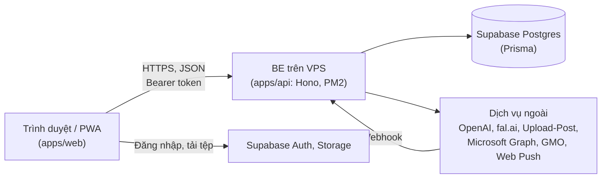

> Demo 18/11/2026 đã bổ sung Auth/TOTP/PWA theo kiến trúc này. Đọc [IMPLEMENTATION](auth-pwa-demo/IMPLEMENTATION.md) và [kết quả/thay đổi cần thiết](auth-pwa-demo/SOURCE_GAPS.md) trước các ví dụ Auth cũ. `@supabase/supabase-js` 2.119.0 đã dùng cho session và adapter Auth; demo công nghệ không dùng worker; self-registration và Web Push đồng bộ, không triển khai workflow nghiệp vụ.

# Tech stack và cấu trúc dự án

> Cập nhật scope DB: `database-design/10_confirmed_scope_and_remediation.md` và `apps/api/PRISMA.md` ưu tiên hơn các mô tả DB cũ dưới đây. Migration mới thêm 6 bảng app_private, khôi phục FK Auth thật qua Prisma externalTables, tách runtime role, chặn phần chưa chốt; đã áp và kiểm chứng Supabase dự án, xem `database-design/12_supabase_deployment.md`.

Bản 1.0 · 17/11/2026 · Dành cho lập trình viên và AI coding agent. **Đọc trước khi thêm mã vào `apps/`.**

Tài liệu này mô tả codebase **base** (khung) sau lần tối ưu ngày 17/11/2026: công nghệ, phiên bản, cấu trúc thư mục, các mẫu thiết kế, quy ước và cách thêm tính năng. Tính năng nghiệp vụ làm theo `SCD/`; đặc tả từng dịch vụ ở các bộ khác trong `agent_spec/`.

Căn cứ quyết định:
- Tách FE và BE: khối "Quyết định ngày 17/11/2026" ở đầu `Phan_tich/18_Ha_tang_he_thong.md`.
- Xác thực: `agent_spec/AI_Talent_OS_Supabase_Database_Auth_Agent_Spec_v1/` (bản 1.3).
- PWA: `agent_spec/pwa-platform-spec/PWA_PLATFORM_SPEC_VI.md`.

Ký hiệu trạng thái: **[Đang dùng]** đã có trong mã; **[Dự kiến]** đã chọn nhưng chưa đưa vào mã; **[Chưa chốt]** còn chờ quyết định.

## 1. Kiến trúc tổng thể



- **FE chỉ có giao diện.** Không có route API, server action hay middleware. Mọi dữ liệu lấy qua BE.
- **BE là nơi duy nhất** đọc và ghi DB, gọi dịch vụ ngoài, giữ khóa bí mật và nhận webhook.
- **Supabase** dùng cho Auth, Storage và Postgres. FE không đọc DB trực tiếp; bảng nào cũng bật RLS (chính sách quyền theo dòng) và không mở quyền cho `anon`, `authenticated`.
- **Một VPS** chạy cả API và worker (sau này), cùng mã nguồn, hai tiến trình PM2. VPS không giữ dữ liệu, hỏng thì dựng lại được (rủi ro RT07 ở `Phan_tich/20_Rui_ro_ky_thuat.md`).

## 2. Tech stack

### 2.1. FE (`apps/web`)

| Thành phần | Phiên bản | Vai trò | Trạng thái |
|---|---|---|---|
| Node.js | 22.20 (tối thiểu 22.18) | Chạy build, dev, kiểm thử | [Đang dùng] |
| Next.js (App Router, Turbopack) | 16.4.6 | Khung giao diện; bật `cacheComponents`, `partialPrefetching`; build `output: 'standalone'` cho Docker | [Đang dùng] |
| React / React DOM | 19.3.0 | Giao diện | [Đang dùng] |
| TypeScript | 5.9.3 | Kiểu tĩnh, `strict` | [Đang dùng] |
| ESLint + eslint-config-next | 9.39 / 16.4.6 | Lint (có luật React Compiler như `set-state-in-effect`) | [Đang dùng] |
| Kiểm thử | `node:test` có sẵn trong Node | Kiểm thử đơn vị cho `lib/` | [Đang dùng] |
| Web API của trình duyệt | — | Service worker, Push API, Notification, Badging API, Web App Manifest | [Đang dùng] |
| CSS | CSS thuần (`app/globals.css`) | Kiểu dáng tối thiểu; chọn bộ UI khi làm màn theo [AG] | [Chưa chốt] |
| `@supabase/supabase-js` | — | Chỉ để giữ phiên đăng nhập và tải tệp lên Storage (TUS) | [Dự kiến] |

Next.js 16 khác nhiều so với bản cũ. Trước khi viết mã FE, đọc tài liệu đi kèm ở `apps/web/node_modules/next/dist/docs/` (xem `apps/web/AGENTS.md`).

### 2.2. BE (`apps/api`)

| Thành phần | Phiên bản | Vai trò | Trạng thái |
|---|---|---|---|
| Node.js | 22.20 (tối thiểu 22.18) | Chạy thẳng tệp `.ts` khi dev (bỏ kiểu), chạy `dist/` khi production | [Đang dùng] |
| TypeScript | 5.9.3 | `module: nodenext`, `rewriteRelativeImportExtensions`, `erasableSyntaxOnly` (không dùng enum, namespace, tham số thuộc tính) | [Đang dùng] |
| Hono | 4.13.19 | Khung HTTP; middleware có sẵn: CORS, header bảo mật, giới hạn thân request, request id | [Đang dùng] |
| @hono/node-server | 2.1.8 | Chạy Hono trên Node | [Đang dùng] |
| @hono/zod-openapi | 1.6.3 | Khai báo API bằng `createRoute` + zod: tự kiểm đầu vào, suy kiểu, sinh `/openapi.json` | [Đang dùng] |
| zod | 4.6.7 | Kiểm dữ liệu (biến môi trường, đầu vào API) | [Đang dùng] |
| Prisma ORM + @prisma/adapter-pg + pg | 7.10.1 / 8.23.1 | Truy cập Postgres, migration; client sinh vào `src/generated/prisma` | [Đang dùng] |
| web-push | 3.6.7 | Gửi Web Push bằng khóa VAPID (`src/infra/push`) | [Đang dùng] (chưa module nào gọi) |
| PM2 | 7.1.2 | Quản lý tiến trình: cluster cho API, tự khởi động lại, chờ request xong mới tắt | [Đang dùng] |
| dotenv | 18.0.10 | Chỉ cho Prisma CLI đọc `.env` (`prisma.config.ts`) | [Đang dùng] |
| pg-boss | — | Hàng đợi và lịch chạy trên Postgres, cho worker | [Dự kiến] |
| Kiểm JWT Supabase | `hono/jwk` (có sẵn trong Hono) | Kiểm token theo JWKS của Supabase | [Dự kiến] |
| openai, @fal-ai/client, ffmpeg | — | AI coach, tạo video, ghép video trình chiếu | [Dự kiến] |
| Microsoft Graph, Upload-Post, GMO | gọi bằng `fetch` | OneDrive, đăng bài, thanh toán | [Dự kiến] |

### 2.3. Hạ tầng và vận hành

| Thành phần | Vai trò | Trạng thái |
|---|---|---|
| Docker Compose (tệp ở thư mục gốc) | `migrate` (Prisma Migrate một lần) → `api` (PM2) → `web`; `db` PostgreSQL 17 local là tùy chọn (profile `local-db`) | [Đang dùng] |
| Image `node:22.20-alpine` | Build nhiều tầng, chạy bằng user `node`, có healthcheck | [Đang dùng] |
| Supabase (Postgres, Auth, Storage) | Dữ liệu, đăng nhập, tệp tạm; project dev ở Tokyo | [Đang dùng] (Postgres) |
| HTTPS | Hiện chạy local bằng HTTP; thử trên điện thoại qua đường hầm. Khi lên VPS cần một reverse proxy có HTTPS (ví dụ Caddy) cho webhook và PWA | [Chưa chốt] |
| VPS Xserver | Chạy `docker compose` hoặc PM2 trực tiếp | [Dự kiến] |
| Nơi chứa FE | Vercel, CDN, hoặc container `web` trên VPS | [Chưa chốt] |

## 3. Cấu trúc thư mục

```
TalentOS/
├─ apps/
│  ├─ api/                          BE (xem 4)
│  │  ├─ src/
│  │  │  ├─ server.ts               Điểm vào HTTP: đọc env → createContainer → createApp → serve; tắt êm khi nhận SIGTERM
│  │  │  ├─ container.ts            Composition root: tạo DB và mọi phụ thuộc dùng chung MỘT lần
│  │  │  ├─ config/env.ts           Kiểm biến môi trường bằng zod
│  │  │  ├─ core/errors.ts          AppError và các hàm tạo lỗi (notFound, conflict, unauthorized, forbidden)
│  │  │  ├─ http/app.ts             Dựng app Hono: middleware, gắn module, dạng lỗi chung, OpenAPI
│  │  │  ├─ http/app.test.ts        Kiểm thử app bằng app.request() với DB giả
│  │  │  ├─ modules/
│  │  │  │  └─ system/routes.ts     Module mẫu: GET /health
│  │  │  ├─ infra/                  Adapter cho hạ tầng và dịch vụ ngoài
│  │  │  │  ├─ database/            client.ts (PrismaClient), config.ts (TLS, pool, chặn cổng 6543 cho migration), check.ts (npm run db:check)
│  │  │  │  └─ push/                sender.ts (web-push), status.ts (phân loại mã trả về), endpoint.ts (chỉ cho máy chủ đẩy thật)
│  │  │  └─ generated/prisma/       Mã Prisma sinh tự động (không commit, không sửa tay)
│  │  ├─ prisma/                    schema.prisma (25 model, sinh bằng db pull); migrations/ (init + lock_prisma_migrations)
│  │  ├─ certs/supabase-ca.crt      CA công khai của Supabase
│  │  ├─ ecosystem.config.cjs       Cấu hình PM2
│  │  ├─ Dockerfile                 Tầng migration (Prisma CLI) và tầng runtime (pm2-runtime)
│  │  ├─ prisma.config.ts, tsconfig.json, package.json, .env.example
│  │  └─ README.md, PRISMA.md
│  └─ web/                          FE (xem 5)
│     ├─ app/                       Route của App Router
│     │  ├─ layout.tsx              <html lang="ja">, metadata cho iPhone, UpdateBanner
│     │  ├─ manifest.ts             Manifest PWA
│     │  ├─ page.tsx                Chuyển hướng tới /home
│     │  ├─ home/page.tsx           Khung màn ホーム (T-07)
│     │  ├─ offline/page.tsx        Trang mất mạng (service worker lưu sẵn)
│     │  └─ apple-icon.png, icon.png
│     ├─ components/
│     │  └─ pwa/                    InstallGuide, PushToggle, UpdateBanner
│     ├─ lib/
│     │  ├─ config.ts               Tên, màu ứng dụng; API_URL; khóa công khai VAPID
│     │  ├─ messages.ts             Toàn bộ chữ giao diện (tiếng Nhật)
│     │  ├─ api/client.ts           apiFetch, ApiError: lớp gọi BE duy nhất
│     │  └─ pwa/                    platform.ts (nhận biết máy, trình duyệt), install-prompt.ts, push.ts (đăng ký push trên trình duyệt), busy.ts
│     ├─ public/sw.js               Service worker
│     ├─ public/icons/              Biểu tượng tạm (scripts/gen-icons.mjs)
│     ├─ instrumentation-client.ts  Đăng ký service worker, giữ sự kiện cài của Android
│     ├─ next.config.ts             Header bảo mật, header không cache cho /sw.js
│     └─ Dockerfile, package.json, .env.example, README.md, AGENTS.md
├─ docker-compose.yml, .env.example, DOCKER.md, AGENTS.md
└─ agent_spec/, SCD/, Phan_tich/    Tài liệu
```

## 4. BE: kiến trúc và mẫu thiết kế

### 4.1. Các lớp và chiều phụ thuộc

Kiến trúc là **modular monolith** (một ứng dụng, chia module theo tính năng):

```
server.ts / worker.ts ──► container.ts ──► infra/*  (DB, push, dịch vụ ngoài)
        │                       │
        └──► http/app.ts ──► modules/<tính năng>/routes.ts ──► service.ts ──► infra/*, core/*
```

Quy tắc phụ thuộc:
- `modules/*` được dùng `core/`, `infra/`, `config/`; **không** import module khác trực tiếp. Cần thì nhận service của module kia qua `AppDeps`.
- `infra/*` không biết gì về module và HTTP.
- `core/*` không phụ thuộc gì trong dự án.
- Chỉ `container.ts` tạo đối tượng dùng chung. Không có singleton import ngầm (ví dụ không `export const db = new PrismaClient()`).

### 4.2. Mẫu thiết kế đang dùng

| Mẫu | Ở đâu | Vì sao |
|---|---|---|
| Composition root + truyền phụ thuộc qua tham số | `container.ts`, `AppDeps`, `createApp(deps)`, `systemModule(deps)` | Một nơi tạo phụ thuộc; kiểm thử thay bằng đồ giả dễ dàng (xem `http/app.test.ts`) |
| Application factory | `createApp(deps)` tách khỏi `server.ts` | Kiểm thử bằng `app.request()` không mở cổng |
| Module theo tính năng | `modules/<tên>/routes.ts` (+ `service.ts`) | Mỗi tính năng (EP01–EP10) một chỗ, dễ giao cho agent |
| Controller mỏng | `routes.ts` chỉ khai báo API, kiểm đầu vào, gọi service, trả JSON | Nghiệp vụ không dính HTTP |
| Adapter cho dịch vụ ngoài | `infra/push`, sau này `infra/openai`, `infra/upload-post`… | Đổi nhà cung cấp hoặc làm đồ giả mà không sửa nghiệp vụ |
| Lỗi nghiệp vụ có mã | `core/errors.ts` → `onError` ở `http/app.ts` | Mọi lỗi cùng dạng `{ error: { code, requestId } }`; lỗi lạ thành 500, không lộ chi tiết |
| Cấu hình kiểm chặt khi khởi động | `config/env.ts` | Sai biến môi trường thì dừng ngay, không chạy nửa vời |
| Contract-first | `createRoute` + zod → `/openapi.json` | FE sinh client và kiểu từ tài liệu API, không dùng chung mã |

Mẫu dùng khi có tính năng cần (chưa đưa vào base, theo các bộ đặc tả):
- **Repository:** chỉ khi một truy vấn phức tạp lặp lại ở nhiều service. Mặc định service gọi Prisma trực tiếp.
- **State machine** cho bài đăng, video, thanh toán (`SCD/EP10…/C-01`).
- **Transactional outbox:** ghi dữ liệu nghiệp vụ và sự kiện trong cùng một giao dịch; worker đọc sự kiện để gửi push, gọi dịch vụ ngoài.
- **Idempotency** (lệnh chống trùng): header `Idempotency-Key` đã được CORS cho phép; lưu kết quả lệnh theo khóa.

### 4.3. Thêm một module mới (ví dụ: thông báo, 6-1)

1. Tạo `src/modules/notifications/`:
   - `schemas.ts`: các schema zod của đầu vào và đầu ra (có `.openapi('Tên')`).
   - `service.ts`: lớp `NotificationService` nhận phụ thuộc qua constructor (`db`, adapter push…), ném `AppError` khi lỗi nghiệp vụ.
   - `routes.ts`: hàm `notificationsModule(deps)` trả về `OpenAPIHono`; mỗi API là một `createRoute` + `app.openapi(route, handler)`.
2. Tạo service trong `container.ts` và thêm vào `AppDeps`.
3. Gắn trong `http/app.ts`, mục "Modules": `app.route('/', notificationsModule(deps))`.
4. Biến môi trường mới: thêm vào `config/env.ts` và `.env.example`.
5. Bảng mới: thêm model vào `prisma/schema.prisma`, chạy `npx prisma migrate dev --name <tên>`, rồi thêm vào migration lệnh bật RLS và thu hồi quyền `anon`, `authenticated` (mẫu SQL ở `apps/api/PRISMA.md`).
6. Kiểm thử: `routes` kiểm bằng `app.request()` với service giả; `service` kiểm với DB thử (`TEST_DATABASE_URL`).

Đường dẫn API: `/api/v1/me/...` cho dữ liệu của người đang đăng nhập; `/api/v1/admin/...` cho màn quản trị; `/api/v1/webhooks/<dịch vụ>` cho webhook; `/api/v1/dev/...` chỉ cho công cụ phát triển, luôn có cờ tắt ở production.

### 4.4. Xác thực (dự kiến, theo bộ Supabase 1.3)

- Đăng nhập bằng mật khẩu **đi qua BE** (`POST /api/v1/auth/login`), để BE đếm và khóa sau 5 lần sai. BE trả token, FE gọi `supabase.auth.setSession()`.
- Quản lý xác thực hai bước bằng ứng dụng Authenticator (TOTP). Nhánh SMS chờ bàn với khách (S01-11). Không làm OTP qua email.
- Middleware `requireUser` đặt ở `src/http/auth.ts`: kiểm JWT bằng JWKS của Supabase (`hono/jwk`), rồi kiểm trạng thái tài khoản trong DB; route `/api/v1/me/*` và `/api/v1/admin/*` đều qua middleware này.

### 4.5. Worker (dự kiến)

- Điểm vào `src/worker.ts`, dùng chung `container.ts` với API.
- Thêm vào `ecosystem.config.cjs` một app thứ hai: `script: 'dist/worker.js'`, `exec_mode: 'fork'`, `instances: 1`. Trong Docker Compose thêm service dùng cùng image, `command: ["node_modules/.bin/pm2-runtime", "ecosystem.config.cjs", "--only", "worker"]` (hoặc tách hai service `api`, `worker`).
- Hàng đợi và lịch chạy: pg-boss trên Postgres (đợt AI 8:00, chờ video, gửi bài, lấy số liệu, gửi push).

## 5. FE: kiến trúc và quy ước

| Quy ước | Nội dung |
|---|---|
| Chỉ giao diện | Không `app/api/`, không server action, không middleware. Hiện chưa có luật lint tự chặn; review phải kiểm |
| Gọi BE | Chỉ qua `lib/api/client.ts` (`apiFetch`, `ApiError`). Mỗi tính năng một tệp `lib/api/<tính năng>.ts` bọc các lời gọi; component không gọi `fetch` tới BE |
| Kiểu dữ liệu API | Sinh từ `/openapi.json` của BE khi có API thật (ví dụ bằng `openapi-typescript`), không chép tay |
| Chữ giao diện | Tiếng Nhật, tất cả ở `lib/messages.ts`; component không viết chữ cứng |
| Server và Client Component | Trang và khung tĩnh là Server Component; phần dùng API của trình duyệt (quyền, push, cài) là Client Component (`'use client'`) |
| Trạng thái theo trình duyệt | Dùng `useSyncExternalStore` (không `setState` đồng bộ trong `useEffect`; lint chặn) |
| Thư mục | `components/<tính năng>/`, `lib/<tính năng>/`; route theo mã màn của [AG] (ví dụ `/home` = T-07) |
| Import | `@/` từ thư mục gốc của app. Tệp trong `lib/` import lẫn nhau bằng đường dẫn tương đối có đuôi `.ts`, để chạy được `node --test` |
| PWA | `lib/pwa/` và `components/pwa/`; quy tắc ở đặc tả PWA (không lưu HTML đã đăng nhập; push nào cũng phải hiện thông báo…) |

Thêm một màn: tạo `app/<route>/page.tsx`, component trong `components/<tính năng>/`, chữ trong `lib/messages.ts`, lời gọi BE trong `lib/api/<tính năng>.ts`.

## 6. Biến môi trường

| Biến | Ở đâu | Bắt buộc | Ý nghĩa |
|---|---|---|---|
| `NODE_ENV` | BE | Không (mặc định `development`) | `production` thì ẩn `/openapi.json` |
| `PORT` | BE | Không (8080) | Cổng API |
| `CORS_ORIGINS` | BE, `.env` gốc | Không | Địa chỉ FE được gọi API, cách nhau bằng dấu phẩy |
| `DATABASE_URL` | `apps/api/.env` | **Có** | Supabase transaction pooler (6543) |
| `DIRECT_URL` | `apps/api/.env` | Cho migration | Session pooler (5432) hoặc direct; chỉ Prisma CLI dùng |
| `DATABASE_POOL_MAX`, `DATABASE_CA_CERT` | `apps/api/.env` | Không | Số kết nối mỗi tiến trình (1–20); CA thay thế |
| `API_INSTANCES` | BE, `.env` gốc | Không (1) | Số tiến trình API trong PM2 cluster |
| `NEXT_PUBLIC_API_URL` | FE (`.env.local`; compose: `PUBLIC_API_URL`) | Không (`http://localhost:8080`) | URL trình duyệt dùng gọi BE, **gắn lúc build** |
| `NEXT_PUBLIC_VAPID_PUBLIC_KEY` | FE (compose: `VAPID_PUBLIC_KEY`) | Cho push | Khóa công khai VAPID, gắn lúc build; phải trùng khóa BE dùng |

Khóa bí mật (VAPID riêng, khóa Supabase, OpenAI…) thêm vào `config/env.ts` và `apps/api/.env` khi có module dùng. Không bao giờ đặt khóa bí mật trong biến `NEXT_PUBLIC_*`.

## 7. Chạy và triển khai

| Cách | Lệnh |
|---|---|
| Phát triển, từng app | `apps/api`: `npm run dev` (http://localhost:8080). `apps/web`: `npm run dev:https` (https://localhost:3000) |
| Docker Compose (thư mục gốc) | `docker compose up -d --build`; chi tiết ở `DOCKER.md` |
| VPS không dùng Docker | `apps/api`: `npm ci && npm run build && npx pm2 start ecosystem.config.cjs` |
| Migration | `apps/api`: `npm run db:status`, `npm run db:migrate` (hoặc service `migrate` của compose) |

## 8. Kiểm thử

| App | Lệnh | Phạm vi hiện có |
|---|---|---|
| BE | `npm test` (`node --test 'src/**/*.test.ts'`), `npm run typecheck` | App: health, dạng lỗi 404 và 500, CORS, OpenAPI, thiếu biến môi trường; cấu hình DB (TLS, cổng migration); push (lọc máy chủ đẩy, phân loại mã trả về) |
| FE | `npm test` (`node --test 'lib/**/*.test.ts'`), `npm run lint`, `npm run build` | Nhận biết máy và trình duyệt; đọc lỗi của BE |
| Máy thật | Ca PW-01〜PW-18 ở đặc tả PWA §7.2 | Cài, push, cập nhật, mất mạng trên iPhone và Android |

Kiểm thử tích hợp với Postgres (`TEST_DATABASE_URL`, schema ngẫu nhiên cho mỗi lần chạy) thêm theo từng module khi có schema.

## 9. Những gì đã gỡ khỏi base

Ngày 17/11/2026 đã gỡ các tính năng thử và **không giữ bản lưu**:
- Demo đăng ký, đăng nhập với QR và TOTP.
- Phiên thông báo dùng mã truy cập, hộp thư, gắn máy nhận push và hàng đợi push có worker.
- API gửi thử push.
- Proxy cùng origin của FE (`app/api/*`), vì FE không còn có API.

Đã xóa toàn bộ bảng thử và lịch sử migration cũ trên Supabase dev. Ngày 17/11/2026 đã áp migration theo `database-design/04` (25 bảng, xem `apps/api/PRISMA.md`). Các schema Supabase tự quản (`auth`, `storage`…) không bị đụng tới. Hai người dùng do demo đăng nhập tạo trong Supabase Auth cũng đã xóa; project dev hiện không có người dùng nào.

Tính năng thông báo (6-1) và đăng nhập (EP01) sẽ làm lại theo đặc tả (bộ PWA, bộ Supabase) và mẫu module ở 4.3. Phần dùng lại được vẫn nằm trong base: `infra/push` (gửi push, đã thử gửi thật tới FCM), `infra/database` (TLS và cấu hình pool cho Supabase), `lib/pwa/*` (đăng ký push và cài đặt phía trình duyệt).

## 10. Việc còn mở

| Việc | Ghi chú |
|---|---|
| Nơi chứa FE (Vercel, CDN hay container trên VPS) | Nếu dùng CDN: `output: 'export'` và đặt header của `sw.js` ở nơi chứa |
| HTTPS trên VPS | Cần reverse proxy có HTTPS cho webhook và PWA khi triển khai thật |
| Bộ thành phần giao diện | Chọn khi làm các màn của [AG] |
| Sinh client API cho FE từ OpenAPI | Làm khi có module API đầu tiên |
| Gói Supabase | Ảnh hưởng khóa đăng nhập (Q08 bộ Supabase), giới hạn phiên |
