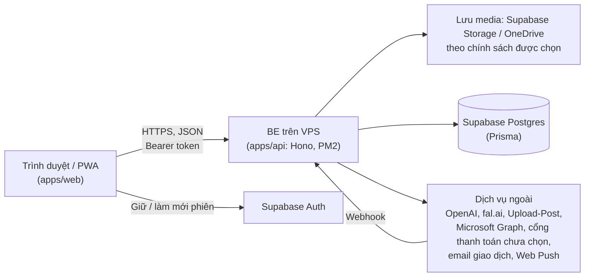

> Demo 18/11/2026 đã bổ sung Auth/TOTP/PWA theo kiến trúc này. Hướng dẫn tích hợp cho agent: [Supabase DB + Auth](supabase-db-auth-spec/HUONG_DAN_TICH_HOP_VI.md), [PWA + Web Push](pwa-platform-spec/HUONG_DAN_TICH_HOP_VI.md) (mỗi thư mục kèm `CA_KIEM_THU_VI.md`). `@supabase/supabase-js` 2.119.0 đã dùng cho session và adapter Auth; demo công nghệ không dùng worker; self-registration và Web Push đồng bộ, không triển khai workflow nghiệp vụ.

> **Review nguồn hiện hành 20/11/2026:** đã đối chiếu QA mới (No.78–92), KS, biên bản và màn 19/11. Các điều chỉnh và quyết định còn mở tại mục 0. Đây là review của tác giả, chưa Independent Verification hoặc G8; code/demo và tài liệu tích hợp không xác nhận nghiệp vụ khách hàng.

> Đặc tả mới 19/11/2026: [ChatGPT → MCP](chatgpt-mcp-spec/README.md) (OAuth, tools, approval, concurrency, AC). Đây là tài liệu đề xuất; MCP chưa được triển khai hoặc kiểm chứng.

# Tech stack và cấu trúc dự án

> Cập nhật scope DB: `database-design/07_implementation_scope_and_rules.md`, `database-design/05_data_dictionary.md` và `apps/api/PRISMA.md` ưu tiên hơn các mô tả DB cũ dưới đây. Migration mới thêm 6 bảng app_private, khôi phục FK Auth thật qua Prisma externalTables, tách runtime role, chặn phần chưa chốt; đã áp và kiểm chứng trên Supabase dev ngày 17/11/2026.

Bản 1.1 · review tài liệu 20/11/2026; khung ban đầu 17/11/2026 · Dành cho lập trình viên và AI coding agent. **Đọc trước khi thêm mã vào `apps/`.**

Tài liệu này mô tả codebase **base** và các module demo hiện có: công nghệ, cấu trúc, mẫu thiết kế và quy ước. Phiên bản thư viện là snapshot của package/lockfile trong repository, không phải khuyến nghị nâng cấp hoặc xác nhận tương thích của nhà cung cấp. Tính năng nghiệp vụ làm theo `SCD/`; đặc tả từng dịch vụ ở các bộ khác trong `agent_spec/`.

Căn cứ quyết định:
- Tách FE và BE: khối "Quyết định ngày 17/11/2026" ở đầu `Phan_tich/18_Ha_tang_he_thong.md`.
- DB và xác thực: `agent_spec/supabase-db-auth-spec/` (bản 2.0: hướng dẫn tích hợp + ca kiểm thử).
- PWA và thông báo đẩy: `agent_spec/pwa-platform-spec/` (bản 2.0: hướng dẫn tích hợp + ca kiểm thử).

Ký hiệu trạng thái: **[Đang dùng]** đã có trong mã; **[Dự kiến]** đã chọn nhưng chưa đưa vào mã; **[Chưa chốt]** còn chờ quyết định.

## 0. Kết quả đối chiếu với tài liệu khách hàng

**Kết luận:** chưa có căn cứ từ nguồn hiện hành để thay Next.js, Hono, TypeScript, Prisma hoặc tách FE/BE khác đi. Đây là lựa chọn kỹ thuật nội bộ. Cần sửa phạm vi tích hợp, hành vi và trạng thái triển khai dưới đây để agent không lấy giả định cũ làm yêu cầu đã chốt.

| Chủ đề | Căn cứ nguồn đúng phiên bản/vị trí | Cách áp dụng trong kiến trúc |
|---|---|---|
| Nơi lưu ảnh/video | QA hiện hành, sheet `Q&A`, No.8, G9/H9; GJ19 §14 | QA ghi có thể lưu ở Supabase và OneDrive. Thiết kế adapter hỗ trợ nơi lưu được chọn; chưa suy phải lưu kép mọi tệp hoặc Supabase chỉ được chứa tệp tạm. Hồ sơ/chỉ thị OneDrive là chủ đề riêng. |
| Sửa hồ sơ/chỉ thị AI | BF19 trang PDF18; SD-M19 M-15 trang20 và M-21 trang26 | Phải hỗ trợ màn quản trị và ChatGPT; không hướng dẫn Manager sửa trực tiếp file OneDrive. Thứ tự ưu tiên: từng Talent → category → toàn bộ. Màn nhập chỉ thị nghiệp vụ khác màn cấu hình kỹ thuật Agent/Model. |
| Quyền Manager và người nhận | QA No.88, G88/H88; No.87, G87/H87; SD-M19 trang1/8 | No.88 ghi Manager nào cũng cập nhật mọi Talent; không dùng assign làm điều kiện giới hạn toàn bộ quyền. No.87 nói gửi mọi Manager, No.88 nói assign để nhận thông báo; bản màn nói người phụ trách. Giữ xung đột về người nhận, không tự chọn cách gửi. |
| Đăng ký và kích hoạt | QA No.65/78/79/80; BF19 trang4 | Self-registration demo không phải đăng ký Talent nghiệp vụ. Đăng ký phương thức thanh toán xong tự chuyển đang dùng; hồ sơ chưa có thì AI chưa đưa đề xuất. Không suy đăng ký phương thức là đã thu tiền. |
| Mật khẩu và MFA | QA No.65 G65/H65, No.79 G79/H79; SD-M19 M-01 trang5 | Mật khẩu tạm không có hạn, thư gửi một lần; mất thư đi qua quên mật khẩu, mở link rồi nhập mật khẩu mới. Manager dùng TOTP; không giữ SMS như một nhánh đã được nguồn mới yêu cầu. Demo TOTP tự nguyện chưa đạt quy tắc Manager bắt buộc TOTP. |
| PWA và điều hướng | SD-T19 T-06 trang8–9, T-08 trang11, T-09 trang12–13; GJ19 phần PWA | Có hướng dẫn thêm vào màn hình chính thủ công; sau khởi tạo vào Mypage. Việc tải ứng dụng như native và trải nghiệm thực tế còn cần đối chiếu với khách. Không lấy khả năng chạy demo thay nghiệm thu iPhone/Android. |
| Lịch và đăng lại | GJ19 §17; SD-M19 M-08 trang12; QA No.59/83/84/91 | Worker cần tách lịch nội bộ với lịch đã gửi dịch vụ đăng bài. Không cố định đợt 08:00 hoặc tự đăng lại khi lỗi SNS; đăng lại ngay theo mô tả hiện hành nhưng đích SNS vẫn No.59. Retry tác vụ kỹ thuật không được tạo thêm lần đăng nghiệp vụ. |
| Sửa bài và từ cấm | QA No.85 G85/H85, No.90 G90/H90; GJ19 §12–13 | Bài đã xin duyệt/duyệt/đặt lịch không cho Talent sửa theo No.85. Manager sửa từ cấm rồi kiểm lại, không trả Talent xác nhận lại. Hiệu lực danh sách mới với bài đã kiểm và đổi SNS khi còn lịch là hai ứng viên chưa chốt trong Q&A nội bộ. |
| AI viết lại và video | DEC-0001 trong [bản ghi quyết định](../docs/requirement-review/corrections-2026-11-19/REPORT.md); QA No.36/CR-04; SD-T19 trang20 | Không giới hạn lượt AI viết lại theo quyết định người dùng về H65; không gắn cap hai lần vào worker/UI. Nguồn mới chỉ mô tả short chưa chứng minh hủy slideshow; giữ phần này chờ đối chiếu phạm vi, không tự bỏ hoặc coi ffmpeg đã được chọn. |
| Thanh toán và email | QA No.4 G5/H5, No.75; GJ19 §7; BF19 trang15 | Dùng adapter cổng thanh toán chưa chọn, không hard-code GMO/Square. Cần đường gửi email giao dịch và bộ mẫu chung; nhà cung cấp email là lựa chọn kỹ thuật chưa chốt. Các câu về giá được rút khỏi bộ Q&A theo yêu cầu, không có nghĩa quyết định thanh toán đã hoàn tất. |

Nguồn: [QA/KS và danh mục phiên bản](../TAI_LIEU_NGUON.md), [BF19](../source_requiments/19112926/業務フロー_AI育成OS.pdf), [SD-T19](../source_requiments/19112926/画面定義書_タレントのアプリ_AI育成OS.pdf), [SD-M19](../source_requiments/19112926/画面定義書_管理画面_AI育成OS.pdf), [GJ19](../source_requiments/19112926/20261119_AMCOLAB様打ち合わせ_画面定義書の確認_議事録.md). Trang ở bảng là trang PDF thực tế, không lấy số màn AG để thay cho SD.

**Quyết định kỹ thuật của người dùng:** dùng **BullMQ với Redis** cho hàng đợi và lịch worker; bằng chứng trong trao đổi: “chốt sử dụng bullmq đi”. Quyết định này thay phương án pg-boss trước đây, chỉ chốt lựa chọn công nghệ, chưa phải đã cài đặt/triển khai hoặc khách phê duyệt nghiệp vụ. Chưa có BullMQ/Redis trong dependencies hoặc worker trong Compose hiện hành. Phiên bản, cấu hình Redis, kết nối, lưu dữ liệu bền vững và vận hành cần được xác định khi triển khai.

**Phần còn cần quyết định riêng:** nơi chạy API/worker; phương án BE trên Vercel trong [báo cáo AI Core v2](AI_Talent_OS_AI_Core_Architecture_Report_v2.md) chưa thay quy ước `apps/api`. Phần báo cáo AI Core cho sửa trực tiếp OneDrive hoặc bỏ màn chỉ thị nghiệp vụ cũng cần đồng bộ theo nguồn ở bảng trên trước khi triển khai.

## 1. Kiến trúc tổng thể



- **FE chỉ có giao diện.** Không có route API, server action hay middleware. Mọi dữ liệu lấy qua BE.
- **BE là nơi duy nhất** đọc/ghi dữ liệu ứng dụng trong DB, cấp quyền nghiệp vụ, giữ khóa bí mật và nhận webhook. FE có ngoại lệ gọi Supabase Auth để giữ/làm mới phiên; đăng nhập mật khẩu đi qua BE. Upload trực tiếp tới kho chỉ được thêm nếu có thiết kế cấp quyền upload riêng, không phải mặc định hiện đã có.
- **Supabase** được chọn nội bộ cho Auth/Postgres; Storage là một nơi lưu media được nguồn QA No.8 cho phép. Chính sách bảng ứng dụng theo `apps/api/PRISMA.md`; không áp câu “thu hồi mọi quyền” lên schema `auth`/`storage` do Supabase quản lý. FE không đọc trực tiếp bảng nghiệp vụ.
- **Một VPS** chạy cả API và worker (sau này), cùng mã nguồn, hai tiến trình PM2. VPS không giữ dữ liệu, hỏng thì dựng lại được (rủi ro RT07 ở `Phan_tich/20_Rui_ro_ky_thuat.md`).

## 2. Tech stack

### 2.1. FE (`apps/web`)

| Thành phần | Phiên bản | Vai trò | Trạng thái |
|---|---|---|---|
| Node.js | 22.20 (tối thiểu 22.18) | Chạy build, dev, kiểm thử | [Đang dùng] |
| Next.js (App Router, Turbopack) | 16.4.6 | Khung giao diện; bật `cacheComponents`, `partialPrefetching`; build `output: 'standalone'` cho Docker | [Đang dùng] |
| React / React DOM | 19.3.0 | Giao diện | [Đang dùng] |
| TypeScript | 5.9.3 | Kiểu tĩnh, `strict` | [Đang dùng] |
| ESLint + eslint-config-next | 9.39 / 16.4.6 | Lint (có luật React Compiler như `set-state-in-effect`) | [Đang dùng] |
| Kiểm thử | `node:test` có sẵn trong Node | Kiểm thử đơn vị cho `lib/` | [Đang dùng] |
| Web API của trình duyệt | — | Service worker, Push API, Notification, Badging API, Web App Manifest | [Đang dùng] |
| CSS | CSS thuần (`app/globals.css`) | Kiểu dáng tối thiểu; chọn bộ UI khi làm màn theo SD hiện hành; AG chỉ là tham chiếu lịch sử | [Chưa chốt] |
| `@supabase/supabase-js` | 2.119.0 | Đã giữ/làm mới phiên trong demo; upload Storage/TUS chưa phải luồng đã triển khai | [Đang dùng] trong demo |

Next.js 16 khác nhiều so với bản cũ. Trước khi viết mã FE, đọc tài liệu đi kèm ở `apps/web/node_modules/next/dist/docs/` (xem `apps/web/AGENTS.md`).

### 2.2. BE (`apps/api`)

| Thành phần | Phiên bản | Vai trò | Trạng thái |
|---|---|---|---|
| Node.js | 22.20 (tối thiểu 22.18) | Chạy thẳng tệp `.ts` khi dev (bỏ kiểu), chạy `dist/` khi production | [Đang dùng] |
| TypeScript | 5.9.3 | `module: nodenext`, `rewriteRelativeImportExtensions`, `erasableSyntaxOnly` (không dùng enum, namespace, tham số thuộc tính) | [Đang dùng] |
| Hono | 4.13.19 | Khung HTTP; middleware có sẵn: CORS, header bảo mật, giới hạn thân request, request id | [Đang dùng] |
| @hono/node-server | 2.1.8 | Chạy Hono trên Node | [Đang dùng] |
| @hono/zod-openapi | 1.6.3 | Khai báo API bằng `createRoute` + zod: tự kiểm đầu vào, suy kiểu, sinh `/openapi.json` | [Đang dùng] |
| zod | 4.6.7 | Kiểm dữ liệu (biến môi trường, đầu vào API) | [Đang dùng] |
| Prisma ORM + @prisma/adapter-pg + pg | 7.10.1 / 8.23.1 | Truy cập Postgres, migration; client sinh vào `src/generated/prisma` | [Đang dùng] |
| web-push | 3.6.7 | Gửi Web Push bằng VAPID; module demo PWA gọi adapter | [Đang dùng] trong demo |
| PM2 | 7.1.2 | Quản lý tiến trình: cluster cho API, tự khởi động lại, chờ request xong mới tắt | [Đang dùng] |
| dotenv | 18.0.10 | Chỉ cho Prisma CLI đọc `.env` (`prisma.config.ts`) | [Đang dùng] |
| BullMQ + Redis | Chốt phiên bản khi triển khai | Hàng đợi, lịch chạy và phân phối việc cho worker; thay phương án pg-boss | [Dự kiến] — người dùng đã chốt công nghệ, chưa triển khai |
| Kiểm JWT Supabase | `@supabase/supabase-js` 2.119.0 | Adapter demo gọi `getClaims()`, tra user và sổ phiên demo; guard danh tính/quyền nghiệp vụ còn phải triển khai | [Đang dùng] trong demo |
| SDK mô hình, tạo video và media | — | OpenAI/fal.ai và cách ghép slideshow là phương án tích hợp; chưa có các SDK này trong dependencies. Đối chiếu đề xuất AI Core trước chọn thư viện | [Dự kiến], chưa xác nhận nhà cung cấp/thư viện cuối |
| Microsoft Graph, Upload-Post | gọi bằng `fetch` | Đã có adapter/module demo OneDrive và kết nối SNS; chưa phải luồng nghiệp vụ hoàn chỉnh | [Đang dùng] trong demo |
| Cổng thanh toán; email giao dịch | Chưa chọn | Adapter thanh toán và gửi thư đăng ký/đặt lại mật khẩu/thông báo; không mặc định GMO hoặc Square | [Chưa chốt] |

### 2.3. Hạ tầng và vận hành

| Thành phần | Vai trò | Trạng thái |
|---|---|---|
| Docker Compose (tệp ở thư mục gốc) | `migrate` (Prisma Migrate một lần) → `api` (PM2) → `web`; `db` PostgreSQL 17 local là tùy chọn (profile `local-db`) | [Đang dùng] |
| Image `node:22.20-alpine` | Build nhiều tầng, chạy bằng user `node`, có healthcheck | [Đang dùng] |
| Supabase (Postgres, Auth, Storage) | Postgres/Auth có trong code/demo; Storage là lựa chọn lưu media, chưa coi luồng upload đã hoàn tất. Vùng dev theo hồ sơ triển khai riêng | [Đang dùng] Postgres/Auth; Storage chờ thiết kế |
| HTTPS | Hiện chạy local bằng HTTP; thử trên điện thoại qua đường hầm. Khi lên VPS cần một reverse proxy có HTTPS (ví dụ Caddy) cho webhook và PWA | [Chưa chốt] |
| VPS Xserver | Chạy `docker compose` hoặc PM2 trực tiếp | [Dự kiến] |
| Nơi chứa FE | Vercel, CDN, hoặc container `web` trên VPS | [Chưa chốt] |

## 3. Cấu trúc thư mục

```
TalentOS/
├─ apps/
│  ├─ api/                          BE (xem 4)
│  │  ├─ src/
│  │  │  ├─ server.ts               Điểm vào HTTP: đọc env → createContainer → createApp → serve; tắt êm khi nhận SIGTERM
│  │  │  ├─ container.ts            Composition root: tạo DB và mọi phụ thuộc dùng chung MỘT lần
│  │  │  ├─ config/env.ts           Kiểm biến môi trường bằng zod
│  │  │  ├─ core/errors.ts          AppError và các hàm tạo lỗi (notFound, conflict, unauthorized, forbidden)
│  │  │  ├─ http/app.ts             Dựng app Hono: middleware, gắn module, dạng lỗi chung, OpenAPI
│  │  │  ├─ http/app.test.ts        Kiểm thử app bằng app.request() với DB giả
│  │  │  ├─ modules/
│  │  │  │  └─ system/routes.ts     Module mẫu: GET /health
│  │  │  ├─ infra/                  Adapter cho hạ tầng và dịch vụ ngoài
│  │  │  │  ├─ database/            client.ts (PrismaClient), config.ts (TLS, pool, chặn cổng 6543 cho migration), check.ts (npm run db:check)
│  │  │  │  └─ push/                sender.ts (web-push), status.ts (phân loại mã trả về), endpoint.ts (chỉ cho máy chủ đẩy thật)
│  │  │  └─ generated/prisma/       Mã Prisma sinh tự động (không commit, không sửa tay)
│  │  ├─ prisma/                    schema.prisma (schema hiện hành; xem PRISMA.md); migrations/ (cả foundation và demo, không chỉ init)
│  │  ├─ certs/supabase-ca.crt      CA công khai của Supabase
│  │  ├─ ecosystem.config.cjs       Cấu hình PM2
│  │  ├─ Dockerfile                 Tầng migration (Prisma CLI) và tầng runtime (pm2-runtime)
│  │  ├─ prisma.config.ts, tsconfig.json, package.json, .env.example
│  │  └─ README.md, PRISMA.md
│  └─ web/                          FE (xem 5)
│     ├─ app/                       Route của App Router
│     │  ├─ layout.tsx              <html lang="ja">, metadata cho iPhone, UpdateBanner
│     │  ├─ manifest.ts             Manifest PWA
│     │  ├─ page.tsx                Chuyển hướng tới /home
│     │  ├─ home/page.tsx           Khung route cũ; Home hiện là SD-T19 T-09, không suy route demo là luồng nghiệp vụ
│     │  ├─ offline/page.tsx        Trang mất mạng (service worker lưu sẵn)
│     │  └─ apple-icon.png, icon.png
│     ├─ components/
│     │  └─ pwa/                    InstallGuide, PushToggle, UpdateBanner
│     ├─ lib/
│     │  ├─ config.ts               Tên, màu ứng dụng; API_URL; khóa công khai VAPID
│     │  ├─ messages.ts             Toàn bộ chữ giao diện (tiếng Nhật)
│     │  ├─ api/client.ts           apiFetch, ApiError: lớp gọi BE duy nhất
│     │  └─ pwa/                    platform.ts (nhận biết máy, trình duyệt), install-prompt.ts, push.ts (đăng ký push trên trình duyệt), busy.ts
│     ├─ public/sw.js               Service worker
│     ├─ public/icons/              Biểu tượng tạm (scripts/gen-icons.mjs)
│     ├─ instrumentation-client.ts  Đăng ký service worker, giữ sự kiện cài của Android
│     ├─ next.config.ts             Header bảo mật, header không cache cho /sw.js
│     └─ Dockerfile, package.json, .env.example, README.md, AGENTS.md
├─ docker-compose.yml, .env.example, DOCKER.md, AGENTS.md
└─ agent_spec/, SCD/, Phan_tich/    Tài liệu
```

## 4. BE: kiến trúc và mẫu thiết kế

### 4.1. Các lớp và chiều phụ thuộc

Kiến trúc là **modular monolith** (một ứng dụng, chia module theo tính năng):

```
server.ts / worker.ts ──► container.ts ──► infra/*  (DB, push, dịch vụ ngoài)
        │                       │
        └──► http/app.ts ──► modules/<tính năng>/routes.ts ──► service.ts ──► infra/*, core/*
```

Quy tắc phụ thuộc:
- `modules/*` được dùng `core/`, `infra/`, `config/`; **không** import module khác trực tiếp. Cần thì nhận service của module kia qua `AppDeps`.
- `infra/*` không biết gì về module và HTTP.
- `core/*` không phụ thuộc gì trong dự án.
- Chỉ `container.ts` tạo đối tượng dùng chung. Không có singleton import ngầm (ví dụ không `export const db = new PrismaClient()`).

### 4.2. Mẫu thiết kế đang dùng

| Mẫu | Ở đâu | Vì sao |
|---|---|---|
| Composition root + truyền phụ thuộc qua tham số | `container.ts`, `AppDeps`, `createApp(deps)`, `systemModule(deps)` | Một nơi tạo phụ thuộc; kiểm thử thay bằng đồ giả dễ dàng (xem `http/app.test.ts`) |
| Application factory | `createApp(deps)` tách khỏi `server.ts` | Kiểm thử bằng `app.request()` không mở cổng |
| Module theo tính năng | `modules/<tên>/routes.ts` (+ `service.ts`) | Mỗi tính năng (EP01–EP10) một chỗ, dễ giao cho agent |
| Controller mỏng | `routes.ts` chỉ khai báo API, kiểm đầu vào, gọi service, trả JSON | Nghiệp vụ không dính HTTP |
| Adapter cho dịch vụ ngoài | `infra/push`, sau này `infra/openai`, `infra/upload-post`… | Đổi nhà cung cấp hoặc làm đồ giả mà không sửa nghiệp vụ |
| Lỗi nghiệp vụ có mã | `core/errors.ts` → `onError` ở `http/app.ts` | Mọi lỗi cùng dạng `{ error: { code, requestId } }`; lỗi lạ thành 500, không lộ chi tiết |
| Cấu hình kiểm chặt khi khởi động | `config/env.ts` | Sai biến môi trường thì dừng ngay, không chạy nửa vời |
| Contract-first | `createRoute` + zod → `/openapi.json` | FE sinh client và kiểu từ tài liệu API, không dùng chung mã |

Mẫu dùng khi có tính năng cần (chưa đưa vào base, theo các bộ đặc tả):
- **Repository:** chỉ khi một truy vấn phức tạp lặp lại ở nhiều service. Mặc định service gọi Prisma trực tiếp.
- **State machine** cho bài đăng, video, thanh toán (`SCD/EP10…/C-01`).
- **Transactional outbox:** ghi dữ liệu nghiệp vụ và sự kiện trong cùng một giao dịch; worker đọc sự kiện để gửi push, gọi dịch vụ ngoài.
- **Idempotency** (lệnh chống trùng): header `Idempotency-Key` đã được CORS cho phép; lưu kết quả lệnh theo khóa.

### 4.3. Thêm một module mới (ví dụ: thông báo, 6-1)

1. Tạo `src/modules/notifications/`:
   - `schemas.ts`: các schema zod của đầu vào và đầu ra (có `.openapi('Tên')`).
   - `service.ts`: lớp `NotificationService` nhận phụ thuộc qua constructor (`db`, adapter push…), ném `AppError` khi lỗi nghiệp vụ.
   - `routes.ts`: hàm `notificationsModule(deps)` trả về `OpenAPIHono`; mỗi API là một `createRoute` + `app.openapi(route, handler)`.
2. Tạo service trong `container.ts` và thêm vào `AppDeps`.
3. Gắn trong `http/app.ts`, mục "Modules": `app.route('/', notificationsModule(deps))`.
4. Biến môi trường mới: thêm vào `config/env.ts` và `.env.example`.
5. Bảng mới: đọc `apps/api/PRISMA.md` và phạm vi DB trước; dùng wrapper `npm run db:dev -- --name <tên>` theo hướng dẫn của repository. Review diff/ACL và thử trên môi trường phù hợp; không sửa migration đã áp hoặc chạy reset trên DB dùng chung. Bảng thuộc phạm vi chưa chốt không tự mở cho runtime.
6. Kiểm thử: `routes` kiểm bằng `app.request()` với service giả; `service` kiểm với DB thử (`TEST_DATABASE_URL`).

Đường dẫn API: `/api/v1/me/...` cho dữ liệu của người đang đăng nhập; `/api/v1/admin/...` cho màn quản trị; `/api/v1/webhooks/<dịch vụ>` cho webhook; `/api/v1/dev/...` chỉ cho công cụ phát triển, luôn có cờ tắt ở production.

### 4.4. Xác thực: demo hiện có và yêu cầu nghiệp vụ

- Theo bộ tích hợp Supabase **2.0**, đăng nhập mật khẩu đi qua BE; FE dùng `setSession()` và làm mới phiên. Adapter hiện có `src/infra/auth/supabase.ts` gọi `getClaims()`; `AuthService.authenticate()` kiểm user, sổ phiên demo và MFA khi được yêu cầu. Không mô tả `hono/jwk` hoặc `requireUser` như phần đã triển khai.
- Các module Auth/PWA/OneDrive/Upload-Post hiện chỉ gắn khi `ENABLE_AUTH_DEMO` bật; `config/env.ts` chặn demo ở production. Self-registration demo và TOTP tự nguyện không thay đăng ký chờ Manager duyệt, tạo tài khoản và Manager bắt buộc TOTP trong nghiệp vụ.
- Quy tắc nghiệp vụ cần triển khai: Manager email/mật khẩu + TOTP, không thao tác 30 phút phải đăng nhập lại; Talent không mặc định bắt MFA. Sai mật khẩu 5 lần liên tiếp/khóa 15 phút theo bộ tích hợp là yêu cầu riêng; rate limit demo `login` 20 lần/phút không chứng minh đã đạt quy tắc này.
- Bộ tích hợp 2.0 còn ghi hạn mật khẩu tạm chưa rõ; **QA hiện hành No.65/79 đã bổ sung**: không hạn mật khẩu tạm, gửi thư một lần; quên mật khẩu qua link đặt lại. Áp dụng nguồn mới khi triển khai, không lấy đề xuất cũ 7 ngày làm quyết định.
- Guard production phải kiểm danh tính Talent/Manager, trạng thái sử dụng, phiên và quyền nghiệp vụ theo phạm vi DB hiện hành; JWT hợp lệ chưa đủ. No.88 không cho phép khóa mọi thao tác của Manager theo assign. Việc gửi thông báo còn chờ đối chiếu No.87/88.

### 4.5. Worker (dự kiến)

- Điểm vào `src/worker.ts`, dùng chung `container.ts` với API.
- Thêm vào `ecosystem.config.cjs` một app thứ hai: `script: 'dist/worker.js'`, `exec_mode: 'fork'`, `instances: 1`. Trong Docker Compose thêm service dùng cùng image, `command: ["node_modules/.bin/pm2-runtime", "ecosystem.config.cjs", "--only", "worker"]` (hoặc tách hai service `api`, `worker`).
- Hàng đợi/lịch chạy dùng **BullMQ với Redis** theo quyết định người dùng (mục 0); không triển khai thêm pg-boss. Lịch lời nhắn sáng/trưa/tối cấu hình được theo SD-M19 trang22, không gắn cứng 08:00. Lịch AI, tác vụ video, thu thập số liệu, email/push và lịch đăng ngoài cần ranh giới rõ.
- Retry lỗi kỹ thuật phải chống trùng; không biến retry job thành tự đăng lại bài lỗi, vì nguồn đã bỏ tự đăng lại (QA No.15/CR-15). Thay đổi nhà cung cấp, SNS, dừng đăng hoặc trạng thái Talent cần kiểm điều kiện hiệu lực trước thao tác, theo quyết định đã được xác nhận; các ứng viên Q&A mới chưa là quy tắc triển khai.

## 5. FE: kiến trúc và quy ước

| Quy ước | Nội dung |
|---|---|
| Chỉ giao diện | Không `app/api/`, không server action, không middleware. Hiện chưa có luật lint tự chặn; review phải kiểm |
| Gọi BE | Chỉ qua `lib/api/client.ts` (`apiFetch`, `ApiError`). Mỗi tính năng một tệp `lib/api/<tính năng>.ts` bọc các lời gọi; component không gọi `fetch` tới BE |
| Kiểu dữ liệu API | Sinh từ `/openapi.json` của BE khi có API thật (ví dụ bằng `openapi-typescript`), không chép tay |
| Chữ giao diện | Tiếng Nhật, tất cả ở `lib/messages.ts`; component không viết chữ cứng |
| Server và Client Component | Trang và khung tĩnh là Server Component; phần dùng API của trình duyệt (quyền, push, cài) là Client Component (`'use client'`) |
| Trạng thái theo trình duyệt | Dùng `useSyncExternalStore` (không `setState` đồng bộ trong `useEffect`; lint chặn) |
| Thư mục | `components/<tính năng>/`, `lib/<tính năng>/`; route theo ý nghĩa tính năng, map đúng tài liệu/phiên bản; SD-T19 Home = T-09, Mypage = T-08. Không đổi nghĩa route chỉ vì mã AG cũ trùng số |
| Import | `@/` từ thư mục gốc của app. Tệp trong `lib/` import lẫn nhau bằng đường dẫn tương đối có đuôi `.ts`, để chạy được `node --test` |
| PWA | `lib/pwa/` và `components/pwa/`; quy tắc ở đặc tả PWA (không lưu HTML đã đăng nhập; push nào cũng phải hiện thông báo…) |

Thêm một màn: tạo `app/<route>/page.tsx`, component trong `components/<tính năng>/`, chữ trong `lib/messages.ts`, lời gọi BE trong `lib/api/<tính năng>.ts`.

## 6. Biến môi trường

| Biến | Ở đâu | Bắt buộc | Ý nghĩa |
|---|---|---|---|
| `NODE_ENV` | BE | Không (mặc định `development`) | `production` thì ẩn `/openapi.json` |
| `PORT` | BE | Không (8080) | Cổng API |
| `CORS_ORIGINS` | BE, `.env` gốc | Không | Địa chỉ FE được gọi API, cách nhau bằng dấu phẩy |
| `DATABASE_URL` | `apps/api/.env` | **Có** | Supabase transaction pooler (6543) |
| `DIRECT_URL` | `apps/api/.env` | Cho migration | Session pooler (5432) hoặc direct; chỉ Prisma CLI dùng |
| `DATABASE_POOL_MAX`, `DATABASE_CA_CERT` | `apps/api/.env` | Không | Số kết nối mỗi tiến trình (1–20); CA thay thế |
| `API_INSTANCES` | BE, `.env` gốc | Không (1) | Số tiến trình API trong PM2 cluster |
| `NEXT_PUBLIC_API_URL` | FE (`.env.local`; compose: `PUBLIC_API_URL`) | Không (`http://localhost:8080`) | URL trình duyệt dùng gọi BE, **gắn lúc build** |
| `NEXT_PUBLIC_VAPID_PUBLIC_KEY` | FE (compose: `VAPID_PUBLIC_KEY`) | Cho push | Khóa công khai VAPID, gắn lúc build; phải trùng khóa BE dùng |

Khóa bí mật (VAPID riêng, khóa Supabase, OpenAI…) thêm vào `config/env.ts` và `apps/api/.env` khi có module dùng. Không bao giờ đặt khóa bí mật trong biến `NEXT_PUBLIC_*`.

## 7. Chạy và triển khai

| Cách | Lệnh |
|---|---|
| Phát triển, từng app | `apps/api`: `npm run dev` (http://localhost:8080). `apps/web`: `npm run dev:https` (https://localhost:3000) |
| Docker Compose (thư mục gốc) | `docker compose up -d --build`; chi tiết ở `DOCKER.md` |
| VPS không dùng Docker | `apps/api`: `npm ci && npm run build && npx pm2 start ecosystem.config.cjs` |
| Migration | `apps/api`: `npm run db:status`, `npm run db:migrate` (hoặc service `migrate` của compose) |

## 8. Kiểm thử

| App | Lệnh | Phạm vi hiện có |
|---|---|---|
| BE | `npm test` (`node --test 'src/**/*.test.ts'`), `npm run typecheck` | App: health, dạng lỗi 404 và 500, CORS, OpenAPI, thiếu biến môi trường; cấu hình DB (TLS, cổng migration); push (lọc máy chủ đẩy, phân loại mã trả về) |
| FE | `npm test` (`node --test 'lib/**/*.test.ts'`), `npm run lint`, `npm run build` | Nhận biết máy và trình duyệt; đọc lỗi của BE |
| Máy thật | Ca máy thật trong `pwa-platform-spec/CA_KIEM_THU_VI.md` | Cài, push, cập nhật, mất mạng trên iPhone và Android |

Kiểm thử tích hợp với Postgres (`TEST_DATABASE_URL`, schema ngẫu nhiên cho mỗi lần chạy) thêm theo từng module khi có schema.

## 9. Phân biệt lịch sử base, demo và nghiệp vụ

Đợt dọn base 17/11 từng gỡ demo cũ. Sau đó repository đã bổ sung lại Auth/TOTP/PWA và các module demo OneDrive/Upload-Post; không dùng trạng thái “chưa có module gọi”, “sẽ làm lại đăng nhập” hoặc “dev hiện không có user” của snapshot cũ để mô tả hệ thống hiện tại.

Bằng chứng code: `src/http/app.ts`, `src/container.ts`, các thư mục `modules/auth`, `modules/pwa`, `modules/onedrive`, `modules/upload-post` và adapter `infra/auth/supabase.ts`. Các route demo có cờ bật và bị chặn ở production. Chưa có worker trong Compose; MCP, AI Coach nghiệp vụ, thanh toán, email nghiệp vụ và các luồng duyệt không được coi là hoàn tất từ demo này.

DB hiện hành tra `apps/api/PRISMA.md` và migration/schema trong repository; số bảng baseline lịch sử không bao gồm tự động mọi bảng demo phát sinh. Review tài liệu này không truy cập DB dev để xác nhận user, dữ liệu hoặc trạng thái migration đang chạy.

## 10. Việc còn mở

| Việc | Ghi chú |
|---|---|
| Nơi chứa FE (Vercel, CDN hay container trên VPS) | Nếu dùng CDN: `output: 'export'` và đặt header của `sw.js` ở nơi chứa |
| HTTPS trên VPS | Cần reverse proxy có HTTPS cho webhook và PWA khi triển khai thật |
| Bộ thành phần giao diện | Chọn theo màn SD hiện hành; không dùng mã AG như mã màn mới |
| Sinh client API cho FE từ OpenAPI | Làm khi có module API đầu tiên |
| Gói Supabase | Ảnh hưởng khóa đăng nhập (Q08 bộ Supabase), giới hạn phiên |
| Triển khai BullMQ + Redis | Công nghệ đã chốt; còn phiên bản, cấu hình Redis/persistence, worker, retry/chống trùng và giám sát |
| Vị trí API | Giữ backend trong `apps/api` theo quy ước repository; phương án Vercel trong báo cáo AI Core chưa phải quyết định thay kiến trúc |
| Chính sách lưu media | QA No.8 cho phép Supabase/OneDrive; cần chốt cách chọn, quyền truy cập và retention, không tự yêu cầu lưu kép |
| Người nhận thông báo | Đối chiếu QA No.87/88 với SD-M19; không gộp quyền thao tác chung thành nhận thông báo chung |
| Cổng thanh toán và email | Provider còn mở; tách adapter, không coi rút câu giá khỏi QA là đã chốt thanh toán |
| Phạm vi video và SDK AI | Giữ chênh lệch short/slideshow; thống nhất đề xuất AI Core/SDK trước cài thư viện |

### Hồ sơ review bản 1.1

Đã đọc lại QA đủ 5 sheet, KS 3 sheet và các nguồn liên quan: QA No.8/65/78–92, GJ19 và các trang PDF nêu ở mục 0; đối chiếu code/package/Compose hiện hành. Hash nguồn QA và trang nguồn tra [kiểm kê hiện hành](../docs/requirement-review/source-inventory-current.json), [hồ sơ tác động](../docs/requirement-review/corrections-2026-11-19/new-delivery-intake.json). Phân biệt FACT từ nguồn, suy luận tác động và đề xuất nội bộ trong từng dòng. Không kiểm lại live provider, phiên bản mới nhất trên mạng, hiệu năng, project Supabase hoặc chất lượng release. Không chạy migration, sửa SQL, nâng dependencies hoặc đổi code.

Giữ các quyết định đã chốt; review này không ký Independent Verification, không làm G1–G8 PASS và không phê duyệt các ứng viên Q&A. BullMQ + Redis đã được người dùng chốt; nơi chạy API/worker vẫn là quyết định riêng.
