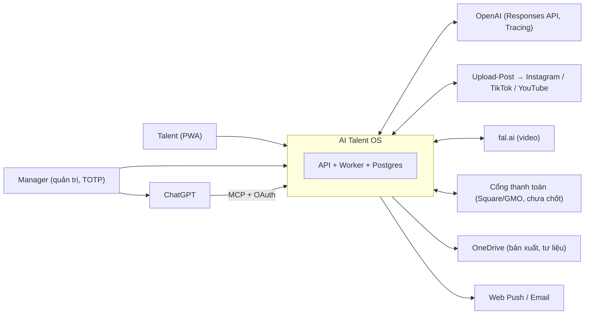
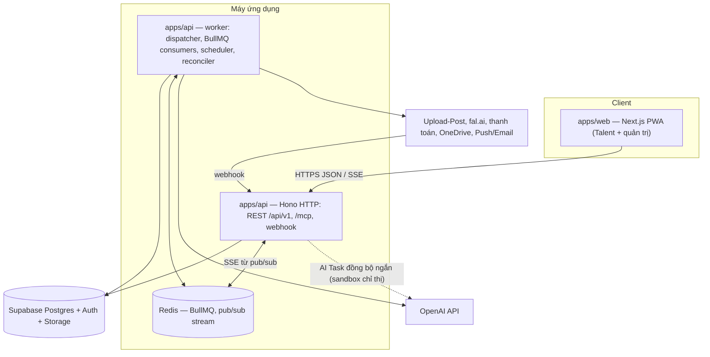
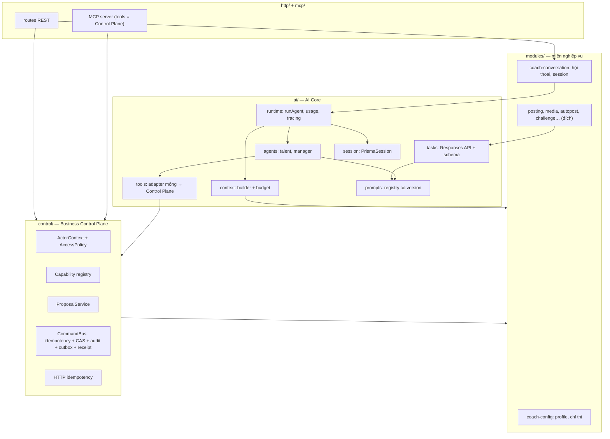
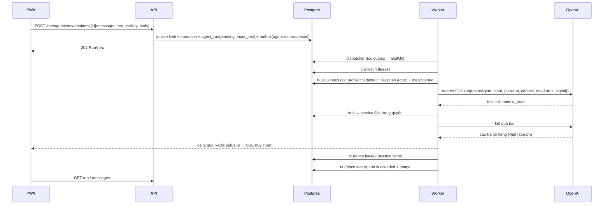
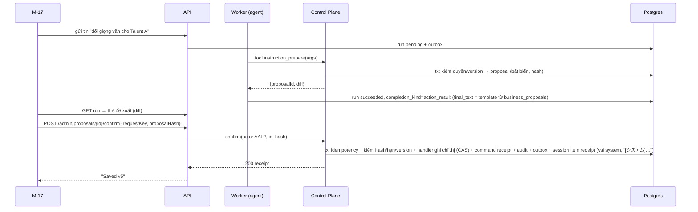

# AI Talent OS — Kiến trúc AI Core

> **Đồng bộ Q&A26/11:** hành vi nghiệp vụ theo trả lời từng ý tại [hồ sơ cập nhật](../../docs/requirement-review/corrections-2026-11-19/QA_KS_UPDATE_2026-11-26.md); chưa tự duyệt G7/G8 hoặc thương mại.

**Bản 1.1 · 26/11/2026.** Mô tả kiến trúc **đang chạy** (trạng thái từng phần: [README](README.md#trạng-thái)). Các quyết định kỹ thuật ở đây do đội kỹ thuật đưa ra theo ủy quyền; không có quyết định nghiệp vụ mới. Yêu cầu nghiệp vụ chưa chốt được giữ nguyên số Q&A gốc.

Bộ tài liệu: [README](README.md) · [Quyết định kiến trúc](ARCHITECTURE_DECISIONS.md) · [Module nghiệp vụ](BUSINESS_MODULES.md) · [Runtime AI](AI_RUNTIME_DESIGN.md) · [Cơ sở dữ liệu](DATABASE_DESIGN.md) · [API và MCP](API_DESIGN.md) · [Bảo mật](SECURITY_DESIGN.md) · [Hướng dẫn mở rộng](HUONG_DAN_MO_RONG.md) · [Kế hoạch](IMPLEMENTATION_PLAN.md) · [Rủi ro kỹ thuật](TECHNICAL_RISK_REGISTER.md).

## 1. Tóm tắt

AI Core không tự viết bộ khung agent (vòng lặp model/tool, sổ ghi từng bước, chờ xác nhận rồi đánh thức run); nó dùng thứ có sẵn và giữ phần tự viết ở chỗ cần chính xác tuyệt đối (ghi dữ liệu nghiệp vụ). Bốn khối:

- **Hội thoại (Agent Mode):** dùng **OpenAI Agents SDK** (`@openai/agents`) cho vòng lặp, tool, session, giới hạn lượt, tracing, usage.
- **Tác vụ AI có đầu vào/đầu ra rõ (AI Task Mode):** gọi thẳng **Responses API** với structured output; không có vòng agent.
- **Nghiệp vụ tất định (Workflow Mode):** service + outbox + BullMQ; không dùng LLM.
- **Business Control Plane:** một lớp chung, độc lập với AI, sở hữu quyền, đề xuất, xác nhận, lệnh ghi, idempotency, CAS, outbox, audit, receipt. AI chỉ gọi vào đây.

Điểm then chốt: **xác nhận của Manager được thực hiện ngay trong request xác nhận**, bởi Control Plane, không đánh thức lại run agent. Run agent kết thúc khi đã tạo đề xuất; không có trạng thái chờ, không có resume, không có tool commit (ADR-04). Code demo trước đây làm theo cách ngược lại; lý do bỏ ở [Lịch sử](LICH_SU_TRIEN_KHAI.md).

## 2. Hiểu hệ thống (Giai đoạn 1)

### 2.1. Miền nghiệp vụ

Nguồn: [module nghiệp vụ §1](BUSINESS_MODULES.md), [SCD](../../Phan_tich/17_Tai_lieu_boi_canh_he_thong.md), YK3 bản 0.3 (24/11/2026), QA/KS hiện hành.

| Miền | Sở hữu | Quan hệ với AI |
|---|---|---|
| Identity & Enrollment | Đơn đăng ký, duyệt, danh tính, MFA Manager | AI không tham gia |
| Billing & Entitlement | Thuê bao, phí video, trạng thái thanh toán | AI không tham gia; quyền dùng coach phụ thuộc entitlement |
| Talent Registry | Talent, office, category, người phụ trách, trạng thái | AI đọc (trong quyền) |
| **Coach Configuration** | Profile cho AI, chỉ thị AI theo tình huống/scope, version | AI đọc; Manager sửa qua đề xuất (M-17, ChatGPT, màn M-15) |
| **Coach Conversation** | Hội thoại Talent và Manager, session | AI Core sở hữu |
| Posting | Chủ đề, bản nháp, duyệt, NG, lịch, delivery | AI tạo nội dung qua AI Task; ghi qua service Posting |
| Media | Upload, asset, phân tích | AI phân tích qua AI Task |
| Autopost | Kỳ tự động, chủ đề kỳ | AI đổi chủ đề kỳ qua tool; đã có trả lời QA70/83 ngày26/11 |
| Challenge & Memory | Challenge, tiến độ, quan sát | AI đề xuất/ghi qua tool; tiêu chí số và trạng thái theo QA72 ngày26/11 |
| Metrics & Goals | Snapshot, mục tiêu 10.000/SNS | AI đọc, tóm tắt |
| Video | Kịch bản, xác nhận giá, tạo, xem trước | AI soạn kịch bản; xác nhận giá là thao tác UI |
| Notifications | Inbox, push, email | AI không gửi trực tiếp; module phát event |
| Lifecycle & Retention | Tạm dừng, chấm dứt, xóa sau 6 tháng | Chặn run mới theo trạng thái |
| Administration & Audit | Cài đặt chung, NG list, nhật ký xem/thao tác | Mọi lệnh AI ghi audit |

### 2.2. Tác nhân và quyền

| Tác nhân | Kênh | Quyền liên quan AI | Căn cứ |
|---|---|---|---|
| Talent | PWA | Chỉ dữ liệu của mình; chat với coach; chọn chủ đề, sửa nháp, nhận/từ chối Challenge | YK3 § 2-4-4 đoạn 289 |
| Office account | Quản trị (Manager thao tác thay) | Như Talent, không tính phí tháng | KS 確認27, QA66/94 |
| Manager (~5) | Quản trị PC/mobile (TOTP), M-17, ChatGPT | Một loại quyền, xem/sửa mọi Talent; người phụ trách chỉ định tuyến thông báo | QA88 |
| Hệ thống (scheduler) | Worker | Tạo chủ đề sáng, nhắc, tổng kết theo lịch | YK3 § 2-4-2 |
| ChatGPT (thay mặt Manager) | MCP | Trong grant OAuth của Manager | 御見積書 A4, QA45 |

Chỉ có **một khách hàng (Adesso)**, nên "tenant isolation" trong tài liệu này có nghĩa là cô lập theo **Talent** (và office account), không phải đa khách hàng.

### 2.3. Ca dùng AI

| Mã | Ca dùng | Chế độ | Trạng thái nguồn |
|---|---|---|---|
| UC-AI-01 | Talent trò chuyện với coach (tư vấn, hỏi về mục tiêu, Challenge) | Agent | Đã xác nhận (QA101) |
| UC-AI-02 | Manager M-17 chat để xem/đề xuất sửa profile và chỉ thị | Agent | Đã xác nhận (YK3 đoạn 767–777) |
| UC-AI-03 | Manager dùng ChatGPT qua MCP | Không có LLM nội bộ | Có căn cứ hợp đồng (A4); OAuth chưa POC |
| UC-AI-04 | Ba chủ đề buổi sáng (theo khung sáng/trưa/tối) | AI Task | Đã xác nhận (KS 確認14/18); tần suất theo chỉ thị |
| UC-AI-05 | Viết caption, hashtag, danh sách cảnh quay, kịch bản video | AI Task | Đã xác nhận |
| UC-AI-06 | Viết lại theo yêu cầu, không giới hạn số lần | AI Task | DEC-0001 ngày20/11; 確認28/29 |
| UC-AI-07 | Kiểm từ cấm theo ngữ cảnh, AI sửa rồi kiểm lại | AI Task + Workflow | QA `Q&A!G71:H71;G96:H96`26/11; lỗi AI vẫn cần thiết kế |
| UC-AI-08 | Phân tích ảnh/video gửi lên | AI Task | Có trong yêu cầu; video trực tiếp chưa xác minh |
| UC-AI-09 | Chọn giờ đăng trong khung chỉ thị | AI Task | QA `J101` (phân vai nội bộ) |
| UC-AI-10 | Tổng kết hôm qua, tổng kết tuần | AI Task | Đã xác nhận |
| UC-AI-11 | Đề xuất Challenge, khen | Agent (khi chat) / AI Task (theo lịch) | QA101; QA72 ngày26/11 chấp thuận chỉ tiêu đếm bằng số |
| UC-AI-12 | Kịch bản video AI | Agent / AI Task | 確認61/62 còn mở |
| UC-AI-13 | Thử chỉ thị trong sandbox (CR) | AI Task, không tác động | Trong phạm vi (KS 17/11) |

### 2.4. Yêu cầu đã chốt và chưa chốt ảnh hưởng AI Core

**Đã chốt (thiết kế dựa vào):** agent đọc/ghi DB, DB là nguồn (QA101); PWA không LINE; Manager một loại quyền (QA88); không tự đăng lại bài lỗi (YK3 đoạn 387); Talent không xem dữ liệu người khác; chưa có profile thì không đề xuất bài; hai chế độ đăng 自動投稿/要確認 (KS); AI sửa từ cấm không cần Talent xác nhận lại (KS `20261122!G4`); không dùng vector/embedding (quyết định nội bộ 26/11/2026).

**Đã cập nhật theo trả lời26/11:** hoàn tất hồ sơ bằng 登録完了, không trường M-08 bắt buộc (QA54/92); đổi chủ đề kỳ qua hội thoại, đổi xác nhận không đổi lịch đã có (QA70/83); daily/auto dùng cùng lúc, xác nhận là trục riêng, auto không Manager duyệt (QA71/84); Challenge có tiêu chí số và chuỗi ngày (QA72); giờ mặc định8/12/20 và nhắc ảnh trước2giờ (QA73); chặn đổi/ngắt SNS còn lịch cho tới Talent huỷ (QA95); NG list mới không quét lại lịch cũ (QA96). **Còn mở:** nhiều category và thứ tự ưu tiên (QA99, Adesso27/11); fallback Manager/đích tin ngoài duyệt (QA87/88); có giữ lịch sử tài chính trong OS và thời hạn (QA98); xác nhận prompt Nonaka (QA72); số tiền video/ngày thu/khả năng Square (QA2/4/49). Các nhánh kỹ thuật lỗi AI/provider vẫn cần thiết kế, không lấy Close làm bảo đảm. Câu hỏi mới về quản trị dữ liệu do thiết kế này phát sinh: xem [Bảo mật §9](SECURITY_DESIGN.md).

### 2.5. Yêu cầu phi chức năng chi phối kiến trúc

| Yêu cầu | Nguồn | Hệ quả |
|---|---|---|
| 30 → 100 → 200–300 → 1.000 Talent | YK3/SCD §6 | Một monolith + một worker đủ cho giai đoạn đầu; queue cho phép tăng worker |
| Việc trước giờ nhắn phải xong trước khung sáng/trưa/tối | SCD §6, KS 確認18 | AI Task chạy trước giờ theo hàng đợi riêng, có hạn chót |
| Dịch vụ ngoài lỗi chỉ dừng chức năng đó | YK3 § 9-3 | Mỗi adapter có timeout, circuit breaker; chat đọc không phụ thuộc video/push |
| Nhật ký xem, thao tác, kết quả xử lý | YK3 § 9-4 | Audit nghiệp vụ trong DB là nguồn; trace OpenAI chỉ để gỡ lỗi |
| Chỉ gửi AI phần dữ liệu cần thiết | YK3 § 10-2 | Context builder có danh sách trường cho phép, không gửi toàn bộ bản ghi |
| Mặc định dữ liệu giả khi thử | YK3 § 10-3 | Môi trường thử tách khóa/project OpenAI |
| Go-live cuối 2/2027 | YK3 § 14-1 | Ưu tiên giảm mã tự viết, dùng SDK chính thức |

## 3. Nguyên tắc kiến trúc

1. **Code tất định quyết định quyền và trạng thái.** Model chỉ đề xuất hoặc gọi tool; tool gọi Control Plane; Control Plane kiểm và ghi.
2. **Đề xuất của AI không phải lệnh.** Một đề xuất chỉ thành lệnh khi người có quyền xác nhận qua kênh đã xác thực.
3. **Lệnh đã xác nhận chạy được không cần model.** Confirm là một transaction DB; không phụ thuộc run agent còn sống.
4. **DB là nguồn.** Hội thoại, session agent, profile, chỉ thị, lệnh, receipt đều ở Postgres. OpenAI không giữ trạng thái nghiệp vụ.
5. **Dùng thứ có sẵn trước.** SDK lo vòng lặp, tool schema, session, giới hạn lượt, tracing. Chỉ tự viết phần SDK không làm được và có yêu cầu thật.
6. **Tác vụ có biên rõ thì gọi model một lần.** Không bọc trong agent.
7. **Không framework AI chung chung.** Mỗi agent, task, tool tồn tại vì một ca dùng ở §2.3.

## 4. Ba chế độ thực thi

| | Agent Mode | AI Task Mode | Workflow Mode |
|---|---|---|---|
| Dùng cho | UC-AI-01, 02, 11 (chat) | UC-AI-04…10, 12, 13 | Lịch, đăng SNS, thông báo, thanh toán, OneDrive, metrics, đối soát |
| Công cụ | `@openai/agents` `run()` với session Postgres | `openai.responses.create()` với `text.format` json_schema strict | Service + outbox + BullMQ |
| Gọi model | Nhiều lượt, tối đa `maxTurns` | Một lần (cộng tối đa 1 lần sửa khi output sai schema) | Không |
| Tool | Function tool gọi Control Plane | Không có tool | — |
| Ghi dữ liệu | Qua tool → Control Plane | Kết quả trả về service gọi nó; service ghi | Service ghi |
| Phục hồi | Mức run (không resume giữa chừng) | Mức job, idempotent theo khóa tác vụ | Outbox + đối soát |
| Kích hoạt | Tin nhắn người dùng | Scheduler hoặc service nghiệp vụ | Event, lịch, webhook |

Chi tiết: [AI_RUNTIME_DESIGN.md](AI_RUNTIME_DESIGN.md).

## 5. Sơ đồ bối cảnh hệ thống



## 6. Sơ đồ container



Một codebase `apps/api`, hai entrypoint (`server.ts`, `worker.ts`). Không microservice.

## 7. Sơ đồ thành phần



## 8. Ranh giới module và quy tắc phụ thuộc

| Thư mục | Được import | Không được import |
|---|---|---|
| `core/`, `infra/` | thư viện ngoài | mọi thứ khác |
| `control/` | `core`, `infra` | `ai/`, `http/`, `mcp/`, `modules/*` (module đăng ký handler qua `container.ts`) |
| `modules/<x>/` | `core`, `infra`, `control`, `ai/tasks` + `ai/prompts` (gọi tác vụ AI, ghi `key@version`), `reader.ts`/`model.ts` của module khác | `ai/agents`, `ai/tools`, `ai/runtime`, phần ghi của module khác |
| `ai/tasks`, `ai/prompts`, `ai/context` | `core`, kiểu của `control` (`Actor`, `Tx`), `reader.ts`/`model.ts` của module (port đọc) | handler ghi, store, `http`, `mcp` |
| `ai/tools`, `ai/agents`, `ai/runtime`, `ai/session` | như trên + `control` (proposals, access), kiểu đầu vào của handler | `http`, `mcp` |
| `http/`, `mcp/` | `control`, `modules`, `ai/tools` (MCP), `ai/tasks` (sandbox); `infra/database` chỉ để lấy kiểu | truy vấn SQL trực tiếp |
| `container.ts` | tất cả | — |

Đã kiểm bằng grep ngày 26/11/2026: code hiện tại theo đúng bảng này. Chưa có ESLint `no-restricted-imports` để CI tự chặn ([Kế hoạch T6.7](IMPLEMENTATION_PLAN.md#31-lõi-không-phụ-thuộc-đặc-tả-module)).

Hệ quả: logic nghiệp vụ không phụ thuộc OpenAI; đổi nhà cung cấp model chỉ chạm `ai/`. MCP và REST dùng chung Control Plane, không đi qua agent.

## 9. Luồng chính

### 9.1. Talent chat (đọc và tư vấn)



### 9.2. Manager M-17 đề xuất sửa chỉ thị và xác nhận



Không có bước đánh thức run. Lượt chat tiếp theo của Manager thấy receipt trong session.

### 9.3. Manager dùng ChatGPT (MCP)

ChatGPT → `/mcp` tool `instruction_prepare` → Control Plane tạo proposal → trả `{proposalId, confirmUrl}` → Manager mở trang xác nhận trong PWA (phiên Manager, TOTP) → `confirm` như §9.2 → ChatGPT gọi `proposal_status` để biết đã lưu. Không có LLM nội bộ trong luồng.

### 9.4. Chủ đề buổi sáng (AI Task + Workflow)

```mermaid
sequenceDiagram
  participant S as Scheduler (worker)
  participant DB as Postgres
  participant Q as BullMQ ai-tasks
  participant T as Task daily_topics
  participant O as OpenAI
  S->>DB: tx: với mỗi Talent đủ điều kiện, operation (khóa ai.task:daily_topics:talent:ngày) + outbox + ai_task_runs
  DB->>Q: dispatcher
  Q->>T: job {eventId}
  T->>DB: lease ai_task_runs; đọc profile, chỉ thị theo tình huống, chủ đề 7 ngày
  T->>O: responses.parse(schema strict: 3 chủ đề + lời chào, store:false)
  O-->>T: JSON hợp lệ
  T->>DB: tx (fence lease): theme_suggestions + usage + task/operation/outbox xong
```

Profile chưa đủ (`PROFILE_NOT_READY`) thì không tạo chủ đề. Chỉ Talent `in_use` mới được lên lịch. Hiện chỉ có một khung buổi sáng (chuẩn bị từ 06:00 JST, hạn 08:00); khung sáng/trưa/tối theo chỉ thị (KS 確認14/18/19) và việc gửi lời chào thành tin coach + thông báo là việc sau. Hạn chót: job còn trong hàng đợi quá giờ khung thì bỏ và ghi `MISSED_WINDOW`, không gửi muộn (giá trị cụ thể là cấu hình kỹ thuật).

### 9.5. Talent tạo bài từ hội thoại (đích, phụ thuộc module Posting)

Agent gọi tool `draft_create(topicRef, assetIds)` → Posting service gọi AI Task `caption@v1` → lưu draft → tool trả `{draftId, preview}`. Adopt ở T-12 là thao tác UI có principal thật, không qua model. Đặt lịch, gửi Upload-Post, nhận kết quả là Workflow Mode. Tool này `ready: false` cho tới khi module Posting có đặc tả và bảng mở ghi ([module nghiệp vụ §4](BUSINESS_MODULES.md#4-luồng-talent-từ-hội-thoại-đến-đăng-sns)).

## 10. Kiến trúc job nền

| Lane | Nội dung | Concurrency | Retry | Ghi chú |
|---|---|---|---|---|
| `agent-interactive` (BullMQ) | Run chat Talent/Manager | `AGENT_INTERACTIVE_CONCURRENCY` (mặc định 1) | Không (job `attempts:1`); phục hồi qua DB | Job chỉ là phương tiện chở `eventId` |
| `ai-tasks` (BullMQ) | Hiện: `daily_topics`. Sau: caption, ng_check, media_analysis, tổng kết | 2 | Không ở BullMQ; service trả task về `pending`, tối đa 3 lần | Idempotent theo `operation_key`; dùng chung cho mọi task, mỗi service chỉ nhận `task_key` của mình |
| Effects (bộ hẹn giờ trong worker, mỗi 3 giây) | Hiện: xuất OneDrive `Profile.md`. Sau: push, email, Upload-Post, fal.ai | 1 | Theo outbox, có reclaim | Tách thành queue `effects` khi có effect thứ hai cần song song |

- **Event type của AI Core** (CHECK của `outbox_events.event_type`): `agent.run.requested` (→ `agent-interactive`), `ai.task.requested` (→ `ai-tasks`), `talent_profile.export` (→ effects). Event không mang payload; consumer đọc lại qua `operation_id`. Module khác đặt tên theo `<module>.<hành động>`.
- **Outbox là nguồn giao việc.** API ghi outbox trong transaction; dispatcher (mỗi giây) lease outbox rồi enqueue với `jobId = <eventId>-<delivery_sequence>`; chỉ tạo job mới khi job trước của cùng event không còn sống trong Redis. Redis mất job thì dispatcher giao lại từ DB.
- **Scheduler:** bộ hẹn giờ trong worker, mỗi phút, chỉ quét DB tìm việc đến hạn (hiện: `DailyTopicsService.schedule`); lịch nghiệp vụ nằm trong DB, không nằm trong Redis.
- **Reconciler:** mỗi 10 giây: run hết lease → `failed/WORKER_LOST` hoặc về `pending` nếu chưa gọi model ([Runtime §6](AI_RUNTIME_DESIGN.md#6-độ-tin-cậy-và-phục-hồi)); task hết lease → `pending`; outbox lease hết hạn → giao lại; proposal quá hạn → `expired`; export kẹt → nhận lại.
- **Shutdown (SIGINT/SIGTERM):** dừng bộ hẹn giờ, đóng worker BullMQ (chờ job đang chạy xong, heartbeat vẫn chạy), đóng Redis và DB. Hạn cứng `AGENT_MODEL_TIMEOUT_MS + 40` giây; quá hạn thì thoát, reconciler xử lý run còn dở.

## 11. Quan sát hệ thống

| Lớp | Công cụ | Nội dung | Nguồn sự thật? |
|---|---|---|---|
| Audit nghiệp vụ | Postgres `activity_logs`, `business_commands`, `manager_view_logs` | Ai làm gì, lúc nào, receipt, nhật ký xem | **Có** |
| Thực thi AI | Postgres `agent_runs`, `ai_task_runs`, `ai_usage_events` | Run/task, prompt version, model, usage, chi phí, mã lỗi | **Có** (chi phí) |
| Trace AI | OpenAI Tracing (Agents SDK) | Span model/tool để gỡ lỗi; `traceIncludeSensitiveData=false` cho mọi run | Không |
| Log kỹ thuật | stdout JSON (PM2/Docker) | requestId, runId, operationId, mã lỗi; không prompt/PII | Không |
| Metric | Đếm từ DB + log | queue wait, latency model/tool, run theo trạng thái, outbox lag, token/chi phí theo ngày | — |

Trace gắn `groupId = conversationId`, `traceMetadata = {runId, promptVersion}`, `workflowName = agent.talent | agent.manager` ([Runtime §7](AI_RUNTIME_DESIGN.md#7-tracing-và-usage)). AI Task gọi Responses API trực tiếp nên không có trace SDK. Tracing không dùng được nếu tổ chức OpenAI bật ZDR; khi đó chỉ còn ledger DB (đủ cho vận hành).

## 12. Triển khai

| Thành phần | Nơi chạy | Ghi chú |
|---|---|---|
| `apps/web` | Theo phương án web của dự án (Vercel hoặc VPS) | Không có API route nghiệp vụ |
| `apps/api` server | VPS (Docker/PM2), HTTPS qua reverse proxy hỗ trợ SSE | `/api/v1`, `/mcp`, webhook |
| `apps/api` worker | Cùng VPS, tiến trình riêng | Health theo heartbeat file |
| Redis | Cùng VPS, mạng riêng, `noeviction`, AOF | Không là nguồn dữ liệu |
| Postgres/Auth/Storage | Supabase (gói trả phí) | Hai login: owner (migration) và `talent_api` (runtime) |
| OpenAI | Project riêng cho dev/staging/prod | Khóa riêng, giới hạn chi tiêu theo project |

Hạ tầng chi tiết: [Phan_tich/18 §12](../../Phan_tich/18_Ha_tang_he_thong.md). Khởi đầu một VPS 4 vCPU/8 GB là đủ cho ≤ 300 Talent theo ước tính tải ở [Runtime §8](AI_RUNTIME_DESIGN.md); cần đo lại (VT-09).

## 13. Chiến lược chi phí (tóm tắt)

- Ít mã tự viết ở phần runtime (không runner, ledger, resume, model gateway riêng); giảm chi phí bảo trì lớn nhất.
- Model theo tác vụ: model nhỏ, reasoning thấp cho chat và caption; model mạnh hơn chỉ khi eval chứng minh cần.
- Prompt caching tự động: phần tĩnh (chính sách, chỉ thị chung, định nghĩa tool) ở đầu prompt; phần động ở cuối; `prompt_cache_key` theo `taskKey`.
- Giới hạn: `maxTurns`, `maxTokens` output, ngân sách ký tự context, số tin nhắn lịch sử.
- Không dùng Flex (đang ngừng phát triển). Batch API (giảm 50%, hoàn tất trong 24 giờ) chỉ cân nhắc cho tổng kết tuần nếu đo thấy đáng; không dùng cho chủ đề buổi sáng vì cần đúng giờ (ADR-12).
- Chi tiết: [Runtime §8](AI_RUNTIME_DESIGN.md).
