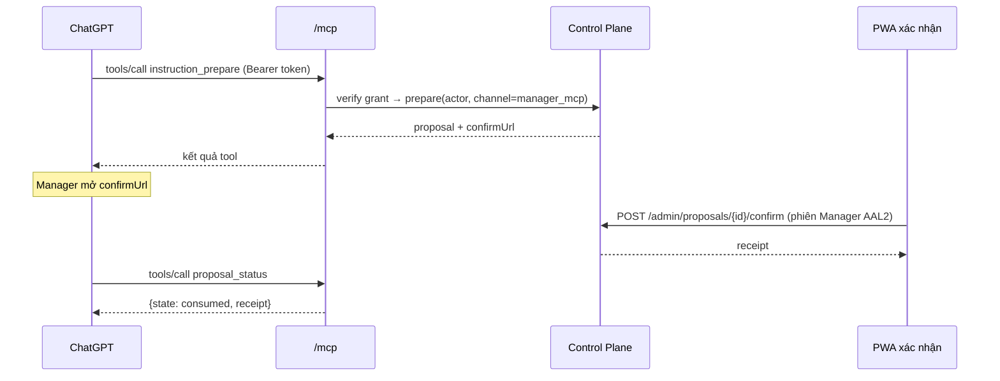

# AI Talent OS — Thiết kế API và MCP

**Bản 1.1 · 26/11/2026.** Thuộc bộ [AI Core](README.md). Route **đang có** trong `apps/api/src/http/` và `src/mcp/`: hội thoại agent, SSE, đề xuất/xác nhận ở `/api/v1/admin/proposals/*` (Control Plane chung, trả receipt ngay), sandbox chỉ thị, MCP. Hợp đồng chính xác: `apps/web/lib/api/openapi.json` (sinh bằng `npm run api:types` trong `apps/web`).

## 1. Quy ước chung

- Talent: `/api/v1/me/...` (phiên Talent). Manager: `/api/v1/admin/...` (phiên Manager **AAL2/TOTP**). Middleware chọn theo route, không theo body.
- Mọi POST thay đổi trạng thái nhận `requestKey: uuid` do client sinh một lần cho mỗi thao tác của người dùng và giữ qua retry/reload. Server lưu ở `idempotency_requests`: cùng key + cùng payload → trả lại response đã lưu; cùng key + khác payload → 409 `REQUEST_KEY_REUSED`.
- Số bigint (version, sequence) trả dạng chuỗi; ID là UUID; thời gian ISO-8601 UTC.
- Thành công trả JSON trực tiếp. Lỗi: `{ "error": { "code": "…", "requestId": "…", "issues": [{ "path", "message" }]? } }`.
- Schema request/response viết bằng zod; OpenAPI sinh từ zod theo cách hiện có của dự án (`apps/web/lib/api/openapi.json`, `schema.d.ts`). FE chỉ gọi qua `lib/api/client.ts`.

| HTTP | Khi |
|---|---|
| 400 | JSON hỏng |
| 401 | Thiếu/sai phiên |
| 403 | Đúng danh tính nhưng thiếu capability hoặc AAL |
| 404 | Không tồn tại hoặc ngoài phạm vi (không phân biệt, tránh dò) |
| 409 | `RUN_BUSY`, `VERSION_CONFLICT`, `REQUEST_KEY_REUSED`, `PROPOSAL_NOT_PENDING` |
| 410 | `PROPOSAL_EXPIRED` |
| 422 | `INPUT_INVALID` (có `issues`) |
| 429 | `RATE_LIMITED` (có `Retry-After`) |
| 503 | `FEATURE_NOT_READY`, `AI_UNAVAILABLE`, cấu hình thiếu |

## 2. Hội thoại agent

`<base>` = `/api/v1/me/agent` (Talent) hoặc `/api/v1/admin/agent` (Manager M-17).

| Method / path | Request | Response |
|---|---|---|
| POST `<base>/conversations` | `{requestKey}` | 201 `{conversationId, version}`; retry cùng key → 200 cùng ID |
| GET `<base>/conversations/{id}/messages?after=<seq>&limit=<1..100>` | — | 200 `{items: MessageView[], nextAfter, hasMore}` |
| POST `<base>/conversations/{id}/messages` | `{requestKey, body}` (1–1.000 ký tự) | 202 `RunView`; 409 `RUN_BUSY` nếu đang có run; 429 khi vượt tần suất |
| GET `<base>/conversations/{id}/runs` | — | 200 `{items: RunView[]}`: run active và tối đa 20 run kết thúc gần nhất |
| GET `<base>/runs/{runId}` | — | 200 `RunView` |
| GET `<base>/runs/{runId}/stream` | — | `text/event-stream` (§2.2) |
| POST `<base>/runs/{runId}/cancel` | `{requestKey}` | 202 `RunView`; chỉ đặt yêu cầu hủy |

### 2.1. DTO

```typescript
type MessageView = {
  id: string; sequence: string; role: 'user' | 'assistant'
  text: string; createdAt: string; runId: string | null
  source: 'sdk' | 'control_receipt' | 'pending'   // pending = input của run chưa xong (chưa có item session)
}
type RunView = {
  id: string; conversationId: string; version: string
  state: 'pending' | 'running' | 'succeeded' | 'failed' | 'cancelled'
  completionKind: 'answer_only' | 'action_result' | null
  finalText: string | null           // text model; với action_result UI hiển thị kèm template từ receipts/proposals
  receipts: Receipt[]                // từ business_commands theo run_id
  proposals: ProposalSummary[]       // từ business_proposals theo run_id
  errorCode: string | null
  retryAfterMs: number | null        // gợi ý chu kỳ poll
}
type Receipt = { commandId: string; commandType: string; targetLabel: string; changed: boolean; resultVersion: string | null; createdAt: string }
type ProposalSummary = { id: string; commandType: string; targetLabel: string; state: ProposalState; expiresAt: string }
type ProposalState = 'prepared' | 'consumed' | 'rejected' | 'expired' | 'conflicted'
```

### 2.2. SSE

`GET <base>/runs/{runId}/stream` kiểm quyền như GET run, rồi đăng ký Redis `run:{runId}`.

```
event: delta     data: {"text":"…"}            // phần câu trả lời đang sinh
event: state     data: <RunView>                // khi trạng thái đổi
event: end       data: <RunView>                // trạng thái cuối; server đóng kết nối
```

Run đã kết thúc khi mở stream → gửi ngay `end`. Mất kết nối → client quay về poll `GET …/runs/{id}` (1 giây, lùi dần tới 5 giây). Text delta chỉ là bản xem trước; `end`/GET là nguồn.

## 3. Đề xuất (Business Control Plane)

Đề xuất do tool agent, MCP hoặc màn quản trị tạo; xác nhận ở đây. Chỉ Manager AAL2.

| Method / path | Request | Response |
|---|---|---|
| GET `/api/v1/admin/proposals?state=prepared&limit=…` | — | 200 `{items: ProposalSummary[]}` |
| GET `/api/v1/admin/proposals/{id}` | — | 200 `ProposalView` |
| POST `/api/v1/admin/proposals/{id}/confirm` | `{requestKey, proposalHash}` | 200 `{proposal: ProposalView, receipt: Receipt}` |
| POST `/api/v1/admin/proposals/{id}/reject` | `{requestKey, reason?}` (≤ 200 ký tự) | 200 `{proposal: ProposalView}` |

```typescript
type ProposalView = {
  id: string; commandType: string; targetLabel: string
  changes: Array<{ field: string; before: string | null; after: string | null }>
  baseVersion: string; proposalHash: string; expiresAt: string
  state: ProposalState; allowedActions: Array<'confirm' | 'reject'>
  origin: { channel: 'manager_ui' | 'manager_mcp' | 'admin_ui'; runId: string | null }
}
```

**Confirm** chạy trong một transaction: idempotency → khóa proposal → kiểm actor còn hoạt động, AAL2, `proposalHash` khớp, `state='prepared'`, chưa hết hạn (đồng hồ DB) → handler của `commandType` ghi với CAS `base_version` → `business_commands` + audit + outbox (ví dụ `talent_profile.export`) → `state='consumed'` → thêm item receipt (`source='control_receipt'`) vào conversation gốc nếu có. Version đã đổi → `state='conflicted'`, 409 `VERSION_CONFLICT`. Không có bước worker; không route `commit`.

## 4. Thử chỉ thị (sandbox) — P4

| Method / path | Request | Response |
|---|---|---|
| POST `/api/v1/admin/ai/instruction-tests` | `{requestKey, scope, situation, candidateText, sample: {talentId}}` | 200 `{output, promptVersion, usage}` |

Chạy AI Task tương ứng tình huống với chỉ thị ứng viên, **đồng bộ** (timeout 30 giây), không ghi dữ liệu nghiệp vụ, chỉ ghi usage (`payer='adesso'`). Không tạo bài, lịch, video.

## 5. Webhook và route nội bộ

Webhook provider (Upload-Post, thanh toán, fal.ai) thuộc module tương ứng, theo mẫu: xác minh chữ ký → ghi inbox idempotent theo event ID provider → outbox → xử lý ở worker. AI Core không có webhook riêng.

## 6. MCP

### 6.1. Transport và xác thực

- Endpoint `/mcp`, Streamable HTTP, MCP TypeScript SDK (`@modelcontextprotocol/sdk`, pin phiên bản sau POC).
- OAuth 2.1 authorization code + PKCE; server là resource server, xác minh access token (issuer, audience = URL `/mcp`, hạn, chữ ký) qua adapter; trả 401 + `WWW-Authenticate` khi sai. Authorization server cụ thể chọn ở POC (VT-08); không giả định phiên Supabase của app là grant MCP.
- Mỗi grant ánh xạ `mcp_grants` (Manager, client, capability, hạn, thu hồi). Mọi tool kiểm grant còn hiệu lực và Manager còn hoạt động ở thời điểm gọi.

### 6.2. Tool MCP

Cùng schema zod với tool agent (registry chung), chỉ những tool có kênh `manager_mcp`:

| Tool | Input | Output | Ghi chú |
|---|---|---|---|
| `talent_search` | `{query, limit?}` | `{items:[{talentId, displayName, status}]}` | |
| `context_read` | `{talentId, sections[]}` | `{sections, versions, missing}` | Ghi `manager_view_logs` (nhật ký xem) |
| `instruction_history` | `{instructionId, limit?}` | `{items}` | |
| `profile_prepare` | như tool agent | `{proposalId, changes, expiresAt, confirmUrl}` | `channel='manager_mcp'`, gắn `client_grant_id` |
| `instruction_prepare` | như tool agent | như trên | |
| `proposal_status` | `{proposalId}` | `{state, receipt?}` | Chỉ đề xuất do chính grant/Manager tạo |

Không có tool confirm/reject trong MCP. `confirmUrl` mở trang PWA `/pwa/confirm/{proposalId}` (FE chưa có khu `/admin`) yêu cầu phiên Manager AAL2; trang gọi `POST /api/v1/admin/proposals/{id}/confirm`. Lỗi nghiệp vụ trả trong tool result với `isError: true` và `{code, message}`; lỗi token trả HTTP 401.

### 6.3. Trình tự


