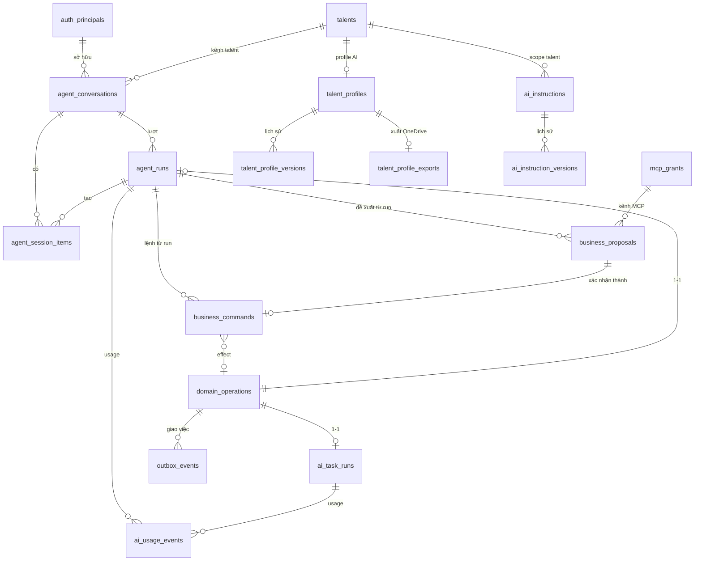

# AI Talent OS — Thiết kế cơ sở dữ liệu AI Core

**Bản 1.1 · 26/11/2026.** Thuộc bộ [AI Core](README.md). Mô tả phần dữ liệu **đang có** của AI Core và Business Control Plane, khớp migration [`20261126000200_ai_core`](../../apps/api/prisma/migrations/20261126000200_ai_core/migration.sql) (đã áp Supabase dev). Khi tài liệu và SQL khác nhau, **SQL đúng**; sửa tài liệu. Bảng nghiệp vụ của các module khác (posts, media, billing…) giữ theo [database-design](../../database-design/). Quy trình migration theo [PRISMA.md](../../apps/api/PRISMA.md) và [07](../../database-design/07_implementation_scope_and_rules.md). Bảng cũ đã bỏ và lý do: [Lịch sử §4–§5](LICH_SU_TRIEN_KHAI.md#4-điểm-lệch-so-với-thiết-kế-ban-đầu).

## 1. Nguyên tắc

- Postgres là nguồn của hội thoại, session agent, run, task, profile, chỉ thị, đề xuất, lệnh, receipt, usage (QA101).
- Bảng AI Core và Control Plane đặt trong `app_private`, bật RLS (policy `backend_runtime` cho `talent_runtime`), thu hồi mọi quyền của `PUBLIC`/`anon`/`authenticated`. API/worker dùng LOGIN `talent_api` (thành viên `talent_runtime`).
- ID là UUID (`gen_random_uuid()`), thời gian `timestamptz`, version `bigint` (trigger `require_next_version` buộc tăng đúng 1 mỗi UPDATE), tiền `numeric`.
- FK `ON DELETE RESTRICT`; không cascade. Role runtime **không có DELETE** trên bảng nào của AI Core.
- Bảng lệnh và lịch sử version **chỉ thêm**.
- Ràng buộc trạng thái nằm trong CHECK của DB, không chỉ trong code (ví dụ: `running` ⇔ có lease; terminal ⇔ có `finished_at`).

## 2. Danh mục bảng

| Nhóm | Bảng | Vai trò |
|---|---|---|
| Agent Mode | `agent_conversations`, `agent_session_items`, `agent_runs` | Hội thoại, item SDK, một lượt chạy agent |
| AI Task Mode | `ai_task_runs` | Một lần gọi Responses API có biên rõ |
| Control Plane | `business_proposals`, `business_commands`, `idempotency_requests` | Đề xuất, lệnh đã ghi, chống gửi trùng HTTP |
| MCP | `mcp_grants` | Quyền một client OAuth được làm cho một Manager |
| Coach Configuration | `talent_profiles`, `talent_profile_versions`, `ai_instructions`, `ai_instruction_versions`, `talent_profile_exports` | Profile cho AI, chỉ thị Manager, bản đã xuất OneDrive |
| Dùng chung (có từ trước) | `domain_operations`, `outbox_events` | Giao việc nền (operation + event) |
| Dùng chung (có từ trước) | `public.ai_usage_events` (mở rộng), `public.theme_suggestions`, `public.manager_view_logs`, `public.activity_logs`, `app_private.auth_rate_buckets` | Usage, chủ đề buổi sáng, nhật ký xem, audit, giới hạn tần suất |
| Không dùng nữa | `public.coach_messages` | Giữ dữ liệu cũ, không ghi mới |

## 3. Bảng

Cột `version`, `created_at`, `updated_at` có ở hầu hết bảng và không nhắc lại trong từng bảng.

### 3.1. Agent Mode

**`agent_conversations`** — một hội thoại của một người.

| Cột | Kiểu | Ràng buộc |
|---|---|---|
| `id` | uuid | PK; UNIQUE(`id`, `actor_user_id`) để FK kép từ `agent_runs` |
| `actor_user_id` | uuid | FK `auth_principals` |
| `channel` | text | `talent` / `manager_ui` |
| `talent_id` | uuid NULL | FK `talents`; có giá trị ⇔ `channel='talent'` |
| `request_key` | uuid | UNIQUE(`actor_user_id`, `request_key`) |
| `next_sequence` | bigint | Số thứ tự item tiếp theo |

**`agent_runs`** — một lượt agent trả lời một tin nhắn.

| Cột | Kiểu | Ràng buộc |
|---|---|---|
| `id` | uuid | PK |
| `operation_id` | uuid | FK `domain_operations`, UNIQUE (một operation = một run) |
| `event_id` | uuid NULL | FK `outbox_events`, UNIQUE |
| `conversation_id`, `actor_user_id` | uuid | FK kép tới `agent_conversations(id, actor_user_id)`: hội thoại thuộc đúng người |
| `channel`, `talent_id` | | Như hội thoại |
| `request_key` | uuid | UNIQUE(`conversation_id`, `actor_user_id`, `request_key`) |
| `input_hash` | text | sha256 hex của tin nhắn; trùng key khác hash → `REQUEST_KEY_REUSED` |
| `input_text` | text | 1–1.000 ký tự |
| `state` | text | `pending` / `running` / `succeeded` / `failed` / `cancelled` |
| `error_code` | text NULL | Dạng `UPPER_SNAKE`; bắt buộc khi `failed`/`cancelled` |
| `final_text` | text NULL | ≤ 8.000; bắt buộc khi `succeeded` |
| `completion_kind` | text NULL | `answer_only` / `action_result`; bắt buộc khi `succeeded` |
| `prompt_version`, `model` | text NULL | `key@N`, tên model |
| `context_manifest` | jsonb NULL | Version profile/chỉ thị/prompt đã dùng ([Runtime §4.2](AI_RUNTIME_DESIGN.md#42-lắp-context)) |
| `trace_id` | text NULL | ID trace của SDK |
| `lease_token`, `lease_until`, `heartbeat_at` | | Có lease ⇔ `running` |
| `model_started_at` | timestamptz NULL | Đã gọi model thì không trả về `pending` |
| `cancel_requested_at` | timestamptz NULL | Người dùng bấm hủy |
| `claims` | int | Số lần worker nhận run |
| `finished_at` | timestamptz NULL | Có ⇔ trạng thái kết thúc |

Chỉ mục: `uq_agent_runs_active (conversation_id) WHERE state IN ('pending','running')` (một run đang chạy mỗi hội thoại → `RUN_BUSY`); `(lease_until) WHERE state='running'` cho reconciler; `(conversation_id, created_at DESC)`.

**`agent_session_items`** — item của Agents SDK, nguyên dạng.

| Cột | Kiểu | Ràng buộc |
|---|---|---|
| `id` | uuid | PK |
| `conversation_id` | uuid | FK `agent_conversations` |
| `sequence` | bigint | UNIQUE(`conversation_id`, `sequence`) |
| `run_id` | uuid NULL | FK `agent_runs`; NULL với receipt do Control Plane thêm |
| `kind` | text | `message` / `function_call` / `function_call_result` / `reasoning` / `other` |
| `role` | text NULL | `user` / `assistant` / `system`; có ⇔ `kind='message'` |
| `item` | jsonb | Item SDK nguyên dạng |
| `display_text` | text NULL | Văn bản cho UI |
| `source` | text | `sdk` / `control_receipt` |
| `discarded_at` | timestamptz NULL | Đánh dấu bỏ (`popItem`), không xóa cứng |

Chỉ mục: `(conversation_id, sequence) WHERE discarded_at IS NULL`.

### 3.2. AI Task Mode

**`ai_task_runs`** — một tác vụ AI, idempotent theo operation.

| Cột | Kiểu | Ràng buộc |
|---|---|---|
| `id` | uuid | PK |
| `operation_id` | uuid | FK `domain_operations`, UNIQUE; `operation_key` của operation là khóa nghiệp vụ (ví dụ `ai.task:daily_topics:<talentId>:<ngày>`) |
| `event_id` | uuid | FK `outbox_events`, UNIQUE |
| `task_key` | text | CHECK theo danh sách task (hiện chỉ `task.daily_topics`). Bảng dùng chung cho mọi task: service của mỗi task chỉ lease/chạy/reconcile dòng có `task_key` của mình |
| `talent_id` | uuid NULL | FK `talents`; NULL với task không gắn Talent |
| `input` | jsonb | Tham số đã cố định lúc lên lịch (ví dụ `{date}`) |
| `output` | jsonb NULL | Kết quả đã kiểm schema; bắt buộc khi `succeeded` |
| `prompt_version`, `model` | text NULL | |
| `state` | text | `pending` / `running` / `succeeded` / `failed` |
| `error_code` | text NULL | Bắt buộc khi `failed` |
| `lease_token`, `lease_until` | | Có ⇔ `running` |
| `attempts` | int | Số lần chạy (tối đa do service quyết, hiện 3) |
| `finished_at` | timestamptz NULL | Có ⇔ `succeeded`/`failed` |

Chỉ mục: `(lease_until) WHERE state='running'`. Kết quả nghiệp vụ (ví dụ `theme_suggestions`) do **service của module** ghi, cùng transaction kết thúc task.

### 3.3. Usage: `public.ai_usage_events`

Bảng có từ migration init, được mở rộng. Một dòng mỗi request model.

| Cột thêm/đổi | Ý nghĩa |
|---|---|
| `talent_id` cho phép NULL | Run Manager/global không gắn Talent; CHECK: NULL thì `payer='adesso'` |
| `cost_amount`, `cost_currency` cho phép NULL | Chưa có giá thì NULL, không ghi 0; CHECK đi theo cặp |
| `run_id` FK `agent_runs` | Request của Agent Mode |
| `task_run_id` FK `ai_task_runs` | Request của AI Task Mode |
| `request_ref` | ID response của OpenAI |
| `cached_input_tokens`, `reasoning_tokens` | int ≥ 0, mặc định 0 |
| `payer` | `talent` / `office` / `adesso` (QA101: token agent do Adesso chịu) |
| `price_revision`, `task_key` | Giá đã dùng; khóa tác vụ để báo cáo (`agent.talent`, `task.daily_topics`, `task.instruction_sandbox`…) |

### 3.4. Business Control Plane

**`business_proposals`** — đề xuất bất biến, chờ một người quyết.

| Cột | Kiểu | Ràng buộc |
|---|---|---|
| `id` | uuid | PK |
| `command_type` | text | CHECK theo danh sách lệnh (hiện `talent_profile.update`, `ai_instruction.write`) |
| `actor_user_id` | uuid | Người tạo đề xuất |
| `channel` | text | `manager_ui` / `manager_mcp` / `admin_ui` |
| `client_grant_id` | uuid NULL | FK `mcp_grants`; có ⇔ `channel='manager_mcp'` |
| `run_id` | uuid NULL | FK `agent_runs` |
| `idempotency_key` | text | sha256 hex, UNIQUE |
| `target_kind`, `target_id`, `target_label` | | `talent` / `global` / `category`; `target_id` NULL ⇔ `global` |
| `before`, `patch` | jsonb | Bất biến sau khi tạo |
| `payload_hash` | text | sha256 của nội dung chuẩn hóa |
| `base_version` | bigint | Version tài nguyên lúc đề xuất (0 = tạo mới) |
| `expires_at` | timestamptz | |
| `state` | text | `prepared` / `consumed` / `rejected` / `expired` / `conflicted` |
| `decided_by`, `decided_at` | | `decided_at` NULL ⇔ `prepared`; `consumed`/`rejected` cần `decided_by`; `expired` không có `decided_by` |

Không có trạng thái `confirmed` trung gian: xác nhận và ghi nằm trong một transaction, đi thẳng `prepared → consumed` (hoặc `conflicted` khi CAS thua). Chỉ mục: `(actor_user_id, state, expires_at)`, `(expires_at) WHERE state='prepared'`, `(run_id)`.

**`business_commands`** — lệnh đã ghi, chỉ thêm.

| Cột | Kiểu | Ràng buộc |
|---|---|---|
| `id` | uuid | PK |
| `command_type` | text | Như proposals |
| `actor_kind`, `actor_user_id` | | `talent` / `manager` / `system`; `actor_user_id` NULL ⇔ `system` |
| `channel` | text | `talent` / `manager_ui` / `manager_mcp` / `admin_ui` / `system` |
| `run_id` | uuid NULL | FK `agent_runs` |
| `proposal_id` | uuid NULL | FK, UNIQUE (một đề xuất thành tối đa một lệnh) |
| `operation_id` | uuid NULL | FK `domain_operations` khi lệnh sinh effect (outbox) |
| `idempotency_key` | text | UNIQUE |
| `target_kind`, `target_id`, `target_label`, `payload_hash` | | |
| `result_version` | bigint NULL | Version tài nguyên sau khi ghi |
| `changed` | boolean | |
| `receipt` | jsonb | Receipt trả cho UI/tool |

**`idempotency_requests`** — chung cho mọi POST có `requestKey`. PK (`actor_user_id`, `route_key`, `request_key`); `payload_hash`; `response_status` + `response_body` (cùng NULL hoặc cùng có); `expires_at` mặc định 7 ngày. Ghi trong cùng transaction với thao tác nó bảo vệ: thao tác lỗi thì dòng cũng rollback.

### 3.5. MCP: `mcp_grants`

`id`, `manager_user_id` FK `auth_principals`, `client_id`, `capabilities text[]` (CHECK ⊂ `context.read`, `talent.search`, `instruction.history`, `talent_profile.prepare`, `ai_instruction.prepare`; không có quyền xác nhận), `issued_at`, `expires_at`, `revoked_at`. Một grant đang hiệu lực mỗi (Manager, client). Token không lưu ở đây. Mỗi lời gọi MCP đọc lại grant, nên thu hồi có hiệu lực ngay.

### 3.6. Coach Configuration

| Bảng | Cột chính | Ràng buộc |
|---|---|---|
| `talent_profiles` | `talent_id` PK, `profile jsonb`, `version`, `updated_by` | `profile` là object chỉ gồm các khóa `profile`, `direction`, `hobbiesSkills`, `futureGoal`, `tone` |
| `talent_profile_versions` | PK(`talent_id`, `version`), `profile`, `actor_user_id` | Chỉ thêm |
| `ai_instructions` | `scope_kind` (`global`/`talent`/`category`), `scope_id`, `talent_id`, `situation` (8 giá trị), `text` (1–1.000), `enabled`, `version` | Unique: `(situation) WHERE global`; `(scope_kind, scope_id, situation)` còn lại. `category` bị chặn bằng CHECK `chk_ai_instructions_category_not_ready` cho tới khi có bảng category canonical |
| `ai_instruction_versions` | PK(`instruction_id`, `version`), `text`, `enabled`, `actor_user_id` | Chỉ thêm; khôi phục tạo version mới |
| `talent_profile_exports` | `talent_id` PK, `version`, `item_ref`, `exported_at` | Version đã xuất lên OneDrive `Profile.md` (một chiều) |

8 giá trị `situation`: `daily_greeting`, `theme_suggestions`, `post_writing`, `post_results`, `challenge_suggestions`, `media_reminder`, `posting_window_frequency`, `conversation_limits`.

### 3.7. Giá trị CHECK dùng chung

| Bảng.cột | Giá trị của AI Core |
|---|---|
| `domain_operations.kind` | `agent.run`, `control.command`, `ai.task` (còn `coach.respond`, `coach.daily_themes` cho dòng cũ) |
| `outbox_events.event_type` | `agent.run.requested`, `ai.task.requested`, `talent_profile.export` (còn `coach.respond`, `coach.daily_themes` cho dòng cũ) |

Thêm loại việc mới = mở rộng CHECK này bằng migration (xem [Hướng dẫn mở rộng](HUONG_DAN_MO_RONG.md)).

## 4. ERD

## 5. Quyền DB của role `talent_runtime`

| Bảng | SELECT | INSERT | UPDATE | DELETE |
|---|---|---|---|---|
| `agent_conversations`, `agent_runs`, `ai_task_runs` | ✓ | ✓ | ✓ | — |
| `agent_session_items` | ✓ | ✓ | chỉ `discarded_at` | — |
| `business_proposals` | ✓ | ✓ | chỉ `state`, `decided_by`, `decided_at`, `version`, `updated_at` | — |
| `business_commands` | ✓ | ✓ | — | — |
| `idempotency_requests` | ✓ | ✓ | chỉ `response_status`, `response_body` | — |
| `talent_profiles`, `ai_instructions`, `talent_profile_exports` | ✓ | ✓ | ✓ (qua handler lệnh) | — |
| `talent_profile_versions`, `ai_instruction_versions` | ✓ | ✓ | — | — |
| `mcp_grants` | ✓ | ✓ | chỉ `revoked_at` | — |
| `public.ai_usage_events`, `public.theme_suggestions`, `public.manager_view_logs` | ✓ | ✓ | — | — |

Test tích hợp chạy bằng login runtime nên quyền thiếu hay thừa đều lộ ra ([Runbook §2](TEST_RUNBOOK.md#2-kiểm-tự-động-chạy-được-ngay)). Xóa theo retention chạy bằng job có role riêng (đích, chờ CR08).

## 6. Retention

- Item session, run, task, usage, proposal, command của một Talent thuộc **manifest xóa** của workflow chấm dứt: xóa sau 6 tháng, không khôi phục (KS 確認55/56). Usage cần cho đối soát hóa đơn: ẩn danh hóa thay vì xóa nếu chính sách tài chính yêu cầu (chờ CR08).
- Hội thoại Manager (M-17): thời hạn lưu chưa có trong nguồn → chờ CR07/CR08, mặc định giữ.
- `idempotency_requests`: xóa sau `expires_at` (job chưa làm).

## 7. Quy tắc khi đổi schema AI Core

1. Viết migration mới; **không sửa migration đã áp** (mọi migration trong repo hiện đã áp Supabase dev).
2. Đổi hoặc bỏ bảng/cột đang có dữ liệu: expand (thêm mới, code dùng cái mới) rồi contract (migration riêng bỏ cái cũ), có đếm dữ liệu trước khi bỏ.
3. Bảng mới trong `app_private`: bật RLS, `REVOKE ALL … FROM PUBLIC,anon,authenticated`, policy `backend_runtime`, GRANT tối thiểu theo §5, trigger `require_next_version` + `set_updated_at` nếu có cột `version`.
4. Đồng bộ `schema.prisma` (back-relation của FK kép để dạng mảng, theo PRISMA.md), rồi `npm run test:local`: replay toàn bộ migration trên DB tạm và kiểm `schema.prisma` khớp DB.
5. Áp lên Supabase bằng `npm run db:migrate` (login owner); kiểm `db:status` và `db:diff` ([Runbook §3.2](TEST_RUNBOOK.md#32-áp-migration-lên-supabase)). Không dùng `prisma migrate dev`, `db push`, `migrate reset`.
6. Không đụng `coach_messages`; không mở trigger chặn ghi của bảng nghiệp vụ (`posts`, `post_deliveries`…) trong migration của AI Core.
