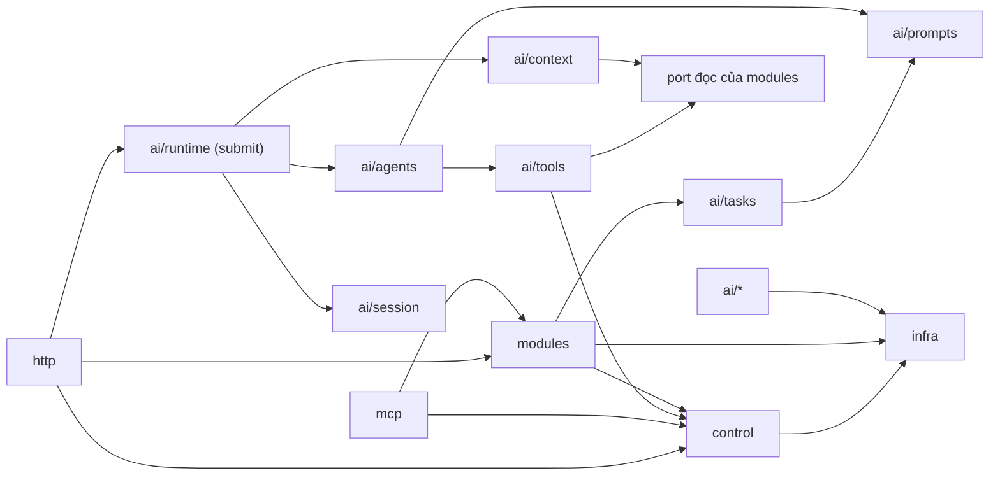

# AI Talent OS — Kế hoạch triển khai AI Core

**Bản 1.1 · 26/11/2026.** Thuộc bộ [AI Core](README.md). Lõi AI Core (P0–P4, một phần P6) **đã làm xong** ngày 26/11/2026; các giai đoạn đã xong, đánh giá code demo cũ và cách chuyển đổi nằm ở [Lịch sử triển khai](LICH_SU_TRIEN_KHAI.md). File này giữ: cấu trúc mã hiện tại, quy tắc phụ thuộc, việc còn lại và ánh xạ ca kiểm. Muốn thêm tool, task hay lệnh mới: [Hướng dẫn mở rộng](HUONG_DAN_MO_RONG.md). Ước lượng tính bằng ngày công, sai số ±30%, không phải cam kết lịch phát hành.

## 1. Cấu trúc mã hiện tại

```
apps/api/
  src/
    server.ts, worker.ts, container.ts     # container nối control/, ai/, mcp/; worker: dispatcher, 2 lane BullMQ, scheduler, reconciler, export
    config/env.ts                          # AI_COACH_MODEL, ENABLE_AGENT_*, AGENT_*, ENABLE_MANAGER_MCP, MCP_*
    core/errors.ts, core/hash.ts           # AppError; sha256 + JSON chuẩn hóa
    control/                               # Business Control Plane (ADR-11), không import module nào
      actor.ts        # Actor (talent|manager), dựng từ phiên/grant; kiểm còn hoạt động
      access.ts       # Capability, Channel, ma trận ALLOWED, assertCapability, assertActive
      commands.ts     # execute(): idempotency key, CAS (qua handler), receipt, audit, outbox, một transaction
      proposals.ts    # ProposalService + interface ProposalHandler: prepare / view / confirm / reject / expireDue
      idempotency.ts  # once(): idempotency_requests cho POST
      rate-limit.ts, tx.ts
    ai/
      agents.ts       # agentFor(channel): talent_coach | manager_assistant
      tools/          # define.ts (defineTool, sdkTools, toolError), index.ts (TOOLS)
      tasks/          # define.ts (runTask), daily-topics.ts
      prompts/        # registry.ts: agent.talent@1, agent.manager@2 (task.daily_topics@1 nằm trong tasks/daily-topics.ts)
      context/        # builder.ts (ContextPack + manifest)
      session/        # prisma-session.ts, history.ts (cắt lịch sử)
      runtime/        # run-agent.ts (runAgentEvent)
    modules/
      coach-config/        # model.ts, reader.ts (đọc), handlers.ts (handler lệnh), export.ts (OneDrive Profile.md)
      coach-conversation/  # store.ts (hội thoại, run: submit/claim/lease/finish/cancel/reconcile), items.ts, events.ts (Redis pub/sub)
      coach-daily/         # service.ts (DailyTopicsService: schedule/lease/run/reconcile)
      auth/, onedrive/, pwa/, system/, upload-post/
    mcp/              # server.ts (/mcp), auth.ts (TokenVerifier, grant)
    http/             # app.ts, agent.ts (REST + SSE), proposals.ts, ai-sandbox.ts
  evals/<suite>/cases.jsonl                # dữ liệu giả; kết quả ở evals/results/ (không commit)
  tools/                                   # eval.ts, agent-smoke.ts, load-morning.ts, test-local.sh, ai-talent.ts
apps/web/
  lib/api/agent.ts                         # client agent + proposals
  components/demo/AgentDemo.tsx, ProposalConfirm.tsx
  app/pwa/coach/, app/pwa/confirm/[proposalId]/
```

## 2. Đồ thị phụ thuộc



Quy tắc chi tiết: [Kiến trúc §8](AI_CORE_ARCHITECTURE.md#8-ranh-giới-module-và-quy-tắc-phụ-thuộc). Mục tiêu kiểm bằng ESLint `no-restricted-imports`; hiện chưa có lint cho `apps/api` (T6.7), giữ bằng review. Quy tắc cứng nhất: `control/` không import `modules/` hay `ai/` (module đăng ký handler qua `container.ts`).

## 3. Việc còn lại

### 3.1. Lõi (không phụ thuộc đặc tả module)

| Mã | Việc | Tiêu chí chấp nhận | Chờ gì |
|---|---|---|---|
| T4.1 | VT-08: POC OAuth với ChatGPT (authorization server, PKCE, audience, refresh, revoke); cắm verifier thật vào `createApp(deps, verifier)`; cách cấp `mcp_grants` | Kết nối thật thành công; quyết định ghi vào ADR-14 | URL HTTPS công khai, tài khoản ChatGPT ([Runbook §3.1](TEST_RUNBOOK.md)) |
| T6.2 | VT-09 đo thật: 300 Talent giả, model thật | Mọi task xong trước hạn khung, dư ≥ 30% | Staging + hạn mức OpenAI (script `npm run load:morning` đã có) |
| T6.3b | BullMQ limiter theo RPM/TPM; giới hạn chi tiêu project OpenAI | Không vượt RPM khi tải đỉnh | — |
| T6.4 | Review bảo mật theo [SECURITY_DESIGN](SECURITY_DESIGN.md); backup/restore staging (AIC-T16) | Biên bản review | Staging |
| T6.6 | FE dùng SSE, mất kết nối quay về polling (ADR-15) | AIC-T37 ở FE | — |
| T6.7 | Chặn import sai hướng bằng lint (AIC-T38); chạy eval trong CI khi đổi prompt/model (AIC-T39) | CI đỏ khi vi phạm | Chưa có CI và ESLint cho `apps/api` |
| T6.8 | Job dọn `idempotency_requests` quá hạn | Dòng quá `expires_at` bị xóa bằng role riêng | Chính sách retention (CR08) |

### 3.2. Theo module nghiệp vụ (P5, 2–4 ngày mỗi module)

| Task | Phụ thuộc | Nội dung |
|---|---|---|
| T5.1 | Đặc tả Posting, mở ghi `posts` ngoài `draft` | Task `caption`, `caption_rewrite`, `ng_check`, `post_time`; tool `draft_create/revise`, `post_delivery_read` |
| T5.2 | Đặc tả Media, VT-06 | Task `media_analysis`; tool `media_read` |
| T5.3 | Đặc tả autopost theo trả lời QA70/83 ngày26/11 | Bật `autopost_set_theme` |
| T5.4 | Đặc tả Challenge theo ba điểm QA72 chấp thuận26/11; prompt Nonaka còn xác nhận27/11 | `challenge_suggest`, `challenge_respond` |
| T5.5 | 確認61/62 | `video_script` |
| T5.6 | Metrics canonical mở ghi | `context_read` section `metrics`; `daily_review`, `weekly_review` |


## 4. Ánh xạ ca kiểm hồi quy

Cột "So với test demo" là lịch sử (test demo đã xóa); cột "Trạng thái" là hiện tại. Test ở `apps/api/src/**/*.integration.test.ts`, chạy bằng `npm run test:local`. Ca toàn hệ thống AIC-T22–T35 ở [module nghiệp vụ §5](BUSINESS_MODULES.md#5-ca-kiểm-toàn-hệ-thống).

| Mã | Ca | So với test demo | Trạng thái |
|---|---|---|---|
| AIC-T01 | Gửi trùng requestKey | Giữ | Đạt |
| AIC-T02 | Talent đọc Talent khác, actor giả trong args | Giữ | Đạt |
| AIC-T03 | Xác nhận proposal A với hash/đích khác; grant đã thu hồi | Giữ, đổi sang `/admin/proposals/*` | Đạt |
| AIC-T04 | Hai kênh cùng sửa một chỉ thị | Giữ | Đạt |
| AIC-T05 | Crash sau tool ghi | **Viết lại:** tool ghi gọi lại cùng tham số trong run → một lệnh; worker chết sau lệnh → lệnh còn, run failed | Đạt |
| AIC-T06 | Crash ở bước model | **Viết lại:** chết khi đang gọi model → `WORKER_LOST`, item của run bị discard; chết trước `model_started_at` → requeue một lần | Đạt |
| AIC-T07 | Redis mất job | Giữ | Đạt |
| AIC-T08 | Mất lease rồi kết quả về muộn | **Viết lại:** `finishRun` của worker cũ bị fence từ chối | Đạt |
| AIC-T09 | Xác nhận, crash, hai xác nhận đồng thời | **Viết lại:** confirm đồng bộ ghi đúng một lần; confirm đồng thời → một lệnh; confirm vs hết hạn | Đạt |
| AIC-T10 | Usage nhiều request, Manager không gắn Talent, chi phí chưa rõ | Giữ (một dòng mỗi request) | Đạt |
| AIC-T11 | Thiếu adapter, profile rỗng, xung đột category | Giữ | Đạt |
| AIC-T12 | Model nói đã lưu khi bị từ chối | Giữ | Đạt (test + eval) |
| AIC-T13 | Reload, hủy, đăng nhập lại | Giữ | Đạt |
| AIC-T14 | MCP sai issuer/aud/revoke | Giữ (P4) | Đạt với verifier dev; OAuth thật chờ VT-08 |
| AIC-T15 | Production và route demo | Giữ | Có (cờ demo bị chặn ở production, `config/env.ts`) |
| AIC-T16 | Backup/restore | Giữ (P6) | Chưa (T6.4) |
| AIC-T17 | Model gửi sai tham số rồi sửa | **Viết lại:** lỗi strict schema của SDK trả cho model; bị chặn bởi `maxTurns` | Đạt (test + eval) |
| AIC-T18 | Replay confirm/cancel cùng key | **Viết lại:** dùng `idempotency_requests` | Đạt |
| AIC-T20 | OneDrive mất kết nối khi lưu profile | Giữ | Chờ OneDrive thật ([Runbook §3.4](TEST_RUNBOOK.md)) |
| AIC-T21 | Ngôn ngữ UI, AAL1/AAL2, demo ở production | Giữ | Chờ kiểm tay giao diện |
| AIC-T36 | Run lỗi giữa chừng → lượt sau không gặp `function_call` mồ côi | Mới | Đạt |
| AIC-T37 | SSE ngắt giữa chừng; mở stream của run đã xong | Mới | Đạt ở BE; FE chưa (T6.6) |
| AIC-T38 | Import sai hướng bị CI chặn | Mới | Chưa (T6.7) |
| AIC-T39 | Eval dưới ngưỡng chặn PR đổi prompt/model | Mới | Chưa (T6.7); eval chạy tay đạt |
| AIC-T40 | MCP không xác nhận được nếu không qua phiên Manager AAL2 | Mới | Đạt |
| AIC-T41 | `daily_topics` chạy lại cùng Talent/ngày/khung → không tạo trùng; quá hạn khung → `MISSED_WINDOW` | Mới | Đạt |

## 5. Điều kiện hoàn tất phần lõi

- Các việc ở §3.1 đạt tiêu chí; mọi ca ở §4 không thuộc P5 đạt.
- Mỗi run/task có `prompt_version`, `model`, usage; trace không chứa nội dung.
- Q-AI-01…03 có trả lời hoặc đang ở mặc định đã ghi.
