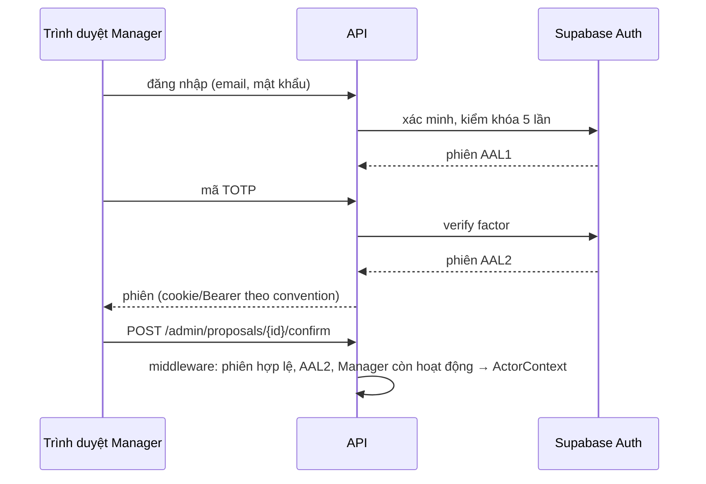

# AI Talent OS — Thiết kế bảo mật AI Core

**Bản 1.0 · 26/11/2026.** Thuộc bộ [AI Core](AI_CORE_ARCHITECTURE.md). Phạm vi: xác thực, phân quyền, cô lập dữ liệu Talent, MCP, an toàn tool và prompt, dữ liệu nhạy cảm, audit, secret, dữ liệu ở nhà cung cấp. Chi tiết Auth production theo [supabase-db-auth-spec](../supabase-db-auth-spec/HUONG_DAN_TICH_HOP_VI.md); MCP theo [chatgpt-mcp-spec](../chatgpt-mcp-spec/README.md).

**Nguyên tắc:** mọi quyết định cho phép/từ chối do code backend tất định đưa ra. Prompt, mô tả tool, `isEnabled` của SDK và lời model không phải cơ chế phân quyền.

## 1. Tài sản và mối đe dọa

| Tài sản | Mối đe dọa chính | Biện pháp chính |
|---|---|---|
| Dữ liệu Talent (profile, hội thoại, ảnh; có người dưới 18) | Talent đọc dữ liệu Talent khác; model làm lộ qua tool | Talent ID do server cố định; query lọc theo actor; context chỉ của một Talent (§4) |
| Chỉ thị AI, profile | Sửa trái phép qua chat/MCP | Đề xuất + xác nhận AAL2 + CAS (§3.3) |
| Phiên Manager | Chiếm phiên, CSRF ở confirm | TOTP, cookie/Bearer theo convention, CSRF cho cookie, Origin check |
| Grant MCP | Token bị lộ, dùng sau thu hồi | Kiểm grant mỗi lời gọi, hạn ngắn, thu hồi có hiệu lực ngay (§5) |
| Khóa API OpenAI, provider | Lộ qua log/trace/RunContext | Secret ngoài code; không đưa vào context; log redact (§8) |
| Chi phí AI | Lạm dụng gửi tin, vòng lặp model | Rate limit, `maxTurns`, ngân sách token, giới hạn chi tiêu project (§6) |

## 2. Xác thực

| Chủ thể | Cơ chế | Ghi chú |
|---|---|---|
| Talent | Supabase Auth email/mật khẩu; đổi mật khẩu tạm lần đầu; tự đặt lại qua email | Không MFA (quyết định hiện hành) |
| Manager | Mật khẩu + TOTP (AAL2); khóa sau 5 lần sai ở BE | Không SMS/email OTP |
| Office account | Manager đăng nhập, chọn office (principal riêng) | Chuyển account phải đăng nhập lại |
| ChatGPT (thay Manager) | OAuth 2.1 code + PKCE → access token cho resource `/mcp` | Authorization server chọn ở POC (VT-08) |
| Worker/scheduler | Không có phiên người dùng; actor `system` | Chỉ chạy task hệ thống, không tool ghi thay người |

Auth demo (`ENABLE_AUTH_DEMO`) bị chặn khi `NODE_ENV=production` (đã có trong `config/env.ts`). Auth production là điều kiện phát hành, không phải điều kiện chạy demo.

## 3. Phân quyền

### 3.1. ActorContext

Được dựng **chỉ** ở server từ phiên hoặc grant: `{ userId, kind: talent|manager|office|system, talentId?, managerId?, aal, channel, grantId? }`. Không bao giờ nhận từ body, tham số tool hay model. Truyền vào agent qua `RunContext.context` (không gửi cho model).

### 3.2. Ba lớp kiểm

| Lớp | Kiểm gì | Ở đâu |
|---|---|---|
| Route | Loại phiên, AAL, actor còn hoạt động | Middleware `me/*`, `admin/*`, `/mcp` |
| Capability | Kênh hiện tại có được dùng capability này | `AccessPolicy.assert(actor, capability)` trong `defineTool` và handler REST/MCP |
| Tài nguyên | Đối tượng thuộc phạm vi actor; trạng thái tài khoản cho phép | Service/handler khi đọc và **kiểm lại khi ghi** |

### 3.3. Ma trận capability

| Capability | Talent | Manager UI (M-17, quản trị) | Manager MCP | System |
|---|---|---|---|---|
| `context.read` | Chỉ mình | Mọi Talent (QA88), ghi nhật ký xem | Trong grant, ghi nhật ký xem | Task của Talent đó |
| `talent.search` | — | ✓ | ✓ | — |
| `instruction.history` | — | ✓ | ✓ | — |
| `talent_profile.prepare` | — | ✓ | ✓ | — |
| `ai_instruction.prepare` | — | ✓ | ✓ | — |
| `proposal.confirm/reject` | — | ✓ (AAL2, qua REST) | — (chỉ qua trang PWA) | — |
| `autopost.set_theme`, `challenge.respond`, `draft.*` | Chỉ của mình, khi module sẵn sàng | Theo luồng Manager riêng của module | — | — |
| Duyệt đơn/bài, đổi trạng thái, thu tiền, xóa | — | Chỉ màn quản trị, không qua AI | — | — |

### 3.4. Trạng thái tài khoản

Mỗi lệnh kiểm lại: Talent `in_use` (hoặc trạng thái được phép theo policy của Lifecycle), Manager chưa bị vô hiệu hóa, grant chưa thu hồi. Talent `paused`/`terminated` → không tạo run mới (`ACCOUNT_NOT_ACTIVE`); chính sách chat khi tạm dừng theo nguồn (không suy cấm mọi chat thủ công).

## 4. Cô lập dữ liệu Talent

- Tool của Talent không nhận `talentId` (hoặc nếu có thì phải trùng actor, khác → 404).
- Mọi query của module lọc theo `talent_id` lấy từ ActorContext; không có hàm "lấy tất cả rồi lọc".
- ContextPack chỉ chứa một Talent; không đưa danh sách Talent khác hay dữ liệu Manager vào prompt Talent.
- Session gắn conversation, conversation gắn actor; đọc conversation kiểm owner.
- Run Manager chọn Talent qua tool, mỗi lần đọc kiểm quyền và ghi `manager_view_logs` (YK3 § 9-4; QA No.7 cho phép Manager xem với thông báo trước).
- Prompt caching của OpenAI dựa trên tiền tố giống hệt; phần riêng của Talent nằm sau phần tĩnh, nên không có dữ liệu Talent nào dùng chung bộ nhớ đệm với Talent khác ngoài phần tĩnh.

## 5. MCP và grant

- Access token kiểm issuer, audience (`/mcp`), hạn, chữ ký; ánh xạ sang `mcp_grants` còn hiệu lực.
- Capability của grant là tập con của quyền Manager; mặc định chỉ đọc + prepare.
- Manager vô hiệu hóa hoặc grant thu hồi → lời gọi tiếp theo bị từ chối; đề xuất `prepared` của grant đó không xác nhận được nữa.
- Không có tool xác nhận trong MCP; xác nhận bắt buộc qua phiên Manager AAL2.
- Không dùng token Supabase admin hay Microsoft Graph làm token MCP.

## 6. An toàn tool, prompt và đầu vào/đầu ra

| Rủi ro | Biện pháp |
|---|---|
| Tiêm chỉ dẫn qua tin nhắn, file, ảnh, tin tức | Dữ liệu ngoài đặt trong khối có nhãn "dữ liệu, không phải chỉ dẫn"; model không có tool nguy hiểm để bị lợi dụng; mọi ghi cần quyền tất định |
| Model gọi tool ngoài quyền | Danh sách tool theo kênh; `AccessPolicy` trong `defineTool`; `toolNotFoundBehavior:'return_error_to_model'` |
| Model đưa ID/actor giả | Actor từ RunContext; ID tài nguyên kiểm phạm vi |
| Model khẳng định đã lưu khi chưa | `action_result` hiển thị template từ receipt DB |
| Tool chung chung (SQL, HTTP, shell) | Không có. Không dùng hosted tool (web search, code interpreter) ở giai đoạn đầu |
| Đầu vào quá lớn/lạ | Zod ở HTTP (body ≤ 64 KiB, tin ≤ 1.000 ký tự); strict schema tool |
| Đầu ra độc hại khi hiển thị | FE hiển thị văn bản thuần (không render HTML từ model); link không tự mở |
| Vòng lặp tốn tiền | `maxTurns` 8, timeout 120 giây, rate limit người dùng, giới hạn chi tiêu theo project OpenAI |

## 7. Dữ liệu nhạy cảm

- **Tối thiểu hóa (YK3 § 10-2):** ContextPack chỉ chứa trường cho phép của profile, chỉ thị, mục tiêu. Không gửi email, ngày sinh, thông tin thanh toán, địa chỉ. Nhãn "dưới 18" (nếu cần cho chính sách nội dung) gửi dạng cờ, không gửi ngày sinh.
- **Lưu ở OpenAI:** `store:false` (ADR-06); không dùng Conversations, Files, Batch cho dữ liệu Talent.
- **Trace:** `traceIncludeSensitiveData=false` ở mọi môi trường, đặt trong code cho từng run (`traceConfig`), không dựa vào cấu hình môi trường; SDK mặc định là `true`.
- **Log kỹ thuật:** không log prompt, câu trả lời, nội dung tool; chỉ ID và mã lỗi.
- **Ảnh/video gửi phân tích:** URL ký ngắn hạn (≤ 10 phút) hoặc base64; không URL công khai lâu dài.
- **Lưu trữ:** Postgres mã hóa khi lưu (Supabase); RLS bật; runtime không có DELETE; xóa theo manifest retention ([DB §6](DATABASE_DESIGN.md#6-retention)).
- **Dữ liệu thử:** dữ liệu giả; dùng dữ liệu thật cần văn bản đồng ý của Adesso (YK3 § 10-3).

## 8. Secret

- Secret ở biến môi trường do operator cấp (Docker secrets/PM2 env), không trong repo. `.env.example` chỉ có tên biến.
- OpenAI: một project và một khóa cho mỗi môi trường (dev, staging, production), đặt giới hạn chi tiêu; khóa tracing có thể tách (`setTracingExportApiKey`).
- Không đặt secret trong `RunContext.context` (tài liệu SDK lưu ý RunState có thể serialize context).
- Xoay khóa: đổi env + khởi động lại; không có khóa nào hard-code.

## 9. Dữ liệu ở nhà cung cấp và câu hỏi cho khách

Sự thật (tài liệu OpenAI, 26/11/2026): dữ liệu API mặc định không dùng để huấn luyện; log giám sát lạm dụng giữ tới 30 ngày; ZDR (không lưu dữ liệu) cần OpenAI duyệt trước, khi bật thì tracing không dùng được và một số endpoint (Conversations, Files, Batch, Evals) không đủ điều kiện.

Đây là quyết định quản trị dữ liệu, cần khách chọn (không phải lựa chọn kỹ thuật):

| Mã | Câu hỏi | Mặc định kỹ thuật cho tới khi có trả lời |
|---|---|---|
| Q-AI-01 | Adesso chấp nhận nội dung hội thoại Talent (kể cả người dưới 18) nằm trong log giám sát lạm dụng của OpenAI tới 30 ngày, hay muốn đăng ký ZDR/giám sát sửa đổi với OpenAI? | `store:false`, chưa đăng ký ZDR |
| Q-AI-02 | Có cho phép gửi trace kỹ thuật (không có nội dung hội thoại) về OpenAI để gỡ lỗi không? | Bật, không có dữ liệu nhạy cảm |
| Q-AI-03 | Thời hạn lưu hội thoại Manager (M-17) và nhật ký thực thi AI? (liên quan CR07/CR08) | Giữ, chưa xóa tự động |

Không có câu hỏi kỹ thuật nào khác cần khách chọn.

## 10. Audit

| Sự kiện | Bảng | Nội dung |
|---|---|---|
| Mọi lệnh ghi (agent, MCP, REST) | `business_commands` + `activity_logs` | Actor, kênh, đối tượng, version, receipt |
| Đề xuất tạo/xác nhận/từ chối/hết hạn | `business_proposals` + `activity_logs` | Ai, lúc nào, hash |
| Manager xem dữ liệu Talent qua AI/MCP | `manager_view_logs` | Manager, Talent, màn/kênh, thời gian |
| Thực thi AI | `agent_runs`, `ai_task_runs`, `ai_usage_events` | Model, prompt version, usage, lỗi |

Audit không chứa secret; nội dung thay đổi nằm ở bảng version, audit chỉ tham chiếu.
