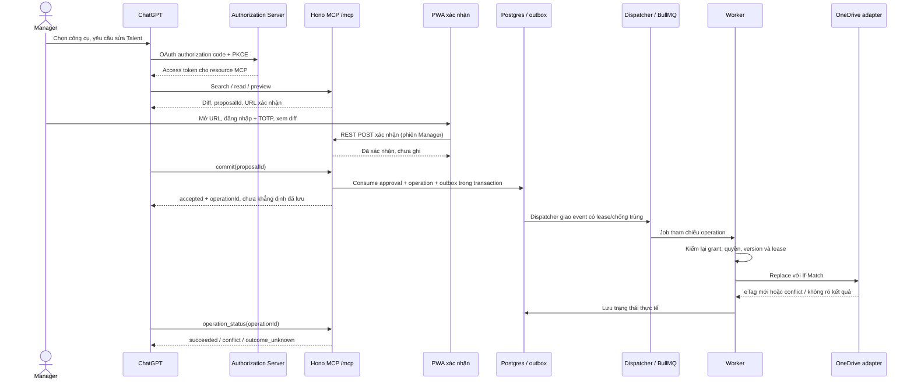

# Hướng dẫn triển khai MCP để gọi từ ChatGPT

Bản 1.1 · review nguồn/kiến trúc hiện hành; bản gốc 19/11/2026 · Thiết kế kỹ thuật đề xuất, **chưa triển khai / chưa kiểm chứng kết nối**.

## 0. Kết quả review và mức sẵn sàng

**Phù hợp làm thiết kế cho MCP hồ sơ giai đoạn đầu, chưa đủ để bật hệ thống MCP production.** Có thể bắt đầu module/ports, registry/schema và POC bằng dữ liệu giả. Chưa chọn SDK/version, chưa có `/mcp`, OAuth resource token, bảng grant/proposal/approval hoặc worker trong ứng dụng; mẫu service không chứng minh các phần đó đã chạy. Không lấy demo Auth/OneDrive làm bằng chứng đã có danh tính Manager production.

| Điểm kiểm | Kết luận hiện hành |
|---|---|
| Backend | Giữ Hono/TypeScript trong `apps/api`; MCP endpoint và UI dùng service hồ sơ chung. FE không có API routes/server actions. |
| MCP server và Agent | MCP SDK phía server cung cấp tool cho ChatGPT. Vercel AI SDK là ứng viên cho Agent **client** trong AI Core, không thay MCP server/OAuth và không bắt buộc cài để ChatGPT sửa hồ sơ. Không cần gọi thêm OpenAI model để chuyển tiếp một tool. |
| Quyền Manager | QA hiện hành No.88 G88/H88: mọi Manager cùng cập nhật mọi Talent. Không tạo ACL theo assign/category để chặn cập nhật mặc định. Grant vẫn có thể giới hạn capability/tài nguyên được ủy quyền rõ; không nhầm grant đó với phân công nhận thông báo. No.87/88 còn lệch cách gửi thông báo. |
| UI và dữ liệu mới | BF19 trang PDF18, SD-M19 M-15 trang20/M-21 trang26 đã mô tả quản trị và ChatGPT cùng cập nhật; không sửa trực tiếp file OneDrive. Mapping năm nhóm thông tin/giọng văn và điều kiện AI chạy còn KS No.39/QA No.92; không tự mở thêm field từ hình màn. |
| Queue và ghi file | Người dùng chốt BullMQ + Redis; dùng operation/outbox Postgres → dispatcher → BullMQ → worker. Không tạo queue riêng hoặc mặc định đường commit đồng bộ production. |
| Protocol/client | 2025-11-25 là baseline có chủ đích, không tuyên bố phiên bản mới nhất. POC ghi protocol thực tế, SDK, cơ chế discovery và khả năng của workspace ChatGPT mục tiêu; không nâng revision bằng suy đoán. |
| Mỗi Talent một Project | Đây là mô tả workflow nguồn cần giữ theo phạm vi. Không coi MCP tự tạo, nhận diện hoặc ràng buộc ChatGPT Project; Project không phải chứng cứ quyền. Hỗ trợ thực tế phải kiểm với workspace/khách theo MCP-G02. |

Phần còn chặn ghi production: AS/client registration/resource audience chưa POC; template/field mapping chưa chốt; UX xác nhận ngoài ChatGPT chưa được chấp thuận; chưa kiểm parser, DB/outbox/worker và reconciliation. Nội dung này là review của tác giả, không ký Independent Verification hoặc làm gate PASS.

## 1. Căn cứ và giới hạn

| Nội dung | Nguồn gốc | Kết luận dùng trong đặc tả |
|---|---|---|
| Manager nhập/sửa hồ sơ, định hướng, sở thích, sở trường, mục tiêu tương lai qua ChatGPT | YK2 §2-6, §6-4 chức năng 2-3, §7-1 | Phạm vi nghiệp vụ có căn cứ; không đồng nghĩa đã chốt template và validation |
| Hiện đích và nội dung, Manager xác nhận trước khi ghi | YK2 §6-4 chức năng 2-3 | Điều kiện bắt buộc của thao tác ghi |
| Chỉ Manager thay đổi thông tin | YK2 UC-02, §7-1 | Talent và AIcore không tự được quyền gọi công cụ ghi |
| Mỗi Talent một Project ChatGPT liên kết OneDrive | YK2 §2-6, UC-01/UC-02 phần 前提 | Không tự thay bằng một connector chung mà coi như khách đã chốt |
| Hướng MCP | QA sheet Q&A No.45, dẫn báo giá 前提条件A4 | Có căn cứ định hướng; chưa đối chiếu bản báo giá ký độc lập; không kết luận phạm vi thương mại |
| Màn nhập thông tin trong ứng dụng | SD-M19 M-21 trang PDF26, M-15 trang20; BF19 trang18; KS sheet20261120 No.39; QA No.92 | UI và ChatGPT gọi cùng service; mapping/validation còn mở, không coi màn nhập chưa tồn tại về mặt yêu cầu |

Tên nguồn tra tại [TAI_LIEU_NGUON](../../TAI_LIEU_NGUON.md). SCD 2-3, S02-01/S02-04 và workbook15 là truy vết nội bộ, không phải bằng chứng duyệt. OAuth, tên tool, hạn mức, bảng lưu và trang xác nhận dưới đây là **quyết định thiết kế đề xuất của đội**, cần review kỹ thuật; trang xác nhận cần thống nhất trải nghiệm với khách.

## 2. Phạm vi tối thiểu

Xây MCP nghiệp vụ trên BE hiện có: tìm Talent được phép, đọc phần hồ sơ cần sửa, tạo đề xuất, kiểm tra trạng thái, ghi một đề xuất đã có xác nhận độc lập. Giới hạn từng Talent, từng tệp `プロフィール.md` đã được adapter OneDrive ánh xạ.

Đề xuất allowlist trường: `profile`, `direction`, `hobbies`, `skills`, `futureGoal` (văn bản mục tiêu dài hạn, không phải chỉ tiêu followers). Năm nhóm dự kiến của SD-M19 M-21 còn có giọng văn; `hobbies`/`skills` là cách tách kỹ thuật, chưa coi tương đương mọi trường nguồn. Phạm vi tối thiểu ở đây chỉ là profile; chưa hỗ trợ giọng văn/chỉ thị nếu chưa có mapping. Mapping sang template phải được chốt theo S02-04, KS No.39 và QA No.92 trước khi mở ghi. Chưa có mapping thì preview trả `PROFILE_TEMPLATE_UNAVAILABLE`, không đoán vị trí.

Không cung cấp tool SQL, Graph tổng quát, đường dẫn/driveId tùy ý, tải cả thư mục, ghi đè tệp thô, sửa quyền, duyệt đơn, thanh toán, đăng SNS, đổi KPI, chỉ thị toàn hệ thống/category, challenge, AI memory hoặc xuất dữ liệu hàng loạt. Mở rộng sau bằng tool/capability được review riêng. Không dùng tên Project hoặc lời nhắn của mô hình để xác định quyền.

**Phần mở rộng chưa thuộc MVP:** chỉ thị cá nhân/category/toàn bộ, mục tiêu/challenge và thống kê SNS có căn cứ riêng nhưng phải thêm capability/schema/approval/AC theo từng use case. Việc chưa có tool trong MVP không có nghĩa khách đã bỏ chức năng. Dùng cùng service với quản trị; không mở Graph tổng quát để thay các tool còn thiếu.

## 3. Kiến trúc và vị trí mã khi triển khai

| Vị trí đề xuất | Trách nhiệm |
|---|---|
| `apps/api/src/modules/mcp/` | Registry tool, routes MCP/approval, service, cổng, schemas, tests |
| `apps/api/src/infra/mcp/` | Adapter SDK/transport, xác minh resource token |
| Adapter OneDrive hiện hữu hoặc vị trí được bộ OneDrive quy định | Truy cập Graph bằng kết nối ở BE; không tạo kết nối riêng cho mỗi hội thoại |
| `apps/api/src/container.ts` | Inject authorization, profile gateway, proposal store, operation store, audit |
| `apps/api/src/http/app.ts` | Mount `/mcp`, protected-resource discovery, REST approval routes |
| `apps/web/app/mcp/approvals/[proposalId]/page.tsx` | Trang xác nhận riêng là phương án UX còn chờ chốt; không thay màn nhập M-21 |
| Worker/dispatcher trong `apps/api` | Operation/outbox hiện hữu làm nền; BullMQ + Redis giao job, worker kiểm quyền/version lại trước Graph |
| `apps/web/components/mcp/`, `apps/web/lib/messages.ts` | UI xác nhận và toàn bộ câu tiếng Nhật |

Giữ Node/TypeScript/Hono theo kiến trúc. Module MCP không import trực tiếp module Auth/OneDrive; định nghĩa port và inject qua composition root. FE chỉ gọi REST BE bằng `lib/api/client.ts`; không thêm Next API routes/server actions. Microsoft secret và token chỉ ở adapter BE. Không cần OpenAI API key để ChatGPT gọi endpoint MCP này; tính năng AI khác có cấu hình riêng.

Dùng SDK MCP chính thức, khóa phiên bản tương thích Node hiện hữu trong lockfile khi làm POC. Không đưa dependency vào app chỉ để hoàn thành tài liệu. Không tự viết parser JSON-RPC/OAuth server. Mẫu ở [examples](examples/commit-profile.ts) chỉ minh họa service độc lập SDK.

## 4. Transport và HTTP contract

Baseline kiểm thử ban đầu (không khẳng định mới nhất): MCP revision **2025-11-25**, Streamable HTTP, endpoint canonical ví dụ `https://api.example.jp/mcp`. SDK thương lượng version; từ chối version không hỗ trợ, không giả định client luôn gửi bản mới nhất.

- `POST /mcp`: JSON-RPC theo SDK, nhận `application/json`, hỗ trợ negotiation `Accept: application/json, text/event-stream`. Không bọc response bằng envelope REST.
- Đợt đầu chọn stateless, không cần server push: `GET /mcp` trả 405 nếu không triển khai SSE; notification hợp lệ có thể trả 202 rỗng. Không dùng SSE transport cũ làm mặc định.
- Public discovery: `GET /.well-known/oauth-protected-resource/mcp`. Trả `resource` bằng chính canonical MCP URI và `authorization_servers` từ cấu hình đã kiểm chứng. Không yêu cầu đăng nhập để đọc discovery.
- Chính sách bootstrap: chọn và kiểm bằng POC giữa bảo vệ toàn endpoint bằng OAuth hoặc chỉ công khai metadata/initialize/list cho client discovery. Nếu có registry công khai thì chỉ trả mô tả tĩnh, không dữ liệu Talent/capability cá nhân; mọi tool dữ liệu vẫn bắt token/quyền. Không để SDK tự trả danh sách khác scope mà không có chủ đích. Tool `securitySchemes` và OAuth scopes phải phản ánh AS thực tế, không tạo scope mới chỉ để client hiển thị consent.
- Thiếu/sai token khi truy cập phần được bảo vệ: HTTP401 kèm `WWW-Authenticate: Bearer resource_metadata="https://api.example.jp/.well-known/oauth-protected-resource/mcp"`. Không trả HTML login hoặc redirect thay JSON-RPC.
- Kiểm tra Origin khi có; Origin ngoài allowlist trả403. Client server-to-server không có Origin vẫn phải xác thực. CORS không thay authorization; không wildcard credentials.
- Reverse proxy phải chuyển Authorization, Accept và các MCP header, không cache response riêng tư hoặc buffer stream nếu bật SSE sau này. JSON-RPC malformed/unknown method dùng lỗi protocol do SDK; tham số tool sai bị schema từ chối.

[Chuẩn transport](https://modelcontextprotocol.io/specification/2025-11-25/basic/transports) và [authorization](https://modelcontextprotocol.io/specification/2025-11-25/basic/authorization) là chuẩn tham chiếu, không phải bằng chứng endpoint dự án đã đáp ứng.

## 5. OAuth và điều kiện chọn nhà cung cấp

ChatGPT là OAuth client; MCP là resource server; Authorization Server (AS) cấp token. Dùng authorization code + PKCE S256, exact redirect URI, state và discovery do thư viện/provider hỗ trợ. Không nhận service role, Microsoft token, OpenAI API key hay token ứng dụng có audience khác làm token MCP.

**Ưu tiên khảo sát Supabase OAuth Server để tái sử dụng tài khoản**, nhưng chưa chọn là giải pháp đã hoạt động. Trạng thái sản phẩm/gói/quyền hỗ trợ phải kiểm trên tài liệu chính thức và project thực tế lúc POC; không dùng ghi chú beta lịch sử làm kết luận hiện hành. Trước khi chốt phải chứng minh:

1. ChatGPT đăng ký/nhận diện client bằng một phương thức thực sự tương thích (pre-registration, CIMD hoặc DCR tùy provider). Không tự bật public DCR để vượt lỗi cấu hình; allowlist client/redirect và quản lý vòng đời đăng ký.
2. Resource indicator đi xuyên luồng authorization/token và access token có `aud` dành cho canonical MCP resource. Token mặc định Supabase `aud=authenticated` không được chấp nhận làm bằng chứng resource binding. Nếu dùng claim hook phải phân biệt đúng OAuth client và kiểm chứng token refresh; không đổi audience của mọi phiên ứng dụng.
3. Token access xác minh được issuer, chữ ký/JWKS, algorithm allowlist, audience, exp/nbf và client hợp lệ. Không dùng ID token hoặc chỉ decode JWT. JWKS rotation có cache và refresh hữu hạn.
4. Chứng minh grant revoke, account disable, quyền Manager thay đổi và yêu cầu TOTP hoạt động theo §6. Không suy ra OAuth token luôn giữ `aal2` của phiên đăng nhập.
5. Scope được AS thực sự hỗ trợ. Supabase công bố OIDC scopes cho identity; chúng không tự hạn chế quyền API. Không khai báo `profile:write` như scope được hỗ trợ nếu AS chưa cấp/enforce nó. Quyền nghiệp vụ riêng lưu bằng grant ở BE và kiểm tra mỗi tool.

Nếu bất kỳ mục nào không đáp ứng: **chặn release**, chọn AS/OAuth gateway đã có implementation chuẩn và nối với Supabase identity qua adapter; lập ADR trước khi triển khai. Không tự viết một OAuth server Hono rút gọn và không tắt audience validation để kết nối thành công.

Sau POC, ghi rõ issuer, endpoints discovery/authorize/token/JWKS, resource, client registration, scope identity thực tế, chiến lược refresh/revoke, phiên bản provider/SDK vào ADR và cấu hình deployment. Protected resource metadata và `securitySchemes` của tool phải cùng scope đã kiểm chứng. Không có secret/token trong ADR.

Tham chiếu: [OpenAI authentication](https://developers.openai.com/plugins/build/auth), [Supabase OAuth getting started](https://supabase.com/docs/guides/auth/oauth-server/getting-started), [Supabase token security](https://supabase.com/docs/guides/auth/oauth-server/token-security). Phần trên là tiêu chí nghiệm thu của đội, không khẳng định Supabase hiện hỗ trợ tất cả tiêu chí.

## 6. Quyền và xác nhận của con người

Mỗi lời gọi tool đều kiểm tra: token hợp lệ → grant chưa revoke, đúng client/resource → user còn active → Manager hiện hành → phạm vi Talent hiện hành → capability được cấp. Truy vấn DB phải giới hạn ngay theo role/capability/tài nguyên trong grant; không tìm toàn bộ rồi lọc response. Với Manager được cấp grant toàn hệ thống, No.88 cho phép cùng truy cập mọi Talent, không thêm ràng buộc assign giả định. Grant có phạm vi hẹp vẫn được kiểm đúng phạm vi đã cấp; proposal/approval luôn bind người tạo, kể cả Manager khác có quyền sửa cùng Talent. Runtime Prisma không tự được bảo vệ bởi JWT người dùng: áp guard BE theo kiến trúc DB hiện hữu. ID không tồn tại và ID ngoài quyền trả cùng `NOT_FOUND_OR_FORBIDDEN`.

Capability nội bộ đề xuất: `talent.search`, `profile.read`, `profile.propose`, `profile.commit`. Không phải OAuth scope đã có. Default deny; không cấp quyền từ `user_metadata`, nội dung hội thoại, tên Project hoặc trường actor do model gửi. Tài khoản Talent/AIcore bị từ chối cả danh mục công cụ nghiệp vụ này.

**Preview không phải approval.** Không chấp nhận `confirmed:true`, câu “người dùng đồng ý”, hay việc gọi commit làm chứng cứ đồng ý. Đề xuất ban đầu dùng trang PWA xác nhận độc lập:

1. Preview lưu proposal bất biến, trả URL origin FE cố định chỉ có proposalId ngẫu nhiên. URL không chứa bearer token/PII và không đủ để phê duyệt.
2. Manager mở trang, đăng nhập theo BE hiện có, hoàn thành TOTP theo policy Manager. BE kiểm tra subject trùng người tạo và grant còn hợp lệ. Xác nhận bắt buộc thao tác POST có chống CSRF nếu dùng cookie; GET/link preview/prefetch không tạo approval.
3. Trang lấy diff từ BE, hiện tên + mã Talent, những trường trước/sau, hạn, cảnh báo ghi. HTML/Markdown không tin cậy phải escape. Người dùng nhấn nút xác nhận; model không có tool phê duyệt thay người.
4. Approval gắn actor, OAuth client/grant, resource, Talent, proposal hash, base eTag, policy version và thời hạn. Hạn đề xuất ban đầu 10 phút tính từ preview, không tự gia hạn sau approval. Đổi quyền/template/đích/nội dung phải preview và xác nhận mới.
5. Commit chỉ nhận proposalId. BE tự lấy patch và quyền. Tại lúc nhận operation kiểm tra approval còn hạn; đánh dấu dùng một lần nguyên tử cùng tạo operation. Retry operation đã nhận trả trạng thái cũ, không tiêu thụ approval mới.

Trang này là đề xuất đáp ứng an toàn việc xác nhận, **khác trải nghiệm xác nhận ngay trong ChatGPT của nguồn**; phải thống nhất với khách hoặc chứng minh cơ chế in-ChatGPT khác có bằng chứng con người tương đương. OAuth consent chỉ cho phép kết nối, không phê duyệt từng thay đổi. UI cảnh báo của ChatGPT/tool annotations không thay thế guard phía server.

Thời hạn phiên, idle timeout, recent MFA và revoke bám bộ Auth. Chưa có policy tương ứng cho grant MCP thì chưa bật; refresh token không tự kéo dài quyền Manager vô hạn. Mỗi thao tác approval phải xác minh phiên ứng dụng đạt assurance yêu cầu, không tin `aal` do model truyền.

## 7. Danh mục công cụ và dữ liệu

Đề xuất sáu tool dưới đây. Mọi input `additionalProperties:false`; dùng UUID cho ID app/proposal/operation; không nhận actorId, raw path hoặc token qua tool arguments. Schema runtime Zod và JSON Schema xuất cho MCP phải đồng nhất.

| Tool | Input | Output thành công | Capability / annotations |
|---|---|---|---|
| `talent_search` | `query` trim 2–100 ký tự; `limit` integer1–20 mặc định10; `cursor?` opaque ≤512 | `items[{talentId,displayName,referenceCode}]`, `nextCursor?` | search; readOnly=true, destructive=false, openWorld=true |
| `talent_profile_read` | `talentId` | `talentId`, `displayName`, `version` opaque, `fields` chỉ allowlist | read; readOnly=true, destructive=false, openWorld=true |
| `talent_profile_preview` | `talentId`, `baseVersion`, `changes` object ≥1 trường allowlist, string1–4000 ký tự/trường | `proposalId`, đích, `diff[{field,before,after}]`, `expiresAt`, `approvalUrl`, `state` | propose + read; readOnly=false, destructive=false, openWorld=true |
| `talent_profile_commit` | `proposalId` | `operationId`, `status`, `updatedVersion?`, `requestId` | commit; readOnly=false, destructive=true, openWorld=true |
| `talent_profile_proposal_status` | `proposalId` | `state`, `expiresAt`, `operationId?`; không lộ diff ngoài quyền | read + propose; readOnly=true, destructive=false, openWorld=true |
| `talent_profile_operation_status` | `operationId` | `status`, `updatedVersion?`, `errorCode?`, `requestId` | read + commit; readOnly=true, destructive=false, openWorld=true |

Tất cả `idempotentHint=false` trừ commit/status có thể true theo semantics triển khai; commit cùng proposal không tạo lần ghi thứ hai. Hints chỉ hỗ trợ client, không cấp quyền. `openWorld=true` vì có thể gọi OneDrive bên ngoài; preview lưu trạng thái nội bộ nên không đánh dấu readOnly.

Không hỗ trợ null hoặc chuỗi rỗng để xóa nội dung trong v1; nhu cầu xóa là quyết định cần chốt. Chuẩn hóa CRLF thành LF, Unicode NFC trước khi tính hash và hiển thị diff. Không tự cắt nội dung; giới hạn tổng body 64KiB và dữ liệu profile được xử lý 128KiB là cấu hình kỹ thuật đề xuất. Chưa có parser round-trip bảo toàn các section khác/encoding thì trả lỗi, không tái tạo toàn bộ tệp từ allowlist.

Duplicate displayName: search trả các lựa chọn, không tự chọn đầu tiên. Cursor phải ký/bind query+actor+scope+expiry, không dùng offset hoặc cursor của người khác. Không trả email, ngày sinh, địa chỉ, thẻ thanh toán, folder/token Graph. Chưa có định danh phân biệt an toàn được duyệt thì dùng mã nội bộ và hỏi lại.

Output trả cả `structuredContent` đúng outputSchema và `content` text tóm tắt không chứa dữ liệu thừa. Nội dung OneDrive/hội thoại là dữ liệu không tin cậy; không chuyển thành system instruction hoặc cho nó mở rộng quyền. Chỉ trả các trường cần thiết để giảm rủi ro gửi PII sang ChatGPT; quyền/chính sách dữ liệu của workspace khách phải được xác nhận.

[Hướng dẫn server OpenAI](https://developers.openai.com/plugins/build/mcp-server) mô tả registry/annotations; schema và policy trên là thiết kế riêng của dự án.

## 8. Lưu trạng thái, concurrency và lỗi không rõ kết quả

Các record sau là **logical contract**, chưa phải bảng đã có. Phải map với `domain_operations`, `outbox_events`, audit và Auth hiện có trước thiết kế additive; không tạo bảng operation/outbox song song. Không ghi thêm kind/event vào CHECK/allowlist hiện hành nếu chưa có migration được review. Thiết kế Prisma/migration riêng khi thực hiện:

| Record | Dữ liệu / invariant |
|---|---|
| MCP grant | actor, client, resource, capability allowlist, policyVersion, assurance policy, revokedAt; một grant không thay quyền DB hiện hành |
| Proposal | UUID ngẫu nhiên, grant/actor/Talent, canonical patch + hash, base eTag, templateVersion, expiresAt, trạng thái; patch bất biến |
| Approval | proposal unique, actor/client/resource/hash/eTag/policyVersion khớp, approvedAt, expiresAt, consumedAt; xác nhận người dùng có audit |
| Operation | Tái sử dụng/mở rộng `domain_operations` qua mapping được review; proposal unique, operationId, trạng thái, attempt lease, request hash, remote version, timestamps/error code; cùng proposal tối đa một operation |
| Audit | actor/client/Talent/proposal/operation/request IDs, sự kiện, trường thay đổi, thời điểm và trạng thái; không log token/toàn bộ diff mặc định |

FK và unique thật ở DB; dùng UUID và timestamptz. Proposal/grant mất hiệu lực thì từ chối hành động mới. Không cascade xóa audit khi xóa người dùng; chọn pseudonymize/restrict theo policy lưu giữ được duyệt. Patch/diff chứa dữ liệu cá nhân: mã hóa theo giải pháp quản lý khóa BE, TTL cleanup và retention phải chốt; không lưu vô hạn để tiện debug. Record hết hạn vẫn phải kiểm tra trực tiếp, không phụ thuộc cron đã xóa.

Proposal state: `pending_approval → approved → consumed`; nhánh `expired/revoked/conflict`. Operation: `accepted → executing → succeeded | conflict | failed | outcome_unknown`. `outcome_unknown` không được hiển thị “đã lưu” hoặc “chưa lưu chắc chắn”.

Transaction DB ngắn nhận commit: khóa/conditional update approval chưa consumed và còn hạn, kiểm tra ràng buộc, tạo operation unique, đánh dấu consumed, audit/outbox trong cùng transaction. Không giữ transaction DB trong lúc gọi Graph. Nhiều PM2 workers dùng DB shared state, không dùng Map/in-memory mutex làm nguồn sự thật. Không chạy lại operation terminal conflict bằng proposal cũ.

Worker/handler claim operation bằng lease có fencing/generation và giới hạn một operation chưa giải quyết cho cùng tệp. Trước side effect kiểm tra lại quyền/revoke và eTag. Thay tệp bằng Graph `If-Match=baseETag`; 412 → conflict, yêu cầu đọc/preview/xác nhận lại. Cùng hash nội dung không phải lý do bỏ qua eTag. Không ghi từng section bằng nhiều request.

Graph và Postgres **không có transaction chung**. Timeout hoặc crash sau Graph success nhưng trước cập nhật DB → `outcome_unknown`; cấm blind retry. Reconcile đọc lại remote version/content hash và operation evidence được adapter hỗ trợ; nếu không chứng minh được attribution thì giữ unknown và cần xử lý vận hành, không tuyên bố exactly-once. Retry Graph chỉ khi chứng minh request chưa tạo side effect hoặc theo cơ chế CAS đã được kiểm chứng; retry không tạo proposal mới tự động.

**Luồng production đã chọn về công nghệ:** transaction consume approval + operation + audit + outbox → dispatcher nhận lease → BullMQ/Redis → worker ghi Graph. Job chỉ giữ operation/event IDs và phiên bản điều phối, không patch chứa PII hoặc bearer token. Dispatcher có thể gửi trùng; worker giành lease/cập nhật có điều kiện và kiểm operation terminal trước side effect. Redis mất job cần replay/đối soát từ Postgres; queue hoàn tất không thay trạng thái operation. Không dựa riêng vào jobId để hứa ghi đúng một lần.

`commit` trả `accepted` không phải “đã cập nhật OneDrive”; client dùng operation status để kiểm. Sau khi approval được consume, TTL không được hiểu như kéo dài quyền: worker vẫn kiểm revoke/Manager active và policy thực thi đã chốt. Quy tắc việc accepted chờ quá lâu phải hết hạn hay cần xác nhận lại cần được quyết định kỹ thuật và kiểm trước production, không mặc định giữ vô hạn. Tắt write flag chỉ chặn nhận commit mới; operation đã nhận theo chính sách dừng/revoke riêng và luôn có đường tra/đối soát.

Chưa có worker thì chỉ POC không ghi dữ liệu thật; không bật đường commit đồng bộ production như một cách bỏ qua outbox/BullMQ hoặc reconciliation.

## 9. Lỗi và giới hạn

| Trường hợp | Phản hồi |
|---|---|
| Token hết hạn/sai audience/chữ ký | HTTP401 + challenge discovery; không thông báo dữ liệu hồ sơ |
| Manager/capability không hợp lệ | HTTP403 ở boundary hoặc tool error `FORBIDDEN`; không thay thành re-login vô hạn |
| Sai schema / gọi tool không tồn tại | JSON-RPC/SDK validation, không gọi adapter |
| Không tìm thấy/ngoài quyền | Tool result `isError:true`, code `NOT_FOUND_OR_FORBIDDEN` |
| Chưa xác nhận/hết hạn/đổi policy | `APPROVAL_REQUIRED` / `PROPOSAL_EXPIRED` / `PROPOSAL_REVOKED` |
| File đổi trước preview/commit | `VERSION_CONFLICT`; không tự rebase |
| Folder chưa có/template sai | `PROFILE_NOT_READY` / `PROFILE_TEMPLATE_UNAVAILABLE`; không tự tạo folder |
| Graph429/503 trước side effect | `UPSTREAM_UNAVAILABLE`, retryAfter nếu có; backoff bounded |
| Timeout không biết kết quả | `OUTCOME_UNKNOWN` + operationId để tra, không bảo người dùng bấm lại bằng proposal mới |
| Gọi quá hạn mức | HTTP429 hoặc lỗi tool đã được SDK hỗ trợ + retryAfter; không trả stacktrace |

Mỗi lỗi có requestId; `structuredContent` lỗi theo schema union rõ `ok:false,error:{code,requestId,retryAfterSeconds?}` và content tóm tắt. Thành công `ok:true,data:{...}`. Adapter SDK phải kiểm chứng `isError` và outputSchema tương thích; không bọc JSON-RPC cấp HTTP bằng envelope này.

Đề xuất ban đầu: rate limit theo actor+client, 30 request/phút và 5 commit/phút; timeout adapter có giới hạn, queue/backoff không vô hạn. Chốt sau load test, không gọi đây là giới hạn khách đã duyệt. Cache hồ sơ không dùng chung giữa actor; response nhạy cảm `Cache-Control: no-store`.

## 10. REST cho trang xác nhận

Các route **đề xuất**, không phải endpoint hiện có:

- `GET /api/v1/admin/mcp/approvals/:proposalId`: phiên Manager + policy; trả đích/diff/hạn/state từ record bất biến, không tin nội dung URL.
- `POST /api/v1/admin/mcp/approvals/:proposalId/approve`: phiên Manager đạt MFA, origin/CSRF, xác minh lại hash/eTag/policy/grant; tạo approval idempotent. Không gọi Graph.
- `POST /api/v1/admin/mcp/approvals/:proposalId/reject`: actor hợp lệ; revoke proposal chưa consumed. Operation đã accepted thì không hứa hủy được side effect; hiển thị trạng thái thực tế.

Các route REST giữ chuẩn `/api/v1/admin/...` và lỗi REST của repo. `/mcp` là protocol riêng, không bọc JSON-RPC bằng middleware REST. Hiện `http/app.ts` chỉ có body limit/no-store/requireOrigin trên `/api/*`: khi thêm `/mcp`, phải gắn body limit, no-store, OAuth và Origin policy riêng; `requireOrigin` của REST không được chặn server-to-server thiếu Origin ở MCP. Gắn error handler SDK trong subapp trước fallback REST `app.onError`; cấu hình CORS/header negotiation/transport theo SDK và POC. Không gắn module MCP production bên trong `ENABLE_AUTH_DEMO`. Trang approve không cache/offline bằng service worker và không auto-submit sau reconnect. Không gửi push chứa diff. `approvalUrl` host/path được BE xây từ cấu hình tin cậy, không nhận returnUrl tùy ý hoặc dùng URL do mô hình đưa.

## 11. Cấu hình, triển khai và kết nối ChatGPT

Xem [mẫu cấu hình](examples/mcp.env.example). Khi code thật: thêm Zod env schema, `.env.example` BE, mapping compose và docs deploy; chỉ thêm FE public origin thật sự cần. Không sửa ba file env thật trong nhiệm vụ viết tài liệu này. Feature flag bật đọc và ghi riêng; ghi mặc định tắt. Secret AS nằm secret store ở BE; không dùng `NEXT_PUBLIC_` cho bí mật.

Lộ trình:

1. Bắt đầu registry/schema/ports và POC transport + auth bằng dữ liệu giả. Ghi quyết định AS/client/resource trong mục5 hoặc hồ sơ hiện có, không cần tạo một gói tài liệu mới. Mapping/template và UX có thể đối chiếu song song, nhưng chưa chốt thì ghi thật vẫn tắt.
2. POC transport/discovery/OAuth với MCP Inspector và ChatGPT thật; thu evidence §12. Không bắt đầu bằng tool Graph tổng quát để “thử nhanh”.
3. Tạo module/ports, migration additive theo `apps/api/PRISMA.md`, RLS/privileges và index theo query thực tế. Không thay bảng `auth.*`, không dùng `db push` lên remote; kiểm thử migration/replay trên DB test.
4. Implement tool đọc trước; sau đó preview, cơ chế approval đã được chốt, operation/outbox, dispatcher BullMQ/Redis, worker và reconciliation rồi mới mở commit. Index tối thiểu xét unique proposal→operation/approval, tra grant active, lease/status và expiresAt cho cleanup; EXPLAIN trước thêm index trùng.
5. Deploy BE public HTTPS + FE HTTPS, allowlist origins/client/redirect, kiểm tra proxy/header/discovery ngoài mạng; không public DB/admin MCP.
6. Theo [hướng dẫn kết nối chính thức](https://developers.openai.com/plugins/deploy/connect-chatgpt): tài khoản/workspace cho phép custom MCP, thêm URL `/mcp` và OAuth, cài/chọn công cụ rồi thử trong hội thoại mới. Tài liệu OpenAI hiện dùng tên Plugins; vị trí UI/khả năng gói cần kiểm tra trên workspace khách, không cam kết mọi tài khoản có cùng menu. Thay registry thì refresh kết nối theo UI hiện hành.
7. Chạy toàn bộ ca bắt buộc, pilot giới hạn Manager/Talent; có bằng chứng mới bật ghi. Không cần publish công khai chỉ để thử nội bộ.

Rollback: tắt commit flag, revoke grant khi có sự cố, giữ status/reconciliation cho operation đã nhận, rollback code tương thích schema mới. Không xóa bảng/log hoặc tự khôi phục tệp cũ đè thay đổi hợp lệ; sửa nội dung phải có đề xuất và xác nhận mới. Backup/restore và retention phải phù hợp dữ liệu cá nhân.

## 12. AC và các điều kiện chưa được phép bỏ qua

| Gate | Người xử lý / evidence bắt buộc | Nếu chưa đạt |
|---|---|---|
| MCP-G01 | Đội kỹ thuật: ADR AS; test discovery, client registration, PKCE, audience, refresh/revoke, MFA | Không mở endpoint dữ liệu thật |
| MCP-G02 | Khách + đội: S02-01/gói ChatGPT và Project riêng hay connector chung; chính sách đưa PII sang ChatGPT | Không coi phương án chung đã được duyệt |
| MCP-G03 | Khách: S02-04 template, trường được sửa/xóa và validation; đội: parser round-trip | Không bật ghi |
| MCP-G04 | Khách xác nhận UX approval; đội chứng minh approval không do model tự tạo | Không bật ghi |
| MCP-G05 | Đội: manager scope/active status; isolation, audit, retention và hỗ trợ revoke | Không dùng dữ liệu production |
| MCP-G06 | Đội: concurrency, timeout unknown/reconcile, proxy/PM2 restart và ca kiểm thử HIGH/CRITICAL | Không bật ghi |

Các mục cần hỏi khách gom vào các chủ đề đã có (No.45/74/92, KS20261120 No.39, S02-01/S02-04); không cấp No.Q&A mới trong tài liệu này. Hạn mức kỹ thuật, SDK/AS, transaction và cách chống race là việc đội phải đề xuất và chứng minh, không đẩy toàn bộ sang khách.

Hoàn tất kỹ thuật khi [AC/ca kiểm thử](CA_KIEM_THU_VI.md) có kết quả, phiên bản và evidence; hoàn tất nghiệp vụ/phạm vi khi có quyết định truy vết nguồn. **Có tài liệu này chưa đồng nghĩa có MCP hoạt động hoặc được phép triển khai production.**

## 13. Kết luận review bản 1.1

Đã đối chiếu [AI Core 2.1](../AI_Talent_OS_AI_Core_Architecture_Report_v2.md), [tech stack](../TECH_STACK_VA_CAU_TRUC_DU_AN.md), code `apps/api/src/http/app.ts`/package/container, nguồn QA hiện hành No.78–92 và BF19/SD-M19. Giữ thiết kế preview/approval/commit, CAS/eTag, revoke và unknown/reconcile; sửa quyền Manager, phạm vi UI, queue/outbox và điểm mount MCP. Đây là review tác giả; tất cả test vẫn NOT RUN, không tự ký Independent Verification.

**Có thể bắt đầu:** code khung/ports, tool/schema không dữ liệu thật, POC OAuth/transport trên staging. **Chưa đủ:** ghi hồ sơ thật, đầy đủ hệ thống MCP cho mọi chức năng dự án, hoặc production. Chặn tương ứng ở MCP-G01–G06; không dùng scaffold pass thay POC ChatGPT/Graph/worker và phê duyệt UX/template.
