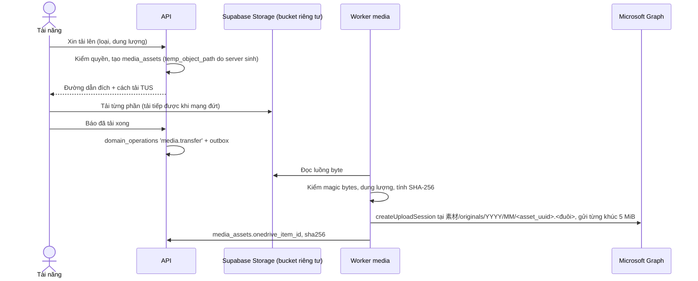

# Hướng dẫn tích hợp OneDrive

Bản 2.1 · 18/11/2026 · Dành cho AI agent lập trình. Thay bộ 1.1 (17/11/2026: `ONEDRIVE_IMPLEMENTATION_SPEC_VI.md`, `TEST_CASES*.json/md`, `CHATGPT_MCP_EVIDENCE_VI.md`, các tệp schema và manifest; xem lịch sử git).

Tài liệu này hướng dẫn agent **chưa làm gì** dựng được phần lưu trữ trên OneDrive của AI Talent OS:
- hệ thống **tự đăng nhập** vào một tài khoản Microsoft 365 doanh nghiệp chính, không ai phải thao tác;
- tạo thư mục cho từng tài năng;
- đọc và ghi tài liệu cho AIコーチ (AI coach);
- chuyển ảnh, video từ Supabase Storage sang OneDrive.

Ca kiểm thử ở [CA_KIEM_THU_VI.md](CA_KIEM_THU_VI.md) (viết tắt **CK**). Đăng nhập, phiên và cơ sở dữ liệu ở [../supabase-db-auth-spec/HUONG_DAN_TICH_HOP_VI.md](../supabase-db-auth-spec/HUONG_DAN_TICH_HOP_VI.md) (viết tắt **HD-Auth**).

**Đọc trước:**
- [TECH_STACK_VA_CAU_TRUC_DU_AN.md](../TECH_STACK_VA_CAU_TRUC_DU_AN.md);
- `database-design/07_implementation_scope_and_rules.md`: bảng bị chặn ghi, quy tắc migration;
- SCD EP02 (2-1, 2-2, 2-3, 2-4) và EP05 (6-3, 6-4).

**Ký hiệu nguồn:**
- [YK2] = bản định nghĩa yêu cầu v2; [QA] = `AI-Talent-OS_Q&A表.xlsx`; [KS] = `要件定義確認シート_AI育成OS.xlsx` (bảng xác nhận yêu cầu, quyết định 17/11/2026; tổng hợp ở `Phan_tich/21_Cap_nhat_theo_bang_xac_nhan_17-11.md`); S1… = tài liệu Microsoft hoặc Supabase ở §13.
- **[Chốt]** = đã có căn cứ; **[Chưa rõ]** = chờ khách; **[Đề xuất]** = thiết kế của đội; **[Kiểm chứng]** = hiểu biết của đội, phải thử với tenant thật.
- Mã mẫu đánh dấu **Đã chạy với giả** khi đã có test với Microsoft giả trong `apps/api`, **Chưa chạy thật** khi chưa có mã nào chạy.

---

## 1. Yêu cầu và quyết định

| Mục | Nội dung | Căn cứ |
|---|---|---|
| Nơi lưu hồ sơ, mục tiêu, know-how, kết quả | OneDrive, một thư mục cho mỗi tài năng | [YK2] §6-4 chức năng 2-2, §7-2 [Chốt] |
| Nơi lưu ảnh, video | OneDrive, thư mục của tài năng. Tài năng đó và quản lý được xem | [YK2] §6-7 chức năng 6-4 素材の保存 (lưu tư liệu), §7-2; [QA] No.8, CR-10 [Chốt] |
| Bản tạm của ảnh, video | Supabase Storage. Trình duyệt tải lên đây, worker chép sang OneDrive. Upload-Post và fal.ai lấy tệp từ bản tạm, không dùng liên kết công khai của OneDrive | "Phương án B" của CR-10; SCD 6-4 [Đề xuất, đã thống nhất nội bộ] |
| Giữ bản tạm | 7 ngày sau khi **bài cuối cùng** dùng nó đăng xong, sau đó xóa. Với 自動投稿 (đăng tự động), tư liệu tải lên một lần được dùng dần trong cả khoảng thời gian (ví dụ 1–2 tuần) | SCD 6-4, S05-03 [Đề xuất, tham số]; [KS] 確認25 [Chốt] |
| Tài năng 退会 (đã rời) | Dữ liệu (thành tích đăng bài, ảnh…) giữ **6 tháng** rồi tự xóa, kể cả thư mục OneDrive; xóa xong không khôi phục | [KS] 確認55, cột I [Chốt] |
| Nhập thông tin tài năng | Có thể thêm **màn trong ứng dụng** để quản lý nhập thông tin tài năng cho AI, ngoài ChatGPT (MCP) | [KS] 確認8 nói cần màn này; màn là gì: [Chưa rõ, Q&A No.74], AMCOLAB đề xuất đợt 1 chưa làm |
| Mốc tạo thư mục | Tài năng đăng ký thanh toán xong; tài khoản công ty (事務所アカウント) khi quản lý tạo | [YK2] §6-4 chức năng 2-2, UC-01 前提 (tiền đề) [Chốt] |
| AIコーチ đọc | Mỗi sáng đọc thư mục của tài năng và thư mục chung. Quản lý sửa tệp thì sáng hôm sau AI dùng bản mới | [YK2] §6-4 chức năng 2-1, §7-5 [Chốt] |
| **Tài khoản Microsoft** | **Một tài khoản dịch vụ Microsoft 365 doanh nghiệp** cho cả hệ thống, ví dụ `ai-talent-os@<tên miền khách>`. Kho là OneDrive for Business của tài khoản đó | Quyết định nội bộ 18/11/2026: giả định khách có Microsoft 365 doanh nghiệp [Chốt giả định]; tài khoản do khách cấp [Chưa rõ, K1] |
| **Xác thực** | **Tự động hoàn toàn.** Hệ thống tự đăng nhập bằng tài khoản và mật khẩu trong biến môi trường (ROPC), tự làm mới token. Khách không thao tác gì trong hệ thống | Quyết định nội bộ 18/11/2026 [Chốt] |
| ChatGPT ghi thông tin | Qua MCP (giao thức cho ChatGPT gọi công cụ của hệ thống) do hệ thống tự dựng, dùng chung kết nối ở BE | 御見積書 (bản báo giá) 前提条件A4, [QA] No.45 [Chốt hướng]; phạm vi [Chưa rõ, K5] |

### 1.1. ROPC và điều kiện để chạy được

ROPC (Resource Owner Password Credentials: gửi thẳng tài khoản và mật khẩu lên token endpoint) cho phép hệ thống tự đăng nhập, không có trang đăng nhập nào (S1). Microsoft hỗ trợ luồng này **chỉ với tài khoản trong tenant Entra**, và **chỉ khi** các điều kiện dưới đây được đáp ứng. Thiếu một điều kiện là không đăng nhập được, nên đây là danh sách phải gửi bộ phận IT của khách [Chưa rõ, K2]:

| Điều kiện | Vì sao | Lỗi nếu thiếu (AADSTS) |
|---|---|---|
| Tài khoản chỉ trên cloud (managed), không liên kết đăng nhập ngoài (federated, ADFS) | ROPC không qua được nhà cung cấp định danh bên ngoài | 50126 hoặc lỗi liên kết |
| **Không** bị bắt xác minh hai bước: tắt Security defaults, hoặc loại tài khoản này khỏi chính sách MFA / Conditional Access (Truy cập có điều kiện) | ROPC không trả lời được MFA | 50076, 50079, 50158, 53003 |
| Admin đã bấm **Grant admin consent** cho quyền ủy quyền của ứng dụng | ROPC không hiện được màn hình đồng ý | 65001 |
| Tài khoản có giấy phép kèm OneDrive, và đã mở OneDrive ít nhất một lần (để drive được tạo) | Không có drive thì không có `/me/drive` | Graph 404 / `ResourceNotFound` |
| Mật khẩu không hết hạn, hoặc có quy trình đổi mật khẩu cùng lúc với biến môi trường | Mật khẩu hết hạn thì đăng nhập thất bại | 50055 |
| Tài khoản không có vai trò quản trị, chỉ dùng cho hệ thống | Giảm thiệt hại nếu mật khẩu bị lộ | — |

Microsoft **không khuyến nghị** ROPC (S1): mật khẩu nằm trên server, và tài khoản phải được miễn MFA. Bù lại, hệ thống phải:
- giữ mật khẩu trong kho bí mật của nơi triển khai;
- không bao giờ ghi mật khẩu hay tài khoản vào log;
- dùng tài khoản dịch vụ riêng, quyền tối thiểu;
- **không** thử lại khi sai mật khẩu, để không làm khóa tài khoản (§6.3).

### 1.2. Hai chế độ

| Chế độ (`ONEDRIVE_AUTH_MODE`) | Cách lấy token | Khách phải làm gì | Ghi chú |
|---|---|---|---|
| `ropc` (mặc định của bản này) | Tài khoản + mật khẩu → token; làm mới bằng refresh token; refresh hỏng thì tự đăng nhập lại bằng mật khẩu | Cấu hình Entra một lần (§3.1). Không thao tác gì trong hệ thống | Quyền ủy quyền `Files.ReadWrite`: chỉ chạm được OneDrive của chính tài khoản dịch vụ (S9) |
| `app` (thay thế) | Client credentials, không có tài khoản người dùng (S5) | Cấu hình Entra một lần. Không thao tác gì trong hệ thống | Không cần mật khẩu, không cần miễn MFA. Production nên giới hạn đúng drive/thư mục bằng quyền "Selected" (S10). Nên dùng nếu IT của khách cấp được quyền ứng dụng |

Hai chế độ dùng chung một adapter Graph (§5) và cùng cây thư mục. Hệ thống không bao giờ tự chuyển từ chế độ này sang chế độ kia.

---

## 2. Cấu trúc thư mục

Tên hiển thị bằng tiếng Nhật vì quản lý của アデッソ mở thư mục hằng ngày. Khóa kỹ thuật là **mã item của Graph** (`drive_id` + `item_id`), không phải tên hay đường dẫn. Cây này thống nhất với SCD 2-2.

```text
AI育成OS_<môi trường>/                ← ONEDRIVE_ROOT_FOLDER, ví dụ AI育成OS_dev, AI育成OS_prod
  共通/                                ← dùng chung cho mọi tài năng
    ノウハウ.md                         ← kiến thức nghề (UC-02 前提)
    アルゴリズム対策.md                  ← chỉ dẫn thuật toán, giờ đăng
    AIへの指示.md                       ← giọng văn, chỉ thị chung (S03-01)
  タレント/
    <talent_uuid>_<表示名>/            ← tiền tố UUID: đổi tên hiển thị không đổi danh tính
      プロフィール.md                    ← hồ sơ (quản lý hoặc ChatGPT qua MCP ghi)
      AIメモ.md                         ← AIコーチ ghi thêm điều đã học (3-2)
      目標.md                           ← xuất từ DB (2-4)
      実績/                             ← xuất từ DB: サマリー.md, <YYYY-MM>.csv (8-8)
      素材/originals/<YYYY>/<MM>/<asset_uuid>.<đuôi>   ← ảnh, video (6-4)
      素材/AI生成/<YYYY>/<MM>/<asset_uuid>.<đuôi>      ← video AI tạo (6-5)
      添付/                             ← tệp đính kèm của quản lý
```

`プロフィール.md` tạo sẵn với các tiêu đề mục cố định: `## プロフィール`, `## 方向性`, `## 趣味・特技`, `## 将来の目標`, `## チャレンジ`, `## 日付`, `## 個別の指示` (S02-04 [Đề xuất]).

**Ai là chủ dữ liệu:**

| Dữ liệu | Chủ | Chiều | Sửa sai chỗ thì sao |
|---|---|---|---|
| Hồ sơ, know-how, chỉ thị (`プロフィール.md`, `共通/*.md`) | Tệp OneDrive | OneDrive → AI mỗi sáng | — |
| `AIメモ.md` | Tệp OneDrive | AI ghi thêm (có điều kiện eTag, §7.3); quản lý được sửa | AI đọc lại rồi mới ghi, không đè phần quản lý sửa |
| Mục tiêu, số liệu (`目標.md`, `実績/`) | DB | DB → OneDrive, ghi đè | Sửa trên OneDrive không nhập ngược vào DB; lần xuất sau ghi đè |
| Ảnh, video | Byte trên OneDrive; DB giữ mã item, SHA-256, trạng thái | Supabase Storage → OneDrive | Xóa trên OneDrive thì tư liệu "không còn dùng được", không xóa lịch sử bài đăng |
| Từ cấm, bài đăng, duyệt, thanh toán, mật khẩu | DB | Không xuất ra OneDrive | — |

---

## 3. Cấu hình

### 3.1. Cấu hình một lần trên Microsoft Entra (do IT của khách, hoặc đội nếu được cấp quyền admin)

Chế độ `ropc`:
1. **Tài khoản dịch vụ:** tạo tài khoản chỉ trên cloud (ví dụ `ai-talent-os@<tên miền>`), gán giấy phép có OneDrive, không gán vai trò quản trị. Đăng nhập OneDrive bằng tài khoản này một lần để drive được tạo.
2. **MFA:** loại tài khoản này khỏi chính sách MFA / Conditional Access, hoặc tắt Security defaults (điều kiện ở §1.1). Nên giới hạn tài khoản chỉ đăng nhập được từ IP của server bằng Conditional Access nếu tenant có gói hỗ trợ [Đề xuất].
3. **App registrations → New registration:** "Accounts in this organizational directory only" (một tenant). Không cần Redirect URI.
4. **API permissions → Microsoft Graph → Delegated:** `User.Read`, `Files.ReadWrite`, `offline_access`, rồi **Grant admin consent**. Cột Status phải hiện "Granted".
5. **Certificates & secrets:** tạo client secret, ghi lại phần **Value** (không phải Secret ID), kèm ngày hết hạn để gia hạn.
6. Nếu token endpoint trả `AADSTS7000218` (thiếu client secret) hoặc `AADSTS700025` (public client không được gửi secret), xem lại mục "Allow public client flows" trong Authentication cho khớp với cách gửi ở §6.1 [Kiểm chứng].

Chế độ `app`: bước 3, 5 như trên. Quyền **Application** (`Files.ReadWrite.All` khi thử; production dùng `Sites.Selected` / `Files.SelectedOperations.Selected` theo S10), bấm Grant admin consent. Không cần tài khoản dịch vụ hay miễn MFA.

### 3.2. Biến môi trường (`apps/api/.env`, chỉ ở BE và worker; production để trong kho bí mật của nơi triển khai)

```bash
ONEDRIVE_AUTH_MODE=ropc                  # ropc | app. Trống → mọi tính năng OneDrive trả 503 ONEDRIVE_NOT_CONFIGURED
ONEDRIVE_TENANT_ID=<Directory (tenant) ID> # bắt buộc; ROPC không chạy với common/consumers
ONEDRIVE_CLIENT_ID=<Application (client) ID>
ONEDRIVE_CLIENT_SECRET=<Value của client secret>
ONEDRIVE_ROOT_FOLDER=AI育成OS_dev          # mỗi môi trường một thư mục gốc
ONEDRIVE_DRIVE_ID=<id drive mong đợi>      # khuyến nghị: lúc khởi động so với /me/drive; lệch thì không ghi gì
# --- ropc ---
ONEDRIVE_USERNAME=ai-talent-os@<tên miền khách>
ONEDRIVE_PASSWORD=<mật khẩu tài khoản dịch vụ>
```

Kiểm biến lúc khởi động trong `src/config/env.ts`; thiếu hoặc sai thì dừng ngay:
- `ropc` bắt buộc có `ONEDRIVE_TENANT_ID`, `ONEDRIVE_CLIENT_ID`, `ONEDRIVE_CLIENT_SECRET`, `ONEDRIVE_USERNAME`, `ONEDRIVE_PASSWORD`;
- `ONEDRIVE_TENANT_ID` không được là `common` hay `consumers`;
- `app` bắt buộc có `ONEDRIVE_DRIVE_ID`.

Mật khẩu chỉ được đọc ở `env.ts` rồi truyền vào token source. Không đưa vào `AppDeps.env` mà route nào cũng đọc được, và không in ra trong bất kỳ thông báo lỗi nào.

**Đổi mật khẩu:** đổi trong Entra và trong kho bí mật **cùng lúc**, rồi khởi động lại BE và worker. Trong khoảng giữa hai bước, hệ thống chỉ thử đăng nhập một lần rồi dừng (§6.3), nên không làm khóa tài khoản.

---

## 4. Cơ sở dữ liệu

Token **không** lưu vào DB. Mỗi tiến trình (API, worker) tự đăng nhập và giữ token trong bộ nhớ, vì luôn đăng nhập lại được bằng mật khẩu. Nhờ vậy không cần bảng token, khóa mã hóa, hay khóa dòng khi làm mới.

Hiện có trong DB:
- `talents.onedrive_folder_id`, `talents.onedrive_folder_created_at` (cả tài khoản công ty: `account_type='office'`);
- `media_assets.onedrive_item_id`, `media_assets.temp_object_path`, với CHECK `chk_media_assets_location` (phải có ít nhất một trong hai);
- loại lệnh `media.transfer` trong `domain_operations.kind` và `outbox_events.event_type`.

Agent viết **một migration mới** bằng `npm run db:dev` (không sửa migration đã áp; quy tắc ở `database-design/07` và HD-Auth):

```sql
-- Vai trò của từng item hệ thống biết. Quyền theo vai trò ghi ở đây, không theo tên tệp.
CREATE TABLE app_private.onedrive_items (
  item_id text PRIMARY KEY,
  drive_id text NOT NULL,                                            -- đổi tài khoản/drive thì item cũ không còn hợp lệ
  talent_id uuid REFERENCES public.talents(id) ON DELETE RESTRICT,   -- NULL = thuộc 共通/ hoặc gốc
  role text NOT NULL CHECK (role IN ('root','common','common_doc','talents','talent_root','profile','ai_memo','goals','results','media','attachments')),
  parent_item_id text,
  e_tag text,
  updated_at timestamptz NOT NULL DEFAULT now()
);
-- Mỗi tài năng một talent_root, một profile, một ai_memo…; common_doc và media có nhiều dòng.
CREATE UNIQUE INDEX uq_onedrive_items_talent_role ON app_private.onedrive_items (talent_id, role) WHERE role NOT IN ('common_doc','media');
ALTER TABLE public.media_assets ADD COLUMN sha256 text CHECK (sha256 ~ '^[0-9a-f]{64}$'), ADD COLUMN temp_deleted_at timestamptz;
-- Thêm 'storage.provision' vào CHECK của domain_operations.kind và outbox_events.event_type (DROP + ADD CONSTRAINT).
-- RLS bật, REVOKE ALL FROM PUBLIC, anon, authenticated; GRANT SELECT, INSERT, UPDATE TO talent_runtime; policy backend_runtime (mẫu ở migration 20261118000100).
```

Ghi chú:
- Bảng demo `app_private.tech_demo_onedrive_*` (migration `20261118000200`) phục vụ luồng đăng nhập web của bản demo. Tính năng thật **không** dùng các bảng này.
- Tạo thư mục cho tài năng thường phụ thuộc sự kiện thanh toán, mà EP08 `billing_accounts` **đang bị chặn ghi**. Đợt này chỉ tài khoản công ty có đường tạo thư mục; với tài năng thường, cắm vào sự kiện "đăng ký thanh toán xong" khi EP08 được mở.

---

## 5. Adapter Microsoft Graph

Mã chạy được ở `apps/api/src/infra/onedrive/` (bản demo, **Đã chạy với giả**: `src/modules/onedrive/service.test.ts`). Dùng lại nguyên các tệp:

| Tệp | Nội dung |
|---|---|
| `graph.ts` | `Graph.request()` (gắn token, gửi lại một lần khi gặp 401, tôn trọng `Retry-After` ≤ 5 giây, đổi lỗi), `DriveClient` (item, con, tạo thư mục `conflictBehavior=fail`, tạo/ghi tệp có `If-Match`, đổi tên, xóa, tải về theo 302 không gửi bearer, upload session chia khúc 5 MiB), `appTokenSource()` |
| `identity.ts` | Token endpoint v2.0, ghi log lỗi bằng mã AADSTS. **Phải thêm** `password()` và token source ROPC (§6) |
| `log.ts` | Một dòng JSON cho mỗi lỗi Microsoft, kèm requestId của hệ thống |

Giao diện nguồn token. Mọi chế độ chỉ khác nhau ở phần này:

```ts
// graph.ts
export interface TokenSource { token(stale?: string): Promise<string>; unauthorized(): Promise<AppError> }
// token(stale): truyền token vừa bị Graph trả 401 để buộc lấy token mới. unauthorized(): lỗi ném ra nếu vẫn 401.
```

Quy tắc khi gọi Graph (S6, S7, S8, S12, S13):
- Gốc API là `https://graph.microsoft.com/v1.0/drives/{drive_id}/…`. Ở chế độ `ropc`, `drive_id` lấy từ `GET /me/drive` lúc khởi động và so với `ONEDRIVE_DRIVE_ID`. Không ghép đường dẫn do người dùng gửi; chỉ dùng `item_id` lấy từ `onedrive_items` hoặc `media_assets`.
- Tạo mới luôn kèm `@microsoft.graph.conflictBehavior=fail`. Gặp `409` thì tìm item cùng tên dưới đúng thư mục cha (`ensureFolder`), không tạo tên "… 1".
- Ghi đè tệp người khác có thể đã sửa: luôn kèm `If-Match: <eTag>`. Gặp `412` là xung đột, không ghi đè mù.
- Upload session: mỗi khúc dưới 60 MiB và là bội số của 320 KiB (trừ khúc cuối). Không gửi `Authorization` tới `uploadUrl`. Lỗi giữa chừng thì `DELETE uploadUrl`.
- Tải về: `GET …/content` trả 302 tới URL đã xác thực sẵn. Tự theo chuyển hướng **không** kèm bearer, và không đưa URL đó cho trình duyệt hay dịch vụ ngoài.
- Gặp `429`/`503`: chờ theo `Retry-After`. Trong request HTTP chỉ chờ tối đa 5 giây; worker có thể chờ lâu hơn rồi xếp lại hàng đợi.
- Mỗi request gửi kèm `client-request-id` bằng requestId của hệ thống, để đối chiếu với Microsoft khi cần.

Bảng đổi lỗi (`graph.ts`, `identity.ts`):

| Nguyên nhân | Mã trả FE/worker | HTTP |
|---|---|---|
| Graph 404 | `NOT_FOUND` | 404 |
| Graph 409 (trùng tên) | `NAME_TAKEN` | 409 |
| Graph 412 (eTag lệch) | `VERSION_CONFLICT` | 409 |
| Graph 423 (tệp bị khóa) | `ONEDRIVE_LOCKED` | 409 |
| Graph 403, hoặc 401 sau khi đã lấy token mới | `ONEDRIVE_FORBIDDEN` | 403 |
| Graph 429/503 quá số lần chờ | `ONEDRIVE_THROTTLED` | 503 |
| Graph 507 (đầy dung lượng) | `ONEDRIVE_QUOTA_EXCEEDED` | 507 |
| Graph 400 "SPO license" (tenant không có SharePoint Online, hoặc trỏ vào OneDrive cá nhân) | `ONEDRIVE_DRIVE_UNSUPPORTED` | 502 |
| Token endpoint: `invalid_client`, sai app, sai tenant, secret hết hạn | `ONEDRIVE_APP_MISCONFIGURED` | 502 |
| ROPC: sai mật khẩu, mật khẩu hết hạn, tài khoản bị khóa/tắt/không tồn tại (50126, 50055, 50053, 50057, 50034) | `ONEDRIVE_CREDENTIALS_REJECTED` | 503 |
| ROPC: bị đòi MFA, bị Conditional Access chặn, chưa admin consent (50076, 50079, 50158, 53003, 65001) | `ONEDRIVE_SIGNIN_BLOCKED` | 503 |
| Mạng hoặc Microsoft 5xx | `ONEDRIVE_UNAVAILABLE` | 503 |
| `ONEDRIVE_DRIVE_ID` khác drive của tài khoản | `ONEDRIVE_DRIVE_MISMATCH` | 503 |

**Ghi log:** gồm `requestId`, `op` (nhãn cố định như `file.replace`, `token.password`), `status`, `msCode`, `msRequestId`; với token endpoint thì thêm `msCodes` (AADSTS), `traceId`, `correlationId`. **Không** ghi token, mật khẩu, tên tài khoản, secret, `error_description` (có thể chứa tên tài khoản), tên tệp hay `item_id`.

---

## 6. Tự đăng nhập bằng ROPC

### 6.1. Lấy token (**Chưa chạy thật**)

Thêm vào `identity.ts`. Gọi token endpoint **riêng của tenant** (`/{ONEDRIVE_TENANT_ID}/oauth2/v2.0/token`). `token()` của demo đã gửi `client_id` + `client_secret`, nên ứng dụng chạy như confidential client.

```ts
// apps/api/src/infra/onedrive/identity.ts (bổ sung)
export const DELEGATED_SCOPES = 'offline_access User.Read Files.ReadWrite'
password(username: string, password: string) {
  return this.token('token.password', { grant_type: 'password', username, password, scope: DELEGATED_SCOPES })
}
refresh(refreshToken: string) {
  return this.token('token.refresh', { grant_type: 'refresh_token', refresh_token: refreshToken, scope: DELEGATED_SCOPES })
}
```

Mở rộng `tokenError()` cho `op === 'token.password'`:

```ts
const CREDENTIALS = new Set([50126, 50055, 50053, 50057, 50034])  // sai mật khẩu, hết hạn, bị khóa, bị tắt, không tồn tại
const BLOCKED = new Set([50076, 50079, 50158, 53003, 65001])      // MFA, Conditional Access, chưa admin consent
if (op === 'token.password' && body.error_codes?.some(c => CREDENTIALS.has(c))) return new AppError('ONEDRIVE_CREDENTIALS_REJECTED', 503)
if (op === 'token.password' && (body.error === 'interaction_required' || body.error_codes?.some(c => BLOCKED.has(c)))) return new AppError('ONEDRIVE_SIGNIN_BLOCKED', 503)
```

### 6.2. Token source ROPC (**Chưa chạy thật**)

Mỗi tiến trình giữ token trong bộ nhớ. Cách làm:
- **Một lượt lấy token tại một thời điểm:** nhiều request cùng cần token thì chờ chung một lời gọi.
- **Làm mới trước:** dùng refresh token; refresh hỏng thì đăng nhập lại bằng mật khẩu.
- **Chặn thử lại khi lỗi do tài khoản:** gặp lỗi mật khẩu hoặc chính sách thì **dừng hẳn** cho tới khi khởi động lại, để không làm khóa tài khoản.

```ts
// apps/api/src/infra/onedrive/ropc.ts
import { AppError } from '../../core/errors.ts'
import type { TokenSource } from './graph.ts'
import type { MicrosoftIdentity, TokenSet } from './identity.ts'
import { msLog } from './log.ts'

// Lỗi do tài khoản hoặc cấu hình: thử lại chỉ làm Entra khóa tài khoản (smart lockout). Dừng tới khi khởi động lại.
const STOP = new Set(['ONEDRIVE_CREDENTIALS_REJECTED', 'ONEDRIVE_SIGNIN_BLOCKED', 'ONEDRIVE_APP_MISCONFIGURED'])

export function ropcTokenSource(identity: Pick<MicrosoftIdentity, 'password' | 'refresh'>, username: string, password: string): TokenSource {
  let current: TokenSet | undefined, inflight: Promise<TokenSet> | undefined, stopped: AppError | undefined
  async function acquire(): Promise<TokenSet> {
    if (stopped) throw stopped
    if (current?.refreshToken) {
      try { return await identity.refresh(current.refreshToken) } catch (e) {
        if (!(e instanceof AppError) || e.code === 'ONEDRIVE_UNAVAILABLE') throw e // Microsoft lỗi tạm: thử lại sau, không dùng mật khẩu
        // refresh token bị thu hồi (invalid_grant…): rơi xuống đăng nhập lại bằng mật khẩu
      }
    }
    try { return await identity.password(username, password) } catch (e) {
      if (e instanceof AppError && STOP.has(e.code)) { stopped = e; msLog({ code: 'ONEDRIVE_SIGNIN_STOPPED', op: 'token.password', reason: e.code }) }
      throw e
    }
  }
  return {
    async token(stale) {
      if (current && current.accessToken !== stale && current.expiresAt > Date.now() + 60_000) return current.accessToken
      inflight ??= acquire().then(t => (current = t)).finally(() => { inflight = undefined })
      return (await inflight).accessToken
    },
    async unauthorized() { current = undefined; return new AppError('ONEDRIVE_FORBIDDEN', 403) },
  }
}
```

Khởi tạo trong `container.ts` (một lần cho mỗi tiến trình):

```ts
const identity = new MicrosoftIdentity({ authority: env.ONEDRIVE_TENANT_ID!, clientId: env.ONEDRIVE_CLIENT_ID!, clientSecret: env.ONEDRIVE_CLIENT_SECRET! })
const source = env.ONEDRIVE_AUTH_MODE === 'ropc' ? ropcTokenSource(identity, env.ONEDRIVE_USERNAME!, env.ONEDRIVE_PASSWORD!) : appTokenSource(identity)
const graph = new Graph(source)
// ropc: drive của chính tài khoản dịch vụ; app: drive chỉ định
const driveId = env.ONEDRIVE_AUTH_MODE === 'ropc' ? (await graph.json<{ id: string; driveType: string }>('me.drive', `${GRAPH}/me/drive?$select=id,driveType`)).id : env.ONEDRIVE_DRIVE_ID!
if (env.ONEDRIVE_DRIVE_ID && driveId !== env.ONEDRIVE_DRIVE_ID) throw new AppError('ONEDRIVE_DRIVE_MISMATCH', 503) // nhầm tài khoản: không ghi gì
const drive = new DriveClient(graph, driveId)
```

Lưu ý khi khởi tạo:
- Gọi `/me/drive` **lười**, ở lần dùng đầu tiên, rồi nhớ kết quả. API không được chết khi Microsoft tạm lỗi lúc khởi động.
- Kết nối và chế độ không phụ thuộc người đang đăng nhập AI Talent OS: mọi request dùng chung `drive`.

### 6.3. Khi đăng nhập hỏng

| Tình huống | Hệ thống làm gì | Người vận hành làm gì |
|---|---|---|
| Access token hết hạn (khoảng 1 giờ) | Tự làm mới bằng refresh token; không có log lỗi | Không gì |
| Refresh token bị thu hồi (đổi chính sách, admin thu hồi phiên) | Tự đăng nhập lại bằng mật khẩu | Không gì |
| Sai mật khẩu / mật khẩu hết hạn / tài khoản bị khóa | Thử **một lần**, rồi dừng, ghi `ONEDRIVE_SIGNIN_STOPPED`; mọi việc OneDrive trả `ONEDRIVE_CREDENTIALS_REJECTED` | Sửa mật khẩu trong kho bí mật, khởi động lại |
| Bị đòi MFA / Conditional Access chặn / chưa consent | Như trên, mã `ONEDRIVE_SIGNIN_BLOCKED` | Báo IT của khách sửa chính sách (§1.1), khởi động lại |
| Client secret hết hạn | Như trên, mã `ONEDRIVE_APP_MISCONFIGURED` | Tạo secret mới, cập nhật, khởi động lại. Ghi ngày hết hạn secret vào lịch vận hành |
| Microsoft lỗi tạm (5xx, mạng) | Báo `ONEDRIVE_UNAVAILABLE`; lần sau thử lại bình thường | Không gì |

Chung cho mọi trường hợp:
- Worker giữ việc OneDrive trong hàng đợi, không bỏ.
- Bản tạm trên Supabase vẫn dùng được, nên lịch đăng bài **không** bị ảnh hưởng ([YK2] §9-3: dịch vụ ngoài lỗi thì chỉ tắt chức năng đó).
- Báo người vận hành bằng log, cộng một biểu ngữ ở màn quản trị [Đề xuất]. Không thêm loại thông báo mới gửi quản lý ngoài danh sách của [YK2].

**Kiểm dung lượng:** mỗi ngày gọi `GET /me/drive?$select=quota` một lần. Ghi lại dung lượng đã dùng; báo khi `quota.state` là `nearing` hoặc `critical` (S6). OneDrive for Business mặc định khoảng 1 TB mỗi người dùng có giấy phép, tùy gói [Kiểm chứng, K3].

---

## 7. Thao tác nghiệp vụ

Mọi thao tác ghi chạy ở **worker**, theo `domain_operations` + `outbox_events` (lease và `SKIP LOCKED`, mẫu ở HD-Auth). Request HTTP không chờ Graph quá vài giây, trừ thao tác đọc nhỏ.

### 7.1. Tạo thư mục cho tài năng (SCD 2-2) (**Chưa chạy thật**; phần Graph **Đã chạy với giả** trong `service.ts` của demo)

1. Sự kiện "đăng ký thanh toán xong" (1-1) hoặc "tạo tài khoản công ty" (1-2) ghi `domain_operations(kind='storage.provision', subject = talent_id)` + outbox, **cùng giao dịch** với thay đổi nghiệp vụ.
2. Worker nhận việc:
   - `talents.onedrive_folder_id` đã có và đủ vai trò trong `onedrive_items` thì xong ngay (chạy lại an toàn).
   - Lấy gốc và `タレント/` từ `onedrive_items`; chưa có thì tạo bằng `ensureFolder` rồi ghi lại.
   - Tạo `<talent_uuid>_<表示名>` bằng `conflictBehavior=fail`. Gặp 409 thì tìm đúng tên dưới `タレント/`, rồi kiểm đó là thư mục đã ghi cho tài năng này. Không chiếm thư mục chỉ vì trùng tên.
   - Ghi `talents.onedrive_folder_id`, `onedrive_folder_created_at` và dòng `talent_root` **ngay sau mỗi bước**, để chết giữa chừng thì lần sau chạy tiếp.
   - Tạo `実績/`, `素材/`, `添付/` (`ensureFolder`) và `プロフィール.md` mẫu, `AIメモ.md` trống, `目標.md`. Ghi từng `item_id` và `e_tag` vào `onedrive_items`.
3. Lỗi giữa chừng: **không** xóa đệ quy để "làm lại", vì quản lý có thể đã nhập dữ liệu. Thử lại theo lease; quá số lần thì đánh dấu thất bại và ghi nhật ký (C-03).
4. Hồ sơ mẫu còn trống thì AI **không** soạn bài dựa trên hồ sơ (SCD 2-1: chưa có thông tin thì chưa có bản nháp).

### 7.2. Đọc tài liệu cho AIコーチ mỗi sáng (SCD 2-1, 3-1)

- Đọc `プロフィール.md`, `AIメモ.md` của tài năng và `共通/*.md` theo `item_id` trong `onedrive_items`. Lưu `e_tag` đã đọc.
- Chốt một **bản chụp** (snapshot) cho đợt sáng, gồm nội dung, `item_id` và `e_tag` của từng tệp. Mọi lượt gọi AI trong đợt dùng đúng bản chụp đó. Bảng lưu bản chụp thiết kế ở SCD 2-1 [Đề xuất].
- `e_tag` không đổi so với hôm trước thì dùng lại nội dung đã có, không tải lại.
- Lỗi mạng hoặc đăng nhập: dùng bản chụp gần nhất trong thời hạn được chốt [Chưa rõ, Q08 cũ]. Tệp bị xóa: không dùng phần đó, và không để AI tự bịa.
- Một tài năng lỗi không chặn cả đợt.

### 7.3. AI ghi thêm vào `AIメモ.md` (SCD 3-2)

Đọc tệp cùng eTag, nối thêm đoạn mới, rồi ghi bằng `replaceFile(id, nội dung, type, eTag)`. Gặp `VERSION_CONFLICT` (quản lý vừa sửa) thì đọc lại và nối lại, tối đa 3 lần; vẫn lỗi thì xếp lại hàng đợi. Không bao giờ ghi khi thiếu `If-Match`.

### 7.4. Xuất từ DB (`目標.md`, `実績/`; SCD 2-4, 8-8)

DB là chủ, nên ghi đè được, không cần `If-Match`. Tạo tệp lần đầu bằng `createFile`; những lần sau bằng `replaceFile` theo `item_id` đã lưu. Không đọc ngược nội dung các tệp này vào DB.

### 7.5. Ảnh, video: Supabase Storage → OneDrive (SCD 6-3, 6-4) (**Chưa chạy thật**; phần upload session **Đã chạy với giả**)



Chi tiết:
- **Bản tạm:** bucket Supabase Storage **riêng tư**, đường dẫn do server sinh (`talents/<talent_id>/<asset_id>.<đuôi>`), không dùng tên tệp của người dùng. Tải tiếp được bằng TUS (S15). Phân quyền tải lên theo HD-Auth (policy của `storage.objects`) [Kiểm chứng].
- **Kiểm tệp:** worker so magic bytes với kiểu khai báo (`sniff()` ở `service.ts` của demo: JPEG, PNG, HEIC, MP4, MOV), so dung lượng thật với dung lượng khai báo, tính SHA-256 khi đang đọc luồng. Sai thì đánh dấu lỗi, không chép.
- **Đích:** worker tạo `YYYY/MM` bằng `ensureFolder`. Tên tệp là `<asset_uuid>.<đuôi>`, chạy lại không tạo bản trùng: gặp 409 thì tìm tệp, so dung lượng hoặc mã băm, rồi nhận là của mình.
- **Dịch vụ ngoài:** Upload-Post và fal.ai lấy tệp từ **bản tạm**, bằng URL ký có hạn của Supabase. Không tạo liên kết chia sẻ của OneDrive ([QA] No.8). Trước khi đăng, kiểm `sha256` của bản tạm khớp với bản đã duyệt.
- **Dọn bản tạm:** việc chạy định kỳ xóa bản tạm 7 ngày sau khi **bài cuối cùng** dùng nó đăng xong (S05-03). Tư liệu còn nằm trong một khoảng 自動投稿 chưa hết, hoặc chưa được bài nào dùng, thì **không** xóa ([KS] 確認25). Xóa xong thì đặt `temp_object_path = NULL` và `temp_deleted_at = now()`. CHECK `chk_media_assets_location` cho phép việc này vì đã có `onedrive_item_id`. Cần dùng lại tư liệu cũ thì tải từ OneDrive về bản tạm mới (SCD 6-4 [Đề xuất]).
- **Chép sang OneDrive lỗi:** thử lại qua hàng đợi; trong lúc đó vẫn dùng bản tạm ([YK2] §9-3).

### 7.6. ChatGPT ghi thông tin qua MCP (SCD 2-3) [Chưa rõ, K5]

Máy chủ MCP của hệ thống dùng **cùng** adapter và kết nối ở BE. ChatGPT không cầm token Microsoft, và không ai cần biết mật khẩu tài khoản dịch vụ.

Ghi tệp phải qua đề xuất có xác nhận: quản lý thấy nội dung và đích (tài năng nào, tệp nào), xác nhận xong mới ghi bằng `If-Match`. Phạm vi lấy từ quyền của quản lý trong DB, không theo tên Project trong ChatGPT. Chỉ bật khi đã thử gói ChatGPT của khách (P09 cũ). Chi tiết ở SCD 2-3.

**Màn nhập thông tin trong ứng dụng** (chỉ làm nếu Q&A No.74 chọn phương án B; [KS] 確認8): quản lý nhập hoặc sửa thông tin tài năng trên màn quản trị, rồi BE ghi vào `プロフィール.md`:
- đọc tệp kèm eTag, hiện nội dung theo các mục cố định ở §2;
- lưu bằng `replaceFile(…, eTag)`; gặp `VERSION_CONFLICT` (ai đó vừa sửa trên OneDrive hay qua ChatGPT) thì báo quản lý tải lại, **không** ghi đè.

Màn này không phụ thuộc K5 (gói ChatGPT), nhưng phụ thuộc Q&A No.74.

### 7.7. Xóa dữ liệu tài năng 退会 sau 6 tháng ([KS] 確認55) (**Chưa chạy thật**)

- Một việc chạy định kỳ mỗi ngày chọn các tài năng có trạng thái 退会 **từ 6 tháng trở lên**. Mốc tính là thời điểm chuyển sang 退会, lấy từ nhật ký đổi trạng thái (SCD 7-3).
- Với mỗi tài năng:
  1. xóa thư mục `<talent_uuid>_<表示名>/` trên OneDrive bằng `DELETE` theo `talents.onedrive_folder_id`;
  2. xóa bản tạm trên Supabase Storage;
  3. xóa hoặc ẩn danh dữ liệu trong DB theo SCD 7-3;
  4. xóa các dòng `onedrive_items` của tài năng đó.
- Phạm vi xóa đang hỏi ở Q&A No.69. AMCOLAB đề xuất: bài đăng, hội thoại, số liệu trong DB, thư mục OneDrive của tài năng, kết nối mạng xã hội; email cũ không đăng ký lại được trong 6 tháng.
- Mỗi bước ghi kết quả để chạy lại an toàn. Không làm theo kiểu "xóa tất cả rồi mới ghi".
- **Lưu ý [Kiểm chứng]:** `DELETE` của Graph chuyển thư mục vào thùng rác của OneDrive, chưa xóa hẳn. "Không khôi phục được" cần thêm bước dọn thùng rác, hoặc chấp nhận thời hạn tự dọn của thùng rác; cách nào đạt yêu cầu phải thử với tenant thật.
- Trạng thái 退会 không quay lại 利用中 (đang dùng) được ([KS] 確認56), nên không cần đường khôi phục.
- Đây là ngoại lệ **duy nhất** cho quy tắc "không xóa đệ quy thư mục tài năng" ở §10.

---

## 8. Quyền truy cập

| Ai | Được gì | Cách bảo đảm |
|---|---|---|
| Tài năng | Chỉ ảnh, video và thông tin của chính mình, **qua ứng dụng** | BE kiểm `talent_id` của phiên đăng nhập; không đưa mã item hay URL của Microsoft |
| Quản lý | Mọi tài năng ([YK2] §7-2) | Qua màn quản trị; trên OneDrive thì qua thư mục được chia sẻ (dưới bảng) |
| AIコーチ | Chỉ thư mục của tài năng đang xử lý cùng `共通/` | Bản chụp theo tài năng; nội dung tệp là dữ liệu, không phải lệnh (tệp ghi "đọc tài năng B" không làm AI đọc thêm) |
| Worker | Mọi item **có trong** `onedrive_items` / `media_assets` | Không nhận `item_id` hay đường dẫn tùy ý từ người dùng |

**Quản lý mở thư mục trên OneDrive** (liên kết ở M-06/M-07, S02-03): tài khoản dịch vụ **chia sẻ thư mục gốc** cho tài khoản Microsoft 365 công ty của từng quản lý, với quyền sửa. Cách này không cần đưa mật khẩu tài khoản dịch vụ cho ai. Chia sẻ bằng Graph (`POST /drives/{drive_id}/items/{root_id}/invite`) hoặc bằng tay một lần [Đề xuất, K4]. Không tạo liên kết "mọi người có liên kết".

---

## 9. Chạy thử

1. Chưa có tenant của khách: chạy test với Microsoft giả (`npm test` trong `apps/api`) và test tích hợp với Postgres dùng một lần (CK §1).
2. Có tenant thử (Microsoft 365 Developer Program hoặc bản dùng thử Business Basic): cấu hình theo §3.1, điền §3.2, áp migration, khởi động BE. **Không có bước kết nối nào:** gọi một thao tác OneDrive là hệ thống tự đăng nhập. Ghi kết quả vào CK §4.
3. Thử hỏng đăng nhập: đổi mật khẩu trong Entra mà không đổi biến môi trường. Kết quả mong đợi: đúng một lần thử ROPC, log `ONEDRIVE_SIGNIN_STOPPED`, tài khoản không bị khóa.

Demo hiện tại (`/pwa/onedrive`) kết nối bằng luồng web có trang callback (`ONEDRIVE_AUTH_MODE=delegated`, `ONEDRIVE_REDIRECT_URI`, `ONEDRIVE_ADMIN_EMAILS`, bảng `tech_demo_onedrive_*`). Đó là luồng của bản thử, **không** phải thiết kế này. Đừng chép luồng web của demo sang tính năng thật.

---

## 10. Không được làm

- Ghi mật khẩu, tên tài khoản, token, client secret, `uploadUrl` hay URL tải sẵn quyền vào log, response API, FE, ChatGPT hay Upload-Post.
- Thử lại ROPC sau lỗi mật khẩu hoặc chính sách (§6.3). Thử lại vô hạn khi gặp 401.
- Dùng tài khoản của một nhân viên thật thay cho tài khoản dịch vụ riêng. Gán vai trò quản trị cho tài khoản dịch vụ.
- Gọi ROPC tới `common` hay `consumers`. Dùng ROPC với tài khoản cá nhân Outlook/Hotmail (Microsoft không hỗ trợ).
- Dùng tên hay đường dẫn tệp làm khóa hoặc làm căn cứ phân quyền. Nhận `item_id` tùy ý từ người dùng mà không kiểm với DB.
- Ghi đè tệp quản lý có thể đã sửa mà không có `If-Match`. Tự giải quyết xung đột theo kiểu "bản sau thắng".
- Tạo liên kết chia sẻ công khai ("mọi người có liên kết") của OneDrive.
- Gọi Graph trực tiếp từ trình duyệt. Tự chuyển giữa `ropc` và `app`, hoặc tự chuyển sang tài khoản hay drive khác.
- Xóa đệ quy thư mục tài năng khi tạo dở, hoặc ngay khi tài năng chuyển sang 退会. Chỉ được xóa bằng việc định kỳ ở §7.7, sau đủ 6 tháng ([KS] 確認55).

---

## 11. Thứ tự làm và tiêu chí xong

1. Migration §4 (bảng, cột, loại lệnh, quyền runtime); `schema.prisma` không lệch (`npm run db:diff` rỗng).
2. `env.ts` (§3.2), `identity.ts` (`password()`, mã lỗi §6.1), `ropc.ts` (§6.2), khởi tạo trong `container.ts` cùng kiểm `ONEDRIVE_DRIVE_ID`.
3. Worker `storage.provision` (§7.1), chạy lại an toàn.
4. Worker `media.transfer` (§7.5) và việc dọn bản tạm.
5. Đọc tài liệu và bản chụp buổi sáng (§7.2), AI ghi thêm (§7.3), xuất từ DB (§7.4), màn nhập thông tin trong ứng dụng (§7.6, nếu Q&A No.74 chọn B).
5b. Xóa dữ liệu tài năng 退会 sau 6 tháng (§7.7).
6. Kiểm dung lượng hằng ngày, biểu ngữ khi đăng nhập hỏng (§6.3); chia sẻ thư mục gốc cho quản lý (§8).
7. MCP (§7.6), sau khi có K5.

**Xong khi:**
- toàn bộ ca ĐV và TH ở CK qua;
- các ca MT chạy với tenant thật của khách và ghi kết quả;
- không còn ca nào ở trạng thái `CHƯA CHẠY` mà không ghi lý do.

---

## 12. Câu hỏi chờ khách

| Mã | Câu hỏi | Ảnh hưởng | Tạm làm |
|---|---|---|---|
| K1 | Khách cấp tài khoản dịch vụ Microsoft 365 nào, khi nào? (thay Q02 cũ) | Không có thì không chạy thật được | Làm với giả và tenant thử của đội |
| K2 | IT của khách đáp ứng được các điều kiện ở §1.1 không (miễn MFA cho tài khoản dịch vụ, admin consent, mật khẩu không hết hạn)? Nếu không miễn được MFA thì chuyển sang chế độ `app` | Quyết định `ropc` hay `app` | Làm `ropc`, adapter giữ được cả `app` |
| K3 | Gói và dung lượng OneDrive của tài khoản dịch vụ; giới hạn dung lượng, định dạng video (Q13 cũ). Phía アデッソ lo đầy dung lượng và muốn tự xóa ảnh, video cũ; FutureCore đang xem xét, tách khỏi chức năng ứng dụng (biên bản họp 17/11, việc số 9; Q&A No.8) | Đầy dung lượng thì không lưu được tư liệu | Báo khi gần đầy (§6.3); không tự xóa tư liệu khi chưa có quyết định |
| K4 | Danh sách tài khoản Microsoft 365 của quản lý để chia sẻ thư mục gốc (S02-03) | Liên kết ở M-06/M-07; quản lý sửa trực tiếp | Chỉ xem và sửa qua màn quản trị |
| K5 | Phạm vi MCP và gói ChatGPT của khách ([QA] No.45, S02-01) | SCD 2-3 | Chưa bật |
| K6 | Ai giữ bản đăng ký ứng dụng và client secret, ai gia hạn khi hết hạn? | Hết hạn secret là ngừng OneDrive | Ghi ngày hết hạn vào lịch vận hành |

---

## 13. Nguồn

| Mã | Tài liệu |
|---|---|
| S1 | ROPC (grant `password`): chỉ tài khoản trong tenant Entra, không qua được MFA, Microsoft không khuyến nghị — https://learn.microsoft.com/entra/identity-platform/v2-oauth-ropc |
| S2 | Mã lỗi AADSTS — https://learn.microsoft.com/entra/identity-platform/reference-error-codes |
| S3 | Refresh token: thời hạn, xoay vòng, thu hồi — https://learn.microsoft.com/entra/identity-platform/refresh-tokens |
| S4 | Smart lockout (khóa tài khoản khi sai mật khẩu nhiều lần) — https://learn.microsoft.com/entra/identity/authentication/howto-password-smart-lockout |
| S5 | Client credentials (chế độ `app`) — https://learn.microsoft.com/entra/identity-platform/v2-oauth2-client-creds-grant-flow |
| S6 | Tài nguyên driveItem, drive (quota) — https://learn.microsoft.com/graph/api/resources/driveitem , https://learn.microsoft.com/graph/api/resources/drive |
| S7 | Upload session — https://learn.microsoft.com/graph/api/driveitem-createuploadsession |
| S8 | Giới hạn tần suất và Retry-After — https://learn.microsoft.com/graph/throttling |
| S9 | Danh sách quyền Graph (`Files.ReadWrite`, `offline_access`) — https://learn.microsoft.com/graph/permissions-reference |
| S10 | Quyền "Selected" — https://learn.microsoft.com/graph/permissions-selected-overview |
| S11 | Chia sẻ item cho người cụ thể (`invite`) — https://learn.microsoft.com/graph/api/driveitem-invite |
| S12 | Tải nội dung (302 tới URL sẵn quyền) — https://learn.microsoft.com/graph/api/driveitem-get-content |
| S13 | Ghi nội dung, `If-Match`, `conflictBehavior` — https://learn.microsoft.com/graph/api/driveitem-put-content |
| S14 | Security defaults và Conditional Access — https://learn.microsoft.com/entra/fundamentals/security-defaults |
| S15 | Supabase Storage: tải lên tiếp được (TUS) — https://supabase.com/docs/guides/storage/uploads/resumable-uploads |
| Dự án | [YK2] §6-4 (2-1…2-4), §6-7 (6-4), §7-2, §7-5, §9-3; [QA] No.8, No.45, CR-10; SCD EP02 2-1…2-4, EP05 6-3, 6-4; `database-design/05`, `07`; mã demo `apps/api/src/infra/onedrive/`, `src/modules/onedrive/` |
