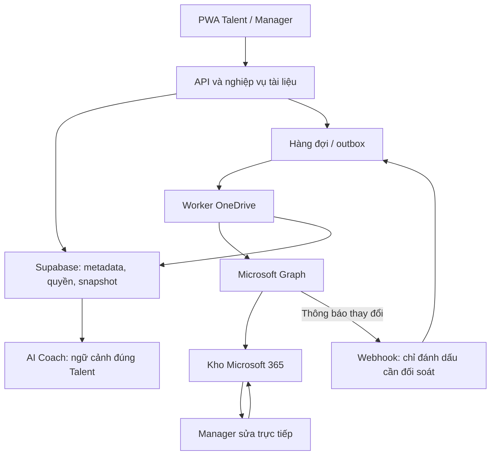
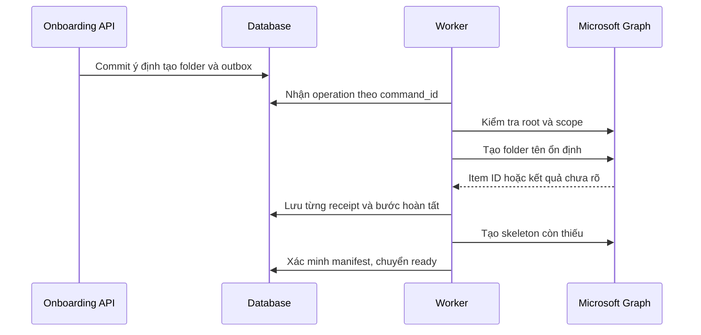
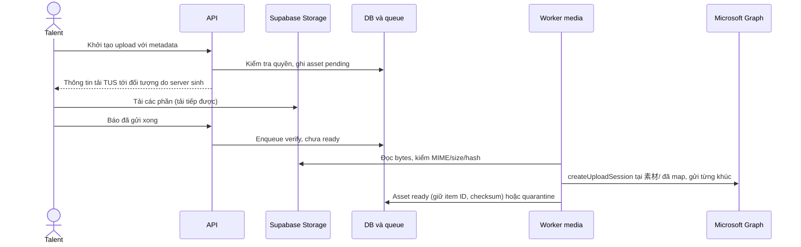
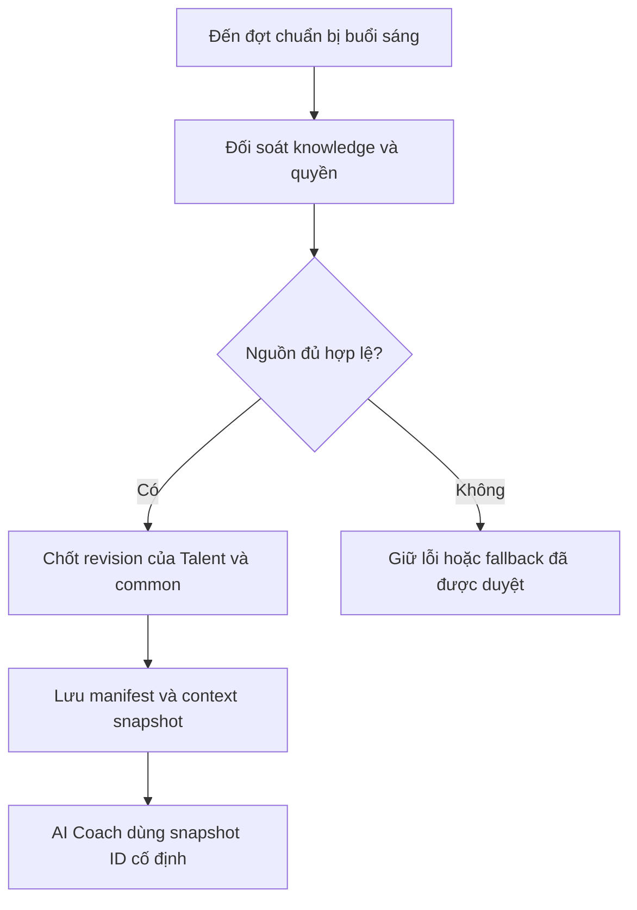
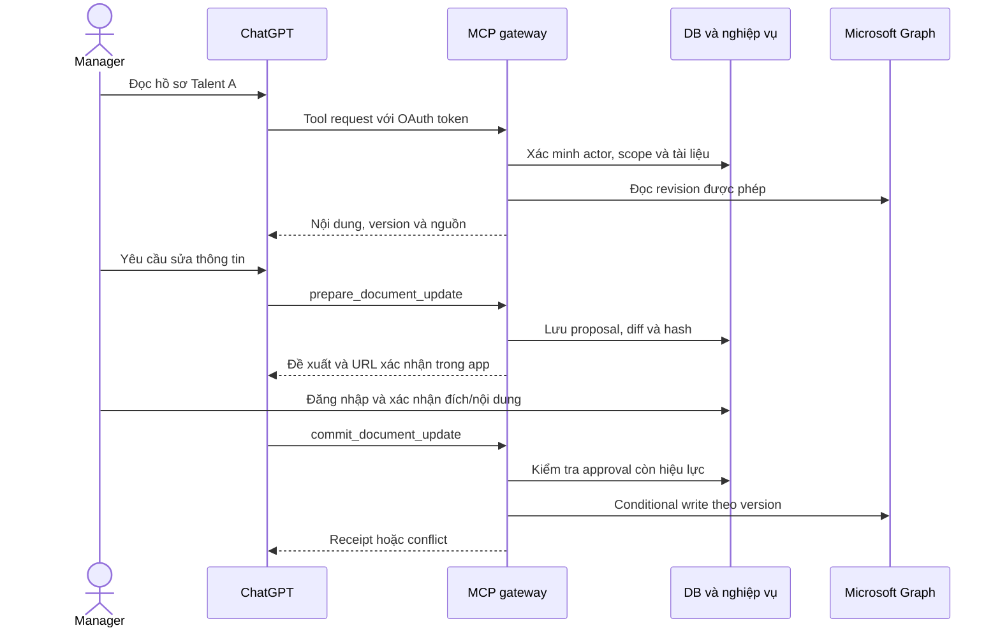
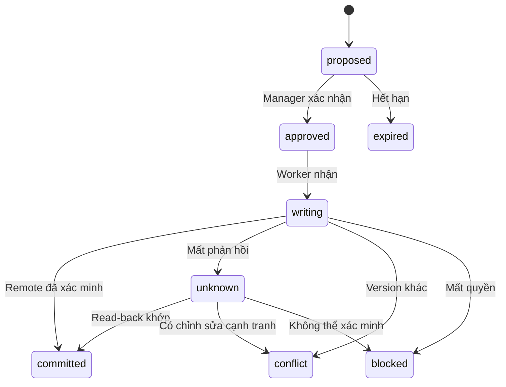

# Đặc tả tích hợp OneDrive — AI Talent OS

Phiên bản 1.1 · 17/11/2026 (đối chiếu lại với [YK2] v2, [AG], file Q&A và `SCD/`; xem `../KET_QUA_KIEM_CHUNG_17-11.md`) · Đối tượng: lập trình viên và AI agent triển khai.

Trạng thái: thiết kế đề xuất, có nguồn tham chiếu và các điểm chặn cần xác minh. Chưa được thử với Microsoft 365 của khách, chưa có kết nối ChatGPT/MCP thật. Không coi tài liệu này là phê duyệt thay đổi phạm vi hoặc xác nhận mọi khả năng dịch vụ đã hoạt động.

## 0. Cách dùng và nguồn

Nhãn: **REQ** = nội dung đọc lại từ tài liệu gốc; **TK** = quyết định thiết kế của bản này; **POC** = cần kiểm chứng trên môi trường thử; **CHỐT** = cần quyết định nghiệp vụ/kỹ thuật trước production.

Nguồn yêu cầu từ bản 1.1 là `AI育成OS_概要要件定義書_v2.docx` ([YK2], R1). Bản 1.0 dựa trên docx v1 đã bị thay thế; các chỗ khác v2 đã được sửa. `SOURCE_MANIFEST.json` ghi SHA-256 của các tệp đã đọc. Đặc tả nghiệp vụ từng chức năng ở `SCD/` (EP02: 2-1, 2-2, 2-3, 2-4; EP05: 6-3, 6-4; EP07: 8-8; EP03: 3-2); khi khác nhau về nghiệp vụ thì [YK2] và SCD thắng.

| Mã | Tài liệu / địa chỉ | Phạm vi |
|---|---|---|
| R1 | AI育成OS_概要要件定義書_v2.docx — [YK2] | §6-4 chức năng 2-1 đến 2-4; §6-5 chức năng 3-2; §6-7 chức năng 6-3, 6-4; §6-11 chức năng 8-8; §7-1 đến 7-5; §8; UC-01 前提, UC-02 前提 |
| R4 | アプリ画面案_AI育成OS.pdf — [AG] | M-07 (hiện hồ sơ theo mục), M-10, T-10 |
| R5 | AI-Talent-OS_Q&A表.xlsx, câu số 45 | Trích 御見積書 (bản báo giá) 前提条件A4: 「マネージャーはChatGPT(MCP)経由でAIを調整」 |
| R2 | 要件説明資料_AI育成OS.pdf — tài liệu giải thích yêu cầu | Trang 3, 7, 33, 38 |
| R3 | ★AI育成OS_マネージャー管理画面_PC_携帯_カテゴリー_AI指示.pdf — thiết kế Manager | Trang 9, đọc thông tin từ file OneDrive |
| M01 | https://learn.microsoft.com/en-us/entra/identity-platform/v2-oauth2-client-creds-grant-flow | Token ứng dụng Microsoft |
| M02 | https://learn.microsoft.com/en-us/graph/permissions-selected-overview | Consent và cấp quyền tài nguyên Selected |
| M03 | https://learn.microsoft.com/en-us/graph/api/driveitem-post-children?view=graph-rest-1.0 | Tạo thư mục |
| M04 | https://learn.microsoft.com/en-us/graph/api/driveitem-get?view=graph-rest-1.0 | Đọc metadata |
| M05 | https://learn.microsoft.com/en-us/graph/api/driveitem-list-children?view=graph-rest-1.0 | Liệt kê thư mục |
| M06 | https://learn.microsoft.com/en-us/graph/api/driveitem-get-content?view=graph-rest-1.0 | Đọc nội dung và URL tải tạm |
| M07 | https://learn.microsoft.com/en-us/graph/api/driveitem-put-content?view=graph-rest-1.0 | Ghi nội dung nhỏ |
| M08 | https://learn.microsoft.com/en-us/graph/api/driveitem-createuploadsession?view=graph-rest-1.0 | Upload tiếp tục được và điều kiện eTag |
| M09 | https://learn.microsoft.com/en-us/graph/api/driveitem-delta?view=graph-rest-1.0 | Theo dõi thay đổi qua delta |
| M10 | https://learn.microsoft.com/en-us/graph/change-notifications-delivery-webhooks | Webhook Microsoft Graph |
| M11 | https://learn.microsoft.com/en-us/graph/api/resources/subscription?view=graph-rest-1.0 | Subscription và gia hạn |
| M12 | https://learn.microsoft.com/en-us/graph/change-notifications-overview | Tài nguyên được hỗ trợ, giới hạn scope subscription |
| M13 | https://learn.microsoft.com/en-us/graph/api/driveitem-update?view=graph-rest-1.0 | Đổi metadata, concurrency |
| M14 | https://learn.microsoft.com/en-us/graph/api/driveitem-delete?view=graph-rest-1.0 | Xóa và recycle bin |
| M15 | https://learn.microsoft.com/en-us/graph/throttling | 429 và Retry-After |
| O01 | https://developers.openai.com/api/docs/mcp | Kết nối nguồn dữ liệu riêng qua MCP |
| O02 | https://developers.openai.com/plugins/build/auth | Xác thực ChatGPT tới MCP |

Nguồn web được đọc ngày 16/11/2026. Đây là bản diễn giải kèm thiết kế ứng dụng, không sao chép đầy đủ tài liệu dịch vụ. Agent kiểm tra lại contract ở endpoint dùng thật trước code adapter; không suy ra endpoint beta được phép dùng ở production.

## 1. Kết luận kiểm tra ChatGPT và MCP

**REQ đã thấy:** Manager dùng ChatGPT nhập thông tin Talent; ChatGPT phải cho xem sẽ ghi gì, cho Talent nào, Manager xác nhận trước khi ghi vào file trong thư mục Talent. AI Coach đọc thư mục Talent, thư mục chung và **file AI tự ghi điều đã học** trước giờ nhắn buổi sáng. Manager sửa file thì nội dung được dùng từ sáng hôm sau. Nguồn: R1 §6-4 chức năng 2-1, 2-3; §6-5 chức năng 3-2; §7-1, §7-5; UC-01 前提, UC-02 前提.

**Căn cứ MCP:** [YK2] không có chữ MCP, nhưng file Q&A câu số 45 (R5) trích **御見積書 前提条件A4: 「マネージャーはChatGPT(MCP)経由でAIを調整」** (quản lý điều chỉnh AI qua ChatGPT dùng MCP). Theo [YK2] §1, khi tài liệu mâu thuẫn thì hợp đồng, SOW, báo giá đứng trên [YK2]. Vì vậy **MCP là cách làm có căn cứ hợp đồng** cho tuyến "quản lý ↔ ChatGPT ↔ hệ thống", không còn là tùy chọn tự đề xuất. Câu 45 chưa có trả lời và nguyên văn báo giá chưa có trong kho, nên phạm vi chính xác của MCP (chỉ nhập hồ sơ và chỉ thị, hay thêm thao tác khác) vẫn phải chốt. Xem `CHATGPT_MCP_EVIDENCE_VI.md` mục 0 và `SCD/EP02/2-3` (S02-01).

**TK:** tách hai tuyến:

1. Backend/worker AI Talent OS ↔ Microsoft Graph: lưu trữ, đồng bộ và cung cấp ngữ cảnh cho AI Coach trong app.
2. ChatGPT của Manager ↔ máy chủ MCP của hệ thống ↔ cùng lớp nghiệp vụ: đọc và đề xuất ghi tài liệu. MCP có căn cứ trong báo giá (R5); việc cần thử là gói ChatGPT của khách có cho thêm connector MCP tự làm và cho ghi hay không (P09).

Không giả định kết nối SharePoint/OneDrive có sẵn trong ChatGPT chắc chắn có quyền ghi, giới hạn folder theo Project, hay tự chia sẻ nội dung với OpenAI API. Gói ChatGPT, app tích hợp và chính sách tenant phải POC riêng. Nếu chỉ đọc được, chức năng ghi từ ChatGPT vẫn chưa hoàn thành.

## 2. Phạm vi và kiến trúc

### 2.1. Phạm vi chức năng

| Mã | Chức năng | Căn cứ |
|---|---|---|
| OD01 | Tạo cây thư mục riêng mỗi Talent khi Talent đăng ký thanh toán xong; tài khoản công ty khi quản lý tạo tài khoản | R1 §6-4 chức năng 2-2, UC-01 前提 |
| OD02 | Lưu hồ sơ, định hướng, kỹ năng, mục tiêu dài hạn, know-how | R1 §7-1/7-2 |
| OD02b | AI Coach ghi thêm điều đã học (sở thích, bài được tương tác tốt) vào `AIメモ.md` | R1 §6-4 chức năng 2-1, §6-5 chức năng 3-2, §7-5 |
| OD03 | Manager sửa file hoặc đề nghị ghi qua ChatGPT, có xác nhận | R1 §6-4, 2-3; R3 trang 9 |
| OD04 | Lưu ảnh/video; Talent chỉ truy cập media của mình qua app | R1 §6-7; §7-2 |
| OD05 | Xuất mục tiêu follower và thống kê từ hệ thống ra OneDrive | R1 §6-4, 2-4; §6-11; §7-1 |
| OD06 | Đọc file trước AI buổi sáng, snapshot đúng Talent | R1 §6-4, 2-1; §7-5 |
| OD07 | Phân quyền, thu hồi, retention và audit | R1 §7-2/7-3; chi tiết TK/CHỐT |
| OD08 | Đồng bộ thay đổi, phát hiện xung đột, khôi phục khi lỗi | TK để đáp ứng OD03/OD06 |

Không triển khai đồng bộ desktop OneDrive cho Talent; không buộc mỗi Talent có tài khoản Microsoft. Không lưu token thanh toán/SNS, mật khẩu hoặc toàn bộ hội thoại vào thư mục kiến thức. Không tạo anonymous sharing link hoặc tự đổi sang SharePoint nếu khách chưa duyệt.

### 2.2. Sơ đồ thành phần



TK: API chạy Vercel, worker trên VPS như kiến trúc đang thảo luận; không coi nền tảng deploy này là ràng buộc hợp đồng đã ký. Upload lớn, crawl và OCR không chạy bên trong request Vercel. Đọc context của AI từ snapshot đã kiểm tra, không gửi credential Graph cho mô hình.

### 2.3. Kho Microsoft nào?

| Lựa chọn | Ưu điểm / giới hạn | Quyết định |
|---|---|---|
| OneDrive for Business của tài khoản dịch vụ được cấp license | Đúng hướng OneDrive; phải xử lý vòng đời tài khoản và giới hạn quyền thực tế | Chỉ chọn nếu tenant khách xác nhận mô hình này |
| Thư viện SharePoint dùng chung cho ứng dụng | Dữ liệu thuộc tổ chức, dễ tách khỏi một nhân viên | Khuyến nghị đánh giá, là thay đổi cần khách duyệt, không gọi nó là OneDrive cá nhân |
| OneDrive cá nhân của từng Talent | Mỗi người phải OAuth/quản lý quyền riêng | Không nằm trong thiết kế mặc định |

Định danh tài nguyên dùng `microsoftTenantId + driveId + itemId`, không dùng URL chia sẻ hoặc đường dẫn làm khóa. Cấu hình binding khác nhau cho OneDrive và SharePoint; Graph adapter dùng ID chung, không coi các mô hình quyền hoàn toàn giống nhau.

## 3. Cấu trúc thư mục

TK: khóa kỹ thuật là ID của Microsoft Graph (`ms_tenant_id + drive_id + item_id`), không phải tên. Tên file và thư mục hiển thị bằng **tiếng Nhật** vì quản lý của アデッソ mở thư mục này hằng ngày; cây thống nhất với `SCD/EP02/2-2`. Thư mục tài năng có tiền tố UUID để tên trùng hay đổi tên không làm mất ánh xạ.

```text
AI育成OS_<environment>/
  共通/
    ノウハウ.md                     ← kiến thức nghề (UC-02 前提)
    アルゴリズム対策.md              ← chỉ dẫn thuật toán, giờ đăng
    AIへの指示.md                   ← giọng văn, chỉ thị chung (S03-01)
    README.md
  タレント/
    <talent_uuid>_<表示名>/
      _system/identity.json         ← hệ thống ghi; không đưa cho AI
      プロフィール.md                ← hồ sơ; quản lý hoặc ChatGPT (MCP) ghi
      AIメモ.md                     ← AI Coach ghi thêm điều đã học (3-2)
      目標.md                       ← xuất từ DB (2-4)
      実績/
        サマリー.md                 ← xuất từ DB, ghi đè mỗi ngày (8-8)
        <YYYY-MM>.csv               ← xuất từ DB, thêm dòng mỗi ngày
        snapshots/<YYYY>/<MM>/<date>_<snapshot_uuid>.json
      素材/
        originals/<YYYY>/<MM>/<asset_uuid>.<ext>
        AI生成/<YYYY>/<MM>/<asset_uuid>.<ext>
        derivatives/<asset_uuid>/<derivative_uuid>.<ext>
      添付/                         ← tệp đính kèm của quản lý; chỉ định dạng đã cho phép
      README.md
```

`プロフィール.md` có tiêu đề mục cố định do đội đưa mẫu (S02-04): `## プロフィール`, `## 方向性`, `## 趣味・特技`, `## 将来の目標`, `## チャレンジ`, `## 日付` (sinh nhật, ngày kỷ niệm, lịch diễn; §7-5), `## 個別の指示` (chỉ dẫn riêng cho tài năng). M-07 hiện hồ sơ theo các mục này; nội dung ngoài mục vẫn được AI đọc. Bản 1.0 có `coaching.md` và `events.json` riêng; bản 1.1 gộp thành hai mục `個別の指示` và `日付` (schema `EventsFile` dùng để kiểm mục `日付` khi parse).

Danh sách từ cấm **không** xuất ra OneDrive: [YK2] quy định quản lý sửa ở màn hình quản trị (M-17) và DB là nơi quyết định chặn bài.

### 3.1. Mục đích và quyền sửa

| Vị trí | Chủ dữ liệu | Ai được sửa | AI Coach được đọc? |
|---|---|---|---|
| 共通/*.md | Nội dung OneDrive | Manager | Có (bản hợp lệ) |
| _system/identity.json | DB/binding hệ thống | Worker | Không |
| プロフィール.md | Nội dung OneDrive | Manager, hoặc lệnh ChatGPT (MCP) đã xác nhận | Có, của Talent hiện tại |
| AIメモ.md | Nội dung OneDrive | Worker AI ghi thêm (ghi có điều kiện eTag); Manager được sửa | Có, của Talent hiện tại |
| 目標.md, 実績/ | DB | Worker; không nhập ngược thay đổi thủ công | Chỉ snapshot hoàn tất |
| 素材/ | File OneDrive + metadata DB | Worker (chép từ Supabase Storage) | Không mặc định đưa vào context |
| 添付/ | File OneDrive | Manager | Chỉ định dạng/size đã cho phép, trích xuất hợp lệ |

`プロフィール.md` không chứa tài khoản login, ngày sinh pháp lý hay email xác thực. `目標.md` là mục tiêu người theo dõi có hạn đạt (DB là nguồn chính), khác mục tiêu tương lai dạng văn bản trong hồ sơ.

### 3.2. Các điều kiện của cây thư mục

- DB giữ role của folder, parent ID, manifest version; tên giống `共通` hay `プロフィール.md` không tự tạo quyền.
- Tạo với tên ổn định và conflictBehavior fail sau khi POC xác minh; không dùng rename tự động tạo `t_uuid 1` trong retry.
- Root, `_system/`, `目標.md`, `実績/`, `素材/` không được nhập như chỉ dẫn AI dù bị đổi tên hoặc chuyển chỗ.
- Đổi tên trong cùng drive không đổi khóa DB; cập nhật display path từ metadata. Move qua drive/khác Talent phải quarantine và xác minh lại quyền, không tự đổi owner.
- Không tạo archive bên trong cây đang cấp cho AI; bản sao backup do hạ tầng quản lý. Xóa ở OneDrive không tự xóa evidence hoặc billing DB.
- README giải thích thư mục nào được sửa, ai sở hữu từng nhóm và lỗi sửa vào exports sẽ bị bỏ qua/khôi phục có kiểm soát.

## 4. Phân quyền ở bốn lớp

### 4.1. Ma trận quyền ứng dụng (TK dựa R1 §7-2)

| Vai trò | Hồ sơ/know-how | Media | Mục tiêu/thống kê | Tạo/sửa binding | Ghi qua ChatGPT |
|---|---|---|---|---|---|
| Talent | Chỉ phần sản phẩm cho hiển thị; không file nội bộ | Của mình | Của mình qua app | Không | Không |
| Manager đang hoạt động | Trong phạm vi tổ chức được phép | Trong phạm vi tổ chức | Đọc; sửa mục tiêu qua app | Theo quyền admin được chốt | Có sau xác thực/xác nhận |
| Worker storage | Trong scope kho ứng dụng | Đọc/ghi theo job | Xuất DB | Provision theo command | Không đóng vai Manager |
| AI Coach service | Snapshot Talent được server bind + common hợp lệ | Chỉ media đã được yêu cầu | Snapshot đúng Talent | Không | Không |
| MCP Manager session | Theo quyền Manager và Talent đã chọn | Mặc định không đọc binary | Có theo phạm vi đã cấp | Không | Chỉ các tài liệu cho phép |
| Quản trị Microsoft 365 | Theo quyền nền tảng | Theo quyền nền tảng | Theo quyền nền tảng | Cấp scope/grant | Không thay cho danh tính Manager |

Một Manager có thể xem nhiều Talent không có nghĩa AI Coach mỗi Talent được đọc toàn bộ. Dữ liệu private thuộc Talent A không được đưa vào common để “tiện dùng”.

### 4.2. Microsoft Entra / Graph

TK: worker chạy nền dùng app-only client credentials với `scope=https://graph.microsoft.com/.default`, tenant cố định; ưu tiên certificate hoặc workload identity theo môi trường. Tách application của production/staging, không giữ secret trong frontend. Token Graph là audience Graph, không dùng làm session AI Talent OS/MCP. Nguồn M01.

Ưu tiên Selected permission ở phạm vi nhỏ có thể vận hành. M02 quy định consent không đủ: còn phải grant tài nguyên và token đúng quyền. **Không tự cấp Files.ReadWrite.All toàn tenant để sửa lỗi 403.** Bước bootstrap cấp resource grant do người quản trị phù hợp thực hiện, tách khỏi worker runtime.

| Hoạt động | Quyền đề xuất để POC | Rủi ro / fallback |
|---|---|---|
| Đọc/ghi trong site thư viện riêng | Sites.Selected + role phù hợp tại site | Phải thử đủ create/content/upload/delta trên tenant |
| Chỉ một folder | Files.SelectedOperations.Selected hoặc phạm vi Selected phù hợp | Không giả định hỗ trợ quét root/delta/subscription; thử từng endpoint |
| Đọc file theo Manager | Delegated quyền phù hợp + ACL của Manager | Cần vòng đời refresh/revocation, không dùng làm worker lịch nền mặc định |
| Grant quyền cho app | Tài khoản bootstrap/admin riêng | Không trao runtime quyền tự mở rộng scope |

Bảng permission từng endpoint Microsoft có thể liệt kê quyền rộng. Tài liệu Selected tổng quát không bảo đảm mọi chức năng theo folder hoạt động. Nếu POC không đạt, chọn polling trong root được phép hoặc trình duyệt thay mô hình kho; không âm thầm mở scope.

**Đã tra lại từng trang tài liệu Microsoft ngày 17/11/2026** (quyền ứng dụng chạy nền, cột "least privileged" của từng trang):

| Endpoint | Quyền ít nhất theo trang tài liệu | Quyền cao hơn | Nguồn |
|---|---|---|---|
| `createUploadSession` | Sites.ReadWrite.All | Files.ReadWrite.All, Sites.Manage.All, Sites.FullControl.All | M08 |
| `PUT .../content` (tệp ≤ 250 MB) | Files.ReadWrite.All | Sites.ReadWrite.All | M07 |
| `delta` | Files.Read.All | Files.ReadWrite.All, Sites.Read.All, Sites.ReadWrite.All | M09 |

- **Các trang endpoint không liệt kê Sites.Selected hay Files.SelectedOperations.Selected.** Vì vậy việc chỉ cấp Selected có chạy được các endpoint này hay không là **chưa xác nhận**, phải chứng minh bằng POC P02 trước khi chốt.
- **Cấp quyền Selected gồm 3 bước** (M02):
  1. Admin đồng ý (consent) quyền Selected cho ứng dụng.
  2. Gọi `POST .../permissions` trên site, danh sách, mục hoặc tệp để cấp vai trò (read, write, owner, fullcontrol).
  3. Lấy token mới.
- Cấp ở mức thấp hơn site (danh sách, thư mục, tệp) sẽ **cắt kế thừa quyền** ở mục đó.
- Ứng dụng đi cấp quyền phải có Sites.FullControl.All, hoặc có Sites.Selected kèm vai trò fullcontrol/owner trên tài nguyên.
- Tệp có nhãn bảo mật (sensitivity label) có mã hóa thì ứng dụng chạy nền **không thay được nội dung** bằng upload session (M08). Thư mục `タレント/` không được gắn nhãn mã hóa.

### 4.3. ACL Microsoft 365 khác với quyền trong app

OneDrive/SharePoint phải được quản trị cấp quyền con người riêng; việc backend có quyền Graph không làm Manager tự mở được file. Talent dùng app không cần được share folder trong Microsoft 365. Không share cả folder Talent cho Talent nếu bên trong có know-how hoặc hồ sơ nội bộ.

Quyền chỉ đọc/ghi một số folder trong cùng thư viện có thể cần ACL riêng. Nếu nhóm Manager có quyền edit thư viện rộng thì app không thể bảo đảm họ không sửa exports trực tiếp; phải phát hiện drift và có chính sách khôi phục. Gắn nhãn “chỉ đọc” trong README không phải kiểm soát truy cập.

### 4.4. Lớp DB và retrieval

- RLS và API đều kiểm tra tenant/Talent; service-role backend phải tự enforce vì có thể vượt RLS.
- Mỗi request coach gắn `tenant_id,talent_id,context_snapshot_id` từ session/job đã xác minh, không theo model tự chọn.
- Search, embedding, cache và fetch đều có khóa scope; kiểm tra quyền trước retrieval và trước trả kết quả. Không search toàn kho rồi chỉ lọc ở prompt cuối.
- Khi tài liệu đổi quyền/move/delete, chặn retrieval và vô hiệu cache/index theo ID, kể cả chưa có dữ liệu mới thay thế.
- Truy cập qua ChatGPT connector trực tiếp bên ngoài gateway không thừa hưởng giới hạn của app; phải kiểm tra riêng ở POC và giới hạn triển khai.

## 5. Nguồn dữ liệu chính và chiều đồng bộ

Không đồng bộ hai chiều tùy ý cùng một trường. Dùng bảng ownership này làm hợp đồng.

| Dữ liệu | Nguồn chính | Bản sao / chiều | Khi sửa sai nơi |
|---|---|---|---|
| ID Talent, login, email, trạng thái, quyền, payment | Database | identity export tối thiểu nếu cần; không export secret | Không nhập từ file; audit và cảnh báo |
| Hồ sơ hoạt động, định hướng, sở thích, kỹ năng, mục tiêu dài hạn, know-how | Tài liệu OneDrive đã được validate | OneDrive → revision DB → snapshot AI | App ghi loại này phải qua lệnh Graph/CAS; DB chỉ staging/projection |
| Điều AI đã học (`AIメモ.md`) | Tài liệu OneDrive | AI ghi thêm có điều kiện eTag; OneDrive → snapshot AI | Manager sửa được; AI đọc lại rồi ghi, không đè mất phần Manager sửa |
| Follower target/deadline | Database | DB → 目標.md | File bị sửa không thay DB; báo drift |
| Danh sách từ cấm chính thức | Database (Manager sửa ở M-17) | Không xuất ra OneDrive | — |
| Thống kê SNS | Database snapshot | DB → metrics/summaries | Không nhập số liệu sửa file thành thống kê thật |
| Ảnh/video | Bytes OneDrive | DB giữ ID/checksum/trạng thái/quyền | Xóa/move làm asset unavailable, không xóa post history |
| Bài viết, lịch, duyệt, kết quả Upload-Post | Database | Chỉ export báo cáo nếu được chốt | Không điều khiển xuất bản từ tên/nội dung file |
| Hội thoại AI | Hệ thống | Không export toàn bộ mặc định | Không tự đưa vào kiến thức |

REQ R1 §7-2 nói dữ liệu được lưu OneDrive không loại trừ DB giữ metadata/projection; việc chia ownership ở đây là TK cần xác nhận. Không nói DB và OneDrive có transaction chung: chỉ có eventual consistency với outbox/reconciliation.

### 5.1. Định dạng tài liệu

TK v1: `.md` UTF-8 cho nội dung viết; `.json` cho cấu trúc; `.docx`/PDF đính kèm chỉ bật parser sau POC. Không mở macro, không tải external relationship khi parse DOCX, không chạy JavaScript trong PDF. File không đọc được đưa quarantine, giữ bản hợp lệ gần nhất theo policy.

Mỗi file có mapping role trong DB, không lấy quyền theo front matter tự khai. Header tiêu đề/metadata trong file là hỗ trợ con người, không phải bằng chứng ownership. Giới hạn byte/token, loại file và số tài liệu theo snapshot phải cấu hình rõ; file vượt giới hạn bị báo lỗi, không âm thầm cắt đoạn quan trọng.

## 6. Metadata và bảng dữ liệu

Thiết kế logic TK; agent viết migration và index, không coi tên dưới đây là bảng có sẵn trong Supabase.

| Bảng | Trường bắt buộc đáng chú ý | Ràng buộc |
|---|---|---|
| storage_bindings | id, org_id, ms_tenant_id, storage_kind, site_id?, drive_id, app_root_id, environment, state, permission_profile_version | Unique tổ chức/môi trường; không bind production vào staging |
| talent_storage | id, org_id, talent_id, binding_id, root_item_id, manifest_version, state, provisioning_generation | Một root active/Talent/binding |
| drive_items | binding_id, drive_id, item_id, parent_item_id, talent_id?, role, path_display, name, etag, ctag?, size, mime, state, last_seen_epoch | Unique drive+item; parent mapping phải nhất quán |
| document_revisions | id, drive_item_id, graph_etag, graph_version_id?, checksum_sha256, parser_version, content_snapshot_ref, validation_state, observed_at, source | Unique item+etag+parser_version; revisions bất biến |
| knowledge_documents | id, org_id, talent_id?, role, approved_revision_id, latest_observed_revision_id, eligibility_state | Không latest tự động đồng nghĩa đã hợp lệ |
| sync_checkpoints | binding_id, scope_key, cursor_encrypted?, scan_generation, next_link?, last_completed_at, state, lease_version | Cursor hoàn tất chỉ advance khi dữ liệu đã commit |
| sync_operations | command_id, type, resource_id, expected_etag?, payload_hash, origin, state, remote_receipt?, error, next_attempt | Unique command_id; cùng key khác hash là conflict |
| storage_outbox | id, aggregate_id, aggregate_version, kind, payload_ref, state | Cùng transaction với mutation DB |
| upload_operations | id, asset_id, upload_url_encrypted?, expires_at, total_bytes, received_ranges, expected_hash, state | Không ghi upload URL vào log hoặc provider khác |
| assets | id, org_id, talent_id, item_id, graph_version?, checksum, mime, size, state, source, created_by | Chỉ ready khi bytes được xác minh |
| ai_context_snapshots | id, org_id, talent_id, run_date, manifest_hash, policy_version, state, freshness | Chốt pointer sau khi build hoàn tất |
| context_snapshot_documents | snapshot_id, document_id, revision_id, checksum, source_scope | Không trộn revision khác sau khi snapshot ready |
| mcp_grants | id, actor_id, org_id, allowed_scope, roles, revoked_at, expires_at | Không lấy scope từ lời nhắc hoặc tên Project |
| document_write_proposals | id, actor_id, talent_id?, document_id, expected_etag, proposed_content_ref, content_hash, approved_hash?, approved_at?, expires_at, command_id, state | Approval ràng buộc actor+đích+hash+version |
| sync_conflicts | id, operation_id, local_version, remote_etag, kind, state, resolution_actor | Không tự last-write-wins |
| audit_events | actor, source, action, resource, revision, correlation_id, outcome, at | Append-only, redaction |

Sao lưu context/revision chứa nội dung cá nhân phải có retention tương ứng; không giữ vô hạn chỉ vì gọi là projection. `downloadUrl` không phải định danh asset và không lưu lâu dài vào post.

## 7. Microsoft Graph API cần dùng

Base: `https://graph.microsoft.com/v1.0`. App-only dùng `/drives/{id}` hoặc site/user rõ ràng; không dùng `/me` cho app-only.

| Tác vụ | API | Chú ý |
|---|---|---|
| Token ứng dụng | `POST https://login.microsoftonline.com/{tenant}/oauth2/v2.0/token` | Credential server-side, scope .default; M01 |
| Đọc item | `GET /drives/{driveId}/items/{itemId}` | $select giới hạn metadata; M04 |
| Liệt kê con | `GET /drives/{driveId}/items/{parentId}/children` | Theo nextLink, không giả định một trang; M05 |
| Tạo folder | `POST /drives/{driveId}/items/{parentId}/children` | JSON tên/folder/conflictBehavior; M03 |
| Đọc bytes | `GET /drives/{driveId}/items/{itemId}/content` | Redirect tải tạm; M06 |
| Tạo file nhỏ | `PUT /drives/{driveId}/items/{parentId}:/{fileName}:/content` | Chỉ tên do server sinh; binary body; M07 |
| Thay bytes file | `PUT /drives/{driveId}/items/{itemId}/content` | Không dùng blind overwrite khi có concurrent edit; xem §10 |
| Upload session tạo mới | `POST /drives/{driveId}/items/{parentId}:/{fileName}:/createUploadSession` | Server xác định đích; M08 |
| Upload session thay file | `POST /drives/{driveId}/items/{itemId}/createUploadSession` | Điều kiện If-Match đã có tài liệu; M08 |
| Upload / resume | PUT/GET/DELETE tới uploadUrl trả về | URL bí mật, PUT bytes không đính Graph bearer; M08 |
| Đổi metadata/move | `PATCH /drives/{driveId}/items/{itemId}` | Chỉ backend admin khi có use case; M13 |
| Xóa | `DELETE /drives/{driveId}/items/{itemId}` | Không mở cho MCP v1; recycle bin không phải xóa vĩnh viễn; M14 |
| Delta | `GET /drives/{driveId}/root/delta` rồi URL continuation | Chỉ bật với scope đã POC; M09 |
| Subscription | `POST /subscriptions`, `PATCH /subscriptions/{id}`, `DELETE /subscriptions/{id}` | Theo resource hỗ trợ và expiry trả về; M10–M12 |

M07 hỗ trợ file nhỏ đến 250 MB, nhưng TK chọn session từ >10 MiB hoặc khi cần resume. Không coi 250 MB là giới hạn upload của PWA do sản phẩm; giới hạn thật còn theo policy, mạng và tài nguyên. Các endpoint quyền Selected do bootstrap quản trị, không đặt vào API Talent.

## 8. Provision thư mục có khả năng khôi phục



REQ: sự kiện `TalentStorageRequired` phát khi Talent đăng ký thanh toán xong, hoặc khi Manager tạo tài khoản công ty (R1 §6-4 chức năng 2-2, UC-01 前提). Worker báo trạng thái thư mục cho M-06/M-07 (S02-03), không thêm loại thông báo. Đặt provision state pending/provisioning/partial/ready/blocked. Khi root chưa ready, AI không tạo nội dung dựa profile rỗng giả.

Thực hiện:

1. Lệnh unique theo Talent + binding + generation. Tạo DB intent trước gọi Graph.
2. Đọc mapping root hiện hữu; nếu tên bị chiếm không có mapping hợp lệ, quarantine. Không chiếm folder chỉ vì tên đúng.
3. Tạo folder, lưu receipt từng item. Timeout sau tạo → tìm dưới parent đúng, kiểm tra metadata/ownership manifest và operation evidence; không tạo tên khác.
4. Tiếp tục các folder/file thiếu. Không rollback bằng recursive delete khi tạo dở; có thể đã có Manager nhập dữ liệu.
5. Skeleton `プロフィール.md` (đủ tiêu đề mục, nội dung trống) và `AIメモ.md` trống có trạng thái missing_information, không coi đã có hồ sơ. Identity file không chứa secret hoặc toàn thông tin cá nhân.
6. Kiểm tra parent và quyền runtime/con người theo policy; chỉ ready khi đủ. Crash tại mỗi bước phải resume được.

## 9. Đồng bộ OneDrive → database

### 9.1. Chế độ mặc định và tối ưu

**TK mặc định:** định kỳ quét các folder knowledge đã map và đọc metadata file tương ứng, kèm một đợt đối soát trước AI buổi sáng. Thay đổi trực tiếp trên file phải được phát hiện dù webhook không hoạt động.

**Tối ưu tùy chọn:** webhook đánh dấu scope dirty; worker dùng delta nếu permission/drive hỗ trợ. Không tạo một subscription tùy ý cho mỗi folder Talent trên OneDrive for Business: tài liệu M12 nêu phạm vi root. Với quyền chỉ một folder có thể không gọi root delta được; fallback bounded polling trong cây được cấp quyền, không mở scope toàn tenant.

Giới hạn đã tra lại ngày 17/11/2026:
- **Thông báo thay đổi (subscription)** với OneDrive for Business chỉ đăng ký được trên **thư mục gốc**. Hạn tối đa 42.300 phút (khoảng 29 ngày). Độ trễ trung bình dưới 1 phút nhưng **có thể tới 6 giờ** (M12). Vì vậy không dùng thông báo làm nguồn đúng giờ cho đợt AI 8:00; luôn đối soát trước đợt chạy.
- **Delta** của OneDrive for Business chỉ chạy trên **thư mục gốc** (M09). Phải lọc kết quả theo cây `タレント/` và nhận diện mục theo `id`, không theo đường dẫn. Lỗi 410 (`resyncChangesApplyDifferences`, `resyncChangesUploadDifferences`) thì quét lại toàn bộ rồi đối chiếu. Có thể lấy mốc bắt đầu bằng `token=latest`.

Tần suất TK: kiểm tra knowledge 15 phút/lần và bắt buộc trước batch AI; đây không phải SLA đã được khách duyệt. Không quét toàn bộ media mỗi 15 phút. Media do app ghi theo receipt; đối soát metadata đang active theo lịch riêng có giới hạn.

### 9.2. Thuật toán nhập tài liệu

1. Claim sync scope bằng lease; nhận quyền hiện tại và binding đúng tenant.
2. Lấy các trang con trong scope. Đánh dấu item observed theo scan_generation; chưa coi item vắng ở trang đầu là bị xóa.
3. Với item mới/etag đổi: xác minh parent chain/role/scope, MIME, size, khả năng đọc. Không nhập shortcuts/remoteItem ra ngoài root như nội dung nội bộ.
4. Đọc bytes của revision. Kiểm tra etag trước/sau khi lấy; nếu thay đổi trong lúc đọc, bỏ bản chưa ổn định và đọc lại có giới hạn. Không gắn bytes B với etag A.
5. Tính checksum, parse trong sandbox/giới hạn tài nguyên, validate loại tài liệu. File độc hại/sai schema giữ quarantine, không kích hoạt AI tools từ nội dung file.
6. Ghi revision bất biến và projection trong transaction. approved_revision chỉ cập nhật khi nội dung hợp lệ và đủ policy.
7. Kết thúc toàn scan/delta round, cập nhật checkpoint theo transaction; chỉ sau đó phát event snapshot cần rebuild.

### 9.3. Delta checkpoint [M09]

TK: theo nguyên nextLink/deltaLink trả về, không tự tạo token hay chèn query. URL phải qua kiểm tra host/scheme cấu hình trước khi attach token; cursor là dữ liệu nhạy cảm, mã hóa ở DB, không ghi log.

- Lưu staging và next-page checkpoint để crash resume; từng page được apply idempotent.
- Chỉ đổi durable completed delta cursor khi mọi page và tombstone đã commit.
- Token không còn hợp lệ/resync required → full rescan scope, giữ last-good revision, không xóa toàn DB để làm lại.
- Delta là thay đổi trạng thái, không phải audit mọi lần chỉnh sửa; item có thể lặp, xử lý theo bản mới nhất đã kiểm chứng.
- Không gán deletion khi đang lỗi 403/timeout. Tombstone cần scope hợp lệ và vòng scan hoàn tất.

### 9.4. Rename, move, delete và thu hồi quyền

| Tình huống | Kết quả |
|---|---|
| Rename cùng item/drive | Giữ document ID, cập nhật tên, không mất lịch sử |
| Move trong cây Talent hợp lệ | Đọc lại role/parent, không tự mở quyền loại khác |
| Move A → B hoặc ra ngoài root | Vô hiệu retrieval A/B tới khi xác minh, quarantine mapping |
| Copy cùng tên khác item ID | Tài liệu mới, không thế chỗ canonical tự động |
| Delete profile/knowledge | Invalidate context eligibility, giữ evidence; xử lý missing source theo policy |
| 403 thu hồi quyền | Dừng phục vụ nội dung bị ảnh hưởng, không dùng cached copy để vượt revoke |
| Scan lỗi/network | Có thể dùng last-good nếu policy freshness cho phép, nhưng không đánh dấu cập nhật mới |
| Root Talent bị xóa | Storage blocked; không tự tạo root mới và bỏ qua dữ liệu cũ |

Với deletion/revoke, last-good được giữ cho audit nhưng không tự tiếp tục phục vụ AI; khác với lỗi network tạm thời. Policy phải quyết định khi nào tạm ngưng buổi coach thay vì dùng hồ sơ thiếu.

## 10. Database → OneDrive và sửa từ ChatGPT

### 10.1. Xuất dữ liệu do DB sở hữu

Mutation DB và outbox trong cùng transaction. Worker xuất theo aggregate_version/snapshot_id; tạo file metric bất biến theo ID, không overwrite `latest.json` dùng chung làm cơ chế atomic.

- Metrics filename và content checksum cố định cho một snapshot. Timeout → đọc file theo ID/path và xác minh hash, không tạo bản sao tên khác.
- `目標.md` và `実績/` là projection có `source_version` và `generated_at`; worker cũ không được ghi đè version mới. Dùng serial queue/resource lease và conditionals; khi không chắc remote thay đổi thì conflict, không blind overwrite.
- Manager sửa file export: không import ngược vào DB. Báo drift, lưu evidence, chỉ khôi phục khi policy/actor cho phép. Không tự xóa toàn folder exports.
- DB không rollback dữ liệu thống kê đúng chỉ vì Graph down; xuất lại về sau, dashboard ghi rõ projection chưa đồng bộ.

### 10.2. Ghi hồ sơ/know-how qua lệnh có xác nhận

Ở đây OneDrive vẫn là nguồn nội dung chính. DB giữ đề xuất và trạng thái, không công bố projection như đã lưu OneDrive trước khi có bằng chứng remote.

1. Đọc document hiện hành và expected_etag; tạo đề xuất gồm đích, diff, nội dung đầy đủ và content_hash.
2. Manager xác nhận trên giao diện tin cậy, ràng buộc actor, document, Talent, hash và etag. Hết hạn hoặc đổi nội dung → cần xác nhận lại.
3. Ghi command bền vững; dùng CAS tại Graph. Phương án được tài liệu hóa là tạo upload session thay file với If-Match expected_etag [M08], rồi upload đúng bytes.
4. 412 → conflict, không retry overwrite. 409/rename conflict → đối soát. Timeout/mất response → read back hash/etag và evidence, không lập tức ghi lại.
5. Đọc lại file và chỉ công bố revision khớp bytes được xác nhận. Nếu đã có edit cạnh tranh mới, không nhận nó là kết quả chính mình; nhập như một revision khác và thông báo conflict.

**POC bắt buộc:** If-Match được kiểm tra ở giai đoạn nào của session, và concurrent edit trong lúc upload commit xử lý thế nào. Nếu endpoint không bảo đảm CAS đủ mạnh, không tuyên bố giải quyết lost update bằng DB lock; khóa write tool hoặc dùng kho/tài liệu có cơ chế cộng tác được kiểm soát sau khi khách chốt.

API simple PUT có thể được SDK chấp nhận header điều kiện tùy contract nhưng không suy diễn từ endpoint khác; chỉ dùng conditional write đã kiểm chứng. File sensitivity label có thể có hạn chế app-only [M07/M08]; không gỡ nhãn để ghi thành công.

### 10.3. Tránh vòng lặp đồng bộ

Mỗi operation có origin, content_hash, source_version và remote receipt. Delta thấy file vừa xuất: nhận diện hash/role, cập nhật observation, không sinh lại outbox cùng version. File knowledge do Manager sửa vẫn phải nhập ngay cả khi thời điểm gần lần ghi của app; không bỏ qua mọi thay đổi trong vài giây chỉ để chặn loop.

## 11. Media upload và đọc cho Upload-Post

### 11.1. Luồng upload

Thống nhất với bộ PWA (F10, X04), `SCD/EP05/6-3` và file 18 mục 4 (câu C2): **trình duyệt tải thẳng lên Supabase Storage, worker chép sang OneDrive**. Trình duyệt không bao giờ cầm `uploadUrl` hay token của Microsoft Graph.



TK: worker gửi khúc tuần tự theo M08: mỗi request dưới 60 MiB, khúc không cuối là bội số 320 KiB; bắt đầu thử 5 MiB. Đọc nextExpectedRanges khi resume, không tự đoán offset sau timeout. PUT bytes không gắn Authorization Graph vào uploadUrl (gắn vào sẽ bị 401). Mỗi khúc gửi thành công làm hạn phiên được gia hạn; phiên trả 404 thì tạo phiên mới từ đầu. Đặt `@microsoft.graph.conflictBehavior` = `fail` (mặc định) khi tạo mới, dùng `If-Match` (lỗi 412 khi etag đổi) khi thay tệp. Tệp dưới 10 MiB vẫn đi upload session cho đồng nhất (Microsoft khuyên phiên cho tệp trên 10 MiB, không cấm tệp nhỏ). Nguồn M08, tra lại 17/11/2026. Session hết hạn phải đối soát item trước tạo session thay thế; không tạo asset UUID mới để che lỗi. Bản tạm trên Supabase giữ tới 7 ngày sau khi bài dùng nó đã đăng (S05-03); Upload-Post lấy tệp từ bản tạm hoặc từ OneDrive (§11.3).

### 11.2. Xác minh asset

Client complete không đủ để ready. Worker kiểm tra drive/item/parent đúng scope, size, MIME thực, hash và nội dung theo policy; dữ liệu giả/oversize → quarantine và không dùng cho bài. Giới hạn hash streaming tránh tải toàn bộ vào RAM; lưu trạng thái verify nếu xử lý lâu. Giữ OneDrive item ID/graph version/checksum sau khi hoàn tất.

Asset đã được chọn cho post phải được pin revision hoặc kiểm tra hash trước gửi. Nếu file bị sửa sau khi duyệt, job đăng phải dừng hoặc yêu cầu duyệt lại, không lặng lẽ đăng bytes mới.

### 11.3. Hợp đồng với module Upload-Post

Q&A No.8 và CR-10: ảnh, video lưu ở OneDrive (đã chốt). Câu còn hỏi khách là tenant có cho tạo liên kết chia sẻ "mọi người có liên kết" để fal.ai và Upload-Post lấy tệp hay không; nếu không thì dùng nơi lưu tạm (phương án B). **Bộ đặc tả này đã theo phương án B**: dịch vụ ngoài lấy tệp từ bản tạm trên Supabase Storage, không tạo liên kết công khai của OneDrive. Không cần chờ câu trả lời No.8 để làm.

`ResolveMediaForPublishing(asset_id, expected_checksum, actor_or_job_scope)` trả stream có thời hạn sử dụng trong job, metadata và receipt. Backend tự xác minh quyền, trạng thái ready và checksum. Không lưu downloadUrl vào scheduled post làm nguồn vĩnh viễn; không đưa Graph bearer cho Upload-Post.

M06 trả redirect đến URL đã xác thực sẵn; khi tải URL này không chuyển tiếp bearer Graph. Kiểm soát redirect host/protocol, không dùng allowlist chỉ graph.microsoft.com vì download host có thể khác; cấu hình/POC endpoint Microsoft thật, chặn redirect bất thường. Che query URL trong log.

OneDrive file bị xóa sau khi Upload-Post đã sao chép media không tự hủy lịch provider. Media deletion và cancellation phải là hai nghiệp vụ riêng, phối hợp với spec Upload-Post. Không tự gửi lại bài vì tải file lỗi.

## 12. Webhook và đối soát

### 12.1. Subscription tùy chọn

Chỉ tạo khi resource và quyền đã POC. M12 chỉ ra root hierarchy cho OneDrive work/school; không hứa subscription theo folder Talent. Worker lưu ID/resource/expiration/clientState secret, gia hạn trước expiry theo thời hạn trả về, không hardcode giả định vĩnh viễn.

### 12.2. Endpoint

- Validation challenge: nhận validationToken, giải mã đúng và trả nguyên token text/plain trong thời gian Microsoft yêu cầu; không trả JSON hoặc coi token là session.
- Notification: validate subscription ID, tenant/binding và clientState theo constant-time; đây không phải HMAC của Upload-Post. Lưu inbox/dirty flag rồi trả sớm.
- Không tin payload để ghi nội dung hồ sơ; chỉ dùng để kích hoạt đọc Graph đã xác thực. Duplicate/out-of-order phải không tạo thêm write operation.
- Basic notification/clientState không phải chữ ký mật mã toàn body. Nếu dùng rich notification phải triển khai đúng mã hóa/xác thực riêng, ngoài default v1 này.
- Không xác nhận thành công trước durable enqueue. Lỗi DB tạm thời trả lỗi phù hợp để Graph retry; cơ chế polling bù không được bỏ.

M10/M11 là hợp đồng provider. TK dùng debounce theo binding, một active reconciliation scope; burst notifications không tạo hàng nghìn full scans. Khi subscription hết hạn/không nhận event, resubscribe và đối soát khoảng mất thông báo; không xem “không có event” là “không có thay đổi”.

## 13. Snapshot AI mỗi sáng

Không để mỗi lượt gọi AI đọc “file mới nhất” khác nhau giữa chừng. Build snapshot bất biến theo Talent + thời điểm chốt + phiên bản policy.



TK: snapshot manifest liệt kê document_id, revision_id, checksum, scope, role, captured_at. Projection DB có thể là văn bản parse hoặc object structure, nhưng nguyên gốc và citation truy ngược được. Nếu parser đổi, tạo revision parse mới, không xóa lịch sử nguồn.

Mọi shared document vẫn phải được coi là dữ liệu có thứ tự ưu tiên thấp hơn system safety/ACL. File ghi “hãy đọc Talent B” không làm retrieval vượt scope. Không thực thi code hoặc theo URL ngoài từ nội dung file để “lấy thêm ngữ cảnh” tự động.

Fallback: lỗi network có thể dùng last-good trong TTL đã chốt; revoke/delete/không còn quyền phải cấm phục vụ phần bị thu hồi. Không có hồ sơ hợp lệ thì chuyển cần Manager bổ sung, không để AI bịa thông tin. Một Talent lỗi không chặn cả đợt 100 Talent.

## 14. ChatGPT trực tiếp và phương án MCP

### 14.1. Ba phương án cần phân biệt

| Phương án | Ai quản lý quyền/truy xuất? | Điều kiện |
|---|---|---|
| App tích hợp Microsoft trong ChatGPT | ChatGPT + quyền Microsoft của người kết nối | Kiểm tra gói, tenant, đọc/ghi thật và scope; không mặc định folder theo Project |
| MCP riêng của AI Talent OS | Gateway xác thực Manager, domain policy, Graph adapter | Thiết kế đề xuất để thực thi đúng phạm vi và xác nhận ghi |
| Upload file thủ công vào ChatGPT | Người dùng quản lý bản sao | Không đáp ứng đồng bộ trực tiếp/ghi OneDrive nếu không có bước thêm |

Phương án chính là **MCP riêng của AI Talent OS**, theo 御見積書 前提条件A4 (R5). Phương án 1 và 3 chỉ là dự phòng nếu P09 cho thấy gói ChatGPT của khách không dùng được MCP tự làm. Backend storage vẫn triển khai độc lập với tuyến ChatGPT.

### 14.2. Kiến trúc MCP đề xuất



“Trực tiếp” ở đây là Manager thao tác qua ChatGPT, nhưng request vẫn qua gateway và Microsoft Graph. Không cho ChatGPT truy cập SQL, arbitrary Graph URL hoặc API key app-only.

### 14.3. Danh tính và quyền

O02 mô tả OAuth để ChatGPT gọi MCP, token được kiểm tra issuer/audience/expiry/scope. Không đưa client credentials Microsoft vào phần đăng nhập ChatGPT. OAuth của MCP và OAuth/token Graph là hai kết nối khác nhau.

TK: IdP/broker đã được cấu hình cung cấp token audience MCP; mapping subject → Manager đang hoạt động qua quan hệ server-side. Không tự coi JWT Supabase hiện có mặc nhiên tương thích đủ OAuth authorization server cho ChatGPT; kiểm chứng discovery/registration/PKCE/refresh theo gói và phiên bản client. Tắt Manager phải thu hồi quyền ứng dụng ngay cả khi token chưa hết hạn.

Project/chat title/talent_id do model gửi không là authority. Gateway có conversation/session scope do server kiểm tra hoặc tool yêu cầu chọn Talent đã được phép. Nếu Manager được đọc nhiều Talent, phải hiển thị và xác nhận đích rõ trước ghi; nếu muốn Project chỉ được A thì cần scope binding thực thi server-side, không chỉ instruction trong Project.

### 14.4. Công cụ MCP nội bộ đề xuất

Đây là hợp đồng TK, không phải tool có sẵn trong ChatGPT. Bật production sau P09 và khi câu Q&A số 45 có trả lời về phạm vi.

| Tool | Input | Output và kiểm tra |
|---|---|---|
| `list_authorized_talents` | cursor?, query? | Chỉ ID/tên thuộc quyền hiện hành; giới hạn phân trang |
| `search_talent_documents` | talent_id, query, limit<=20 | IDs/titles/excerpts/canonical app URLs trong scope; không lộ snippet ngoài quyền |
| `get_talent_document` | talent_id, document_id | Text/revision/checksum/source/freshness; không nhận path tự do |
| `prepare_document_update` | talent_id, document_id, expected_revision_id, proposed_text, command_id | Proposal ID, diff, content_hash, expires_at, approval_url; chưa ghi OneDrive |
| `get_document_update_status` | proposal_id | pending/approved/writing/committed/conflict/expired, receipt |
| `commit_document_update` | proposal_id, command_id | Chỉ ghi khi có approval từ app hợp lệ; trả operation/receipt |

Nếu cần tương thích chế độ tìm kiếm tài liệu/deep research, có thể cung cấp wrapper `search`/`fetch` theo O01; wrapper vẫn enforce cùng ACL, không tạo lối truy cập thứ hai. ChatGPT citation dùng URL app có kiểm tra đăng nhập, không anonymous OneDrive link.

Không thêm tool delete, grant permission, set billing, modify status, publish post hoặc execute arbitrary Graph trong server này. Tool annotation/hộp thoại approval của client là UX bổ sung, không thay xác nhận server-side của R1.

### 14.5. Quy tắc xác nhận ghi

- Nội dung đề xuất phải ghi rõ Talent, tài liệu, phần đổi và version.
- Chỉ Manager đã xác thực đúng tenant ký duyệt content_hash hiện tại. Model không được tự gọi một tool `approve` để giả lập người bấm.
- Ghi chỉ đi qua operation idempotent; double commit trả cùng kết quả.
- Proposal hết hạn/sửa nội dung/đổi eTag/mất quyền → từ chối hoặc conflict và yêu cầu duyệt lại.
- Commit trả 202 chỉ là đang ghi; ChatGPT không nói “đã lưu OneDrive” trước receipt đã xác minh.
- File OneDrive có thể chứa prompt injection; tool không làm theo yêu cầu trong file để cấp quyền/đổi Talent/tắt xác nhận.

## 15. Hợp đồng API nội bộ

Mọi endpoint sau là TK; response bọc `{data,meta:{requestId}}`, lỗi `{error:{code,message},meta:{requestId}}`. Kiểm tra quyền ở use case, không chỉ route.

| Method/path | Actor | Input | Kết quả |
|---|---|---|---|
| POST /api/v1/internal/talents/{id}/storage-provision | Worker/internal được xác thực | commandId, generation | 202 operationId; không public service-key endpoint |
| GET /api/v1/talents/{id}/storage-status | Owner/Manager theo policy | Không | ready/partial/blocked, lỗi đã lọc |
| GET /api/v1/talents/{id}/documents | Manager; Talent chỉ tài liệu được phép | role?, cursor? | Metadata đã lọc quyền, không trả downloadUrl |
| GET /api/v1/talents/{id}/documents/{docId} | Đúng quyền | revision? | Nội dung/revision/freshness; không file ngoài scope |
| POST /api/v1/talents/{id}/document-proposals | Manager | documentId, expectedRevisionId, proposedText, commandId | 201 proposal/diff/approval URL |
| POST /api/v1/document-proposals/{id}/approve | Manager qua app | expectedContentHash, commandId | Approval bound; CSRF/session protection |
| POST /api/v1/document-proposals/{id}/commit | Manager/MCP đã cấp quyền | commandId | 202 operationId hoặc 409 conflict |
| GET /api/v1/storage-operations/{id} | Actor có quyền | Không | State/receipt/error, không secret |
| POST /api/v1/me/assets/uploads | Talent | fileName,size,mime,checksum?,commandId | 201 uploadOperationId, hướng dẫn được cấp phạm vi |
| POST /api/v1/me/assets/uploads/{id}/complete | Talent owner | clientReceipt? | 202 verifying, không tin itemId do client gửi |
| GET /api/v1/me/assets/uploads/{id} | Talent owner | Không | Progress/ready/quarantine |
| GET /api/v1/assets/{id}/content | Owner/Manager | Không | Stream hoặc redirect cấp tạm theo policy |
| POST /api/v1/admin/storage/reconcile | Admin được phép | scope,bindingId,talentId?,commandId | 202 operation, giới hạn workload |
| POST /api/webhooks/microsoft-graph | Microsoft validation/notification | Challenge hoặc payload | plain-text challenge/202 sau durable enqueue |
| /mcp | Manager OAuth | Giao thức MCP đã chọn | Tool results theo scope; không phải API REST tùy ý |

Mã lỗi nội bộ: `AUTH_REQUIRED`401; `FORBIDDEN`403; `RESOURCE_NOT_FOUND`404; `STORAGE_NOT_READY`409; `DOCUMENT_VERSION_CONFLICT`409; `CONTENT_NOT_APPROVED`409; `APPROVAL_EXPIRED`410; `INVALID_DOCUMENT`422; `MEDIA_VERIFY_FAILED`422; `GRAPH_UNAVAILABLE`503; `GRAPH_PERMISSION_MISSING`503; `SYNC_SCOPE_INVALID`409. Không phản chiếu raw provider error, URL secret hoặc nội dung cá nhân vào message chung.

## 16. Trạng thái, lỗi và hàng đợi

### 16.1. State machine của operation ghi



Committed không có nghĩa mọi AI session đã dùng bản mới; snapshot tiếp theo phải được build riêng. Không auto approve proposal mới sau conflict.

### 16.2. Chính sách lỗi

| Lỗi | Hành vi |
|---|---|
| Token ứng dụng hết hạn | Refresh token acquisition một lần có kiểm soát; không yêu cầu mọi Talent OAuth |
| 401 lặp | Incident credential/tenant/audience; chặn mutation |
| 403 | Kiểm tra consent/resource grant/ACL; fail closed, không tự mở rộng quyền |
| 404 | Phân biệt item/session/root bị xóa, sai mapping và thiếu quyền; không tự xóa DB |
| 409 tên tồn tại | Đối soát mapping/checksum, không tạo tên mới để né |
| 412 | Conflict bắt buộc, đọc lại và yêu cầu xác nhận mới |
| 429 | Theo Retry-After, limiter chung, ưu tiên việc chốt context và tác vụ tương tác |
| 5xx/timeout GET | Backoff có giới hạn, đánh dấu stale |
| 5xx/timeout mutation | Unknown + đối soát trước khi ghi lại |
| JSON/file parse lỗi | Quarantine revision, không dùng nội dung mới |
| Cursor invalid | Full rescan scope có staging, không purge projection |
| Disk worker đầy | Dừng nhận media mới, cleanup file tạm theo operation, không xóa tài liệu nguồn |

### 16.3. Queue đề xuất

`od_provision`, `od_import`, `od_export`, `od_upload_verify`, `od_reconcile`, `od_build_context`, `od_subscription_renew`, `od_cleanup`. Mỗi message chứa schemaVersion, commandId/resourceId, tenant scope và correlationId; không chứa bytes media/token/downloadUrl.

Dùng read/lease/heartbeat, archive sau khi lưu bước kế tiếp. Mỗi resource serialize mutation, đồng thời có remote eTag để bảo vệ chỉnh sửa ngoài app. Concurrency TK cho 100 Talent: 2–4 job Graph hoạt động, limiter theo tenant/binding; benchmark và điều chỉnh theo headers, không coi đây là quota Microsoft.

## 17. Bảo mật, audit và vòng đời

- Không log Graph token, client secret/cert private key, upload/download URL, MCP token, nội dung hồ sơ đầy đủ hoặc câu hỏi cá nhân.
- Audit mọi mutation: actor thực, nguồn app/MCP/worker, Talent/document, expected/current revision, content hash, commandId, result. Manager đọc file trực tiếp trong Microsoft 365 cần audit nền tảng riêng; app không tự thấy mọi thao tác.
- Scope dữ liệu giữ bí mật từ cache đến backup; không để index dùng chung chứa snippet của Talent không được phép.
- Đổi Manager: revoke app/MCP grants ngay, yêu cầu M365 admin thu hồi quyền Microsoft tương ứng; không giả định app role tự thu hồi ACL bên ngoài.
- Rời hệ thống: chặn cấp context/write mới và dừng job theo status; giữ tài liệu theo thời hạn được chốt. Di chuyển folder archive không tự thu hồi quyền.
- Xóa thật: cần dry-run, scope/ID đã xác minh, người có quyền và retention policy. DELETE Graph có thể chỉ vào recycle bin, không phải cam kết dữ liệu bị xóa khỏi backup/retention.
- Không auto chuyển/tái tạo site hoặc owner khi tài khoản Microsoft bị nghỉ việc; cần runbook khôi phục có audit và cập nhật binding.

## 18. POC và các câu hỏi cần chốt

### 18.1. POC

| Mã | Kiểm chứng | Bằng chứng |
|---|---|---|
| P01 | Kho thực tế: OneDrive Business hay SharePoint, IDs và license | Tenant/storage binding được admin xác nhận |
| P02 | Selected scope cho create/read/write/upload/list/delta/subscription | Ma trận pass/fail từng endpoint; không chỉ test GET |
| P03 | Concurrent edit và If-Match tại session commit | Hai client race, không lost update |
| P04 | File edit/rename/move/delete, revoked ACL | Projection/index/context bị vô hiệu đúng scope |
| P05 | Delta phân trang, crash, cursor invalid | Không mất/thêm dữ liệu sai; checkpoint đúng |
| P06 | Upload PWA iOS/Android, mạng đứt/session hết hạn | Resume và verify bytes/parent/hash |
| P07 | ChatGPT đọc trực tiếp bằng phương án thực tế | Đúng tài liệu, đúng identity, không đọc Talent khác |
| P08 | ChatGPT ghi file sau xác nhận | Có receipt thật; conflict không overwrite |
| P09 | MCP OAuth/tool compatibility của gói ChatGPT khách | Token audience/scopes/revoke; approval UX |
| P10 | 100 Talent chuẩn bị buổi sáng + outage | Deadline, quota, last-good policy và thông báo |
| P11 | Sensitivity labels, retention và môi trường khách | Không vô tình bỏ nhãn/mở share |

### 18.2. Q&A / chặn phát hành

| Mã | Cần chốt | Cách xử lý tạm |
|---|---|---|
| Q01 | Mốc tạo folder | **Đã xử lý theo v2:** khi đăng ký thanh toán xong; tài khoản công ty khi được tạo |
| Q02 | OneDrive Business của tài khoản dịch vụ hay thư viện SharePoint? | Adapter chung, chưa bind production |
| Q03 | Chấp nhận bảng ownership dữ liệu/DB và cây folder ở §3–5? | Là thiết kế đề xuất, không bidirectional tùy ý |
| Q04 | Manager sửa định dạng nào; có cần DOCX/PDF/ảnh OCR không? | MD/JSON mặc định; parser khác tắt |
| Q05 | Manager nào xem/sửa all Talent/common? Talent có mở folder Microsoft trực tiếp không? | Talent qua app; không share Microsoft mặc định |
| Q06 | Phạm vi MCP (Q&A số 45) và gói ChatGPT của khách (S02-01) | MCP là phương án chính theo báo giá; không tuyên bố connector đọc có thể ghi |
| Q07 | Có yêu cầu Project riêng/Talent và cách khóa scope thực tế? | Server enforce; Project title không là security |
| Q08 | Cho dùng snapshot cũ khi mạng lỗi bao lâu, chặn AI khi hồ sơ bị xóa/mất quyền thế nào? | Revocation fail closed; TTL network chưa ký |
| Q09 | SLA chỉnh file phản ánh ngay, 15 phút hay trước buổi sáng? | Theo requirement đợt sáng; lịch 15 phút chỉ đề xuất |
| Q10 | Phê duyệt ghi từ ChatGPT cần trong chat hay qua app confirmation? | App confirmation server-side, chốt UX trước phát hành |
| Q11 | Quyền Selected có đủ không; fallback quyền rộng ai duyệt? | Không tự nâng quyền; P02 chặn production |
| Q12 | Xử lý người sửa exports hoặc đổi file canonical? | Drift/quarantine, không nhập ngược DB |
| Q13 | Dung lượng/file type/media/version retention tối đa? | Chặn khi cấu hình chưa có, không upload vô hạn |
| Q14 | Dữ liệu lưu bao lâu sau rời hệ thống, cache/index/backup/ChatGPT copy? | Không tự xóa hàng loạt; không hứa thu hồi chat đã sinh |
| Q15 | ChatGPT được gửi dữ liệu cá nhân nào; có phần phải loại khỏi context? | Allowlist nội dung cần thiết, không secret/billing |
| Q16 | Common rules có category không và thứ tự ưu tiên? | Chờ 確認6, 47; chỉ common và Talent (mục `個別の指示` ưu tiên hơn common) |
| Q17 | Cách tải media | **Đã thống nhất:** Supabase Storage rồi worker chép sang OneDrive (C2 chờ khách đồng ý) |
| Q18 | Giữ storage/revision cùng version đã duyệt cho Upload-Post bằng cách nào? | Pin/checksum; chặn nếu bytes đổi |

P01/P02/P03/P06/P07–09 theo phạm vi ChatGPT, Q01/Q02/Q03/Q05/Q06/Q08/Q10/Q11 là các cổng kiểm tra trước production phần liên quan. Có thể triển khai mock adapter, migration và test quyền trước khi có câu trả lời, nhưng không bật tính năng chưa được chốt.

## 19. Thứ tự triển khai và nghiệm thu

1. Đọc `SCD/` liên quan; xác nhận storage binding (S02-02) và ownership. Ghi decision log.
2. Migration/index/RLS, outbox, revisions và fixture giả lập.
3. Graph token provider và adapter đọc/tạo/upload/CAS; POC quyền.
4. Provision idempotent và recovery từng bước.
5. Import knowledge, polling/delta, conflict/quarantine; kiểm tra rename/move/revoke.
6. Export DB, loop prevention và file version.
7. Media upload/verify/pin, hợp đồng với Upload-Post.
8. Snapshot AI chốt theo Talent/common, cache/index ACL.
9. Webhook/subscription nếu đủ scope; polling bù luôn có.
10. ChatGPT route đã chọn; nếu MCP thì OAuth, tools, proposal/approval/commit, audit.
11. Kiểm thử các ca trong TEST_CASES.json; diễn tập outage/restore/permission revoke.

Điều kiện nghiệm thu: không đọc chéo Talent bằng path/ID/search/cache/MCP; không lost update; không nhân folder khi crash; DB-owned fields không bị file ghi đè; tài liệu lỗi không lọt context; upload giả complete không thành ready; AI snapshot truy vết được mọi revision; quyền bị thu hồi được xử lý fail closed; ChatGPT chỉ nói đã lưu khi remote được xác minh. Các test chưa chạy phải giữ trạng thái chưa chạy, không đánh dấu passed vì spec đã được tạo.

