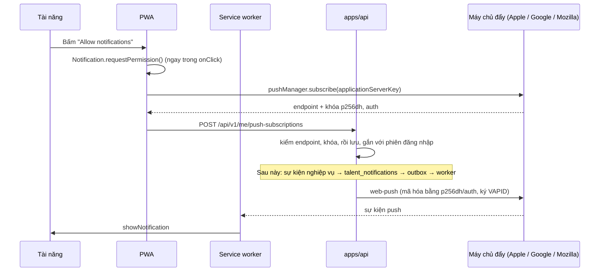

# Hướng dẫn tích hợp PWA và thông báo đẩy (Web Push)

Bản 2.0 · 18/11/2026 · Dành cho AI agent lập trình. Thay `PWA_PLATFORM_SPEC_VI.md` (bản 17/11/2026).

PWA (ứng dụng web cài lên màn hình chính) là ứng dụng của tài năng. Tài liệu này hướng dẫn agent **chưa làm gì** dựng được: tệp mô tả ứng dụng (manifest), cài lên màn hình chính, service worker (tiến trình chạy nền của trình duyệt), trang mất mạng, cập nhật phiên bản, và thông báo đẩy từ BE tới máy. Ca kiểm thử ở [CA_KIEM_THU_VI.md](CA_KIEM_THU_VI.md). Đăng nhập và phiên ở [../supabase-db-auth-spec/HUONG_DAN_TICH_HOP_VI.md](../supabase-db-auth-spec/HUONG_DAN_TICH_HOP_VI.md) (viết tắt **HD-Auth**).

**Đọc trước:** [TECH_STACK_VA_CAU_TRUC_DU_AN.md](../TECH_STACK_VA_CAU_TRUC_DU_AN.md); Next.js 16 khác bản cũ, đọc `apps/web/node_modules/next/dist/docs/01-app/02-guides/progressive-web-apps.md` trước khi viết mã FE.

Ký hiệu nguồn: [YK2] = bản định nghĩa yêu cầu v2; [AG] = `アプリ画面案_AI育成OS.pdf` (phương án màn hình ứng dụng); S1… = tài liệu công nghệ ở §10. **[Chốt]** đã có căn cứ; **[Chưa rõ]** chờ khách; **[Kiểm chứng]** là hiểu biết của đội, phải thử trên máy thật.

---

## 1. Yêu cầu và quyết định

| Mục | Nội dung | Căn cứ |
|---|---|---|
| Hình thức | PWA, thêm vào màn hình chính, không qua kho ứng dụng | [YK2] §6-12 (6-8) [Chốt] |
| Thông báo | Tin trong ứng dụng + thông báo đẩy | [YK2] §6-12 (6-1) [Chốt] |
| iPhone | Thông báo đẩy cần iOS 16.4+ **và** đã thêm vào màn hình chính | [YK2] §11; S5 [Chốt] |
| Hướng dẫn lần đầu | Thêm vào màn hình chính → cho phép thông báo → thanh toán → kết nối mạng xã hội | [YK2] §6-1 (6-2) [Chốt] |
| Cơ chế đẩy | Web Push chuẩn + khóa VAPID (khóa định danh máy chủ gửi), thư viện `web-push`. Không dịch vụ ngoài, không phí, không cần tài khoản Apple Developer | SCD câu hỏi C6 [Chốt theo đề xuất]; S5 |
| Tên, logo, màu | Của ứng dụng アデッソ hiện có (khách gửi). Hiện dùng giá trị tạm | [YK2] §6-14; câu hỏi C-06 [Chưa rõ] |
| Phạm vi PWA | Chỉ các đường dẫn `/pwa/*`. Màn quản trị **không** nằm dưới service worker của tài năng | Thiết kế; ca PW-18 |
| Màn mở đầu | `/pwa/home` | Câu hỏi B13 [Chưa rõ]; đổi màn mở đầu được, không đổi `id` của manifest |
| Ngôn ngữ giao diện | Tiếng Anh từ 18/11/2026 theo yêu cầu nội bộ; mọi chữ ở `lib/messages.ts` | — |

**Tiêu chí "đạt PWA"** dùng để nghiệm thu:
1. Android, Chrome: có nút cài; cài xong mở toàn màn hình, đúng tên và biểu tượng.
2. iPhone, Safari 16.4+: thêm được vào màn hình chính; mở toàn màn hình.
3. Cho phép thông báo; nhận được thông báo khi ứng dụng đang đóng; bấm vào mở đúng màn.
4. Có bản mới: ứng dụng báo, tải lại khi tài năng đồng ý.
5. Mất mạng: mở được và thấy trang báo mất mạng, không lộ dữ liệu cũ.

Máy hỗ trợ [Chưa rõ, chờ câu hỏi S09-04]:

| Máy | Cài | Thông báo đẩy |
|---|---|---|
| iPhone iOS 16.4+, Safari | Thủ công: Chia sẻ → Add to Home Screen | Có, chỉ sau khi cài |
| iPhone, Chrome/Edge/Firefox | Không ổn định | Hướng dẫn mở bằng Safari |
| iPhone dưới 16.4 | Cài được | Không; chỉ xem tin trong ứng dụng |
| Android, Chrome | Nút cài (`beforeinstallprompt`) | Có, kể cả chưa cài |
| Trình duyệt trong Instagram, LINE, TikTok | **Không** | Không; hướng dẫn mở bằng trình duyệt thật |

---

## 2. Manifest và biểu tượng

```ts
// apps/web/app/manifest.ts — Next.js tự phục vụ ở /manifest.webmanifest (S1)
import type { MetadataRoute } from 'next'
import { APP } from '@/lib/config'

export default function manifest(): MetadataRoute.Manifest {
  return {
    id: '/',                    // KHÔNG đổi sau khi phát hành: đổi = trình duyệt coi là ứng dụng khác
    name: APP.name,
    short_name: APP.shortName,
    description: APP.description,
    start_url: '/pwa/home',
    scope: '/pwa/',             // ngoài /pwa/ (màn quản trị, trang công khai) mở trong trình duyệt
    display: 'standalone',
    orientation: 'portrait',
    lang: 'en',
    background_color: APP.backgroundColor,
    theme_color: APP.themeColor,
    icons: [
      { src: '/icons/icon-192.png', sizes: '192x192', type: 'image/png', purpose: 'any' },
      { src: '/icons/icon-512.png', sizes: '512x512', type: 'image/png', purpose: 'any' },
      { src: '/icons/icon-maskable-512.png', sizes: '512x512', type: 'image/png', purpose: 'maskable' },
    ],
  }
}
```

```tsx
// apps/web/app/layout.tsx — thẻ riêng cho iPhone qua Metadata API (S2)
export const metadata: Metadata = {
  title: APP.name, description: APP.description,
  appleWebApp: { capable: true, title: APP.shortName, statusBarStyle: 'default' },
}
export const viewport: Viewport = { themeColor: APP.themeColor, width: 'device-width', initialScale: 1 }
```

- Biểu tượng: `apps/web/public/icons/` (192, 512, maskable 512, badge 72 đơn sắc) và `app/apple-icon.png` (180×180, iPhone dùng). Ảnh tạm sinh bằng `npm run icons` (`scripts/gen-icons.mjs`); khi khách gửi logo thì thay ảnh, giữ tên tệp.
- Điều kiện để Chrome cho cài: HTTPS, manifest có `name`/`short_name`, biểu tượng 192 và 512, `start_url`, `display` (S3).

---

## 3. Cài lên màn hình chính

### 3.1. Nhận biết môi trường

Nhận biết bằng user agent **chỉ để chọn câu hướng dẫn**. Có hỗ trợ hay không thì kiểm tính năng (`'PushManager' in window`). Mã đầy đủ đã chạy: `apps/web/lib/pwa/platform.ts` (có test `platform.test.ts`).

```ts
// apps/web/lib/pwa/platform.ts (rút gọn)
export type InstallGuide = 'installed' | 'in-app' | 'ios-safari' | 'ios-other' | 'android' | 'desktop'
export interface Env { ua: string; standalone: boolean; maxTouchPoints?: number }

const IN_APP = /Instagram|FBAN|FBAV|FB_IAB|Line\/|musical_ly|BytedanceWebview|TikTok/i   // [Kiểm chứng] ca PW-04

export const isIOS = (e: Env) => /iPhone|iPad|iPod/.test(e.ua) || (/Macintosh/.test(e.ua) && (e.maxTouchPoints ?? 0) > 1) // iPadOS giả làm Mac
export function installGuide(e: Env): InstallGuide {
  if (e.standalone) return 'installed'
  if (IN_APP.test(e.ua)) return 'in-app'
  if (isIOS(e)) return /CriOS|FxiOS|EdgiOS|OPiOS/.test(e.ua) ? 'ios-other' : 'ios-safari'
  return /Android/.test(e.ua) ? 'android' : 'desktop'
}
export const pushNeedsInstall = (e: Env) => isIOS(e) && !e.standalone
export function iosTooOldForPush(e: Env) {
  const m = e.ua.match(/OS (\d+)[_.](\d+)/)
  return isIOS(e) && !!m && Number(m[1]) + Number(m[2]) / 100 < 16.04
}
export const currentEnv = (): Env => ({
  ua: navigator.userAgent,
  standalone: matchMedia('(display-mode: standalone)').matches || (navigator as { standalone?: boolean }).standalone === true,
  maxTouchPoints: navigator.maxTouchPoints,
})
export const supportsPush = () => 'serviceWorker' in navigator && 'PushManager' in window && 'Notification' in window
```

### 3.2. Nút cài trên Android

Chrome bắn `beforeinstallprompt` sớm, có thể trước khi component hiện. Bắt ở `instrumentation-client.ts` (chạy trước khi React gắn, S2) và giữ trong một kho nhỏ:

```ts
// apps/web/lib/pwa/install-prompt.ts
let deferred: BeforeInstallPromptEvent | null = null
const listeners = new Set<() => void>()
export function rememberInstallPrompt(e: BeforeInstallPromptEvent) { deferred = e; listeners.forEach(l => l()) }
export const canPromptInstall = () => deferred !== null
export function onInstallPromptChange(l: () => void) { listeners.add(l); return () => listeners.delete(l) }
export async function promptInstall() {
  if (!deferred) return false
  const e = deferred; deferred = null                     // mỗi sự kiện chỉ prompt được một lần
  await e.prompt()
  const { outcome } = await e.userChoice
  listeners.forEach(l => l())
  return outcome === 'accepted'
}

// apps/web/instrumentation-client.ts
window.addEventListener('beforeinstallprompt', e => { e.preventDefault(); rememberInstallPrompt(e as BeforeInstallPromptEvent) })
```

Component `components/pwa/InstallGuide.tsx` (đã chạy) đọc kho bằng `useSyncExternalStore` (tránh lệch giữa lần dựng ở server và trình duyệt), hiện:
- `installed`: một dòng "đang chạy từ màn hình chính";
- `in-app`: câu hướng dẫn mở bằng trình duyệt thật + nút sao chép link (`navigator.clipboard.writeText(location.href)`);
- `ios-other`: bảo mở bằng Safari;
- `ios-safari`: 4 bước (Chia sẻ → Add to Home Screen → Add → mở từ biểu tượng và **đăng nhập lại**);
- `android`/`desktop`: nút cài nếu `canPromptInstall()`, không thì câu hướng dẫn dùng menu ⋮.

### 3.3. iPhone: phải đăng nhập lại sau khi cài [Kiểm chứng]

Ứng dụng đã thêm vào màn hình chính trên iPhone có bộ nhớ riêng, không chung với Safari: đăng nhập trong Safari rồi mở từ biểu tượng vẫn phải đăng nhập lại. Hệ quả:
- Đổi mật khẩu tạm trong Safari, rồi mới hướng dẫn cài.
- Bước cuối của hướng dẫn cài nói rõ phải đăng nhập lại.
- Cho phép thông báo **trong ứng dụng đã cài** (iPhone bắt buộc).
- Kiểm bằng ca PW-03 ngay tuần đầu; iOS mới chia sẻ đăng nhập thì bỏ câu nhắc.

---

## 4. Service worker

### 4.1. Đăng ký

Tệp ở `/sw.js` (thư mục `public/`), phạm vi `/pwa/`. Đăng ký trong `instrumentation-client.ts`:

```ts
// apps/web/instrumentation-client.ts
if ('serviceWorker' in navigator) {
  void navigator.serviceWorker
    .register('/sw.js', { scope: '/pwa/', updateViaCache: 'none' })   // luôn tải sw.js mới từ mạng
    .catch(() => {})
}
```

- Phạm vi `/pwa/` hẹp hơn vị trí tệp (`/`) nên không cần header `Service-Worker-Allowed`. Màn quản trị ngoài `/pwa/` không bị điều khiển (PW-18).
- Mã hiện tại có thêm bước gỡ bản đăng ký cũ ở phạm vi `/` (để lại từ demo). Dự án mới không cần bước này.

Header cho `sw.js` (S1):

```ts
// apps/web/next.config.ts — trong headers()
{
  source: '/sw.js',
  headers: [
    { key: 'Content-Type', value: 'application/javascript; charset=utf-8' },
    { key: 'Cache-Control', value: 'no-cache, no-store, must-revalidate' },
    { key: 'Content-Security-Policy', value: "default-src 'self'; script-src 'self'" },
  ],
},
```

### 4.2. Mã service worker

Mã đã chạy và có test (`apps/web/public/sw.js`, `lib/pwa/sw.test.ts`). Nguyên tắc lưu:
- **Không bao giờ** lưu API, phản hồi đăng nhập, RSC (dữ liệu trang của Next.js), mã QR, HTML có dữ liệu riêng.
- Chỉ lưu tệp tĩnh có băm trong tên (`/_next/static/`) và biểu tượng. Điều hướng luôn đi mạng; mất mạng thì trả trang `/pwa/offline` đã lưu sẵn.

```js
// apps/web/public/sw.js
const VERSION = 'v1'                                  // tăng khi đổi mã sw.js
const CACHE = `talent-static-${VERSION}`
const OFFLINE = '/pwa/offline'

self.addEventListener('install', e => { e.waitUntil(caches.open(CACHE).then(c => c.addAll([OFFLINE]))) })
// KHÔNG gọi skipWaiting() ở install: bản mới chỉ chạy khi người dùng đồng ý (§4.3)
self.addEventListener('activate', e => {
  e.waitUntil(caches.keys()
    .then(keys => Promise.all(keys.filter(k => k.startsWith('talent-static-') && k !== CACHE).map(k => caches.delete(k))))
    .then(() => self.clients.claim()))
})
self.addEventListener('fetch', e => {
  const req = e.request, url = new URL(req.url)
  if (req.method !== 'GET' || url.origin !== location.origin || req.headers.has('Authorization')
      || req.headers.has('RSC') || url.searchParams.has('_rsc')) return            // để trình duyệt tự xử lý
  if (req.mode === 'navigate') {
    if (!url.pathname.startsWith('/pwa/')) return
    e.respondWith(fetch(req).catch(() => caches.match(OFFLINE)))
  } else if (url.pathname.startsWith('/_next/static/') || url.pathname.startsWith('/icons/')) {
    e.respondWith(caches.match(req).then(hit => hit || fetch(req).then(res => {
      if (res.ok) { const copy = res.clone(); e.waitUntil(caches.open(CACHE).then(c => c.put(req, copy))) }
      return res
    })))
  }
})
self.addEventListener('message', e => { if (e.data === 'SKIP_WAITING') self.skipWaiting() })

// Thông báo đẩy (§6.5)
self.addEventListener('push', e => {
  let d = {}
  try { d = e.data ? e.data.json() : {} } catch {}                 // nội dung hỏng vẫn phải hiện một thông báo
  if (!d || typeof d !== 'object') d = {}
  const jobs = [
    self.registration.showNotification(typeof d.title === 'string' ? d.title : 'Notification', {
      body: typeof d.body === 'string' ? d.body : '',
      icon: '/icons/icon-192.png', badge: '/icons/badge-72.png',
      tag: typeof d.tag === 'string' ? d.tag : undefined,           // cùng tag thì thay thông báo cũ
      data: { url: d.url },
    }),
    self.clients.matchAll({ type: 'window' }).then(list => list.forEach(c => c.postMessage({ type: 'NOTIFICATION_RECEIVED' }))),
  ]
  if (Number.isInteger(d.badgeCount) && d.badgeCount >= 0 && self.navigator.setAppBadge)
    jobs.push(d.badgeCount > 0 ? self.navigator.setAppBadge(d.badgeCount) : self.navigator.clearAppBadge())
  e.waitUntil(Promise.all(jobs))
})
self.addEventListener('notificationclick', e => {
  e.notification.close()
  let target = location.origin + '/pwa/home'
  try {                                                            // chỉ mở trang trong /pwa/ của chính ứng dụng
    const url = new URL(e.notification.data?.url || target, location.origin)
    if (url.origin === location.origin && url.pathname.startsWith('/pwa/')) target = url.href
  } catch {}
  e.waitUntil(self.clients.matchAll({ type: 'window', includeUncontrolled: true }).then(async list => {
    for (const c of list) {
      const u = new URL(c.url)
      if (u.origin === location.origin && u.pathname.startsWith('/pwa/') && 'focus' in c) { await c.navigate(target); return c.focus() }
    }
    return self.clients.openWindow(target)                         // ứng dụng đang mở thì chuyển màn, không mở cửa sổ mới
  }))
})
```

iPhone: mỗi sự kiện `push` **phải** hiện một thông báo; không hiện nhiều lần thì Safari có thể thu hồi đăng ký (S5, S6). Vì vậy nội dung hỏng vẫn hiện thông báo mặc định.

### 4.3. Cập nhật phiên bản

Bản mới cài xong thì ở trạng thái chờ. Hiện thanh "A new version is available"; người dùng bấm thì gửi `SKIP_WAITING`, rồi tải lại khi có `controllerchange`. Đang tải ảnh, video hay đang gửi biểu mẫu thì không tải lại.

```ts
// apps/web/lib/pwa/busy.ts — màn đang bận gọi const done = markBusy(); … done()
let count = 0
export function markBusy() { count++; let released = false; return () => { if (!released) { released = true; count-- } } }
export const isBusy = () => count > 0
```

```tsx
// apps/web/components/pwa/UpdateBanner.tsx (rút gọn; bản đầy đủ đã chạy trong repo)
useEffect(() => {
  let hadController = !!navigator.serviceWorker.controller, reloading = false
  const onChange = () => { if (!hadController) { hadController = true; return } if (!reloading) { reloading = true; location.reload() } }
  navigator.serviceWorker.addEventListener('controllerchange', onChange)
  navigator.serviceWorker.getRegistration('/pwa/').then(reg => {
    if (!reg) return
    if (reg.waiting && navigator.serviceWorker.controller) setWaiting(reg.waiting)
    reg.addEventListener('updatefound', () => {
      const sw = reg.installing
      sw?.addEventListener('statechange', () => { if (sw.state === 'installed' && navigator.serviceWorker.controller) setWaiting(sw) })
    })
  })
  return () => navigator.serviceWorker.removeEventListener('controllerchange', onChange)
}, [])
// bấm nút: if (isBusy()) return alert(t.update.busy); waiting.postMessage('SKIP_WAITING')
```

### 4.4. Trang mất mạng

`app/pwa/offline/page.tsx`: trang tĩnh, chỉ có chữ từ `t.offline`, không gọi API, không đọc phiên. Đây là trang duy nhất của `/pwa/` được lưu.

---

## 5. Khóa VAPID

```bash
npx web-push generate-vapid-keys      # một cặp cho mỗi môi trường (dev, staging, production)
```

```dotenv
# apps/web/.env.local
NEXT_PUBLIC_VAPID_PUBLIC_KEY=<khóa công khai>
# apps/api/.env
VAPID_PUBLIC_KEY=<cùng khóa công khai>
VAPID_PRIVATE_KEY=<khóa bí mật>        # chỉ BE/worker; không bao giờ ở biến NEXT_PUBLIC_*
VAPID_SUBJECT=mailto:<email vận hành>  # hoặc https://<tên miền>; máy chủ đẩy dùng để liên hệ (S7)
```

- FE và BE phải dùng **cùng** khóa công khai. Lệch thì đăng ký được nhưng không gửi được (máy chủ đẩy trả 403).
- **Đổi khóa = mọi đăng ký cũ mất hiệu lực**: FE tự phát hiện và đăng ký lại (§6.2); BE tắt đăng ký cũ khi nhận 404/410.
- BE thiếu một trong ba biến thì tính năng đẩy tắt (`PUSH_NOT_CONFIGURED`, 503), phần còn lại vẫn chạy.

---

## 6. Thông báo đẩy

### 6.1. Luồng



### 6.2. FE: xin quyền và đăng ký

Mã đã chạy: `apps/web/lib/pwa/push.ts`.

```ts
import { VAPID_PUBLIC_KEY } from '../config.ts'

function urlBase64ToUint8Array(base64: string) {
  const padding = '='.repeat((4 - (base64.length % 4)) % 4)
  const raw = atob((base64 + padding).replace(/-/g, '+').replace(/_/g, '/'))
  return Uint8Array.from(raw, c => c.charCodeAt(0))
}
const sameKey = (cur: ArrayBuffer | null | undefined, want: Uint8Array) =>
  !!cur && new Uint8Array(cur).length === want.length && new Uint8Array(cur).every((b, i) => b === want[i])

export async function currentSubscription() {
  if (!('serviceWorker' in navigator) || !('Notification' in window) || Notification.permission !== 'granted') return null
  return (await (await navigator.serviceWorker.getRegistration('/pwa/'))?.pushManager.getSubscription()) ?? null
}

// Gọi TRỰC TIẾP trong onClick: Safari chỉ cho xin quyền ngay sau thao tác của người dùng (S5).
export async function subscribePush() {
  if (!('serviceWorker' in navigator) || !('PushManager' in window) || !VAPID_PUBLIC_KEY) return { status: 'unsupported' as const }
  if (await Notification.requestPermission() !== 'granted') return { status: 'denied' as const }
  const reg = await navigator.serviceWorker.ready
  const key = urlBase64ToUint8Array(VAPID_PUBLIC_KEY)
  let sub = await reg.pushManager.getSubscription()
  if (sub && !sameKey(sub.options.applicationServerKey, key)) { await sub.unsubscribe(); sub = null }   // đã đổi khóa VAPID
  sub ??= await reg.pushManager.subscribe({ userVisibleOnly: true, applicationServerKey: key })
  return { status: 'subscribed' as const, subscription: sub }
}

export async function unsubscribePush() {
  const sub = await currentSubscription()
  if (sub && !(await sub.unsubscribe())) throw new Error('UNSUBSCRIBE_FAILED')
}
```

Component `components/pwa/PushToggle.tsx` (đã chạy):
- Trạng thái suy từ trình duyệt: iOS quá cũ → câu báo; iPhone chưa cài → "Add the app to your Home Screen…"; không hỗ trợ → câu báo; đã từ chối (`denied`) → hướng dẫn bật trong Cài đặt, **không** hỏi lại.
- Khi mở màn: có đăng ký ở trình duyệt thì hỏi BE (`POST …/state`); BE chưa có (ví dụ sau khi đăng nhập lại) thì gửi lại.
- Chỉ báo "đã bật" **sau khi BE lưu xong**. Lỗi thì hiện "Please try again".

### 6.3. BE: lưu đăng ký

Đăng ký gắn với **tài năng** và **phiên đăng nhập** tạo ra nó (cột `owner_session_id`, `owner_auth_user_id` của `public.push_subscriptions`). Thu hồi phiên thì trigger `trg_sessions_detach_push` tắt đăng ký đó: máy dùng chung không nhận thông báo của người đã đăng xuất (PW-12).

Kiểm đầu vào (đã chạy):

```ts
// apps/api/src/modules/pwa/routes.ts — DTO
const Subscription = z.object({
  endpoint: z.url().max(2048),
  label: z.string().trim().min(1).max(80).optional(),
  keys: z.object({ p256dh: z.string().regex(/^[A-Za-z0-9_-]{87}$/), auth: z.string().regex(/^[A-Za-z0-9_-]{22}$/) }).strict(),
}).strict()

// apps/api/src/infra/push/endpoint.ts — chỉ gửi tới máy chủ đẩy thật, chặn SSRF (máy chủ bị lợi dụng gọi URL tùy ý)
const ALLOWED = [/^web\.push\.apple\.com$/, /\.push\.apple\.com$/, /^fcm\.googleapis\.com$/,
                 /^updates\.push\.services\.mozilla\.com$/, /\.notify\.windows\.com$/]
export function isAllowedPushEndpoint(endpoint: string) {
  let u: URL; try { u = new URL(endpoint) } catch { return false }
  return u.protocol === 'https:' && u.port === '' && !u.username && !u.password && !u.hash && ALLOWED.some(r => r.test(u.hostname))
}

// Khóa: p256dh là điểm P-256 hợp lệ 65 byte, auth 16 byte; sai → PUSH_KEY_INVALID (422)
function assertValidKeys(keys: { p256dh: string; auth: string }) {
  try {
    if (Buffer.from(keys.auth, 'base64url').length !== 16 || Buffer.from(keys.p256dh, 'base64url').length !== 65) throw new Error()
    ECDH.convertKey(Buffer.from(keys.p256dh, 'base64url'), 'prime256v1')   // ném lỗi nếu không phải điểm hợp lệ
  } catch { throw new AppError('PUSH_KEY_INVALID', 422) }
}
```

Lưu vào bảng thật:

> **Chưa chạy thật** với `public.push_subscriptions`: cùng logic với bản demo đã chạy (bảng `tech_demo_push_subscriptions`). Viết ca PW-B01…PW-B08 trước.

```ts
// apps/api/src/modules/push/service.ts
async subscribe(actor: Actor, input: PushInput) {          // actor từ authenticate(..., { kind: 'talent' }) (HD-Auth §6.3)
  if (!this.vapid) throw new AppError('PUSH_NOT_CONFIGURED', 503)
  if (!isAllowedPushEndpoint(input.endpoint)) throw new AppError('PUSH_ENDPOINT_INVALID', 422)
  assertValidKeys(input.keys)
  await this.db.$transaction(async tx => {
    // Khóa dòng phiên trước: request đăng ký đến muộn sau khi đã đăng xuất không thể bật lại đăng ký.
    const s = await tx.$queryRaw<Array<{ ok: boolean }>>`
      SELECT revoked_at IS NULL AS ok FROM app_private.auth_session_registry
       WHERE session_id = ${actor.sessionId}::uuid AND auth_user_id = ${actor.userId}::uuid FOR UPDATE`
    if (!s[0]?.ok) throw new AppError('SESSION_REVOKED', 401)
    // Guard đã bảo đảm người gọi là tài năng có hồ sơ, nên SELECT dưới luôn ra đúng 1 dòng.
    const n = await tx.$executeRaw`
      INSERT INTO public.push_subscriptions (talent_id, endpoint, p256dh_key, auth_secret, owner_session_id, owner_auth_user_id)
      SELECT t.id, ${input.endpoint}, ${input.keys.p256dh}, ${input.keys.auth}, ${actor.sessionId}::uuid, ${actor.userId}::uuid
        FROM public.talents t WHERE t.auth_user_id = ${actor.userId}::uuid
      ON CONFLICT (endpoint) DO UPDATE SET
        talent_id = EXCLUDED.talent_id, p256dh_key = EXCLUDED.p256dh_key, auth_secret = EXCLUDED.auth_secret,
        owner_session_id = EXCLUDED.owner_session_id, owner_auth_user_id = EXCLUDED.owner_auth_user_id,
        is_active = true, deactivated_at = NULL, updated_at = now()
      -- máy đang gắn với NGƯỜI KHÁC và còn bật thì không cướp
      WHERE push_subscriptions.owner_auth_user_id = EXCLUDED.owner_auth_user_id OR NOT push_subscriptions.is_active`
    if (n !== 1) throw new AppError('DEVICE_ALREADY_BOUND', 409)
  })
  return { active: true }
}

async unsubscribe(actor: Actor, endpoint: string) {
  await this.db.$executeRaw`UPDATE public.push_subscriptions SET is_active = false, deactivated_at = now(), updated_at = now()
     WHERE endpoint = ${endpoint} AND owner_auth_user_id = ${actor.userId}::uuid AND owner_session_id = ${actor.sessionId}::uuid AND is_active`
}

async state(actor: Actor, endpoint: string) {
  const r = await this.db.$queryRaw<Array<{ active: boolean }>>`SELECT is_active AS active FROM public.push_subscriptions
     WHERE endpoint = ${endpoint} AND owner_auth_user_id = ${actor.userId}::uuid AND owner_session_id = ${actor.sessionId}::uuid`
  return { active: r[0]?.active ?? false }
}
```

| Phương thức | Đường dẫn | Kết quả |
|---|---|---|
| POST | `/api/v1/me/push-subscriptions` | `{ active: true }`; lỗi `PUSH_ENDPOINT_INVALID`, `PUSH_KEY_INVALID`, `DEVICE_ALREADY_BOUND`, `SESSION_REVOKED`, `PUSH_NOT_CONFIGURED` |
| POST | `/api/v1/me/push-subscriptions/state` | `{ active }` của máy này trong phiên này (dùng POST vì endpoint dài, không đưa lên URL) |
| DELETE | `/api/v1/me/push-subscriptions` (body `{ endpoint }`) | 204 |

Bảng `push_subscriptions` có CHECK `is_active = (deactivated_at IS NULL)`: bật lại phải đặt `deactivated_at = NULL`, tắt phải ghi thời điểm.

### 6.4. Đăng xuất trên máy có thông báo

Thứ tự bắt buộc (mã đã chạy: `apps/web/lib/auth/store.ts`, hàm `logout`):

1. `DELETE /api/v1/me/push-subscriptions` với endpoint của máy (BE tắt trước).
2. `POST /api/v1/auth/logout` (BE thu hồi phiên; trigger tắt nốt nếu bước 1 lỗi).
3. `unsubscribePush()` ở trình duyệt.
4. `authClient().auth.signOut({ scope: 'local' })`, `navigator.clearAppBadge()`.

Làm ngược (hủy ở trình duyệt trước) thì BE còn giữ đăng ký và có thể gửi tiếp tới máy đó.

### 6.5. Gửi

Gửi một thông báo (mã đã chạy: `apps/api/src/infra/push/sender.ts`, `status.ts`):

```ts
import webpush from 'web-push'
export interface PushPayload { title: string; body: string; url?: string; tag?: string; badgeCount?: number }
export type SendOutcome = 'sent' | 'gone' | 'retry' | 'payload-too-large' | 'config-error'

export function classifyStatus(status: number): SendOutcome {
  if (status >= 200 && status < 300) return 'sent'
  if (status === 404 || status === 410) return 'gone'              // đăng ký hết hạn: tắt bản ghi
  if (status === 413) return 'payload-too-large'                   // sửa nội dung, không thử lại
  if (status === 429 || status >= 500) return 'retry'              // thử lại có giới hạn
  return 'config-error'                                            // 400, 403: khóa VAPID hoặc cấu hình
}

export async function sendPush(vapid: { subject: string; publicKey: string; privateKey: string },
                               sub: { endpoint: string; keys: { p256dh: string; auth: string } }, payload: PushPayload) {
  try {
    const res = await webpush.sendNotification(sub, JSON.stringify(payload), {
      vapidDetails: vapid,
      TTL: 6 * 60 * 60,                                            // máy đang tắt: giữ tối đa 6 giờ (S8)
      urgency: 'normal',                                           // 'high' cho việc gấp
      timeout: 15_000,
      topic: payload.tag?.replace(/[^A-Za-z0-9_-]/g, '').slice(0, 32) || undefined, // cùng topic: máy chỉ nhận bản mới nhất (S8)
    })
    return { outcome: classifyStatus(res.statusCode), status: res.statusCode }
  } catch (err) {
    if (err instanceof webpush.WebPushError) return { outcome: classifyStatus(err.statusCode), status: err.statusCode }
    return { outcome: 'retry' as const }                           // lỗi mạng
  }
}
```

Quy tắc nội dung:
- **Không** đưa thông tin cá nhân hay nội dung riêng vào `title`/`body`: thông báo hiện trên màn khóa. Ví dụ: "Your theme ideas for today are ready", không ghi tên hay nội dung bài.
- `url` chỉ là đường dẫn trong `/pwa/` (service worker cũng chặn đường dẫn khác).
- Giữ nội dung dưới khoảng 3 KB (máy chủ đẩy giới hạn khoảng 4 KB sau mã hóa).
- Câu chữ chính thức do khách duyệt ([YK2] §6-13; sheet お知らせ・メール文章 (câu chữ thông báo và thư) của [QA]).

Gửi theo nghiệp vụ, **chưa dựng** (cần worker, chờ module thông báo 6-1):

1. Use case nghiệp vụ ghi `public.talent_notifications` (tin trong ứng dụng) + `app_private.outbox_events` **trong cùng giao dịch**. Push không đến thì tài năng vẫn thấy tin khi mở ứng dụng.
2. Worker lấy sự kiện (`FOR UPDATE SKIP LOCKED`), với mỗi đăng ký `is_active` của tài năng ghi một dòng `app_private.push_deliveries` (UNIQUE `event_id`, `subscription_id`: chạy lại không gửi hai lần).
3. Trước khi gửi, kiểm lại đăng ký còn bật và phiên chủ chưa thu hồi. Gửi bằng `sendPush`.
4. `sent` → `state='sent'`, cập nhật `push_subscriptions.last_success_at`. `gone` → tắt đăng ký. `retry` → thử lại tối đa 3 lần (cột `attempts`), giãn cách tăng dần, trong TTL. `config-error` → báo vận hành, không thử lại từng máy.
5. Giờ gửi (8:00 sáng…) do worker quyết; máy có thể nhận trễ. Push không bảo đảm đúng giờ.

Bản demo hiện có `POST /api/v1/dev/push-test` gửi đồng bộ (không worker) để thử công nghệ; chỉ chạy khi `ENABLE_AUTH_DEMO=true` và không phải production. Không dùng làm mẫu cho gửi nghiệp vụ.

### 6.6. Số trên biểu tượng (badge)

Gửi `badgeCount` trong payload; service worker gọi `navigator.setAppBadge(n)` hoặc `clearAppBadge()` (Badging API, S9). Mở màn thông báo (T-14 của [AG]) thì FE gọi `navigator.clearAppBadge()` hoặc đặt bằng số chưa đọc. iPhone chỉ hiện số khi đã cài và đã cho phép thông báo.

### 6.7. Declarative Web Push (iOS 18.4+)

Safari 18.4+ nhận được thông báo khai báo sẵn trong payload (`"web_push": 8030`, khối `notification`) mà không cần service worker (S6). **Chưa dùng**, vì phải hỗ trợ iOS 16.4. Thêm sau được; máy cũ vẫn đi qua sự kiện `push`.

---

## 7. Chạy thử

| Việc | Cách |
|---|---|
| HTTPS trên máy lập trình | `npm run dev:https` (`next dev --experimental-https`, S1) |
| Thử trên điện thoại | Đường hầm HTTPS (ngrok, cloudflared) tới FE và BE; thêm URL FE vào `CORS_ORIGINS` của BE; build lại FE vì `NEXT_PUBLIC_*` gắn lúc build |
| ngrok bản miễn phí | Chặn `GET` từ trình duyệt bằng trang cảnh báo (`ERR_NGROK_6024`, không có CORS). `lib/api/client.ts` tự gửi header `ngrok-skip-browser-warning` khi API nằm sau tên miền ngrok; BE đã cho phép header này |
| Xem service worker | Chrome DevTools → Application → Service Workers / Manifest / Cache Storage |
| Gửi thử push | Bản demo: hai tài khoản; máy B bật thông báo, máy A nhập mã nhận của B và bấm gửi |
| iPhone | Thêm vào màn hình chính, mở từ biểu tượng, đăng nhập lại, rồi mới bật thông báo |

Gỡ lỗi thường gặp: không có nút cài → kiểm manifest và HTTPS (S3); đăng ký được nhưng không nhận → so khóa công khai VAPID ở FE và BE; iPhone không hiện nút bật → chưa mở từ biểu tượng màn hình chính.

---

## 8. Không được làm

- Lưu API, HTML có dữ liệu riêng, mã QR hay phản hồi đăng nhập vào cache của service worker.
- Gọi `skipWaiting()` ở sự kiện `install` (tải lại giữa lúc người dùng đang thao tác).
- Xin quyền thông báo tự động khi mở trang (Safari từ chối; Chrome đánh dấu là phiền) hoặc hỏi lại sau khi đã bị từ chối.
- Gửi push tới URL không thuộc danh sách máy chủ đẩy; đưa khóa bí mật VAPID ra FE.
- Đưa tên, nội dung riêng của tài năng vào nội dung thông báo.
- Mở `url` ngoài `/pwa/` khi bấm thông báo.
- Đổi `id` của manifest sau khi phát hành.

---

## 9. Thứ tự làm và tiêu chí xong

1. Manifest, biểu tượng tạm, metadata iPhone (§2). Xong khi: PW-01, PW-02 đạt.
2. `sw.js`, trang mất mạng, header (§4.1, §4.2, §4.4). Xong khi: PW-15, PW-17, PW-18 và test `sw.test.ts` đạt.
3. Hướng dẫn cài (§3). Xong khi: PW-03, PW-04 và `platform.test.ts` đạt.
4. Cập nhật phiên bản (§4.3). Xong khi: PW-13, PW-14 đạt.
5. Khóa VAPID, đăng ký ở FE, lưu ở BE (§5, §6.2, §6.3); cần đăng nhập (HD-Auth). Xong khi: PW-05…PW-07, PW-B01…PW-B08 đạt.
6. Gửi và bấm thông báo, badge (§6.5, §6.6). Xong khi: PW-08…PW-12, PW-16 đạt.

Bước 1–4 không cần nghiệp vụ, làm được ngay. Mỗi bước: `npm test`, `npm run lint`, `npm run build` (web) và `npm test`, `npm run typecheck` (API) sạch.

---

## 10. Nguồn

| Mã | Tài liệu |
|---|---|
| S1 | Next.js 16 — Progressive Web Apps (bản đi kèm: `apps/web/node_modules/next/dist/docs/01-app/02-guides/progressive-web-apps.md`; trực tuyến: https://nextjs.org/docs/app/guides/progressive-web-apps). Manifest, web-push, VAPID, header của `sw.js`, `--experimental-https`. Đối chiếu ngày 18/11/2026 |
| S2 | Next.js 16 — `instrumentation-client.ts`, Metadata API (`manifest`, `appleWebApp`): cùng thư mục tài liệu đi kèm |
| S3 | web.dev — What does it take to be installable?: https://web.dev/articles/install-criteria |
| S4 | MDN — Service Worker API, `PushManager.subscribe()`, `Notification.requestPermission()`: https://developer.mozilla.org/docs/Web/API/Service_Worker_API |
| S5 | WebKit — Web Push for Web Apps on iOS and iPadOS (iOS 16.4, phải cài, xin quyền khi người dùng thao tác): https://webkit.org/blog/13878/web-push-for-web-apps-on-ios-and-ipados/ |
| S6 | WebKit — Meet Declarative Web Push (iOS 18.4; thu hồi đăng ký khi push không hiện thông báo): https://webkit.org/blog/16535/meet-declarative-web-push/ |
| S7 | RFC 8292 — VAPID: https://www.rfc-editor.org/rfc/rfc8292 |
| S8 | RFC 8030 — Generic Event Delivery Using HTTP Push (TTL, Urgency, Topic): https://www.rfc-editor.org/rfc/rfc8030 |
| S9 | MDN — Badging API: https://developer.mozilla.org/docs/Web/API/Badging_API |
| S10 | web-push (Node.js): https://github.com/web-push-libs/web-push |

Tài liệu dự án: [YK2] §6-12 (6-1, 6-8), §6-1 (6-2), §6-13, §6-14, §11; SCD EP09 (6-8, 6-1), EP01 (6-2); câu hỏi C-06, C6, S09-04, B13. Mã đã chạy: `apps/web/app/manifest.ts`, `public/sw.js`, `lib/pwa/*`, `components/pwa/*`, `apps/api/src/infra/push/*`, `apps/api/src/modules/pwa/*` (bản demo, bảng `tech_demo_push_subscriptions`). Mục §3.3 và danh sách user agent ở §3.1 là hiểu biết của đội, phải kiểm trên máy thật.
