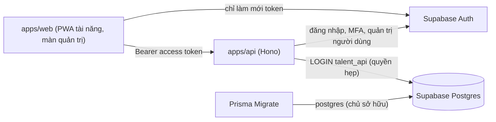

# Hướng dẫn tích hợp Supabase Database và Auth

Bản 2.0 · 18/11/2026 · Dành cho AI agent lập trình. Thay toàn bộ bộ `AI_Talent_OS_Supabase_Database_Auth_Agent_Spec_v1` (bản 1.3).

Tài liệu này hướng dẫn agent **chưa làm gì** dựng được đăng nhập, phiên, xác thực hai bước bằng ứng dụng xác thực (TOTP) và lớp truy cập DB trên nền mã hiện có. Ca kiểm thử ở [CA_KIEM_THU_VI.md](CA_KIEM_THU_VI.md). Thông báo đẩy và PWA (ứng dụng web cài lên màn hình chính) ở [../pwa-platform-spec/HUONG_DAN_TICH_HOP_VI.md](../pwa-platform-spec/HUONG_DAN_TICH_HOP_VI.md).

**Đọc trước:** [TECH_STACK_VA_CAU_TRUC_DU_AN.md](../TECH_STACK_VA_CAU_TRUC_DU_AN.md) (cấu trúc mã), [apps/api/PRISMA.md](../../apps/api/PRISMA.md) (migration), [database-design/07_implementation_scope_and_rules.md](../../database-design/07_implementation_scope_and_rules.md) (phạm vi DB đã chốt), [05_data_dictionary.md](../../database-design/05_data_dictionary.md) (từ điển dữ liệu).

Ký hiệu nguồn: [YK2] = `AI育成OS_概要要件定義書_v2.docx` (bản định nghĩa yêu cầu tổng quát, bản 2); [QA] = `AI-Talent-OS_Q&A表.xlsx` (bảng hỏi đáp với khách); S1… = tài liệu công nghệ ở §12. Nhãn trạng thái: **[Chốt]** đã có căn cứ; **[Chưa rõ]** chờ khách, làm thành cấu hình, không tự quyết.

---

## 1. Quyết định đã có

| Mục | Quyết định | Căn cứ |
|---|---|---|
| Ai gọi Supabase Auth để đăng nhập bằng mật khẩu | **Chỉ BE** (`POST /api/v1/auth/login`). Trình duyệt không gọi `signInWithPassword` | [Chốt] quyết định 17/11/2026: khóa 5 lần sai làm ở BE |
| Tài năng | Email + mật khẩu, **không** bắt MFA (xác thực nhiều yếu tố) | [YK2] §6-1; [Chốt] |
| Quản lý | Email + mật khẩu, rồi **bắt buộc** TOTP 6 số; lần đầu đăng ký bằng mã QR | [YK2] §6-2; [Chốt] 17/11/2026 |
| SMS, OTP qua email | Không làm ở đợt này | [Chốt] 17/11/2026 |
| Khóa sau sai mật khẩu | Sai 5 lần liên tiếp → khóa 15 phút, đếm ở BE | [YK2] §6-1; [QA] No.25; [Chốt] |
| Phiên tài năng | Hết hạn tuyệt đối sau 30 ngày kể từ lúc đăng nhập | [YK2] §6-1; [QA] No.25 |
| Phiên quản lý | Không thao tác 30 phút → phải nhập lại mật khẩu + TOTP | [YK2] §6-2 |
| Hạn tuyệt đối phiên quản lý | **[Chưa rõ]**: nguồn không nêu. Làm cấu hình `MANAGER_SESSION_MAX_HOURS`, mặc định 720 (bằng tài năng) | — |
| Tài khoản tài năng được tạo khi nào | Khi quản lý duyệt đơn: BE gọi `auth.admin.createUser`. Tắt tự đăng ký công khai ở Supabase | [YK2] UC-01; [QA] No.11, CR-01 |
| Mật khẩu tạm | Gửi qua thư; hạn **[Chưa rõ]** ([QA] No.65 đề xuất 7 ngày, quản lý bấm gửi lại). Đăng nhập bằng mật khẩu tạm chỉ được đổi mật khẩu | [YK2] §6-1 |
| Đặt lại TOTP khi quản lý mất máy | **[Chưa rõ]** ([QA] No.67 đề xuất quản lý khác bấm đặt lại) | — |
| Tài khoản công ty (事務所アカウント – tài khoản văn phòng) | Đăng nhập riêng như tài năng, không chuyển tài khoản | [QA] No.20 |

Không tự thêm phương thức đăng nhập khác (Google, magic link…): ngoài phạm vi [YK2] ch.6.

---

## 2. Kiến trúc



Nguyên tắc:

1. **FE chỉ giữ phiên.** FE dùng `@supabase/supabase-js` để lưu và tự làm mới token (`setSession`, `getSession`, `autoRefreshToken`). Mọi thao tác nghiệp vụ, kể cả đăng nhập và MFA, đi qua BE. FE không đọc DB (không dùng Data API).
2. **BE là nơi duy nhất cấp quyền.** Mỗi request: xác minh chữ ký JWT (token đăng nhập có chữ ký) → tra **sổ phiên** (`app_private.auth_session_registry`) → tra danh tính (`app_private.auth_principals` + `managers`/`talents`) → kiểm MFA, hạn phiên. JWT hợp lệ chưa đủ: phiên phải có trong sổ và chưa bị thu hồi. Lý do: Supabase không tự hết hạn phiên ở gói thường (S5) và JWT đã phát vẫn dùng được tới khi hết hạn dù đã đăng xuất.
3. **Hai tài khoản DB.** `DATABASE_URL` = LOGIN `talent_api` (thuộc nhóm `talent_runtime`, chỉ đọc ghi các bảng được cấp). `DIRECT_URL` = `postgres`, chỉ cho migration. API từ chối khởi động nếu `DATABASE_URL` là tài khoản quyền cao (`apps/api/src/infra/database/client.ts`).
4. **Không lưu bí mật của Auth.** Không lưu mật khẩu, mã TOTP, secret TOTP, mã QR, refresh token vào DB hay nhật ký. Bảng `auth.*` do Supabase quản lý; migration của dự án không sửa schema `auth` (chỉ tham chiếu `auth.users(id)` bằng khóa ngoại).

---

## 3. Cấu hình Supabase (Dashboard)

Làm cho **từng** project (dev, staging, production). Ghi lại giá trị đã đặt vào hồ sơ bàn giao.

| Mục trong Dashboard | Đặt | Vì sao |
|---|---|---|
| Authentication → Sign In / Providers → Email | Bật Email; **tắt "Allow new users to sign up"** ở staging, production | Tài khoản chỉ tạo khi quản lý duyệt (§7.5). Tắt thì ai cầm publishable key cũng không tự tạo được người dùng |
| Authentication → Sign In / Providers → Phone | Tắt | Không làm SMS |
| Authentication → Multi-Factor | TOTP: **Enabled**; Phone: Disabled | S1, S2 |
| Project Settings → JWT Keys | Dùng **khóa ký bất đối xứng** (ECC P-256 hoặc RSA) | `getClaims()` kiểm chữ ký tại chỗ bằng JWKS, không gọi mạng mỗi request (S3, S4) |
| Authentication → Rate Limits | Giảm giới hạn đăng nhập và xác minh MFA về mức thấp nhất dùng được | Bù cho rủi ro gọi thẳng Auth bỏ qua bộ đếm của BE (§7.2) |
| Authentication → URL Configuration | Site URL = URL FE; Redirect URLs chỉ gồm `https://<FE>/pwa/reset-password` (và URL quản trị tương ứng) | Đặt lại mật khẩu không chuyển ra trang ngoài (S13) |
| Authentication → Emails → SMTP | SMTP riêng của dự án | SMTP mặc định của Supabase chỉ dùng thử, giới hạn rất thấp |
| Authentication → Sessions | Gói Pro trở lên: có thể đặt time-box. Không thay được sổ phiên | S5 |
| Authentication → Hooks | Không dùng ở gói Pro. Password Verification Hook chỉ có ở gói Team/Enterprise (S7) | Khi lên Team: chuyển bộ đếm khóa sang hook |
| Project Settings → API Keys | Publishable key cho FE và BE; **secret key chỉ ở BE** | S15 |

---

## 4. Biến môi trường

Khai báo trong `apps/api/src/config/env.ts` (zod) và `apps/api/.env.example`. Không đọc `process.env` rải rác.

```dotenv
# apps/api/.env
DATABASE_URL="postgresql://talent_api.<project-ref>:<mật-khẩu>@<pooler-host>:6543/postgres"   # LOGIN runtime
DIRECT_URL="postgresql://postgres.<project-ref>:<mật-khẩu>@<pooler-host>:5432/postgres"       # chỉ migration
SUPABASE_URL=https://<project-ref>.supabase.co
SUPABASE_PUBLISHABLE_KEY=sb_publishable_...
SUPABASE_SECRET_KEY=sb_secret_...            # tạo người dùng khi duyệt đơn; không bao giờ gửi cho FE
LOGIN_HMAC_KEY=<32 byte ngẫu nhiên, base64>   # băm email cho bộ đếm khóa; đổi khóa = mất bộ đếm hiện tại
TALENT_SESSION_MAX_DAYS=30
MANAGER_IDLE_MINUTES=30
MANAGER_SESSION_MAX_HOURS=720                 # [Chưa rõ] §1
MFA_POLICY_VERSION=totp-v1                    # đổi khi đổi chính sách MFA; phiên cũ phải xác minh lại
```

```dotenv
# apps/web/.env.local (gắn lúc build)
NEXT_PUBLIC_API_URL=https://<api>
NEXT_PUBLIC_SUPABASE_URL=https://<project-ref>.supabase.co
NEXT_PUBLIC_SUPABASE_PUBLISHABLE_KEY=sb_publishable_...
```

```ts
// apps/api/src/config/env.ts — phần thêm vào object Env
SUPABASE_URL: z.string().url(),
SUPABASE_PUBLISHABLE_KEY: z.string().min(1),
SUPABASE_SECRET_KEY: z.string().min(1),
LOGIN_HMAC_KEY: z.string().min(32),
TALENT_SESSION_MAX_DAYS: z.coerce.number().int().min(1).default(30),
MANAGER_IDLE_MINUTES: z.coerce.number().int().min(1).default(30),
MANAGER_SESSION_MAX_HOURS: z.coerce.number().int().min(1).default(720),
MFA_POLICY_VERSION: z.string().min(1).default('totp-v1'),
```

---

## 5. Lớp DB

### 5.1. Kết nối và tài khoản

- Một `PrismaClient` cho mỗi tiến trình, tạo trong `container.ts` bằng `connectDatabase(env.DATABASE_URL)`. Hàm này kiểm tài khoản đang kết nối thuộc `talent_runtime` và **không** có quyền chủ sở hữu, BYPASSRLS, CREATEROLE…; sai thì API dừng với `DATABASE_RUNTIME_ROLE_REQUIRED`.
- Cấp LOGIN cho môi trường mới (chạy bằng `postgres`, mật khẩu do kho bí mật sinh, không ghi vào Git):

```sql
CREATE ROLE talent_api LOGIN PASSWORD '<bản băm SCRAM hoặc mật khẩu sinh ngẫu nhiên>'
  NOSUPERUSER NOCREATEDB NOCREATEROLE NOREPLICATION NOBYPASSRLS;
GRANT CONNECT ON DATABASE postgres TO talent_api;
GRANT talent_runtime TO talent_api;
```

  Chuỗi kết nối qua pooler dạng `talent_api.<project-ref>` (S9). Đổi mật khẩu: `\password talent_api` trong psql (psql gửi bản băm, mật khẩu gốc không vào nhật ký DB).

### 5.2. Thêm bảng mới

Quy trình đầy đủ ở `apps/api/PRISMA.md`. Tóm tắt:

1. Sửa `prisma/schema.prisma`.
2. `npm run db:dev -- --create-only --name <tên>` (không dùng `prisma migrate dev` trực tiếp: lệnh bọc trong `tools/prisma-safe.ts` khai báo các bảng `auth.*` là bảng bên ngoài để Prisma không đề xuất xóa).
3. Thêm tay vào SQL những gì Prisma không diễn đạt được, **kèm quyền cho runtime**:

```sql
-- CHECK, trigger updated_at, chỉ mục theo biểu thức nếu có
CREATE TRIGGER trg_<bảng>_updated_at BEFORE UPDATE ON public.<bảng>
  FOR EACH ROW EXECUTE FUNCTION set_updated_at();
-- RLS tự bật (trigger sự kiện) và anon/authenticated không có quyền (quyền mặc định đã bỏ).
-- Runtime CHỈ có quyền khi cấp rõ, kèm policy cho đúng role:
GRANT SELECT, INSERT, UPDATE ON public.<bảng> TO talent_runtime;   -- chỉ những lệnh thật sự cần
CREATE POLICY backend_runtime ON public.<bảng> TO talent_runtime USING (true) WITH CHECK (true);
```

4. `npm run db:dev` (áp lên dev), `npm run prisma:generate`. Môi trường khác: `npm run db:migrate`.
5. Kiểm: không bảng nào tắt RLS; `anon`, `authenticated` không có quyền (truy vấn ở PRISMA.md).

`USING (true)` nghĩa là runtime thấy mọi dòng: **quyền theo người dùng nằm ở BE** (§6). Không tạo policy cho `anon`, `authenticated`. Không mở endpoint nhận tên bảng hay điều kiện tự do từ client.

### 5.3. Viết truy vấn

- Ưu tiên Prisma client có kiểu. SQL thuần chỉ dùng `$queryRaw`/`$executeRaw` dạng **tagged template** (tham số tự ràng buộc). Không dùng `$queryRawUnsafe` với dữ liệu người dùng.
- Không giữ giao dịch DB trong lúc gọi Supabase Auth hay dịch vụ ngoài. Gọi ngoài trước hoặc sau, có bước đối soát nếu một bên lỗi.
- Đổi trạng thái có tranh chấp (duyệt đơn, đổi trạng thái tài năng) dùng cột `version` (khóa lạc quan): `UPDATE … WHERE id = $1 AND version = $2`, 0 dòng → `VERSION_CONFLICT` (409).
- Bảng `billing_accounts`, `social_accounts`, `post_deliveries`, `video_generations`… đang bị **chặn ghi** bằng trigger (phạm vi chưa chốt, `database-design/07_implementation_scope_and_rules.md` §3). Ghi vào sẽ lỗi SQLSTATE 55000: không gỡ trigger để chạy cho được.

### 5.4. Các bảng dùng cho Auth (đã có trên Supabase dev)

| Bảng | Dùng để | Cột chính |
|---|---|---|
| `app_private.auth_principals` | Một danh tính ứng dụng cho mỗi người dùng Auth | `auth_user_id` (khóa, FK `auth.users`), `principal_kind` ('manager'/'talent'), `must_change_password`, `security_version`, `mfa_enrollment_allowed` |
| `public.managers` / `public.talents` | Hồ sơ nghiệp vụ, khóa ngoại kép (`auth_user_id`, `principal_kind`) tới `auth_principals` | `managers.is_active`; `talents.status` ('before_use','in_use','ended'), `account_type` ('talent','office') |
| `app_private.auth_session_registry` | **Sổ phiên**: một dòng cho mỗi `session_id` trong JWT | `purpose` ('full','first_password','recovery','mfa_setup'), `security_version_at_issue`, `auth_time`, `absolute_expires_at`, `admin_last_activity_at`, `mfa_factor_id`, `mfa_verified_at`, `mfa_policy_version`, `revoked_at` |
| `app_private.auth_challenges` | Lượt xác minh TOTP đang chờ, gắn phiên và factor | `provider_challenge_id`, `factor_id`, `purpose`, `state`, `attempts_used`, `expires_at` |
| `app_private.auth_mfa_enrollments` | Chặn hai lượt đăng ký TOTP cùng lúc | `session_id`, `auth_user_id` (duy nhất), `factor_id`, `state`, `expires_at` |
| `app_private.auth_login_identifiers` | Email đã băm → `auth_user_id`, để đếm sai mật khẩu trước khi biết người dùng | `email_hash` (64 ký tự hex), `auth_user_id` |
| `app_private.password_lock_state` | Bộ đếm sai mật khẩu | `consecutive_failures`, `blocked_until`, `last_failed_at` |
| `app_private.auth_rate_buckets` | Giới hạn tần suất theo khóa (IP, phiên…) | `bucket_key` (băm), `count`, `window_started_at` |

Trigger đã có, không viết lại ở BE:
- `trg_auth_sessions_immutable`: không sửa được `session_id`, `auth_user_id`, `auth_time`, `absolute_expires_at`, `security_version_at_issue`, và không bỏ thu hồi được.
- `trg_managers_revoke_disabled` / `trg_talents_revoke_ended`: vô hiệu quản lý hoặc chuyển tài năng sang `ended` thì tăng `security_version` và thu hồi mọi phiên ngay.
- `trg_sessions_detach_push`: thu hồi phiên thì tắt mọi đăng ký thông báo đẩy gắn với phiên đó.

---

## 6. Kiểm quyền mỗi request (guard)

Đây là phần lõi. Mọi route cần đăng nhập gọi `authenticate()` trước khi đọc dữ liệu.

### 6.1. Cổng (port) Auth

Để kiểm thử không cần Supabase, use case chỉ biết interface; adapter Supabase nằm ở `infra/`.

```ts
// apps/api/src/core/auth.ts
export interface TokenPair { access_token: string; refresh_token: string; expires_at: number }
export interface VerifiedToken { userId: string; sessionId: string; aal: 'aal1' | 'aal2' }
export interface AuthFactor { id: string; factor_type: string; status: 'verified' | 'unverified' }
export interface AuthProvider {
  login(email: string, password: string): Promise<TokenPair>          // lỗi: AUTH_INVALID | RATE_LIMITED | AUTH_PROVIDER_UNAVAILABLE
  verifyToken(token: string): Promise<VerifiedToken>                  // kiểm chữ ký + iss + aud
  factors(token: string): Promise<AuthFactor[]>
  enrollTotp(token: string): Promise<{ factorId: string; qr: string; secret: string }>
  removeFactor(token: string, factorId: string): Promise<void>
  challenge(token: string, factorId: string): Promise<{ id: string; expiresAt: Date }>
  verify(token: string, factorId: string, challengeId: string, code: string): Promise<TokenPair>
  updatePassword(token: string, password: string): Promise<void>
  signOut(token: string): Promise<void>
  createUser(email: string, password: string): Promise<{ userId: string }> // dùng secret key
}
```

### 6.2. Adapter Supabase

Mẫu dưới lấy từ `apps/api/src/infra/auth/supabase.ts` (đã chạy thật với Supabase dev ngày 18/11/2026), bổ sung `updatePassword`, `createUser`.

```ts
// apps/api/src/infra/auth/supabase.ts
import { createClient } from '@supabase/supabase-js'
import type { AuthProvider, AuthFactor, TokenPair } from '../../core/auth.ts'
import { AppError, unauthorized } from '../../core/errors.ts'

export function createAuthProvider(url: string, publishableKey: string, secretKey: string): AuthProvider {
  // Không giữ phiên trong tiến trình: mỗi lời gọi mang token của chính người dùng.
  const options = { auth: { persistSession: false, autoRefreshToken: false, detectSessionInUrl: false } }
  const verifier = createClient(url, publishableKey, options)
  const admin = createClient(url, secretKey, options)

  // REST Auth với Bearer của người dùng (MFA, đổi mật khẩu, đăng xuất). Hết giờ sau 12 giây.
  async function request(path: string, token: string, method = 'GET', body?: object) {
    let res: Response
    try {
      res = await fetch(`${url}/auth/v1${path}`, {
        method,
        headers: { apikey: publishableKey, Authorization: `Bearer ${token}`, 'Content-Type': 'application/json' },
        body: body ? JSON.stringify(body) : undefined,
        signal: AbortSignal.timeout(12_000),
      })
    } catch { throw new AppError('AUTH_PROVIDER_UNAVAILABLE', 503) }
    const data = await res.json().catch(() => ({})) as Record<string, unknown>
    if (res.status === 429) throw new AppError('RATE_LIMITED', 429)
    if (res.status >= 500) throw new AppError('AUTH_PROVIDER_UNAVAILABLE', 503)
    if (!res.ok) throw new AppError('AUTH_INVALID', 401)
    return data
  }
  const pair = (s: { access_token: string; refresh_token: string; expires_at?: number; expires_in?: number }): TokenPair => ({
    access_token: s.access_token, refresh_token: s.refresh_token,
    expires_at: s.expires_at ?? Math.floor(Date.now() / 1000) + (s.expires_in ?? 0),
  })

  return {
    async login(email, password) {
      // Client mới cho mỗi lần đăng nhập: hai người đăng nhập cùng lúc không dùng chung phiên.
      const { data, error } = await createClient(url, publishableKey, options).auth.signInWithPassword({ email, password })
      if (error?.status === 429) throw new AppError('RATE_LIMITED', 429)
      if (error && (!error.status || error.status >= 500)) throw new AppError('AUTH_PROVIDER_UNAVAILABLE', 503)
      if (error || !data.session) throw new AppError('AUTH_INVALID', 401)
      return pair(data.session)
    },
    async verifyToken(token) {
      // getClaims: kiểm chữ ký bằng JWKS khi project dùng khóa bất đối xứng (S3, S4).
      const { data, error } = await verifier.auth.getClaims(token)
      const c = data?.claims
      if (error || !c || c.iss !== `${url}/auth/v1` || c.aud !== 'authenticated'
        || typeof c.sub !== 'string' || typeof c.session_id !== 'string' || !['aal1', 'aal2'].includes(String(c.aal))) throw unauthorized()
      return { userId: c.sub, sessionId: c.session_id, aal: c.aal as 'aal1' | 'aal2' }
    },
    async factors(token) {
      const data = await request('/user', token)
      return ((Array.isArray(data.factors) ? data.factors : []) as AuthFactor[]).filter(f => f.factor_type === 'totp')
    },
    async enrollTotp(token) {
      const data = await request('/factors', token, 'POST', {
        factor_type: 'totp', issuer: 'AI Talent OS', friendly_name: `TOTP ${crypto.randomUUID().slice(0, 8)}`,
      })
      const totp = data.totp as { qr_code?: string; secret?: string } | undefined
      // qr_code là chuỗi SVG (S1). Bỏ phần khai báo XML rồi đóng gói thành data URL cho thẻ .
      const svg = (totp?.qr_code ?? '').trimStart().replace(/^(?:(?:<\?xml[\s\S]*?\?>|<!--[\s\S]*?-->|<!DOCTYPE[^>]*>)\s*)+/, '')
      if (typeof data.id !== 'string' || !/^<svg[\s>]/.test(svg) || !totp?.secret) throw new AppError('AUTH_PROVIDER_UNAVAILABLE', 503)
      return { factorId: data.id, qr: 'data:image/svg+xml;base64,' + Buffer.from(svg).toString('base64'), secret: totp.secret }
    },
    async removeFactor(token, factorId) { await request(`/factors/${encodeURIComponent(factorId)}`, token, 'DELETE') },
    async challenge(token, factorId) {
      const data = await request(`/factors/${encodeURIComponent(factorId)}/challenge`, token, 'POST', {})
      if (typeof data.id !== 'string' || typeof data.expires_at !== 'number') throw new AppError('AUTH_PROVIDER_UNAVAILABLE', 503)
      return { id: data.id, expiresAt: new Date(data.expires_at * 1000) }
    },
    async verify(token, factorId, challengeId, code) {
      const data = await request(`/factors/${encodeURIComponent(factorId)}/verify`, token, 'POST', { challenge_id: challengeId, code })
      if (typeof data.access_token !== 'string' || typeof data.refresh_token !== 'string') throw new AppError('AUTH_PROVIDER_UNAVAILABLE', 503)
      return pair(data as never)
    },
    async updatePassword(token, password) { await request('/user', token, 'PUT', { password }) },
    async signOut(token) { await request('/logout?scope=local', token, 'POST') },
    async createUser(email, password) {
      // email_confirm: [Chưa rõ] — xem §7.5. Không tự đặt true khi khách chưa quyết.
      const { data, error } = await admin.auth.admin.createUser({ email, password })
      if (error?.status === 422) throw new AppError('EMAIL_ALREADY_REGISTERED', 409)
      if (error || !data.user) throw new AppError('AUTH_PROVIDER_UNAVAILABLE', 503)
      return { userId: data.user.id }
    },
  }
}
```

Ghi chú theo tài liệu gốc:
- Supabase xác minh TOTP thành công thì phát **cặp token mới cùng `session_id`, `aal` = `aal2`** (S1, S2). BE phải kiểm lại token mới có đúng người dùng, đúng `session_id` và `aal2` (§7.4).
- `getAuthenticatorAssuranceLevel()` (S1) là hàm phía trình duyệt; BE đọc `aal` từ claims đã xác minh.

### 6.3. Hàm `authenticate`

> **Chưa chạy thật** với bảng `auth_session_registry`: logic giống bản demo đã chạy (dùng bảng `tech_demo_sessions`), chuyển sang bảng thật. Viết ca AU-G01…AU-G10 trước khi viết hàm.

```ts
// apps/api/src/modules/auth/guard.ts
import type { Database } from '../../infra/database/client.ts'
import type { AuthProvider } from '../../core/auth.ts'
import { AppError } from '../../core/errors.ts'

export type Kind = 'talent' | 'manager'
export type Purpose = 'full' | 'first_password' | 'recovery' | 'mfa_setup'
export interface Actor { userId: string; sessionId: string; kind: Kind; purpose: Purpose }
export interface Need { kind: Kind; purposes?: Purpose[]; allowAal1?: boolean } // allowAal1: chỉ 2 route TOTP (§7.4)
type Row = { purpose: Purpose; revoked: boolean; expired: boolean; idle: boolean | null; mfa_ok: boolean; version_ok: boolean; kind: Kind; active: boolean }

export async function authenticate(
  db: Database, provider: AuthProvider, token: string, need: Need,
  cfg: { idleMinutes: number; mfaPolicyVersion: string },
): Promise<Actor> {
  const t = await provider.verifyToken(token)                       // 1. chữ ký, iss, aud
  const rows = await db.$queryRaw<Row[]>`
    SELECT r.purpose,
           r.revoked_at IS NOT NULL                                  AS revoked,
           r.absolute_expires_at <= now()                            AS expired,
           p.principal_kind = 'manager'
             AND r.admin_last_activity_at < now() - make_interval(mins => ${cfg.idleMinutes}) AS idle,
           r.mfa_verified_at IS NOT NULL AND r.mfa_policy_version = ${cfg.mfaPolicyVersion} AS mfa_ok,
           r.security_version_at_issue = p.security_version          AS version_ok,
           p.principal_kind                                          AS kind,
           COALESCE(m.is_active, t.status <> 'ended', false)         AS active
      FROM app_private.auth_session_registry r
      JOIN app_private.auth_principals p ON p.auth_user_id = r.auth_user_id
      LEFT JOIN public.managers m ON m.auth_user_id = p.auth_user_id
      LEFT JOIN public.talents  t ON t.auth_user_id = p.auth_user_id
     WHERE r.session_id = ${t.sessionId}::uuid AND r.auth_user_id = ${t.userId}::uuid`
  const r = rows[0]
  // 2. phiên phải do BE tạo lúc đăng nhập; đăng nhập thẳng vào Supabase không có dòng này
  if (!r || r.revoked || r.expired || !r.version_ok) throw new AppError('SESSION_REVOKED', 401)
  if (!r.active) throw new AppError('ACCOUNT_DISABLED', 403)        // 3. tài khoản còn dùng được
  if (r.kind !== need.kind) throw new AppError('FORBIDDEN', 403)     // 4. đúng loại người dùng
  if (!(need.purposes ?? ['full']).includes(r.purpose)) {           // 5. mật khẩu tạm, đặt lại, chưa có TOTP
    throw new AppError(r.purpose === 'mfa_setup' ? 'MFA_ENROLLMENT_REQUIRED' : 'PASSWORD_CHANGE_REQUIRED', 403)
  }
  if (r.kind === 'manager') {
    if (r.idle) {                                                    // 6. quá 30 phút không thao tác
      await db.$executeRaw`UPDATE app_private.auth_session_registry SET revoked_at = now()
                            WHERE session_id = ${t.sessionId}::uuid AND revoked_at IS NULL`
      throw new AppError('REAUTH_REQUIRED', 401)
    }
    if (!need.allowAal1 && (t.aal !== 'aal2' || !r.mfa_ok)) throw new AppError('MFA_REQUIRED', 403) // 7. TOTP của chính phiên này
    await db.$executeRaw`UPDATE app_private.auth_session_registry SET admin_last_activity_at = now()
                          WHERE session_id = ${t.sessionId}::uuid`
  }
  return { userId: t.userId, sessionId: t.sessionId, kind: r.kind, purpose: r.purpose }
}
```

Gắn vào Hono như middleware theo nhóm route:

```ts
// apps/api/src/http/auth.ts
import { createMiddleware } from 'hono/factory'
export const requireActor = (deps: AppDeps, need: Need) => createMiddleware<{ Variables: { actor: Actor } }>(async (c, next) => {
  c.set('actor', await authenticate(deps.db, deps.authProvider, bearer(c), need, deps.authConfig))
  await next()
})
// app.use('/api/v1/me/*', requireActor(deps, { kind: 'talent' }))
// app.use('/api/v1/admin/*', requireActor(deps, { kind: 'manager' }))
// trong handler: const actor = c.get('actor')
```

Quy tắc khi dùng `actor`:
- Lấy `talent_id` của người gọi từ DB theo `actor.userId`, **không** nhận `talentId` hay vai trò từ body hay query.
- Quản lý xem dữ liệu riêng của tài năng (hồ sơ, hội thoại, số liệu) thì ghi `manager_view_logs` trong cùng giao dịch, trước khi trả dữ liệu ([YK2] §6-2 7-6). Không ghi được nhật ký thì không trả dữ liệu.
- Chỉ đồng hồ của DB (`now()`) quyết định hết hạn; không tin giờ của client.
- Chỉ thao tác thật của quản lý mới gia hạn thời gian chờ: không viết request định kỳ chạy nền chỉ để giữ phiên.

---

## 7. Các luồng

### 7.1. API

| Phương thức | Đường dẫn | Ai | Kết quả |
|---|---|---|---|
| POST | `/api/v1/auth/login` | Công khai | `{ session, next }` với `next` ∈ `home`, `change-password`, `mfa-setup`, `mfa-verify` |
| POST | `/api/v1/auth/password` | Phiên `first_password`/`recovery`/`full` | 204; mọi phiên cũ bị thu hồi, phải đăng nhập lại |
| POST | `/api/v1/auth/password-reset` | Công khai | 202 chung, không cho biết email có tồn tại |
| GET | `/api/v1/auth/state` | Mọi phiên trong sổ | `{ kind, purpose, next }` để FE chọn màn |
| POST | `/api/v1/auth/mfa/enroll` | Quản lý, phiên `mfa_setup` | `{ factorId, qr, secret }` (chỉ trả một lần) |
| DELETE | `/api/v1/auth/mfa/enroll` | Quản lý, phiên `mfa_setup` | Hủy lượt đăng ký dở |
| POST | `/api/v1/auth/mfa/challenges` | Quản lý (`mfa_setup` hoặc `full` chưa xác minh) | `{ challengeRef, expiresAt }` |
| POST | `/api/v1/auth/mfa/challenges/{ref}/verify` | Như trên | `{ session, next: 'home' }` |
| POST | `/api/v1/auth/logout` | Mọi phiên | 204 |
| POST | `/api/v1/admin/applications/{id}/approve` | Quản lý `full` | 202; tạo tài khoản theo §7.5 |

Mọi route `/api/*`: `Cache-Control: no-store`; kiểm `Origin` thuộc `CORS_ORIGINS` với lệnh ghi (đã có trong `http/app.ts`); dữ liệu vào kiểm bằng zod `.strict()` (trường lạ → 422).

### 7.2. Đăng nhập và khóa 5 lần sai

> **Chưa chạy thật** với `password_lock_state`, `auth_login_identifiers`. Bản demo chỉ có giới hạn theo IP (`auth_rate_buckets`), đã chạy.

```ts
// apps/api/src/modules/auth/service.ts (trích)
import { createHmac } from 'node:crypto'

type Next = 'home' | 'change-password' | 'mfa-setup' | 'mfa-verify'
const emailHash = (key: string, email: string) => createHmac('sha256', key).update(email.trim().toLowerCase()).digest('hex')

async login(email: string, password: string, ip: string) {
  await this.rateLimit('login-ip:' + ip, 20, 60)                       // 20 lần / phút / IP
  const hash = emailHash(this.cfg.loginHmacKey, email)
  const known = await this.db.$queryRaw<Array<{ user_id: string; blocked: boolean }>>`
    SELECT i.auth_user_id AS user_id, COALESCE(s.blocked_until > now(), false) AS blocked
      FROM app_private.auth_login_identifiers i
      LEFT JOIN app_private.password_lock_state s ON s.auth_user_id = i.auth_user_id
     WHERE i.email_hash = ${hash}`
  if (known[0]?.blocked) throw new AppError('ACCOUNT_LOCKED', 429)     // không gọi Supabase khi đang khóa

  let tokens: TokenPair
  try { tokens = await this.provider.login(email, password) }
  catch (e) {
    if (e instanceof AppError && e.code === 'AUTH_INVALID' && known[0]) await this.recordFailure(known[0].user_id)
    throw e                                                           // lỗi 503 của Supabase không tính là sai mật khẩu
  }
  const t = await this.provider.verifyToken(tokens.access_token)
  await this.db.$executeRaw`UPDATE app_private.password_lock_state
                              SET consecutive_failures = 0, blocked_until = NULL WHERE auth_user_id = ${t.userId}::uuid`
  const next = await this.openSession(t, tokens)                       // §7.3
  return { session: tokens, next }
}

// Nguyên tử trong một câu lệnh. Đang khóa thì không tới đây, nên không kéo dài thời gian khóa.
private async recordFailure(userId: string) {
  await this.db.$executeRaw`
    INSERT INTO app_private.password_lock_state (auth_user_id, consecutive_failures, last_failed_at)
    VALUES (${userId}::uuid, 1, now())
    ON CONFLICT (auth_user_id) DO UPDATE SET
      consecutive_failures = CASE WHEN password_lock_state.blocked_until <= now() THEN 1
                                  ELSE password_lock_state.consecutive_failures + 1 END,
      blocked_until = CASE WHEN (CASE WHEN password_lock_state.blocked_until <= now() THEN 1
                                      ELSE password_lock_state.consecutive_failures + 1 END) >= 5
                           THEN now() + interval '15 minutes' END,
      last_failed_at = now()`
}
```

- `auth_login_identifiers` được ghi khi tạo tài khoản (§7.5). Email chưa có trong bảng vẫn bị giới hạn theo IP.
- Trả `ACCOUNT_LOCKED` cho phép người dùng biết phải chờ, đổi lại người ngoài đoán được email có tồn tại. Nếu khách muốn không lộ, đổi thành `AUTH_INVALID` (chỉ sửa một dòng).
- **Rủi ro đã chấp nhận** (quyết định 17/11/2026): ai biết URL Auth và publishable key vẫn thử mật khẩu thẳng với Supabase mà bộ đếm của BE không thấy. Bù bằng giới hạn tần suất ở Supabase (§3). Lên gói Team thì chuyển sang Password Verification Hook (S7).

### 7.3. Mở phiên sau khi đăng nhập

```ts
private async openSession(t: VerifiedToken, tokens: TokenPair): Promise<Next> {
  const p = await this.db.$queryRaw<Array<{ kind: Kind; must_change: boolean; version: bigint; active: boolean }>>`
    SELECT p.principal_kind AS kind, p.must_change_password AS must_change, p.security_version AS version,
           COALESCE(m.is_active, t.status <> 'ended', false) AS active
      FROM app_private.auth_principals p
      LEFT JOIN public.managers m ON m.auth_user_id = p.auth_user_id
      LEFT JOIN public.talents  t ON t.auth_user_id = p.auth_user_id
     WHERE p.auth_user_id = ${t.userId}::uuid`
  if (!p[0] || !p[0].active) {                                         // người dùng Auth chưa gắn hồ sơ hoặc đã ngừng
    await this.provider.signOut(tokens.access_token).catch(() => {})
    throw new AppError(p[0] ? 'ACCOUNT_DISABLED' : 'ACCOUNT_NOT_PROVISIONED', 403)
  }
  const { kind, must_change, version } = p[0]
  const hasTotp = kind === 'manager' && (await this.provider.factors(tokens.access_token)).some(f => f.status === 'verified')
  const purpose: Purpose = must_change ? 'first_password' : kind === 'manager' && !hasTotp ? 'mfa_setup' : 'full'
  const maxHours = kind === 'talent' ? this.cfg.talentDays * 24 : this.cfg.managerMaxHours
  await this.db.$executeRaw`
    INSERT INTO app_private.auth_session_registry
      (session_id, auth_user_id, purpose, security_version_at_issue, auth_time, absolute_expires_at,
       admin_last_activity_at, password_verified_at)
    VALUES (${t.sessionId}::uuid, ${t.userId}::uuid, ${purpose}, ${version}, now(),
            now() + make_interval(hours => ${maxHours}), ${kind === 'manager' ? new Date() : null}, now())`
  if (purpose === 'first_password') return 'change-password'
  if (purpose === 'mfa_setup') return 'mfa-setup'
  return kind === 'manager' ? 'mfa-verify' : 'home'
}
```

`session_id` là khóa chính: cùng một phiên không mở hai lần. Sau khi làm mới token, `session_id` giữ nguyên nên sổ phiên vẫn khớp (S5).

### 7.4. TOTP của quản lý

Lần đầu (phiên `mfa_setup`):

1. `POST /mfa/enroll`: chặn nếu đã có factor `verified` (`MFA_ENROLLMENT_NOT_ALLOWED`) hoặc đang có lượt dở (`MFA_SETUP_PENDING`, dùng `INSERT … ON CONFLICT DO NOTHING` vào `auth_mfa_enrollments`, hạn 10 phút). Gọi `enrollTotp`, trả `qr` và `secret` **một lần**, không lưu, không ghi nhật ký.
2. FE hiện QR (thẻ ``) và nút hiện `secret` để nhập tay; người dùng nhập mã 6 số.
3. `POST /mfa/challenges` rồi `POST /mfa/challenges/{ref}/verify` như lần sau.
4. Muốn làm lại: `DELETE /mfa/enroll` chỉ xóa factor **chưa xác minh** của chính người đó.

Mỗi lần đăng nhập (đã có TOTP):

```ts
async challenge(token: string, factorId: string) {
  const a = await this.authenticate(token, { kind: 'manager', purposes: ['mfa_setup', 'full'], allowAal1: true })
  if (!(await this.provider.factors(token)).some(f => f.id === factorId)) throw new AppError('FACTOR_NOT_ALLOWED', 403)
  await this.rateLimit('mfa-challenge:' + a.sessionId, 10, 60)
  const c = await this.provider.challenge(token, factorId)
  const [row] = await this.db.$queryRaw<Array<{ id: string }>>`
    INSERT INTO app_private.auth_challenges (session_id, auth_user_id, factor_id, provider_challenge_id, purpose, expires_at)
    VALUES (${a.sessionId}::uuid, ${a.userId}::uuid, ${factorId}, ${c.id},
            ${a.purpose === 'mfa_setup' ? 'enrollment' : 'login'}, ${c.expiresAt}) RETURNING id`
  return { challengeRef: row!.id, expiresAt: c.expiresAt.toISOString() }
}

async verify(token: string, ref: string, code: string) {
  const a = await this.authenticate(token, { kind: 'manager', purposes: ['mfa_setup', 'full'], allowAal1: true })
  const [ch] = await this.db.$queryRaw<Array<{ factor_id: string; provider_challenge_id: string; usable: boolean }>>`
    UPDATE app_private.auth_challenges SET attempts_used = attempts_used + 1
     WHERE id = ${ref}::uuid AND session_id = ${a.sessionId}::uuid AND state = 'pending'
     RETURNING factor_id, provider_challenge_id, (expires_at > now() AND attempts_used <= 5) AS usable`
  if (!ch) throw new AppError('CHALLENGE_CONSUMED', 409)
  if (!ch.usable) throw new AppError('CHALLENGE_EXPIRED', 409)
  const tokens = await this.provider.verify(token, ch.factor_id, ch.provider_challenge_id, code) // sai mã → AUTH_INVALID
  const t = await this.provider.verifyToken(tokens.access_token)
  if (t.userId !== a.userId || t.sessionId !== a.sessionId || t.aal !== 'aal2') throw new AppError('MFA_PROOF_INVALID', 401)
  await this.db.$transaction([
    this.db.$executeRaw`UPDATE app_private.auth_challenges SET state = 'verified', verified_at = now() WHERE id = ${ref}::uuid`,
    this.db.$executeRaw`UPDATE app_private.auth_session_registry
        SET purpose = 'full', mfa_factor_id = ${ch.factor_id}, mfa_verified_at = now(),
            mfa_policy_version = ${this.cfg.mfaPolicyVersion}, admin_last_activity_at = now()
      WHERE session_id = ${a.sessionId}::uuid`,
    this.db.$executeRaw`DELETE FROM app_private.auth_mfa_enrollments WHERE session_id = ${a.sessionId}::uuid`,
  ])
  return { session: tokens, next: 'home' as const }
}
```

- `allowAal1: true` chỉ dùng cho đúng hai route này: chúng là nơi phiên `aal1` đi lên `aal2`.
- Bằng chứng MFA lấy từ challenge do server lưu và token `aal2` mới, **không** từ thông tin client gửi lên.
- Bộ đếm sai TOTP tách khỏi bộ đếm sai mật khẩu.
- Không có mã dự phòng (recovery code) và không có đường vòng bằng email: mất máy thì theo quy trình đặt lại của quản lý khác ([QA] No.67, chưa chốt).

### 7.5. Tạo tài khoản tài năng khi duyệt đơn

> **[Chưa rõ]**: hạn và cách gửi lại mật khẩu tạm ([QA] No.65); có coi email đã xác minh hay không (`email_confirm`). Làm thành cấu hình; không tự quyết.

Gọi Supabase Auth không nằm trong giao dịch DB được, nên làm theo các bước có thể làm lại:

1. Giao dịch 1: khóa đơn (`version`), chuyển `talent_applications.status` sang `approved`, ghi `domain_operations` + `outbox_events` (chỉ chứa mã tham chiếu, không chứa mật khẩu).
2. Worker hoặc chính request: sinh mật khẩu ngẫu nhiên (`crypto.randomBytes(18).toString('base64url')`), gọi `createUser`. Hết giờ chờ thì tra lại bằng email trước khi gọi lại; email đã thuộc người dùng khác ngoài luồng này → dừng, chờ quản lý xử lý tay.
3. Giao dịch 2: `auth_principals` (`principal_kind='talent'`, `must_change_password=true`) → `talents` → `auth_login_identifiers` (băm email như §7.2).
4. Gửi thư chứa mật khẩu tạm qua bộ gửi thư của dự án. Mật khẩu chỉ ở bộ nhớ hoặc kho bí mật có hạn, không vào DB, nhật ký hay outbox.

Tài khoản công ty: quản lý tạo, cùng các bước 2–4, `account_type='office'`, không qua đơn ([QA] No.20). Không dùng trigger trên `auth.users` để tự cấp vai trò.

### 7.6. Đổi mật khẩu, quên mật khẩu, đăng xuất

```ts
async changePassword(token: string, password: string, kind: Kind) {
  const a = await this.authenticate(token, { kind, purposes: ['first_password', 'recovery', 'full'] })
  await this.provider.updatePassword(token, password)                    // Supabase kiểm độ mạnh theo cấu hình
  await this.db.$transaction([
    this.db.$executeRaw`UPDATE app_private.auth_principals
        SET must_change_password = false, security_version = security_version + 1 WHERE auth_user_id = ${a.userId}::uuid`,
    this.db.$executeRaw`UPDATE app_private.auth_session_registry SET revoked_at = now()
        WHERE auth_user_id = ${a.userId}::uuid AND revoked_at IS NULL`,
  ])
  await this.provider.signOut(token).catch(() => {})                    // FE chuyển về màn đăng nhập
}

async logout(token: string) {
  const t = await this.provider.verifyToken(token)
  // Thu hồi trong DB trước: trigger tắt luôn đăng ký thông báo đẩy của phiên này.
  await this.db.$executeRaw`UPDATE app_private.auth_session_registry SET revoked_at = now()
      WHERE session_id = ${t.sessionId}::uuid AND auth_user_id = ${t.userId}::uuid AND revoked_at IS NULL`
  await this.provider.signOut(token).catch(() => {})                    // Supabase lỗi thì quyền ở app vẫn đã bị chặn
}
```

Quên mật khẩu: `POST /auth/password-reset` gọi `resetPasswordForEmail(email, { redirectTo })` với `redirectTo` nằm trong danh sách cho phép (§3), luôn trả 202 (S13). Màn đặt lại ở FE nhận phiên khôi phục từ liên kết, gửi token đó cho BE; BE mở sổ phiên `purpose='recovery'`, chỉ cho gọi `POST /auth/password`. Quản lý sau khi đặt lại vẫn phải qua TOTP.

---

## 8. Phía FE

```ts
// apps/web/lib/auth/client.ts — client Supabase CHỈ để lưu và làm mới phiên
import { createClient, type SupabaseClient } from '@supabase/supabase-js'
let client: SupabaseClient | undefined
export function authClient() {
  const url = process.env.NEXT_PUBLIC_SUPABASE_URL, key = process.env.NEXT_PUBLIC_SUPABASE_PUBLISHABLE_KEY
  if (!url || !key) throw new Error('AUTH_NOT_CONFIGURED')
  client ??= createClient(url, key, { auth: { persistSession: true, autoRefreshToken: true, detectSessionInUrl: true, storageKey: 'ai-talent-auth' } })
  return client
}
```

```ts
// Đăng nhập: BE đăng nhập hộ, FE chỉ nhận token rồi giao cho SDK giữ.
const result = await authApi.login(email, password)          // POST /api/v1/auth/login
await authClient().auth.setSession(result.session)
router.replace({ home: '/pwa/home', 'change-password': '/pwa/password', 'mfa-setup': '/admin/mfa/setup', 'mfa-verify': '/admin/mfa' }[result.next])

// Mỗi request tới BE: lấy token còn hạn (SDK tự làm mới).
const { data } = await authClient().auth.getSession()
await apiFetch('/api/v1/...', { token: data.session?.access_token })
```

- Mẫu đầy đủ (kho trạng thái đăng nhập, đồng bộ nhiều tab, xử lý mất mạng): `apps/web/lib/auth/store.ts`. Trong callback `onAuthStateChange` **không** `await` hàm của SDK (SDK giữ khóa; dùng `setTimeout(…, 0)`), theo hướng dẫn của supabase-js.
- Lỗi 401 `SESSION_REVOKED`/`REAUTH_REQUIRED` → `signOut({ scope: 'local' })` rồi về màn đăng nhập. 403 `MFA_REQUIRED` → màn nhập TOTP.
- Đăng xuất: hủy đăng ký thông báo đẩy ở BE → `POST /auth/logout` → hủy đăng ký ở trình duyệt → `signOut({ scope: 'local' })` (thứ tự ở hướng dẫn PWA §6.4).
- PWA trên iPhone và Safari giữ phiên riêng: mở từ màn hình chính phải đăng nhập lại (hướng dẫn PWA §3.3).
- Màn quản trị dùng cùng client nhưng `storageKey` khác (`ai-talent-admin-auth`) để phiên quản lý và tài năng trên cùng máy không đè nhau.

---

## 9. Mã lỗi

Mọi lỗi trả `{ "error": { "code": "...", "requestId": "..." } }`. FE dịch `code` sang chữ trong `lib/messages.ts`; không hiện thông điệp gốc của Supabase.

| Mã | HTTP | Khi nào |
|---|---|---|
| `INPUT_INVALID` | 422 | Dữ liệu vào sai, có trường lạ |
| `AUTH_INVALID` | 401 | Sai email/mật khẩu, sai mã TOTP. Không phân biệt email có tồn tại hay không |
| `ACCOUNT_LOCKED` | 429 | Đang trong 15 phút khóa |
| `RATE_LIMITED` | 429 | Vượt giới hạn tần suất |
| `AUTH_REQUIRED` | 401 | Thiếu hoặc sai token |
| `SESSION_REVOKED` | 401 | Phiên không có trong sổ, đã thu hồi, hết hạn tuyệt đối, hoặc `security_version` đã đổi |
| `REAUTH_REQUIRED` | 401 | Quản lý quá 30 phút không thao tác |
| `MFA_REQUIRED` | 403 | Quản lý chưa xác minh TOTP trong phiên này |
| `MFA_ENROLLMENT_REQUIRED` | 403 | Quản lý chưa đăng ký TOTP |
| `PASSWORD_CHANGE_REQUIRED` | 403 | Phiên mật khẩu tạm hoặc đặt lại gọi route nghiệp vụ |
| `MFA_ENROLLMENT_NOT_ALLOWED` / `MFA_SETUP_PENDING` | 403 / 409 | Đã có TOTP / đang có lượt đăng ký dở |
| `FACTOR_NOT_ALLOWED` | 403 | `factorId` không thuộc người gọi |
| `CHALLENGE_EXPIRED` / `CHALLENGE_CONSUMED` | 409 | Lượt xác minh hết hạn, hết số lần thử / đã dùng |
| `MFA_PROOF_INVALID` | 401 | Token sau xác minh không đúng người, đúng phiên hoặc không phải `aal2` |
| `ACCOUNT_DISABLED` / `ACCOUNT_NOT_PROVISIONED` | 403 | Tài khoản bị vô hiệu, đã ngừng / người dùng Auth chưa có hồ sơ |
| `FORBIDDEN` | 403 | Sai loại người dùng cho route |
| `VERSION_CONFLICT` | 409 | Khóa lạc quan thất bại |
| `EMAIL_ALREADY_REGISTERED` | 409 | Tạo tài khoản trùng email |
| `AUTH_PROVIDER_UNAVAILABLE` | 503 | Supabase Auth lỗi hoặc hết giờ chờ. Không tính là sai mật khẩu |

---

## 10. Không được làm

- Gọi `signInWithPassword` từ trình duyệt; đưa secret key vào FE hoặc biến `NEXT_PUBLIC_*`.
- Phân quyền theo `user_metadata`, `app_metadata` do client ghi, hoặc giải mã JWT không kiểm chữ ký (`jwt-decode`).
- Dùng `postgres` làm `DATABASE_URL`; tắt kiểm chứng chỉ TLS; gỡ trigger chặn ghi để chạy cho được.
- Lưu hoặc ghi nhật ký mật khẩu, mã TOTP, secret, QR, token, email thô trong khóa giới hạn tần suất.
- Tạo policy cho `anon`/`authenticated`; mở Data API cho FE đọc bảng.
- Tự thêm SMS, OTP email, đăng nhập mạng xã hội, mã dự phòng.
- Sửa migration đã áp. Thay đổi đi bằng migration mới.

---

## 11. Thứ tự làm và tiêu chí xong

1. Cấu hình Supabase (§3), biến môi trường (§4), LOGIN `talent_api` (§5.1). Xong khi: `/health` trả `database: up` với `talent_api`.
2. Cổng + adapter Auth (§6.1–6.2), kèm test adapter với Supabase dev (đăng nhập, `getClaims`).
3. `authenticate` + middleware (§6.3). Xong khi: AU-G01…AU-G10 đạt trên Postgres cục bộ.
4. Đăng nhập, khóa, mở phiên (§7.2–7.3). Xong khi: AU-L01…AU-L08 đạt.
5. TOTP quản lý (§7.4). Xong khi: AU-M01…AU-M09 đạt, và thử tay bằng Google Authenticator hoặc 1Password trên Supabase dev.
6. Đổi mật khẩu, đăng xuất, quên mật khẩu (§7.6), rồi tạo tài khoản khi duyệt đơn (§7.5) khi các mục [Chưa rõ] đã có câu trả lời.
7. FE (§8). Xong khi: ca e2e ở `CA_KIEM_THU_VI.md` §4 đạt.

Mỗi bước: `npm run typecheck`, `npm test` (API và web), `npm run lint` (web) sạch.

---

## 12. Nguồn

Tài liệu công nghệ (kiểm lại khi nâng phiên bản thư viện; S1 đã đối chiếu ngày 18/11/2026):

| Mã | Tài liệu |
|---|---|
| S1 | Supabase — Multi-Factor Authentication (TOTP): https://supabase.com/docs/guides/auth/auth-mfa/totp |
| S2 | Supabase — Multi-Factor Authentication (mức bảo đảm `aal1`/`aal2`): https://supabase.com/docs/guides/auth/auth-mfa |
| S3 | supabase-js — `auth.getClaims()`: https://supabase.com/docs/reference/javascript/auth-getclaims |
| S4 | Supabase — JWT Signing Keys: https://supabase.com/docs/guides/auth/signing-keys |
| S5 | Supabase — User sessions: https://supabase.com/docs/guides/auth/sessions |
| S6 | supabase-js — `auth.admin.createUser()`: https://supabase.com/docs/reference/javascript/auth-admin-createuser |
| S7 | Supabase — Auth Hooks (gói hỗ trợ): https://supabase.com/docs/guides/auth/auth-hooks |
| S8 | Supabase — Rate limits: https://supabase.com/docs/guides/auth/rate-limits |
| S9 | Supabase — Prisma: https://supabase.com/docs/guides/database/prisma |
| S10 | Supabase — Postgres roles: https://supabase.com/docs/guides/database/postgres/roles |
| S11 | Supabase — Row Level Security: https://supabase.com/docs/guides/database/postgres/row-level-security |
| S12 | Prisma 7 — Externally managed tables: https://www.prisma.io/docs/orm/v7/prisma-schema/data-model/externally-managed-tables |
| S13 | supabase-js — `auth.resetPasswordForEmail()`: https://supabase.com/docs/reference/javascript/auth-resetpasswordforemail |
| S14 | supabase-js — `auth.updateUser()`: https://supabase.com/docs/reference/javascript/auth-updateuser |
| S15 | Supabase — API keys: https://supabase.com/docs/guides/api/api-keys |

Tài liệu dự án: [YK2] §6-1 (đăng nhập tài năng, khóa 5 lần, phiên 30 ngày), §6-2 (quản lý, xác thực hai bước, 30 phút, nhật ký xem 7-6), UC-01; [QA] No.11, No.20, No.25, No.65, No.67, CR-01; quyết định ngày 17/11/2026 (TOTP trước, không SMS, không OTP email, khóa ở BE); `database-design/07_implementation_scope_and_rules.md`, `05_data_dictionary.md`; mã đã chạy: `apps/api/src/infra/auth/supabase.ts`, `apps/api/src/modules/auth/*`, `apps/web/lib/auth/*` (bản demo, bảng `tech_demo_*`).
