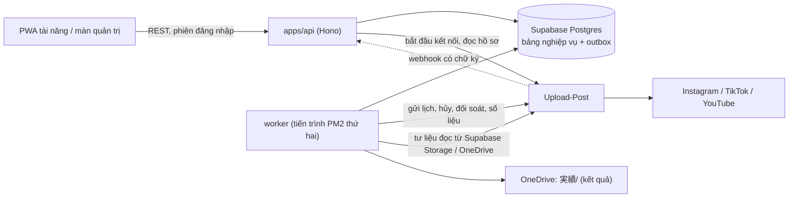
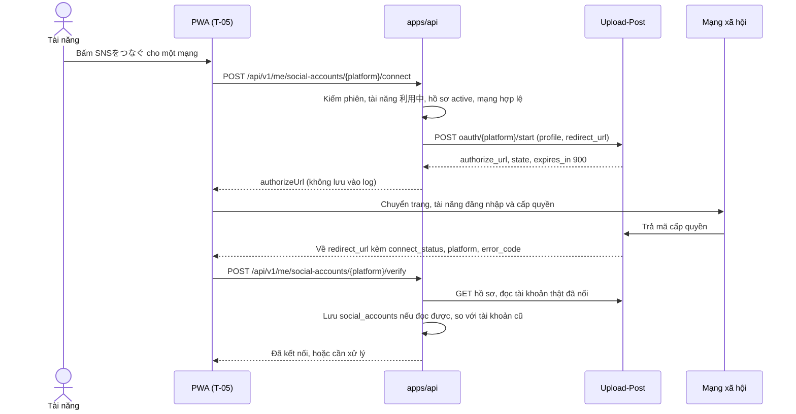

<!-- DELIVERY24112026 -->
## Cập nhật nguồn24/11 — đối chiếu25/11/2026

Phần cập nhật này thay nhận định cũ trên đúng chủ đề bên dưới; giữ nội dung trước để truy vết. [Báo cáo và hash](../../docs/requirement-review/corrections-2026-11-19/DELIVERY_24112026_REVIEW.md). Chưa là baseline/AC đã duyệt.

### Từ cấm sau AI sửa

Quyết định24/11: AI viết lại rồi đặt lịch; không thêm bước Talent xác nhận lại, không chuyển Manager sửa.

**Còn mở/giới hạn:** Không tự chốt số lần sửa khi vẫn lỗi, thất bại hoặc tương tác với duyệt bài công việc; No.96 vẫn theo dõi hiệu lực danh sách đổi. Căn cứ: `KS 20261122!G4:I4 (No.3)`; `EV-1313`; QA No.40;QA No.90;QA No.96;TR-4-4.

### TikTok: giữ đăng trực tiếp

Nguồn ghi tiếp tục đăng trực tiếp qua Upload-Post, không gửi nháp; giữ lịch/autopost và không thêm ô Talent chọn phạm vi công khai từng bài. Nguồn đồng thời ghi câu trả lời TikTok và Upload-Post khác nhau.

**Còn mở/giới hạn:** Đây là hướng đi và lời thuật lại của nguồn, không chứng minh TikTok duyệt mô hình. Giữ rủi ro hạn chế bài/tài khoản và kiểm provider; không ghi tuân thủ đã xác minh. Căn cứ: `KS 20261122!G20:H24 (No.19–23)`; `EV-1320`; QA No.70;QA No.71;TR-8-2;TR-8-3;TR-8-4.

### Dừng hệ thống và lịch ngoài

Sau họp24/11 xác nhận không làm nút hủy toàn bộ lịch; dừng từng Talent vẫn có. Dừng hệ thống phải hủy cả lịch đã gửi Upload-Post, vì tắt OS không tự hủy lịch ngoài.

**Còn mở/giới hạn:** Đội thiết kế trình tự hủy/đối soát trước shutdown và xử lý thất bại, không hứa tắt VPS là dừng được mọi bài. Căn cứ: `KS 20261122!G30:H30;G35:I35 (No.29,34)`; `EV-1321`; QA No.77;QA No.91;TR-7-5.

<!-- /DELIVERY24112026 -->

# Hướng dẫn tích hợp Upload-Post

Bản 2.0 · 19/11/2026 · Dành cho AI agent lập trình. Thay bộ 1.1 (17/11/2026: `UPLOAD_POST_IMPLEMENTATION_SPEC_VI.md`, `API_CONTRACTS.schema.json`, `TEST_CASES.csv`, `README.md`, `SOURCE_MANIFEST.json`, `VALIDATION.md`; xem lịch sử git).

Tài liệu này hướng dẫn agent **chưa làm gì** dựng được phần đăng bài của AI Talent OS qua Upload-Post:
- đăng ký từng tài năng với Upload-Post, cho tài năng tự kết nối Instagram, TikTok, YouTube (SCD 8-2);
- gửi lịch đăng cùng một tư liệu và chú thích lên các mạng đã kết nối, theo dõi kết quả **riêng từng mạng** (8-3);
- hủy lịch, dừng đăng tự động, báo đăng lỗi và mất kết nối (7-2, 7-5, 8-5, 8-6);
- lấy số liệu mỗi ngày và khung giờ tương tác (8-7, 8-9, 3-10).

Ca kiểm thử ở [CA_KIEM_THU_VI.md](CA_KIEM_THU_VI.md) (viết tắt **CK**). Đăng nhập, phiên, quyền ở [../supabase-db-auth-spec/HUONG_DAN_TICH_HOP_VI.md](../supabase-db-auth-spec/HUONG_DAN_TICH_HOP_VI.md); thông báo push ở [../pwa-platform-spec/HUONG_DAN_TICH_HOP_VI.md](../pwa-platform-spec/HUONG_DAN_TICH_HOP_VI.md); tư liệu trên OneDrive ở [../onedrive-agent-spec/HUONG_DAN_TICH_HOP_VI.md](../onedrive-agent-spec/HUONG_DAN_TICH_HOP_VI.md).

**Đọc trước:**
- [TECH_STACK_VA_CAU_TRUC_DU_AN.md](../TECH_STACK_VA_CAU_TRUC_DU_AN.md): chỗ đặt mã, worker, mẫu outbox;
- `database-design/07_implementation_scope_and_rules.md`: các bảng đăng bài **đang bị chặn ghi**, quy tắc migration;
- SCD EP06 (7-2, 7-5, 7-7, 8-2〜8-6, 9-1) và EP07 (3-10, 8-1, 8-7〜8-9); `SCD/EP06_…/00_Cau_hoi_cho_khach.md` §4 (danh sách kiểm chứng Upload-Post).

**Ký hiệu nguồn:**
- [YK2] = bản định nghĩa yêu cầu v2; [QA] = `AI-Talent-OS_Q&A表.xlsx`; [KS] = `要件定義確認シート_AI育成OS.xlsx` (bảng xác nhận yêu cầu, quyết định 17/11/2026; tổng hợp ở `Phan_tich/21`); [GJ] = biên bản họp 17/11/2026; [AG] = `アプリ画面案_AI育成OS.pdf` (mã màn T-/M- theo tài liệu này); U1… = tài liệu Upload-Post ở §16.
- **[Chốt]** = đã có căn cứ; **[Chưa rõ]** = chờ khách; **[Đề xuất]** = thiết kế của đội; **[Kiểm chứng]** = theo tài liệu Upload-Post, phải thử với tài khoản thật.
- Mã mẫu đánh dấu **Đã chạy với giả** khi đã qua `tsc` strict và phép kiểm với `fetch` giả (chưa nằm trong `apps/api`); **Chưa chạy thật** khi chưa gọi Upload-Post thật lần nào. Hiện **chưa có API key**, nên mọi ca UP (Upload-Post thật) đều chưa chạy.

---

## 1. Yêu cầu và quyết định

| Mục | Nội dung | Căn cứ |
|---|---|---|
| Mạng | Instagram, TikTok, YouTube. Cùng tư liệu và chú thích cho cả ba; bài chỉ có ảnh thì bỏ YouTube; mạng chưa kết nối thì bỏ qua | [YK2] §6-10 chức năng 8-3 [Chốt] |
| Số tài khoản | Một tài khoản mỗi mạng cho mỗi tài năng; tài khoản của nhóm (ユニット, nhóm nghệ sĩ) coi là tài khoản công ty | [KS] 確認10; [QA] No.23, CR-20 bỏ [Chốt] |
| Ai kết nối | Tài năng tự đăng nhập mạng xã hội. Instagram phải là tài khoản doanh nghiệp hoặc nhà sáng tạo | [YK2] UC-03, §6-10 8-2; [AG] T-05 [Chốt] |
| Cách kết nối | **Connect API** (`oauth/{platform}/start`, hạn 15 phút, màn do mình dựng). [YK2] 8-2 tả trang kết nối dựng sẵn hạn 48 giờ (`generate-jwt`). Adapter phải đổi được sang trang 48 giờ mà không sửa nghiệp vụ | Quyết định của đội, khác [YK2] [Chưa rõ] (UP-Q02) |
| Lúc đăng ký hồ sơ Upload-Post | Khi tài năng sang 利用中 (đang dùng, đã đăng ký thanh toán); tài khoản công ty khi được tạo. Phí Upload-Post tính theo số hồ sơ | SCD 8-2, S06-02; [YK2] UC-08 前提 (tiền đề) [Đề xuất] |
| Hai cách đăng | 自動投稿 (đăng tự động: chọn chủ đề, tải tư liệu một lần cho một khoảng, hệ thống tự viết và hẹn giờ) và 要確認 (xác nhận từng bài). Phần Upload-Post giống nhau, chỉ khác nơi phát lệnh hẹn giờ | [KS] 確認19, 25; [GJ]; chi tiết chờ [QA] No.70, 71 [Chốt hướng, chi tiết Chưa rõ] |
| Bài chờ duyệt | Giữ ở hệ thống, **chưa gửi** Upload-Post; chỉ gửi khi đã duyệt. Quá giờ đăng mà chưa duyệt thì hủy, không gửi | SCD 7-7, S06-01; [YK2] §6-9 [Đề xuất] |
| Giờ đăng | Hệ thống chọn (AI theo số liệu, rồi tới chỉ thị của công ty); không phải tài năng chọn | [YK2] §6-6 4-9, 8-1; [KS] 確認14 [Chốt] |
| Trần số bài/ngày của sản phẩm | **Không đặt**. Trần 1 ảnh + 1 video/ngày và mặc định 3 bài/ngày đều đã bỏ. Chỉ còn giới hạn của Upload-Post và từng mạng (§12) | [KS] 確認37; [GJ] §7; [QA] No.56 [Chốt] |
| Khoảng cách giữa hai bài, rải giờ | Đề xuất 3 giờ, ±10 phút; chưa chốt | SCD 8-4, S06-03; [QA] No.56 [Chưa rõ] |
| Tự đăng lại bài lỗi | **Không**. Người dùng chủ động hẹn lại | [YK2] §6-10 8-5; [QA] No.15, CR-15 [Chốt] |
| Ai hẹn lại bài lỗi | Quản lý ở M-08 ([AG]); [YK2] ghi "tài năng hoặc quản lý". [QA] No.59 hỏi thêm nút ở cả ứng dụng tài năng, chỉ mạng lỗi, giờ do AI chọn | SCD 8-5, S06-04, S06-05 [Chưa rõ] |
| Hủy lịch | Quản lý hủy ở màn quản trị, hệ thống hủy cả bên Upload-Post. Tài năng không hủy trong ứng dụng | [YK2] §6-10 7-2 [Chốt] |
| Dừng đăng tự động | Một công tắc toàn hệ thống và một công tắc từng tài năng; dừng thì hủy cả lịch đã hẹn; mở lại không khôi phục bài đã hủy. Dừng toàn bộ có dừng cả khoảng 自動投稿 không: chờ [QA] No.77 | [YK2] UC-08, §6-10 7-5 [Chốt]; No.77 [Chưa rõ] |
| Mất kết nối | Báo tài năng và quản lý, mỗi lần mất một lần | [YK2] §6-10 8-6; SCD S06-08 [Chốt] |
| Số liệu | Lấy mỗi ngày một lần; lỗi thì lấy lại ở lần sau; ghi vào thư mục tài năng cho AI đọc | [YK2] §6-11 8-7, 8-8 [Chốt] |
| Nhãn nội dung AI | Video do AI tạo phải gắn nhãn theo từng mạng | [YK2] §6-8 5-5 [Chốt] |
| 退会 (rút khỏi hệ thống) | Hủy lịch, ngừng tính phí; không quay lại 利用中; dữ liệu tự xóa sau 6 tháng | [KS] 確認55, 56; [QA] No.69 [Chốt hướng] |
| Sự cố dịch vụ ngoài | Chỉ tắt chức năng liên quan, báo bài lỗi | [YK2] §9-3 [Chốt] |

### 1.1. Ngoài phạm vi

Không làm:
- OAuth trực tiếp với từng mạng;
- tự đăng lại bài lỗi, tự xóa bài đã đăng;
- trả lời tin nhắn hay bình luận tự động, quảng cáo, nhạc thịnh hành;
- sửa lịch bằng `PATCH` (đổi nội dung thì hủy rồi hẹn lại).

Upload-Post có nhiều khả năng khác; thấy có endpoint không phải lý do để mở thêm tính năng.

Chức năng ngắt hoặc đổi tài khoản mạng xã hội chỉ được làm sau khi khách trả lời UP-Q03.

---

## 2. Kiến trúc và vị trí mã



| Phần | Chỗ đặt | Việc |
|---|---|---|
| Adapter | `apps/api/src/infra/upload-post/` (`client.ts`, `form.ts`, `webhook.ts`) | Gọi HTTP, phân loại lỗi, kiểm chữ ký. Không biết gì về nghiệp vụ |
| Kết nối mạng | `modules/social-accounts/` | Hồ sơ Upload-Post, Connect API, trạng thái kết nối |
| Đăng bài | `modules/publishing/` | Lập delivery, gửi lịch, hủy, dừng, webhook, đối soát |
| Số liệu | `modules/metrics/` | Lấy số liệu mỗi ngày, ghi sự kiện cho OneDrive |
| Worker | `src/worker.ts` (dự kiến, TECH_STACK §4.5) | Đọc `app_private.outbox_events`, gọi Upload-Post ngoài giao dịch |

Quy tắc [Đề xuất]:
- **API key chỉ ở BE và worker.** Trình duyệt không nhận API key, profile JWT hay token mạng xã hội.
- Route không chứa quy tắc đăng; adapter không tự hẹn lịch hay gửi thông báo.
- Một request Upload-Post chỉ nhắm **một mạng**. Một bài video tạo tối đa ba delivery độc lập, để hủy, đối soát và báo lỗi theo từng mạng. Upload-Post cho gửi nhiều mạng một lần, nhưng làm vậy thì không tách được kết quả và khóa chống trùng.
- Upload-Post giữ lịch và tự đăng đúng giờ. Hệ thống **không** có bộ hẹn giờ thứ hai tự đăng lúc tới giờ.
- Không giữ giao dịch DB mở trong lúc chờ HTTP: nhận việc (lease) trong giao dịch ngắn → gọi HTTP → lưu kết quả trong giao dịch mới có kiểm `version`.

---

## 3. Cấu hình

Biến môi trường (`apps/api/.env`, chỉ ở BE và worker; production để trong kho bí mật của nơi triển khai). Thiếu biến bắt buộc thì API không khởi động và báo tên biến, không in giá trị. Chưa cấu hình thì các route đăng bài trả 503 `UPLOAD_POST_NOT_CONFIGURED`.

```dotenv
UPLOAD_POST_API_BASE_URL=https://api.upload-post.com
UPLOAD_POST_SETTINGS_BASE_URL=https://app.upload-post.com   # cấu hình webhook tài khoản dùng host này (U8)
UPLOAD_POST_API_KEY=                 # bí mật
UPLOAD_POST_WEBHOOK_SECRETS=         # bí mật; "mới,cũ" trong lúc xoay, xong thì bỏ cũ
UPLOAD_POST_PROFILE_PREFIX=dev       # dev | stg | prod: tách hồ sơ giữa môi trường trên cùng tài khoản
UPLOAD_POST_TIMEOUT_MS=15000         # lệnh điều khiển; upload tư liệu dùng hạn riêng theo dung lượng
UPLOAD_POST_CONNECT_RETURN_URL=https://app.example.jp/pwa/sns/return   # phải nằm trong phạm vi /pwa/ để Android có thể đưa về PWA đã cài (§6.2)
UPLOAD_POST_PUBLISHING_ENABLED=false # công tắc kỹ thuật; tắt thì không gửi lịch mới (khác công tắc nghiệp vụ 7-5)
```

- Không để môi trường xem trước (preview) dùng API key production hay nhận webhook production.
- Gói Upload-Post phải từ **Basic** trở lên: gói Free bị 403 với TikTok (U25) [Kiểm chứng].
- Không có biến trần số bài/ngày: trần đó đã bỏ ([KS] 確認37). Bộ 1.1 có `POSTS_PER_TALENT_PER_DAY_MAX=3`; **không dùng nữa**.

---

## 4. Cơ sở dữ liệu

### 4.1. Bảng đã có (migration đã áp dụng, **đang chặn ghi**)

| Bảng | Dùng cho | Ghi chú |
|---|---|---|
| `posts` | Bài, 6 trạng thái nghiệp vụ theo hình 5-1: `draft`, `awaiting_approval`, `scheduled`, `published`, `failed`, `cancelled`; `cancel_reason` ∈ `manager_cancelled`, `approval_expired`, `auto_posting_paused`, `talent_ended` | Runtime hiện chỉ ghi được `draft`. `chk_posts_adopted` buộc bài đã hẹn phải có `adopted_at`, nên **trái với 自動投稿**: sửa theo P-12 |
| `social_accounts` | Một hàng mỗi mạng mỗi tài năng; `status` ∈ `connected`, `disconnected` | Chặn ghi chờ [QA] No.23 (nay đã đóng: mỗi mạng một tài khoản) |
| `post_deliveries` | Một hàng mỗi bài mỗi mạng; `provider_state` ∈ `not_submitted`, `submitted`, `submit_failed`, `cancel_requested`, `cancelled`, `cancel_failed`, `published`, `publish_failed`; `provider_job_ref`, `external_post_ref`, `failure_reason`, `published_at` | `UNIQUE (post_id, platform)`: hẹn lại mạng lỗi phải dùng lại hàng cũ hoặc thêm `generation` (UP-D3) |
| `post_metric_snapshots`, `follower_snapshots` | Số liệu bài, số người theo dõi theo ngày (giờ Nhật) | `metrics` giữ nguyên tên chỉ số gốc |
| `app_private.domain_operations`, `app_private.outbox_events` | Lệnh nghiệp vụ và sự kiện cho worker (lease, số lần thử, `unknown`) | Danh sách `kind` / `event_type` cho phép nằm trong CHECK; phải thêm loại mới (UP-D5) |

Bật ghi các bảng trên là một migration riêng, làm khi khách chốt các câu tương ứng (`database-design/07`). Không tắt trigger chặn ghi để thử.

### 4.2. Đề xuất bổ sung (chưa có migration; đưa vào `database-design/04` thành P-xx khi làm)

| Mã | Nội dung | Lý do |
|---|---|---|
| UP-D1 | `talents.upload_post_profile` (text, UNIQUE, NULL khi chưa đăng ký) + `upload_post_profile_state` (`pending`, `active`, `deleting`, `deleted`) | Tên hồ sơ cố định, không suy từ email hay tên: `<prefix>_t_<uuid không gạch>`. Mất phản hồi khi tạo thì đọc lại đúng tên đó |
| UP-D2 | `social_accounts`: thêm `status = 'reauth_required'`, `external_account_id` (ID của mạng, chuỗi), `handle`, `restricted_until`, `restriction_reason`, `last_verified_at`, `version` | Phân biệt mất kết nối với bị tạm dừng; nhận ra khi kết nối lại ra **tài khoản khác** |
| UP-D3 | `post_deliveries`: thêm `generation` (đổi UNIQUE thành `(post_id, platform, generation)`), `request_id`, `idempotency_key` UNIQUE, `payload_hash`, `first_sent_at`, `outcome_unknown_since`, `skip_reason`, `version`; trạng thái `outcome_unknown`, `skipped` | Ghi ý định **trước** HTTP; timeout không sinh khóa mới; hẹn lại mạng lỗi là một lần đăng mới có người ra lệnh |
| UP-D4 | `app_private.upload_post_webhook_inbox` (`delivery_id` UNIQUE, `redelivery_of`, `event`, `body_hash`, `body` mã hóa hoặc đã lược, `state` ∈ `pending`, `processed`, `unmatched`, `quarantined`, `received_at`) | Ghi bền trước khi trả 200; sự kiện đến trước khi lưu xong mã lịch thì thử ghép lại sau |
| UP-D5 | `domain_operations.kind` thêm `social.provision`, `publishing.submit`, `publishing.cancel`, `publishing.stop`, `publishing.reconcile`, `metrics.collect`; `outbox_events.event_type` thêm tương ứng và `publishing.webhook` | Dùng lại hàng đợi đã có, không thêm hệ thống hàng đợi thứ hai |
| UP-D6 | Bảng công tắc đăng (`scope` ∈ `global`, `talent`; `stopped`, `epoch`, người đổi, lúc đổi) hoặc cột trong `system_settings` và `talents`; `epoch` tăng mỗi lần đổi | Worker kiểm trước khi gửi và sau khi Upload-Post nhận; epoch đổi thì hủy bù |

Ánh xạ trạng thái bài từ các delivery [Đề xuất, chờ UP-Q10]:
- `scheduled`: còn ít nhất một delivery đang chờ;
- `published`: mọi delivery không bị bỏ qua đều `published`;
- `failed`: có delivery `publish_failed` và không còn delivery chờ.

UI luôn hiện kết quả **từng mạng** (T-13, M-08 [AG]), không chỉ trạng thái gộp.

---

## 5. Adapter Upload-Post

Tất cả request: `Authorization: Apikey <API key>`, host cố định trong cấu hình, không theo chuyển hướng (`redirect: 'manual'`), có hạn chờ. **Đã chạy với giả** (`tsc` strict, phép kiểm với `fetch` giả); **Chưa chạy thật**.

```ts
// infra/upload-post/client.ts: chỉ BE và worker gọi. Không log API key, URL có chữ ký, chú thích.
// Tài liệu: https://docs.upload-post.com/api/upload-video/ , /guides/rate-limits , /guides/error-handling
import { AppError } from '../../core/errors.ts'

export type Platform = 'instagram' | 'tiktok' | 'youtube'
export const PLATFORMS: readonly Platform[] = ['instagram', 'tiktok', 'youtube']
export type UploadPostConfig = { apiBase: string; settingsBase: string; apiKey: string; timeoutMs: number }

// kind quyết định bước tiếp theo; worker đọc kind, không đọc message của nhà cung cấp.
export type FailureKind =
  | 'outcome_unknown' // lệnh ghi có thể đã được nhận: đối soát, KHÔNG gửi lại bằng khóa mới
  | 'rate_limited'    // chờ tới retryAfterSeconds
  | 'quota'           // hết hạn mức gói / số bài 24 giờ / số lịch chờ: không thử lại vòng ngắn
  | 'auth'            // API key sai: mở cầu dao, không thử lại (10 lần sai liên tiếp bị chặn IP)
  | 'plan'            // 403: vượt số profile, TikTok trên gói Free, ghế bị khóa
  | 'invalid' | 'not_found' | 'conflict' | 'unavailable'

export class UploadPostError extends AppError {
  readonly kind: FailureKind
  readonly providerCode: string | null
  readonly retryAfterSeconds: number | null
  constructor(kind: FailureKind, providerCode: string | null = null, retryAfterSeconds: number | null = null) {
    super(`UPLOAD_POST_${kind.toUpperCase()}`, kind === 'invalid' ? 422 : kind === 'not_found' ? 404 : kind === 'conflict' ? 409 : 503)
    this.kind = kind
    this.providerCode = providerCode
    this.retryAfterSeconds = retryAfterSeconds
  }
}

type Body = Record<string, unknown>
const text = (v: unknown) => (typeof v === 'string' ? v : null)

// Trạng thái HTTP + thân lỗi → FailureKind. write=true với POST/DELETE/PATCH.
export function classify(status: number, body: Body, headers: Headers, write: boolean): UploadPostError {
  const code = text(body.error_code) ?? text(body.code)
  if (status === 401) return new UploadPostError('auth', code)
  if (status === 403) return new UploadPostError('plan', code)
  if (status === 404) return new UploadPostError('not_found', code)
  if (status === 409) return new UploadPostError('conflict', code) // IDEMPOTENCY_KEY_IN_USE: đợi rồi đối soát cùng khóa
  if (status === 429) {
    const message = text(body.message) ?? ''
    if (code === 'SCHEDULED_POSTS_LIMIT' || Array.isArray(body.violations) || /monthly limit/i.test(message)) return new UploadPostError('quota', code)
    const reset = Number(headers.get('X-RateLimit-Reset'))
    const wait = Number.isFinite(reset) && reset > 0 ? Math.max(5, Math.ceil(reset - Date.now() / 1000)) : 60
    return new UploadPostError('rate_limited', code, wait)
  }
  if (status === 400 || status === 422) return new UploadPostError('invalid', code)
  return new UploadPostError(write ? 'outcome_unknown' : 'unavailable', code)
}

type CallOptions = { json?: unknown; form?: FormData; query?: Record<string, string>; idempotencyKey?: string; base?: 'api' | 'settings' }

export class UploadPostClient {
  private readonly cfg: UploadPostConfig
  private readonly http: typeof fetch
  constructor(cfg: UploadPostConfig, http: typeof fetch = fetch) { this.cfg = cfg; this.http = http }

  // path cố định trong mã (ví dụ '/api/upload'); id do người dùng gửi phải qua encodeURIComponent.
  async call<T extends Body>(method: 'GET' | 'POST' | 'DELETE' | 'PATCH', path: string, o: CallOptions = {}): Promise<T> {
    if (!path.startsWith('/api/')) throw new Error('UPLOAD_POST_PATH_INVALID')
    const url = new URL(path, o.base === 'settings' ? this.cfg.settingsBase : this.cfg.apiBase)
    for (const [k, v] of Object.entries(o.query ?? {})) url.searchParams.set(k, v)
    const headers: Record<string, string> = { Authorization: `Apikey ${this.cfg.apiKey}`, Accept: 'application/json' }
    if (o.idempotencyKey) headers['Idempotency-Key'] = o.idempotencyKey
    let body: BodyInit | undefined
    if (o.form) body = o.form // để fetch tự đặt Content-Type kèm boundary
    else if (o.json !== undefined) { headers['Content-Type'] = 'application/json'; body = JSON.stringify(o.json) }
    const write = method !== 'GET'
    let res: Response
    try {
      // redirect 'manual': không mang Authorization sang host khác
      res = await this.http(url, { method, headers, body, redirect: 'manual', signal: AbortSignal.timeout(this.cfg.timeoutMs) })
    } catch {
      throw new UploadPostError(write ? 'outcome_unknown' : 'unavailable', 'NETWORK')
    }
    const parsed = (await res.json().catch(() => ({}))) as Body
    if (res.status >= 300 && res.status < 400) throw new UploadPostError('unavailable', 'REDIRECT')
    if (!res.ok) throw classify(res.status, parsed, res.headers, write)
    return parsed as T
  }

  // Connect API: URL đăng nhập mạng xã hội, hạn 900 giây, state dùng một lần.
  async startConnect(profile: string, platform: Platform, redirectUrl: string) {
    const r = await this.call('POST', `/api/uploadposts/oauth/${platform}/start`, { json: { profile, redirect_url: redirectUrl } })
    const authorizeUrl = text(r.authorize_url)
    if (!authorizeUrl?.startsWith('https://')) throw new UploadPostError('unavailable', 'BAD_RESPONSE')
    return { authorizeUrl, expiresInSeconds: typeof r.expires_in === 'number' ? r.expires_in : 900 }
  }

  async cancelSchedule(jobId: string) {
    await this.call('DELETE', `/api/uploadposts/schedule/${encodeURIComponent(jobId)}`)
  }
}
```

Endpoint dùng trong hệ thống (host `api.upload-post.com` trừ khi ghi khác) [Kiểm chứng]:

| Việc | Method, đường dẫn | Ghi chú |
|---|---|---|
| Tạo / đọc / liệt kê / xóa hồ sơ | `POST` / `GET /{username}` / `GET` / `DELETE` `/api/uploadposts/users` | 403 khi vượt số hồ sơ của gói (U2) |
| Bắt đầu kết nối | `POST /api/uploadposts/oauth/{platform}/start` | body `profile`, `redirect_url` (U1) |
| Ngắt một mạng | `DELETE /api/uploadposts/users/social` | Chỉ dùng sau UP-Q03 |
| Quyền đăng của TikTok | `GET /api/uploadposts/tiktok/settings` (tham số `profile`) | Đọc mức riêng tư cho phép trước khi gửi (U12) |
| Gửi video / ảnh | `POST /api/upload` / `POST /api/upload_photos` (multipart) | §7.2 |
| Trạng thái, lịch sử | `GET /api/uploadposts/status` (`request_id` hoặc `job_id`), `GET /api/uploadposts/history` | Đối soát (U6, U7) |
| Lịch: danh sách, một lịch, hủy | `GET /api/uploadposts/schedule`, `GET` / `DELETE /api/uploadposts/schedule/{job_id}` | Không dùng `PATCH` (U5) |
| Đăng lại mạng lỗi | `POST /api/uploadposts/posts/retry` | Chỉ đăng lại mạng lỗi, dùng lại tư liệu cũ; chỉ gọi khi có lệnh hẹn lại (§10.3) (U14) |
| Webhook | `GET/POST/DELETE https://app.upload-post.com/api/uploadposts/users/notifications`; `/api/uploadposts/users/profile-webhook`; nhật ký `/api/uploadposts/webhooks/deliveries` (giữ 7 ngày), gửi lại `…/{id}/redeliver`; xoay bí mật `POST /api/uploadposts/users/webhook-secret` | Thao tác vận hành, không mở ra FE (U8) |
| Số liệu | `GET /api/analytics/{profile_username}`, `GET /api/uploadposts/post-analytics/{request_id}`, `GET /api/uploadposts/audience`, `GET /api/uploadposts/best-times`, `GET /api/uploadposts/me` | §11 (U9, U18) |

---

## 6. Kết nối mạng xã hội (SCD 8-2)

### 6.1. Đăng ký hồ sơ (**Chưa chạy thật**)

Khi tài năng sang 利用中 (hoặc khi tạo tài khoản công ty), giao dịch đổi trạng thái ghi thêm lệnh `social.provision`. Worker:
1. Nếu `upload_post_profile_state = active` thì xong.
2. Ghi tên hồ sơ cố định (UP-D1) với `pending`, commit.
3. `POST /api/uploadposts/users`. Kết quả:
   - 2xx: đọc lại hồ sơ để xác nhận;
   - lỗi mạng hoặc 5xx: đọc lại hồ sơ cùng tên;
   - 409: chỉ nhận nếu đúng tên của hệ thống;
   - 403: sự cố gói, báo vận hành;
   - 401: cầu dao tích hợp.
4. Đánh dấu `active`. Không tự tạo tên khác để tránh lỗi; không tự xóa hồ sơ trùng.

Trong lúc chưa `active`, nút SNSをつなぐ (kết nối mạng xã hội) ở T-05 [AG] tạm khóa, ghi "đang chuẩn bị" (SCD 8-2).

### 6.2. Luồng kết nối (**Chưa chạy thật**)



- **Không tin tham số trên URL trả về.** `connect_status=success` chỉ là gợi ý; trạng thái lưu vào DB lấy từ việc đọc hồ sơ ở Upload-Post.
- `state` dùng một lần, hạn 15 phút. Hết hạn thì bấm lại để tạo lần mới, không kéo dài.
- `error_description` là chữ tự do, tối đa 200 ký tự: không phân tích, không hiện nguyên dạng HTML.
- Trang trả về: `Cache-Control: no-store`, `Referrer-Policy: no-referrer`, xóa query khỏi thanh địa chỉ sau khi đọc. Phiên hết hạn thì đăng nhập lại rồi gọi `verify`; không dùng lại URL cũ.

**Không dựa vào việc tài năng quay về đúng PWA** [Đề xuất, Kiểm chứng UP-M03]. Từ PWA đã cài, trang đăng nhập của mạng xã hội mở ở nơi do hệ điều hành quyết định:
- iPhone: khung trình duyệt phủ lên PWA. Xong thì trang trả về hiện ngay trong khung đó; tài năng phải bấm "Xong" mới về PWA.
- Android: khung trình duyệt phủ lên PWA, hoặc app của mạng xã hội. Có thể về PWA, có thể về Chrome.
- Nếu app mạng xã hội bật lên thì đường về thường là Safari hoặc Chrome. Ở đó **không có phiên đăng nhập của PWA** (iPhone tách bộ nhớ giữa Safari và PWA).

Vì vậy:
1. Trang trả về (`/pwa/sns/return`) **không cần phiên đăng nhập**. Nó chỉ hiện "Đã xong, hãy quay lại ứng dụng". Có phiên thì gọi `verify` luôn.
2. PWA tự gọi `verify` khi tài năng quay lại app (`visibilitychange` sang `visible`, hoặc khi mở T-05) nếu còn lượt kết nối chưa xác nhận. Kết quả đúng dù tài năng quay về bằng đường nào.
3. T-05 có câu "Cho phép xong trên mạng xã hội thì quay lại ứng dụng này" và nút "Kiểm tra lại kết nối".
4. Mở `authorizeUrl` bằng `location.assign` trong cùng cửa sổ, không dùng `window.open` (cửa sổ mới dễ bị chặn và lạc khỏi PWA).

### 6.2a. TikTok

- Upload-Post dùng **đăng nhập TikTok trên web** (Login Kit for Web). Tài liệu TikTok chỉ tả luồng web: chưa đăng nhập thì đưa tới trang web TikTok để đăng nhập, cho phép xong thì chuyển về `redirect_uri` kèm `code` và `state`. Tài liệu **không** nói gì về việc mở app TikTok, Universal Links hay trình duyệt trong app (TT4, tra 19/11/2026).
- Hệ quả: **không cam kết được app TikTok sẽ mở**. Thường tài năng đăng nhập TikTok ngay trên trang web, trong khung trình duyệt; trên iPhone, khung này thường chưa có phiên TikTok. Chuyển hẳn sang app TikTok chỉ chắc chắn với SDK gốc của TikTok cho iOS/Android, mà PWA không dùng được.
- Tài khoản TikTok tạo bằng Apple, Google hay số điện thoại vẫn đăng nhập được trên trang web, nhưng phải thử (UP-M03).
- `ACCESS_DENIED` khi tài năng đóng khung giữa chừng: xử lý như §6.2. `INVALID_STATE` khi để quá 15 phút: bấm kết nối lại.

| `connect_status` / `error_code` | Hệ thống làm |
|---|---|
| `success` | Gọi `verify`; đọc được tài khoản thì `connected` |
| `cancelled` / `ACCESS_DENIED` | Không đổi kết nối đang có; hiện "đã hủy" |
| `error` / `INVALID_STATE` | Cho bấm lại (lần mới) |
| `error` / `PROVIDER_ERROR`, `CONNECTION_FAILED` | Báo lỗi, cho thử lại; vẫn gọi `verify` vì có thể đã nối |
| Không quay về (đóng tab) | Lần mở T-05 sau gọi `verify` |

### 6.3. Trường hợp đặc biệt

| Tình huống | Hành vi | Căn cứ |
|---|---|---|
| Kết nối lại ra **tài khoản khác** tài khoản cũ | Không tự chuyển lịch cũ sang tài khoản mới; chặn gửi mới cho mạng đó tới khi xử lý lịch cũ | [Đề xuất], UP-Q03 |
| Tài khoản mạng đang nối ở hồ sơ Upload-Post khác (`account_moved: true`) | Upload-Post **chuyển** tài khoản sang hồ sơ vừa nối; hồ sơ cũ mất kết nối. Hệ thống: báo quản lý, tài năng cũ chuyển `disconnected` qua webhook hoặc đối soát | U1 [Kiểm chứng] |
| Instagram tài khoản cá nhân | Hiện hướng dẫn chuyển sang doanh nghiệp hoặc nhà sáng tạo; giữ chưa kết nối | [AG] T-05; U15 |
| YouTube nhiều kênh | Lưu kênh thật đọc được từ hồ sơ; POC phải thử tài khoản có nhiều kênh | U16 [Kiểm chứng] |
| Chỉ nối 1–2 mạng | Vẫn dùng được, chỉ đăng lên mạng đã nối | 確認11 |

---

## 7. Gửi lịch đăng (SCD 8-3)

### 7.1. Điều kiện gửi

Lệnh `publishing.submit` được ghi khi:
- 要確認: tài năng chấp nhận bài (4-3), hoặc quản lý duyệt bài (7-7);
- 自動投稿: hệ thống soạn xong bài của khoảng (P-12).

Worker gửi **một delivery** khi đủ cả các điều kiện dưới, kiểm ngay trước HTTP:
- tài năng 利用中; công tắc toàn hệ thống và của tài năng đều đang bật đăng (đọc `epoch`);
- bài đúng `version` đã chấp nhận hoặc đã duyệt, không dính từ cấm (4-4);
- tư liệu sẵn sàng, đúng loại cho mạng (bài ảnh không gửi YouTube);
- mạng đã `connected`, chưa bị tạm dừng (`restricted_until` đã qua), tài khoản trùng tài khoản lúc lập delivery;
- giờ đăng ở tương lai và không quá 365 ngày.

Thiếu một điều kiện thì không gửi, ghi lý do, báo theo 8-5. **Giờ đăng đã qua thì không bỏ `scheduled_date` để thành "đăng ngay".**

### 7.2. Trường gửi đi [Kiểm chứng, U3, U4]

| Trường | Giá trị |
|---|---|
| `user` | Tên hồ sơ Upload-Post (UP-D1), không phải tên tài khoản mạng xã hội |
| `platform[]` | Đúng một mạng |
| `video` / `photos[]` | Tệp từ tư liệu đã kiểm (§7.4); không nhận URL do trình duyệt gửi |
| `title` | Instagram, TikTok: chú thích + hashtag (Upload-Post bỏ qua `description` ở hai mạng này). YouTube: tiêu đề ≤ 100 ký tự |
| `description` | YouTube: chú thích |
| `scheduled_date` | ISO-8601 UTC có `Z`; không gửi `timezone` để khỏi hiểu hai lần |
| `async_upload` | `true` (upload đồng bộ hết hạn sau 59 giây) |
| `request_id`, `external_id` | Tự đặt và lưu **trước** HTTP; `external_id` ≤ 255 ký tự, chỉ để tương quan |
| Header `Idempotency-Key` | Cố định cho delivery (UP-D3); hiệu lực 24 giờ ở Upload-Post |
| `privacy_level` (TikTok) | Luôn gửi rõ, lấy trong các mức tài khoản cho phép (đọc settings); mức không có thì lỗi `tiktok_privacy_unavailable` |
| Nhãn AI | §7.3 |

Bài ảnh: trường chú thích của `/api/upload_photos` cho từng mạng phải kiểm lại trong POC (UP-K04).

Mẫu dựng form (**Đã chạy với giả**):

```ts
// infra/upload-post/form.ts: một submission = một mạng. Đầu vào lấy từ DB (bản đã chấp nhận), không từ request.
import type { Platform } from './client.ts'

export type Submission = {
  idempotencyKey: string   // = id submission, gửi lại đúng khóa này khi đối soát cho phép
  requestId: string        // tự đặt trước HTTP, để đối soát qua /status và /history
  externalId: string       // nhãn tương quan (≤ 255 ký tự), không chống trùng
  profileUsername: string  // hồ sơ Upload-Post của tài năng, không phải tên tài khoản mạng xã hội
  platform: Platform
  kind: 'video' | 'photo'
  caption: string          // chú thích + hashtag, dùng chung ([YK2] §6-10 8-3)
  youtubeTitle?: string    // bắt buộc với YouTube, ≤ 100 ký tự
  scheduledAt: Date
  aiGenerated: boolean     // lấy từ nguồn gốc tư liệu (5-5), không suy ra từ chú thích do AI viết
  tiktokPrivacy?: 'PUBLIC_TO_EVERYONE' | 'MUTUAL_FOLLOW_FRIENDS' | 'FOLLOWER_OF_CREATOR' | 'SELF_ONLY'
  files: { name: string; blob: Blob }[]
}

export const endpointFor = (s: Submission) => (s.kind === 'video' ? '/api/upload' : '/api/upload_photos')

export function buildUploadForm(s: Submission, now = new Date()): FormData {
  if (s.scheduledAt.getTime() <= now.getTime()) throw new Error('SCHEDULE_TIME_PASSED') // không bỏ giờ để thành "đăng ngay"
  if (s.kind === 'photo' && s.platform === 'youtube') throw new Error('PLATFORM_NOT_APPLICABLE')
  if (s.files.length === 0 || (s.kind === 'video' && s.files.length !== 1)) throw new Error('MEDIA_NOT_READY')
  const f = new FormData()
  f.set('user', s.profileUsername)
  f.append('platform[]', s.platform)
  for (const file of s.files) f.append(s.kind === 'video' ? 'video' : 'photos[]', file.blob, file.name)
  if (s.platform === 'youtube') {
    if (!s.youtubeTitle || [...s.youtubeTitle].length > 100) throw new Error('PLATFORM_INPUT_INVALID')
    f.set('title', s.youtubeTitle)
    f.set('description', s.caption)
  } else {
    f.set('title', s.caption) // Instagram, TikTok: chú thích nằm ở title; description bị bỏ qua
  }
  f.set('scheduled_date', s.scheduledAt.toISOString()) // UTC có Z; không gửi timezone để khỏi hiểu hai lần
  f.set('async_upload', 'true')
  f.set('request_id', s.requestId)
  f.set('external_id', s.externalId)
  if (s.platform === 'tiktok') {
    if (!s.tiktokPrivacy) throw new Error('PLATFORM_INPUT_INVALID') // luôn gửi rõ, lấy từ mức tài khoản cho phép
    f.set('privacy_level', s.tiktokPrivacy)
  }
  if (s.aiGenerated) f.set(s.platform === 'youtube' ? 'containsSyntheticMedia' : s.platform === 'tiktok' ? 'is_aigc' : 'is_ai_generated', 'true')
  return f
}
```

Gọi: `client.call('POST', endpointFor(s), { form: buildUploadForm(s), idempotencyKey: s.idempotencyKey })`.

### 7.3. Nhãn nội dung AI (SCD 5-5) [Kiểm chứng, U3, U13]

| Mạng | Trường | Lưu ý |
|---|---|---|
| TikTok | `is_aigc` (tên khác `tiktok_is_ai_generated`) | Chỉ áp dụng khi đăng thẳng (`post_mode=DIRECT_POST`, mặc định) |
| Instagram | `is_ai_generated` | Hiện nhãn "AI info"; **không gỡ được sau khi đăng** |
| YouTube | `containsSyntheticMedia` (hoặc `is_ai_generated`) | — |

Nhãn lấy từ nguồn gốc tư liệu (video do fal.ai tạo), không suy ra từ việc chú thích do AI viết. Không bỏ nhãn để chữa lỗi đăng.

### 7.4. Tư liệu

- Worker đọc tệp từ bản tạm trên Supabase Storage (giữ 7 ngày sau khi đăng); bản tạm đã xóa thì đọc từ OneDrive (bộ OneDrive §7.5). Gửi dạng luồng (stream), không đọc cả video vào RAM.
- Nếu dùng URL tải tạm thay cho tệp thì URL phải còn hạn tới khi Upload-Post tải xong. Không dùng link chia sẻ HTML của OneDrive. Upload-Post chép tư liệu lúc nhận hay lúc tới giờ đăng: kiểm trong POC (UP-K03).
- Trước khi gửi [Đề xuất]:
  - ảnh HEIC đổi sang JPEG;
  - ảnh > 8 MB nén xuống (giới hạn của Instagram);
  - video chuẩn hóa MP4 H.264 + AAC, `yuv420p`, `+faststart` để Upload-Post khỏi chuyển mã lâu;
  - không tự cắt ảnh hay thêm viền: Upload-Post tự làm và ghi vào trường `changes`.
- Giới hạn tải lên phía ứng dụng (video 3 giây – 3 phút, ≤ 300 MB) lấy từ SCD 6-3, S05-01 [Đề xuất]. Giới hạn chữ: SCD 4-1, S04-05.

### 7.5. Thuật toán gửi (**Chưa chạy thật**)

```text
nhận outbox 'publishing.submit' bằng lease
đọc delivery; nếu đã có provider_job_ref hoặc đang outcome_unknown → chuyển sang đối soát, KHÔNG POST mới
kiểm lại §7.1 (đọc epoch); thiếu điều kiện → kết thúc với lý do
ghi first_sent_at, request_id, idempotency_key, payload_hash (giao dịch riêng, commit)
POST /api/upload hoặc /api/upload_photos (ngoài giao dịch)
  202 + job_id        → provider_state = submitted, lưu provider_job_ref
  outcome_unknown     → provider_state = outcome_unknown, lên lịch đối soát
  invalid / plan      → submit_failed + failure_reason, báo 8-5
  quota / rate_limited→ chưa gửi được; giữ việc tới mốc chờ, không đổi khóa
đọc lại epoch; nếu đã dừng trong lúc gửi → ghi 'publishing.cancel' bù ngay
```

Khi Upload-Post đã nhận lịch, việc của worker xong. Worker không ngồi chờ tới giờ đăng.

---

## 8. Kết quả và đối soát

### 8.1. Webhook (**Đã chạy với giả**)

Đăng ký đúng bốn sự kiện: `upload_completed`, `social_account_connected`, `social_account_disconnected`, `social_account_reauth_required`. Không bật sự kiện khác (tin nhắn, bình luận, duyệt bài của Upload-Post).

Đặc điểm của Upload-Post [Kiểm chứng, U8]:
- Chữ ký nằm ở `X-Upload-Post-Signature: sha256=<hex>`: HMAC-SHA256 của chuỗi `<X-Upload-Post-Timestamp>.<thân thô>`.
- Bỏ các request có timestamp lệch quá 5 phút.
- Mã lần gửi `X-Upload-Post-Delivery` giữ nguyên qua các lần gửi lại.
- Gửi **ít nhất một lần**, thứ tự không bảo đảm.
- Thử lại khi gặp 5xx, 408, 429 hoặc quá hạn chờ (tối đa 6 lần, khoảng 8,5 giờ). 4xx khác thì không thử lại; 3xx coi như đã nhận.
- Gửi lại thủ công tạo mã lần gửi mới, kèm `X-Upload-Post-Redelivery-Of`.

```ts
// infra/upload-post/webhook.ts: kiểm chữ ký webhook. https://docs.upload-post.com/api/webhooks/
// X-Upload-Post-Signature: sha256=<hex HMAC-SHA256 của "<timestamp>.<thân thô>">, X-Upload-Post-Timestamp: giây Unix.
import { createHmac, timingSafeEqual } from 'node:crypto'

export type SignatureCheck = { ok: true } | { ok: false; reason: 'missing' | 'stale' | 'bad_signature' }

// secrets: bí mật hiện hành, cộng bí mật cũ trong lúc xoay (nhận cả hai, rồi bỏ cũ).
export function verifySignature(raw: Uint8Array, signature: string | undefined, timestamp: string | undefined,
  secrets: readonly string[], nowSeconds = Math.floor(Date.now() / 1000), windowSeconds = 300): SignatureCheck {
  if (!signature?.startsWith('sha256=') || !timestamp || !/^\d{1,12}$/.test(timestamp)) return { ok: false, reason: 'missing' }
  if (Math.abs(nowSeconds - Number(timestamp)) > windowSeconds) return { ok: false, reason: 'stale' }
  const given = Buffer.from(signature.slice('sha256='.length), 'hex')
  for (const secret of secrets) {
    const expected = createHmac('sha256', secret).update(`${timestamp}.`).update(raw).digest()
    if (given.length === expected.length && timingSafeEqual(given, expected)) return { ok: true }
  }
  return { ok: false, reason: 'bad_signature' }
}
```

```ts
// modules/publishing/webhook-routes.ts: chỉ kiểm chữ ký, ghi hộp thư + outbox trong một giao dịch, trả 200.
import { Hono } from 'hono'
import { bodyLimit } from 'hono/body-limit'
import { verifySignature } from '../../infra/upload-post/webhook.ts'

export type WebhookDeps = {
  secrets: () => readonly string[]
  // INSERT ... ON CONFLICT (delivery_id) DO NOTHING + outbox 'publishing.webhook' cùng giao dịch.
  // Trả 'conflict' khi cùng delivery_id mà thân khác (sự cố, không ghi đè).
  record: (e: { deliveryId: string; redeliveryOf: string | null; event: string; raw: Uint8Array }) => Promise<'stored' | 'duplicate' | 'conflict'>
}

export function uploadPostWebhook(deps: WebhookDeps) {
  return new Hono().post('/api/v1/webhooks/upload-post', bodyLimit({ maxSize: 256 * 1024 }), async c => {
    const raw = new Uint8Array(await c.req.arrayBuffer()) // thân thô: không parse JSON trước khi kiểm chữ ký
    const check = verifySignature(raw, c.req.header('X-Upload-Post-Signature'), c.req.header('X-Upload-Post-Timestamp'), deps.secrets())
    // 4xx: Upload-Post không gửi lại. Mất sự kiện do lỗi chữ ký thì gửi lại thủ công từ nhật ký (giữ 7 ngày).
    if (!check.ok) return c.json({ error: { code: 'WEBHOOK_SIGNATURE_INVALID' } }, 401)
    const deliveryId = c.req.header('X-Upload-Post-Delivery')
    const event = c.req.header('X-Upload-Post-Event')
    if (!deliveryId || !event) return c.json({ error: { code: 'WEBHOOK_HEADERS_MISSING' } }, 400)
    // Lỗi DB ném ra → 5xx → Upload-Post gửi lại (tối đa 6 lần trong khoảng 8,5 giờ).
    const r = await deps.record({ deliveryId, redeliveryOf: c.req.header('X-Upload-Post-Redelivery-Of') ?? null, event, raw })
    if (r === 'conflict') return c.json({ error: { code: 'WEBHOOK_DELIVERY_CONFLICT' } }, 409)
    return c.json({ ok: true })
  })
}
```

Worker xử lý hộp thư (`publishing.webhook`):
- ghép bằng `request_id`, `job_id`, `external_id`, `profile_username` + `platform`; chưa ghép được thì `unmatched`, thử lại sau (sự kiện có thể đến trước khi lưu xong mã lịch);
- áp trạng thái theo §8.2 bằng `version`. Bài đã `published` không lùi về lỗi vì sự kiện cũ;
- gửi lại cùng sự kiện (mã lần gửi mới) không tạo thông báo lần hai: chống trùng theo delivery + mạng + kết quả.

### 8.2. Ánh xạ kết quả [Kiểm chứng, U6, U17]

| Quan sát | `post_deliveries.provider_state` |
|---|---|
| Gửi lịch trả 202 + `job_id` | `submitted` (chưa phải đã đăng) |
| `upload_completed`, `result.success = true` | `published`, lưu `result.url`, mã bài, `published_at` |
| `upload_completed`, `result.success = false` | `publish_failed` + lý do đã phân loại (§9); báo 8-5 |
| HTTP 200 tổng thể | Chỉ là request được xử lý; xem kết quả **từng mạng** |
| `pending`, `queued`, `processing` | Chưa xong; hỏi lại sau |
| Mất phản hồi, quá hạn chờ | `outcome_unknown` (UP-D3); đối soát §8.3 |
| TikTok trả mã tạm (`publish_id`) | Chưa phải mã bài công khai; mã thật có thể về muộn mà không có webhook mới, nên đối soát tiếp |

### 8.3. Đối soát khi không rõ

1. Có `job_id` thì hỏi `status` theo `job_id`, không thì theo `request_id`.
2. Chưa thấy thì tìm trong `history` (lọc theo hồ sơ, `request_id`/`external_id`); bài tương lai thì liệt kê `schedule` có phân trang.
3. Thấy đúng một bản ghi thì gắn vào delivery. Thấy nhiều bản ghi là sự cố trùng: báo vận hành, không tự xóa bài đã đăng.
4. Một lần không thấy chưa chứng minh là chưa nhận. Hỏi giãn dần: chờ 5 giây, rồi 10 giây khi đang xử lý, bài hẹn giờ tới 60 giây; tối thiểu 5 giây vì kết quả có cache.
5. Chỉ gửi lại khi còn trong 24 giờ hiệu lực của khóa, cùng khóa và cùng nội dung. Hết 24 giờ mà vẫn không rõ thì chuyển xử lý tay; **không** tự gửi bằng khóa mới.

Webhook không tính vào hạn mức request, nên ưu tiên webhook; hỏi định kỳ chỉ để dự phòng. Không nhận kết quả sau giờ đăng 1 giờ thì hỏi Upload-Post; vẫn không rõ thì cảnh báo vận hành (SCD 8-3).

---

## 9. Bảng lỗi

Mã lỗi Upload-Post không trả thẳng ra giao diện. Lỗi phiên kết nối thường chỉ là chuỗi chữ, nên phân loại theo mẫu chuỗi đã kiểm trong POC (UP-K08) [Kiểm chứng, U24, U26].

| Tình huống | Hệ thống làm | Thử lại? |
|---|---|---|
| 401 API key | Mở cầu dao tích hợp, báo vận hành; không bắt tài năng kết nối lại | Không (10 lần sai liên tiếp → IP bị chặn 5 phút) |
| 403 gói / số hồ sơ / `TEAM_SEAT_SUSPENDED` | Sự cố gói; chặn đăng ký hồ sơ mới | Không |
| 400/422 dữ liệu sai | `submit_failed`, ghi trường lỗi; sửa adapter hoặc dữ liệu | Không |
| 429 tốc độ gọi | Chờ tới `X-RateLimit-Reset` (bộ giới hạn chung cho mọi worker) | Có, sau mốc |
| 429 kèm `violations` (`hard_cap`, vượt số bài 24 giờ của một mạng) | Lỗi đúng mạng đó, báo 8-5; không thử lại trong 24 giờ | Không |
| 429 `SCHEDULED_POSTS_LIMIT`, hết số upload trong tháng | Sự cố hạn mức, báo vận hành | Không |
| 409 `IDEMPOTENCY_KEY_IN_USE` | Đợi vài giây rồi đối soát **cùng khóa** | Đối soát |
| 5xx / quá hạn chờ khi gửi | `outcome_unknown`, đối soát | Chỉ cùng khóa |
| Mất phiên: "session has expired", "Token expired and refresh failed", "Error validating access token", "user changed their password", "User has not authorized application", `tiktok_reconnect_required` | `social_accounts` → `reauth_required` (UP-D2), báo 8-6 một lần | Không |
| Instagram `account_checkpoint_required` | Báo tài năng **mở Instagram** xác nhận cảnh báo bảo mật; kết nối lại không giúp | Không |
| Instagram `account_reauth_required` (`failure_stage: precheck`) | Tự hết khi Meta thôi báo; giữ kết nối, báo nhẹ | Không |
| Tài khoản bị mạng chặn: YouTube "account … is suspended", Instagram "restricted or inactive", TikTok `spam_risk_user_banned_from_posting` | Báo quản lý; gợi ý dừng đăng tự động của tài năng đó (7-5) | Không |
| `account_restricted` (Upload-Post tự tạm dừng; `restriction_reason`, `restricted_until`) | Lưu theo tài khoản mạng (UP-D2); không gửi cho mạng đó tới hết hạn, hai mạng kia vẫn đăng. **Không dùng kết nối lại để lách** | Sau `restricted_until` |
| TikTok `content_rejected` (`spam_risk`, `spam_risk_text`) | Không gửi lại nguyên bài; báo tài năng sửa chú thích qua AI (4-2) | Không |
| Lỗi tư liệu ("Invalid image aspect ratio", "rejected the media format", "could not be fetched", "too small") | `publish_failed`; sửa tư liệu trước | Không |
| Lỗi tạm phía mạng ("Temporary issue…", 503, "Fatal", "Rate limit reached") | Theo dõi; Upload-Post có thể đã tự thử lại | Không gửi thêm (UP-Q06) |
| Lỗi không nhận ra (quyền riêng tư, bản quyền, nội dung trùng…) | `publish_failed` với lý do "không rõ", đưa vào đối soát tay | Không |

`restriction_reason` [Kiểm chứng, U26]:

| Lý do | Thời gian tạm dừng |
|---|---|
| Instagram `spam_restricted` | 24 giờ |
| Instagram `publish_limit` | 30 phút |
| YouTube `daily_upload_limit` | 2 giờ; Upload-Post tự thử lại bài đó. Đây không phải hệ thống đăng lại nên không trái 8-5; adapter không gửi thêm |
| YouTube `permission_denied` | 24 giờ |
| TikTok `spam_risk_user_banned_from_posting` | 7 ngày |
| TikTok `spam_risk_too_many_posts` | 1 giờ |

Mã lỗi ứng dụng ổn định cho FE: `UPLOAD_POST_NOT_CONFIGURED`, `PUBLISHING_STOPPED`, `APPROVAL_REQUIRED`, `POST_VERSION_CONFLICT`, `NO_ELIGIBLE_DESTINATION`, `MEDIA_NOT_READY`, `PLATFORM_INPUT_INVALID`, `SCHEDULE_TIME_PASSED`, `PUBLICATION_OUTCOME_UNKNOWN`, `SOCIAL_REAUTH_REQUIRED`, `CONNECT_ATTEMPT_EXPIRED`, `UPLOAD_POST_UNAVAILABLE`. Thông báo do FE dịch, lấy chữ từ `lib/messages.ts`.

---

## 10. Hủy, dừng, hẹn lại, rút khỏi hệ thống

### 10.1. Quản lý hủy một bài (SCD 7-2) (**Chưa chạy thật**)

- Bài `awaiting_approval` hoặc chưa gửi: hủy ở hệ thống, không gọi Upload-Post (S06-01).
- Bài đã gửi: `cancel_requested` → `DELETE /api/uploadposts/schedule/{job_id}` cho **từng delivery** → `cancelled`. Ghi nhật ký thao tác (C-03). `posts.cancel_reason = manager_cancelled`.
- Hủy sát giờ: DELETE trả 200 vẫn chưa chứng minh bài chưa đăng. Đối soát lại; nếu đã đăng thì giữ `published` và báo "hủy không kịp". Không gọi xóa bài đã đăng để che.
- DELETE trả 404: đối soát `status`/`history` (có thể đã chạy hoặc sai mã); không mặc định đã hủy.
- Lỗi hủy: `cancel_failed`, bài vẫn hiện "đã hẹn", cho thử lại (SCD 7-2).

### 10.2. Dừng đăng tự động (SCD 7-5) (**Chưa chạy thật**)

1. Trong một giao dịch: đặt `stopped = true`, tăng `epoch` (UP-D6), tạo `domain_operations` `publishing.stop`, ghi nhật ký. Mọi lệnh gửi mới bị từ chối (`PUBLISHING_STOPPED`) ngay sau khi commit.
2. Delivery chưa gửi: hủy ở hệ thống. Delivery `submitted` hoặc `outcome_unknown`: tạo lệnh hủy như §10.1.
3. Quét danh sách lịch ở Upload-Post theo hồ sơ để bắt lịch đã gửi mà mất phản hồi. Không xóa lịch không do hệ thống tạo.
4. Lệnh dừng chỉ xong khi mọi delivery có kết quả rõ; M-16 [AG] hiện số bài chưa hủy được.
5. Mở lại: chỉ mở cổng, **không** khôi phục bài đã hủy. `cancel_reason = auto_posting_paused`.

Trong lúc dừng, AIコーチ vẫn nhắn và tạo bản nháp (S06-06). Bài được chấp nhận trong lúc dừng xử lý thế nào, có báo tài năng không: [QA] No.60, 61 [Chưa rõ]. Dừng toàn bộ có dừng cả khoảng 自動投稿 không: [QA] No.77 [Chưa rõ]. Hủy nhiều tài năng một lúc không nguyên tử: UI không được báo "đã dừng hết" khi còn lịch chưa hủy xong.

### 10.3. Hẹn lại bài lỗi (SCD 8-5) [Chưa rõ]

- Chỉ khi có người ra lệnh (S06-04: quản lý ở M-08; [QA] No.59 hỏi thêm nút ở ứng dụng tài năng). Không bao giờ tự động (CR-15).
- Chỉ các mạng lỗi (S06-05), một lần đăng mới với `generation` mới (UP-D3) và khóa chống trùng mới. Giờ mới: đề xuất sau 15 phút (S06-05) hoặc AI chọn (No.59).
- Có hai cách:
  - (a) gửi lại như delivery mới;
  - (b) `POST /api/uploadposts/posts/retry`: chỉ đăng lại mạng lỗi, dùng lại tư liệu cũ.

  Chọn sau POC (UP-K07). Không dùng (b) khi delivery còn `outcome_unknown`.
- Upload-Post chặn nội dung trùng hoặc gần giống trong 48 giờ trên cùng tài khoản và mạng (U19). Hẹn lại cùng ảnh và chú thích có thể bị từ chối; nếu vậy thì báo cụ thể, không thử vòng.

### 10.4. Rút khỏi hệ thống (退会, SCD 7-3)

- Đổi sang 退会 → cùng luồng dừng từng tài năng (§10.2), `cancel_reason = talent_ended`.
- Xóa hồ sơ Upload-Post (`DELETE /api/uploadposts/users`) khi nào: S01-03 đề xuất ngay khi ngừng (để thôi tính phí); [QA] No.69 hỏi phạm vi xóa sau 6 tháng ([KS] 確認55). Chỉ xóa sau khi mọi lịch đã hủy xong. Số liệu và bài trong DB xóa theo việc xóa 6 tháng (P-18), không xóa lúc ngừng.

---

## 11. Số liệu (SCD 8-7, 8-9, 3-10, 8-1)

- Lệnh `metrics.collect` một lần mỗi ngày cho mỗi tài năng, khóa `(tài năng, ngày giờ Nhật)`; chạy trước lô buổi sáng (câu C5, Phan_tich/18). Lỗi một mạng không bỏ số của hai mạng kia; lần sau lấy lại.
- Ghi `follower_snapshots`, `post_metric_snapshots` (giữ nguyên tên chỉ số gốc). Thiếu số là `null` kèm lý do, **không phải 0**. Không coi `reach` = `views`.
- Commit số liệu xong mới phát sự kiện cho OneDrive ghi `実績/` (kết quả) (bộ OneDrive §7.4, SCD 8-8). Lỗi OneDrive không làm mất số liệu đã lấy.

| Số liệu | Nguồn [Kiểm chứng] |
|---|---|
| Người theo dõi Instagram, YouTube (YouTube là người đăng ký kênh) | `GET /api/analytics/{profile_username}` (U9) |
| Người theo dõi TikTok | **Không có** ở trang thống kê; lấy `followers_daily` của `GET /api/uploadposts/audience` (chỉ TikTok, tối đa 60 ngày, ngày cuối trước hôm nay) (U18) |
| Số liệu từng bài | `GET /api/uploadposts/post-analytics/{request_id}` (cache 5 phút) |
| Khung giờ tương tác (8-9) | `GET /api/uploadposts/best-times` (`profile_username`, `platform`, `timezone=Asia/Tokyo`): `best_times`, `by_hour`, `by_day_hour`, `confidence`, `warnings`; cache 24 giờ. YouTube chỉ có theo ngày. Instagram cần ≥ 100 người theo dõi |
| Số lần upload đã dùng trong tháng | `GET /api/uploadposts/me` → `api_usage.count`; cảnh báo khi tới 80% |

8-1 (chọn giờ đăng):
- dùng `best_times` khi độ tin cậy từ trung bình trở lên;
- độ tin cậy thấp, hoặc với YouTube, thì so giờ đăng các bài trước của tài năng, rồi tới chỉ thị thuật toán của công ty;
- ghi `confidence`, `warnings` vào lý do chọn giờ.

Nhịp và giờ đăng nằm trong chỉ thị cho AI, không viết cứng trong mã ([GJ]; [KS] 確認14).

---

## 12. Giới hạn, gói và chi phí [Kiểm chứng, tra 17/11/2026, U10, U19, U25]

| Giới hạn | Giá trị | Hệ thống làm |
|---|---|---|
| Request API theo gói | Basic 60/phút; Professional 100; Advanced 200; Business 500; mỗi hồ sơ +2/phút; trần 1.000/phút | Bộ giới hạn chung trong DB; đọc `X-RateLimit-*`; không suy hạn mức từ tên gói |
| Bài mỗi tài khoản mạng trong 24 giờ trượt | Instagram 50, TikTok 15 (tính chung mọi ứng dụng đăng qua API), YouTube 30. Chỉ bài thành công bị tính; bài hẹn giờ được kiểm lại lúc tới giờ | Đọc `violations` trả về, không viết cứng con số. U24 có ví dụ "5 uploads" cho Instagram trái với U19: hỏi trong POC |
| Lịch chờ mỗi tài khoản Upload-Post | Basic 20.000 … Business 50.000 (chỉ tính bài hẹn xa hơn 15 phút) | `SCHEDULED_POSTS_LIMIT` → sự cố hạn mức |
| Nội dung trùng | Cùng hồ sơ, cùng mạng, cùng nội dung trong 48 giờ bị chặn; gửi lại cùng `Idempotency-Key` trong 24 giờ nhận lại việc cũ **kể cả khi nội dung khác** | Khóa gắn đúng một delivery, không dùng lại cho nội dung khác |
| Chữ | Instagram 2.200 ký tự, ≤ 30 hashtag, ≤ 20 lần gắn @; TikTok 2.200 đơn vị UTF-16; YouTube tiêu đề 100, mô tả 5.000 | Kiểm trước khi gửi; không tự cắt (U22) |
| Video | Instagram MP4/MOV ≤ 300 MB, 3 giây – 15 phút; TikTok 3 giây – 10 phút | §7.4 (U21) |

Gói (giá công bố, chưa thuế):

| Gói | Giá tháng | Hồ sơ có sẵn | Ghi chú |
|---|---|---|---|
| Free | 0 | 2 | Không đăng được TikTok |
| Basic | 24 USD | 5 | Không có white-label (tích hợp mang thương hiệu riêng) |
| Professional | 50 USD | 25 | Có white-label |
| Advanced | 147 USD | 75 | |
| Business | 438 USD | 225 | Hồ sơ thêm 1 USD/tháng |

Ước tính: 100 tài năng ≈ Advanced + 25 hồ sơ thêm, hoặc Business; 300 tài năng ≈ Business + 75 hồ sơ (≈ 513 USD/tháng). Connect API có cần gói có white-label không: hỏi Upload-Post (UP-K10).

---

## 13. Không được làm

- Đưa API key, profile JWT hay token mạng xã hội ra trình duyệt, log, fixture, PR.
- Log URL đăng nhập (`authorize_url`), URL tải có chữ ký, email, toàn bộ chú thích.
- Gửi Upload-Post một bài đang chờ duyệt, dính từ cấm, hoặc khi công tắc dừng đang bật.
- Tự đăng lại bài lỗi; đổi `Idempotency-Key` để vượt chống trùng; gửi POST mới khi delivery đang `outcome_unknown`.
- Bỏ `scheduled_date` để "đăng ngay" khi giờ đã qua.
- Đặt lại trần 3 bài/ngày hay 1 ảnh + 1 video/ngày ([KS] 確認37).
- Lấy HTTP 200 tổng thể làm kết quả của cả ba mạng.
- Tin `connect_status` trên URL trả về mà không đọc lại hồ sơ.
- Parse JSON webhook trước khi kiểm chữ ký; trả 200 trước khi ghi bền hộp thư.
- Dùng kết nối lại để lách tạm dừng của Upload-Post hay của mạng.
- Gọi `PATCH` lịch, xóa bài đã đăng, xóa hồ sơ khi còn lịch chưa hủy xong.
- Tắt trigger chặn ghi để thử; chạy ca UP với tài khoản mạng xã hội thật của tài năng khi chưa được phép.

---

## 14. Thứ tự làm và tiêu chí xong

| Bước | Việc | Xong khi |
|---|---|---|
| 1 | POC với tài khoản thử (UP-K01〜K11) | Có kết quả ghi theo CK §4, đã lược dữ liệu nhạy cảm |
| 2 | Migration UP-D1〜D6 + bật ghi bảng đăng bài (sau khi khách chốt) | `npm run db:diff` sạch; test TH quyền và ràng buộc |
| 3 | `infra/upload-post` (client, form, webhook) + đồ giả | CK §2 qua với `fetch` giả |
| 4 | Hồ sơ + Connect API + T-05 | CK UP-I01〜I06 |
| 5 | Webhook + hộp thư + đối soát | CK UP-I07〜I11 |
| 6 | Lập delivery + gửi lịch (要確認 trước; 自動投稿 sau P-12) | CK UP-I12〜I17 |
| 7 | Hủy, dừng, 退会 | CK UP-I18〜I21 |
| 8 | Số liệu + sự kiện OneDrive | CK UP-I22〜I24 |
| 9 | Hẹn lại bài lỗi (sau UP-Q04 / No.59) | CK UP-I25 |

Tiêu chí xong chung:
- không có bí mật ở FE, log, mã nguồn;
- gửi lặp hoặc worker sập giữa chừng không tạo bài thứ hai;
- bài chờ duyệt không có lịch ở Upload-Post; bài ảnh không gửi YouTube;
- kết quả độc lập từng mạng;
- dừng và hủy không báo xong trước khi có bằng chứng;
- số thiếu không thành 0.

---

## 15. Câu hỏi và việc kiểm chứng

### 15.1. Chờ khách (đã có hoặc cần đưa vào Q&A; không tự quyết)

| Mã | Câu hỏi | Liên quan |
|---|---|---|
| UP-Q02 | Dùng Connect API (hạn 15 phút, màn tự dựng) thay trang kết nối 48 giờ của [YK2] 8-2 được không? | 8-2 |
| UP-Q03 | Ai được ngắt hoặc đổi tài khoản mạng xã hội; lịch cũ xử lý thế nào? | 8-2, 8-6 |
| UP-Q04 | Ai hẹn lại bài lỗi, mạng nào, giờ nào | S06-04, S06-05; [QA] No.59 |
| UP-Q05 | Tiêu đề YouTube lấy từ đâu (B3) | 4-1, 8-3 |
| UP-Q06 | Upload-Post tự thử lại một số lỗi (ví dụ YouTube sau 2 giờ): có tính là "tự đăng lại" theo 8-5 không? | 8-5 |
| UP-Q08 | Hủy hoặc dừng sát giờ có thể không kịp: khách chấp nhận hiện "hủy không kịp" không? | 7-2, 7-5 |
| UP-Q10 | Trạng thái bài gộp khi một mạng thành công, một mạng lỗi | hình 5-1, C-01 |
| UP-Q11 | Tài khoản công ty kết nối mạng bằng phiên nào (quản lý đăng nhập lại tài khoản công ty, [QA] No.20) | 9-1 |
| — | 自動投稿: duyệt, từ cấm, hết tư liệu, nút dừng | [QA] No.70, 71, 77; P-12 |
| — | Khoảng cách tối thiểu giữa hai bài, rải giờ | [QA] No.56; S06-03 |
| — | Trong lúc dừng, bài được chấp nhận và thông báo hủy | [QA] No.60, 61 |
| — | Lúc đăng ký và xóa hồ sơ Upload-Post | S06-02, S01-03; [QA] No.69 |

### 15.2. Đội tự kiểm chứng với tài khoản thử (không hỏi khách)

| Mã | Kiểm chứng | Dùng cho |
|---|---|---|
| UP-K01 | Kết nối cả ba mạng trên máy tính, PWA iPhone, Android; hủy, lỗi, đóng tab | §6 |
| UP-K02 | Instagram cá nhân; YouTube nhiều kênh; TikTok riêng tư/công khai; `account_moved` | §6.3 |
| UP-K03 | Lịch tương lai: Upload-Post chép tư liệu lúc nhận hay lúc đăng; URL hết hạn sau khi gửi | §7.4 |
| UP-K04 | Trường chú thích của bài ảnh cho Instagram và TikTok; bài nhiều ảnh | §7.2 |
| UP-K05 | Quá hạn chờ hoặc sập sau POST: `Idempotency-Key` + `request_id` có đủ đối soát không | §8.3 |
| UP-K06 | Hủy trước giờ và hủy sát giờ; hủy nhiều bài | §10 |
| UP-K07 | `posts/retry` so với gửi mới: mã mới, tư liệu, chống trùng 48 giờ | §10.3 |
| UP-K08 | Đủ bốn sự kiện webhook; chuỗi lỗi mất phiên thật của từng mạng | §8.1, §9 |
| UP-K09 | Số liệu từng mạng, `audience`, `best-times` với tài khoản thật | §11 |
| UP-K10 | Gói tối thiểu cho Connect API; hạn mức thật cho 100 hồ sơ | §12 |
| UP-K11 | Quy định giao diện đăng thẳng của TikTok (chọn quyền riêng tư không mặc định, cho sửa chữ trước khi đăng, không dùng làm công cụ nội bộ cho tài khoản do một nhóm quản lý): ai chịu trách nhiệm khi đăng qua Upload-Post | §7.2; rủi ro RT13 (`Phan_tich/20`) |

---

## 16. Nguồn

Tài liệu dự án: [YK2] §5-1, §6-6〜6-11, §6-14, §7-2, §9-3, UC-03, UC-07〜UC-09, UC-12, UC-13; [KS] 確認9〜11, 14, 18, 19, 25, 37, 55, 56; [QA] No.15, 20, 23, 56, 59〜61, 69〜71, 77, CR-15, CR-20; [GJ] §7; [AG] T-05, T-13, M-08, M-16; SCD EP06, EP07; `database-design/05` (bảng `posts`, `social_accounts`, `post_deliveries`, `post_metric_snapshots`, `follower_snapshots`, `domain_operations`, `outbox_events`), `database-design/04` P-12, P-18; `agent_spec/KET_QUA_KIEM_CHUNG_17-11.md` §4.

Tài liệu Upload-Post (tra 16–17/11/2026; trang U1, U3, U8 tra lại 19/11/2026):

| Mã | Trang |
|---|---|
| U1 | https://docs.upload-post.com/api/connect-api |
| U2 | https://docs.upload-post.com/api/user-profiles/ |
| U3 | https://docs.upload-post.com/api/upload-video/ |
| U4 | https://docs.upload-post.com/api/upload-photo |
| U5 | https://docs.upload-post.com/api/schedule-posts |
| U6 | https://docs.upload-post.com/api/upload-status |
| U7 | https://docs.upload-post.com/api/upload-history |
| U8 | https://docs.upload-post.com/api/webhooks/ |
| U9 | https://docs.upload-post.com/api/get-analytics |
| U10 | https://docs.upload-post.com/guides/rate-limits |
| U12 | https://docs.upload-post.com/api/get-tiktok-settings |
| U13 | https://docs.upload-post.com/guides/ai-content-labeling |
| U14 | https://docs.upload-post.com/api/retry-post |
| U15 | https://docs.upload-post.com/guides/post-to-instagram-api |
| U16 | https://docs.upload-post.com/guides/post-to-youtube-api |
| U17, U24 | https://docs.upload-post.com/guides/error-handling |
| U18 | https://docs.upload-post.com/api/audience/ , https://docs.upload-post.com/api/best-times |
| U19 | https://docs.upload-post.com/guides/limit-of-uploads/ |
| U21 | https://docs.upload-post.com/api/video-requirements |
| U22 | https://docs.upload-post.com/resources/character-limits |
| U25 | https://docs.upload-post.com/resources/pricing-and-limits |
| U26 | https://docs.upload-post.com/resources/common-errors |
| TT4 | https://developers.tiktok.com/doc/login-kit-web (TikTok Login Kit for Web, tra 19/11/2026) |
