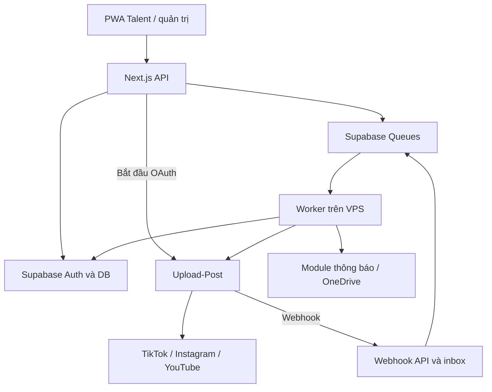
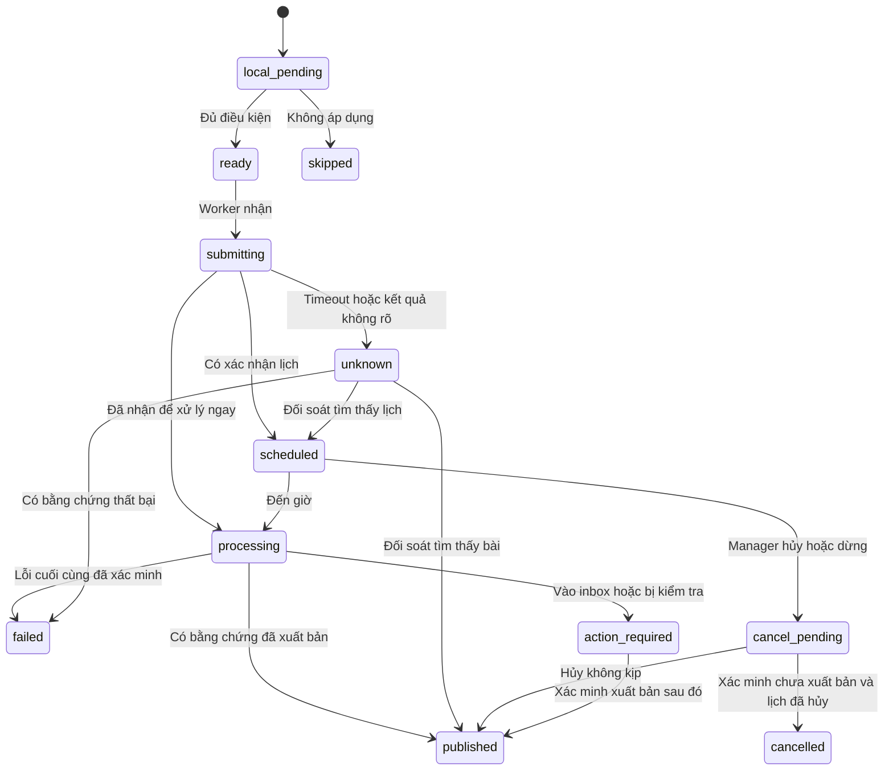
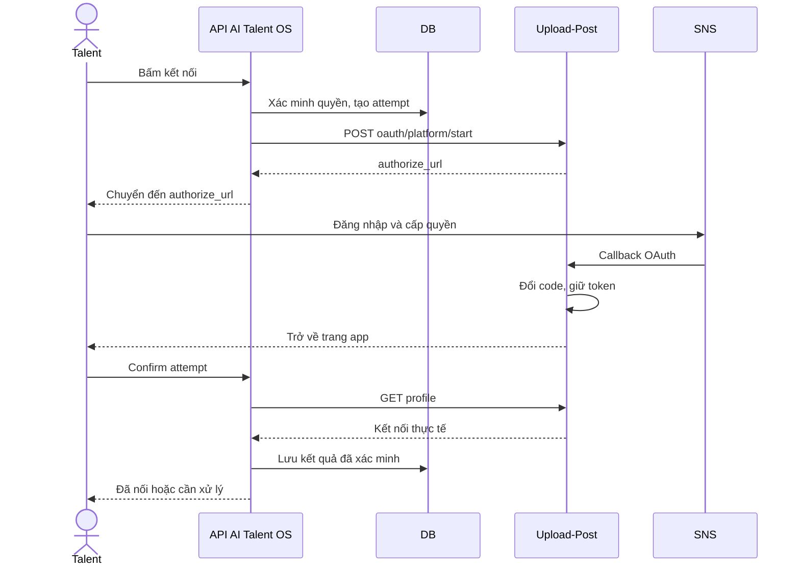
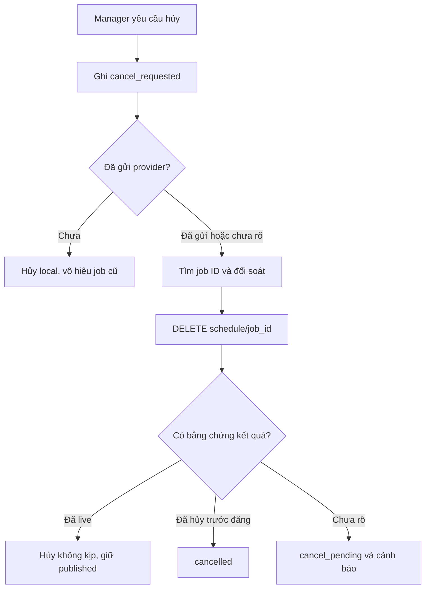
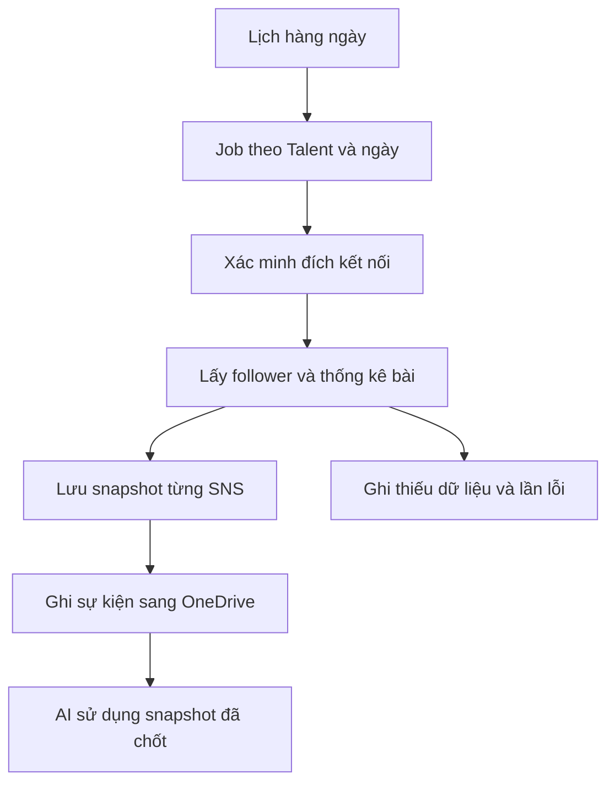

# Đặc tả triển khai Upload-Post cho AI Talent OS

Phiên bản: 1.1 — ngày 17/11/2026 (bổ sung theo kiểm chứng tài liệu Upload-Post ngày 17/11; xem `../KET_QUA_KIEM_CHUNG_17-11.md`). Ngôn ngữ: tiếng Việt. Định dạng dành cho lập trình viên và AI agent.

**Trạng thái:** bản thiết kế kỹ thuật đề xuất để triển khai và rà soát. Chưa phải toàn bộ yêu cầu đã được khách hàng phê duyệt; chưa chạy thử API bằng tài khoản thật. Những chỗ có nhãn `CẦN CHỐT` hoặc `CẦN POC` không được agent tự quyết định rồi đưa lên môi trường thật.

## 0. Cách sử dụng tài liệu

- Đọc lần lượt mục 1–5 trước khi viết code; đọc tình huống và kiểm thử của chức năng đang triển khai.
- `REQ`: yêu cầu nghiệp vụ có trong tài liệu nguồn. `USER`: quyết định người dùng trong cuộc trao đổi. `TK`: thiết kế đề xuất của tài liệu này. `API`: hành vi mô tả trong tài liệu Upload-Post. `CẦN POC`: phải kiểm chứng bằng tài khoản thử. `CẦN CHỐT`: cần câu trả lời nghiệp vụ.
- Nguồn có ưu tiên: quyết định người dùng về Connect API → yêu cầu v2 đang dùng → đặc tả này. Quy tắc kinh doanh lấy từ REQ; khả năng kỹ thuật lấy từ API. Khi không tương thích phải ghi nhận vấn đề, không sửa ý nghĩa nghiệp vụ để vừa API.
- Các tên bảng, trạng thái kỹ thuật, đường dẫn API nội bộ, timeout và lịch chạy bên dưới là TK. Các endpoint Upload-Post được liệt kê riêng ở mục 6.
- Không tái tạo OAuth của TikTok/Meta/Google. Không dùng hosted page hoặc phát profile JWT cho trình duyệt trong phương án này.
- Không chạy thử đăng bài bằng tài khoản thật hoặc dữ liệu khách hàng nếu chưa được cấp quyền cho môi trường thử.

### 0.1. Nguồn tham chiếu

| Mã | Nguồn và phạm vi dùng |
|---|---|
| R1 | `AI育成OS_概要要件定義書_v2.docx`, UC-03, UC-07–09, UC-12–13; §5-1, §5-3, §6-6–11, §6-14. Đã đọc lại file trong thư mục dự án ngày 16/11/2026. Tên Nhật: tài liệu định nghĩa yêu cầu tổng quan v2. |
| R2 | File Excel Q&A `AI-Talent-OS_Q&A表.xlsx` trong thư mục dự án; kiểm tra các dòng No.5–6, 10–12, 15–16, 20, 23–24, 35, 40–41. Các dòng liên quan được đọc có cột trả lời trống và trạng thái nháp; chưa dùng làm quyết định được duyệt. Tên file chính xác và SHA-256 được ghi trong SOURCE_MANIFEST.json. |
| U1 | https://docs.upload-post.com/api/connect-api — bắt đầu OAuth và kết quả trở về |
| U2 | https://docs.upload-post.com/api/user-profiles/ — profile và liên kết SNS |
| U3 | https://docs.upload-post.com/api/upload-video/ — gửi video |
| U4 | https://docs.upload-post.com/api/upload-photo — gửi ảnh |
| U5 | https://docs.upload-post.com/api/schedule-posts — danh sách, chi tiết và hủy lịch |
| U6 | https://docs.upload-post.com/api/upload-status — kết quả bất đồng bộ |
| U7 | https://docs.upload-post.com/api/upload-history — đối soát lịch sử |
| U8 | https://docs.upload-post.com/api/webhooks/ — chữ ký, sự kiện, nhật ký gửi webhook |
| U9 | https://docs.upload-post.com/api/get-analytics — thống kê |
| U10 | https://docs.upload-post.com/guides/rate-limits — giới hạn, polling và idempotency |
| U11 | https://docs.upload-post.com/resources/common-errors/ — phân biệt lỗi phiên và hạn chế SNS |
| U12 | https://docs.upload-post.com/api/get-tiktok-settings — quyền xuất bản của tài khoản TikTok |
| U13 | https://docs.upload-post.com/guides/ai-content-labeling — nhãn nội dung AI |
| U14 | https://docs.upload-post.com/api/retry-post — đăng lại bài lỗi, chỉ dùng khi có lệnh nghiệp vụ |
| U15 | https://docs.upload-post.com/guides/post-to-instagram-api — điều kiện Instagram |
| U16 | https://docs.upload-post.com/guides/post-to-youtube-api — video YouTube |
| U17 | https://docs.upload-post.com/guides/error-handling — HTTP thành công khác kết quả từng SNS |
| U18 | https://docs.upload-post.com/api/audience/ (Audience Insights) và https://docs.upload-post.com/api/best-times (Best Time to Post), đọc trang riêng ngày 17/11/2026 |
| U19 | https://docs.upload-post.com/guides/limit-of-uploads/ — số bài mỗi ngày, `violations`, trùng nội dung 48 giờ |
| U20 | https://docs.upload-post.com/api/photo-requirements — yêu cầu ảnh từng mạng, tự xử lý ảnh |
| U21 | https://docs.upload-post.com/api/video-requirements — yêu cầu video từng mạng, tự chuyển mã |
| U22 | https://docs.upload-post.com/resources/character-limits — giới hạn chữ |
| U23 | https://docs.upload-post.com/guides/post-to-tiktok-api — tham số TikTok, `privacy_level`, `post_mode` |
| U24 | https://docs.upload-post.com/guides/error-handling — định dạng lỗi theo từng mạng |
| U25 | https://docs.upload-post.com/resources/pricing-and-limits — gói, số profile, profile thêm, giới hạn theo gói |
| U26 | https://docs.upload-post.com/resources/common-errors — danh sách lỗi theo mạng, tạm dừng tài khoản, phán quyết spam của TikTok |

Các nguồn U được tra cứu ngày 16/11/2026. Đây là bản diễn giải và thiết kế tích hợp, không phải bản sao tài liệu nhà cung cấp. Trước khi triển khai adapter, kiểm tra lại schema trên nguồn liên quan và giữ fixture đã ẩn dữ liệu nhạy cảm. Không suy ra giới hạn gói dịch vụ từ tài liệu cũ.

R2 cho biết còn khác biệt với báo giá/SOW ở quyền dừng, người duyệt, retry và hủy lịch. Chưa đọc trực tiếp hợp đồng/SOW/báo giá trong lần soạn này; không coi lời dẫn trong bảng nháp là bằng chứng hợp đồng. Do đó R1 là baseline kỹ thuật tạm thời, không phải phê duyệt phạm vi thương mại. Q16 chặn phát hành nghiệp vụ còn xung đột.

## 1. Phạm vi và quy tắc bắt buộc

### 1.1. Bảng truy vết yêu cầu

| Mã | Nội dung | Căn cứ | Cách thực hiện |
|---|---|---|---|
| B01 | Chỉ TikTok, Instagram, YouTube; Connect API, màn hình do app xây | USER; R1 §6-10, 8-2 | Danh sách platform cố định, gọi OAuth start qua backend |
| B02 | Talent tự đăng nhập SNS; một tài khoản mỗi SNS | R1 UC-03, xác nhận 9–10; §6-10 | Tối đa một kết nối hiện hành/platform/Talent; trường hợp công ty xem Q09 |
| B03 | Hiển thị trạng thái ở app Talent và quản trị | R1 §6-10, 8-2 | API đọc từ DB, đối soát từ nhà cung cấp |
| B04 | Chỉ gửi nội dung đã được chọn; có media, không vướng từ cấm | R1 §6-6 | Kiểm tra phiên bản nội dung, media và kết quả kiểm duyệt |
| B05 | Bài được yêu cầu duyệt không được xuất bản trước khi duyệt | R1 §6-9 | Giữ trong DB, chưa gửi lịch sang Upload-Post khi chờ duyệt |
| B06 | Cùng nội dung cho ba SNS; bài chỉ có ảnh không đưa YouTube; bỏ SNS chưa nối | R1 §6-10, 8-3 | Một delivery mỗi SNS; lưu lý do không áp dụng |
| B07 | Theo dõi thành công/thất bại riêng từng SNS | R1 §5-1, §6-10 | Không lấy HTTP 200 hoặc tổng trạng thái làm kết quả tất cả |
| B08 | Không tự đăng lại bài đã thất bại; người dùng chủ động đặt lại | R1 §6-10, 8-5 | Phân biệt khôi phục request với một lần xuất bản mới |
| B09 | Manager hủy lịch từ quản trị; Talent không hủy lịch từ app | R1 §6-10, 7-2 | Kiểm tra quyền tại backend, không chỉ ẩn nút |
| B10 | Dừng toàn hệ thống/từng Talent: chặn lịch mới, hủy lịch cũ; mở lại không hồi sinh bài | R1 UC-08; §6-10, 7-5 | Cờ chặn bền vững, tác vụ hủy hàng loạt, đối soát |
| B11 | Mất kết nối: báo Talent và quản trị | R1 §6-10, 8-6 | Một thông báo cho mỗi đợt sự cố, không spam mỗi job |
| B12 | Lấy thống kê/follower một lần/ngày; chỉ số khả dụng phải thử thật | R1 §6-11, 8-7 | Snapshot, phân biệt thiếu dữ liệu và số 0 |
| B13 | Ghi kết quả vào thư mục Talent cho AI đọc | R1 §6-11, 8-8 | Sự kiện nội bộ sang module OneDrive; không gọi trong webhook HTTP |
| B14 | Video do AI tạo cần nhãn theo SNS | R1 §6-8, 5-5 | Lưu nguồn gốc media, ánh xạ nhãn trước khi gửi |
| B15 | Kết thúc sử dụng phải dừng và hủy lịch | R1 UC-13 | Dùng cùng quy trình chặn/hủy; không tự xóa profile |

Các mục xác nhận trong R1 vẫn cần khách chốt. Spec có thể triển khai nền tảng an toàn trước, nhưng không biến câu hỏi thành yêu cầu đã ký. Các điểm cụ thể ở mục 18.

### 1.2. Ngoài phạm vi triển khai này

Không triển khai hosted page, OAuth trực tiếp từng SNS, tự đăng lại bài lỗi, tự xóa bài đã đăng, DM/comment tự động, quảng cáo, nhạc trend, tìm kiếm trend hoặc tính phí tạo video. Upload-Post có nhiều khả năng ngoài danh sách trên; agent không mở rộng tính năng vì thấy endpoint tồn tại.

Ngắt và thay tài khoản được đặc tả kỹ thuật để xử lý vòng đời kết nối nhưng thao tác tự phục vụ mặc định tắt đến khi Q03 được chốt. Thống kê organic ngoài bài của hệ thống mặc định không thu thập đến khi Q07 được trả lời.

## 2. Quyết định kiến trúc

### 2.1. Thành phần



TK-01: API thực hiện xác thực, phân quyền, kiểm tra đầu vào và ghi lệnh; worker thực hiện gửi media, hủy/đối soát và thống kê. OAuth start cần phản hồi sớm nên chạy qua API, không bắt người dùng đợi queue không xác định.

TK-02: Upload-Post giữ lịch đã đủ điều kiện. Queue nội bộ chỉ gửi yêu cầu đặt lịch và đối soát. Không có scheduler nội bộ thứ hai tự đăng lại tại giờ hẹn.

TK-03: Một yêu cầu Upload-Post chỉ nhắm một SNS. Một bài video tạo tối đa ba delivery độc lập. Quyết định này nhằm hủy/thử lại và kiểm toán theo SNS, không phải giới hạn của nhà cung cấp. Một batch đang gửi dở không có tính nguyên tử giữa các SNS.

TK-04: Chỉ backend/worker giữ API key. Trình duyệt không nhận API key, token SNS hoặc profile JWT. Tài khoản thử và production dùng tài khoản dịch vụ hoặc namespace tách riêng.

### 2.2. Cấu trúc code đề xuất

```text
apps/web/app/api/v1/social-connections/
apps/web/app/api/v1/posts/
apps/web/app/api/webhooks/upload-post/
apps/worker/src/consumers/upload-post/
packages/modules/social-connections/{domain,application,ports}/
packages/modules/publishing/{domain,application,ports}/
packages/modules/analytics/{domain,application,ports}/
packages/integrations/upload-post/{client,schemas,mappers,errors}/
packages/contracts/upload-post/
supabase/migrations/
tests/integration/upload-post/
tests/fixtures/upload-post/
```

Route không chứa quy tắc xuất bản. Adapter không tự tạo lịch mới hay tự gửi thông báo. Các use case phụ thuộc cổng giao tiếp, không phụ thuộc Next.js. Dùng injection bằng factory; không yêu cầu framework DI riêng.

### 2.3. Hợp đồng adapter nội bộ

```ts
type Platform = "tiktok" | "instagram" | "youtube";
type Correlation = { requestId?: string; jobId?: string; externalId: string };
interface UploadPostGateway {
  ensureProfile(input: { username: string; displayName: string }): Promise<void>;
  getProfile(username: string): Promise<ProfileSnapshot>;
  startConnection(input: {
    username: string; platform: Platform; redirectUrl: string;
  }): Promise<{ authorizationUrl: string; expiresInSeconds: number }>;
  disconnect(input: { username: string; platform: Platform }): Promise<void>;
  getTikTokSettings(username: string): Promise<TikTokSettings>;
  submit(input: ImmutableSubmission): Promise<SubmissionReceipt>;
  getStatus(ids: Correlation): Promise<ProviderObservation>;
  findHistory(ids: Correlation, username: string): Promise<ProviderObservation[]>;
  listSchedules(input: SchedulePageQuery): Promise<SchedulePage>;
  inspectSchedule(jobId: string): Promise<ScheduleObservation>;
  cancelSchedule(jobId: string): Promise<CancelReceipt>;
  getAccountMetrics(username: string, platforms: Platform[]): Promise<AccountMetrics>;
  getPostMetrics(input: PostMetricsQuery): Promise<PostMetrics>;
}
```

Đây là kiểu nội bộ do agent phải hoàn thiện, không phải SDK của Upload-Post. Response thô được parse thành kiểu nội bộ; không truyền cấu trúc không ổn định của nhà cung cấp trực tiếp tới frontend. Kết quả không nhận diện được chuyển `unknown` và đối soát, không mặc định thành công.

## 3. Mô hình dữ liệu và bất biến

Các bảng dưới đây là thiết kế logic; viết migration SQL thật trước khi triển khai repository. Tất cả bảng theo tenant/tổ chức nếu sản phẩm có nhiều tổ chức. Dự án một tổ chức vẫn cần quyền theo Talent.

| Bảng | Trường tối thiểu | Ràng buộc |
|---|---|---|
| `up_profiles` | id, tenant_id, talent_id, provider_account_id, profile_username, state, created_at, last_verified_at | unique(provider_account_id, profile_username); unique(tenant_id,talent_id,provider_account_id) |
| `social_connections` | id, profile_id, platform, remote_account_id, handle, display_name, avatar_url, state, connection_version, capabilities jsonb, last_verified_at, incident_id, row_version | unique(profile_id,platform); ID từ SNS không dùng handle làm khóa |
| `social_connection_history` | connection_id, version, remote_account_id, observed_at, reason | Append-only; giữ dấu vết tài khoản đích cũ |
| `oauth_attempts` | id, connection_id, actor_id, token_hash, expires_at, previous_account_id, state, provider_outcome, created_at, consumed_at | Một lần đang hoạt động cho mỗi connection; không lưu authorize URL trong log |
| `post_versions` | id, post_id, version, text, media_manifest_id, ai_media, approval_state, moderation_state, content_hash | Nội dung đã duyệt bất biến; sửa tạo version mới |
| `post_deliveries` | id, post_version_id, platform, target_connection_version, target_account_id, generation, scheduled_at timestamptz, business_timezone, state, skip_reason, row_version, cancel_requested_at | unique(post_version_id,platform,generation) |
| `up_submissions` | id, delivery_id, provider_account_id, request_id, job_id, external_id, idempotency_key, payload_hash, content_hash, first_sent_at, state, next_reconcile_at | unique(provider_account_id,external_id); unique(provider_account_id,idempotency_key); ID khác null phải unique theo phạm vi provider |
| `provider_observations` | id, submission_id, source, provider_time, received_at, payload_redacted, semantic_hash | Append-only; không ghi credential/URL tải có chữ ký |
| `webhook_inbox` | provider_account_id, delivery_id, original_delivery_id, profile_id?, body_encrypted, body_hash, event_type, state, error_code, created_at | unique(provider_account_id,delivery_id); không ACK trước khi ghi bền vững |
| `publishing_controls` | tenant_id, talent_id nullable, stopped, epoch, changed_by, changed_at | Một hàng global/tổ chức và một hàng/Talent; epoch tăng khi đổi cờ |
| `control_operations` | id, scope, requested_by, state, total, completed, unresolved, created_at | Theo dõi hủy hàng loạt, không ghi thành công giả |
| `metric_snapshots` | profile_id, remote_account_id, connection_version, platform, delivery_id?, metric_name, value nullable, unavailable_reason, metric_scope, period_start?, period_end?, captured_at, sync_date, provider_payload_ref | Không trộn phạm vi profile/post hoặc tài khoản cũ/mới |
| `notification_outbox` | event_key, recipient, kind, data, state | unique(event_key,recipient); gửi lại delivery không gửi thông báo lần hai |
| `audit_events` | actor, action, resource, before_redacted, after_redacted, correlation_id, at | Các thao tác Manager và sửa trạng thái có kiểm toán |

### 3.1. Quy tắc định danh

TK: profile username lấy từ định danh bất biến, ví dụ `prod_t_<uuid-khong-dau-gach>`; không dùng email, tên Talent hay handle. `provider_account_id` là ID nội bộ của tài khoản tích hợp, không phải API key.

ID SNS và ID bài lưu dưới dạng chuỗi. Với TikTok, giữ publish ID tạm và ID bài thật ở hai trường riêng; không chuyển số dài sang JavaScript number. `connection_version` chỉ tăng khi đích đăng thay đổi hoặc quyền kết nối bị vô hiệu hóa; nối lại cùng tài khoản hợp lệ không tự làm cũ mọi lịch.

### 3.2. Giao dịch và phân quyền

- Talent chỉ đọc kết nối/delivery của mình và bắt đầu OAuth cho mình. Manager đọc trong phạm vi tổ chức; có quyền hủy/dừng theo R1. Bảng queue, inbox, credentials không cho trình duyệt truy cập trực tiếp.
- API dùng session Supabase đã xác minh server-side. Bỏ qua role, talent_id, profile_username từ client khi có thể suy ra từ phiên; nếu nhận resource ID phải kiểm tra ownership.
- Backend dùng service-role phải tự kiểm tra tenant/actor; service-role không được miễn quy tắc nghiệp vụ chỉ vì bỏ qua RLS.
- Ghi delivery + submission ban đầu + enqueue trong cùng giao dịch qua SQL function được cấp quyền hẹp. Không gọi hai REST request rồi coi là một transaction.
- Không giữ transaction DB mở trong lúc chờ HTTP nhà cung cấp. Claim/lease trong transaction ngắn, gọi HTTP ngoài transaction, lưu kết quả trong transaction mới có kiểm tra phiên bản.
- Unique constraint là hàng rào cuối cùng chống hai lần bấm/two workers, không chỉ dựa vào kiểm tra trước bằng SELECT.

## 4. Trạng thái

### 4.1. Kết nối SNS

Các trạng thái TK: `disconnected`, `connecting`, `connected`, `reauth_required`, `replacement_pending`, `disconnecting`, `unknown`. Một lần OAuth thất bại không tự biến kết nối đang tốt thành disconnected.

| Sự kiện | Chuyển trạng thái | Hành động |
|---|---|---|
| Start lần đầu | disconnected → connecting | Tạo attempt, trả authorize URL |
| Kết quả xác minh cùng tài khoản | connecting/reauth_required → connected | Cập nhật capabilities, đóng incident |
| Kết quả xác minh khác tài khoản cũ | bất kỳ → replacement_pending | Chặn submission mới; rà soát lịch cũ |
| Reauth từ webhook | connected → reauth_required sau đối soát | Không gửi mới, báo nối lại |
| Unlink được xác minh | disconnecting → disconnected | Ghi history, giữ metrics cũ |
| Không đọc được trạng thái | bất kỳ → giữ last-known + cờ stale | Không cho start mù hoặc ghi mất kết nối giả |

### 4.2. Delivery kỹ thuật

Đây là trạng thái kỹ thuật riêng, không thay thế sáu nhãn nghiệp vụ trong hình R1 §5-1. Việc ánh xạ UI cần chốt ở Q10.



TK: Không thấy bài qua một lần GET không đủ chứng minh chưa đăng. Published không lùi về failed do webhook cũ; có bằng chứng xung đột thì tạo sự cố và đối soát. `failed`, `cancelled`, `skipped` không tự trở lại ready; đặt lại phải tạo generation mới và có actor.

## 5. Các bất biến bảo vệ xuất bản

I01. Chỉ gửi một submission khi Talent còn hoạt động, global/Talent chưa dừng, nội dung được chọn và đúng version, media sẵn sàng, kiểm duyệt đã qua và yêu cầu duyệt đã được giải quyết.

I02. Đích thực tế phải trùng `target_account_id` và `target_connection_version`; không tự thay đích khi người dùng đổi SNS.

I03. Cờ dừng là hàng rào bền vững. Worker kiểm tra trước khi gọi provider và kiểm tra lại sau khi provider nhận lịch; nếu epoch đã đổi, enqueue hủy bù ngay khi có job ID.

I04. Một nội dung có thể đăng thành công ở SNS này và lỗi ở SNS khác. Không đăng lại phần đã thành công để chữa phần lỗi.

I05. Mọi mutation bên ngoài phải có bản ghi ý định trước HTTP. Timeout không xóa ý định hoặc sinh ID mới.

I06. Hủy tại giờ đang xuất bản không thể được bảo đảm bằng DB lock nội bộ. Hiển thị hủy đang xử lý/không kịp nếu chưa xác minh; không cam kết thu hồi bài đã live.

I07. Phải lưu khóa chống trùng nội bộ dài hạn. Không dựa hoàn toàn vào cửa sổ idempotency của nhà cung cấp.

I08. Sự kiện đến muộn được xử lý theo version/submission của nó, không gán cho generation mới nhất chỉ vì cùng post_id.

## 6. Danh mục API Upload-Post

### 6.1. Quản lý kết nối [U1, U2]

| Thao tác | Method/path | Đầu vào chính |
|---|---|---|
| Tạo profile | `POST /api/uploadposts/users` | JSON `username`, `display_name` |
| Đọc profile | `GET /api/uploadposts/users/{username}` | Path đã encode |
| Liệt kê profile | `GET /api/uploadposts/users` | Dùng cho đối soát |
| Bắt đầu OAuth | `POST /api/uploadposts/oauth/{platform}/start` | JSON `profile`, `redirect_url`; platform: tiktok/instagram/youtube |
| Ngắt SNS | `DELETE /api/uploadposts/users/social` | JSON `profile_username`, `social_platform` |
| Xóa profile | `DELETE /api/uploadposts/users` | JSON `username`; chỉ thao tác vận hành sau quyết định lưu dữ liệu |

Backend dùng `Authorization: Apikey <secret>`. Base URL chính: `https://api.upload-post.com`. Không gọi `generate-jwt` trong thiết kế server-to-server này. OAuth start trả URL chuyển hướng và thời hạn; kết quả về app cần đọc lại profile. Liên kết profile chỉ ra tài khoản đã nối, không chứng minh người dùng đã chốt đích mới trong nghiệp vụ nội bộ.

### 6.2. Gửi và quản lý lịch [U3–U7]

| Thao tác | Method/path | Đầu vào |
|---|---|---|
| Gửi video | `POST /api/upload` | Multipart, xem mục 9 |
| Gửi ảnh | `POST /api/upload_photos` | Multipart, xem mục 9 |
| Đọc trạng thái | `GET /api/uploadposts/status` | `request_id` hoặc `job_id` |
| Đọc lịch sử | `GET /api/uploadposts/history` | profile_username, request_id/job_id/external_id, page, limit |
| Danh sách lịch | `GET /api/uploadposts/schedule` | profile_username, from/to, limit, offset |
| Chi tiết lịch | `GET /api/uploadposts/schedule/{job_id}` | job ID đã được kiểm tra ownership |
| Hủy lịch | `DELETE /api/uploadposts/schedule/{job_id}` | job ID |
| Sửa lịch | `PATCH /api/uploadposts/schedule/{job_id}` | Nhà cung cấp hỗ trợ; không mở thành tính năng sửa trực tiếp trong v1 spec |

TK: Không dùng PATCH để sửa media/đích. Nếu yêu cầu thay version, hủy lịch cũ và chỉ tạo lịch mới sau khi đủ điều kiện; các tình huống không chắc hủy xong phải dừng ở unknown. Tương tác thay nội dung qua AI nằm ở module bài viết, không thêm form sửa trực tiếp trái R1.

### 6.3. Webhook và thống kê [U8, U9]

| Thao tác | Method/path | Mục đích |
|---|---|---|
| Cấu hình webhook chung | `GET/POST /api/uploadposts/users/notifications` | Theo tài liệu endpoint cấu hình dùng host `https://app.upload-post.com`; tách biến base URL |
| Gắn webhook profile | `POST /api/uploadposts/users/profile-webhook` | JSON profile_username, webhook_url, webhook_events |
| Đọc/xóa cấu hình profile | `GET/DELETE /api/uploadposts/users/profile-webhook` | GET query profile_username; DELETE body cùng khóa |
| Kiểm tra webhook | `POST /api/uploadposts/users/notifications/test` | Thao tác vận hành, không tạo thông báo nghiệp vụ |
| Xoay secret | `POST /api/uploadposts/users/webhook-secret` | Thao tác quản trị hạ tầng |
| Nhật ký gửi webhook | `GET /api/uploadposts/webhooks/deliveries` | Lọc theo sự kiện, trạng thái, profile, request/job |
| Chi tiết/gửi lại webhook | `GET /api/uploadposts/webhooks/deliveries/{id}`; `POST .../{id}/redeliver` | Phục hồi sự kiện, không đăng lại bài |
| Thống kê tài khoản | `GET /api/analytics/{profile_username}` | Query platforms danh sách phân cách dấu phẩy |
| Thống kê bài qua request | `GET /api/uploadposts/post-analytics/{request_id}` | Có thể lọc platform |
| Thống kê bài qua ID SNS | `GET /api/uploadposts/post-analytics` | platform_post_id, platform, user |
| Cấu hình chỉ số | `GET /api/uploadposts/platform-metrics` | Dùng để kiểm chứng danh sách chỉ số |

Các API vận hành không được mở nguyên dạng cho frontend. Adapter phải lấy quyền admin và allowlist hành động. Các tài liệu analytics có chỗ gọi credential là JWT nhưng ví dụ sử dụng `Apikey`; dùng API key của tích hợp, không dùng JWT của Supabase. Xác minh contract bằng POC, không trộn hai token.

### 6.4. Đăng lại có người dùng yêu cầu [U14]

`POST /api/uploadposts/posts/retry` nhận request_id hoặc job_id; scheduled_date tùy trường hợp. Chỉ dùng sau lệnh đặt lại rõ ràng và khi không còn kết quả mơ hồ. V1 mặc định chọn tạo submission mới có generation sau kiểm tra lịch sử; adapter retry chỉ được bật sau POC xác minh quyền, ID mới và snapshot media. Không tự gọi endpoint này từ retry queue.

## 7. API nội bộ dành cho frontend và agent

Mọi đường dẫn trong mục này là TK. Trả JSON `{data, meta:{requestId}}` hoặc `{error:{code,message,fieldErrors?,retryAfterSeconds?},meta:{requestId}}`. Không trả stack trace, danh sách profile toàn tài khoản hoặc response provider chưa lọc.

| Method/path | Quyền | Request | Kết quả / lỗi chính |
|---|---|---|---|
| `GET /api/v1/me/social-connections` | Talent | Không | 200: platform, state, stale, displayName, handle, accountId, version, verifiedAt |
| `POST /api/v1/me/social-connections/{platform}/attempts` | Talent hoạt động | `{}`; CSRF/origin hợp lệ | 201: attemptId, authorizationUrl, expiresAt; 409 đang kết nối/đang hủy; 503 provider |
| `POST /api/v1/me/social-connections/attempts/{id}/confirm` | Chính actor | `{returnToken, providerOutcome?, providerPlatform?}` | 200 đã xác minh; 202 đang đối soát; 409 đổi tài khoản/attempt khác; 410 hết hạn |
| `POST /api/v1/me/social-connections/{platform}/disconnect` | Talent, cờ Q03 bật | `{expectedVersion,reason}` | 202 operationId; 403 khi tính năng chưa được chốt |
| `POST /api/v1/me/social-connections/{platform}/replacement-confirmation` | Talent, cờ Q03 bật | `{expectedVersion,expectedAccountId}` | 200/202; không tiếp tục nếu lịch cũ chưa rõ |
| `GET /api/v1/admin/talents/{id}/social-connections` | Manager cùng tổ chức | Không | 200 danh sách, không có token |
| `POST /api/v1/posts/{id}/schedule` | Talent sở hữu hoặc Manager được phép | `{postVersion,scheduledAt,timezone,commandId}` | 202 deliveryIds; 409 chưa duyệt/đang dừng/sai version; 422 không có đích hợp lệ |
| `GET /api/v1/posts/{id}/deliveries` | Chủ sở hữu/Manager | Không | 200 kết quả từng SNS và cảnh báo |
| `POST /api/v1/admin/deliveries/{id}/cancel` | Manager | `{expectedVersion,reason,commandId}` | 202 operationId; 409 đã xuất bản |
| `POST /api/v1/posts/{id}/reschedule-failed` | Manager; Talent chỉ khi cờ `talentRescheduleFailed` bật ([AG] M-08 chỉ cho quản lý; S06-04) | `{failedDeliveryIds,scheduledAt,commandId}` | 202 generation mới; 409 chưa rõ kết quả/đích đổi/chưa duyệt |
| `POST /api/v1/admin/publishing-control` | Manager | `{scope:"global"|"talent",talentId?,stopped,commandId}` | 202 operationId khi dừng; mở lại không tạo job bài cũ |
| `GET /api/v1/admin/operations/{id}` | Manager | Không | 200 tổng tiến độ và unresolved |
| `GET /api/v1/talents/{id}/metrics` | Chủ sở hữu/Manager | khoảng ngày hợp lệ | 200 snapshot, freshness, unavailableReason |
| `POST /api/webhooks/upload-post/{opaqueProfileRoute}` | Chữ ký provider | Raw body | 200 sau ghi inbox; 401 chữ ký; 503 lỗi lưu |

Mã chung: 401 không có session hợp lệ; 403 không được phép; 404 tài nguyên không trong phạm vi; 409 xung đột trạng thái; 422 đầu vào nghiệp vụ không hợp lệ; 429 rate limit app; 502/503 lỗi tích hợp. Dùng cùng `commandId` và cùng payload trả lại kết quả lệnh cũ; cùng commandId khác payload trả 409. Frontend không chọn profile provider hoặc truyền URL media tùy ý.

### 7.0.1. Mã lỗi ứng dụng ổn định (TK)

| Code | HTTP thông thường | Cách frontend xử lý |
|---|---|---|
| `AUTH_REQUIRED` | 401 | Đăng nhập lại, không tự khởi tạo OAuth mới |
| `FORBIDDEN` | 403 | Không hiển thị dữ liệu/không gọi lại bằng resource khác |
| `RESOURCE_NOT_FOUND` | 404 | Không tiết lộ tài nguyên thuộc Talent khác |
| `FEATURE_NOT_ENABLED` | 403 | Chức năng chưa được chốt hoặc chưa bật |
| `CONNECTION_ATTEMPT_ACTIVE` | 409 | Cho tiếp tục/đối soát attempt hiện hành |
| `CONNECTION_ATTEMPT_EXPIRED` | 410 | Nút tạo lần kết nối mới |
| `CONNECTION_VERIFICATION_PENDING` | 202 | Hiển thị đang xác minh và đọc kết quả sau |
| `CONNECTION_TARGET_CHANGED` | 409 | Hiển thị tài khoản mới, không tự chuyển lịch |
| `SOCIAL_REAUTH_REQUIRED` | 409 | Dẫn đến Connect API theo platform |
| `PUBLISHING_STOPPED` | 409 | Hiển thị trạng thái dừng, không retry schedule |
| `APPROVAL_REQUIRED` | 409 | Chờ duyệt theo version hiện tại |
| `POST_VERSION_CONFLICT` | 409 | Đọc lại bài và yêu cầu thao tác trên bản mới |
| `IDEMPOTENCY_CONFLICT` | 409 | Không tự đổi commandId để lặp lệnh |
| `PUBLICATION_OUTCOME_UNKNOWN` | 409 | Đang đối soát, chưa cho đăng lại |
| `NO_ELIGIBLE_DESTINATION` | 422 | Yêu cầu kết nối hoặc bổ sung loại media phù hợp |
| `MEDIA_NOT_READY` | 422 | Hiển thị media cần xử lý |
| `PLATFORM_INPUT_INVALID` | 422 | Hiển thị lỗi trường và nền tảng; không tự cắt text |
| `SCHEDULE_TIME_PASSED` | 422 | Cần chọn lại theo quyền nghiệp vụ |
| `PROVIDER_UNAVAILABLE` | 503 | Báo trì hoãn; giữ commandId nếu thao tác chưa rõ |
| `PROVIDER_CONFIGURATION_ERROR` | 503 | Liên hệ vận hành; không bắt Talent reconnect |
| `PROVIDER_QUOTA_EXCEEDED` | 503 | Báo hết năng lực/quota; không vòng retry ngắn |

Mã lỗi provider không trả trực tiếp thành code giao diện. HTTP 202 là trạng thái tác vụ đang xử lý, không phải lỗi thực thi. UI polling đi qua API nội bộ, không gọi Upload-Post trực tiếp.

### 7.0.2. Kết quả HTTP minh họa (TK)

```json
{
  "data": {
    "deliveryIds": ["3e92a7a8-605c-4d91-a879-ed6d6da70b63"],
    "commandId": "25a80d4c-9940-47de-8e2f-af4cb2d86ed7"
  },
  "meta": {"requestId": "ec8bcebb-2a79-46a6-873d-47d20e71239c"}
}
```

Ví dụ trên trả 202 và chỉ có nghĩa đã nhận lệnh nội bộ. Lịch provider được xác nhận sau qua delivery read API. Một lỗi nghiệp vụ có dạng:

```json
{
  "error": {
    "code": "APPROVAL_REQUIRED",
    "message": "Bài viết đang chờ Manager duyệt.",
    "fieldErrors": []
  },
  "meta": {"requestId": "ec8bcebb-2a79-46a6-873d-47d20e71239c"}
}
```

`fieldErrors` nếu có gồm path/code/message; không phản chiếu nguyên HTML hoặc error_description của SNS. Mọi message provider dùng ở UI phải escape; không render bằng HTML thô.

### 7.1. Luồng trả về OAuth nội bộ

TK: đường dẫn cố định `/social/return/{attemptId}?rt=<random-token>`. Sinh token ít nhất 32 byte ngẫu nhiên; chỉ lưu hash. Provider thêm query kết quả. Khi mở trang, JavaScript gọi confirm với session hiện tại; server đối chiếu actor, Talent, attempt, token, platform và TTL. Không dùng `state` của provider làm session của app. Đánh dấu token consumed khi lưu kết quả xác minh thành công; lần gọi lại hợp lệ trả cùng kết quả, không gọi side effect mới.

Trang return không gắn analytics bên thứ ba, đặt Referrer-Policy no-referrer và Cache-Control no-store; xóa query nhạy cảm khỏi thanh địa chỉ sau khi lấy. Nếu session hết hạn: yêu cầu đăng nhập, sau đó đối soát tài khoản; không tái sử dụng URL OAuth cũ. Không tùy ý cho client chỉ định redirect URL.

## 8. Luồng kết nối chi tiết

### 8.1. Khởi tạo profile

TK: `EnsureProfile` được gọi sau sự kiện đăng ký Talent đã đủ điều kiện; mốc cụ thể chưa chốt Q01. Có thể triển khai on-demand tại lần kết nối đầu tiên để không chặn phần kỹ thuật khác. Namespace cố định giúp khôi phục khi response tạo profile bị mất.

1. Khóa hàng mapping Talent; nếu active thì trả lại.
2. Tạo hàng pending có username cố định, commit.
3. POST tạo profile. 201 → getProfile xác minh; timeout → getProfile cùng username; 409 → đọc và chỉ nhận nếu mapping của hệ thống đúng; 403 → sự cố gói dịch vụ; 401 → sự cố tích hợp.
4. Đánh dấu active; unique constraint giải quyết hai request đồng thời.
5. Không xóa profile bị trùng tự động; không tạo username khác chỉ để tránh lỗi.

### 8.2. Sơ đồ Connect API [U1]



OAuth start có state dùng một lần, thời hạn 15 phút (`expires_in: 900`, U1). [YK2] v2 (R1 §6-10 chức năng 8-2) là tài liệu hiện hành và tả **trang kết nối dựng sẵn hạn 48 giờ**, tức `generate-jwt` của Upload-Post (U2). Dùng Connect API thay trang đó là **quyết định của đội, khác [YK2]**: phải hỏi khách và sửa câu chữ 8-2 nếu khách đồng ý (Q02). Nếu khách giữ trang 48 giờ thì đổi adapter sang `generate-jwt`, các bước đối soát profile giữ nguyên. Nếu hết hạn, tạo attempt mới; không tự kéo dài state.

### 8.3. Trường hợp kết nối

| Mã | Tình huống | Hành vi bắt buộc |
|---|---|---|
| C01 | Lần đầu kết nối thành công | Đọc profile, lưu ID/handle, hiện tài khoản đích |
| C02 | Từ chối `ACCESS_DENIED` | Đóng attempt cancelled; không xóa kết nối cũ |
| C03 | `INVALID_STATE` | Attempt lỗi; nút thử lại tạo start mới |
| C04 | Đóng tab/không quay về | Attempt hết hạn; lần mở app sau đối soát, vì OAuth có thể đã hoàn tất |
| C05 | `success` giả mạo trên URL | Không thay DB nếu GET profile không xác minh được |
| C06 | GET provider lỗi sau OAuth | 202 verifying; queue đối soát, không buộc OAuth lại ngay |
| C07 | Nối lại cùng ID | Giữ dữ liệu lịch sử; cập nhật quyền; không tự đăng lại bài lỗi |
| C08 | Nối ra ID khác | replacement_pending; cấm gửi mới; không áp dụng lịch cũ cho tài khoản mới |
| C09 | Hai tab cùng kết nối | Chỉ một attempt hoạt động/connection; attempt sau cần hủy logic attempt trước và đối soát |
| C10 | Hai Talent nối cùng SNS | Unique nội bộ theo provider-account/platform/remote-ID cho kết nối active; nếu provider đã di chuyển thì chặn và đưa vào xử lý, không giả định rollback được OAuth |
| C11 | Webhook đến trước redirect | Đồng bộ profile; confirm sau đó idempotent |
| C12 | Redirect đến trước webhook | Confirm bằng GET; webhook sau chỉ đối soát |
| C13 | Token SNS mất quyền | Đánh dấu reauth sau xác minh; báo Talent/Manager; không lặp retry gửi bài |
| C14 | Platform không nằm allowlist | 422 trước khi gọi provider |
| C15 | Profile bị xóa ngoài app | Đánh dấu sự cố mapping; không tự tạo lại rồi đăng lịch cũ |

API có hành vi tài khoản có thể được chuyển khi đã liên kết nơi khác [U1]. Việc chống dùng chung trong DB không ngăn được mutation đã diễn ra ở provider; C10 phải có POC và xử lý vận hành trước production.

### 8.4. Điều kiện từng SNS

- Instagram: thông báo yêu cầu tài khoản Business/Creator. Không bắt buộc Talent đăng nhập Facebook hoặc tạo Facebook Page nếu dùng Instagram Login; hướng dẫn chính thức [U15]. Nếu không đủ điều kiện giữ disconnected, hiển thị hướng dẫn, không đổi loại tài khoản tự động.
- YouTube: xác nhận channel đích bằng dữ liệu trả về. Không yêu cầu Google Cloud project của khách trong luồng thông thường [U16]. POC bắt buộc tài khoản có nhiều channel/Brand Account để xác minh cách chọn và ID trả về; không bịa thêm API chọn channel.
- TikTok: đọc settings với query `profile` trước chọn privacy hoặc validation độ dài. Không giả định mọi tài khoản có quyền public; settings/capability không hợp lệ cần hướng dẫn hoặc chặn. Các chức năng nhạc/comment/trend không được mở theo capability chỉ vì có hỗ trợ [U12].

### 8.4a. Giới hạn đăng bài, định dạng và chữ (tra 17/11/2026)

Nguồn chính là tài liệu Upload-Post, vì hệ thống chỉ gọi Upload-Post:
- U19: https://docs.upload-post.com/guides/limit-of-uploads/
- U20: https://docs.upload-post.com/api/photo-requirements
- U21: https://docs.upload-post.com/api/video-requirements
- U22: https://docs.upload-post.com/resources/character-limits
- U23: https://docs.upload-post.com/guides/post-to-tiktok-api
- U24: https://docs.upload-post.com/guides/error-handling

Tài liệu gốc của Meta và TikTok dùng để đối chiếu (IG1: developers.facebook.com/docs/instagram-platform/content-publishing; IG2: …/reference/ig-user/media; TT1: developers.tiktok.com/doc/content-sharing-guidelines; TT2: …/content-posting-api-reference-direct-post; TT3: …/content-posting-api-media-transfer-guide).

#### Số bài mỗi ngày [U19]

| Mạng | Số bài tối đa trong 24 giờ trượt, mỗi tài khoản mạng xã hội |
|---|---|
| Instagram | 50 (Meta cho tới 100 qua API [IG1], nhưng Upload-Post chặn ở 50) |
| TikTok | 15 (TikTok tính chung cho mọi ứng dụng đăng qua API [TT1]) |
| YouTube | 30 |

- **Chỉ bài đăng thành công mới bị tính.**
- **Bài hẹn giờ được kiểm lại lúc tới giờ đăng.** Nếu khi đó đã chạm mức thì bài bị từ chối. Vì vậy một bài đã "予約済み" (đã hẹn giờ) vẫn có thể thất bại lúc đăng; kết quả về qua webhook hoặc đối soát, xử lý như đăng lỗi (8-5) cho đúng mạng đó.
- Vượt mức: HTTP 429, thân trả về có `success: false`, `message: "Post verification failed"` và mảng `violations`. Mỗi phần tử có `platform`, `type: "hard_cap"`, `used_last_24h`, `cap`. Adapter đọc `violations` để biết mạng nào bị chặn; không thử lại trong cửa sổ 24 giờ.
- Các kiểm tra khác của Upload-Post trước khi đăng:
  - **Nội dung trùng hoặc gần giống trong 48 giờ** trên cùng tài khoản và cùng mạng thì bị chặn. Hai bài gần giống nhau trong 2 ngày (ví dụ tài năng đăng lại bài vừa lỗi với cùng ảnh và chú thích) có thể bị từ chối.
  - Gắn @ quá nhiều, hoặc gắn một tài khoản lặp lại nhiều lần.
  - Kiểm tra media và nội dung khác; Upload-Post ghi rằng các kiểm tra này thay đổi theo thời gian.
- Trang U24 có ví dụ "daily limit of 5 uploads for: Instagram" cho gói Professional, trái với U19 (50). Hỏi Upload-Post trong POC; adapter luôn đọc `cap` trả về, không hard-code.

#### Ảnh [U20]

| Mạng | Định dạng | Dung lượng | Kích thước, tỉ lệ | Upload-Post tự xử lý |
|---|---|---|---|---|
| Instagram | PNG, JPEG, GIF | 8 MB | Rộng 320–1440 px; ảnh feed tỉ lệ 2:3 đến 1,91:1 | Có: ảnh cao hơn 2:3 được thêm viền thành 2:3, ảnh rộng hơn 1,91:1 thêm viền thành 1,91:1; đổi kích thước và màu |
| TikTok | JPG, JPEG, WebP | 20 MB mỗi ảnh | Cạnh ngắn ≤ 1080 px, cạnh dài ≤ 1920 px; tối đa 35 ảnh mỗi bài | Có: thu nhỏ, giữ tỉ lệ |

Upload-Post ghi các thay đổi đã làm vào trường `changes` của kết quả; lưu trường này vào observation.

#### Video [U21, U23]

| Mạng | Định dạng | Dung lượng | Độ dài | Khác |
|---|---|---|---|---|
| Instagram (Reels, feed) | MP4, MOV; H.264 hoặc HEVC; AAC | **300 MB** | **3 giây – 15 phút** | 23–60 khung hình/giây; rộng ≤ 1920 px; nên 9:16 |
| TikTok | MP4, WebM, MOV; H.264, H.265, VP8 | Upload-Post từ chối tệp trên 3 GB (`invalid_video_file`) | **3 giây – 10 phút** qua API; tài khoản có thể bị giới hạn ngắn hơn (`max_video_post_duration_sec` [TT1]) | 23–60 khung hình/giây; 360–4096 px |
| YouTube | `video/*` | 256 GB | Không ghi | — |

Upload-Post **tự chuyển mã video** cho hợp từng mạng, nhưng làm chậm việc upload. Upload-Post khuyên tự chuẩn hóa trước: H.264, AAC, `yuv420p`, `+faststart`.

#### Chữ [U22, U23]

| Mạng | Giới hạn |
|---|---|
| Instagram | Chú thích 2.200 ký tự; tối đa 30 hashtag và 20 lần gắn @ [IG2]; **một số hashtag bị Instagram cấm làm request bị từ chối** |
| TikTok | Chú thích video 2.200 đơn vị UTF-16 (emoji tính 2); bài ảnh có tiêu đề 90 và mô tả 4.000 đơn vị UTF-16 |
| YouTube | **Tiêu đề 100 ký tự**; mô tả 5.000 ký tự; tag tổng 500 ký tự |

Upload-Post kiểm trước và trả lỗi nếu vượt. Instagram và YouTube đôi khi tự cắt chữ thay vì từ chối, nên phải đọc `results` để biết chữ cuối cùng được đăng.

#### TikTok qua Upload-Post [U23]

- Upload-Post dùng ứng dụng TikTok **đã được TikTok duyệt** của họ; mình không phải đăng ký ứng dụng hay qua kiểm duyệt.
- `privacy_level`: bảng tham số ghi mặc định `PUBLIC_TO_EVERYONE`, nhưng mục lưu ý lại ghi không gửi trường này thì TikTok dùng mặc định của tài khoản. **Luôn gửi rõ giá trị**, lấy trong các mức tài khoản cho phép; mức không có thì lỗi `tiktok_privacy_unavailable`.
- `disable_comment`, `disable_duet`, `disable_stitch` mặc định `false`. `is_aigc` mặc định `false`.
- `post_mode`: `DIRECT_POST` (mặc định, đăng ngay) hoặc `MEDIA_UPLOAD` (đưa vào bản nháp trên TikTok). Hệ thống dùng `DIRECT_POST`.
- Gói Free bị 403 với TikTok.
- **Quy định giao diện khi đăng thẳng của TikTok** [TT1]: chọn quyền riêng tư không có giá trị mặc định; các nút tương tác mặc định tắt; câu đồng ý về nhạc; cho sửa chữ soạn sẵn trước khi đăng; không dùng làm công cụ nội bộ đăng cho các tài khoản do một nhóm quản lý. **Trang của Upload-Post không nhắc tới các quy định này**, nên chưa rõ ai chịu trách nhiệm. Hỏi Upload-Post trong POC (rủi ro RT13).

#### Lỗi theo từng mạng [U24]

- HTTP 200 vẫn có thể có mạng bị lỗi: đọc `results[platform].success` của từng mạng.
- Lỗi phiên kết nối hết hạn chỉ là chuỗi `error` (ví dụ "session has expired. Please reconnect…"), không có mã riêng. Adapter phân loại bằng mẫu chuỗi đã kiểm trong POC và đưa vào luồng mất kết nối (8-6).
- 429 "monthly limit of X uploads": hết số lần upload trong tháng của gói; xử lý như sự cố hạn mức (§10.4).

#### Gói và chi phí theo số tài năng [U25, tra 17/11/2026]

| Gói | Giá tháng (trả năm) | Profile có sẵn | Profile thêm | Ghi chú |
|---|---|---|---|---|
| Free | 0 | 2 | — | 10 upload/tháng; **không đăng được TikTok** (403) |
| Basic | 24 USD (16) | 5 | +5: 120 USD/năm; +10: 200 USD/năm | Không có tích hợp white-label |
| Professional | 50 USD (33) | 25 | +15: 280 USD/năm; +25: 440 USD/năm | Có white-label |
| Advanced | 147 USD (118) | 75 | +25: 650 USD/năm; +50: 1.150 USD/năm | Có white-label, hỗ trợ ưu tiên |
| Business | 438 USD (350) | 225 | 1 USD/tháng mỗi profile | Có white-label, hỗ trợ ưu tiên |

- Mỗi tài năng và mỗi tài khoản công ty là một profile. Gói trả phí không giới hạn số lần upload, nhưng vẫn chịu giới hạn ngày của từng mạng.
- Gói thêm profile chỉ chọn một mức, không cộng dồn (trừ Business tính theo từng profile).
- Ước tính theo giá công bố (chưa thuế, chưa đổi giá EUR):
  - 30 tài năng: Professional + 15 profile thêm (khoảng 50 USD/tháng + 280 USD/năm), hoặc Advanced (147 USD/tháng).
  - 100 tài năng: Advanced + 25 profile thêm (147 USD/tháng + 650 USD/năm), hoặc Business (438 USD/tháng).
  - 300 tài năng: Business + 75 profile (khoảng 513 USD/tháng).
  - 1.000 tài năng: Business + 775 profile (khoảng 1.213 USD/tháng).
- **Gói Basic không có "whitelabel integration".** Trang Connect API không ghi yêu cầu gói, nhưng có dẫn sang hướng dẫn white-label. Cần hỏi Upload-Post: Connect API (màn kết nối do mình tự làm) có cần gói Professional trở lên không (Q11).
- `scheduled_date` phải ở tương lai và không quá 365 ngày.
- Hạ gói làm thành viên vượt số ghế bị khóa với lỗi 403 `TEAM_SEAT_SUSPENDED`.

#### Lỗi thường gặp và cách hệ thống xử lý [U26]

**Mất kết nối, phải kết nối lại (vào luồng 8-6, không thử lại):**
- Chuỗi lỗi: "Your [Platform] session has expired", "Token expired and refresh failed", "Error validating access token", "The session has been invalidated because the user changed their password", "User has not authorized application".
- Mã lỗi: `tiktok_reconnect_required`.
- **Riêng Instagram:** `account_checkpoint_required` nghĩa là Meta bắt chủ tài khoản xử lý cảnh báo bảo mật ngay trong Instagram; **kết nối lại không giải quyết được**. Thông báo cho tài năng phải nói rõ là cần mở Instagram để xác nhận. `account_reauth_required` (`failure_stage: "precheck"`) sẽ tự hết khi Meta không còn báo nữa.

**Tài khoản bị mạng chặn (không thử lại; báo quản lý):**
- YouTube: "The YouTube account of the authenticated user is suspended".
- Instagram: "The Instagram account is restricted or inactive".
- TikTok: `spam_risk_user_banned_from_posting`.

**Upload-Post tự tạm dừng tài khoản** (`error_code: "account_restricted"`, `failure_stage: "precheck"`, kèm `restriction_reason`, `restricted_until`, `retry_after_seconds`). Bài bị từ chối trước khi tới mạng, không tốn lượt, kết nối vẫn giữ. Kết nối lại làm hết tạm dừng sớm, nhưng **hệ thống không được dùng kết nối lại để lách**.

| `restriction_reason` | Mạng | Thời gian tạm dừng |
|---|---|---|
| `spam_restricted` | Instagram ("Action suspected as spam") | 24 giờ |
| `publish_limit` | Instagram | 30 phút |
| `daily_upload_limit` | YouTube | 2 giờ, **Upload-Post tự thử lại** |
| `permission_denied` | YouTube | 24 giờ |
| `spam_risk_user_banned_from_posting` | TikTok | 7 ngày |
| `spam_risk_too_many_posts` | TikTok | 1 giờ |

Hệ thống lưu trạng thái tạm dừng theo từng tài khoản mạng xã hội tới `restricted_until`. Trong thời gian đó, bài mới cho mạng đó dời sang sau `restricted_until` hoặc báo lỗi (8-5); hai mạng còn lại vẫn đăng. Với Instagram `spam_restricted`, báo quản lý và gợi ý giảm số bài mỗi ngày của tài năng đó (8-4). Việc Upload-Post tự thử lại YouTube là thử lại của chính bài đó, không phải hệ thống đăng lại, nên không trái với 8-5; adapter không gửi thêm lần nào.

**TikTok từ chối một bài** (`error_code: "content_rejected"`):
- `spam_risk`: TikTok gắn cờ bài này, không nói lý do.
- `spam_risk_text`: chú thích bị coi là spam.

Không gửi lại nguyên bài. Báo tài năng sửa chú thích hoặc hashtag (qua AI, 4-2) rồi chấp nhận lại. Lỗi ở mức bài không làm hạn chế tài khoản.

**Lỗi media (sửa trước khi gửi, không thử lại nguyên bài):** "Invalid image aspect ratio" (Instagram, ngoài 2:3–1,91:1; ảnh feed được tự thêm viền), "TikTok rejected the media format", "Media could not be fetched from the provided URL" (link tệp không công khai hoặc đã hết hạn: link ký sẵn của Supabase Storage phải còn hạn tới khi Upload-Post tải xong), "Downloaded file is too small" (tệp dưới 1 KB).

**Lỗi tạm thời phía mạng (thử lại có giới hạn, cùng submission):** "Temporary issue. We retried 4 times but it still failed" (Instagram), "Service Unavailable (503)", "Fatal" / "Unexpected error", "Rate limit reached".

**Trang U26 không ghi:** lỗi quyền riêng tư, loại tài khoản Instagram, bản quyền, nội dung trùng. Những lỗi này phân loại "không rõ" và đưa vào đối soát thủ công.

#### Việc hệ thống làm trước khi gửi

1. Ảnh HEIC của iPhone: worker đổi sang JPEG (Upload-Post không nhận HEIC). Ảnh lớn hơn 8 MB: nén xuống dưới 8 MB. **Không tự thêm viền hay cắt ảnh**: Upload-Post làm việc này và ghi vào `changes`.
2. Video: worker chuẩn hóa sang MP4 H.264, AAC, `yuv420p`, `+faststart` để upload nhanh hơn; vẫn giữ giới hạn tải lên **3 giây – 3 phút, ≤ 300 MB** (S05-01) để hợp cả Instagram và TikTok.
3. Chú thích chung ≤ 2.200 ký tự và ≤ 10 hashtag (S04-05); AI không dùng các hashtag bị Instagram cấm. Tiêu đề YouTube ≤ 100 ký tự (B3).
4. Trước khi gửi, kiểm bài mới có gần giống bài đã đăng trên cùng tài khoản trong 48 giờ không; nếu có thì báo tài năng ngay, không đợi Upload-Post từ chối.
5. Lỗi `hard_cap`, `spam_risk_too_many_posts`, `spam_risk_user_banned_from_posting`: không thử lại; ghi lỗi cho đúng mạng (8-5) và báo quản lý. Bị cấm đăng thì gợi ý dừng đăng tự động của tài năng đó (7-5).

### 8.5. Ngắt/thay tài khoản — cờ tính năng mặc định tắt

1. Có actor và xác nhận; đóng khả năng gửi mới trên platform.
2. Liệt kê tất cả submission/lịch cũ của platform, kể cả chưa lưu xong response.
3. Hủy và đối soát. Nếu có unknown, giữ operation unresolved; không cho phép chuyển lịch sang tài khoản mới.
4. Ngắt bằng DELETE social nếu thao tác đã được chốt. 404 phải kiểm tra profile thực tế; không đánh đồng 404 do sai tài khoản tích hợp với đã ngắt thành công.
5. Đọc lại profile, ghi history. Không xóa thống kê cũ.
6. Thay đích tạo version mới, xác nhận tài khoản mới rồi mới mở gửi. Lịch đã hủy không phục hồi.

Không có giao dịch nguyên tử giữa reconnect và hủy lịch phía provider. Nếu người dùng đã đổi tài khoản ngay trong OAuth, đưa vào replacement_pending và hủy lịch khẩn; chỉ coi giải pháp đủ an toàn khi POC xác minh provider gắn lịch theo token/ID cũ hay đọc profile tại giờ đăng. Nếu không bảo vệ được thì khóa chức năng thay đích khi còn lịch. Xem Q03/Q04.

## 9. Chuẩn bị và gửi bài

### 9.1. Lập kế hoạch delivery

1. Chọn version bất biến đã được Talent chọn. Không nhận caption/media bất kỳ trực tiếp từ request schedule.
2. Kiểm tra kiểm duyệt và quyết định duyệt. Chờ duyệt chỉ lưu local; hết giờ mà chưa duyệt → hết hiệu lực và thông báo. Đây là TK để đáp ứng R1 mà không đưa bài chưa duyệt ra provider.
3. Giờ đăng phải tương lai. Nếu đã qua, không bỏ scheduled_date để biến thành đăng ngay; yêu cầu chọn lại theo quyền nghiệp vụ.
4. Tính đích: ảnh → Instagram/TikTok đã nối; video → cả ba đã nối. Ghi `skipped` cho đích không áp dụng, không gọi provider với platform chưa nối.
5. Không có đích hợp lệ → 422, không tạo queue xuất bản.
6. Ghi mỗi delivery, target account/version và ý định submission trong transaction cùng queue. Lệnh lặp cùng commandId trả kết quả cũ.
7. Trước gửi, worker GET profile để xác minh đích. Lỗi xác minh → giữ chưa gửi, không cược vào last-known.

### 9.2. Payload nhà cung cấp

Các trường tối thiểu dùng ở adapter; gửi multipart, để thư viện tự đặt boundary. Không đặt Content-Type application/json cho upload.

| Trường | Video | Ảnh | Quy tắc TK |
|---|---|---|---|
| `user` | Có | Có | Username của profile, không phải handle SNS |
| `platform[]` | Một giá trị | Một giá trị | platform của delivery |
| `video` / `photos[]` | File hoặc URL | Mỗi ảnh một trường photos[] | Chỉ từ media_manifest đã duyệt |
| `title` | Có | Có | Text mapping đã chốt, không tự cắt |
| `scheduled_date` | Có | Có | Chuỗi UTC có Z; chỉ gửi giờ tương lai |
| `async_upload` | true | true | Chấp nhận bất đồng bộ |
| `external_id` | Có | Có | Submission ID ổn định, tối đa 200 ký tự trong hệ thống mình |
| `request_id` | Có | Có | Tạo và lưu trước HTTP |
| `is_ai_generated` | Theo media | Theo media | Nhãn nguồn gốc, không dựa riêng caption do AI viết |

Headers: Authorization API key và `Idempotency-Key` cố định cho submission. Giữ `request_id` là form field riêng, không lạm dụng `X-Request-Id` làm hai nhiệm vụ. `external_id` dùng tương quan, không chống trùng [U3, U4, U10].

Giờ hiển thị lưu IANA timezone, nhưng adapter gửi UTC và bỏ `timezone` để tránh diễn giải hai lần. Không phụ thuộc timezone máy chủ. Test DST bằng một timezone có đổi giờ dù thị trường ban đầu là Nhật.

Video cần ánh xạ tiêu đề/description riêng cho YouTube; ảnh TikTok có cấu trúc tiêu đề/mô tả khác. Để bảo toàn yêu cầu cùng nội dung, frontend dùng cùng text gốc nhưng adapter cần quy tắc mapping do Q05 quyết định. Không tự tóm tắt, dịch hoặc cắt caption để qua validation. Payload vượt khả năng một SNS phải trả lỗi có trường cụ thể.

### 9.3. Media và nhãn AI

TK: module media cung cấp manifest gồm ID, checksum, MIME thực, kích thước, duration/dimensions nếu có, OneDrive item/version và ai_media. Chỉ chấp nhận file đã kiểm tra; không nhận URL client tùy ý để tránh SSRF hoặc đăng file khác.

Đường truyền: worker đọc tệp từ bản tạm trên Supabase Storage (thống nhất với bộ PWA F10, bộ OneDrive §11.1, `SCD/EP05/6-3`); bản tạm đã xóa (S05-03) thì đọc từ OneDrive theo item/version. Chuyển multipart đến provider bằng thư viện hỗ trợ streaming. Đặt giới hạn bộ nhớ, dung lượng tạm và timeout; không đọc toàn bộ video lớn vào RAM. Nếu dùng URL tải tạm thì URL phải truy cập được bởi provider, đủ TTL cho cả fetch/retry, không được là link HTML chia sẻ OneDrive; POC kiểm tra thời điểm provider sao chép tài sản. Nếu không xác minh được dùng luồng file.

Nhãn AI được lấy từ provenance của media; adapter ánh xạ theo U13 và trang U3: TikTok `is_aigc` (tên khác `tiktok_is_ai_generated`) **chỉ áp dụng khi đăng thẳng (Direct Post)**; Instagram `is_ai_generated` hiện nhãn "AI info" và **không gỡ được sau khi đăng**; YouTube `containsSyntheticMedia`. `is_ai_generated` là tên thay thế dùng chung. Với TikTok không ở chế độ Direct Post thì thêm dòng ghi chú trong chú thích (`SCD/EP05/5-5`, C3). Caption do AI viết không tự chứng minh video do AI tạo. Gắn nhãn hỗ trợ không bảo đảm mọi nền tảng hiển thị cùng vị trí hoặc có cùng cách diễn giải. Không bỏ nhãn để sửa lỗi xuất bản.

### 9.4. Thuật toán gửi có khả năng phục hồi

```text
claim delivery bằng lease + row_version
nếu đã có receipt/unknown: chuyển sang đối soát, không gửi POST mới
đọc lại trạng thái Talent, cờ dừng/epoch, version duyệt và kết nối
nếu có điều kiện không đạt: kết thúc hoặc giữ chờ với lý do
chuẩn bị media; kiểm tra lại điều kiện ngay trước HTTP
lưu first_sent_at + request_id + idempotency_key + payload_hash
gọi Upload-Post
nếu được nhận: lưu receipt request_id/job_id, enqueue reconcile
nếu response mơ hồ: lưu unknown, enqueue reconcile
kiểm tra epoch sau nhận; nếu đã dừng/hủy: enqueue cancel bù
archive message nội bộ sau khi DB đã lưu bước tiếp theo
```

Không giữ worker ngồi đợi đến ngày đăng. Khi provider đã nhận lịch thì job gửi của queue nội bộ hoàn tất, delivery vẫn scheduled và được theo dõi qua webhook/đối soát.

## 10. Kết quả, idempotency và retry

### 10.1. Ánh xạ kết quả [U6, U17]

| Quan sát provider | Trạng thái nội bộ/hành động |
|---|---|
| HTTP 202 và job ID | scheduled/accepted; chưa published |
| HTTP 200, top-level success | Chỉ xác nhận xử lý request; xem từng platform |
| pending/queued/processing/in_progress | Chưa kết thúc; đặt lần đối soát tiếp |
| skipped ở provider | Ghi skipped và cảnh báo lệch kế hoạch; không coi thành công |
| TikTok fallback_to_inbox | action_required; không coi đã live; không tự gửi lại |
| Thành công nhưng ID/URL chưa hoàn chỉnh | Giữ bằng chứng provider; xác minh riêng tình trạng xuất bản, không phát sinh POST mới |
| failed nhưng không có bằng chứng cuối cùng | unknown để đối soát, nhất là timeout/no-activity |
| Platform lỗi cuối cùng đã xác minh | failed, báo Talent/Manager, chờ lệnh đặt lại |

TK: Lưu `provider_status` nguyên dạng đã lọc cùng trạng thái chuẩn hóa; schema parser chấp nhận field bổ sung nhưng bắt buộc các khóa an toàn cần dùng. `results` có thể khác dạng ở từng endpoint, không dùng một parser cho mọi response. URL chỉ hiển thị nếu là HTTPS hợp lệ; text placeholder không render thành link.

### 10.2. Ba loại chạy lại

| Loại | Ví dụ | Được tự động? |
|---|---|---|
| Đọc/đối soát | GET status bị 503 | Có, backoff có giới hạn |
| Khôi phục cùng submission | Mất response POST, chưa rõ provider nhận chưa | Đối soát trước; chỉ lặp đúng request/khóa cũ khi đủ bằng chứng an toàn |
| Một lần xuất bản mới | SNS đã xác nhận bài thất bại | Không; phải có lệnh Talent/Manager theo B08 |

U10 mô tả thời hạn Idempotency-Key là 24 giờ. TK: ledger nội bộ giữ lâu hơn, mọi retry truyền request dùng cùng key/request_id/payload. Không đổi key để vượt chống trùng. Sau khi hết cửa sổ provider, không tự gửi lại nếu chưa chứng minh chưa nhận; chuyển xử lý thủ công.

### 10.3. Đối soát khi mất phản hồi

1. Nếu có job_id, GET status theo job_id; nếu chỉ có request_id đã tạo trước, GET theo request_id.
2. Nếu chưa thấy, GET history lọc ID/external_id và profile. Với bài tương lai, liệt kê schedule có phân trang rồi đối chiếu external_id.
3. Tìm thấy một bản ghi → gắn receipt vào submission. Tìm nhiều bản → sự cố trùng, không tự xóa bài live.
4. Chưa thấy qua một lần đọc → backoff, giữ unknown. Tính đến độ trễ eventual consistency và cache.
5. Gửi lại cùng key chỉ khi còn cửa sổ, không thay logical payload và đã kiểm tra pause/deadline. Nếu media upload một phần hoặc mã lỗi không rõ đã tạo job, ưu tiên đối soát.
6. Đến deadline vận hành vẫn không chắc → cảnh báo; tuyệt đối không tự bỏ lịch để đăng ngay.

### 10.4. Bảng quyết định lỗi

| Tình huống | Hành động |
|---|---|
| 400/422 đầu vào sai | Không retry mù; validation error hoặc sửa adapter |
| 401 API key | Mở circuit breaker tích hợp, cảnh báo vận hành; không bắt mọi Talent reconnect |
| 403 profile/gói | Chặn onboarding/gửi liên quan, kiểm tra cấu hình |
| 404 sau mutation | Đối soát ID/account và lịch sử, không mặc định thành công |
| 429 rate limit ngắn | Theo header reset/retry-after, dùng limiter chung giữa worker |
| 429 vượt số bài 24 giờ của một mạng | Không thử lại trong cửa sổ 24 giờ; ghi lỗi cho đúng mạng đó, báo tài năng và quản lý như đăng lỗi (8-5) |
| 429 `SCHEDULED_POSTS_LIMIT` | Sự cố hạn mức; không thử lại cho tới khi số bài chờ giảm |
| 409 `IDEMPOTENCY_KEY_IN_USE` | Đợi vài giây rồi đối soát cùng key; không tạo key mới |
| Hết quota gói/tháng hoặc số lịch chờ | Không retry mỗi vài giây; sự cố quota, chờ xử lý |
| 5xx/timeout POST | unknown + đối soát; không tự tạo key mới |
| Reauth/thiếu quyền | Chặn platform, hướng dẫn cấp quyền; không retry upload |
| Hạn chế chống spam hoặc quota SNS | Giữ kết nối; tôn trọng restricted_until; không dùng reconnect làm cách vượt giới hạn |
| `account_restricted` (Upload-Post tự tạm dừng) | Lưu `restriction_reason`, `restricted_until` theo tài khoản mạng xã hội; không gửi cho mạng đó tới hết hạn (§8.4a) |
| `content_rejected` của TikTok (`spam_risk`, `spam_risk_text`) | Không gửi lại nguyên bài; báo tài năng sửa chú thích |
| `account_checkpoint_required` của Instagram | Báo tài năng mở Instagram xử lý cảnh báo bảo mật; kết nối lại không giúp |
| Nội dung/media bị từ chối | failed với lý do; người dùng sửa/tạo version mới |
| Provider tự retry platform | Không thêm vòng retry xuất bản của app; theo dõi đến kết quả cuối; Q06 phải chốt |

Bản thân provider có thể tự retry; B08 không thể bảo đảm chỉ bằng việc bỏ retry của worker. Nếu không tắt được theo cấu hình, phải trình khách quyết định Q06 trước go-live.

## 11. Hủy lịch, dừng và rời hệ thống

### 11.1. Hủy một delivery



DELETE provider 200 là bằng chứng yêu cầu hủy đã được xử lý, không tự chứng minh không có bài đã live trong race. Đối soát trạng thái/lịch sử sau hủy sát giờ. Không gọi API xóa bài đã đăng để che việc hủy không kịp. Nếu 404, kiểm tra history, status và list; thiếu lịch có thể vì đã chạy hoặc sai ID.

### 11.2. Dừng toàn bộ hoặc từng Talent

1. Trong transaction, đặt stopped=true và tăng epoch, tạo operation và audit. Mọi API gửi mới phải từ chối ngay sau commit.
2. Đưa các delivery local chưa gửi sang trạng thái bị hủy theo operation; job cũ phải kiểm tra tombstone.
3. Tạo cancel cho các scheduled/submitting/unknown. Ưu tiên lấy job ID bị mất response, hủy bù.
4. Quét schedule phía provider và so mapping để bắt lịch bị chỉnh/tạo ngoài app. Không xóa lịch không thuộc phạm vi quản lý khi chưa có quyết định.
5. Khi đang hủy, dừng vẫn hiệu lực. Resume chỉ mở gate, không xóa ý định hủy cũ và không đưa bài đã hủy về ready.
6. operation chỉ completed khi mọi delivery có kết quả rõ; unresolved hiển thị ở quản trị.

Với một batch nhiều Talent, hủy không có tính nguyên tử. UI phải cho biết đã chặn yêu cầu mới nhưng còn lịch đang xử lý, không dùng một toast nói toàn bộ đã dừng tuyệt đối.

### 11.3. Kết thúc sử dụng

R1 UC-13: dùng luồng chặn/hủy như trên, event chuyển trạng thái Talent là nguồn kích hoạt. Không tự xóa profile, media hoặc metrics vì có thể cần phục hồi/đối soát. Xóa profile chỉ sau quyết định retention và hoàn thành hủy; endpoint quản trị hạ tầng không phải nút xóa tài khoản tự phục vụ.

## 12. Webhook có khả năng phục hồi

### 12.1. Cấu hình

TK: ưu tiên webhook per-profile với route ngẫu nhiên ánh xạ profile server-side, chung một signing secret của tài khoản tích hợp. Chỉ đăng ký `upload_completed`, `social_account_connected`, `social_account_disconnected`, `social_account_reauth_required`. Không bật event ngoài phạm vi. Nếu dùng account webhook thay thế, phải có cơ chế xác định profile từ receipt hoặc payload đã kiểm chứng. Không bật cả hai cùng xử lý mà thiếu chống trùng nghiệp vụ.

### 12.2. Endpoint nhận [U8]

1. Giới hạn kích thước body theo cấu hình, đọc raw bytes; không JSON parse trước tính chữ ký.
2. Kiểm tra header signature/timestamp; tính HMAC-SHA256 với dữ liệu `<timestamp>.<raw body>`, so sánh constant-time. Cửa sổ đề xuất 300 giây; đồng bộ giờ máy chủ.
3. Kiểm tra event envelope, delivery ID và route binding. Payload trái profile route đưa quarantine; không cập nhật Talent khác.
4. Transaction insert inbox và enqueue. Trùng delivery ID → 200 nếu đã ghi cùng payload; cùng ID khác body → sự cố, không ghi đè.
5. Trả 200 sau commit, mục tiêu nội bộ dưới 2 giây. DB lỗi trả 503 để provider giao lại. Không redirect webhook URL.
6. Payload hợp lệ chữ ký nhưng schema/sự kiện chưa biết: lưu quarantine rồi 200, cảnh báo drift; không mất dữ liệu chỉ vì parser chưa hỗ trợ.

### 12.3. Worker xử lý

Đọc inbox, định danh bằng request_id/job_id/external_id hoặc profile route, đối soát khi dữ liệu mơ hồ. Semantic idempotency theo submission + platform + observation; redelivery mới có delivery ID khác vẫn không gửi thông báo lần hai. Thứ tự sự kiện không được bảo đảm; reconcile profile thay vì áp đặt mọi disconnected cũ lên kết nối mới.

Webhook upload báo từng platform. Worker cập nhật bằng state machine, ghi observation và notification_outbox cùng transaction. Bài published không bị ghi failed do observation cũ; nội dung có thể đến trước khi worker lưu receipt, nên inbox unmatched phải được thử mapping lại.

Provider delivery log có retention hữu hạn; runbook không coi đó là audit lâu dài. Gửi lại webhook từ vận hành chỉ phục hồi event, không kích hoạt upload mới.

### 12.4. Xoay secret

TK: trong cửa sổ đổi secret, receiver chấp nhận old/new; giới hạn thời gian rồi bỏ old. Nếu API xoay trả secret mới ngay lập tức, chuẩn bị receiver có thể reload secret trước, thực hiện thay đổi có giám sát và đối soát delivery bị từ chối. Không gọi rotate trong mỗi deploy. Không ghi secret vào log/fixture/PR.

## 13. Thống kê hàng ngày

### 13.1. Luồng



R1 §6-11: một lần/ngày, thất bại lấy lại ở đợt tiếp; không biến thành polling thống kê liên tục. TK đề xuất giờ trước đợt AI sáng, timezone Asia/Tokyo nhưng cần chốt Q07. Job theo ngày unique để cron lặp không tạo hai snapshot nghiệp vụ giống nhau.

### 13.2. Hợp đồng dữ liệu

Lưu riêng metric_scope `account`/`post`; metric_name chuẩn hóa nhưng giữ tên gốc và định nghĩa. Không gán reach=views hoặc impressions=views chỉ vì dashboard muốn một cột. Không lấy một snapshot cumulative làm số tăng trong ngày nếu chưa có phép tính baseline cùng nguồn/tài khoản.

Mỗi metric có value nullable, captured_at, source, period và unavailable_reason. Thiếu field là null, không phải 0. Follower YouTube là subscriber cần nhãn UI đúng. Thống kê cũ còn dùng được phải hiển thị captured_at và stale, không thay ngày cũ bằng hôm nay.

TK: ưu tiên số liệu của bài đã được hệ thống xuất bản; dùng request ID hoặc ID bài native đã xác minh. Không đọc TikTok publish ID tạm như public video ID. Một SNS lỗi không hủy snapshot của hai SNS còn lại.

Trang U9 (tra 17/11) **không liệt kê số người theo dõi cho TikTok** (chỉ views, impressions); Instagram và YouTube có followers. Số người theo dõi TikTok (dùng cho 3-10, 3-7) phải kiểm chứng trên tài khoản thật; nếu không có thì để null kèm lý do và báo khách. **Số người theo dõi TikTok:** lấy từ Audience Insights (U18). Đây là nguồn duy nhất cho số này; Upload-Post không trả nó ở trang thống kê U9.

### 13.2a. Audience Insights và Best Time to Post (U18, đọc ngày 17/11/2026)

**Audience Insights:** `GET /api/uploadposts/audience`
- Chỉ dùng được với TikTok.
- Tham số: `user` (bắt buộc), khoảng ngày tối đa 60 ngày, ngày kết thúc phải trước hôm nay.
- Trả về `activity_by_hour` (giờ người theo dõi hoạt động, theo giờ địa phương của tài khoản) và `followers_daily` (tổng, số tăng mới, số mất theo ngày).
- Lỗi `tiktok_reconnect_required` thì đưa vào luồng mất kết nối (8-6).

**Best Time to Post:** `GET /api/uploadposts/best-times`
- Tham số: `profile_username`, `platform` (tiktok, instagram, youtube…), `timezone` (đặt `Asia/Tokyo`), `top` (mặc định 5), `refresh`.
- Tính riêng cho từng hồ sơ, tức từng tài năng. Nguồn dữ liệu, theo thứ tự:
  1. `audience_activity`: TikTok tài khoản Business; Instagram cần **≥ 100 người theo dõi** và quyền insights.
  2. `account_posts`: cần ≥ 10 bài.
  3. `upload_post_history`: lịch sử đăng qua Upload-Post.
- YouTube **không có chiều giờ**, chỉ có theo ngày.
- Độ tin cậy theo số bài: dưới 30 là thấp, dưới 60 là trung bình, từ 60 trở lên là cao. Có ít hơn 3 khung giờ thì luôn tính là thấp.
- Trả về: `best_times`, `by_hour`, `by_day`, `by_day_hour`, `sample`, `warnings`.
- Kết quả được cache 24 giờ (YouTube, X là 7 ngày). Lỗi hạn mức: `quota_exceeded`, `daily_limit_reached`.

**Cách dùng trong hệ thống:**
- 8-9 lấy `by_hour` hoặc `by_day_hour` mỗi ngày cùng đợt 8-7.
- 8-1 dùng `best_times` khi độ tin cậy từ trung bình trở lên. Khi độ tin cậy thấp, hoặc với YouTube, thì dùng cách so giờ đăng các bài của tài năng, rồi tới chỉ thị thuật toán của công ty.
- Ghi `confidence` và `warnings` vào lý do chọn giờ (`SCD/EP07/8-1`, `8-9`).

U9 có endpoint cache nhưng cache không tự làm mới; không dùng cache làm bằng chứng đã thu thập dữ liệu mới. Số liệu hỗ trợ thực tế và khoảng thời gian phải được chốt bằng POC và bảng ánh xạ chỉ số. Không hứa dữ liệu theo giờ nếu provider không trả được.

### 13.3. Ghi OneDrive

Commit snapshot trước, phát event `MetricsSnapshotReady` có snapshot ID. Worker OneDrive ghi theo version/checksum và chỉ đánh dấu hoàn tất sau xác minh. Lỗi OneDrive không rollback dữ liệu đã lấy hoặc gọi lại analytics vô hạn. AI chỉ đọc snapshot đã chốt, không trộn thời điểm giữa các Talent do file đang ghi dở. Hợp đồng module này là điểm tích hợp, không triển khai Microsoft Graph trong package Upload-Post.

## 14. Hàng đợi và vận hành

| Queue/job | Khóa nghiệp vụ | Hoàn tất khi |
|---|---|---|
| `up_profile_sync` | profile+sync_generation | Mapping được xác minh |
| `up_connection_reconcile` | connection+attempt/version | Kết quả được lưu hoặc chuyển incident |
| `up_submit` | submission_id | Receipt/unknown và job đối soát đã ghi bền vững |
| `up_cancel` | submission_id+cancel_generation | Hủy đã xác minh hoặc unresolved được ghi |
| `up_reconcile` | submission_id+poll_generation | Observation và lần chạy sau đã lưu |
| `up_webhook` | inbox_delivery_id | Inbox processed/quarantined |
| `up_metrics` | profile+business_date | Snapshot hoặc lỗi đợt đã ghi |

TK: worker dùng read + visibility timeout, không dùng pop làm mất message trước xử lý. Lease có heartbeat khi gửi media dài; mất lease không tự tạo submission khác. Sau crash, kiểm tra ledger trước mọi HTTP mutation.

Giới hạn của Upload-Post (U10, tra lại 17/11/2026):

| Loại giới hạn | Giá trị | Cách hệ thống xử lý |
|---|---|---|
| Số request API theo gói | Basic 60/phút và 300/10 phút; Professional 100/500; Advanced 200/1.000; Business 500/2.500. Mỗi profile cộng thêm 2/phút và 10/10 phút. Trần 1.000/phút và 5.000/10 phút | Limiter dùng chung trong DB, đọc `X-RateLimit-Limit`, `X-RateLimit-Remaining`, `X-RateLimit-Reset` (mốc Unix). Còn 0 thì dừng gửi tới mốc reset. **Không suy hạn mức từ tên gói**: request đầu sau thời gian nghỉ có thể trả hạn mức của gói Free/Basic |
| Số bài mỗi tài khoản mạng xã hội trong **24 giờ trượt** (tính theo tài khoản mạng xã hội, không theo API key) | Instagram 50, TikTok 15, **YouTube 30** | Vượt thì 429. Giới hạn số bài mỗi ngày của hệ thống (S06-03, mặc định 3/tài năng) phải nhỏ hơn mức thấp nhất (TikTok 15). Tài khoản công ty cũng tính riêng theo từng tài khoản |
| Số bài hẹn giờ đang chờ trên mỗi tài khoản Upload-Post | Basic 20.000; Professional 30.000; Advanced 40.000; Business 50.000. Chỉ tính bài hẹn xa hơn 15 phút | Vượt thì 429 `error_code: "SCHEDULED_POSTS_LIMIT"` kèm `pending_scheduled_posts`, `max_pending_scheduled_posts`. Gửi lại không giúp được: báo sự cố, không thử lại. Với 1.000 tài năng × 3 bài/ngày vẫn dưới mức Basic, nhưng phải theo dõi |
| Số lần gọi upload mỗi tháng | Theo bảng giá của gói (gói Free chỉ 10) | Theo dõi `api_usage.count` của `GET /api/uploadposts/me` mỗi ngày; cảnh báo khi đạt 80% |
| Upload đồng bộ | Hết thời gian sau 59 giây | Luôn `async_upload=true` |
| API key sai | 10 lần liên tiếp sai cùng một key thì IP bị chặn 5 phút (trả 429) | Gặp 401 thì mở circuit breaker ngay, không thử lại, để không làm chặn IP của worker |

Chống trùng phía Upload-Post:
- Cùng người dùng, cùng mạng và cùng nội dung (hash) gửi trong thời gian ngắn thì Upload-Post trả lại request cũ, không tạo bài mới. Hai bài khác nhau của một tài năng mà dùng cùng ảnh và chú thích sẽ bị coi là một; nên kiểm trùng ở phía mình trước khi gửi.
- `Idempotency-Key` có hiệu lực 24 giờ, theo tài khoản và loại upload. Gửi lại cùng key thì nhận lại job cũ kèm `idempotent_replay`, **kể cả khi nội dung đã khác**. Vì vậy key phải gắn với đúng một submission và không bao giờ dùng lại cho nội dung khác.
- Hai request cùng key chạy song song có thể nhận 409 `IDEMPOTENCY_KEY_IN_USE`: đợi vài giây rồi đối soát, không đổi key.

Polling và cache:
- Trạng thái upload: chờ 5 giây rồi hỏi mỗi 10 giây khi đang `pending`, `queued`, `processing`. Bài hẹn giờ hỏi thưa hơn (tới 60 giây). Cache trạng thái là 2–3 giây khi chưa xong và 5 phút khi đã xong, nên hỏi nhanh hơn 5 giây là vô ích.
- `GET /api/uploadposts/post-analytics` được cache 5 phút.
- Webhook không tính vào hạn mức request. Đây là lý do ưu tiên webhook, polling chỉ là dự phòng.

Giá trị khởi đầu TK, phải benchmark: submit 2–3 job đồng thời toàn worker; metrics 2; cancel có năng lực riêng; timeout API control 15 giây, upload theo kích thước và hard deadline; retry đọc tối đa 5 lần với backoff 5/10/15/30/60 giây có jitter (không dưới 5 giây, theo U10). Không dùng các số này làm hạn mức provider. Limiter chia sẻ trong DB giữa các worker và ưu tiên webhook/cancel trước metrics.

Polling là fallback có ngân sách; sau thời gian hẹn chờ một khoảng rồi đối soát, không poll tất cả lịch tương lai mỗi giây. Với TikTok ID về muộn cần đối soát tiếp dù webhook ban đầu đã thành công, vì cập nhật ID có thể không phát event mới [U6]. Quá deadline không tự kết luận failed rồi đăng lại.

### 14.1. Cấu hình

```dotenv
UPLOAD_POST_API_BASE_URL=https://api.upload-post.com
UPLOAD_POST_SETTINGS_BASE_URL=https://app.upload-post.com
UPLOAD_POST_API_KEY=<secret-manager>
UPLOAD_POST_WEBHOOK_SECRET=<secret-manager>
UPLOAD_POST_PROVIDER_ACCOUNT_ID=<internal-id>
UPLOAD_POST_ENV_PREFIX=stg
APP_PUBLIC_ORIGIN=https://staging.example.com
UPLOAD_POST_ENABLE_DISCONNECT=false
UPLOAD_POST_ENABLE_REPLACEMENT=false
UPLOAD_POST_ENABLE_MANUAL_PROVIDER_RETRY=false
UPLOAD_POST_PLAN=<basic|professional|advanced|business>   # TikTok bị 403 trên gói Free
POSTS_PER_TALENT_PER_DAY_MAX=3                             # S06-03; nhỏ hơn giới hạn 24 giờ của từng mạng
```

Chỉ dùng host allowlist cố định, TLS, timeout, không follow redirect tùy ý khi mang Authorization. Không để preview deployment gọi production API key hoặc nhận webhook production. Feature flag đổi qua quy trình cấu hình, không từ input người dùng.

### 14.2. Theo dõi

Log có request_id nội bộ, submission_id, job_id provider khi có, platform, operation và error_code chuẩn. Che token, cookie, HMAC secret, authorize URL, URL tải có chữ ký, email và toàn caption. Quyền xem payload thô bị hạn chế; retention phải được quyết định ở Q12.

Chỉ số: số unknown/cancel_pending quá hạn, độ trễ queue, tỉ lệ lỗi theo platform, cảnh báo 401/429/quota, số webhook quarantine/unmatched, độ mới metrics và tỉ lệ kết nối stale. Cảnh báo ngay khi có published sau yêu cầu cancel, sai tài khoản đích hoặc nghi bài trùng. Không tự động xóa evidence để giải quyết cảnh báo.

## 15. Ma trận tình huống chuẩn hóa

Mỗi dòng sau phải có kiểm thử tự động hoặc POC/manual tương ứng trong `TEST_CASES.csv`. Các hành động có mutation provider chỉ chạy với môi trường thử.

| Nhóm | Tình huống bắt buộc |
|---|---|
| Hồ sơ/kết nối | Tạo mới; trùng profile; mất phản hồi; hết gói; OAuth từ chối/hết hạn; đóng tab; callback giả; hai tab; nối lại cùng ID; đổi ID; account di chuyển; session app hết hạn; webhook trước/sau callback |
| Đầu vào | Platform không hỗ trợ; không có đích; ảnh không gửi YouTube; thiếu media; MIME giả; caption dài; video quá dài; URL hết hạn; OneDrive lỗi; AI label |
| Duyệt | Chờ duyệt không được gửi; hết giờ; duyệt đồng thời; sửa version; reject có lý do; chọn lại bài sau khi hết hiệu lực |
| Gửi | Nhận lịch; nhận async; response partial/unknown; timeout sau provider nhận; crash trước lưu receipt; cùng command khác payload; idempotency hết hạn; late ID; fallback inbox |
| Dừng/hủy | Hủy trước gửi; hủy lúc submitting; 404; DELETE 200 nhưng bài đã live; global/Talent stop; resume khi đang hủy; lịch orphan; rời hệ thống |
| Webhook | HMAC đúng/sai; body bị sửa; replay; retry cùng delivery; redelivery ID khác; event sai thứ tự; payload chưa biết; thiếu profile; DB chết; enqueue transaction lỗi |
| Thống kê | Thiếu metric; 0 hợp lệ; lỗi một SNS; account đổi; ID tạm; cache cũ; gọi trùng theo ngày; xuất file OneDrive lỗi |
| Quyền/vận hành | Talent đọc người khác; Manager khác tổ chức; lỗi API key; secret rotation; clock lệch; worker restart; rate limit; kiểm soát môi trường |

## 16. Kế hoạch triển khai cho agent

| Bước | Đầu ra | Điều kiện hoàn tất |
|---|---|---|
| 01 | Nguồn + danh sách Q&A và POC | Không còn giả định provider cốt lõi chưa thử |
| 02 | Migration, enum và ràng buộc | Test transaction, ownership, unique và lịch sử |
| 03 | HTTP client + schemas + fake adapter | Timeout/error mapping; không leak credential |
| 04 | Profile và Connect API | C01–C15; desktop + PWA iOS/Android |
| 05 | Webhook inbox + đối soát | Trùng, sai thứ tự, unmatched và DB lỗi |
| 06 | Planner/delivery và submit | Không gửi chưa duyệt; idempotency và crash recovery |
| 07 | Hủy/dừng/withdraw | Race test; operation unresolved hiển thị rõ |
| 08 | Metrics + sự kiện OneDrive | Null/0, freshness, account version |
| 09 | UI Talent/Manager | Đúng quyền; nhãn trạng thái; thông báo không trùng |
| 10 | Runbook và diễn tập lỗi | Restart, timeout, provider outage, secret rotation |

Mỗi bước có PR nhỏ, migration tương thích ngược khi deploy API và worker lệch phiên bản. Job payload có `schemaVersion`; worker không hiểu version phải quarantine, không archive bỏ. Không cần triển khai microservices hoặc event bus ngoài Supabase Queues cho spec này.

### 16.1. Tiêu chí hoàn tất

- Không có credential SNS hoặc API key ở frontend, log, fixture hay source control.
- Chứng minh được request lặp và worker crash không tạo thêm submission nghiệp vụ.
- Bài chờ duyệt không xuất hiện trong lịch provider; ảnh không gửi YouTube.
- Có kết quả độc lập từng SNS, phân biệt skipped, inbox và unknown.
- Dừng/hủy không báo thành công trước khi có bằng chứng; resume không phục hồi lịch đã hủy.
- Không tự đăng lại bài lỗi; thao tác người dùng có audit và generation mới.
- Test HMAC, sự kiện trùng/sai thứ tự và cập nhật ID muộn.
- Metrics thiếu không biến thành 0; thống kê gắn đúng account/version.
- Các Q&A chặn production đã được trả lời; fixture thật đã được ẩn dữ liệu và được review.

## 17. POC và runbook

### 17.1. POC cần có trước production

| Mã | Thử nghiệm | Bằng chứng cần lưu |
|---|---|---|
| P01 | Connect cả ba SNS trên desktop, iPhone PWA và Android | Redirect thực tế, lỗi/cancel, profile response đã che thông tin |
| P02 | Instagram Business/Creator; YouTube nhiều channel; TikTok private/public | ID đích, lựa chọn OAuth và settings |
| P03 | Lịch tương lai và file OneDrive; hết quyền tải sau submit | Provider đã lưu media hay cần URL còn hạn đến giờ đăng |
| P04 | Hủy trước giờ và hủy sát giờ | Response, schedule/status/history và kết quả live |
| P05 | Timeout/crash sau POST | Idempotency và request_id có đủ khôi phục; cả video/ảnh |
| P06 | Đổi tài khoản khi còn lịch; nối cùng SNS vào profile khác | Lịch dùng tài khoản nào, account_moved và webhook thực tế |
| P07 | Lỗi SNS và retry nội bộ provider | Có tự retry không, có cấu hình tắt không; quyết định B08 |
| P08 | Webhook đủ bốn event | Chữ ký, route profile, ID tương quan, sai thứ tự |
| P09 | Analytics từng SNS và bài | Danh sách metric, phạm vi, độ mới và quota thực tế |
| P10 | Gói dịch vụ cho 100 Talent | Profile quota, lịch chờ, upload credits và rate headers |

Không có API key trong phiên này nên P01–P10 chưa được chạy. Không đánh dấu chúng passed vì đã đọc tài liệu.

### 17.2. Runbook tối thiểu

**401 hàng loạt:** chặn mutation tích hợp, kiểm tra key/account/môi trường, sửa secret, chạy GET kiểm tra rồi mở lại. Không yêu cầu toàn bộ Talent cấp quyền SNS lại.

**Unknown sau timeout:** tìm theo submission IDs qua status/history/schedule; xác minh bằng chứng, không nhấn retry đăng lại. Chỉ chạy lại cùng key khi còn điều kiện an toàn.

**Provider outage:** giữ ledger và queue, hiển thị trạng thái trì hoãn. Quá giờ hẹn không tự đăng ngay khi hồi phục; chuyển quá hạn cần quyết định người dùng.

**Webhook lỗi:** kiểm tra endpoint final URL, secret, raw body, clock; xem delivery log và redeliver nếu còn dữ liệu. Sau đó chạy đối soát khoảng sự cố. Redelivery không có nghĩa đã nhận thành công chỉ vì API trả success.

**Stop chưa hết:** cờ dừng giữ nguyên; xem submitting/unknown, quét lịch, hủy bù; báo rõ lịch không kịp hủy. Không đóng operation chỉ để dashboard hết cảnh báo.

**Sai đích/nghi trùng:** chặn platform/Talent liên quan, giữ evidence, kiểm tra account version, không tự xóa bài live. Xử lý khách hàng và provider theo quyền đã cho.

## 18. Các quyết định cần chốt

| Mã | Câu hỏi | Đề xuất bảo thủ trong bản này | Chặn phần nào |
|---|---|---|---|
| Q01 | Tạo profile khi đăng ký, được duyệt hay sau thanh toán? | Đề xuất S06-02: khi tài năng sang 利用中 (đăng ký thanh toán xong); tài khoản công ty khi được tạo; xóa khi 利用終了 (S01-03). Tạm thời EnsureProfile on-demand | Chốt onboarding/quota |
| Q02 | Sửa yêu cầu màn hình 48 giờ sang OAuth start 15 phút? | URL start mới theo mỗi lần thử | Tài liệu và UI kết nối |
| Q03 | Ai được ngắt/thay tài khoản? Xử lý lịch cũ thế nào? | Tắt UI ngắt/thay; không chuyển bài sang tài khoản mới tự động | Tính năng thay/ngắt |
| Q04 | Provider gắn lịch với ID cũ hay đọc profile tại giờ đăng? | Chặn thay khi còn lịch nếu chưa chứng minh an toàn | Chặn production của chức năng thay |
| Q05 | Mapping caption chung vào title/description và privacy từng SNS? | Không cắt/sửa text tự động; payload không phù hợp bị chặn | Xuất bản đủ ba SNS |
| Q06 | “Không tự đăng lại” có cho phép retry nội bộ provider? Có tắt được không? | Không retry bài lỗi ở app, đối soát khi provider còn xử lý | Chặn production xuất bản |
| Q07 | Chỉ số chính xác, organic hay chỉ bài hệ thống, lịch/timezone, tuổi bài cần đồng bộ? | Chỉ bài hệ thống; lấy hằng ngày, metric chưa hỗ trợ là null | Báo cáo và dùng dữ liệu AI |
| Q08 | Hủy/dừng sát giờ có chấp nhận không bảo đảm thu hồi? | Báo cancel_pending/hủy không kịp, không xóa bài live | Nghiệm thu chức năng dừng |
| Q09 | Tài khoản công ty kết nối SNS bằng vai trò nào? | Chưa mở endpoint Manager giả Talent | UC-12 |
| Q10 | Ánh xạ sáu trạng thái nghiệp vụ từ hình §5-1 sang delivery kỹ thuật? | Không thay enum nghiệp vụ bằng enum provider | UI/acceptance |
| Q11 | Gói Upload-Post và quota thực tế? | Gói phải từ Basic trở lên (TikTok bị 403 trên Free, U3). **Connect API có cần gói có white-label (Professional trở lên) không: hỏi Upload-Post** (U25). Chi phí theo số tài năng ở §8.4a; số profile tối đa theo gói (403 khi vượt, U2); không coi giá theo Talent là bảo đảm đăng không giới hạn | Dự toán/vận hành |
| Q12 | Giữ webhook payload, evidence, profile và metrics bao lâu sau rời hệ thống? | Không tự xóa đến khi có chính sách | Retention/cleanup |
| Q13 | Khi chỉ một SNS đã nối, có được bắt đầu đầy đủ tính năng? | Adapter bỏ đích chưa nối theo §6-10; UI onboarding chưa chốt | UC-03, xác nhận 11 |
| Q14 | Chờ duyệt ở local, chỉ gửi provider sau duyệt có được chấp nhận? | Giữ local để không rủi ro đăng chưa duyệt | UC-07 và deadline |
| Q15 | Các tùy chọn bắt buộc của SNS: privacy, nội dung tài trợ, trẻ em/AI được nhập ở đâu? | Chặn trường hợp cần lựa chọn nhưng chưa có dữ liệu, không tự suy ra | Xuất bản phù hợp tài khoản |
| Q16 | Baseline được phê duyệt giữa v2, SOW/báo giá và bảng Q&A là gì, đặc biệt quyền dừng, người duyệt, retry và hủy? | Tách policy qua interface; quyền Manager theo v2 chỉ là tạm thời; không thêm vai trò tùy ý | Phát hành các nghiệp vụ còn xung đột; R2 No.5,6,12,15,16,23,35 |

## 19. Chỉ dẫn giao việc cho agent

```text
Đọc README.md và UPLOAD_POST_IMPLEMENTATION_SPEC_VI.md.
Triển khai theo bước 01–10 ở mục 16; chỉ làm phạm vi được giao.
Mọi API bên ngoài qua UploadPostGateway; không gọi provider trực tiếp từ UI.
Phân biệt REQ/USER với TK và CẦN CHỐT; ghi decision log khi thay thiết kế.
Không dùng hosted page, không phát profile JWT/API key cho trình duyệt.
Không tự tạo lại submission khi trạng thái unknown hoặc đăng lại bài failed.
Mỗi thay đổi kèm case ID trong TEST_CASES.csv, test phù hợp và bằng chứng.
Nếu contract thật khác tài liệu, giữ observation, báo drift và cập nhật spec;
không bỏ validation, nhãn AI, quyền duyệt hay chống trùng để làm API chạy.
Hoàn thành fake adapter và test trước; chỉ chạy smoke test thật khi có quyền.
Không phát hành production khi Q&A/POC chặn phần đó chưa hoàn tất.
```

