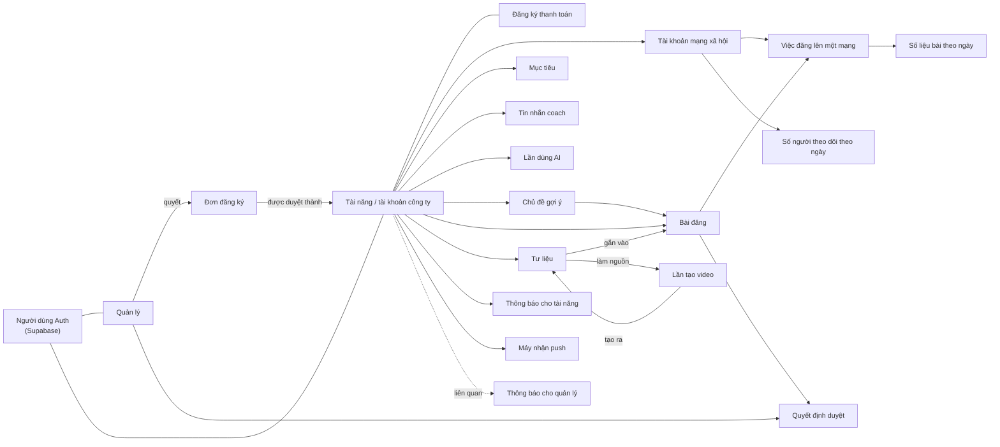
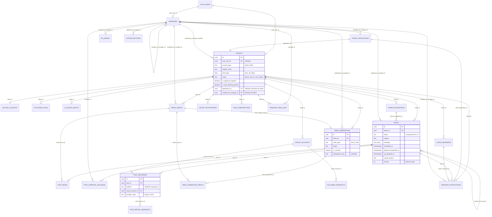
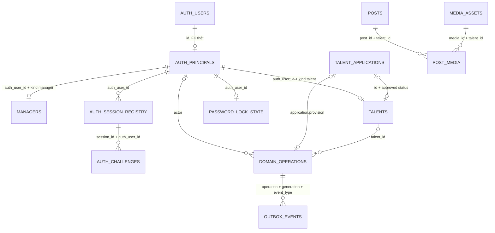

# 03. ERD khái niệm và logic

> **Cập nhật 17/11/2026:** ERD này là bản trước remediation. Mô hình hiện hành xem [10](10_confirmed_scope_and_remediation.md) và Prisma schema: FK Auth thật, auth_principals/session, ownership FK kép, operation/outbox. Các quan hệ một chiều trigger Auth ở §4 đã bị thay thế.

Bản 1.0 · 17/11/2026 · Bước 3. Tên bảng và cột theo `04_database_schema.md`; mã R, BR, U theo `01_confirmed_requirements.md`.

## 1. ERD khái niệm

Mức nghiệp vụ: chỉ thực thể và quan hệ, chưa có cột.

## 2. ERD logic

Ký hiệu crow's foot: `||` đúng một, `o|` không hoặc một, `}o` không hoặc nhiều. Bảng `activity_logs` chỉ tham chiếu mềm nên không vẽ.

Chi tiết đủ cột của 25 bảng ở `04_database_schema.md`. Sơ đồ chỉ ghi cột của 4 bảng trung tâm cho dễ đọc.

## 3. Quyết định khi chuẩn hóa

| Mã | Quyết định | Lý do | Dạng chuẩn |
|---|---|---|---|
| D-01 | Tài năng và tài khoản công ty chung một bảng `talents`, phân biệt bằng `account_type` | [YK2] §3-1, §5-4: tài khoản công ty "dùng cùng chức năng với tài năng", chỉ khác chuyện thu phí. Tách hai bảng thì mọi bảng con (bài, tư liệu, video…) phải có hai khóa ngoại | 3NF; khác biệt giữ bằng CHECK (BR-02, BR-03, BR-04) |
| D-02 | Bản nháp và bài đăng là **một** thực thể `posts` | Hình 5-1 coi 投稿案 (bản nháp) là trạng thái đầu của bài đăng. Tách hai bảng sẽ chép chú thích, hashtag sang bảng thứ hai | 3NF |
| D-03 | Kết quả đăng tách sang `post_deliveries` (một dòng mỗi mạng) | [YK2] §5-1: thành công hay thất bại ghi theo từng mạng (R06-03). Để chung trong `posts` thì phải có cột lặp cho 3 mạng | 1NF, 3NF |
| D-04 | Quyết định duyệt tách sang `post_approval_decisions` (lịch sử) | Trả lại kèm lý do (R06-05); cách gửi duyệt lại chưa chốt (U-03). Bảng lịch sử dùng được cho cả "cùng bài, nhiều lần quyết" lẫn "bài mới mỗi lần" | 3NF |
| D-05 | Ảnh, video gắn vào bài qua bảng nối `post_media` | Một bài nhiều tư liệu, một tư liệu dùng cho nhiều bài ([YK2] §6-7 6-4: "後から投稿に使えます" – dùng sau cho bài đăng) | N:N |
| D-06 | Ảnh nguồn của video qua bảng nối `video_generation_inputs` | Một lần tạo video chọn nhiều ảnh, một ảnh dùng cho nhiều lần (R05-08) | N:N |
| D-07 | Hashtag lưu dạng mảng `text[]` trong `posts` | Hashtag là danh sách có thứ tự đi cùng chú thích, không truy vấn riêng từng hashtag, không có thuộc tính riêng. Tách bảng chỉ thêm phép nối | Chấp nhận mảng (giá trị nguyên tử ở mức bài) |
| D-08 | Số liệu bài lưu dạng JSONB | Chỉ số lấy được còn UNKNOWN và khác nhau theo mạng (U-07, R07-02) | Ngoại lệ có lý do; khi chốt chỉ số thì có thể tách cột |
| D-09 | Thông báo tách hai bảng: cho tài năng và cho quản lý | Khác người nhận (một tài năng so với mọi quản lý, [YK2] §3-3), khác trạng thái (đã đọc so với đã xử lý), khác đối tượng liên quan | 3NF |
| D-10 | Thông báo cho quản lý dùng khóa ngoại có kiểu (`talent_id`, `talent_application_id`, `post_id`, `coach_message_id`), không dùng cặp "loại + id" | Giữ được toàn vẹn tham chiếu; 8 loại thông báo ([YK2] §6-12 7-4) chỉ cần 4 loại đối tượng | 3NF |
| D-11 | `activity_logs` tham chiếu mềm (`target_type`, `target_id` dạng chữ) | Nhật ký phải giữ được khi đối tượng đổi hoặc bị xóa, và trải qua mọi loại đối tượng ([YK2] §9-4). Khóa ngoại cứng sẽ chặn xóa hoặc mất nhật ký | Ngoại lệ có lý do |
| D-12 | Không sao chép email vào `talents`, `managers` | Email nằm ở `auth.users`; chép sang sẽ lệch khi đổi email | 3NF |
| D-13 | Không lưu cờ vị thành niên, số ngày không đăng, ngày đăng liên tục | Đều tính được từ dữ liệu khác (02 §4) | Tránh dữ liệu suy ra |
| D-14 | Số người theo dõi gắn với tài khoản mạng xã hội, không gắn thẳng với tài năng | Tài năng kết nối lại tài khoản khác thì lịch sử vẫn đúng tài khoản | 3NF |
| D-15 | Cài đặt chung là một dòng có cột rõ kiểu, không dùng bảng khóa–giá trị | Số cài đặt ít và đã biết ([YK2] §5-6); có kiểu dữ liệu và DEFAULT rõ ràng | 3NF |
| D-16 | Giá trị liệt kê (trạng thái, loại) dùng `text` + CHECK, không dùng kiểu ENUM của Postgres | Danh sách còn có thể đổi (U-04, U-06, U-11). Sửa CHECK dễ hơn bỏ giá trị khỏi ENUM | — |

## 4. Kiểm tra quan hệ và phụ thuộc

| Kiểm tra | Kết quả |
|---|---|
| Mọi bảng dữ liệu của tài năng đều có đường tới `talents` | Đúng: lọc được theo `talent_id`, trực tiếp hoặc qua bài, qua tài khoản mạng xã hội |
| `post_deliveries.social_account_id` phải thuộc cùng tài năng với bài | Khóa ngoại đơn không diễn đạt được. Kiểm ở tầng dịch vụ (07, vấn đề M-02) |
| `post_media`, `video_generation_inputs`: tư liệu phải cùng tài năng với bài hoặc lần tạo video | Như trên (07, M-02) |
| Xóa tài năng | Không xóa: [YK2] §6-2 7-3 chuyển sang 利用終了 và §7-3 giữ dữ liệu. Mọi khóa ngoại tới `talents` dùng ON DELETE RESTRICT |
| Xóa người dùng Auth | RESTRICT: không xóa được người dùng Auth khi còn tài năng hoặc quản lý gắn với nó |
| Chu trình khóa ngoại | Không có chu trình bắt buộc. `posts.revised_from_post_id` tự tham chiếu, cho phép NULL |

## 5. Vòng đời trạng thái dùng trong schema

| Bảng.cột | Giá trị | Căn cứ |
|---|---|---|
| `talents.status` | `before_use` (利用前), `in_use` (利用中), `ended` (利用終了) | R01-11 |
| `talent_applications.status` | `pending`, `approved`, `rejected` | R01-01 |
| `posts.status` | `draft` (投稿案), `awaiting_approval` (承認待ち), `scheduled` (予約済み), `published` (投稿済み), `failed` (失敗), `cancelled` (取り消し) | R06-01. Đường chuyển theo hình 5-1 (sơ đồ ở `SCD/EP10…/C-01`); DB không chặn đường chuyển, tầng dịch vụ kiểm |
| `post_deliveries.provider_state` | `not_submitted` → `submitted` / `submit_failed`; `submitted` → `cancel_requested` → `cancelled` / `cancel_failed`; `submitted` → `published` / `publish_failed`; `publish_failed` → `submitted` (hẹn lại, hình 5-1) | R06-03, R06-11〜R06-13, IR-01. Giá trị "bỏ qua" chờ U-06 |
| Quy tắc tạm `posts.status` theo từng mạng (IR-02, chờ [QA] No.51) | `failed` khi có ít nhất một mạng `publish_failed`; `published` khi mọi mạng đã gửi đều `published`; `cancelled` khi đã yêu cầu hủy (mạng nào `cancel_failed` thì báo quản lý để xử lý tay) | Quy tắc tạm, ghi vào đặc tả; đổi quy tắc không phải chuyển dữ liệu |
| `social_accounts.status` | `connected`, `disconnected` | R06-09, [YK2] §6-10 8-6 |
| `video_generations.status` | `requested`, `processing`, `succeeded`, `failed` | R05-06〜R05-09. [YK2] §5-1 nói trạng thái video sẽ ghi ở bản cuối; đây là bản tối thiểu |

## 6. ERD bổ sung hiện hành — scope đợt 1

Các quan hệ ownership bổ sung cũng bảo vệ theme/revised post, video input/result, delivery account/platform và subject của manager notification. Kind chỉ cho identity đóng một vai trò; không bắt buộc mỗi principal phải có domain row ngay trong lúc provisioning. Bảng phiên/operation/outbox đặt ở app_private, không expose Data API. Xem `10` để phân biệt bảng có trong DB với chức năng được mở; EP06/EP08 chưa mở.
