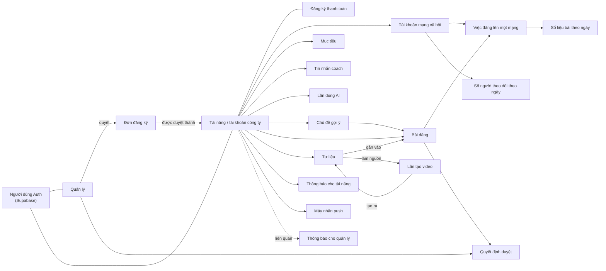
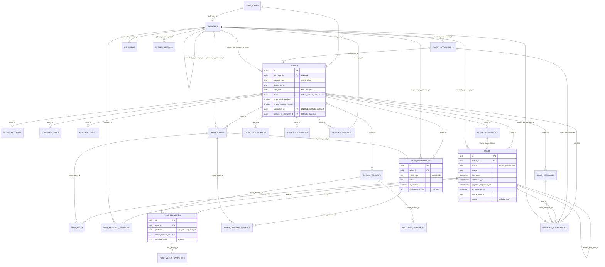
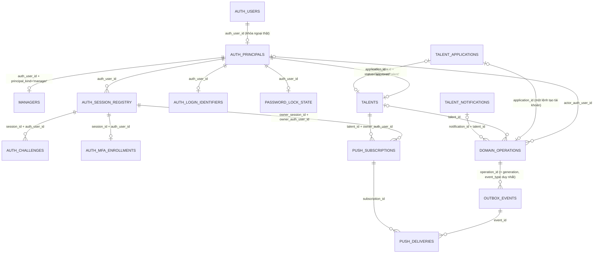
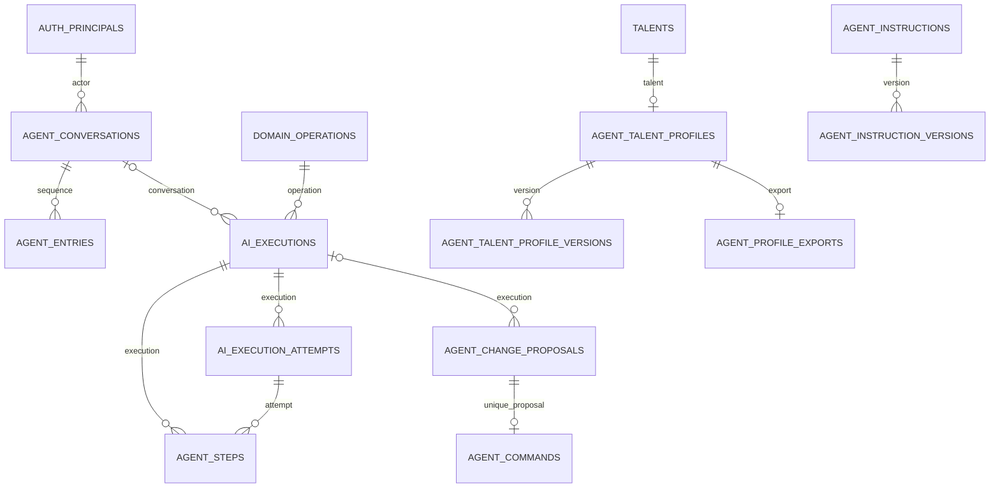

# 03. ERD khái niệm và logic

> **Cập nhật quyết định 25/11/2026:** Đã đồng bộ nhóm quyết định đã rõ vào nội dung tài liệu. Phân biệt yêu cầu nguồn, SQL hiện có và thiết kế đích chưa có migration. Cấu trúc repository: 13 migration/53 bảng ứng dụng; chưa kiểm DB live. Các ghi chú ngày 18/11 và 23/11 giữ vai trò lịch sử ở phần đã được thay. [Hồ sơ thay đổi](decisions-update-2026-11-25.json); [review và phần còn thiếu](08_full_review_2026-11-25.md).

> **Rà soát 23/11/2026:** Đối chiếu QA/KS hiện hành và bộ `23112026`; xem [kết quả tác động DB](06_extensibility_review.md) và [danh mục nguồn](../TAI_LIEU_NGUON.md). Tách schema trong repository, quyết định nguồn và đề xuất thiết kế. Lần rà này chỉ cập nhật tài liệu, chưa áp migration hoặc kiểm tra database đang chạy; không cấp phê duyệt nghiệp vụ, thương mại hay release.

> **Cập nhật 18/11/2026:** §1–§2 là ERD 25 bảng nghiệp vụ; §6 là phần danh tính, phiên, tác động ra ngoài và thông báo đẩy (schema `app_private`). Phần lõi phản ánh 6 migration tới technology_demo; migration thứ 7 chỉ thêm 2 bảng demo OneDrive không vẽ: khóa ngoại thật tới `auth.users`, khóa ngoại kép theo chủ (D-18), bảng chưa chốt bị chặn ghi (D-22, `07` §3).

Bản 1.1 · 18/11/2026 · Bước 3. Tên bảng và cột theo `05_data_dictionary.md`; mã R, BR, U theo `01_confirmed_requirements.md`.

## 1. ERD khái niệm

Mức nghiệp vụ: chỉ thực thể và quan hệ, chưa có cột.

## 2. ERD logic

Ký hiệu crow's foot: `||` đúng một, `o|` không hoặc một, `}o` không hoặc nhiều. Bảng `activity_logs` chỉ tham chiếu mềm nên không vẽ.

Snapshot catalog 38 bảng và bổ sung SQL của các bảng mới ở `05_data_dictionary.md`. Sơ đồ chỉ ghi cột của 4 bảng trung tâm cho dễ đọc. Các bảng con còn có khóa ngoại kép (`id`, `talent_id`) tới bảng cha để bảo đảm cùng chủ (D-18); sơ đồ không vẽ lặp.

## 3. Quyết định khi chuẩn hóa

| Mã | Quyết định | Lý do | Dạng chuẩn |
|---|---|---|---|
| D-01 | Tài năng và tài khoản công ty chung một bảng `talents`, phân biệt bằng `account_type` | [YK2] §3-1, §5-4: tài khoản công ty "dùng cùng chức năng với tài năng", chỉ khác chuyện thu phí. Tách hai bảng thì mọi bảng con (bài, tư liệu, video…) phải có hai khóa ngoại | 3 NF; khác biệt giữ bằng CHECK (BR-02, BR-03, BR-04) |
| D-02 | Bản nháp và bài đăng là **một** thực thể `posts` | Hình 5-1 coi 投稿案 (bản nháp) là trạng thái đầu của bài đăng. Tách hai bảng sẽ chép chú thích, hashtag sang bảng thứ hai | 3 NF |
| D-03 | Kết quả đăng tách sang `post_deliveries` (một dòng mỗi mạng) | [YK2] §5-1: thành công hay thất bại ghi theo từng mạng (R06-03). Để chung trong `posts` thì phải có cột lặp cho 3 mạng | 1 NF, 3 NF |
| D-04 | Quyết định duyệt tách sang `post_approval_decisions` (lịch sử) | Trả lại kèm lý do (R06-05); cách gửi duyệt lại chưa chốt (U-03). Bảng lịch sử dùng được cho cả "cùng bài, nhiều lần quyết" lẫn "bài mới mỗi lần" | 3 NF |
| D-05 | Ảnh, video gắn vào bài qua bảng nối `post_media` | Một bài nhiều tư liệu, một tư liệu dùng cho nhiều bài ([YK2] §6-7 6-4: "後から投稿に使えます" – dùng sau cho bài đăng) | N:N |
| D-06 | Ảnh nguồn của video qua bảng nối `video_generation_inputs` | Một lần tạo video chọn nhiều ảnh, một ảnh dùng cho nhiều lần (R05-08) | N:N |
| D-07 | Hashtag lưu dạng mảng `text[]` trong `posts` | Hashtag là danh sách có thứ tự đi cùng chú thích, không truy vấn riêng từng hashtag, không có thuộc tính riêng. Tách bảng chỉ thêm phép nối | Chấp nhận mảng (giá trị nguyên tử ở mức bài) |
| D-08 | Số liệu bài lưu dạng JSONB | Chỉ số lấy được còn UNKNOWN và khác nhau theo mạng (U-07, R07-02) | Ngoại lệ có lý do; khi chốt chỉ số thì có thể tách cột |
| D-09 | Thông báo tách hai bảng: cho tài năng và cho quản lý | Thiết kế vật lý tách đối tượng Talent/Manager; chưa đáp ứng routing tới người phụ trách Talent (KS K77/K93) hoặc phân biệt read/handled (No.97). Cần thiết kế P-16 trước mở luồng | 3 NF |
| D-10 | Thông báo cho quản lý dùng khóa ngoại có kiểu (`talent_id`, `talent_application_id`, `post_id`, `coach_message_id`), không dùng cặp "loại + id" | Giữ được toàn vẹn tham chiếu; 8 loại thông báo ([YK2] §6-12 7-4) chỉ cần 4 loại đối tượng | 3 NF |
| D-11 | `activity_logs` tham chiếu mềm (`target_type`, `target_id` dạng chữ) | Nhật ký phải giữ được khi đối tượng đổi hoặc bị xóa, và trải qua mọi loại đối tượng ([YK2] §9-4). Khóa ngoại cứng sẽ chặn xóa hoặc mất nhật ký | Ngoại lệ có lý do |
| D-12 | Không sao chép email vào `talents`, `managers` | Email nằm ở `auth.users`; chép sang sẽ lệch khi đổi email | 3 NF |
| D-13 | Không lưu cờ vị thành niên, số ngày không đăng, ngày đăng liên tục | Đều tính được từ dữ liệu khác (02 §4) | Tránh dữ liệu suy ra |
| D-14 | Số người theo dõi gắn với tài khoản mạng xã hội, không gắn thẳng với tài năng | Tài năng kết nối lại tài khoản khác thì lịch sử vẫn đúng tài khoản | 3 NF |
| D-15 | Cài đặt chung là một dòng có cột rõ kiểu, không dùng bảng khóa–giá trị | Số cài đặt ít và đã biết ([YK2] §5-6); có kiểu dữ liệu và DEFAULT rõ ràng | 3 NF |
| D-16 | Giá trị liệt kê (trạng thái, loại) dùng `text` + CHECK, không dùng kiểu ENUM của Postgres | Danh sách còn có thể đổi (U-04, U-06, U-11). Sửa CHECK dễ hơn bỏ giá trị khỏi ENUM | — |
| D-17 | Schema `app_private` chứa nền runtime và dữ liệu nghiệp vụ agent cần bảo vệ | Không mở trực tiếp qua Data API; service kiểm quyền actor/scope. QA101 và SQL 25/11 bổ sung profile/instruction/history | Quyết định kỹ thuật |
| D-18 | Bảo đảm cùng chủ bằng khóa ngoại kép (`id`, `talent_id`): bảng cha có UNIQUE (`id`, `talent_id`), bảng con lặp `talent_id` | Kiểm ở tầng dịch vụ dễ lọt (gắn tư liệu, chủ đề, tài khoản mạng xã hội của người khác). Đánh đổi: lặp cột `talent_id` ở `post_media`, `video_generation_inputs`, `post_deliveries` | Phi chuẩn có chủ đích (lặp khóa) |
| D-19 | Danh tính ứng dụng tách ra `auth_principals` (một vai trò mỗi người dùng Auth); `managers`/`talents` tham chiếu bằng khóa ngoại kép (`auth_user_id`, `principal_kind`) | Một người dùng không thể vừa là quản lý vừa là tài năng; cờ buộc đổi mật khẩu và `security_version` dùng chung cho cả hai vai trò | 3 NF |
| D-20 | Sổ phiên do BE cấp (`auth_session_registry`) thay vì chỉ tin JWT | Supabase không tự hết hạn phiên ở gói thường; JWT đã phát vẫn dùng được sau khi đăng xuất. Cần thu hồi tức thì, hạn tuyệt đối 30 ngày, thời gian chờ 30 phút của quản lý và bằng chứng TOTP theo từng phiên ([SUPA] §6) | — |
| D-21 | Tác động ra ngoài ghi vào `domain_operations` + `outbox_events` trong cùng giao dịch với dữ liệu nghiệp vụ | Không mất việc gửi khi tiến trình chết sau khi ghi DB; chống gửi trùng bằng khóa idempotency và lease (`07` §4.4) | — |
| D-22 | Bảng của luồng chưa chốt giữ lại nhưng chặn ghi bằng trigger, không xóa | Giữ thiết kế và dữ liệu cũ; không ai vô tình mở luồng chưa có quyết định của khách (`07` §3) | — |
| D-23 | Khóa ngoại thật tới `auth.users`; Prisma coi bảng Auth là bảng bên ngoài | Thay cách dùng trigger chặn xóa (migration `000200`): khóa ngoại bảo vệ cả chiều thêm, sửa, xóa | — |

## 4. Kiểm tra quan hệ và phụ thuộc

| Kiểm tra | Kết quả |
|---|---|
| Mọi bảng dữ liệu của tài năng đều có đường tới `talents` | Đúng: lọc được theo `talent_id`, trực tiếp hoặc qua bài, qua tài khoản mạng xã hội |
| `post_deliveries.social_account_id` phải thuộc cùng tài năng và đúng mạng với bài | DB ép: `fk_post_deliveries_account_scope` (`social_account_id`, `talent_id`, `platform`) và `fk_post_deliveries_owner` (D-18) |
| `post_media`, `video_generation_inputs`, bản sửa, chủ đề, kết quả video, đối tượng của thông báo quản lý, máy nhận push: phải cùng tài năng | DB ép bằng khóa ngoại kép (`fk_*_owner`, D-18) |
| Xóa tài năng | Bình thường chuyển ended, giữ 6 tháng rồi tự xóa theo YK3 P660. FK RESTRICT hiện có đòi purge plan theo policy; chưa có DDL purge, không đồng nhất RESTRICT với yêu cầu không bao giờ xóa. |
| Xóa người dùng Auth | Khóa ngoại thật, RESTRICT: không xóa được người dùng Auth khi còn `auth_principals`, tài năng hoặc quản lý gắn với nó (D-23) |
| Chu trình khóa ngoại | Không có chu trình bắt buộc. `posts.revised_from_post_id` tự tham chiếu, cho phép NULL |

## 5. Giá trị vật lý trong migration và giới hạn vòng đời

| Bảng.cột | Giá trị | Căn cứ |
|---|---|---|
| `talents.status` | `before_use`, `in_use`, `ended` là 3 giá trị hiện có; thiếu 一時停止 theo KS K116/F32 | R01-11, P-21; chưa sửa CHECK |
| `talent_applications.status` | `pending`, `approved`, `rejected` | R01-01 |
| `posts.status` | `draft` (投稿案), `awaiting_approval` (承認待ち), `scheduled` (予約済み), `published` (投稿済み), `failed` (失敗), `cancelled` (取り消し) | R06-01. Đường chuyển theo hình 5-1 (sơ đồ ở `SCD/EP10…/C-01`); DB không chặn đường chuyển, tầng dịch vụ kiểm |
| `post_deliveries.provider_state` | `not_submitted` → `submitted` / `submit_failed`; `submitted` → `cancel_requested` → `cancelled` / `cancel_failed`; `submitted` → `published` / `publish_failed`; `publish_failed` → `submitted` (hẹn lại, hình 5-1) | R06-03, R06-11〜R06-13. Bảng đang chặn ghi; vòng đời này phải xem lại khi thiết kế lại luồng đăng (`07` §3). Giá trị "bỏ qua" chờ U-06 |
| Cách tính `posts.status` từ kết quả từng mạng | **Chưa có**: không dùng quy tắc tạm (ví dụ "một mạng lỗi thì cả bài lỗi") cho tới khi [QA] No.51 đóng (`07` §2) | — |
| `auth_session_registry.purpose` | `first_password`, `recovery`, `mfa_setup` → `full`; đã `revoked_at` thì không quay lại | [SUPA] §6.3, §7 |
| `auth_challenges.state` | `pending` → `verified` / `expired` / `failed` | [SUPA] §7.4 |
| `domain_operations.state` | `accepted` → `running` → `completed` / `failed` / `unknown` (đối soát) | `07` §4.4 |
| `outbox_events.state` | `pending` → `leased` → `done` / `failed` / `unknown` | `07` §4.4 |
| `push_deliveries.state` | `pending` → `sent` / `gone` / `failed` (tối đa 3 lần thử) | [PWA] §6.5 |
| `social_accounts.status` | `connected`, `disconnected` | R06-09, [YK2] §6-10 8-6 |
| `video_generations.status` | `requested`, `processing`, `succeeded`, `failed` | R05-06〜R05-09. [YK2] §5-1 nói trạng thái video sẽ ghi ở bản cuối; đây là bản tối thiểu |

## 6. ERD phần danh tính, phiên, tác động ra ngoài, thông báo đẩy

- Một người dùng Auth đóng đúng một vai trò (D-19). `auth_principals` có thể tồn tại trước dòng `managers`/`talents` trong lúc tạo tài khoản.
- Thu hồi phiên (trigger) tắt luôn các máy nhận push gắn với phiên đó; vô hiệu quản lý hoặc chuyển tài năng sang `ended` thì tăng `security_version` và thu hồi mọi phiên.
- `auth_rate_buckets` không có quan hệ (khóa là chuỗi băm). Năm bảng demo (gồm hai bảng OneDrive migration `20261118000200`) không vẽ: không dùng cho tính năng thật.
- Bảng có trong DB không có nghĩa luồng đã được mở: xem `07` §2–§3.

Ký hiệu nguồn: [SUPA] = `agent_spec/supabase-db-auth-spec/HUONG_DAN_TICH_HOP_VI.md`; [PWA] = `agent_spec/pwa-platform-spec/HUONG_DAN_TICH_HOP_VI.md`.

## 7. Khoảng lệch với nguồn hiện hành 23/11

ERD trên mô tả cấu trúc nghiệp vụ/danh tính đã có trong repository, không là ERD đích đã duyệt và không bao gồm đầy đủ bảng demo. Không thêm trạng thái/bảng đề xuất vào hình như đã triển khai.

- **D-02:** Một `posts` không đồng nghĩa chỉ ghi đè nội dung. Khi mở duyệt/đăng cần revision và snapshot nội dung/media đã được xác nhận, gắn đúng quyết định/lần gửi (P-23); chuỗi `revised_from_post_id` hiện có chưa tự đủ.
- **D-03:** Một dòng `post_deliveries` mỗi SNS là aggregate hiện có; không thay lịch sử lần thử, callback hoặc bằng chứng đăng. Nguồn mới KS20261122 G20:H 20 giữ TikTok direct; không lấy đề nghị inbox 22/11 làm thiết kế mặc định.
- **D-09:** Người nhận duyệt theo Talent khác quyền Manager xem mọi Talent; không suy từ routing ra hàng rào phân quyền.
- **D-16:** `text + CHECK` vẫn cần migration, kiểm dữ liệu/backfill, tương thích API/worker và thời gian khóa. Không mặc định nới CHECK là thay đổi rủi ro thấp.
- **Trạng thái:** 一時停止 vẫn thu phí, khác `ended` và cờ dừng đăng. Không suy ra dừng login hoặc hủy job provider; `ended` không khôi phục theo KS 確認56, còn cơ chế DB thực hiện cần kiểm riêng P-18.
- **Lưu trữ:** media hỗ trợ hướng Supabase/OneDrive (QA No.8), nhưng cột vật lý còn thiên OneDrive. Profile/history đã có SQL 25/11; readiness còn P-24. Mã màn YK3 M-08 khác UI-M20 M-21, không đồng nhất theo số.

Truy vết đầy đủ, đề xuất chưa duyệt và điều kiện triển khai: [06](06_extensibility_review.md), [04 P-21–P-26](04_database_schema.md#bổ-sung-thiết-kế-sau-đợt2311--chưa-có-ddl).

## 8. Quan hệ agent đã có trong SQL 25/11

Hình tóm tắt FK/cardinality hiện có, không vẽ toàn bộ constraint vòng waiting_proposal/step. Scope category hiện bị chặn; Challenge/progress, category/membership/assignment và lịch từng SNS là thiết kế đích chưa có bảng/cột. Không thêm chúng vào ERD vật lý như đã migrate. Runtime profile/instruction ghi qua proposal→xác nhận→command, không cho model SQL tùy ý.

Thiết kế đích cần quan hệ Talent–category N:N; Talent–assignment history; Talent–Challenge/progress; period–media N:N và post–plan theo từng SNS. Đây là PROPOSAL nội bộ theo các quyết định đã rõ, giữ QA99/95/96/98 và nhánh còn mở ở 01; không phải khách chọn tên bảng hoặc khóa.
