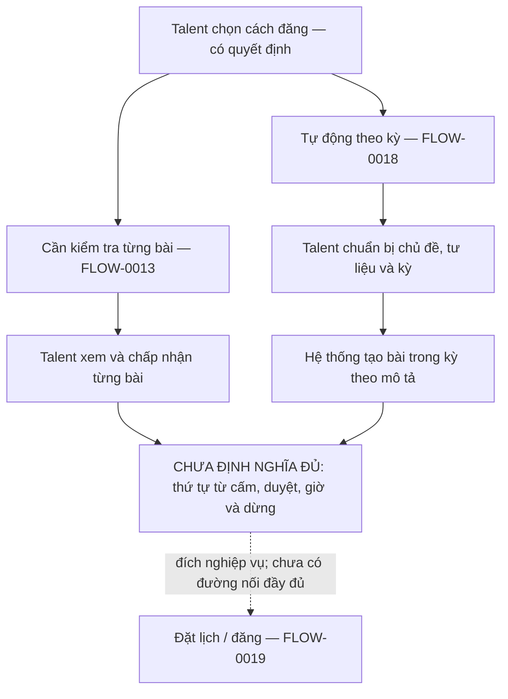

# Business Flow Specification — quy ước và điểm vào

Phạm vi: toàn bộ Requirement Register175 dòng của đợt extraction19/11, nguồn YK2/KS/QA/GJ và mô tả màn18/11;13UC và19 trang flow nguồn được map về30 flow. Nguồn gốc được mở lại, hash12 tệp không thay đổi. Các sổ REQ/BR/EV cũ giữ nguyên; không sửa SCD/technical spec hoặc workbook Q&A.

Đặc tả đầy đủ nằm trong30 tệp tại [Flow Index](FLOW_INDEX.md). Mỗi flow có12 mục: mục tiêu, actors, trigger, preconditions, trình tự chính, nhánh thay thế, ngoại lệ, chuyển trạng thái, postconditions, business rules, phụ thuộc ngoài và flow liên quan. Điều kiện trước/sau là tóm tắt tái dựng có giới hạn, không tạo thêm requirement khách. Nguồn trực tiếp gắn từng bước/nhánh; nguồn hỗ trợ không được dùng vượt điều nó chứng minh.

## Phân loại từng hành vi

| Nhãn | Ý nghĩa |
|---|---|
| SOURCE_CONFIRMED / C | Có căn cứ khách xác nhận đúng ý; không xác nhận toàn flow hoặc mọi thứ tự giữa các ý. |
| SOURCE_DESCRIBED / D | YK2/giao diện/nhật ký mô tả hành vi; chưa đủ xác nhận riêng của khách. Con số trong chương6 còn là giả định nếu không có quyết định riêng. |
| INFERENCE / I | Suy luận được ghi rõ tiền đề, chủ yếu nối đầu ra với đầu vào; không phải requirement đã được khách chốt. |
| UNDEFINED / U | Trong phần nguồn đã kiểm chưa có hành vi/điều kiện đầy đủ. Không điền mặc định, không tự đặt enum/giá/timeout/retry. |
| CONFLICTED / X | Các mô tả hiện còn khác nhau; giữ hai phía, không tự giải bằng code/SCD. |
| SOURCE_PROPOSAL / P | Nội dung đề xuất trong nguồn, chưa biến thành đường vận hành được duyệt. |

**Nhãn hành vi và nhãn thứ tự là hai trục khác nhau.** Ví dụ “Talent đăng ký thanh toán” có thể được xác nhận, nhưng tín hiệu dịch vụ dùng để cho AI bắt đầu là phần nối suy luận chưa được xác định. Cột sequence_basis trong [steps.csv](steps.csv) ghi giới hạn của quan hệ trước–sau. Nhánh ghi rõ tách từ bước nào, điều kiện và kết thúc/điểm nối; không phải các nhánh đều xảy ra trong một lượt.

Các bước được trình bày theo trình tự thời gian tái dựng; những việc chuẩn bị độc lập không mặc định là hàng rào chặn nhau. Nếu gặp U/X, việc mô tả đích thành công sau đó không cấp phép bỏ qua điểm chưa rõ: mốc đích được ghi rõ có điều kiện. Không có tuyến thực thi mặc định được tạo ra từ khoảng trống.

## Dữ liệu và truy vết

- [steps.csv](steps.csv) là bảng chiếu máy đọc từ các đặc tả: mã bước, điều kiện/điểm tách, tác nhân, hành vi, nhãn, căn cứ thứ tự, REQ phù hợp, source_refs và EV. REQ trống ở một bước nghĩa là quan hệ phụ trợ/điểm thiếu được đọc trực tiếp từ nguồn, không phải một yêu cầu khách mới.
- [scenarios.csv](scenarios.csv) chỉ ghi các trường hợp thực sự liên quan đã nêu trong nhánh; chưa chạy kiểm thử và không tự biến thành AC hoặc Q&A.
- [flow-gaps.csv](flow-gaps.csv) là bản ghi điểm chưa định nghĩa/khác biệt gắn bước. Chỉ ở mức DRAFT, chưa G4/G5; không phải danh sách câu hỏi khách hoặc phát hiện độc lập đã xác minh. Phân loại bên xử lý thực sự cần làm tiếp theo; không mặc định mọi điểm thiếu là việc khách.
- [requirement-flow-map.csv](requirement-flow-map.csv) phân PRODUCT_BEHAVIOR, SUPPORTING_CONSTRAINT, PROJECT_CONTEXT, PROPOSAL_CONTEXT_NOT_ACTIVE_FLOW và UNDEFINED_CAPABILITY. “Có map” không có nghĩa “đủ đặc tả”.
- [rule-flow-map.csv](rule-flow-map.csv) chỉ map BR khi phù hợp REQ và nguồn dùng trong flow. BR chưa đủ ánh xạ được giữ ngữ cảnh để rà tiếp, không tự gán bừa vào một flow.
- EV cũ tra [evidence.csv](../registers/evidence.csv). EV mới có ID sau max cũ, lưu riêng tại [flow-evidence.csv](flow-evidence.csv) để giữ snapshot extraction. Đọc cả source_id/version/hash/locator và limits. claim_supported của EV mới trỏ mã bước/TRANS, không nâng thành phê duyệt.
- Ký hiệu nguồn kế thừa extraction: Y:đoạn w:p YK2; K:hàng KS; Q:hàng QA; G:mục đồng thuận GJ; T/M:trang SD-T18/SD-M18. **Q:r là hàng Excel, không phải No.** EV ghi No./dải ô; mã màn phải kèm tài liệu18/11. Tệp [source-snapshot.json](source-snapshot.json) giữ hash đúng bản đọc.

## Giới hạn hình và bằng chứng

Đã xem trực quan SD-T18 trang23 (đăng tự động) và SD-M18 trang32 (dừng/mở); các cảnh báo đỏ cần xác nhận trên hình được giữ mở. Hình5-1 YK2 đã được xem trong extraction, vẫn là bộ trạng thái cũ theo cùng hash, phải cập nhật theo No.51. Phần còn lại dùng mô tả bằng chữ và nguồn quyết định; chưa tuyên bố kiểm trực quan mọi connector/hình nhúng. Hình mới không tự đóng No.70/71/74/77.

## Sơ đồ chọn đường đăng

Sơ đồ rút gọn này thể hiện ranh giới hai đường. Nét đứt chỉ là đích được mô tả, **không** là phép vượt qua điểm U. Nguồn: KS xác nhận19/25/26 (K:52/61/62), GJ mục1, SD-T18 trang12/23; QA No.57/70/71.

Không xem đây là một gate mới đã được khách duyệt. Không tự gộp thiết lập tự động/cần kiểm tra với lựa chọn tự động/đăng một lần khi No.71 còn mở.

## Trạng thái kiểm soát

G1/G2 trước đó chưa ký. Theo lệnh hiện tại đã chuẩn bị hồ sơ tái dựng G3; kết quả gate vẫn BLOCKED chờ duyệt đầu vào/reviewer, không tự ký PASS. Chưa G4/G5/G6/G7/G8, chưa tạo Customer Q&A, chưa chốt baseline. Có thể rà phần độc lập khi thiếu nguồn/quyết định, nhưng không được coi các flow đó đã đủ để triển khai.
