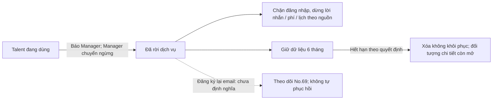

# State Transition Tables — bảng chuyển trạng thái

Các trạng thái dưới là diễn giải nghiệp vụ từ nguồn, không phải enum/schema cuối. “CHƯA ĐỊNH NGHĨA” không phải một trạng thái chạy thật. Chỉ thị cấm chuyển ngược được ghi như một ràng buộc, không phải cạnh hợp lệ của state machine. Không lấy enum từ SCD/DB.

| Mã | Flow / đối tượng | Trước | Sự kiện / điều kiện | Sau / tác động | Nhãn | Nguồn |
|---|---|---|---|---|---|---|
| TRANS-0001 | [FLOW-0001](flows/FLOW-0001.md) / Đơn đăng ký | Chưa gửi | Talent gửi; Có các trường và đồng ý điều khoản | Đã nộp/chờ xử lý; Báo Manager | SOURCE_DESCRIBED | `Y:244-247` → `EV-0001`: UC-01 利用するタレントを決めて、登録する; Đoạn XML P244–P247 (đánh số w:p từ 1, kể cả đoạn trống); xem mục/chức năng trong source_refs |
| TRANS-0002 | [FLOW-0001](flows/FLOW-0001.md) / Đơn đăng ký | Chờ xử lý | Manager duyệt; Có quyết định duyệt | Được duyệt; Gửi mật khẩu tạm; có quyền đăng nhập | SOURCE_CONFIRMED | `Q:12` → `EV-0004`: Q&A!A12:J12; ID=11.0; `K:32` → `EV-0014`: 確認事項!A32:I32; ID=前提 UC-03-2 |
| TRANS-0003 | [FLOW-0001](flows/FLOW-0001.md) / Đơn đăng ký | Chờ xử lý | Manager từ chối; Có quyết định từ chối | Bị từ chối; Email không nêu lý do | SOURCE_CONFIRMED | `K:4` → `EV-0009`: 確認事項!A4:I4; ID=前提 UC-01-3; `Q:12` → `EV-0004`: Q&A!A12:J12; ID=11.0 |
| TRANS-0004 | [FLOW-0001](flows/FLOW-0001.md) / Đơn đăng ký | Chờ xử lý | Hai quyết định hoặc quá hạn; Chưa có quy tắc phân xử/hạn | CHƯA ĐỊNH NGHĨA; Không chọn quyết định thắng | UNDEFINED | `Q:65` → `EV-0068`: Q&A!A65:J65; ID=65.0; `M:6` → `EV-0007`: Trang PDF 6 (từ 1); mã màn ở source_refs |
| TRANS-0005 | [FLOW-0002](flows/FLOW-0002.md) / Mật khẩu Talent | Mật khẩu tạm | Talent đặt mật khẩu riêng; Đã đăng nhập lần đầu | Mật khẩu do Talent đặt; Đi tiếp khởi tạo | SOURCE_CONFIRMED | `K:32` → `EV-0014`: 確認事項!A32:I32; ID=前提 UC-03-2 |
| TRANS-0006 | [FLOW-0002](flows/FLOW-0002.md) / Đăng nhập Talent | Được phép thử | Sai5 lần; 5lần/15phút là đề xuất | Tạm khóa theo đề xuất; Không coi số này đã được khách chốt | SOURCE_DESCRIBED | `Y:583` → `EV-0018`: 6. 機能要件; Đoạn XML P583–P583 (đánh số w:p từ 1, kể cả đoạn trống); xem mục/chức năng trong source_refs; `Y:594` → `EV-0507`: YK2 đoạn w:p P594–P594 (đếm mọi đoạn XML từ1); mục/UC ghi tại flow |
| TRANS-0007 | [FLOW-0002](flows/FLOW-0002.md) / Phiên Talent | Đang dùng thiết bị cũ | Đăng nhập thiết bị mới; Tài khoản được phép dùng | Dùng tiếp dữ liệu cũ; Hội thoại/kết quả tiếp tục, không tạo Talent mới | SOURCE_CONFIRMED | `K:114` → `EV-0023`: 確認事項!A114:I114; ID=前提 UC-13-1 |
| TRANS-0008 | [FLOW-0003](flows/FLOW-0003.md) / Phương thức thanh toán | Chưa đăng ký | Đăng ký thành công ở cổng; Có kết quả thật; hợp đồng tín hiệu chưa rõ | Đã đăng ký; Điều kiện dùng AI, tạo thư mục; không tự suy đã thu tiền | SOURCE_CONFIRMED | `K:36` → `EV-0029`: 確認事項!A36:I36; ID=前提 UC-03-6; `K:7` → `EV-0066`: 確認事項!A7:I7; ID=前提 UC-01-6 |
| TRANS-0009 | [FLOW-0003](flows/FLOW-0003.md) / Trạng thái sử dụng Talent | 利用前 (chưa dùng) | Đăng ký thanh toán/hồ sơ; Điều kiện chuyển chưa chốt | CHƯA ĐỊNH NGHĨA; Không tự chuyển 利用中 (đang dùng) | UNDEFINED | `Q:52` → `EV-0059`: Q&A!A52:J52; ID=52.0; `Q:53` → `EV-0277`: Q&A!A53:J53; ID=53.0 |
| TRANS-0010 | [FLOW-0004](flows/FLOW-0004.md) / Kết nối SNS | Chưa kết nối | Talent cấp quyền thành công; Đúng Talent/mỗi SNS1 tài khoản | Đã kết nối; Hiện tình trạng | SOURCE_DESCRIBED | `Y:742-745` → `EV-0208`: 8-2 投稿サービスとの接続（優先順位：高）; Đoạn XML P742–P745 (đánh số w:p từ 1, kể cả đoạn trống); xem mục/chức năng trong source_refs; `K:40` → `EV-0214`: 確認事項!A40:I40; ID=10.0 |
| TRANS-0011 | [FLOW-0004](flows/FLOW-0004.md) / Trang kết nối theo YK2 | Trang còn hiệu lực | Hết48giờ; Chỉ cách YK2; khác biệt SD chưa giải nghĩa | Trang hết hiệu lực; Cho cấp lại theo YK2, không áp cho mọi cách kết nối | SOURCE_DESCRIBED | `Y:743` → `EV-0453`: YK2 đoạn w:p P743–P743 (đếm mọi đoạn XML từ1); mục/UC ghi tại flow; `T:9` → `EV-0033`: Trang PDF 9 (từ 1); mã màn ở source_refs |
| TRANS-0012 | [FLOW-0004](flows/FLOW-0004.md) / Kết nối SNS | Đã nối | Mất kết nối; Có dấu hiệu kết nối mất | Mất kết nối; Báo Talent nối lại; lịch cũ chưa có luật | SOURCE_DESCRIBED | `Y:757` → `EV-0230`: 8-6 SNS の接続切れの通知（優先順位：中）; Đoạn XML P757–P757 (đánh số w:p từ 1, kể cả đoạn trống); xem mục/chức năng trong source_refs |
| TRANS-0013 | [FLOW-0005](flows/FLOW-0005.md) / Hồ sơ Talent | Chưa đăng ký | Manager đăng ký qua ChatGPT; Đúng Talent và thư mục | Đã có thông tin ghi; AI đọc từ lần sau theo nguồn | SOURCE_CONFIRMED | `K:14` → `EV-0073`: 確認事項!A14:I14; ID=前提 UC-02-2; `K:15` → `EV-0084`: 確認事項!A15:I15; ID=前提 UC-02-3 |
| TRANS-0014 | [FLOW-0005](flows/FLOW-0005.md) / Mức hoàn tất hồ sơ | Có thông tin | Xác định đủ hồ sơ; Tín hiệu đủ chưa chốt | CHƯA ĐỊNH NGHĨA; Không tự gỡ điều kiện chặn tạo nháp | UNDEFINED | `K:9` → `EV-0086`: 確認事項!A9:I9; ID=前提 UC-01-8; `Q:54` → `EV-0437`: Q&A!A54:J54; ID=54.0 |
| TRANS-0015 | [FLOW-0006](flows/FLOW-0006.md) / Phiên hồ sơ | Bản hiện tại | ChatGPT/M-20 ghi đồng thời; Quy tắc ưu tiên chưa có | CHƯA ĐỊNH NGHĨA; Không mặc định bên ghi cuối thắng | UNDEFINED | `M:23` → `EV-0330`: Trang PDF 23 (từ 1); mã màn ở source_refs; `M:30` → `EV-0331`: Trang PDF 30 (từ 1); mã màn ở source_refs |
| TRANS-0016 | [FLOW-0007](flows/FLOW-0007.md) / Mục tiêu | Mục tiêu hiện tại | Manager lưu mục tiêu mới; Theo từng SNS và thời hạn | Mục tiêu mới; Được nguồn mô tả phản ánh ngay; không là trạng thái đạt | SOURCE_DESCRIBED | `K:17` → `EV-0079`: 確認事項!A17:I17; ID=前提 UC-02-5; `K:25` → `EV-0080`: 確認事項!A25:I25; ID=3.0; `Y:651` → `EV-0082`: 2-4 目標の登録（優先順位：高）; Đoạn XML P651–P651 (đánh số w:p từ 1, kể cả đoạn trống); xem mục/chức năng trong source_refs |
| TRANS-0017 | [FLOW-0007](flows/FLOW-0007.md) / Mục tiêu | Chưa rõ mức đạt | Đến hạn mục tiêu; Không có luật kết thúc tự động | CHƯA ĐỊNH NGHĨA; Không tự gia hạn/reset | UNDEFINED | `Y:650` → `EV-0077`: 2-4 目標の登録（優先順位：高）; Đoạn XML P650–P650 (đánh số w:p từ 1, kể cả đoạn trống); xem mục/chức năng trong source_refs |
| TRANS-0018 | [FLOW-0008](flows/FLOW-0008.md) / Gán category | Đang gán Talent/chỉ thị | Bỏ/xóa nhóm; Tác động người phụ trách chưa chốt | CHƯA ĐỊNH NGHĨA; Không tự phân tuyến về tất cả Manager | UNDEFINED | `K:99` → `EV-0317`: 確認事項!A99:I99; ID=47.0; `Q:7` → `EV-0205`: Q&A!A7:J7; ID=6.0 |
| TRANS-0019 | [FLOW-0009](flows/FLOW-0009.md) / Chỉ thị | Nội dung đang soạn | Manager thử; Có Talent được chọn | Có kết quả xem thử; Chưa đồng nghĩa đã lưu | SOURCE_CONFIRMED | `K:29` → `EV-0325`: 確認事項!A29:I29; ID=7.0 |
| TRANS-0020 | [FLOW-0009](flows/FLOW-0009.md) / Chỉ thị | Nội dung sau thử | Manager lưu; Đã xem thử theo luồng nguồn | Có bản đã lưu; Có lịch sử; thời điểm hiệu lực chưa đầy đủ | SOURCE_CONFIRMED | `K:29` → `EV-0325`: 確認事項!A29:I29; ID=7.0 |
| TRANS-0021 | [FLOW-0009](flows/FLOW-0009.md) / Chỉ thị | Bản đang dùng | Quay bản trước; Có lịch sử | Bản trước được chọn; Không suy sửa hồi tố bài/job | SOURCE_CONFIRMED | `K:29` → `EV-0325`: 確認事項!A29:I29; ID=7.0; `M:18` → `EV-0326`: Trang PDF 18 (từ 1); mã màn ở source_refs |
| TRANS-0022 | [FLOW-0011](flows/FLOW-0011.md) / Hội thoại | Chưa gửi tin | Talent gửi; Có quyền dùng AI | Có tin trong hội thoại; AI đáp bằng chữ theo mô tả | SOURCE_DESCRIBED | `K:44` → `EV-0112`: 確認事項!A44:I44; ID=前提 UC-04-1; `Y:667` → `EV-0111`: 3-4 AIコーチとの会話（優先順位：高）; Đoạn XML P667–P667 (đánh số w:p từ 1, kể cả đoạn trống); xem mục/chức năng trong source_refs |
| TRANS-0023 | [FLOW-0012](flows/FLOW-0012.md) / Thử thách | Được đề xuất | Talent nhận; Quyết định Talent; không cần Manager duyệt | Đã nhận theo nghĩa nghiệp vụ; Chưa phải enum vòng đời cuối | SOURCE_CONFIRMED | `G:2` → `EV-0315`: 合意事項 (nội dung đồng thuận), 2. チャレンジ（確認5） |
| TRANS-0024 | [FLOW-0012](flows/FLOW-0012.md) / Thử thách | Được đề xuất | Talent từ chối; Có quyền từ chối | Đã từ chối theo nghĩa nghiệp vụ; Thời điểm đề xuất lại chưa xác định | SOURCE_CONFIRMED | `G:2` → `EV-0315`: 合意事項 (nội dung đồng thuận), 2. チャレンジ（確認5） |
| TRANS-0025 | [FLOW-0012](flows/FLOW-0012.md) / Thử thách | Đang thực hiện theo nghĩa nghiệp vụ | Đạt/quá hạn/đổi mục tiêu; Chưa có tiêu chí máy xác định | CHƯA ĐỊNH NGHĨA; Không tự chốt đạt hoặc thất bại | UNDEFINED | `Q:72` → `EV-0127`: Q&A!A72:J72; ID=72.0 |
| TRANS-0026 | [FLOW-0013](flows/FLOW-0013.md) / Bài nháp | Chưa có nháp | Talent chọn/chủ đề riêng; Có thông tin Talent | Có bài nháp; AI tạo chữ/hashtag/tư liệu gợi ý | SOURCE_DESCRIBED | `Y:693-695` → `EV-0138`: 4-1 投稿案の自動作成（優先順位：高）; Đoạn XML P693–P695 (đánh số w:p từ 1, kể cả đoạn trống); xem mục/chức năng trong source_refs; `K:9` → `EV-0086`: 確認事項!A9:I9; ID=前提 UC-01-8 |
| TRANS-0027 | [FLOW-0013](flows/FLOW-0013.md) / Bài chế độ cần kiểm tra | Bài nháp | Talent chấp nhận; Có tư liệu; các điều kiện duyệt/từ cấm cần xét | Đã được Talent chấp nhận theo nghĩa nghiệp vụ; Không tự coi đã đủ điều kiện đặt lịch | SOURCE_CONFIRMED | `K:61` → `EV-0149`: 確認事項!A61:I61; ID=25.0; `Y:701` → `EV-0150`: 4-3 採用（優先順位：高）; Đoạn XML P701–P701 (đánh số w:p từ 1, kể cả đoạn trống); xem mục/chức năng trong source_refs |
| TRANS-0028 | [FLOW-0013](flows/FLOW-0013.md) / Bài nháp | Đã sửa bằng AI2lần | Vẫn không phù hợp; Talent không tự sửa để dùng | Không đăng ngày đó; Không suy enum hủy | SOURCE_CONFIRMED | `K:65` → `EV-0142`: 確認事項!A65:I65; ID=29.0 |
| TRANS-0029 | [FLOW-0014](flows/FLOW-0014.md) / Tư liệu | Đang gửi | Mạng ngắt; Gửi không thành công | Gửi lỗi theo mô tả; Hiện lỗi và cho gửi lại; không tự resume byte | SOURCE_DESCRIBED | `Y:713` → `EV-0508`: YK2 đoạn w:p P713–P713 (đếm mọi đoạn XML từ1); mục/UC ghi tại flow |
| TRANS-0030 | [FLOW-0014](flows/FLOW-0014.md) / Tư liệu | Đã gửi tới hệ thống | Lưu OneDrive thành công; Có thư mục đúng Talent | Có tư liệu dùng lại; Không chứng minh tất cả lần lưu thành công | SOURCE_DESCRIBED | `Y:716-717` → `EV-0166`: 6-4 素材の保存（優先順位：高）; Đoạn XML P716–P717 (đánh số w:p từ 1, kể cả đoạn trống); xem mục/chức năng trong source_refs |
| TRANS-0031 | [FLOW-0015](flows/FLOW-0015.md) / Yêu cầu tạo video | Chưa gửi | Talent xác nhận giá và gửi; Có tư liệu/giá hiển thị | Yêu cầu đã gửi; Tính1lượt theo mô tả; chưa chốt điều chỉnh khi lỗi | SOURCE_DESCRIBED | `Y:636` → `EV-0468`: YK2 đoạn w:p P636–P636 (đếm mọi đoạn XML từ1); mục/UC ghi tại flow |
| TRANS-0032 | [FLOW-0015](flows/FLOW-0015.md) / Video | Đang tạo theo mô tả | Tạo thành công; Có kết quả rõ | Video sẵn để xem; Báo Talent | SOURCE_CONFIRMED | `K:71` → `EV-0182`: 確認事項!A71:I71; ID=前提 UC-06-5 |
| TRANS-0033 | [FLOW-0015](flows/FLOW-0015.md) / Video/lượt tính phí | Đang tạo theo mô tả | Dịch vụ báo lỗi rõ; Lỗi tạo do dịch vụ | Không có video thành công; Hiện lý do; lượt lỗi không tính theo nguồn | SOURCE_DESCRIBED | `Y:726` → `EV-0183`: 5-1 動画の作成（優先順位：高）; Đoạn XML P726–P726 (đánh số w:p từ 1, kể cả đoạn trống); xem mục/chức năng trong source_refs; `Y:637` → `EV-0184`: 5-4 動画生成回数の集計と月額との合算請求（優先順位：高）; Đoạn XML P637–P637 (đánh số w:p từ 1, kể cả đoạn trống); xem mục/chức năng trong source_refs |
| TRANS-0034 | [FLOW-0015](flows/FLOW-0015.md) / Video/lượt tính phí | Đang tạo theo mô tả | Timeout/không phản hồi; Chưa biết kết quả thật | CHƯA ĐỊNH NGHĨA; Không tự trừ/hoàn phí hoặc gửi lại | UNDEFINED | `Q:62` → `EV-0436`: Q&A!A62:J62; ID=62.0; `Y:725-726` → `EV-0469`: YK2 đoạn w:p P725–P726 (đếm mọi đoạn XML từ1); mục/UC ghi tại flow |
| TRANS-0035 | [FLOW-0015](flows/FLOW-0015.md) / Video đã tạo | Có video | Talent không dùng; Đã tạo thành công | Không chọn dùng; Không suy miễn/hoàn lượt đã tạo thành công | SOURCE_DESCRIBED | `Y:730` → `EV-0189`: 5-3 でき上がりの確認（優先順位：高）; Đoạn XML P730–P730 (đánh số w:p từ 1, kể cả đoạn trống); xem mục/chức năng trong source_refs; `Y:544` → `EV-0190`: 5-4 課金の決まり; Đoạn XML P544–P544 (đánh số w:p từ 1, kể cả đoạn trống); xem mục/chức năng trong source_refs |
| TRANS-0036 | [FLOW-0016](flows/FLOW-0016.md) / Bài được kiểm | Đang xét để đặt lịch | AI phát hiện từ cấm; Có biểu đạt cấm theo AI | Bị chặn đặt lịch theo nghĩa nghiệp vụ; Báo Manager, không phải enum cuối | SOURCE_CONFIRMED | `K:59` → `EV-0154`: 確認事項!A59:I59; ID=前提 UC-05-3 |
| TRANS-0037 | [FLOW-0016](flows/FLOW-0016.md) / Bài bị chặn | Manager sửa | Bấm sửa/đặt lịch theo màn; Thứ tự kiểm lại/duyệt còn mở | CHƯA ĐỊNH NGHĨA; Không tự đưa thẳng về lịch hợp lệ | UNDEFINED | `Q:57` → `EV-0439`: Q&A!A57:J57; ID=57.0; `M:14` → `EV-0440`: Trang PDF 14 (từ 1); mã màn ở source_refs |
| TRANS-0038 | [FLOW-0017](flows/FLOW-0017.md) / Bài xin duyệt | Bài nháp | Talent xin duyệt; Có sử dụng duyệt và Talent chọn | 承認待ち (chờ duyệt); Định tuyến còn phụ thuộc phần chưa chốt | SOURCE_DESCRIBED | `Y:702` → `EV-0509`: YK2 đoạn w:p P702–P702 (đếm mọi đoạn XML từ1); mục/UC ghi tại flow; `K:77` → `EV-0204`: 確認事項!A77:I77; ID=34.0 |
| TRANS-0039 | [FLOW-0017](flows/FLOW-0017.md) / Bài xin duyệt | 承認待ち (chờ duyệt) | Manager duyệt; Bài/giờ còn hợp lệ và điều kiện khác thỏa | 予約済み (đã đặt lịch) theo nguồn; Không tự khẳng định dịch vụ đã nhận nếu kết quả chưa rõ | SOURCE_DESCRIBED | `Y:737` → `EV-0473`: YK2 đoạn w:p P737–P737 (đếm mọi đoạn XML từ1); mục/UC ghi tại flow; `M:8` → `EV-0200`: Trang PDF 8 (từ 1); mã màn ở source_refs |
| TRANS-0040 | [FLOW-0017](flows/FLOW-0017.md) / Bài xin duyệt | Chờ duyệt | Manager trả; Có lý do | Đã trả bài theo nghĩa nghiệp vụ; Talent được sửa/gửi lại; cùng bài/hay mới còn mở | SOURCE_CONFIRMED | `K:78` → `EV-0198`: 確認事項!A78:I78; ID=35.0; `Q:58` → `EV-0441`: Q&A!A58:J58; ID=58.0 |
| TRANS-0041 | [FLOW-0017](flows/FLOW-0017.md) / Bài xin duyệt | Chờ duyệt | Đến giờ chưa duyệt; Chưa được Manager duyệt | Lịch bị hủy theo nghĩa nghiệp vụ; Không đăng, muốn đăng phải chấp nhận lại | SOURCE_CONFIRMED | `K:79` → `EV-0202`: 確認事項!A79:I79; ID=36.0 |
| TRANS-0042 | [FLOW-0018](flows/FLOW-0018.md) / Kỳ tự động | Chưa xác định vòng đời kỳ | Bắt đầu/đổi/dừng/hết kỳ; Ghép bài, hết tư liệu và thời điểm tạo còn mở | CHƯA ĐỊNH NGHĨA; Không tự tạo enum active/paused/completed từ code | UNDEFINED | `Q:70` → `EV-0140`: Q&A!A70:J70; ID=70.0; `Q:71` → `EV-0337`: Q&A!A71:J71; ID=71.0 |
| TRANS-0043 | [FLOW-0019](flows/FLOW-0019.md) / Kết quả từng SNS | Bài đã được đặt lịch | Đăng thành công; Dịch vụ/SNS có kết quả rõ | Đã đăng trên SNS tương ứng; Giữ kết quả riêng từng SNS | SOURCE_DESCRIBED | `Y:747-750` → `EV-0215`: 8-3 3つの SNS への投稿（優先順位：高）; Đoạn XML P747–P750 (đánh số w:p từ 1, kể cả đoạn trống); xem mục/chức năng trong source_refs |
| TRANS-0044 | [FLOW-0019](flows/FLOW-0019.md) / Kết quả từng SNS | Bài đã được đặt lịch | Đăng thất bại rõ; Có kết quả lỗi | Lỗi ở SNS tương ứng; Báo lỗi, không tự đăng lại theo nguồn | SOURCE_DESCRIBED | `Y:748` → `EV-0510`: YK2 đoạn w:p P748–P748 (đếm mọi đoạn XML từ1); mục/UC ghi tại flow; `Y:754-755` → `EV-0511`: YK2 đoạn w:p P754–P755 (đếm mọi đoạn XML từ1); mục/UC ghi tại flow |
| TRANS-0045 | [FLOW-0019](flows/FLOW-0019.md) / Trạng thái tổng bài | Các SNS có kết quả khác nhau | Một phần thành công; Chưa có cách tổng hợp cuối | CHƯA ĐỊNH NGHĨA; Không tự gán toàn bài đã đăng hoặc thất bại | UNDEFINED | `Q:51` → `EV-0336`: Q&A!A51:J51; ID=51.0; `Q:59` → `EV-0412`: Q&A!A59:J59; ID=59.0 |
| TRANS-0046 | [FLOW-0019](flows/FLOW-0019.md) / Bài/lịch tại dịch vụ | Đã gửi yêu cầu | Không phản hồi; Chưa biết dịch vụ đã thực hiện | CHƯA ĐỊNH NGHĨA; Không suy gửi lại là an toàn | UNDEFINED | `Y:747-755` → `EV-0479`: YK2 đoạn w:p P747–P755 (đếm mọi đoạn XML từ1); mục/UC ghi tại flow; `Q:59` → `EV-0412`: Q&A!A59:J59; ID=59.0 |
| TRANS-0047 | [FLOW-0020](flows/FLOW-0020.md) / Đăng tự động | Đang hoạt động theo màn | Manager dừng; Quyền/điều kiện theo từng phạm vi | Dừng theo mô tả; Chặn lịch mới/hủy lịch cũ còn tiền đề chưa OK | SOURCE_DESCRIBED | `Y:759-761` → `EV-0480`: YK2 đoạn w:p P759–P761 (đếm mọi đoạn XML từ1); mục/UC ghi tại flow; `K:85` → `EV-0235`: 確認事項!A85:I85; ID=前提 UC-08-6; `M:32` → `EV-0482`: SD-M18 PDF trang32 từ1; mã màn/luồng theo đúng bản18/11 |
| TRANS-0048 | [FLOW-0020](flows/FLOW-0020.md) / Đăng tự động | Đang dừng theo mô tả | Manager mở lại; Chưa chốt việc bài tạo/chấp nhận lúc dừng | Cho lập lịch tiếp theo mô tả; Không mặc định phục hồi các lịch hủy | SOURCE_DESCRIBED | `Y:759-761` → `EV-0480`: YK2 đoạn w:p P759–P761 (đếm mọi đoạn XML từ1); mục/UC ghi tại flow; `Q:60` → `EV-0442`: Q&A!A60:J60; ID=60.0; `M:32` → `EV-0482`: SD-M18 PDF trang32 từ1; mã màn/luồng theo đúng bản18/11 |
| TRANS-0049 | [FLOW-0020](flows/FLOW-0020.md) / Một lịch đã đặt | 予約済み (đã đặt lịch) | Manager hủy; Có thao tác hủy và kết quả dịch vụ thật | Lịch được hủy theo nghĩa nghiệp vụ; Trạng thái bài/đưa lại nháp chưa chốt | SOURCE_CONFIRMED | `K:84` → `EV-0239`: 確認事項!A84:I84; ID=前提 UC-08-5; `Q:61` → `EV-0443`: Q&A!A61:J61; ID=61.0 |
| TRANS-0050 | [FLOW-0021](flows/FLOW-0021.md) / Dữ liệu kết quả | Chưa nhập kỳ này | Nhập thành công; Chỉ trường dịch vụ cung cấp | Có kết quả kỳ; Hiển thị/ghi file cho AI | SOURCE_DESCRIBED | `K:88` → `EV-0255`: 確認事項!A88:I88; ID=前提 UC-09-1; `K:89` → `EV-0256`: 確認事項!A89:I89; ID=前提 UC-09-2; `Y:774` → `EV-0257`: 8-8 実績の書き戻し（優先順位：高）; Đoạn XML P774–P774 (đánh số w:p từ 1, kể cả đoạn trống); xem mục/chức năng trong source_refs |
| TRANS-0051 | [FLOW-0021](flows/FLOW-0021.md) / Dữ liệu kết quả | Chưa nhập kỳ này | Nhập thất bại; Không lấy được dữ liệu | Chờ lượt nhập sau theo mô tả; Không tự thay bằng0 | SOURCE_DESCRIBED | `Y:772` → `EV-0485`: YK2 đoạn w:p P772–P772 (đếm mọi đoạn XML từ1); mục/UC ghi tại flow |
| TRANS-0052 | [FLOW-0021](flows/FLOW-0021.md) / Mục tiêu follower | Chưa đạt theo dữ liệu có được | Follower chạm mục tiêu; Có mục tiêu theo SNS | Đạt mục tiêu theo nghĩa nghiệp vụ; Báo Talent/Manager | SOURCE_CONFIRMED | `K:90` → `EV-0124`: 確認事項!A90:I90; ID=39.0; `Q:43` → `EV-0125`: Q&A!A43:J43; ID=42.0 |
| TRANS-0053 | [FLOW-0022](flows/FLOW-0022.md) / Thông báo | Chưa xử lý | Manager đánh dấu; Theo quyền và ngữ nghĩa chưa chốt hết | Đã xử lý theo mô tả; Cách ẩn/lọc và dùng chung/riêng còn mở | SOURCE_DESCRIBED | `K:98` → `EV-0308`: 確認事項!A98:I98; ID=46.0; `Q:76` → `EV-0106`: Q&A!A76:J76; ID=76.0 |
| TRANS-0054 | [FLOW-0023](flows/FLOW-0023.md) / Giao dịch thu phí | Yêu cầu thu theo nguồn | Cổng trả thất bại rõ; Kỳ/giá/giao dịch phải được xác định | Thu không thành công; Báo Talent/Manager, không tự nghỉ theo mô tả | SOURCE_DESCRIBED | `Y:626` → `EV-0279`: 1-1 月額使用料の課金（優先順位：高）; Đoạn XML P626–P626 (đánh số w:p từ 1, kể cả đoạn trống); xem mục/chức năng trong source_refs; `Q:63` → `EV-0444`: Q&A!A63:J63; ID=63.0 |
| TRANS-0055 | [FLOW-0023](flows/FLOW-0023.md) / Giao dịch thu phí | Đã yêu cầu thu | Không phản hồi; Kết quả thật chưa biết | CHƯA ĐỊNH NGHĨA; Không tự coi chưa thu/thu lại | UNDEFINED | `Y:454` → `EV-0492`: YK2 đoạn w:p P454–P454 (đếm mọi đoạn XML từ1); mục/UC ghi tại flow; `Q:5` → `EV-0270`: Q&A!A5:J5; ID=4.0 |
| TRANS-0056 | [FLOW-0023](flows/FLOW-0023.md) / Trạng thái Talent vì nợ | Đang sử dụng | Manager muốn dừng do thu lỗi; Chính sách trạng thái chưa chốt | CHƯA ĐỊNH NGHĨA; Không tự chuyển sang 利用終了 (ngừng dùng) | UNDEFINED | `Q:63` → `EV-0444`: Q&A!A63:J63; ID=63.0 |
| TRANS-0057 | [FLOW-0024](flows/FLOW-0024.md) / Office | Chưa có tài khoản | Manager tạo; Tài khoản công ty/không phí tháng | Office được tạo theo nghĩa nghiệp vụ; Tạo thư mục, không xin thanh toán | SOURCE_CONFIRMED | `K:108` → `EV-0242`: 確認事項!A108:I108; ID=前提 UC-12-1; `K:7` → `EV-0066`: 確認事項!A7:I7; ID=前提 UC-01-6; `K:36` → `EV-0029`: 確認事項!A36:I36; ID=前提 UC-03-6 |
| TRANS-0058 | [FLOW-0024](flows/FLOW-0024.md) / Vòng đời office | Office có sẵn | Muốn xóa/ngừng; Quy tắc riêng office chưa chốt | CHƯA ĐỊNH NGHĨA; Không áp vòng đời/xóa của Talent thường | UNDEFINED | `Q:66` → `EV-0252`: Q&A!A66:J66; ID=66.0 |
| TRANS-0059 | [FLOW-0025](flows/FLOW-0025.md) / Manager | Có quyền dùng | Manager được vô hiệu hóa; Có thao tác quản lý hợp lệ | Không được dùng; Không đăng nhập/không nhận thông báo | SOURCE_CONFIRMED | `K:115` → `EV-0039`: 確認事項!A115:I115; ID=前提 UC-13-2 |
| TRANS-0060 | [FLOW-0025](flows/FLOW-0025.md) / Manager | Mất thiết bị xác thực | Yêu cầu khôi phục; Người/điều kiện khôi phục chưa chốt | CHƯA ĐỊNH NGHĨA; Không lấy flow demo làm chính sách | UNDEFINED | `Q:67` → `EV-0332`: Q&A!A67:J67; ID=67.0 |
| TRANS-0061 | [FLOW-0026](flows/FLOW-0026.md) / Talent | Đang sử dụng | Manager chuyển ngừng; Talent thông báo nghỉ và Manager đổi | 利用終了/退会 (ngừng dùng/rời dịch vụ); Dừng lời nhắn/phí, chặn đăng nhập, hủy lịch theo nguồn | SOURCE_CONFIRMED | `K:116` → `EV-0045`: 確認事項!A116:I116; ID=53.0; `K:117` → `EV-0046`: 確認事項!A117:I117; ID=54.0; `Y:617` → `EV-0043`: 7-3 タレントのステータスの切り替え（優先順位：高）; Đoạn XML P617–P617 (đánh số w:p từ 1, kể cả đoạn trống); xem mục/chức năng trong source_refs |
| TRANS-0062 | [FLOW-0026](flows/FLOW-0026.md) / Talent | 利用終了/退会 (ngừng dùng) | Muốn bật lại; Quyết định17/11 bỏ thao tác phục hồi | KHÔNG CÓ CHUYỂN NGƯỢC; Không đưa lại 利用中 (đang dùng) | SOURCE_CONFIRMED | `K:119` → `EV-0049`: 確認事項!A119:I119; ID=56.0; `Q:64` → `EV-0051`: Q&A!A64:J64; ID=64.0 |
| TRANS-0063 | [FLOW-0026](flows/FLOW-0026.md) / Dữ liệu Talent đã nghỉ | Giữ sau ngừng | Hết6tháng; Tính từ nghỉ; đối tượng xóa chi tiết còn mở | Đã xóa không khôi phục theo nguyên tắc; Không suy tập đối tượng hoặc xóa thành công mọi kho | SOURCE_CONFIRMED | `K:118` → `EV-0054`: 確認事項!A118:I118; ID=55.0; `G:5` → `EV-0056`: 合意事項 (nội dung đồng thuận), 5. 退会したタレントのデータ（確認55）; `Q:69` → `EV-0069`: Q&A!A69:J69; ID=69.0 |
| TRANS-0064 | [FLOW-0026](flows/FLOW-0026.md) / Đăng ký lại | Talent cũ đã nghỉ | Nộp lại cùng email; Trước/sau6tháng chưa có quyết định | CHƯA ĐỊNH NGHĨA; Không tự phục hồi/tạo mới | UNDEFINED | `Q:69` → `EV-0069`: Q&A!A69:J69; ID=69.0 |

## Bộ trạng thái bài cũ trong YK2

YK2 §5-1 hình5-1 có6 nhãn: 投稿案 (nháp), 承認待ち (chờ duyệt), 予約済み (đặt lịch), 投稿済み (đã đăng), 失敗 (thất bại), 取り消し (đã hủy). Đây là hình của bản YK2 hiện lưu, **không phải máy trạng thái cuối** sau quyết định hai cách đăng. QA No.51 nói phải cập nhật; No.58/59/70/71 còn ảnh hưởng đường trả lại/đăng lại/tự động. Nguồn: `F:505` → `EV-0433`: §5-1, hình5-1, đoạn P505, ảnh nhúng word/media/image7.png; đã xem trực quan; `Q:51` → `EV-0336`: Q&A!A51:J51; ID=51.0.

Không suy “đã chấp nhận”, “bị từ cấm”, “trả bài” là enum cuối chỉ vì có mô tả màn. Kết quả từng SNS và trạng thái tổng bài tách riêng; thành công một phần chưa có cách tổng hợp cuối.

## Ngừng sử dụng và lưu dữ liệu

Sơ đồ dưới chỉ thể hiện quyết định đã có và khoảng trống đăng ký lại. Không bảo đảm việc dừng tác vụ ngoài hoặc xóa mọi kho thành công theo một giao dịch. Nguồn: KS xác nhận53–56; GJ mục5; QA No.69.

Không có cạnh rời dịch vụ → đang dùng bằng thao tác phục hồi quản trị; quyết định17/11 thay đúng phần cũ cho phép phục hồi. Dừng đăng tạm thời không đồng nhất với rời dịch vụ.

Những flow không có bảng trạng thái riêng dùng điều kiện/dữ liệu của flow liên quan. Không tạo một state machine riêng cho mọi lần xem báo cáo, chỉnh nội dung hoặc bàn giao tài liệu.
